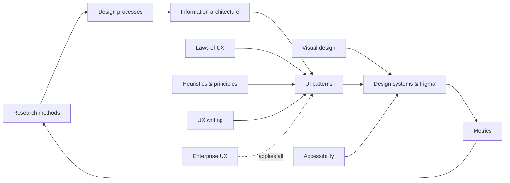

# 01 — UX & UI Design

> **TL;DR** — Reference library for user experience and interface design: the psychology (laws of UX), evaluation frameworks (heuristics, Norman, Rams), visual craft (Gestalt, typography, colour, spacing, motion, touch), accessibility (WCAG 2.2, ARIA, EAA, EN 301 549), research methods and metrics, design processes, information architecture, a UI pattern catalogue, enterprise/ERP-specific UX, design systems & Figma, UX writing and dark patterns, and a curated book/resource list.

## Files

| File | What's inside |
|------|---------------|
| [laws-of-ux.md](laws-of-ux.md) | 35 laws & principles (Fitts, Hick, Jakob, Miller, Tesler, Doherty, Postel, Peak–end, Von Restorff, Zeigarnik, Goal-gradient, cognitive load, flow, working memory…) with formulas, takeaways, examples and sources |
| [heuristics-and-principles.md](heuristics-and-principles.md) | Nielsen's 10 heuristics & heuristic evaluation, Shneiderman's 8 golden rules, Norman's principles (affordances, signifiers, mapping, gulfs, error types), Dieter Rams' 10 principles, ISO 9241-110, GOV.UK principles, review checklist |
| [visual-design.md](visual-design.md) | Gestalt, visual hierarchy, scanning patterns, typography (scales, 45–75ch, line-height), colour (OKLCH, contrast formula), 4/8pt spacing, grids, breakpoints, icons, elevation, motion (durations, easing), mobile & touch (44pt/48dp, thumb zone) |
| [accessibility.md](accessibility.md) | WCAG 2.2 POUR & levels, key success criteria with thresholds, rules of ARIA, APG widget patterns, keyboard & focus management, screen readers, testing, EAA 2025, EN 301 549, Web Accessibility Directive |
| [research-methods.md](research-methods.md) | NN/g research landscape, sample sizes, interviews, contextual inquiry, usability testing & the 5-user rule caveats, card sorting, tree testing, surveys, A/B tests, diary studies, JTBD, personas vs proto-personas, empathy maps, journey maps, service blueprints, affinity mapping |
| [design-processes.md](design-processes.md) | Double Diamond, Design Thinking (d.school, IBM), Lean UX, GV Design Sprint, Atomic Design, Hook model, Kano model (evaluation table & coefficients), ideation techniques, prototype fidelity, design in agile |
| [metrics.md](metrics.md) | Task success (adjusted Wald), time on task, errors, KLM, SUS (scoring formula, grades), UMUX-Lite, SEQ, NPS (and its critique), CSAT, CES, HEART + Goals-Signals-Metrics, enterprise metrics, statistics essentials |
| [information-architecture.md](information-architecture.md) | Organisation, labelling, navigation & search systems, LATCH, structures, breadth vs depth, navigation patterns, search UX, IA process, enterprise IA |
| [ui-patterns.md](ui-patterns.md) | Forms (layout, labels, validation timing, masks), tables & data grids, dashboards (Few, Tufte), empty/loading/error states, notifications, modals vs drawers, wizards, search, pagination vs infinite scroll, onboarding, progressive disclosure, undo vs confirm |
| [enterprise-ux.md](enterprise-ux.md) | Enterprise vs consumer UX, role archetypes, object pages, work queues, high-volume data entry, batch jobs, imports/exports, permissions, audit, effective dating, density, keyboard, legacy modernisation, enterprise design systems |
| [design-systems-and-figma.md](design-systems-and-figma.md) | Design system anatomy, Material 3 / Fluent 2 / Carbon / Polaris / GOV.UK / NL Design System, design tokens (tiers, DTCG format, pipeline), component specs, governance & contribution, Figma (auto layout, variables, components, Dev Mode, Code Connect), handoff & design QA |
| [ux-writing-and-dark-patterns.md](ux-writing-and-dark-patterns.md) | UX writing principles, voice & tone, microcopy patterns (buttons, errors, empty states), content design, dark pattern catalogue, EU legal landscape (GDPR, DSA Art. 25, UCPD), ethical checklist |
| [resources.md](resources.md) | Books by topic, websites, tools, courses, communities, reading paths |

## How the pieces fit

## Quick numbers cheat-sheet

| Topic | Number |
|-------|-------|
| Text contrast (WCAG AA) | 4.5:1 (large text 3:1); UI components 3:1 |
| Target size | WCAG 2.5.8 AA 24×24 CSS px; AAA 44×44; iOS 44pt; Android 48dp |
| Line length | 45–75 characters (~66 ideal) |
| Line-height (body) | 1.4–1.6 |
| Spacing grid | 4 / 8 pt |
| Response time | 0.1 s instant · 1 s flow · 10 s attention; Doherty < 400 ms; INP ≤ 200 ms |
| Motion | 100–500 ms; ease-out entering, ease-in exiting |
| Usability test | 5 users per group per iteration (~85% of common problems) |
| SUS average | 68 (50th percentile) |
| SEQ average | ~5.5 / 7 |
| Heuristic evaluation | 3–5 evaluators find ~75% of issues |
| Reflow | Works at 320 CSS px width (400% zoom) |
| Text resize | 200% without loss |
| EAA applies from | 28 June 2025 |

## Related sections

- [02 — Product management](../02-product-management/README.md)
- [03 — Project management](../03-project-management/README.md)
- [04 — Agile, Kanban, Scrum](../04-agile-kanban-scrum/README.md)
- [05 — Software architecture](../05-software-architecture/README.md)
- [06 — Cloud architecture](../06-cloud-architecture/README.md)
- [07 — Data & AI architecture](../07-data-ai-architecture/README.md)
- [08 — Engineering](../08-engineering/README.md)
- [09 — Leadership, teams & facilitation](../09-leadership-teams-facilitation/README.md)
- [10 — Laws, principles & mental models](../10-laws-principles-mental-models/README.md)
- [11 — Enterprise architecture & business](../11-enterprise-architecture-business/README.md)

## References

- Nielsen Norman Group: <https://www.nngroup.com/>
- Laws of UX: <https://lawsofux.com/>
- W3C Web Accessibility Initiative: <https://www.w3.org/WAI/>
- GOV.UK Design System: <https://design-system.service.gov.uk/>
- Interaction Design Foundation: <https://www.interaction-design.org/>
