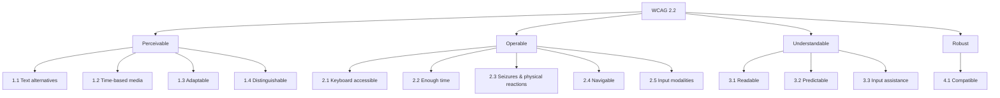

# Accessibility (a11y)

> **TL;DR** — Target **WCAG 2.2 Level AA** (W3C Recommendation, 5 Oct 2023; ISO/IEC 40500 covers 2.0). It is organised by POUR (Perceivable, Operable, Understandable, Robust), 4 principles → 13 guidelines → 86 success criteria (2.2; 4.1.1 Parsing was removed). EU law: the **European Accessibility Act** (Directive (EU) 2019/882) applies from **28 June 2025** to many private-sector products/services; public sector is covered by the **Web Accessibility Directive** (EU 2016/2102). The harmonised standard is **EN 301 549** (v3.2.1, 2021 → references WCAG 2.1 AA; v4 aligning to WCAG 2.2 in progress). Use semantic HTML first; the first rule of ARIA is *don't use ARIA if a native element does the job*. Automated tools catch only ~30–40% of issues — test with keyboard and screen readers.

Related: [Visual design (contrast, targets)](visual-design.md) · [UI patterns](ui-patterns.md) · [Design systems](design-systems-and-figma.md) · [Engineering](../08-engineering/README.md)

---

## 1. Why and who

- WHO (2023): ~1.3 billion people (16%) experience significant disability. Plus situational and temporary impairments (Microsoft Inclusive Design "persona spectrum": one arm permanent / broken arm temporary / new parent holding baby situational).
- Disability categories: visual (blind, low vision, colour vision deficiency), auditory, motor/physical (tremor, limited dexterity, switch users), cognitive/learning/neurological (dyslexia, ADHD, memory, autism), speech, seizure/vestibular.
- Assistive technologies: screen readers (JAWS, NVDA, VoiceOver, TalkBack, Narrator), screen magnifiers (ZoomText, OS zoom), voice control (Dragon, Voice Control, Voice Access), switch access, alternative keyboards, braille displays, high contrast / forced colours mode, browser zoom & text-spacing overrides.
- Curb-cut effect: accessibility features benefit everyone (captions in noisy places, keyboard shortcuts for power users, clear language for non-native speakers).

---

## 2. WCAG structure



| Version | Published | Notes |
|---------|----------|-------|
| WCAG 1.0 | May 1999 | 14 guidelines, checkpoints P1–P3 |
| WCAG 2.0 | Dec 2008 | POUR, technology-agnostic; ISO/IEC 40500:2012 |
| WCAG 2.1 | June 2018 | +17 SC (mobile, low vision, cognitive): reflow, non-text contrast, text spacing, orientation, etc. |
| WCAG 2.2 | Oct 2023 (updated Dec 2024) | +9 SC (focus not obscured, target size, dragging, accessible authentication, redundant entry, consistent help); 4.1.1 Parsing obsolete |
| WCAG 3.0 | Working Draft | New model (outcomes, Bronze/Silver/Gold), not before late 2020s |

**Conformance levels:**
- **A** — minimum; failures block access entirely for some users.
- **AA** — the legal/industry target (EN 301 549, Section 508 refresh via WCAG 2.0 AA, ADA case law, Dutch "Digitoegankelijk" for government).
- **AAA** — not recommended as a blanket requirement for whole sites (W3C itself says some content can't satisfy all AAA), but adopt individual AAA criteria where feasible.

Conformance requirements: full pages, complete processes, accessibility-supported ways of using technologies, non-interference.

---

## 3. Key success criteria (with numbers)

Level in brackets. **New in 2.2** marked ★; **new in 2.1** marked ◆.

### Perceivable

| SC | Name | Requirement (paraphrased) | Practical |
|----|------|---------------------------|----------|
| 1.1.1 (A) | Non-text Content | Text alternative for non-text content | `alt` on informative images; `alt=""` for decorative; label icon buttons |
| 1.2.2 (A) | Captions (Prerecorded) | Captions for recorded video with audio | |
| 1.2.5 (AA) | Audio Description | For prerecorded video | |
| 1.3.1 (A) | Info and Relationships | Structure conveyed visually is programmatically determinable | Real headings, lists, `<table>` with `<th scope>`, `<label for>`, fieldset/legend |
| 1.3.2 (A) | Meaningful Sequence | DOM order matches reading order | Don't reorder with CSS only |
| 1.3.3 (A) | Sensory Characteristics | Instructions don't rely solely on shape, colour, position, sound | Not "click the green button on the right" |
| 1.3.4 (AA) ◆ | Orientation | Don't lock portrait/landscape unless essential | |
| 1.3.5 (AA) ◆ | Identify Input Purpose | Use `autocomplete` tokens for user data fields | `autocomplete="given-name"`, `email`, `postal-code`, `tel` |
| 1.4.1 (A) | Use of Color | Colour not the only visual means | Error = red + icon + text; links underlined in body text |
| 1.4.2 (A) | Audio Control | Auto-playing audio > 3 s can be paused | |
| 1.4.3 (AA) | **Contrast (Minimum)** | Text **4.5:1**; large text (≥ 18pt / 24px, or 14pt / ~18.66px bold) **3:1** | |
| 1.4.4 (AA) | Resize Text | Text resizable to **200%** without loss of content/function | Use rem; no fixed-height text containers |
| 1.4.5 (AA) | Images of Text | Use real text | |
| 1.4.6 (AAA) | Contrast (Enhanced) | 7:1 / 4.5:1 large | |
| 1.4.10 (AA) ◆ | **Reflow** | No 2D scrolling at **320 CSS px** width (vertical content) / 256px height (horizontal) — equals 1280px at 400% zoom | Exception: data tables, maps, diagrams, toolbars that need 2D |
| 1.4.11 (AA) ◆ | **Non-text Contrast** | UI components and meaningful graphics **3:1** against adjacent colours | Input borders, focus rings, checkbox outlines, chart lines, icons |
| 1.4.12 (AA) ◆ | **Text Spacing** | No loss of content when user sets line-height **1.5**, paragraph spacing **2×**, letter-spacing **0.12×**, word-spacing **0.16×** font size | Avoid fixed heights, `overflow: hidden` on text |
| 1.4.13 (AA) ◆ | Content on Hover or Focus | Tooltips/popovers: **dismissible** (Esc), **hoverable** (pointer can move onto them), **persistent** | |

### Operable

| SC | Name | Requirement | Practical |
|----|------|------------|----------|
| 2.1.1 (A) | **Keyboard** | All functionality operable via keyboard | Custom widgets need key handlers; no `div onclick` |
| 2.1.2 (A) | No Keyboard Trap | Focus can always move away | Modals trap *intentionally* but must close with Esc |
| 2.1.4 (A) ◆ | Character Key Shortcuts | Single-key shortcuts can be turned off/remapped or only active on focus | Gmail-style shortcuts conflict with voice control |
| 2.2.1 (A) | Timing Adjustable | Time limits can be turned off, adjusted (≥ 10×) or extended (warn ≥ **20 s** before, simple action to extend, at least 10 times) | Session timeouts in HR/banking portals |
| 2.2.2 (A) | Pause, Stop, Hide | Moving/blinking/scrolling content starting automatically and lasting > **5 s** can be paused | Carousels, tickers |
| 2.3.1 (A) | Three Flashes or Below Threshold | No more than **3 flashes per second** | |
| 2.4.1 (A) | Bypass Blocks | Skip link / landmarks | `<a href="#main">Skip to content</a>`, `<main>`, `<nav>` |
| 2.4.2 (A) | Page Titled | Descriptive `<title>`; update on SPA route change | "Leave requests – HR Portal" |
| 2.4.3 (A) | Focus Order | Logical focus order | Avoid positive `tabindex` |
| 2.4.4 (A) | Link Purpose (In Context) | Purpose clear from text/context | Avoid lone "click here"/"more" |
| 2.4.6 (AA) | Headings and Labels | Descriptive | |
| 2.4.7 (AA) | **Focus Visible** | Keyboard focus indicator visible | Never `outline: none` without replacement; use `:focus-visible` |
| 2.4.11 (AA) ★ | **Focus Not Obscured (Minimum)** | Focused element not *entirely* hidden by author content (sticky headers/footers, cookie banners) | `scroll-padding-top` for sticky headers |
| 2.4.12 (AAA) ★ | Focus Not Obscured (Enhanced) | No part hidden | |
| 2.4.13 (AAA) ★ | Focus Appearance | Indicator ≥ area of a **2 CSS px** perimeter, **3:1** contrast change | Good target for design systems even though AAA |
| 2.5.1 (A) ◆ | Pointer Gestures | Multipoint/path gestures have single-pointer alternative | Pinch-zoom map also has +/- buttons |
| 2.5.2 (A) ◆ | Pointer Cancellation | Activate on up-event; allow abort | Use `click`, not `mousedown` |
| 2.5.3 (A) ◆ | **Label in Name** | Accessible name contains the visible label text (start with it) | Visible "Send" → `aria-label` must include "Send" (voice control users say what they see) |
| 2.5.4 (A) ◆ | Motion Actuation | Shake/tilt has UI alternative and can be disabled | |
| 2.5.7 (AA) ★ | **Dragging Movements** | Any drag operation has a single-pointer alternative | Kanban drag + "Move to…" menu; sortable list + up/down buttons |
| 2.5.8 (AA) ★ | **Target Size (Minimum)** | Targets ≥ **24 × 24 CSS px**, or spaced so a 24px-diameter circle centred on each doesn't intersect another target/circle | Exceptions: inline text links, equivalent control elsewhere, UA-controlled, essential |
| 2.5.5 (AAA) ◆ | Target Size (Enhanced) | **44 × 44 CSS px** | |

### Understandable

| SC | Name | Requirement | Practical |
|----|------|------------|----------|
| 3.1.1 (A) | Language of Page | `<html lang="nl">` | |
| 3.1.2 (AA) | Language of Parts | `lang` on foreign-language passages | |
| 3.2.1 (A) | On Focus | No context change on focus | |
| 3.2.2 (A) | On Input | No unexpected context change on input | Don't auto-submit on select change without warning |
| 3.2.3 (AA) | Consistent Navigation | Same order across pages | |
| 3.2.4 (AA) | Consistent Identification | Same function = same label | |
| 3.2.6 (A) ★ | **Consistent Help** | Help mechanisms (contact, chat, FAQ link) in the same relative order across pages | |
| 3.3.1 (A) | Error Identification | Error identified and described in text | |
| 3.3.2 (A) | Labels or Instructions | Provide labels/instructions | Required-field indication, format hints |
| 3.3.3 (AA) | Error Suggestion | Suggest correction when known | |
| 3.3.4 (AA) | Error Prevention (Legal, Financial, Data) | Reversible, checked, or confirmed | Review step before submitting contracts, payments |
| 3.3.7 (A) ★ | **Redundant Entry** | Don't ask for the same info twice in a process — auto-populate or allow selection | "Billing address same as delivery" |
| 3.3.8 (AA) ★ | **Accessible Authentication (Minimum)** | No cognitive function test (remembering password, solving puzzle, transcribing) unless alternative, mechanism to assist (allow paste & password managers), object recognition, or personal content | Don't block paste in password/OTP fields; support passkeys/WebAuthn, magic links |
| 3.3.9 (AAA) ★ | Accessible Authentication (Enhanced) | No object-recognition exception | |

### Robust

| SC | Name | Requirement |
|----|------|------------|
| 4.1.1 | Parsing | **Obsolete / removed in 2.2** (always satisfied for HTML) |
| 4.1.2 (A) | **Name, Role, Value** | All UI components have programmatically determinable name, role, states, values; changes notified |
| 4.1.3 (AA) ◆ | **Status Messages** | Status messages announced without receiving focus | `role="status"` / `aria-live="polite"` for "12 results", "Saved"; `role="alert"` for errors |

Full list: <https://www.w3.org/WAI/WCAG22/quickref/> · What's new in 2.2: <https://www.w3.org/WAI/standards-guidelines/wcag/new-in-22/>

---

## 4. ARIA

WAI-ARIA 1.2 (W3C Rec, June 2023); 1.3 in draft. ARIA changes *semantics exposed to the accessibility tree only* — not behaviour, not styling.

### 4.1 The five rules of ARIA use (W3C "Using ARIA")

1. **If you can use a native HTML element or attribute with the semantics and behaviour you require, do so** instead of repurposing an element and adding ARIA. ("No ARIA is better than bad ARIA" — WebAIM Million finds pages with ARIA average *more* detected errors.)
2. Do not change native semantics unless you really have to (no `<h2 role="tab">`; wrap instead).
3. All interactive ARIA controls must be keyboard operable.
4. Do not use `role="presentation"` or `aria-hidden="true"` on a focusable element.
5. All interactive elements must have an accessible name.

### 4.2 Core concepts

| Concept | Examples |
|---------|---------|
| **Roles** — landmark | `banner` (`<header>`), `navigation` (`<nav>`), `main`, `complementary` (`<aside>`), `contentinfo` (`<footer>`), `search` (`<search>`), `form`, `region` (needs a name) |
| Roles — widget | `button`, `checkbox`, `switch`, `tab`/`tablist`/`tabpanel`, `menu`/`menuitem`, `combobox`, `listbox`/`option`, `grid`/`row`/`gridcell`, `treegrid`, `dialog`/`alertdialog`, `slider`, `tooltip` |
| Roles — live region | `alert`, `status`, `log`, `marquee`, `timer` |
| **States** | `aria-expanded`, `aria-selected`, `aria-checked`, `aria-pressed`, `aria-disabled`, `aria-invalid`, `aria-current="page"`, `aria-busy` |
| **Properties** | `aria-label`, `aria-labelledby`, `aria-describedby`, `aria-controls`, `aria-haspopup`, `aria-required`, `aria-live`, `aria-modal`, `aria-sort`, `aria-rowcount`/`aria-rowindex` (virtualised grids), `aria-errormessage` |

**Accessible name computation priority** (accname spec): `aria-labelledby` → `aria-label` → native label (`<label>`, `alt`, `<caption>`, `<legend>`) → contents (for roles allowing name from content) → `title` / `placeholder` (last resort, unreliable).

### 4.3 Common widget patterns (ARIA Authoring Practices Guide — APG)

| Widget | Native first? | Key keyboard behaviour |
|--------|--------------|------------------------|
| Button | `<button>` | Enter, Space |
| Link | `<a href>` | Enter |
| Disclosure (show/hide) | `<details>/<summary>` or button + `aria-expanded` | Enter/Space toggles |
| Dialog (modal) | `<dialog>` + `showModal()` | Focus moves in; Tab cycles inside; Esc closes; focus returns to trigger |
| Tabs | — | Arrow keys move between tabs (roving tabindex); Tab moves into panel; Home/End |
| Menu / menubar | Usually *not needed* — use disclosure nav for site navigation | Arrows, Esc, typeahead |
| Combobox / autocomplete | `<input list>` limited; custom | Down opens list; arrows; Enter selects; Esc closes; `aria-activedescendant` |
| Listbox | `<select>` | Arrows, typeahead, Shift+arrows for multi-select |
| Grid (data grid) | `<table>` if not interactive | Arrow keys between cells, Home/End, Ctrl+Home, PageUp/Down; Enter/F2 to edit |
| Tree view | — | Up/Down, Right expands, Left collapses |
| Accordion | buttons in headings + `aria-expanded` | Enter/Space; optional arrows |
| Tooltip | — | Shows on focus & hover; Esc dismisses; never put interactive content in tooltip |
| Toast/notification | `role="status"` region | Don't steal focus; must not disappear too fast if it contains actions (2.2.1) |
| Switch | `<input type="checkbox" role="switch">` | Space |
| Slider | `<input type="range">` | Arrows, PageUp/Down, Home/End |

Source: <https://www.w3.org/WAI/ARIA/apg/>

---

## 5. Keyboard & focus management

### 5.1 Keyboard expectations

| Key | Expected behaviour |
|-----|-------------------|
| Tab / Shift+Tab | Move between interactive components |
| Enter | Activate link/button, submit form |
| Space | Activate button, toggle checkbox, scroll page |
| Arrow keys | Move within composite widgets (radio group, tabs, menu, grid, listbox) |
| Esc | Close dialog/menu/popover, cancel |
| Home/End | First/last item in widget |

**Roving tabindex:** in composite widgets, only one item has `tabindex="0"`, others `-1`; arrows move focus. Alternative: `aria-activedescendant`.
`tabindex` values: `0` = in natural order; `-1` = programmatically focusable only; positive values = **avoid**.

### 5.2 Focus management rules

- **Visible focus** always (`:focus-visible { outline: 2px solid var(--focus); outline-offset: 2px; }`), with ≥ 3:1 contrast against adjacent colours; consider a two-tone ring (dark + light) to work on any background.
- **Opening a modal:** move focus to the dialog (first focusable, or the dialog heading/container with `tabindex="-1"`), trap focus inside (native `<dialog>` + `inert` on background), Esc closes, **return focus to the trigger** on close.
- **SPA route changes:** move focus to the new page's `<h1>` (or a wrapper) and update `document.title`; or announce via live region. Frameworks don't do this by default (except some routers, e.g. Gatsby/Reach Router historically).
- **Deleting an item:** move focus to the next/previous item or the list heading, not `<body>`.
- **Inline expansion / lazy loading:** keep focus in place; announce new content count.
- **Form submit with errors:** move focus to an error summary at the top (GOV.UK pattern) with links to each field, or to the first invalid field.
- **Skip links** as first focusable element.
- Never remove an element that has focus without moving focus first.
- Avoid focus traps in custom widgets and embedded iframes.

### 5.3 Screen readers

| Screen reader | Platform | Browser pairing | Share (WebAIM survey #10, 2024) |
|---------------|---------|-----------------|------------------------------|
| JAWS (Freedom Scientific / Vispero) | Windows | Chrome, Edge | ~41% primary |
| NVDA (NV Access, free) | Windows | Firefox, Chrome | ~38% |
| VoiceOver | macOS / iOS / iPadOS | Safari | ~10% desktop; dominant on mobile |
| TalkBack | Android | Chrome | |
| Narrator | Windows | Edge | small |

Modes: **browse/virtual mode** (arrow through content, H for headings, D/R landmarks, T tables, F form fields, K links; insert+F7 / rotor elements list) vs **focus/forms mode** (keys pass to the widget). Users navigate by headings first (WebAIM: ~70% use headings to find information).

Basic test (VoiceOver: Cmd+F5; NVDA: Ctrl+Alt+N): navigate by headings, landmarks, tab through forms, check every control announces name + role + state, check dynamic updates are announced.

Source: <https://webaim.org/projects/screenreadersurvey10/>

---

## 6. Accessible design checklist (designer-owned)

- [ ] Colour contrast: text 4.5:1, large text & UI components 3:1 (check hover, focus, disabled-looking-but-enabled, placeholder)
- [ ] Information not conveyed by colour alone (status chips with icon/text; links underlined)
- [ ] Visible labels for every input (no placeholder-only labels); required indicated in text, not only `*` colour
- [ ] Focus states designed for every interactive component
- [ ] Logical reading/focus order annotated (Figma annotation kits: e.g. Indeed's, CVS Health, Microsoft's)
- [ ] Heading structure annotated (one `h1`, no skipped levels for structure)
- [ ] Landmarks annotated (header, nav, main, aside, footer)
- [ ] Alt text written for informative images; decorative marked
- [ ] Touch/click targets ≥ 24px (aim 44px on touch)
- [ ] Error messages: text, specific, linked to field; error summary for long forms
- [ ] Layout reflows at 320px and works with 200% text and text-spacing overrides
- [ ] Motion: reduced-motion alternative; nothing flashes > 3/s
- [ ] Drag-and-drop has a non-drag alternative
- [ ] Session timeouts warned and extendable
- [ ] Plain language (B1 level in NL government guidance "Taalniveau B1")
- [ ] Consistent help location
- [ ] Authentication supports password managers/paste; no CAPTCHAs without alternative

## 7. Developer checklist

- [ ] Semantic HTML: `<button>`, `<a href>`, `<label for>`, `<fieldset><legend>`, `<table><caption><th scope>`, landmarks, `<ul>` lists
- [ ] `lang` attribute; unique, descriptive `<title>` per route
- [ ] Accessible names for icon buttons (`aria-label` or visually hidden text)
- [ ] `aria-describedby` linking hints and errors to inputs; `aria-invalid="true"` on invalid fields
- [ ] Live regions present in DOM *before* content changes
- [ ] Focus management for dialogs, routes, deletions
- [ ] Respect `prefers-reduced-motion`, `prefers-contrast`, `forced-colors` (Windows High Contrast: don't rely on background-colour only; use `outline`/`border`, test with `forced-colors: active`)
- [ ] `autocomplete` attributes on personal data fields
- [ ] Don't disable zoom (`user-scalable=no`, `maximum-scale=1`)
- [ ] Virtualised tables: `aria-rowcount`/`aria-rowindex`
- [ ] Automated tests: axe-core (jest-axe, @axe-core/playwright, Storybook a11y addon), eslint-plugin-jsx-a11y / eslint-plugin-vuejs-accessibility, Lighthouse, Pa11y; plus manual testing

Visually hidden utility:

```css
.visually-hidden {
  position: absolute !important; width: 1px; height: 1px; padding: 0; margin: -1px;
  overflow: hidden; clip: rect(0 0 0 0); clip-path: inset(50%); white-space: nowrap; border: 0;
}
```

---

## 8. Testing approach

| Layer | Method | Catches |
|-------|--------|---------|
| Automated | axe DevTools, WAVE, Lighthouse, Accessibility Insights (FastPass) | ~30–57% of issues (Deque claims ~57% by volume; GOV.UK audit of tools found ~30–40% of seeded issues) — contrast, missing alt/labels, ARIA misuse |
| Manual keyboard | Tab through every flow | Focus order, traps, visibility, operability |
| Screen reader | NVDA+Firefox/Chrome, VoiceOver+Safari, TalkBack | Names, roles, announcements, reading order |
| Zoom/reflow | 200% text, 400% zoom, 320px, text-spacing bookmarklet | Overlap, clipping, 2D scroll |
| Forced colours | Windows High Contrast | Invisible controls/focus |
| Users with disabilities | Usability testing (e.g. via Fable, Access Works, local disability organisations) | Real-world barriers |
| Audit | Expert WCAG-EM evaluation (W3C methodology) | Conformance report / VPAT (ACR) |

Statements: EU public sector requires an **accessibility statement**; in NL via the "toegankelijkheidsverklaring" register (digitoegankelijk.nl) with status A–E. US/procurement: **VPAT** (Voluntary Product Accessibility Template, ITI) → ACR (Accessibility Conformance Report) — editions for Section 508, EN 301 549, WCAG, INT.

---

## 9. Legal landscape (EU focus)

| Instrument | Scope | Standard | Key dates |
|-----------|-------|---------|-----------|
| **Web Accessibility Directive** (EU) 2016/2102 | Public sector websites & apps | EN 301 549 (→ WCAG 2.1 AA) | New sites 2019, all sites Sept 2020, apps June 2021 |
| **European Accessibility Act (EAA)** — Directive (EU) 2019/882 | Private sector: computers & OS, ATMs/ticketing/check-in kiosks, smartphones, TV equipment, e-readers; services: e-commerce, banking (consumer), e-books, electronic communications, passenger transport (air, bus, rail, water) websites/apps/e-tickets, access to audiovisual media, emergency number 112 | EN 301 549 (presumption of conformity); harmonised standards in development | Transposition by 28 June 2022; **applies from 28 June 2025**; existing service contracts may continue until 28 June 2030; self-service terminals in use up to 20 years |
| EAA exemptions | **Microenterprises** (< 10 staff and ≤ €2M turnover/balance) providing *services* exempt; disproportionate burden & fundamental alteration exceptions (must be documented) | | |
| NL transposition | *Implementatiewet toegankelijkheidsvoorschriften producten en diensten* (+ Besluit digitale toegankelijkheid overheid for government) | | Supervision by e.g. ACM / AFM / ILT depending on sector |
| **EN 301 549** (ETSI/CEN/CENELEC) | ICT products & services — clause 9 Web (= WCAG), 10 non-web documents, 11 software, 12 docs & support, plus hardware, two-way voice, video | v3.2.1 (2021-03) references WCAG 2.1 AA; v4.1.1 (WCAG 2.2) in progress | |
| US — ADA Title II/III, Section 508 (Revised 2017 → WCAG 2.0 AA), DOJ rule 2024 for state/local government → WCAG 2.1 AA (2026/2027) | | | |
| UK — Public Sector Bodies Accessibility Regulations 2018, Equality Act 2010 | | WCAG 2.2 AA (from Oct 2024 for monitoring) | |

Note: EAA is a *directive* — each member state's national law has its own penalties and enforcement. Internal-only employee tools are not in EAA scope per se, but employment equality law (Directive 2000/78/EC reasonable accommodation) and procurement rules (public procurement directive 2014/24/EU requires accessibility in technical specifications) often mandate EN 301 549 anyway — relevant for HR/ERP systems sold to government.

---

## 10. Inclusive & cognitive accessibility

- W3C COGA "Making Content Usable for People with Cognitive and Learning Disabilities" (2021): 8 objectives — help users understand what things are and how to use them; help users find what they need; use clear and understandable content; help users avoid mistakes and know how to correct them; help users focus; ensure processes do not rely on memory; provide help and support; support adaptation and personalisation.
- Plain language: short sentences (≤ 15–20 words), common words, active voice; NL government targets **B1**; EU/CEFR levels A1–C2.
- Microsoft Inclusive Design principles: recognise exclusion; solve for one, extend to many; learn from diversity.
- Dyslexia-friendly: ≥ 16px, left-aligned, avoid italics/underline for emphasis (use bold), off-white backgrounds can help.

Sources: <https://www.w3.org/TR/coga-usable/> · <https://inclusive.microsoft.design/>

---

## Common mistakes

- `div`/`span` buttons with click handlers (no keyboard, no role).
- `outline: none` without replacement.
- Placeholder as label; floating labels with low contrast.
- `aria-label` that differs from the visible label (2.5.3).
- Adding `role="menu"` to site navigation (forces application-menu keyboard model).
- Toasts that disappear in 3 s with an "Undo" action screen-reader users can't reach.
- Infinite scroll making footer unreachable by keyboard.
- Custom select/combobox libraries without keyboard support — prefer well-tested libraries (React Aria, Radix UI, Headless UI, Reach, Vue: Headless UI/Reka UI, PrimeVue with a11y).
- Accessibility overlays/widgets (e.g. toolbar plug-ins) as a compliance shortcut — rejected by the community (Overlay Fact Sheet) and don't produce conformance.
- Testing only with automated tools.

## References

- WCAG 2.2: <https://www.w3.org/TR/WCAG22/>
- WCAG overview: <https://www.w3.org/WAI/standards-guidelines/wcag/>
- How to Meet WCAG (Quick Reference): <https://www.w3.org/WAI/WCAG22/quickref/>
- What's new in WCAG 2.2: <https://www.w3.org/WAI/standards-guidelines/wcag/new-in-22/>
- Understanding 2.5.8 Target Size (Minimum): <https://www.w3.org/WAI/WCAG22/Understanding/target-size-minimum.html>
- Using ARIA (rules of ARIA): <https://www.w3.org/TR/using-aria/>
- WAI-ARIA 1.2: <https://www.w3.org/TR/wai-aria-1.2/>
- ARIA Authoring Practices Guide: <https://www.w3.org/WAI/ARIA/apg/>
- WCAG-EM evaluation methodology: <https://www.w3.org/WAI/test-evaluate/conformance/wcag-em/>
- COGA: <https://www.w3.org/TR/coga-usable/>
- European Accessibility Act (Wikipedia): <https://en.wikipedia.org/wiki/European_Accessibility_Act>
- EAA — European Commission: <https://ec.europa.eu/social/main.jsp?catId=1202>
- Directive (EU) 2019/882 (EUR-Lex): <https://eur-lex.europa.eu/eli/dir/2019/882/oj>
- Web Accessibility Directive: <https://digital-strategy.ec.europa.eu/en/policies/web-accessibility>
- EN 301 549 (ETSI): <https://en.wikipedia.org/wiki/EN_301_549>
- Digitoegankelijk (NL government): <https://www.digitoegankelijk.nl/>
- WebAIM: <https://webaim.org/> · Screen reader survey: <https://webaim.org/projects/screenreadersurvey10/> · WebAIM Million: <https://webaim.org/projects/million/>
- The A11Y Project checklist: <https://www.a11yproject.com/checklist/>
- Inclusive Components (Heydon Pickering): <https://inclusive-components.design/>
- GOV.UK Design System accessibility: <https://design-system.service.gov.uk/accessibility/>
- axe-core: <https://github.com/dequelabs/axe-core>
- React Aria: <https://react-spectrum.adobe.com/react-aria/>
- Microsoft Inclusive Design: <https://inclusive.microsoft.design/>
- Overlay Fact Sheet: <https://overlayfactsheet.com/>
