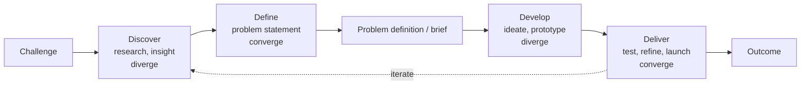
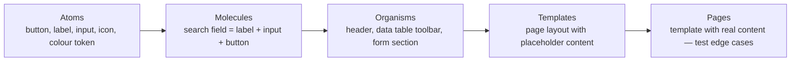
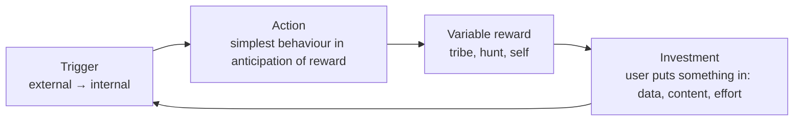
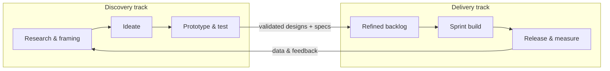

# Design Processes & Frameworks

> **TL;DR** — All good design processes alternate between **diverging** (explore many options) and **converging** (decide), and between **problem space** and **solution space**. Double Diamond (UK Design Council, 2005) is the canonical map; Design Thinking (IDEO / Stanford d.school) is the same idea with five modes; Lean UX (Gothelf & Seiden) brings it into agile delivery as hypothesis → MVP → learn; GV's Design Sprint compresses it into five days; Atomic Design (Brad Frost) structures UI construction; the Hook model (Nir Eyal) explains habit formation; the Kano model (Noriaki Kano, 1984) classifies features by their effect on satisfaction.

Related: [Research methods](research-methods.md) · [Design systems](design-systems-and-figma.md) · [Product management](../02-product-management/README.md) · [Agile / Scrum](../04-agile-kanban-scrum/README.md) · [Facilitation](../09-leadership-teams-facilitation/README.md)

---

## 1. Double Diamond

- **Origin:** UK Design Council, 2005 (study of design processes at 11 companies incl. Microsoft, Sony, LEGO, Starbucks). Revised 2019 as the **Framework for Innovation** (adds design principles, methods bank, engagement, leadership).
- **Four phases:** Discover (diverge) → Define (converge) → Develop (diverge) → Deliver (converge).

| Phase | Activities | Outputs |
|-------|-----------|---------|
| Discover | Interviews, contextual inquiry, desk research, data analysis, stakeholder mapping | Raw insights |
| Define | Affinity mapping, personas, journey maps, HMW, problem statement, prioritisation | Design brief, problem statement, success metrics |
| Develop | Ideation (crazy 8s, sketching), co-creation, prototyping, concept testing | Tested concepts |
| Deliver | Usability testing, refinement, specs, build, launch, measure | Released solution, learnings |

**Design Council principles (2019):** put people first; communicate visually and inclusively; collaborate and co-create; iterate, iterate, iterate.

**Pitfalls:** treated as linear waterfall; skipping Discover because "we know the problem"; "Triple Diamond" variants add a delivery/implementation diamond.

Source: <https://www.designcouncil.org.uk/our-resources/the-double-diamond/>

---

## 2. Design Thinking

- **Roots:** Herbert Simon, *The Sciences of the Artificial* (1969); Bryan Lawson; Nigel Cross "designerly ways of knowing" (1982); Rolf Faste & David Kelley at Stanford; IDEO (founded 1991); Stanford **d.school** (Hasso Plattner Institute of Design, 2004); Tim Brown, *Change by Design* (2009).
- **d.school five modes:**

| Mode | Purpose | Methods |
|------|---------|---------|
| **Empathize** | Understand people | Interviews, observation, immersion |
| **Define** | Frame a meaningful, actionable problem | POV statement: `[User] needs [need] because [insight]`; HMW questions |
| **Ideate** | Generate many ideas | Brainstorm (defer judgement, go for quantity, build on others), SCAMPER, crazy 8s, worst-possible-idea |
| **Prototype** | Make ideas tangible fast | Paper, clickable Figma, role-play, Wizard of Oz |
| **Test** | Learn from users | Usability tests, feedback grids |

- Non-linear: modes are revisited. Desirability (human) × Feasibility (technology) × Viability (business) — IDEO's three lenses.
- **IBM Enterprise Design Thinking:** "The Loop" (Observe → Reflect → Make), "Hills" (aligned outcomes: Who + What + Wow), "Playbacks", "Sponsor users". Very relevant to enterprise software.
- **Critique:** "design thinking theatre" (sticky-note workshops without follow-through, Natasha Jen's 2017 talk "Design Thinking is Bullsh*t"), underestimates craft and implementation.

Sources: <https://dschool.stanford.edu/> · <https://www.ideou.com/pages/design-thinking> · <https://www.ibm.com/design/thinking/> · <https://www.nngroup.com/articles/design-thinking/>

---

## 3. Lean UX

- **Source:** Jeff Gothelf & Josh Seiden, *Lean UX* (2013; 3rd ed. 2021). Builds on Lean Startup (Eric Ries, 2011: Build–Measure–Learn), agile, and design thinking.
- **Core idea:** outcomes over outputs; treat designs as hypotheses; reduce waste (heavy deliverables); collaborate cross-functionally.

**Lean UX Canvas (v2):**
1. Business problem
2. Business outcomes (metrics)
3. Users
4. User outcomes & benefits
5. Solutions
6. Hypotheses
7. What's the most important thing we need to learn first?
8. What's the least amount of work to learn it? (MVP/experiment)

**Hypothesis statement:**

> We believe that **[business outcome]** will be achieved if **[user]** attains **[user outcome]** with **[feature]**.

Or: *We believe [this capability] will result in [this outcome]. We will know we have succeeded when we see [this measurable signal].*

**Principles (selection):** cross-functional teams, small dedicated colocated teams, progress = outcomes, problem-focused teams, removing waste, small batch size, continuous discovery, GOOB ("get out of the building", Steve Blank), shared understanding, anti-pattern: rockstars/gurus/ninjas, externalising work, making over analysis, learning over growth, permission to fail.

**MVP types:** landing page/fake door, concierge, Wizard of Oz, clickable prototype, single-feature MVP, piecemeal (off-the-shelf tools stitched).

Sources: <https://jeffgothelf.com/> · <https://en.wikipedia.org/wiki/Lean_startup>

---

## 4. Design Sprint (GV)

- **Source:** Jake Knapp at Google Ventures (GV), ~2010; book *Sprint* (Knapp, Zeratsky, Kowitz, 2016). **Design Sprint 2.0** (AJ&Smart, 2017) compresses to 4 days.
- **Team:** Decider + Facilitator + 5–7 people (finance, marketing, customer expert, tech, design).

| Day | Name | Activities |
|-----|------|-----------|
| Mon | **Map** | Long-term goal, sprint questions, map the challenge, ask the experts (HMW notes), pick a target |
| Tue | **Sketch** | Lightning demos, 4-step sketch (notes → ideas → crazy 8s → solution sketch) |
| Wed | **Decide** | Art museum, heat map voting, speed critique, straw poll, Decider supervote, storyboard |
| Thu | **Prototype** | Realistic façade prototype ("Goldilocks quality"), assign roles (makers, stitcher, writer, asset collector, interviewer) |
| Fri | **Test** | 5 one-on-one customer interviews, team watches and notes patterns |

**When to use:** high-stakes, ambiguous problems with a team that can commit; kick-starting a new product/feature; breaking stalemates. **When not:** problems already well understood (just build), small fixes, when the Decider can't attend, problems requiring long-term research.

Variants: Design Sprint 2.0 (4 days), Google's Design Sprint Kit, Foundation Sprint (Knapp & Zeratsky, *Click*, 2025).

Sources: <https://www.gv.com/sprint/> · <https://www.thesprintbook.com/>

---

## 5. Atomic Design

- **Source:** Brad Frost, blog post 2013, book *Atomic Design* (2016, free online).
- Methodology for building design systems as a hierarchy:

| Level | Description | Examples (ERP) |
|-------|------------|----------------|
| Atoms | Basic HTML elements & tokens; not useful alone | Button, input, checkbox, badge, icon |
| Molecules | Simple groups functioning as a unit | Form field (label + input + hint + error), search box, pagination control |
| Organisms | Complex sections | Data grid with toolbar, filter panel, page header with breadcrumbs & actions |
| Templates | Page-level structure | List–detail template, dashboard template, wizard template |
| Pages | Specific instances with real data | "Employee 1043 — Contract tab" |

- **Benefits:** shared vocabulary, reuse, modularity, matches component-based frameworks (React/Vue).
- **Criticism/practice:** many teams drop the chemistry metaphor (debates over molecule vs organism waste time) and use *foundations / components / patterns / templates* (e.g. GOV.UK: styles, components, patterns). Atomic Design is a *mental model*, not a folder structure mandate.
- Related: **tokens** as "sub-atomic" level; Pattern Lab tool; Storybook.

Source: <https://atomicdesign.bradfrost.com/>

---

## 6. Hook Model

- **Source:** Nir Eyal, *Hooked: How to Build Habit-Forming Products* (2014). Builds on BJ Fogg's Behavior Model.
- **Four phases:**

| Phase | Description | Example |
|-------|------------|---------|
| Trigger | External (notification, email) → internal (emotion: boredom, uncertainty, FOMO) | "You have 3 approvals waiting" |
| Action | Behaviour done in anticipation of reward; requires motivation + ability + trigger (Fogg: **B = MAP**) | Open app, scroll |
| Variable reward | Rewards of the **tribe** (social), **hunt** (resources/information), **self** (mastery, completion) | Feed content, likes, inbox zero |
| Investment | Stored value increases likelihood of return: data, followers, reputation, skill, content | Saved views, configured dashboards |

- **Manipulation Matrix** (Eyal's ethics check): Does the maker use it themselves? Does it materially improve users' lives? → Facilitator (both yes), Peddler (improves but maker doesn't use), Entertainer (uses but doesn't improve), Dealer (neither).
- **Critique:** basis of attention-economy dark patterns; Eyal's later book *Indistractable* (2019). In enterprise tools, habit formation is mostly irrelevant — users *must* use the tool; focus on efficiency, not engagement. Avoid engagement metrics as success measures for productivity software.

Sources: <https://www.nirandfar.com/how-to-manufacture-desire/> · <https://behaviormodel.org/>

---

## 7. Kano Model

- **Source:** Noriaki Kano et al., 1984 ("Attractive quality and must-be quality"), building on Herzberg's two-factor theory.
- **Categories:**

| Category | When present | When absent | Example (HR portal) |
|----------|-------------|-------------|---------------------|
| **Must-be** (basic, threshold) | Neutral (taken for granted) | Strong dissatisfaction | Login works, payslip correct, data secure |
| **One-dimensional** (performance, linear) | Satisfaction proportional | Dissatisfaction proportional | Page speed, number of integrations |
| **Attractive** (delighters, exciters) | Delight | No dissatisfaction | Automatic leave balance forecast |
| **Indifferent** | No effect | No effect | Theme customisation for most users |
| **Reverse** | Dissatisfaction | Satisfaction | Gamification badges for some users |
| Questionable | Contradictory answers | | |

- Over time **delighters decay into must-be** (feature fatigue / expectation creep).
- **Kano questionnaire:** for each feature ask a *functional* question ("How do you feel if the product has X?") and a *dysfunctional* one ("…does not have X?"), answers: I like it / I expect it / I am neutral / I can tolerate it / I dislike it. Classify using the Kano evaluation table.

**Evaluation table (functional rows × dysfunctional columns):**

| Functional ↓ / Dysfunctional → | Like | Expect | Neutral | Tolerate | Dislike |
|---|---|---|---|---|---|
| **Like** | Q | A | A | A | O |
| **Expect** | R | I | I | I | M |
| **Neutral** | R | I | I | I | M |
| **Tolerate** | R | I | I | I | M |
| **Dislike** | R | R | R | R | Q |

(A = Attractive, O = One-dimensional, M = Must-be, I = Indifferent, R = Reverse, Q = Questionable)

- **Satisfaction coefficients (Berger et al., 1993):** `Better = (A + O) / (A + O + M + I)`; `Worse = −(O + M) / (A + O + M + I)`. Plot features on Better vs |Worse|.
- **Prioritisation rule:** Must-be first (enough, not more) → One-dimensional (competitive) → a few Attractive (differentiation).

Source: <https://en.wikipedia.org/wiki/Kano_model> · <https://foldingburritos.com/blog/kano-model/>

---

## 8. Other frameworks worth knowing

| Framework | Origin | Essence |
|-----------|--------|---------|
| **Human-centred design (ISO 9241-210:2019)** | ISO | Understand context of use → specify requirements → produce solutions → evaluate; iterate; involve users throughout |
| **Goal-Directed Design** | Alan Cooper, *About Face* (1995; 4th ed. 2014) | Research → Modelling (personas) → Requirements (scenarios) → Framework → Refinement → Support |
| **Contextual Design** | Beyer & Holtzblatt (1997) | Contextual inquiry → work models → consolidation → visioning → storyboards → UI design → paper prototypes |
| **User-Centred Design (UCD)** | Don Norman & Stephen Draper (1986) | Users at the centre of each phase |
| **Jobs-to-be-Done** | Christensen / Ulwick / Moesta | See [research-methods.md](research-methods.md#312-jobs-to-be-done-jtbd-interviews) |
| **Shape Up** | Basecamp, Ryan Singer (2019) | 6-week cycles, shaping (fat-marker sketches, breadboarding), betting table, appetite instead of estimates, 2-week cooldown |
| **Dual-track agile** | Marty Cagan, Jeff Patton | Discovery track and delivery track run in parallel (see [../04-agile-kanban-scrum/README.md](../04-agile-kanban-scrum/README.md)) |
| **Continuous Discovery** | Teresa Torres (2021) | Weekly customer touchpoints, opportunity solution trees, assumption testing |
| **Hooked / Fogg Behavior Model** | BJ Fogg (2009) | B = MAP: Behaviour = Motivation × Ability × Prompt |
| **HEART / Goals-Signals-Metrics** | Google (2010) | See [metrics.md](metrics.md) |
| **Value Proposition Canvas** | Strategyzer, Osterwalder (2014) | Customer jobs/pains/gains ↔ products/pain relievers/gain creators (see [../11-enterprise-architecture-business/README.md](../11-enterprise-architecture-business/README.md)) |
| **Service Design Doing** | Stickdorn et al. (2018) | Service design process: research, ideation, prototyping, implementation |
| **Speculative / futures design** | Dunne & Raby | Futures cone: possible, plausible, probable, preferable |
| **Inclusive design** | Microsoft (2016), Kat Holmes *Mismatch* (2018) | Recognise exclusion, solve for one extend to many |

---

## 9. Ideation & prototyping techniques

| Technique | How | When |
|-----------|-----|------|
| Crazy 8s | Fold A4 into 8, sketch 8 ideas in 8 minutes | Rapid divergence |
| How Might We | Reframe problems as opportunities: "HMW let managers approve without opening each request?" | After synthesis |
| SCAMPER | Substitute, Combine, Adapt, Modify, Put to other use, Eliminate, Reverse | Iterating existing products |
| Brainwriting (6-3-5) | 6 people, 3 ideas, 5 minutes, pass on | Avoid loud voices dominating |
| Storyboarding | Comic-style user scenario | Communicating concepts |
| Design studio (charrette) | Sketch → present → critique → iterate in rounds | Team alignment |
| Lightning demos | 3-min demos of inspiring solutions | Sprint day 2 |
| Dot voting / heat map | Silent voting | Converging |
| Impact/effort matrix (2×2) | Prioritise ideas | Converging |
| MoSCoW | Must, Should, Could, Won't (Dai Clegg, DSDM 1994) | Scope |
| RICE | (Reach × Impact × Confidence) / Effort (Intercom) | Backlog prioritisation |

**Prototype fidelity:**

| Fidelity | Tools | Use |
|----------|-------|-----|
| Paper / sketch | Pen, whiteboard | Concept exploration, earliest tests |
| Low-fi wireframe | Balsamiq, FigJam, Excalidraw, Figma grey-box | Structure, flow |
| Mid-fi clickable | Figma prototype | Flow & IA testing |
| High-fi | Figma with variables & conditional logic, ProtoPie, Framer | Detailed interaction, stakeholder buy-in, usability tests |
| Code prototype | React/Vue + design system, Storybook, v0/Lovable-style AI generation | Complex data interactions (grids, real data), performance, feasibility |

Rule: *lowest fidelity that answers the question*. High fidelity attracts surface-level feedback; real data in code prototypes reveals issues Figma hides (long names, empty values, 10,000 rows).

---

## 10. Process in an agile delivery team

- Design works **1–2 sprints ahead** on discovery, but stays engaged during delivery (design QA, edge cases).
- Definition of Ready for UI stories: user story + acceptance criteria + designs for all states (empty, loading, error, overflow) + copy + a11y annotations + responsive behaviour.
- Definition of Done includes: design review/QA, WCAG checks (axe), usability-relevant analytics events.
- Design critique rituals: weekly crits (clarify goal → present → feedback on goals, not taste → "I like / I wish / What if").

## Common mistakes

- Running Design Thinking workshops without access to real users.
- Skipping the "Define" convergence — solutions without a problem statement.
- Treating the Double Diamond as one-off rather than iterative and nested (diamonds within diamonds per feature).
- Big-bang redesigns instead of incremental, measured changes.
- Design Sprints for problems that need research weeks, or without a Decider.
- Using Kano with a tiny sample or on features users can't imagine.
- Using Hook/engagement thinking for productivity tools.

## References

- Design Council — Double Diamond / Framework for Innovation: <https://www.designcouncil.org.uk/our-resources/the-double-diamond/>
- Stanford d.school: <https://dschool.stanford.edu/>
- IDEO U — Design thinking: <https://www.ideou.com/pages/design-thinking>
- IBM Enterprise Design Thinking: <https://www.ibm.com/design/thinking/>
- NN/g — Design thinking 101: <https://www.nngroup.com/articles/design-thinking/>
- Lean UX (Jeff Gothelf): <https://jeffgothelf.com/>
- Lean startup: <https://en.wikipedia.org/wiki/Lean_startup>
- GV Design Sprint: <https://www.gv.com/sprint/>
- Sprint book: <https://www.thesprintbook.com/>
- Atomic Design (Brad Frost): <https://atomicdesign.bradfrost.com/>
- Nir Eyal — Hook model: <https://www.nirandfar.com/how-to-manufacture-desire/>
- Fogg Behavior Model: <https://behaviormodel.org/>
- Kano model: <https://en.wikipedia.org/wiki/Kano_model>
- Kano model guide (Folding Burritos): <https://foldingburritos.com/blog/kano-model/>
- Shape Up (Basecamp): <https://basecamp.com/shapeup>
- Design thinking (Wikipedia): <https://en.wikipedia.org/wiki/Design_thinking>
- User-centered design: <https://en.wikipedia.org/wiki/User-centered_design>
