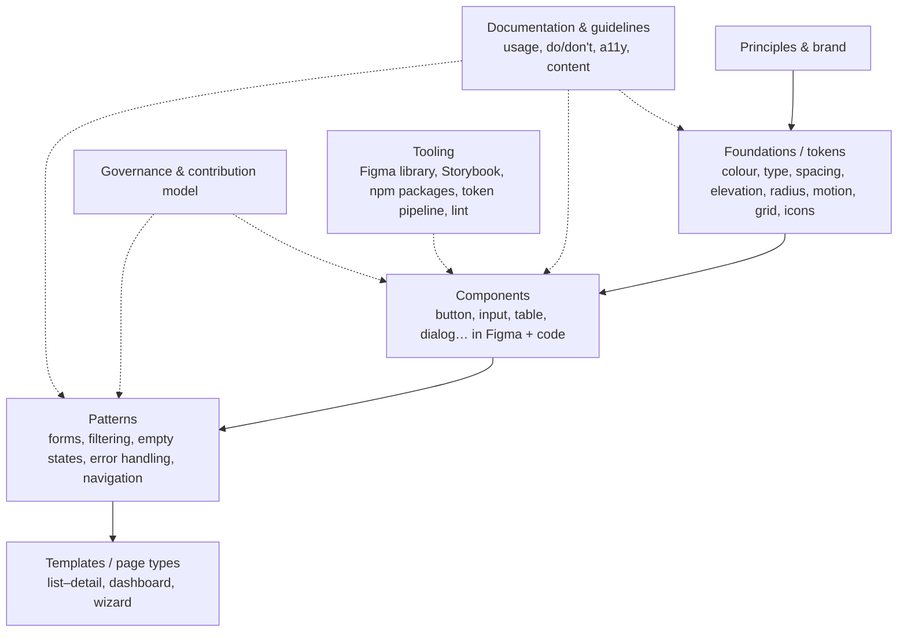
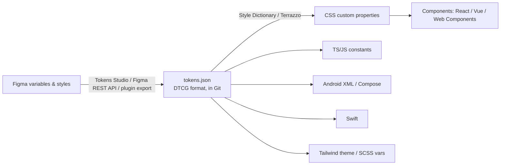
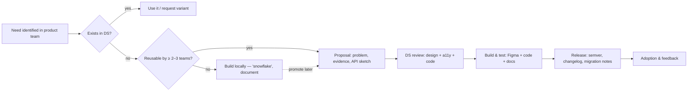

# Design Systems, Figma Workflows & Design Handoff

> **TL;DR** — A design system is the single source of truth for building UI: **foundations/tokens** (colour, type, spacing, motion), **components** (code + design), **patterns**, **guidelines/docs**, and the **governance** process around them. Tokens (W3C Design Tokens Community Group format, stable spec 2025) flow from Figma variables → token JSON → Style Dictionary → CSS custom properties/TS. Reference systems: Material 3, Fluent 2, Carbon, Polaris, GOV.UK, NL Design System. In Figma, build with auto layout, variables (modes for themes/density), components with properties and variants, libraries, and Dev Mode / Code Connect for handoff. Handoff is a conversation, not a file: specify states, behaviour, responsive rules, content and accessibility.

Related: [Visual design](visual-design.md) · [Design processes (Atomic Design)](design-processes.md#5-atomic-design) · [Accessibility](accessibility.md) · [Engineering](../08-engineering/README.md) · [Software architecture](../05-software-architecture/README.md)

---

## 1. What a design system contains



| Layer | Contents |
|-------|---------|
| Principles | Short, opinionated statements guiding decisions ("Clarity over density", "Work with real data") |
| Foundations | Tokens + styles: colour palettes & semantic roles, typography scale, spacing scale, grid & breakpoints, elevation, radius, motion, iconography, illustration, data-viz palette |
| Components | Coded, accessible, themable, documented; design counterparts in Figma kept in sync |
| Patterns | Combinations solving user problems (form validation, bulk actions, search & filter, empty states) |
| Content | Voice & tone, terminology, microcopy patterns, i18n rules |
| Docs site | Usage, anatomy, states, props/API, accessibility notes, do/don't, live examples (Storybook, zeroheight, Supernova, Docusaurus, Backlight) |
| Governance | Ownership, contribution process, versioning, deprecation, roadmap, support channels |

**Design system vs component library vs style guide vs pattern library:** a style guide documents visual rules; a component library is code; a pattern library collects reusable solutions; a design system combines them with governance and shared language.

Source: <https://www.nngroup.com/articles/design-systems-101/> · <https://bradfrost.com/blog/post/atomic-web-design/>

---

## 2. Reference design systems

| System | Owner | Platform/tech | Notable |
|--------|------|--------------|---------|
| **Material Design 3** (Material You, 2021; M3 Expressive 2025) | Google | Android (Compose), Web (Material Web components), Flutter | Dynamic colour (HCT), tonal palettes, type roles, shape scale, motion tokens, window size classes |
| **Fluent 2** (2023) | Microsoft | React (Fluent UI React v9), Web Components, iOS, Android, Windows (WinUI) | Tokens with global/alias layers, M365/Teams/Dynamics consistency, density |
| **Carbon** (2015/2017) | IBM | React, Web Components, Angular, Vue (community), Svelte | Enterprise focus, data tables, 2x grid, productive vs expressive type & motion, strong a11y, themes White/G10/G90/G100 |
| **Polaris** | Shopify | React (legacy), Polaris web components (2025) | Admin/merchant UX, content guidelines, excellent writing guidance |
| **GOV.UK Design System** | UK Government Digital Service | Nunjucks/HTML (govuk-frontend) | Evidence-based patterns, research-backed, accessibility-first, "one thing per page", service manual |
| **NL Design System** | Dutch government (community; Logius, municipalities like Utrecht, Den Haag, Amsterdam, Rotterdam) | Framework-agnostic web components, React, CSS + design tokens per organisation (theme) | Shared components with per-organisation themes; "estafettemodel" relay model of component maturity (Help Wanted → Community → Candidate → Hall of Fame); WCAG/EN 301 549 focus; Rijkshuisstijl |
| **Apple HIG** | Apple | SwiftUI/UIKit | Platform conventions; Liquid Glass (2025) |
| **SAP Fiori** | SAP | UI5, Web Components | Enterprise floorplans |
| **Salesforce Lightning (SLDS 2)** | Salesforce | LWC | Originated design tokens (Jina Anne & Jon Levine, 2014), styling hooks |
| **Atlassian DS** | Atlassian | React | Tokens, collaboration UIs |
| **Primer** | GitHub | React, ViewComponents | Developer tools, dense UIs |
| **Spectrum / React Aria** | Adobe | React | Accessibility hooks (React Aria), headless primitives |
| **Base Web, Chakra, MUI, Radix, shadcn/ui, Headless UI, Reka UI (Radix Vue), Vuetify, PrimeVue** | Various OSS | React/Vue | Building blocks for in-house systems |
| **US Web Design System (USWDS)**, **Government of Canada (GC Design System)**, **Australian Gold** | Governments | Web | Public-sector patterns |

Links: <https://m3.material.io/> · <https://fluent2.microsoft.design/> · <https://carbondesignsystem.com/> · <https://polaris-react.shopify.com/> · <https://design-system.service.gov.uk/> · <https://nldesignsystem.nl/> · <https://designsystem.digital.gov/> · <https://primer.style/> · <https://spectrum.adobe.com/>

Galleries: <https://designsystemsrepo.com/> · <https://component.gallery/> (Iain Bean's component gallery, cross-system component names).

---

## 3. Design tokens

### 3.1 Definition

Design tokens are named, platform-agnostic design decisions (name → value) used to keep design and code in sync: `color.action.primary.background = #0F62FE`.

### 3.2 Token tiers

| Tier | Also called | Example | Rule |
|------|-------------|---------|-----|
| **Primitive / global / reference / core** | Options | `blue.600 = #2563EB`, `space.4 = 16px` | Raw palette; never used directly in components |
| **Semantic / alias / system** | Decisions | `color.text.primary → gray.900`, `color.border.danger → red.600`, `space.inset.md → space.4` | Describes purpose; changes per theme/mode |
| **Component** | Specific | `button.primary.bg.hover → color.action.primary.hover` | Optional; for fine-grained theming |

Naming conventions (e.g. Nathan Curtis, "Naming Tokens in Design Systems", EightShapes 2020): `[namespace]-[object]-[base/category]-[concept/property]-[variant]-[state]-[scale]-[mode]`, e.g. `ds-color-background-action-primary-hover`.

### 3.3 W3C Design Tokens Community Group (DTCG) format

First stable version **2025.10** of the Design Tokens Format Module. JSON with `$value`, `$type`, `$description`, aliases with `{}`:

```json
{
  "color": {
    "blue": { "600": { "$type": "color", "$value": "#2563eb" } },
    "action": {
      "primary": { "$type": "color", "$value": "{color.blue.600}", "$description": "Primary buttons, links" }
    }
  },
  "space": { "4": { "$type": "dimension", "$value": { "value": 16, "unit": "px" } } }
}
```

Types: color, dimension, fontFamily, fontWeight, duration, cubicBezier, number, plus composites (typography, shadow, border, transition, gradient, strokeStyle).

### 3.4 Pipeline



```css
:root {
  --color-action-primary: #2563eb;
  --color-text-primary: #111827;
  --space-4: 1rem;
}
[data-theme="dark"] {
  --color-action-primary: #60a5fa;
  --color-text-primary: #f9fafb;
}
```

Tools: **Style Dictionary** (Amazon, v4 supports DTCG), **Tokens Studio for Figma**, **Terrazzo** (formerly Cobalt UI), Specify, Supernova, Figma Variables REST API.

Sources: <https://www.designtokens.org/> · <https://www.w3.org/community/design-tokens/> · <https://styledictionary.com/>

### 3.5 Theming & modes

- Light/dark, high-contrast, brand (white-label/multi-tenant), density (compact/comfortable), platform.
- Implement via semantic tokens switching value per mode — components never reference primitives.
- NL Design System: each organisation supplies a theme (token set) for the shared components.

---

## 4. Component design & API

**Component spec checklist:**
- [ ] Purpose & when to use / when not (link to alternatives)
- [ ] Anatomy (named parts)
- [ ] Variants (primary/secondary/tertiary, sizes)
- [ ] States: default, hover, focus-visible, active/pressed, selected, disabled, read-only, loading, error, empty, skeleton
- [ ] Content rules (label length, truncation, wrapping, i18n expansion ~30–40% for NL/DE vs EN)
- [ ] Behaviour (interactions, keyboard, animations)
- [ ] Responsive behaviour
- [ ] Accessibility (role, name, keyboard pattern per APG, focus management, contrast)
- [ ] Tokens used
- [ ] Props/API (code) aligned with Figma component properties
- [ ] Do/don't examples
- [ ] Related components

**API principles (code):** composable over configurable (slots/children), consistent prop names across components (`size`, `variant`, `disabled`, `onChange`), controlled & uncontrolled modes, forward refs, pass-through of native attributes, headless logic separated from styling (React Aria, Radix, Headless UI, TanStack) where flexibility is needed.

---

## 5. Governance

### 5.1 Team models (Nathan Curtis, 2015)

| Model | Description | Risk |
|------|------------|-----|
| **Solitary** | One team builds a system for itself; others may adopt | Others see it as "theirs" |
| **Centralised** | Dedicated DS team serves product teams | Bottleneck, disconnected from product reality |
| **Federated** | Designers/devs from product teams contribute part-time, coordinated | Slow decisions, needs strong facilitation |
| **Hybrid** (most common at scale) | Small core team + federated contributors | Needs clear contribution process |

### 5.2 Contribution process



- **Maturity stages:** experimental/alpha → beta → stable → deprecated → removed (NL Design System uses "estafette" stages).
- **Versioning:** semantic versioning (MAJOR.MINOR.PATCH), changelogs, codemods for breaking changes, deprecation periods.
- **Design–code parity:** Figma library publishes alongside code releases; Code Connect maps Figma components to code snippets.
- **Quality gates:** visual regression (Chromatic, Percy, Playwright screenshots), a11y tests (axe in Storybook), unit/interaction tests, design review sign-off.
- **Metrics:** adoption (% of UI using DS components — e.g. via Figma library analytics, code scanning tools like Omlet, react-scanner), detached instances count, time-to-build for new features, consistency defects, a11y issues.
- **Support:** office hours, Slack/Teams channel, documentation, onboarding for new designers/devs, design system champions.
- Rituals: weekly triage, monthly roadmap review, quarterly survey.

Sources: <https://medium.com/eightshapes-llc/team-models-for-scaling-a-design-system-2cf9d03be6a0> · <https://bradfrost.com/blog/>

### 5.3 When to build vs adopt

| Situation | Approach |
|----------|---------|
| Small team, internal tools, speed | Adopt an existing system (Fluent, Carbon, MUI, PrimeVue, Vuetify, shadcn/ui) + theme tokens |
| Multiple products, strong brand | Build own system on headless primitives (React Aria, Radix, Reka UI) |
| Government NL | Use NL Design System components + own theme |
| Microsoft-centric enterprise | Fluent 2 for coherence with M365/Dynamics/Teams |
| Data-heavy enterprise | Carbon or AG Grid/MUI X + own theme |

---

## 6. Figma workflows

### 6.1 Core features

| Feature | What it does | Practice |
|---------|-------------|---------|
| **Auto layout** | Flexbox-like layout: direction (horizontal/vertical/wrap), gap, padding, alignment, hug/fill/fixed sizing, min/max width, absolute position inside; **grid auto layout** (2025) | Build every component and screen with auto layout so content-driven resizing works like code |
| **Components & instances** | Main component + instances inheriting changes; overrides allowed | Keep components in a library file; avoid detaching |
| **Variants** | Grouped component states/types in a component set | Variant properties: `Type=Primary`, `Size=M`, `State=Hover` |
| **Component properties** | Boolean (show icon), text (label), instance swap (icon), variant | Mirror code props → simpler handoff |
| **Slots** (2025) | Flexible content areas in components | Composition like `children` in code |
| **Nested instances & preferred values** | Expose nested properties; curated swap lists | — |
| **Styles** | Colour, text, effect, grid styles | Increasingly replaced by variables for colour/number |
| **Variables** (2023) | Colour, number, string, boolean values; collections & **modes** (light/dark, brand, density, language); aliasing; scoping; code syntax | Mirror token tiers: primitives collection → semantic collection with modes |
| **Prototyping with variables** | Conditional logic, expressions, set variable actions | Realistic interactions (cart totals, toggles) without code |
| **Libraries** | Publish components/styles/variables across files; library analytics | One core library + product-specific libraries |
| **Branching & merging** (Org/Enterprise) | Git-like branches for files | Major library changes reviewed before merge |
| **Dev Mode** (2023) | Inspect mode for developers: measurements, CSS/iOS/Android code, variables/tokens shown, component properties, annotations, "Ready for dev" status, compare changes, VS Code extension | Mark sections "Ready for dev"; devs see token names not hex |
| **Code Connect** | Map Figma components to real code snippets shown in Dev Mode | Devs see `<Button variant="primary">` instead of generated CSS |
| **Annotations & measurements** | Native annotations in Dev Mode | Document behaviour, a11y (focus order, headings, labels) |
| **FigJam** | Whiteboarding | Research synthesis, workshops, flows |
| **Figma Slides, Sites, Make, Buzz** (2025) | Presentations, website publishing, AI prompt-to-app prototyping, marketing assets | Make: AI-generated functional prototypes |
| **Figma MCP server / Dev Mode MCP** (2025) | Exposes design context (components, variables, layout) to AI coding agents | Design-to-code with LLM tools |
| **Plugins** | Extend Figma | Tokens Studio, Stark/Able (contrast, a11y), Content Reel, Iconify, Autoflow, A11y annotation kits, Figma to Code, Batch Styler |

### 6.2 File organisation

```
📁 Team: Product X
  ├── 📄 Cover / README conventions
  ├── 📚 Design System — Foundations (variables, styles)        ← published library
  ├── 📚 Design System — Components                              ← published library
  ├── 📄 Feature: Leave requests (one file per epic/feature)
  │     ├── Page: 📝 Brief & research links
  │     ├── Page: 🧪 Explorations (WIP, messy allowed)
  │     ├── Page: ✅ Ready for dev (final, annotated, sections marked)
  │     ├── Page: 🔁 Prototype
  │     └── Page: 🗄 Archive
  └── 📄 Playground / sandbox
```

Conventions: naming layers semantically, frames named after routes/states (`Leave/List/Empty`), cover thumbnails with status (WIP / In review / Ready / Shipped), version history descriptions for milestones, link Jira/Azure DevOps issues.

### 6.3 Variables setup example

| Collection | Modes | Example variables |
|-----------|------|-------------------|
| Primitives | — (single) | `blue/600`, `gray/900`, `space/4 = 16`, `radius/2 = 4` |
| Semantic colour | Light · Dark · High contrast | `text/primary → gray/900 \| gray/50`, `bg/surface`, `border/focus` |
| Spacing / density | Comfortable · Compact | `control/height = 40 \| 32`, `table/row-height = 48 \| 32` |
| Brand | Brand A · Brand B | `action/primary` |
| Content (string) | EN · NL · PL | Labels for prototyping localisation |

Set variable **scopes** (e.g. spacing variables only available for gap/padding) and **code syntax** (`var(--space-4)`) so Dev Mode shows the token name.

Sources: <https://help.figma.com/hc/en-us/articles/360040451373-Guide-to-auto-layout> · <https://help.figma.com/hc/en-us/articles/15339657135383-Guide-to-variables-in-Figma> · <https://help.figma.com/hc/en-us/articles/15023124644247-Guide-to-Dev-Mode> · <https://www.figma.com/best-practices/>

---

## 7. Design handoff

### 7.1 Principles

- **Handoff is continuous collaboration**, not a throw over the wall: involve developers from discovery (feasibility, data availability), review designs together (walkthrough), pair during build, design-QA before release.
- Design with the **real component library**; anything not in the DS is explicitly flagged as new.
- Use **real content & data** (long names, missing values, 0 / 1 / many, max lengths, negative amounts, RTL if applicable).

### 7.2 What to deliver

| Item | Details |
|------|--------|
| User story & acceptance criteria | Linked from the Figma section |
| Flows | User flow diagram with entry/exit points, decision branches |
| Screens for all states | Default, empty, loading, error, partial, success, no-permission, overflow/long content, offline |
| Responsive behaviour | Breakpoint frames or rules (what stacks, hides, truncates) |
| Interaction specs | Hover/focus/active, transitions (duration + easing tokens), keyboard shortcuts, drag behaviour |
| Content | Final microcopy, error messages, i18n keys/notes, character limits |
| Accessibility annotations | Headings, landmarks, focus order, accessible names for icon buttons, alt text, live region announcements, keyboard interactions, focus management on open/close |
| Data | Field definitions, formats, validation rules, sorting defaults, source of data, calculations |
| Analytics | Events to track |
| Edge cases & business rules | Permissions per role, status-dependent behaviour |
| Assets | Icons from the library (SVG), illustrations exported |
| Open questions | Explicitly listed with owners |

### 7.3 Design QA

- Compare build vs design in the real browser at target breakpoints; check states, keyboard, screen reader basics, contrast, motion, content.
- Log issues with screenshots and severity; agree tolerance (pixel perfection is not the goal — token and behaviour correctness is).
- Visual regression tests in Storybook prevent drift.

### 7.4 Tools

Figma Dev Mode, Code Connect, Storybook (+ Chromatic), Zeroheight / Supernova (docs), Jira/Azure DevOps integration, Loom for walkthrough videos, Zeplin (legacy), Anima/Locofy/Builder.io (design-to-code), AI coding agents with Figma MCP.

---

## 8. Storybook & component documentation (code side)

- Storybook (React, Vue, Angular, Web Components): stories per state, Controls (props), Docs (MDX), a11y addon (axe), interaction tests (`play` functions), visual tests (Chromatic), Figma embed / Designs addon.
- Document usage guidelines next to live components; keep Figma ↔ Storybook links bidirectional.

Source: <https://storybook.js.org/>

## Common mistakes

- Building a design system before having products to serve (no real needs) — or a "Figma-only" system without code.
- Primitive tokens used directly in components → theming impossible.
- Variants explosion in Figma (every combination as a variant instead of properties/booleans/slots).
- Detached instances everywhere → drift.
- No contribution model → teams fork components.
- Docs that show only the happy path.
- Treating handoff as a final step; no design QA.
- Not versioning the Figma library alongside code.

## References

- Material Design 3: <https://m3.material.io/>
- Fluent 2: <https://fluent2.microsoft.design/>
- Carbon: <https://carbondesignsystem.com/>
- Polaris: <https://polaris-react.shopify.com/>
- GOV.UK Design System: <https://design-system.service.gov.uk/>
- NL Design System: <https://nldesignsystem.nl/>
- USWDS: <https://designsystem.digital.gov/>
- Primer: <https://primer.style/>
- Adobe Spectrum: <https://spectrum.adobe.com/> · React Aria: <https://react-spectrum.adobe.com/react-aria/>
- Design Tokens Community Group: <https://www.designtokens.org/> · <https://www.w3.org/community/design-tokens/>
- Style Dictionary: <https://styledictionary.com/>
- Tokens Studio: <https://tokens.studio/>
- NN/g — Design systems 101: <https://www.nngroup.com/articles/design-systems-101/>
- Brad Frost — Atomic Design: <https://atomicdesign.bradfrost.com/>
- Nathan Curtis (EightShapes) on Medium: <https://medium.com/eightshapes-llc>
- Component Gallery: <https://component.gallery/>
- Design Systems Repo: <https://designsystemsrepo.com/>
- Figma Help Center: <https://help.figma.com/>
- Figma best practices: <https://www.figma.com/best-practices/>
- Storybook: <https://storybook.js.org/>
- Alla Kholmatova, *Design Systems* (Smashing, 2017): <https://www.smashingmagazine.com/design-systems-book/>
