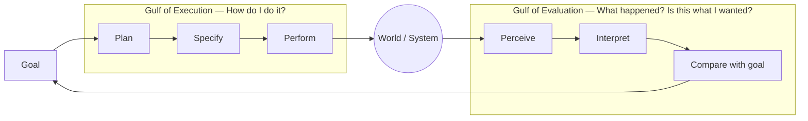
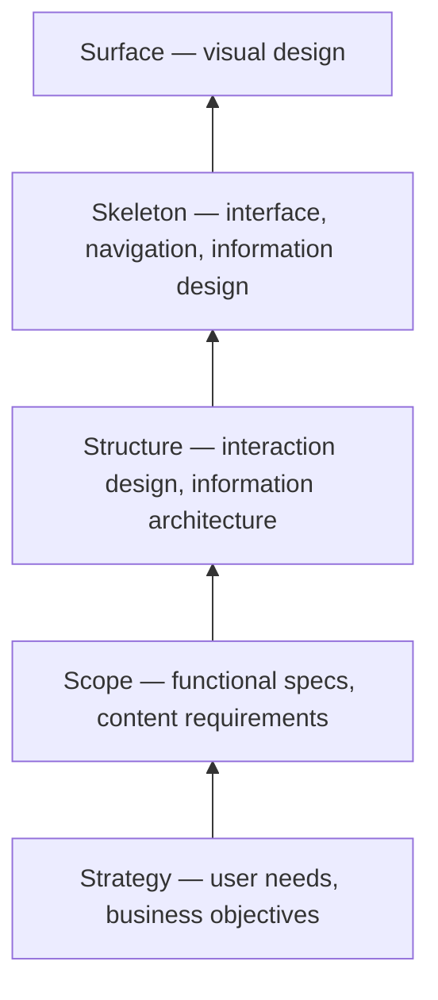

# Heuristics & Design Principles

> **TL;DR** — The canonical evaluation frameworks: Nielsen's 10 usability heuristics (1994, updated 2020), Shneiderman's 8 Golden Rules (1986, *Designing the User Interface*), Norman's interaction principles from *The Design of Everyday Things* (1988 / revised 2013), Dieter Rams' 10 principles of good design (late 1970s), plus Tognazzini, ISO 9241-110 dialogue principles and Gerhardt-Powals. Use them for heuristic evaluation (3–5 evaluators find ~75% of issues), design reviews and as a shared critique vocabulary.

Related: [Laws of UX](laws-of-ux.md) · [Research methods](research-methods.md) · [UI patterns](ui-patterns.md)

---

## 1. Nielsen's 10 Usability Heuristics

Jakob Nielsen & Rolf Molich (1990), refined by Nielsen (1994) from a factor analysis of 249 usability problems. Wording refreshed by NN/g in 2020; the heuristics themselves are unchanged.

| # | Heuristic | Meaning | Enterprise/ERP example | Typical violation |
|---|-----------|---------|------------------------|-------------------|
| 1 | **Visibility of system status** | Keep users informed via timely feedback | "Saved 10:42", sync indicator, payroll run progress (412/980 employees) | Silent save; button with no loading state; batch job without status |
| 2 | **Match between system and real world** | Use users' language and conventions, real-world order | "Leave request" not "Absence entity"; fields in order of the paper form/contract | Database column names as labels (`emp_ctr_type`) |
| 3 | **User control and freedom** | Clearly marked "emergency exits"; undo/redo | Undo after bulk status change; Cancel in wizard; Esc closes dialog | Irreversible actions; wizard with no back |
| 4 | **Consistency and standards** | Internal (within product) and external (platform conventions, Jakob's Law) | Same "Approve" verb and colour everywhere; same date format | "Delete" vs "Remove" vs "Archive" used interchangeably |
| 5 | **Error prevention** | Prevent problems before they occur: constraints, confirmations, good defaults | Date pickers that block end < start; disabling duplicate submit; warning on overlap with existing leave | Free-text fields for constrained values |
| 6 | **Recognition rather than recall** | Make elements, actions and options visible | Recent customers list; autocomplete; selected filters shown as chips | Requiring codes (cost centre IDs) to be typed from memory |
| 7 | **Flexibility and efficiency of use** | Accelerators for experts; personalisation | Keyboard shortcuts, saved views, bulk edit, type-ahead, command palette | Mouse-only grid; no saved filters |
| 8 | **Aesthetic and minimalist design** | No irrelevant or rarely needed information competing for attention | Progressive disclosure of rarely used fields | 60-field form with everything visible |
| 9 | **Help users recognise, diagnose and recover from errors** | Plain-language error messages, precise problem, constructive solution | "IBAN NL… has 17 characters; Dutch IBANs have 18" | "Error 500", "Invalid input" |
| 10 | **Help and documentation** | Ideally not needed; if needed, searchable, task-focused, concise | Contextual help links, inline field hints, onboarding checklist | 200-page PDF manual only |

### Heuristic evaluation — how to run

1. Define scope (flows/screens) and user profile/tasks.
2. 3–5 evaluators review independently (Nielsen: 1 evaluator finds ~35% of problems; 5 find ~75%).
3. Each walks the interface twice: once for flow, once element-by-element.
4. Log each issue: location, heuristic violated, description, screenshot, severity.
5. Merge and de-duplicate in a debrief; agree severity.
6. Prioritise and propose fixes.

**Severity rating (Nielsen):**

| Score | Meaning |
|-------|---------|
| 0 | Not a usability problem |
| 1 | Cosmetic — fix if time permits |
| 2 | Minor — low priority |
| 3 | Major — high priority |
| 4 | Catastrophe — must fix before release |

Severity = f(frequency, impact, persistence) + market impact.

**When to use:** early and cheap, on prototypes or live products, before usability testing; for competitor reviews. **When not:** as a substitute for testing with real users — evaluators are not users, and domain-specific issues (wrong workflow model) are often missed.

Source: <https://www.nngroup.com/articles/ten-usability-heuristics/> · <https://www.nngroup.com/articles/how-to-conduct-a-heuristic-evaluation/>

---

## 2. Shneiderman's Eight Golden Rules of Interface Design

Ben Shneiderman, *Designing the User Interface* (1st ed. 1986; 6th ed. 2016 with Plaisant, Cohen, Jacobs, Elmqvist, Diakopoulos).

| # | Rule | Practical translation |
|---|------|----------------------|
| 1 | **Strive for consistency** | Same terminology, layouts, colours, fonts, actions across similar situations |
| 2 | **Seek universal usability** (formerly "enable frequent users to use shortcuts") | Cater to novices and experts, diverse abilities, ages, devices; add shortcuts, explanations |
| 3 | **Offer informative feedback** | Every action gets a response, proportional to the importance/frequency of the action |
| 4 | **Design dialogs to yield closure** | Sequences with beginning, middle, end; confirmation of completion ("Order 1043 placed") |
| 5 | **Prevent errors** | Grey out invalid options, constrain input, error message that keeps the user's input |
| 6 | **Permit easy reversal of actions** | Undo, reduce anxiety, encourage exploration |
| 7 | **Keep users in control** (formerly "support internal locus of control") | No surprise behaviour, no hidden automation; users initiate actions |
| 8 | **Reduce short-term memory load** | Keep displays simple, consolidate multiple pages, avoid requiring recall |

Source: <https://www.cs.umd.edu/users/ben/goldenrules.html>

---

## 3. Don Norman's Principles (The Design of Everyday Things)

Donald A. Norman, *The Psychology of Everyday Things* (1988), renamed *The Design of Everyday Things* (revised & expanded 2013). Norman coined "user experience" while at Apple (1993, "User Experience Architect").

### 3.1 The seven fundamental principles of design (2013 edition)

| Principle | Definition | UI example | Failure |
|-----------|-----------|------------|---------|
| **Discoverability** | Is it possible to figure out what actions are possible and the current state? | Visible toolbar actions; menus | Hidden swipe gestures with no hint |
| **Affordance** | Relationship between object properties and an agent's capabilities that determines how it *could* be used | A button can be pressed; a text field can be typed in | — |
| **Signifier** | Perceivable cue that communicates *where/how* to act (Norman added this in 2013 because "affordance" was misused for perceivable cues) | Raised button styling, underline, cursor change, drag handle `⋮⋮`, placeholder | Flat text that's actually a button; "mystery meat" icons |
| **Mapping** | Relationship between controls and their effects; natural mapping uses spatial analogy | Sort arrow on the column it sorts; slider direction = value direction | Stove-top knobs; "Next" on the left |
| **Feedback** | Communicating results of an action, immediately and informatively | Pressed states, toasts, inline validation, progress | No response to click → double submissions |
| **Constraints** | Limit possible actions: physical, cultural, semantic, logical | Disabled states, input masks, date picker min/max, dropdowns for enums | Free text where only 5 values are valid |
| **Conceptual model** | Simplified explanation of how something works (system image conveys it) | Folder/file metaphor; "Draft → Submitted → Approved" status chips | Hidden state machines; unexplained statuses |

**Three models:** *design model* (designer's), *user's model* (mental model), *system image* (everything the user can perceive: UI, docs, behaviour). The designer only communicates with the user via the system image.

### 3.2 The Gulfs and the Seven Stages of Action

- **Gulf of Execution:** the gap between what the user intends and the actions the system allows. Bridge it with signifiers, constraints, mappings, conceptual model.
- **Gulf of Evaluation:** the effort to interpret the system's state. Bridge it with feedback and a clear conceptual model.

### 3.3 Error types (Norman / Reason)

| Type | Description | Example | Prevention |
|------|------------|---------|-----------|
| **Slip — action-based** | Right goal, wrong execution | Clicking "Delete" instead of adjacent "Duplicate" | Spacing (Fitts), undo, distinct styling |
| **Slip — memory-lapse** | Forgetting a step | Leaving card in ATM | Forcing functions, reminders, checklists |
| **Mode error** (slip) | Action appropriate in another mode | Typing in read-only vs edit mode; caps lock | Avoid modes or make them highly visible |
| **Capture error** (slip) | Frequent sequence takes over | Typing a common password in wrong field | Avoid near-identical sequences |
| **Mistake — rule-based** | Wrong rule applied correctly | Choosing "Gross" when "Net" was needed | Clear labels and explanations |
| **Mistake — knowledge-based** | Wrong diagnosis in novel situation | Misreading a dashboard trend | Good conceptual model, feedback |
| **Mistake — memory-lapse** | Forgetting goal/plan | Interrupted mid-wizard | Save state, show progress |

Forcing functions: **interlock** (must do A before B — e.g. confirm IBAN before payment run), **lock-in** (prevents leaving — "unsaved changes" dialog), **lockout** (prevents entry — stairway barrier; e.g. "type the project name to delete").

### 3.4 Human-centred design (Norman's "HCD" process)

Observation → idea generation → prototyping → testing, iterated; aligned with Double Diamond (see [design-processes.md](design-processes.md)). Norman's "Don Norman's Law of Product Development": the day a product development process starts, it is behind schedule and above budget.

Sources: <https://en.wikipedia.org/wiki/The_Design_of_Everyday_Things> · <https://jnd.org/> · <https://www.nngroup.com/articles/two-ux-gulfs-evaluation-execution/>

---

## 4. Dieter Rams — Ten Principles for Good Design

Dieter Rams, head of design at Braun (1961–1995). Principles formulated late 1970s/early 1980s. "Weniger, aber besser" — less, but better.

| # | Good design… | Software interpretation |
|---|--------------|------------------------|
| 1 | is innovative | Innovation goes hand in hand with technology; don't innovate for its own sake |
| 2 | makes a product useful | Prioritise function; remove what detracts from usefulness |
| 3 | is aesthetic | Quality visuals affect well-being and trust (aesthetic–usability effect) |
| 4 | makes a product understandable | Self-explanatory; structure clarifies function |
| 5 | is unobtrusive | Tools are neutral and restrained, leaving room for the user's content |
| 6 | is honest | Doesn't manipulate or overpromise (no dark patterns) |
| 7 | is long-lasting | Avoid fashion; timeless rather than trendy |
| 8 | is thorough down to the last detail | Edge cases, empty/error/loading states, microcopy |
| 9 | is environmentally friendly | Performance, data minimisation, low energy (sustainable web design) |
| 10 | is as little design as possible | Focus on essentials, back to purity and simplicity |

Source: <https://en.wikipedia.org/wiki/Dieter_Rams> · <https://www.vitsoe.com/gb/about/good-design>

---

## 5. Other principle sets worth knowing

### 5.1 ISO 9241-110:2020 — Interaction principles

Formerly "dialogue principles". The 2020 revision lists seven:

1. Suitability for the user's tasks
2. Self-descriptiveness
3. Conformity with user expectations
4. Learnability
5. Controllability
6. Use error robustness (formerly "error tolerance")
7. User engagement

ISO 9241-11:2018 defines **usability** as: the extent to which a system can be used by specified users to achieve specified goals with **effectiveness, efficiency and satisfaction** in a specified context of use. ISO 9241-210:2019 defines human-centred design for interactive systems. (Standards themselves are paywalled: <https://www.iso.org/standard/75258.html>.)

### 5.2 Bruce Tognazzini — First Principles of Interaction Design (2003, revised 2014)

Anticipation, autonomy, colour-blindness, consistency, defaults, discoverability, efficiency of the user, explorable interfaces, Fitts's Law, human-interface objects, latency reduction, learnability, metaphors, protect users' work, readability, simplicity, state tracking, visible navigation. Source: <https://asktog.com/atc/principles-of-interaction-design/>

### 5.3 Gerhardt-Powals' cognitive engineering principles (1996)

Automate unwanted workload; reduce uncertainty; fuse data; present new information with meaningful aids to interpretation; use names that are conceptually related to function; group data consistently; limit data-driven tasks; include only needed information; provide multiple coding of data when appropriate; practise judicious redundancy. Particularly useful for **dashboards and control-room-style enterprise UIs**.

### 5.4 Usability components (Nielsen, 1993)

Learnability · Efficiency · Memorability · Errors · Satisfaction (+ utility = usefulness). Useful = usability + utility.

### 5.5 Peter Morville's UX Honeycomb (2004)

Useful · Usable · Desirable · Findable · Accessible · Credible · Valuable. Source: <https://semanticstudios.com/user_experience_design/>

### 5.6 Jesse James Garrett — The Elements of User Experience (2002)

Five planes, abstract → concrete:

Decisions on lower planes constrain upper ones; fixing a surface problem rooted in strategy doesn't work.

### 5.7 Apple HIG & Material principles (platform)

- Apple HIG themes: clarity, deference, depth (older), now *hierarchy, harmony, consistency*. <https://developer.apple.com/design/human-interface-guidelines/>
- Material Design 3: personal, adaptive, expressive. <https://m3.material.io/>

### 5.8 GOV.UK Design Principles (2012)

1. Start with user needs · 2. Do less · 3. Design with data · 4. Do the hard work to make it simple · 5. Iterate. Then iterate again · 6. This is for everyone · 7. Understand context · 8. Build digital services, not websites · 9. Be consistent, not uniform · 10. Make things open: it makes things better.
Source: <https://www.gov.uk/guidance/government-design-principles>

---

## 6. Crosswalk: which principle covers what

| Concern | Nielsen | Shneiderman | Norman | Rams |
|---------|---------|-------------|--------|------|
| Feedback/status | #1 | #3, #4 | Feedback | — |
| Language/conventions | #2, #4 | #1 | Mapping, conceptual model | 4 |
| Undo/control | #3 | #6, #7 | — | — |
| Error prevention | #5 | #5 | Constraints, forcing functions | — |
| Memory load | #6 | #8 | Knowledge in the world vs head | — |
| Efficiency | #7 | #2 | — | 2 |
| Minimalism | #8 | — | — | 5, 10 |
| Error recovery | #9 | #5 | Slips vs mistakes | — |
| Help | #10 | — | Discoverability | 4 |
| Honesty / ethics | — | — | — | 6 |

---

## 7. Design review checklist (derived)

- [ ] Can a first-time user tell what this screen is for within 5 seconds?
- [ ] Is the current state (record status, filters applied, unsaved changes) visible?
- [ ] Does every action give feedback within 100 ms (visual) and completion feedback?
- [ ] Is there exactly one primary action per view/section?
- [ ] Are labels in the user's vocabulary (checked against interview transcripts)?
- [ ] Are destructive actions reversible (undo) or, if not, confirmed with specific consequence text?
- [ ] Are invalid inputs prevented (constraints) rather than only reported?
- [ ] Do errors say what happened, why, and how to fix — next to the field?
- [ ] Can experts work with keyboard only, and are there bulk actions and saved views?
- [ ] Is anything shown that most users never need (move behind disclosure)?
- [ ] Is terminology, iconography and placement consistent with the rest of the product and the design system?
- [ ] Are empty, loading, error, partial and overflow states designed?
- [ ] Does it meet WCAG 2.2 AA (see [accessibility.md](accessibility.md))?

## Common mistakes

- Heuristic evaluation by one person → misses most issues and reflects personal taste.
- Reporting heuristic violations without severity → backlog noise.
- Using "affordance" when meaning "signifier".
- Treating consistency as uniformity — consistency serves predictability; break it when the task differs substantially (GOV.UK: "be consistent, not uniform").
- Confirmation dialogs as the default error-prevention strategy (users habituate; prefer undo — see [ui-patterns.md](ui-patterns.md#12-undo-vs-confirm)).

## References

- NN/g — 10 Usability Heuristics: <https://www.nngroup.com/articles/ten-usability-heuristics/>
- NN/g — How to conduct a heuristic evaluation: <https://www.nngroup.com/articles/how-to-conduct-a-heuristic-evaluation/>
- NN/g — Two UX gulfs: <https://www.nngroup.com/articles/two-ux-gulfs-evaluation-execution/>
- Shneiderman — Eight Golden Rules: <https://www.cs.umd.edu/users/ben/goldenrules.html>
- *The Design of Everyday Things*: <https://en.wikipedia.org/wiki/The_Design_of_Everyday_Things>
- Don Norman: <https://jnd.org/>
- Dieter Rams: <https://en.wikipedia.org/wiki/Dieter_Rams> · Vitsœ: <https://www.vitsoe.com/gb/about/good-design>
- Tognazzini: <https://asktog.com/atc/principles-of-interaction-design/>
- Morville UX Honeycomb: <https://semanticstudios.com/user_experience_design/>
- GOV.UK design principles: <https://www.gov.uk/guidance/government-design-principles>
- ISO 9241-110:2020: <https://www.iso.org/standard/75258.html>
- Jesse James Garrett, *The Elements of User Experience*: <https://en.wikipedia.org/wiki/Jesse_James_Garrett>
