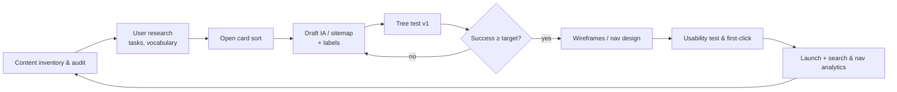

# Information Architecture (IA)

> **TL;DR** — IA is the structural design of shared information environments: **organisation** (how content is grouped), **labelling** (what it's called), **navigation** (how users move) and **search** (how users look for it) — the four systems from Rosenfeld & Morville's "polar bear book" (1998; 4th ed. 2015 with Arango). Organise by the user's mental model (validated with card sorting and tree testing), not the org chart or database schema. Prefer broad-and-shallow over deep hierarchies, use consistent, user-language labels, and design for both browsing and search. Wurman's **LATCH** — Location, Alphabet, Time, Category, Hierarchy — lists the only five ways to organise information.

Related: [Research methods (card sort, tree test)](research-methods.md) · [UI patterns (search, navigation)](ui-patterns.md) · [Enterprise UX](enterprise-ux.md) · [Enterprise architecture](../11-enterprise-architecture-business/README.md)

---

## 1. Foundations

| Concept | Definition |
|---------|-----------|
| **Information architecture** | The structural design of shared information environments; organising, labelling, search and navigation systems to support findability and understanding |
| **Findability** | The degree to which content can be located (Peter Morville, *Ambient Findability*, 2005) |
| **Ontology** | Meaning: the concepts and relationships in a domain (entities: Employee, Contract, Position, Department) |
| **Taxonomy** | Hierarchical classification of concepts |
| **Choreography** | Rules for interaction/flow between parts |
| **Controlled vocabulary** | Defined set of preferred terms (+ synonyms rings, authority files, thesauri) |
| **Metadata** | Descriptive, structural, administrative data about content — enables faceted search |
| **Sitemap** | Diagram of page hierarchy |
| **Object model / OOUX** | Object-Oriented UX (Sophia Prater): identify objects, relationships, calls-to-action, attributes (ORCA process) before screens |

**The IA "three circles" (Rosenfeld & Morville):** **Context** (business goals, funding, politics, culture, technology) × **Content** (document types, volume, structure, metadata, ownership) × **Users** (audience, tasks, needs, information-seeking behaviour, experience).

**Information-seeking behaviours:**
- **Known-item seeking** — user knows what they want and its name → search.
- **Exploratory** — knows roughly, will recognise it → browse, facets.
- **Don't know what they need to know** → guidance, FAQs, curated paths.
- **Re-finding** → recents, favourites, history.
- Marcia Bates' **berrypicking** (1989): queries evolve as users learn.
- Peter Pirolli & Stuart Card **information foraging theory** (1999): users follow **information scent** — cues (link labels) predicting value. Weak scent → users leave.

Sources: <https://en.wikipedia.org/wiki/Information_architecture> · <https://www.nngroup.com/articles/information-foraging/>

---

## 2. Organisation systems

### 2.1 LATCH (Richard Saul Wurman, *Information Anxiety*, 1989)

| Scheme | Organise by | Use when | Example |
|--------|------------|---------|---------|
| **L**ocation | Geography/space | Physical spread matters | Office locations, warehouse map, floor plans, store finder |
| **A**lphabet | Letters | Users know the name; large reference lists | Employee directory, glossary, country list |
| **T**ime | Chronology | Sequence or recency matters | Activity log, audit trail, payslips by month, timeline |
| **C**ategory | Similarity/type | Items of similar importance grouped by kind | Product categories, document types |
| **H**ierarchy | Magnitude/importance | Ranking by a measure | Top customers by revenue, priority-sorted tickets |

### 2.2 Exact vs ambiguous schemes

- **Exact:** alphabetical, chronological, geographical — easy to maintain, good for known-item.
- **Ambiguous:** topic/subject, task, audience, metaphor — harder, but better for exploration.
  - **Topic:** "Benefits", "Pay", "Leave".
  - **Task:** "Request leave", "Update bank details". Very effective for transactional portals (GOV.UK).
  - **Audience:** "Employees", "Managers", "HR" — use only when audiences are distinct and self-identify clearly (people hesitate when they fit multiple).
  - **Metaphor:** "Desktop", "Folder" — risky if metaphor breaks.
- **Hybrid** schemes confuse unless clearly separated (e.g. main nav by topic, utility nav by audience).

### 2.3 Structures

| Structure | Description | Use |
|-----------|------------|-----|
| **Hierarchy (tree)** | Top-down parent–child | Most sites/apps; polyhierarchy allowed when items legitimately live in multiple places (with one canonical location) |
| **Database / faceted** | Items described by attributes (facets) | Catalogues, records, search results; ERP list views |
| **Hypertext / network** | Associative links | Wikis, knowledge bases, cross-references ("Related contracts") |
| **Sequential** | Linear | Wizards, onboarding, checkout |
| **Hub-and-spoke** | Return to hub between tasks | Mobile apps, dashboards with drill-down |
| **Matrix** | Multiple dimensions to navigate | Product comparison, reports by period × unit |

**Breadth vs depth:** research (Miller 1981; Larson & Czerwinski 1998; Zaphiris 2000) consistently favours **broad and shallow** (e.g. 8×8 beats 2×2×2×2×2×2) as long as the broad level is well grouped and labelled. Each extra level adds a decision point and a page load, and errors compound. Aim for ≤ 3 levels in most product navigation.

---

## 3. Labelling systems

**Types of labels:** navigation links, headings, index terms, iconic labels, CTAs, page titles, field labels.

**Rules:**
- Use **users' language** (from interviews, search logs, support tickets, card sorts) — not internal jargon, department names, or database fields.
- **Consistent** grammar (all nouns or all verbs), granularity, and style within a set.
- **Distinct** — labels in a menu should not overlap ("Resources" vs "Documents" vs "Library").
- **Specific** — avoid vague bins: "Resources", "Solutions", "Tools", "Other", "Miscellaneous", "General".
- **Front-load** keywords ("Leave — request" vs "Submitting a request for leave").
- Short (1–3 words for nav), but clarity beats brevity.
- Test labels with tree testing and first-click tests.
- Maintain a **content glossary / controlled vocabulary**, especially in multilingual products (NL/EN): one concept, one term, across UI, docs, support and code (Domain-Driven Design's *ubiquitous language* — see [../05-software-architecture/README.md](../05-software-architecture/README.md)).

**Enterprise example:** in an HR system, "Dienstverband", "Contract", "Employment" and "Assignment" might be distinct entities for the system but blur for users — define each, show relationships, and use one label per concept.

---

## 4. Navigation systems

### 4.1 Types

| Type | Purpose | Examples |
|------|---------|---------|
| **Global (primary)** | Access to top-level sections from anywhere | Top bar, left side nav |
| **Local (secondary)** | Within a section | Sub-nav, tabs, section side nav |
| **Contextual** | Related content inline | "Related documents", links in text, record cross-links |
| **Utility** | Tools, not content | Account, settings, help, language, notifications |
| **Supplemental** | Alternative access | Sitemap, A–Z index, guides |
| **Breadcrumbs** | Location in hierarchy | `Home › Employees › J. de Vries › Contracts` |
| **Footer (fat footer)** | Secondary links, legal | Corporate sites |
| **Faceted navigation** | Filter by attributes | Search/list views |
| **Command palette** | Keyboard-driven jump to anything | `Ctrl/Cmd+K` (Linear, VS Code, GitHub, Slack) — excellent for power users |

### 4.2 Navigation patterns

| Pattern | Best for | Pros | Cons |
|---------|---------|------|------|
| **Top horizontal nav** | 3–7 top-level items, content sites | Visible, conventional | Limited space; poor for deep apps |
| **Left vertical side nav** (collapsible) | Enterprise apps, many sections, admin consoles | Scales to many items, groups, hierarchy; room for labels | Takes horizontal space (collapse to icon rail 56–72px) |
| **Mega menu** | Large sites with many categories | Shows breadth at once; good scent | Heavy; hover issues (use click + hover intent); accessibility effort |
| **Tabs** | 2–7 peer views of the same object | Familiar, visible | Don't use for sequential steps; overflow on mobile |
| **Hamburger / drawer** | Mobile, secondary nav | Saves space | Out of sight, out of mind — NN/g found hidden nav reduces discoverability (~20% lower usage) |
| **Bottom tab bar** | Mobile apps, 3–5 destinations | Thumb reachable, visible | Limited items |
| **Hub & spoke** | Task-based mobile, kiosks | Simple | Many back-and-forth steps |
| **Dashboard / launchpad tiles** | Role-based ERP home (SAP Fiori launchpad) | Personalised entry | Becomes a junk drawer without governance |
| **Breadcrumbs** | Hierarchies ≥ 3 levels | Orientation & up-navigation | Not a replacement for primary nav |
| **Step navigation** | Linear processes | Shows progress | Not for non-linear tasks |
| **Master–detail (list–detail)** | Records (mail, CRM, ERP) | Context retained, fast switching | Needs width; on mobile → two screens |
| **Command palette / quick search** | Experts, large apps | Fast, scalable | Hidden; supplement, don't replace |

### 4.3 Navigation guidelines

- Show **where you are** (active state with `aria-current="page"`), **where you can go**, and **how to get back**.
- Keep global nav consistent across pages (WCAG 3.2.3).
- Don't hide primary nav on desktop.
- Label icons in side rails (tooltip at minimum, labels preferred).
- Make the link target the whole item area.
- Avoid > 2 levels of nested fly-outs (steering law).
- For apps with many modules (ERP), combine: module switcher (global) + side nav (module) + tabs (record) + breadcrumbs + command palette + recent items.
- Deep links: every meaningful state (record, tab, filter) should have a URL — shareable, bookmarkable, back-button friendly.

Source: <https://www.nngroup.com/articles/menu-design/> · <https://www.nngroup.com/articles/breadcrumbs/>

---

## 5. Search systems

**When search matters:** large content volume, known-item seeking, diverse users, poorly structured content. In enterprise apps: **global record search** (employee by name/number, order by ID) is often the #1 navigation path.

**Search UX components:**

| Component | Guidelines |
|-----------|-----------|
| Search box | Visible (not just an icon on desktop), wide enough (~27+ characters), placeholder showing what can be searched ("Search employees, orders, invoices…"), keyboard shortcut (`/` or `Ctrl+K`) |
| Autocomplete / autosuggest | Suggest queries and direct results (scoped: "Employees", "Documents"); highlight the matched part; keyboard navigable (APG combobox) |
| Scoping | Default to all; allow scope selection; show scope clearly |
| Query handling | Typo tolerance, stemming, synonyms (synonym ring: "verlof" ↔ "vakantie" ↔ "leave"), partial IDs, diacritics-insensitive |
| Results page | Show query and count, sort (relevance default), facets with counts, highlight terms, meaningful snippets, object type icons |
| Zero results | Never a dead end: suggest spelling, broaden scope, show popular items, offer to create |
| Best bets | Curated results for common queries |
| Search analytics | Top queries, zero-result queries, refinements, exits → feed IA and labels |

**Faceted search** (Ranganathan's facet classification, 1933 Colon Classification; Hearst's Flamenco project): filter by multiple independent attributes (status, department, date range, location). Show counts; avoid zero-result facet values or disable them; show applied filters as removable chips; "Clear all".

Engines: Elasticsearch/OpenSearch, Algolia, Meilisearch, Typesense, Azure AI Search, Postgres full-text — and hybrid/semantic (vector) search for natural-language queries (see [../07-data-ai-architecture/README.md](../07-data-ai-architecture/README.md)).

Source: <https://www.nngroup.com/articles/search-visible-and-simple/>

---

## 6. IA process

1. **Content inventory** — list all content/features (URL/screen, title, type, owner, last updated, traffic).
2. **Content audit** — qualitative: ROT analysis (Redundant, Outdated, Trivial); keep/merge/rewrite/delete.
3. **Top-task analysis** (Gerry McGovern) — users vote on a list of 50–100 tasks; usually 5–10 tasks get ~25% of votes ("long neck").
4. **Card sorting** → mental models and vocabulary.
5. **Draft structure** — sitemap, object model, navigation model.
6. **Tree testing** → validate findability (aim ≥ 70–80% success on key tasks, high directness).
7. **Design navigation UI** and test with first-click/usability tests.
8. **Governance** — ownership, content lifecycle, rules for adding new sections (prevent nav sprawl).

**Deliverables:** sitemap, user flows, object model / ER-like concept map, navigation model, labelling guidelines, controlled vocabulary, wireframes, annotated nav specs.

---

## 7. IA for enterprise applications

- **Organise by object and task, not by department or database table.** Object-oriented UX: nouns first (Employee, Position, Contract, Absence), then actions (verbs). Each object gets a consistent detail page with tabs and related objects.
- **Role-based entry points:** employee self-service vs manager self-service vs HR back-office vs admin — each a workspace with its own home, sharing object pages.
- **Workspaces/hubs** for recurring work: "My approvals", "Payroll period close", "Open tasks".
- **Global search across objects** + recents + favourites (re-finding is the dominant behaviour in daily-use tools).
- **Deep linking and URLs** for every record/view (paste into Teams/email).
- **Settings & configuration IA** is often the worst part of enterprise apps — group by user goal ("Payroll setup", "Leave policies") and provide search in settings.
- Align IA with the domain model (bounded contexts) but translate system concepts into user concepts.
- Consider the **module map** (ERP: Finance, HR, Procurement, Sales, Inventory, Manufacturing) as global nav, and within modules: Overview (dashboard) → Work queues → Records → Reports → Configuration.

## 8. IA checklist

- [ ] Top tasks identified and reachable in ≤ 2–3 clicks or via search
- [ ] Labels come from user vocabulary; no "Misc/Other/Resources" bins
- [ ] Each item has one canonical location (polyhierarchy only with clear canonical)
- [ ] Hierarchy ≤ 3 levels deep for nav
- [ ] Current location always visible (active state, breadcrumbs, page title)
- [ ] Search is prominent with autosuggest, typo tolerance and useful zero-results
- [ ] Every view is deep-linkable; back button works; filters persisted in URL
- [ ] Tree test success ≥ target on critical tasks
- [ ] Governance owner for navigation changes

## Common mistakes

- Mirroring the org chart ("Departments → HR → Services → Forms").
- Labels from developers' data model.
- Deep, narrow hierarchies; hidden hamburger nav on desktop.
- "Everything is in search" without investing in search quality.
- Adding a new top-level nav item for every new feature.
- Card sorting with feature names users don't understand.

## References

- Rosenfeld, Morville & Arango, *Information Architecture* (4th ed., O'Reilly 2015): <https://www.oreilly.com/library/view/information-architecture-4th/9781491913529/>
- Information architecture (Wikipedia): <https://en.wikipedia.org/wiki/Information_architecture>
- Richard Saul Wurman (LATCH): <https://en.wikipedia.org/wiki/Richard_Saul_Wurman>
- NN/g — Information foraging: <https://www.nngroup.com/articles/information-foraging/>
- NN/g — Menu design: <https://www.nngroup.com/articles/menu-design/>
- NN/g — Breadcrumbs: <https://www.nngroup.com/articles/breadcrumbs/>
- NN/g — Search: visible and simple: <https://www.nngroup.com/articles/search-visible-and-simple/>
- NN/g — Tree testing: <https://www.nngroup.com/articles/tree-testing/>
- Abby Covert — *How to Make Sense of Any Mess*: <https://abbycovert.com/make-sense/>
- Object-Oriented UX (OOUX): <https://ooux.com/>
- Gerry McGovern — Top tasks: <https://gerrymcgovern.com/>
- Information Architecture Institute / IA Conference: <https://www.theiaconference.com/>
- Peter Morville — Semantic Studios: <https://semanticstudios.com/>
- Faceted search: <https://en.wikipedia.org/wiki/Faceted_search>
