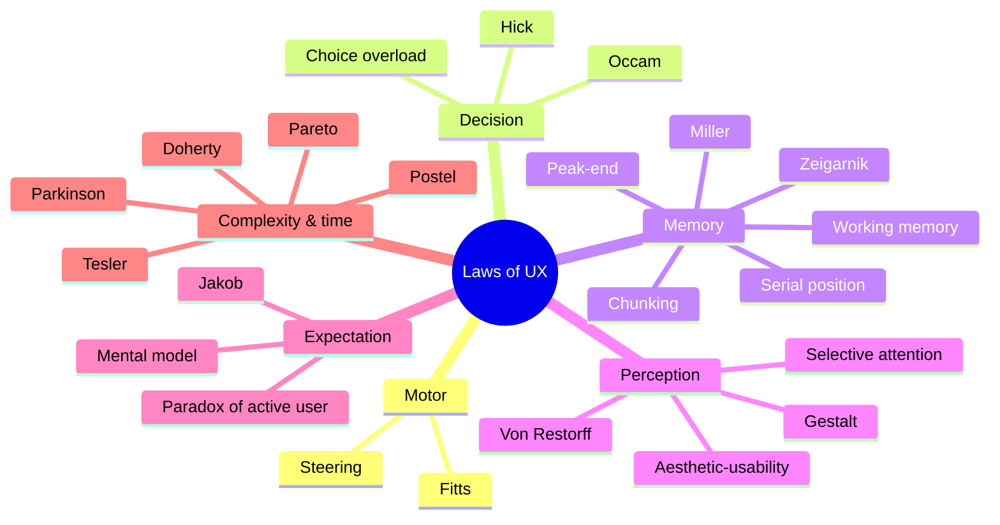

# Laws of UX

> **TL;DR** — A compact catalogue of the psychological laws, heuristics and principles most often cited in interaction design (largely following Jon Yablonski's *Laws of UX* collection). Each entry gives the origin, a one-line definition, practical takeaways, a concrete example (mostly from internal tools, ERP and portal UIs) and a source link. Treat them as *lenses for critique and design decisions*, not as physics: most are empirical regularities with boundary conditions.

Related: [Heuristics & principles](heuristics-and-principles.md) · [Visual design (Gestalt)](visual-design.md) · [Cognitive biases & mental models section](../10-laws-principles-mental-models/README.md)

---

## Quick index

| # | Law | Category | One-liner |
|---|-----|----------|-----------|
| 1 | Fitts's Law | Motor | Time to hit a target depends on distance and size |
| 2 | Hick–Hyman Law | Decision | Decision time grows logarithmically with number of choices |
| 3 | Jakob's Law | Expectation | Users expect your product to work like the others they use |
| 4 | Miller's Law | Memory | Working memory holds ~7±2 (more realistically ~4) chunks |
| 5 | Tesler's Law | Complexity | Every system has irreducible complexity; someone must carry it |
| 6 | Doherty Threshold | Performance | Productivity soars when response < 400 ms |
| 7 | Postel's Law | Robustness | Be liberal in what you accept, conservative in what you send |
| 8 | Peak–End Rule | Memory/emotion | Experiences are judged by peak and end, not average |
| 9 | Aesthetic–Usability Effect | Perception | Beautiful things are perceived as more usable |
| 10 | Von Restorff Effect | Attention | The item that differs is remembered |
| 11 | Serial Position Effect | Memory | First and last items are recalled best |
| 12 | Zeigarnik Effect | Motivation | Unfinished tasks are remembered better |
| 13 | Goal-Gradient Effect | Motivation | Effort increases as the goal gets closer |
| 14 | Occam's Razor | Simplicity | Prefer the option with fewest assumptions |
| 15 | Pareto Principle | Prioritisation | ~80% of effects come from ~20% of causes |
| 16 | Parkinson's Law | Time | Work expands to fill the time available |
| 17 | Selective Attention | Attention | We filter to what is relevant to our goal |
| 18 | Cognitive Load | Memory | Mental resources needed to use an interface |
| 19 | Choice Overload | Decision | Too many options paralyse and dissatisfy |
| 20 | Chunking | Memory | Group information into meaningful units |
| 21 | Mental Model | Cognition | Users act on what they *believe* the system does |
| 22 | Paradox of the Active User | Behaviour | Users never read manuals; they start using |
| 23 | Flow | Engagement | Full immersion when challenge matches skill |
| 24 | Working Memory | Memory | Temporary store for task-relevant info, limited and decaying |
| 25 | Law of Prägnanz | Gestalt | People perceive the simplest form |
| 26 | Law of Proximity | Gestalt | Near objects are seen as a group |
| 27 | Law of Similarity | Gestalt | Similar-looking objects are seen as a group |
| 28 | Law of Common Region | Gestalt | Objects within a boundary are seen as a group |
| 29 | Law of Uniform Connectedness | Gestalt | Visually connected objects are seen as related |
| 30 | Cognitive Bias | Cognition | Systematic errors in thinking shape decisions |
| 31 | Krug's first law | Usability | "Don't make me think" |
| 32 | Weber–Fechner / JND | Perception | Perceived change is relative, not absolute |
| 33 | Steering Law | Motor | Time to move through a tunnel depends on its width |
| 34 | Banner blindness | Attention | Users ignore what looks like ads |
| 35 | Progressive disclosure | Complexity | Defer advanced features to secondary screens |

Gestalt laws (25–29) are treated in depth in [visual-design.md](visual-design.md#1-gestalt-principles).

---

## 1. Fitts's Law

- **Origin:** Paul Fitts, 1954, reciprocal tapping experiments (US Air Force).
- **Definition:** The time to acquire a target is a function of the distance to and size of the target.
- **Formula (Shannon formulation, MacKenzie 1992):**

  `MT = a + b · log2(D / W + 1)`

  where `MT` = movement time, `D` = distance to target centre, `W` = target width along the axis of motion, `a`, `b` = empirically fitted constants. `log2(D/W + 1)` is the *Index of Difficulty* (ID, in bits).

**Takeaways**
- Make primary and frequent targets large; increase the *clickable area*, not just the visual (padding on links, whole-row clickability in lists).
- Put related actions close to where the user's pointer/attention already is (inline row actions, contextual toolbars).
- Screen edges and corners are "infinitely deep" targets on desktop (the pointer stops there) — macOS menu bar, Windows Start button. Less relevant in browser viewports and irrelevant on touch.
- Keep sufficient spacing between destructive and frequent targets (avoid "Delete" next to "Save").
- On touch, Fitts interacts with finger size: minimum targets (see [accessibility.md](accessibility.md) 2.5.8 / 2.5.5 and [visual-design.md](visual-design.md#9-mobile--touch)).
- Pop-up / context menus that open at the pointer reduce `D` to near zero (pie menus exploit this further).

**Example (ERP):** In a purchase order line grid, put the "+ Add line" button directly below the last row rather than in a toolbar at the top right; place the checkbox column's hit area across the full cell height.

**Common mistakes:** tiny icon-only buttons (16×16) in dense toolbars; label text that is not part of the checkbox/radio click target (fix: `<label for>`); hover-only menus that collapse when the pointer crosses a gap (see Steering Law).

Source: <https://lawsofux.com/fittss-law/> · <https://en.wikipedia.org/wiki/Fitts%27s_law>

---

## 2. Hick's Law (Hick–Hyman Law)

- **Origin:** William Edmund Hick and Ray Hyman, 1952.
- **Definition:** The time it takes to make a decision increases with the number and complexity of choices.
- **Formula:** `RT = a + b · log2(n + 1)` for `n` equally probable choices. With unequal probabilities, decision time is proportional to the information entropy `H = Σ p_i · log2(1/p_i + 1)`.

**Takeaways**
- Reduce choices where response time matters (primary nav, primary CTA).
- Break complex tasks into steps (wizards) and use progressive disclosure for advanced options.
- Highlight recommended options/defaults to shortcut deliberation.
- Do **not** over-apply: the law holds for simple stimulus–response choices. For familiar, well-ordered lists (alphabetical country list, sorted menus) users scan and search, so time grows closer to linearly or depends on organisation. Hiding options behind too many levels costs more than a long, well-grouped list.

**Example:** A "Create" menu in an HR portal with 25 document types → group by category, show the 5 most used first, add type-ahead filter.

Source: <https://lawsofux.com/hicks-law/> · <https://en.wikipedia.org/wiki/Hick%27s_law>

---

## 3. Jakob's Law

- **Origin:** Jakob Nielsen (NN/g), 2000.
- **Definition:** Users spend most of their time on *other* sites/apps; they prefer yours to work the same way as the ones they already know.

**Takeaways**
- Use established conventions: logo top-left links home; search top; cart/user menu top-right; underlined/coloured links; `Ctrl/Cmd+S` saves; `Esc` closes dialogs.
- In enterprise: users' "other apps" are Excel, Outlook, SAP/Dynamics/Exact and the previous version of your app — match those mental models (keyboard nav in grids like Excel, copy-paste ranges).
- When redesigning, consider letting users keep the familiar version for a transition period (YouTube / Reddit redesign pattern) and change in increments.
- Innovate in the *value*, not in standard interaction mechanics.

**Example:** A custom date picker that requires clicking through months to reach a birth date from 1975 breaks expectations — allow typing (`dd-mm-yyyy`) plus a picker.

Source: <https://lawsofux.com/jakobs-law/> · <https://www.nngroup.com/videos/jakobs-law-internet-ux/>

---

## 4. Miller's Law

- **Origin:** George A. Miller, 1956, "The Magical Number Seven, Plus or Minus Two".
- **Definition:** The average person can keep about 7 (±2) items in working memory. Later research (Nelson Cowan, 2001) suggests ~4 chunks is the more realistic capacity.

**Takeaways**
- Do **not** use "7" as a hard rule for menu length (a common misreading — menus are *visible*, so they don't load memory).
- The real lesson: *chunk* content so users don't need to memorise; keep critical info visible instead of requiring recall across screens.
- Format long numbers: IBAN `NL91 ABNA 0417 1643 00`, phone numbers, order IDs in groups of 3–4.

**Example:** A BSN/employee number shown on screen 1 but required in a form on screen 3 → show it in a persistent context header.

Source: <https://lawsofux.com/millers-law/> · <https://en.wikipedia.org/wiki/The_Magical_Number_Seven,_Plus_or_Minus_Two>

---

## 5. Tesler's Law (Law of Conservation of Complexity)

- **Origin:** Larry Tesler, Xerox PARC / Apple, mid-1980s.
- **Definition:** For any system there is a certain amount of complexity that cannot be reduced; the question is *who* deals with it — the user, the designer or the engineer.

**Takeaways**
- Absorb complexity in the system: sensible defaults, auto-detection (postcode → street/city via BAG/PostNL lookup), smart formatting, inferred values.
- Don't over-simplify to the point that you remove control experts need (the inverse failure: "abstracting away" makes edge cases impossible).
- Push complexity into code paid once by developers rather than daily by thousands of users.

**Example:** Payroll period selection: instead of forcing the user to choose fiscal year, period number and run type, default to "current open period" and let advanced users change it.

Source: <https://lawsofux.com/teslers-law/> · <https://en.wikipedia.org/wiki/Law_of_conservation_of_complexity>

---

## 6. Doherty Threshold

- **Origin:** Walter J. Doherty & Ahrvind J. Thadani, IBM Systems Journal, 1982.
- **Definition:** Productivity soars when a computer and its users interact at a pace (< 400 ms) that ensures neither has to wait on the other.

**Related response-time limits (Miller 1968; Card et al. 1991; Nielsen 1993):**

| Delay | Perception | Design response |
|-------|-----------|-----------------|
| ≤ 0.1 s | Instantaneous | No feedback needed beyond the result |
| ≤ 1 s | Flow of thought uninterrupted, delay noticed | Subtle indication (button pressed state) |
| ≤ 10 s | Limit of attention | Spinner / progress indicator; skeletons for page loads |
| > 10 s | User switches task | Determinate progress bar, ability to run in background, notify on completion |

**Takeaways**
- Use optimistic UI (update immediately, reconcile with server later) for low-risk actions.
- Skeleton screens and progressive rendering make waits feel shorter.
- Purposeful delays can increase perceived value/trust (e.g. "searching 400 suppliers"), but use sparingly and honestly.
- Measure: Core Web Vitals INP (Interaction to Next Paint) "good" ≤ 200 ms; LCP ≤ 2.5 s.

Source: <https://lawsofux.com/doherty-threshold/> · <https://www.nngroup.com/articles/response-times-3-important-limits/> · <https://web.dev/articles/vitals>

---

## 7. Postel's Law (Robustness Principle)

- **Origin:** Jon Postel, TCP specification (RFC 761, 1980 / RFC 793).
- **Definition:** Be conservative in what you do, be liberal in what you accept from others.

**Takeaways**
- Accept varied input formats: phone numbers with/without spaces, dates as `1-2-2025`, `01/02/2025`, `2025-02-01`; postcode `1234ab` and `1234 AB`; amounts with `,` or `.` decimal (locale-aware).
- Normalise and *display back* the interpreted value so users can verify.
- Output consistently (one display format).
- Anticipate any input, access method and capability (assistive tech, keyboards, slow networks).
- Caveat: in security and protocols, overly liberal parsing can be harmful; validate strictly at trust boundaries even when the UI is forgiving.

Source: <https://lawsofux.com/postels-law/> · <https://en.wikipedia.org/wiki/Robustness_principle>

---

## 8. Peak–End Rule

- **Origin:** Daniel Kahneman, Barbara Fredrickson et al., 1993 (cold-water experiment) and Redelmeier & Kahneman colonoscopy study (1996).
- **Definition:** People judge an experience largely by how they felt at its most intense point and at its end, rather than the sum/average of every moment.

**Takeaways**
- Identify the peaks (positive and negative) in the journey; design the end moment deliberately (confirmation screens, success states, "you're done" summary).
- Negative peaks are remembered more vividly (negativity bias) — invest in error recovery and support moments.
- Example: After submitting an annual leave request, show a clear success state with the remaining balance and expected approval time, not a bare toast that disappears.

Source: <https://lawsofux.com/peak-end-rule/> · <https://en.wikipedia.org/wiki/Peak%E2%80%93end_rule>

---

## 9. Aesthetic–Usability Effect

- **Origin:** Masaaki Kurosu & Kaori Kashimura, Hitachi Design Center, 1995 (ATM interface study).
- **Definition:** Users often perceive aesthetically pleasing design as more usable.

**Takeaways**
- Visual polish increases tolerance for minor usability problems — good for adoption, *bad for testing*: users in usability tests may under-report issues on beautiful prototypes. Observe behaviour, not just opinions.
- Polish matters in internal tools too: perceived quality affects trust in data ("is this number right?").
- Never let aesthetics hide affordances (flat "ghost" buttons that don't look clickable).

Source: <https://lawsofux.com/aesthetic-usability-effect/> · <https://www.nngroup.com/articles/aesthetic-usability-effect/>

---

## 10. Von Restorff Effect (Isolation Effect)

- **Origin:** Hedwig von Restorff, 1933.
- **Definition:** When multiple similar objects are present, the one that differs is most likely to be remembered.

**Takeaways**
- Make the primary action visually distinct (one filled primary button per view).
- Use restraint: if everything is highlighted, nothing is (dilution).
- Don't rely on colour alone (colour-blind users, WCAG 1.4.1) — combine with shape, weight, icon, position.
- Avoid styling important content like ads (banner blindness).
- Motion attracts attention strongly — use for critical state changes only; respect `prefers-reduced-motion`.

**Example:** In a dashboard of 12 KPI tiles, only the out-of-threshold KPI gets an accent colour + icon.

Source: <https://lawsofux.com/von-restorff-effect/> · <https://en.wikipedia.org/wiki/Von_Restorff_effect>

---

## 11. Serial Position Effect

- **Origin:** Hermann Ebbinghaus (1885); primacy & recency effects formalised by Murdock (1962).
- **Definition:** Users best remember the first (primacy) and last (recency) items in a series.

**Takeaways**
- Place the most important nav items at the start and end of a navigation bar (e.g. Home first, Account/Help last).
- In a list of features/benefits, lead and close with the strongest.
- Mobile tab bars: key items left and right edges.

Source: <https://lawsofux.com/serial-position-effect/> · <https://en.wikipedia.org/wiki/Serial-position_effect>

---

## 12. Zeigarnik Effect

- **Origin:** Bluma Zeigarnik, 1927 (waiters remembered unpaid orders).
- **Definition:** People remember uncompleted or interrupted tasks better than completed ones.

**Takeaways**
- Show incomplete states: profile completeness, onboarding checklists, "3 drafts not submitted".
- Provide clear signifiers of additional content (partially visible next card) to invite continuation.
- Use ethically: persistent nagging about incomplete states becomes a dark pattern.
- Save drafts automatically and show "Continue where you left off".

Source: <https://lawsofux.com/zeigarnik-effect/> · <https://en.wikipedia.org/wiki/Zeigarnik_effect>

---

## 13. Goal-Gradient Effect

- **Origin:** Clark Hull, 1932 (rats running faster near food); Kivetz, Urminsky & Zheng, 2006 (coffee loyalty cards — a 12-stamp card with 2 pre-filled stamps completed faster than a blank 10-stamp card).
- **Definition:** The tendency to approach a goal increases with proximity to the goal.

**Takeaways**
- Show progress in multi-step flows (step indicator "Step 3 of 5", progress bar).
- Give artificial head start ("Account created ✓" as step 1 already done).
- Keep wizards short; long processes sap motivation in the middle ("stuck in the middle" effect).

Source: <https://lawsofux.com/goal-gradient-effect/>

---

## 14. Occam's Razor

- **Origin:** William of Ockham, 14th century (lex parsimoniae).
- **Definition:** Among competing hypotheses that predict equally well, choose the one with the fewest assumptions. In design: the simplest solution that achieves the goal is usually best.

**Takeaways**
- Remove elements that don't support the user's task; each element must earn its place.
- Analyse each element: "if removed, would anyone notice/miss it?"
- Simplicity is not minimalism-as-style; a dense grid can be the simplest solution for an expert task.

Source: <https://lawsofux.com/occams-razor/> · <https://en.wikipedia.org/wiki/Occam%27s_razor>

---

## 15. Pareto Principle (80/20 rule)

- **Origin:** Vilfredo Pareto, 1896 (land ownership in Italy); generalised by Joseph Juran in quality management.
- **Definition:** For many events, roughly 80% of the effects come from 20% of the causes.

**Takeaways**
- Identify the 20% of features/flows used 80% of the time (analytics, task frequency studies) and optimise those first.
- Focus usability fixes on issues affecting the most users/most frequent tasks.
- For accessibility, don't use Pareto as an excuse to exclude the "20%".

Source: <https://lawsofux.com/pareto-principle/> · <https://en.wikipedia.org/wiki/Pareto_principle>

---

## 16. Parkinson's Law

- **Origin:** C. Northcote Parkinson, *The Economist*, 1955.
- **Definition:** Any task will inflate until all of the available time is spent.

**Takeaways**
- Limit the time it takes to complete a task to what users expect it to take: autofill (browser `autocomplete` attributes), saved payment/address, prefilled data from master records.
- Exceed expectations by making tasks shorter than anticipated (express checkout, "repeat last order", copy previous timesheet).
- Applies to project work too — timeboxing in design sprints (see [design-processes.md](design-processes.md)).

Source: <https://lawsofux.com/parkinsons-law/> · <https://en.wikipedia.org/wiki/Parkinson%27s_law>

---

## 17. Selective Attention

- **Definition:** The process of focusing attention on a subset of stimuli in the environment — usually those related to our goals — while ignoring the rest.
- Related phenomena: **banner blindness** (Benway & Lane 1998), **change blindness** (failing to notice changes during a visual disruption), **inattentional blindness** (Simons & Chabris "invisible gorilla", 1999).

**Takeaways**
- Don't style important content like ads (no boxed, colourful right-rail promos for critical notices).
- When content changes (e.g. validation error appears far above the viewport, cart count updates), make the change noticeable at the point of attention.
- Keep users focused by removing distractions on task-critical screens (checkout, payroll approval).

Source: <https://lawsofux.com/selective-attention/> · <https://www.nngroup.com/articles/banner-blindness-old-and-new-findings/>

---

## 18. Cognitive Load

- **Origin:** Cognitive Load Theory, John Sweller, 1988.
- **Definition:** The amount of mental resources needed to understand and interact with an interface.
- **Types:**
  - *Intrinsic* — inherent difficulty of the task/information (can't be removed, only managed).
  - *Extraneous* — imposed by poor presentation (remove it!).
  - *Germane* — effort devoted to building schemas/learning (desirable).

**Takeaways**
- Eliminate extraneous load: visual clutter, unnecessary choices, inconsistent terminology, jargon.
- Offload tasks: defaults, recognition over recall, show previous inputs, calculate totals automatically.
- Build on existing mental models (Jakob's Law).
- Split complex tasks; show only what's needed now.

Source: <https://lawsofux.com/cognitive-load/> · <https://www.nngroup.com/articles/minimize-cognitive-load/>

---

## 19. Choice Overload (Paradox of Choice)

- **Origin:** Alvin Toffler (*Future Shock*, 1970, "overchoice"); Iyengar & Lepper jam study, 2000 (24 vs 6 jams: more browsing, fewer purchases); Barry Schwartz, *The Paradox of Choice*, 2004. Meta-analyses (Scheibehenne et al., 2010) show the effect is real but highly context-dependent.
- **Definition:** People get overwhelmed when presented with a large number of options, leading to decision paralysis or lower satisfaction.

**Takeaways**
- Offer comparison tools when options are necessary (side-by-side plan comparison).
- Narrow choices with filters, search, recommendations, and "most popular" markers.
- Use smart defaults.

Source: <https://lawsofux.com/choice-overload/> · <https://en.wikipedia.org/wiki/Overchoice>

---

## 20. Chunking

- **Origin:** George Miller, 1956.
- **Definition:** Breaking individual pieces of information into meaningful wholes.

**Takeaways**
- Group form fields into fieldsets (Personal details / Contract / Payment).
- Use headings, short paragraphs, bullet lists; whitespace between groups (see Law of Proximity).
- Format strings: `+31 20 123 4567`, `NL91 ABNA 0417 1643 00`, `4111 1111 1111 1111`.
- Dashboards: group KPIs by domain question, not by data source.

Source: <https://lawsofux.com/chunking/> · <https://www.nngroup.com/articles/chunking/>

---

## 21. Mental Model

- **Origin:** Kenneth Craik, *The Nature of Explanation*, 1943; popularised in HCI by Don Norman.
- **Definition:** A compressed model, based on what users *think* they know about a system and how it works.

**Takeaways**
- Discover users' mental models via research (interviews, card sorting, contextual inquiry) before designing structure.
- Align the system image (UI) with users' models, or explicitly teach the new model.
- Mismatch example: users think "Save" in a web form also *submits* for approval; system treats them separately → orders stuck in draft. Fix: separate labels "Save draft" / "Submit for approval" + status chip.
- Designers' models ≠ users' models: the gap is closed by testing, not by assumption.

Source: <https://lawsofux.com/mental-model/> · <https://www.nngroup.com/articles/mental-models/>

---

## 22. Paradox of the Active User

- **Origin:** John M. Carroll & Mary Beth Rosson, 1987.
- **Definition:** Users never read manuals but start using the software immediately; motivated to complete their immediate task, they won't invest time learning up front — even though learning would save time long-term.

**Takeaways**
- Embed guidance in the flow: inline hints, empty states that teach, contextual tooltips, sensible defaults.
- Make the first use productive; avoid mandatory up-front tours.
- Support discovery of efficient methods later (keyboard shortcut hints in menus/tooltips, "Did you know you can bulk edit?").

Source: <https://lawsofux.com/paradox-of-the-active-user/> · <https://www.nngroup.com/articles/paradox-of-the-active-user/>

---

## 23. Flow

- **Origin:** Mihály Csíkszentmihályi, 1975 / *Flow*, 1990.
- **Definition:** The mental state in which a person is fully immersed in an activity with energised focus, full involvement and enjoyment.
- **Conditions:** clear goals, immediate feedback, balance between challenge and skill (too hard → anxiety, too easy → boredom).

**Takeaways**
- Provide immediate feedback on actions.
- Remove unnecessary friction (interruptions, slow responses — see Doherty).
- Make content and features discoverable progressively as skill grows (novice → expert paths, shortcuts).
- Respect flow in data entry: don't steal focus with modal pop-ups mid-task; keep keyboard focus predictable.

Source: <https://lawsofux.com/flow/> · <https://en.wikipedia.org/wiki/Flow_(psychology)>

---

## 24. Working Memory

- **Origin:** Baddeley & Hitch model, 1974 (central executive, phonological loop, visuospatial sketchpad; episodic buffer added 2000).
- **Definition:** A cognitive system that temporarily holds and manipulates information needed to complete tasks. Capacity ~4 chunks; contents decay in ~20–30 s without rehearsal.

**Takeaways**
- Design for recognition over recall (Nielsen heuristic #6): show options, recent items, visited-link states.
- Carry information across screens (comparison, selected filters as chips, summary panel in checkout/wizard).
- Never require the user to remember a code from one screen to type into another (or provide copy buttons).

Source: <https://lawsofux.com/working-memory/> · <https://en.wikipedia.org/wiki/Working_memory>

---

## 25–29. Gestalt laws (summary)

| Law | Definition | UI use |
|-----|-----------|--------|
| Prägnanz (simplicity) | Ambiguous or complex images are perceived in the simplest form | Simple icon silhouettes; avoid ambiguous shapes |
| Proximity | Objects near each other are grouped | Label close to its field (closer than to the previous field) |
| Similarity | Similar-looking elements are perceived as related | Consistent link/button styling; same colour = same meaning |
| Common Region | Elements in a shared boundary form a group | Cards, panels, table row backgrounds |
| Uniform Connectedness | Connected elements (lines, shared colour) are related | Steppers, timelines, connected tabs |

Sources: <https://en.wikipedia.org/wiki/Principles_of_grouping> · <https://lawsofux.com/law-of-proximity/> · <https://lawsofux.com/law-of-similarity/> · <https://lawsofux.com/law-of-common-region/> · <https://lawsofux.com/law-of-uniform-connectedness/>

---

## 30. Cognitive Bias (selected, relevant to UX)

| Bias | Effect in UX | Use / guard |
|------|-------------|-------------|
| Anchoring | First number seen influences judgement | Pricing pages; but also biases survey answers — randomise order |
| Framing | "90% success" vs "10% failure" | Neutral wording in research and consent |
| Default effect / status quo | People stick with defaults | Choose defaults in the user's interest (privacy by default) |
| Loss aversion | Losses weigh ~2× gains (Kahneman & Tversky) | Ethical: "you'll lose unsaved changes" warnings; unethical: confirmshaming |
| Confirmation bias | Researchers/stakeholders see what they expect | Pre-register hypotheses, involve multiple analysts |
| Social proof | Others' behaviour guides ours | "Most teams choose…", only if true |
| Hindsight / IKEA effect / sunk cost | Overvaluing own work; continuing failed designs | Kill criteria for experiments |
| Recency / availability | Last research session feels most important | Synthesise across sessions with affinity mapping |

Source: <https://lawsofux.com/cognitive-bias/> · <https://en.wikipedia.org/wiki/List_of_cognitive_biases> · see also [../10-laws-principles-mental-models/README.md](../10-laws-principles-mental-models/README.md)

---

## 31. Krug's First Law of Usability

- **Origin:** Steve Krug, *Don't Make Me Think*, 2000 (3rd ed. 2014).
- **Definition:** A page/screen should be self-evident; users should "get it" without effort. Users **scan**, **satisfice** (pick the first reasonable option — Herbert Simon's term) and **muddle through** rather than figuring out how things work.
- **Takeaways:** obvious clickability, conventional placement, omit needless words ("get rid of half the words, then half of what's left"), clear visual hierarchy.

Source: <https://sensible.com/dont-make-me-think/>

---

## 32. Weber–Fechner Law / Just-Noticeable Difference

- **Definition:** The perceived change in a stimulus is proportional to the relative (not absolute) change. JND ≈ constant fraction of the base stimulus.
- **UI:** a 2px size difference between 12px and 14px text is noticeable; between 32px and 34px not — use a *ratio-based* type scale; incremental redesigns below the JND go unnoticed (gradual brand changes).

Source: <https://en.wikipedia.org/wiki/Weber%E2%80%93Fechner_law>

---

## 33. Steering Law (Accot–Zhai)

- **Origin:** Johnny Accot & Shumin Zhai, 1997 — derived from Fitts.
- **Definition:** Time to steer through a tunnel of width `W` and length `A`: `T = a + b · (A / W)`.
- **UI:** Cascading/fly-out menus with narrow paths are slow and error-prone. Use wider menus, hover intent delays (~300–500 ms) or "safe triangle" logic (Amazon mega-menu, Ben Kamens), or click-to-open menus.

Source: <https://en.wikipedia.org/wiki/Steering_law>

---

## 34. Banner Blindness

- **Origin:** Benway & Lane, 1998; re-confirmed by NN/g eye-tracking (2007, 2018).
- **Definition:** Users ignore elements that look like advertisements or are in ad-typical positions (top banner, right rail).
- **UI:** important system messages should be inline, near the task, styled as part of the content — not as a decorative banner.

Source: <https://www.nngroup.com/articles/banner-blindness-old-and-new-findings/>

---

## 35. Progressive Disclosure

- **Origin:** IBM / Xerox Star era; popularised by Jakob Nielsen (2006 article).
- **Definition:** Initially show only the most important options; offer specialised options on request.
- **Rules:** get the split right (research what is frequent), make the path to advanced options obvious ("Advanced filters", "More options"), avoid more than 2 levels (staged disclosure in wizards is a different pattern).

Source: <https://www.nngroup.com/articles/progressive-disclosure/>

---

## Laws mapped to design decisions

| Design decision | Laws to consult |
|-----------------|----------------|
| Button size & placement | Fitts, Von Restorff, Serial position |
| Navigation structure | Hick, Jakob, Serial position, Miller/Chunking, Mental model |
| Form design | Postel, Tesler, Chunking, Goal-gradient, Parkinson, Working memory |
| Performance budget | Doherty, Flow, Peak-end |
| Onboarding | Paradox of active user, Zeigarnik, Goal-gradient, Progressive disclosure |
| Dashboards | Selective attention, Von Restorff, Cognitive load, Pareto |
| Pricing/plans | Choice overload, Hick, cognitive biases (anchoring, defaults) |
| Redesign | Jakob, Weber–Fechner, Aesthetic–usability |

## Common mistakes when applying laws

- Treating Miller's 7±2 as a limit for menu items (menus don't require recall).
- Using Hick's Law to justify deep hierarchies (each level adds a decision and a page load).
- Citing aesthetic-usability effect to skip usability testing.
- Using Zeigarnik / goal-gradient / loss aversion manipulatively (see [ux-writing-and-dark-patterns.md](ux-writing-and-dark-patterns.md)).
- Applying laws without context: users' expertise level and task frequency change which law dominates (experts → Fitts and keyboard efficiency; novices → Hick, recognition).

## References

- Jon Yablonski — Laws of UX (site): <https://lawsofux.com/>
- Jon Yablonski — *Laws of UX* (O'Reilly, 2nd ed. 2024): <https://www.oreilly.com/library/view/laws-of-ux/9781098146955/>
- Fitts's law: <https://en.wikipedia.org/wiki/Fitts%27s_law>
- Hick's law: <https://en.wikipedia.org/wiki/Hick%27s_law>
- Miller (1956): <https://en.wikipedia.org/wiki/The_Magical_Number_Seven,_Plus_or_Minus_Two>
- Cognitive load: <https://en.wikipedia.org/wiki/Cognitive_load>
- NN/g response time limits: <https://www.nngroup.com/articles/response-times-3-important-limits/>
- NN/g progressive disclosure: <https://www.nngroup.com/articles/progressive-disclosure/>
- NN/g mental models: <https://www.nngroup.com/articles/mental-models/>
- Peak–end rule: <https://en.wikipedia.org/wiki/Peak%E2%80%93end_rule>
- Flow: <https://en.wikipedia.org/wiki/Flow_(psychology)>
- Robustness principle: <https://en.wikipedia.org/wiki/Robustness_principle>
- Web Vitals: <https://web.dev/articles/vitals>
- Steve Krug: <https://sensible.com/dont-make-me-think/>
