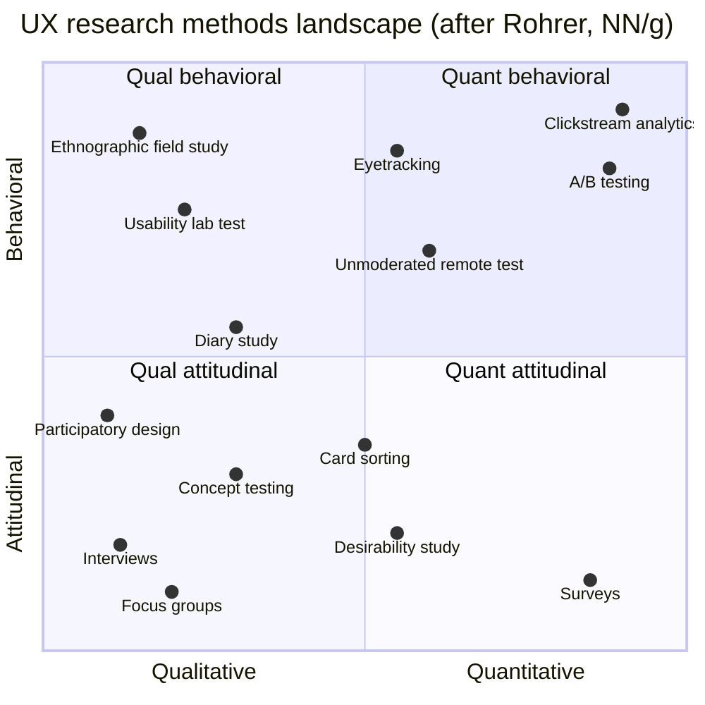
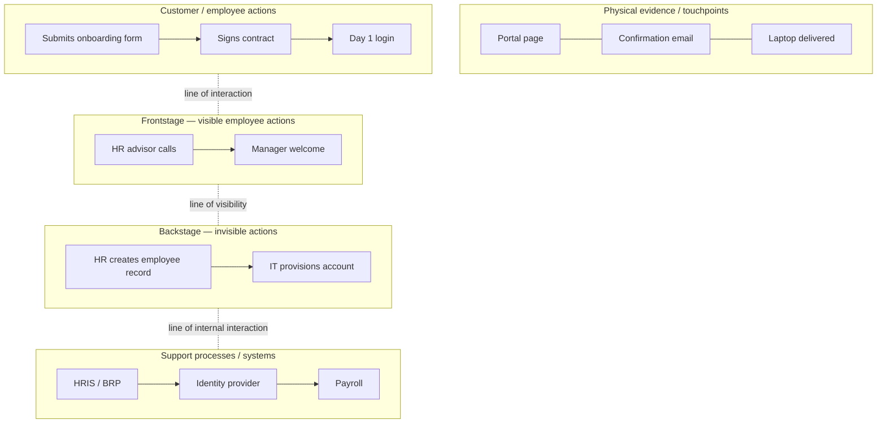

# UX Research Methods

> **TL;DR** — Choose methods by question: *what people say* (attitudinal) vs *what people do* (behavioural), *why/how* (qualitative) vs *how many/how much* (quantitative), and product phase (discover → explore → test → listen). Interviews and contextual inquiry discover needs; usability tests find problems (5 users per round per user group finds ~85% of *common* problems — iterate rather than test once with many); card sorting and tree testing shape IA; surveys and analytics quantify; A/B tests prove causality at scale. Synthesise with affinity mapping into personas, journey maps, service blueprints and JTBD statements.

Related: [Metrics](metrics.md) · [Design processes](design-processes.md) · [Information architecture](information-architecture.md) · [Product management](../02-product-management/README.md) · [Facilitation](../09-leadership-teams-facilitation/README.md)

---

## 1. The NN/g UX research landscape

Christian Rohrer's (NN/g, 2014/2022) framework plots ~20 methods on three dimensions:

1. **Attitudinal vs behavioural** — what people say vs what they do.
2. **Qualitative vs quantitative** — direct observation (why/how to fix) vs indirect measurement (how many/how much).
3. **Context of use** — natural use, scripted use, de-contextualised (not using the product), or a combination.

*(Positions approximate.)*

**Methods by product phase:**

| Phase | Goal | Methods |
|-------|------|---------|
| **Discover / Strategize** | Understand users, context, opportunities | Field studies, contextual inquiry, diary studies, stakeholder interviews, user interviews, JTBD interviews, competitive analysis, data mining, surveys |
| **Explore / Define** | Shape the solution space | Card sorting, journey mapping, personas, service blueprints, participatory design, concept testing, design reviews, prototype feedback |
| **Test / Execute** | Evaluate & improve designs | Usability testing (moderated/unmoderated), tree testing, first-click testing, heuristic evaluation, cognitive walkthrough, accessibility evaluation, benchmark testing |
| **Listen / Assess** | Monitor performance in the wild | Analytics, A/B & multivariate testing, surveys (SUS, NPS, CSAT, CES), search-log analysis, support ticket analysis, feedback widgets, session replay |

Source: <https://www.nngroup.com/articles/which-ux-research-methods/> · <https://www.nngroup.com/articles/ux-research-cheat-sheet/>

---

## 2. Planning research

**Research plan template:**
1. Background & decision to be informed ("We need to decide whether to merge the approval and overview screens")
2. Research questions (3–5; *what we want to learn*, not interview questions)
3. Hypotheses/assumptions to test
4. Method(s) and rationale
5. Participants: profile, segments, number, recruitment channel, incentives (internal users: manager approval, time budget)
6. Logistics: dates, tools, roles (moderator, note-taker, observers)
7. Consent & privacy (GDPR: purpose, retention, recordings, DPIA if sensitive — HR data!)
8. Discussion guide / tasks
9. Analysis approach & deliverables
10. Stakeholders & readout date

**Sample size rules of thumb:**

| Method | Typical n | Rationale |
|--------|----------|-----------|
| Interviews (discovery) | 5–8 per segment; stop at saturation (often 12–20 total) | Guest, Bunce & Johnson (2006): saturation ~12 interviews in homogeneous groups |
| Contextual inquiry | 4–8 per role | Rich data, time-intensive |
| Qualitative usability test | 5 per user group per iteration | Nielsen & Landauer |
| Quantitative usability test / benchmark | ≥ 20–40 per group | Narrower confidence intervals (MeasuringU) |
| Card sort (open) | 15–20 (Tullis & Wood 2004: 15 gives ~0.90 correlation) | |
| Tree test | ≥ 50 per tree (Optimal Workshop suggests 50+) | |
| First-click test | 30+ | |
| Survey | Depends on margin of error: ~385 for ±5% at 95% for large populations; ~100 gives ±10% | `n = z²·p(1-p)/e²` |
| A/B test | Power calculation: often thousands per variant | Depends on baseline conversion & minimum detectable effect |
| Diary study | 10–15 | Dropout |

---

## 3. Method reference

### 3.1 User interviews (semi-structured)

- **Purpose:** goals, context, pain points, mental models, vocabulary. Attitudinal, qualitative.
- **Structure:** intro & consent (5 min) → warm-up (role, context) → main topics (open questions, "tell me about the last time you…") → wrap-up ("anything I should have asked?").
- **Good questions:** open, about past behaviour, specific instances. Ask "why" (5 Whys) carefully — prefer "what made you…".
- **Avoid:** leading ("Wouldn't it be easier if…"), hypotheticals ("Would you use…?"), double-barrelled, future predictions, asking users to design the solution.
- *The Mom Test* (Rob Fitzpatrick, 2013): talk about their life not your idea; ask about specifics in the past; talk less, listen more.
- Interviewer techniques: echoing, silence (count to 7), boomerang ("what do you think it does?"), Columbo (playing dumb).

**When to use:** early discovery, understanding motivations. **When not:** to evaluate usability ("what do you think of this button?") — observe behaviour instead.

Source: <https://www.nngroup.com/articles/user-interviews/>

### 3.2 Contextual inquiry

- **Origin:** Hugh Beyer & Karen Holtzblatt, *Contextual Design* (1997).
- **Model:** master–apprentice. Researcher observes users doing real work in their environment and asks questions as they go.
- **Four principles:** **context** (go to the workplace), **partnership** (user as expert), **interpretation** (verify interpretations with the user), **focus** (have a clear research focus).
- **Output:** work models — flow, sequence, artifact, cultural, physical models; affinity diagram.
- **Excellent for enterprise/ERP:** reveals workarounds (Excel side-sheets, sticky notes with codes, printed lists), interruptions, multi-monitor setups, copy-paste between systems.
- Duration: 1–2 hours per session.

Source: <https://www.nngroup.com/articles/contextual-inquiry/>

### 3.3 Ethnographic field studies / shadowing

Longer immersion, less interaction than contextual inquiry. "Fly on the wall." Useful for shop floors, warehouses, call centres, greenhouses/logistics floors.

### 3.4 Usability testing

**Variants:**

| Type | Description | Pros | Cons |
|------|------------|------|------|
| Moderated in-person | Facilitator with participant in lab/office | Rich observation, follow-up | Costly, geographic |
| Moderated remote | Video call, screen share (Teams/Zoom/Lookback) | Wide reach, cheap | Tech friction |
| Unmoderated remote | Tool records participant doing tasks (Maze, UserTesting, Lyssna, Useberry) | Fast, scalable, quant possible | No follow-up, professional testers |
| Guerrilla / hallway | Quick tests with whoever's available | Very cheap | Non-representative |
| Benchmark / summative | Quantitative, measure task success & time | Comparison over time/competitors | Larger n |
| Formative | Qualitative, find problems to fix | Iterative | Not statistically generalisable |

**Process:**
1. Define goals & tasks (realistic scenarios, not instructions: "You need to take next Friday off" — not "Click Leave → New request").
2. Recruit representative users (screener).
3. Pilot test.
4. Run: intro, consent, **think-aloud protocol** (concurrent or retrospective), tasks, post-task questions (SEQ), post-test questionnaire (SUS/UMUX-Lite), debrief.
5. Facilitator rules: don't lead, don't help (unless stuck — then note it as a failure), neutral responses ("What are you thinking?" "What would you expect?"), let silence happen.
6. Analyse: list issues, frequency, severity; highlight reels.
7. Report: top findings, severity, recommendations, video clips.

**Rainbow spreadsheet** (Tomer Sharon): rows = observations, columns = participants, coloured cells → quick collaborative analysis.

**The "5 users" rule (Nielsen & Landauer, 1993; Nielsen 2000):**

`Problems found = N · (1 − (1 − L)^n)`, where `N` = total problems, `L` ≈ 0.31 (average proportion found by one user), `n` = number of users. With n = 5: 1 − 0.69⁵ ≈ **0.84**.

**Caveats:**
- `L` = 0.31 is an average; real values vary widely (Faulkner 2003: with 5 users, found between 55% and 99% of problems; Spool & Schroeder 2001: much lower for complex sites).
- Applies to **one user group** — test 3–4 per group if groups differ (e.g. HR admin vs employee vs manager).
- Applies to **qualitative, formative** testing; not for metrics (need ≥ 20).
- Finds *common* problems; rare but severe problems need more users.
- The real point: **iterate** — 3 rounds of 5 beat 1 round of 15.
- Large/complex products need many test rounds covering different areas.

Source: <https://www.nngroup.com/articles/why-you-only-need-to-test-with-5-users/> · <https://www.nngroup.com/articles/usability-testing-101/>

### 3.5 Cognitive walkthrough

Expert method (Wharton, Rieman, Lewis, Polson, 1994). For each step of a task, ask:
1. Will the user try to achieve the right effect?
2. Will the user notice that the correct action is available?
3. Will the user associate the correct action with the effect they want?
4. If the correct action is performed, will the user see that progress is being made?

Good for learnability of new/infrequent tasks (annual review, year-end payroll).

### 3.6 Card sorting

- **Open:** participants group cards *and* name groups → discover mental models and vocabulary.
- **Closed:** predefined categories → validate a proposed structure.
- **Hybrid:** predefined categories + can create new ones.
- 30–60 cards typical (max ~100); representative content items, not features named in jargon.
- Analysis: similarity matrix (% of participants pairing two cards), dendrogram (hierarchical clustering), standardisation grid.
- Tools: Optimal Workshop OptimalSort, Maze, Lyssna, UXtweak; physical cards for in-person (with think-aloud).

Source: <https://www.nngroup.com/articles/card-sorting-definition/>

### 3.7 Tree testing (reverse card sorting)

- Participants find items in a text-only hierarchy (no visual design) — tests IA findability in isolation.
- Metrics: **success rate** (direct vs indirect), **directness** (no backtracking), time, **first click** (path where they started), destination distribution.
- Run before and after IA changes; compare variants; target ≥ 70–80% success on key tasks.
- Tools: Treejack (Optimal Workshop), UXtweak, Maze.

Source: <https://www.nngroup.com/articles/tree-testing/>

### 3.8 First-click testing

Bob Bailey & Cari Wolfson (2006/2009): when the first click is correct, ~87% complete the task successfully vs ~46% when wrong. Test with screenshots/wireframes.

### 3.9 Surveys

- **Use for:** quantifying attitudes, segmenting, prioritising, measuring satisfaction over time. **Not for:** discovering why, predicting behaviour.
- **Question types:** Likert (5- or 7-point, label all points), semantic differential, multiple choice, ranking (≤ 5–7 items), open-ended (sparingly), MaxDiff (best-worst scaling), Kano questionnaire (functional/dysfunctional pairs), Van Westendorp (price sensitivity).
- **Rules:** keep short (< 5–10 min), one concept per question, neutral wording, balanced scales with mid-point if a neutral opinion is legitimate, include "don't know/not applicable", randomise option order (except ordered scales), pilot test, avoid double negatives and absolutes.
- **Biases:** sampling, non-response, social desirability, acquiescence (yes-saying), order effects, central tendency.
- Tools: Microsoft Forms, Google Forms, Qualtrics, Typeform, SurveyMonkey, LimeSurvey (self-hosted, GDPR-friendly).

### 3.10 A/B and multivariate testing

- Randomised controlled experiment on live traffic; measures causal effect of a change on a metric.
- **Requirements:** enough traffic, a primary metric (OEC — Overall Evaluation Criterion, Kohavi), pre-defined hypothesis, sample size via power analysis (α = 0.05, power 0.8), fixed duration (≥ 1–2 business cycles), guardrail metrics.
- **Pitfalls:** peeking (stopping early when significant — inflates false positives; use sequential testing if you must), novelty/primacy effects, sample ratio mismatch (SRM), multiple comparisons, Simpson's paradox, testing tiny changes without enough power, optimising for local maxima.
- **Sample size approx (two proportions):** `n per variant ≈ 16 · p(1−p) / δ²` (α 0.05 two-sided, power 0.8), where `p` = baseline rate, `δ` = absolute minimum detectable effect. E.g. p = 0.10, δ = 0.01 → n ≈ 14,400 per variant.
- **Enterprise reality:** internal tools rarely have traffic for A/B tests → rely on usability testing, feature flags with staged rollouts, before/after metrics with caution.
- Reference: Kohavi, Tang & Xu, *Trustworthy Online Controlled Experiments* (2020).

Source: <https://en.wikipedia.org/wiki/A/B_testing>

### 3.11 Diary studies

- Participants self-report experiences over time (days–weeks) — via app (dscout, Indeemo), messaging, forms.
- **Use for:** longitudinal behaviour, infrequent tasks, multi-channel journeys, habit formation, monthly processes (payroll close, expense claims).
- Structure: briefing, logging prompts (interval-, signal-, or event-contingent), periodic check-ins, debrief interview.
- Pitfalls: dropout, fatigue — incentivise per entry and completion; keep prompts short.

Source: <https://www.nngroup.com/articles/diary-studies/>

### 3.12 Jobs-to-be-Done (JTBD) interviews

- **Theory:** people "hire" products to make progress in a particular circumstance (Clayton Christensen, *Competing Against Luck*, 2016; milkshake example). Two schools: **Jobs-as-Activities** (Tony Ulwick, Outcome-Driven Innovation, Strategyn — job maps & desired-outcome statements) and **Jobs-as-Progress** (Bob Moesta, Chris Spiek — Switch interviews, forces of progress).
- **Switch interview:** reconstruct the timeline of a recent switch: first thought → passive looking → active looking → deciding → consuming/onboarding → satisfaction.
- **Forces of progress:** Push of the situation + Pull of the new solution vs Anxiety of the new + Habit of the present.
- **Job statement format:** `When [situation], I want to [motivation], so I can [expected outcome].` (Job Story — Alan Klement / Intercom).
- **Desired outcome statement (ODI):** `[Direction: minimize] + [metric: the time it takes] + [object: to verify] + [clarifier: that hours match the roster]`.
- **Job map (Ulwick & Bettencourt):** Define → Locate → Prepare → Confirm → Execute → Monitor → Modify → Conclude.

Sources: <https://www.christenseninstitute.org/theory/jobs-to-be-done/> · <https://strategyn.com/jobs-to-be-done/>

### 3.13 Focus groups

Group discussion (6–10 people). Good for attitudes and reactions, **poor for usability** (groupthink, dominant voices, says ≠ does). NN/g generally discourages for UX evaluation.

### 3.14 Other methods (brief)

| Method | What it is | Use |
|--------|-----------|-----|
| Stakeholder interviews | Business goals, constraints, politics | Project kick-off |
| Competitive / comparative analysis | Review competitors and analogous products | Discovery |
| Analytics / data mining | Funnels, paths, feature usage, search logs, error logs | Listen; find where to look |
| Session replay & heatmaps | Hotjar, Microsoft Clarity, FullStory | Diagnose observed drop-offs (mind privacy masking!) |
| Desirability study (Microsoft Product Reaction Cards, 118 words, Benedek & Miner 2002) | Participants pick adjectives | Brand/visual direction |
| 5-second test | Show design 5 s, ask recall | Clarity of purpose / hierarchy |
| Preference test | A vs B | Visual direction (weak evidence) |
| Eye tracking | Gaze patterns | Attention research (costly) |
| Participatory / co-design | Users design with you | Buy-in, domain-heavy tools |
| Kano survey | Feature categorisation | Prioritisation (see [design-processes.md](design-processes.md#7-kano-model)) |
| Accessibility testing with users | AT users perform tasks | Real-world barriers |
| Support ticket analysis | Categorise tickets | Prioritise pain points (great in enterprise) |
| Wizard of Oz | Human simulates system | Test AI/automation concepts |
| Concierge test | Manually deliver the service | Validate value before building |
| Fake door / painted door | Button to a not-yet-built feature | Demand validation (ethically: explain and apologise) |

---

## 4. Synthesis & artefacts

### 4.1 Affinity mapping (affinity diagram, KJ method)

- **Origin:** Jiro Kawakita, 1960s (KJ method).
- **Steps:** 1) write one observation per sticky (quote, behaviour, pain point — with participant ID) → 2) silently cluster bottom-up → 3) name clusters with insight statements ("Managers approve in bulk on Monday mornings") → 4) group clusters into themes → 5) vote/prioritise → 6) derive insights → opportunities ("How might we…").
- Tools: FigJam, Miro, Mural, Dovetail (repository + tagging), physical stickies.
- Distinguish **observation** (what happened) → **finding** (pattern) → **insight** (why it matters) → **recommendation**.

Source: <https://www.nngroup.com/articles/affinity-diagram/>

### 4.2 Personas vs proto-personas

| | Research-based persona | Proto-persona (Jeff Gothelf, Lean UX) |
|--|------------------------|-------------------------------------|
| Basis | Qualitative research (+ quant segmentation) | Team's assumptions, workshop |
| Effort | Weeks | 1–2 hours |
| Confidence | Higher | Low — hypotheses to validate |
| Use | Ongoing design decisions, alignment | Start quickly; replace with validated persona |

- **Origin:** Alan Cooper, *The Inmates Are Running the Asylum* (1999); goal-directed design.
- **Content:** name/role, photo (or illustration — avoid stereotypes), goals, behaviours, pain points, context (devices, environment, frequency), skills/domain expertise, quote, scenarios. Avoid irrelevant demographics that don't drive design.
- **Types:** primary, secondary, negative (who we're *not* designing for), **role-based** personas (enterprise: HR administrator, line manager, employee, payroll specialist, auditor).
- **Criticism:** often fictional, unused, stereotyping; many teams prefer JTBD or behavioural archetypes. Keep personas evidence-linked and few (3–5).

Source: <https://www.nngroup.com/articles/persona/>

### 4.3 Empathy map

Dave Gray (XPLANE). Quadrants: **Says**, **Thinks**, **Does**, **Feels** (+ updated 2017 version: Goal, See, Hear, Pains, Gains). Quick alignment tool after interviews; one map per persona/segment.

Source: <https://www.nngroup.com/articles/empathy-mapping/>

### 4.4 Customer/user journey map

- Visualises the process a person goes through to accomplish a goal, across time and channels.
- **Components:** actor (persona) · scenario & expectations · phases (e.g. Aware → Request → Approve → Prepare → Day 1 → First month for onboarding) · actions · thoughts · emotions (curve) · touchpoints/channels · pain points · opportunities · ownership (internal).
- **Types:** current-state (as-is), future-state (to-be), day-in-the-life, experience map (product-agnostic).
- Ground in research, not assumptions; co-create in workshops; link to metrics.

Source: <https://www.nngroup.com/articles/journey-mapping-101/>

### 4.5 Service blueprint

- **Origin:** G. Lynn Shostack, *Harvard Business Review*, 1982/1984.
- Extends the journey map with the organisation's side:

- Lines: **line of interaction**, **line of visibility**, **line of internal interaction**. Add time, metrics, fail points, wait points.
- Ideal for enterprise and government services spanning departments and systems (onboarding, permit applications, procurement).

Source: <https://www.nngroup.com/articles/service-blueprints-definition/>

### 4.6 Other synthesis artefacts

- **User stories / job stories** → backlog (see [../04-agile-kanban-scrum/README.md](../04-agile-kanban-scrum/README.md)).
- **User flows / task flows** — step diagrams of a single task.
- **Mental model diagram** (Indi Young, 2008) — towers of user behaviours aligned with product support.
- **Opportunity Solution Tree** (Teresa Torres, *Continuous Discovery Habits*, 2021): outcome → opportunities → solutions → assumption tests.
- **"How Might We"** questions (Procter & Gamble 1970s, popularised by IDEO).
- **Research repository / atomic research** (Tomer Sharon, Daniel Pidcock): experiments → facts → insights → recommendations; tools: Dovetail, Condens, EnjoyHQ, Notion.

---

## 5. Research ops & ethics

- Informed consent (purpose, recording, data use, withdrawal), GDPR lawful basis, pseudonymise notes (P1, P2), store recordings securely with retention period; DPIA for sensitive data (health, HR, BSN).
- Internal users: get managers' permission for time; guarantee results won't be used to evaluate their performance.
- Incentives: external €50–100/hour typical (B2B professionals more); internal: thank-you, early access, influence.
- Recruit: customer panels, CRM, in-app intercepts, recruiting agencies, Respondent/User Interviews/Prolific.
- Continuous discovery: weekly touchpoints with customers by the product trio (PM, designer, tech lead) — Teresa Torres.
- ResearchOps community framework: participants, governance, knowledge, tools, competency, advocacy.

---

## 6. Choosing a method — decision table

| Question | Method |
|----------|--------|
| Who are our users and what do they need? | Interviews, contextual inquiry, field studies, surveys (segmentation) |
| How do they do this today (workarounds)? | Contextual inquiry, shadowing, artefact analysis |
| What job are they hiring the product for? | JTBD switch interviews |
| How should we structure navigation? | Open card sort → tree test |
| Can people use this design? | Usability test (moderated, 5 per group, iterate) |
| Which design performs better at scale? | A/B test (if traffic) or quant usability benchmark |
| How satisfied are users over time? | SUS/UMUX-Lite/CSAT benchmarks; analytics |
| Where do users drop off? | Funnel analytics → session replay → usability test |
| How does experience evolve over weeks? | Diary study |
| What features matter most? | Kano, MaxDiff, top-task analysis (Gerry McGovern) |
| Is it accessible? | Audit + testing with AT users |

## Common mistakes

- Asking users what they want instead of observing what they do ("faster horses" — quote misattributed to Henry Ford).
- Recruiting colleagues/proxies (sales, product owners) instead of actual users.
- Leading questions and helping during usability tests.
- Testing only once at the end ("validation theatre").
- Treating 5-user qualitative results as percentages ("60% of users…").
- Research without a decision to inform → reports nobody reads.
- Synthesising alone; not involving the team in observation (Jared Spool: exposure hours — each team member ≥ 2 h every 6 weeks).
- Over-relying on surveys/NPS for diagnosis.

## References

- NN/g — When to use which UX research methods: <https://www.nngroup.com/articles/which-ux-research-methods/>
- NN/g — UX research cheat sheet: <https://www.nngroup.com/articles/ux-research-cheat-sheet/>
- NN/g — Why you only need to test with 5 users: <https://www.nngroup.com/articles/why-you-only-need-to-test-with-5-users/>
- NN/g — Usability testing 101: <https://www.nngroup.com/articles/usability-testing-101/>
- NN/g — Contextual inquiry: <https://www.nngroup.com/articles/contextual-inquiry/>
- NN/g — Card sorting: <https://www.nngroup.com/articles/card-sorting-definition/>
- NN/g — Tree testing: <https://www.nngroup.com/articles/tree-testing/>
- NN/g — Diary studies: <https://www.nngroup.com/articles/diary-studies/>
- NN/g — Personas: <https://www.nngroup.com/articles/persona/>
- NN/g — Empathy mapping: <https://www.nngroup.com/articles/empathy-mapping/>
- NN/g — Journey mapping 101: <https://www.nngroup.com/articles/journey-mapping-101/>
- NN/g — Service blueprints: <https://www.nngroup.com/articles/service-blueprints-definition/>
- NN/g — Affinity diagramming: <https://www.nngroup.com/articles/affinity-diagram/>
- NN/g — User interviews: <https://www.nngroup.com/articles/user-interviews/>
- Christensen Institute — JTBD: <https://www.christenseninstitute.org/theory/jobs-to-be-done/>
- Strategyn — JTBD / ODI: <https://strategyn.com/jobs-to-be-done/>
- The Mom Test: <https://www.momtestbook.com/>
- MeasuringU (Jeff Sauro): <https://measuringu.com/>
- Optimal Workshop: <https://www.optimalworkshop.com/>
- A/B testing: <https://en.wikipedia.org/wiki/A/B_testing>
- Teresa Torres — Product Talk: <https://www.producttalk.org/>
- Service blueprint: <https://en.wikipedia.org/wiki/Service_blueprint>
- Contextual design: <https://en.wikipedia.org/wiki/Contextual_design>
