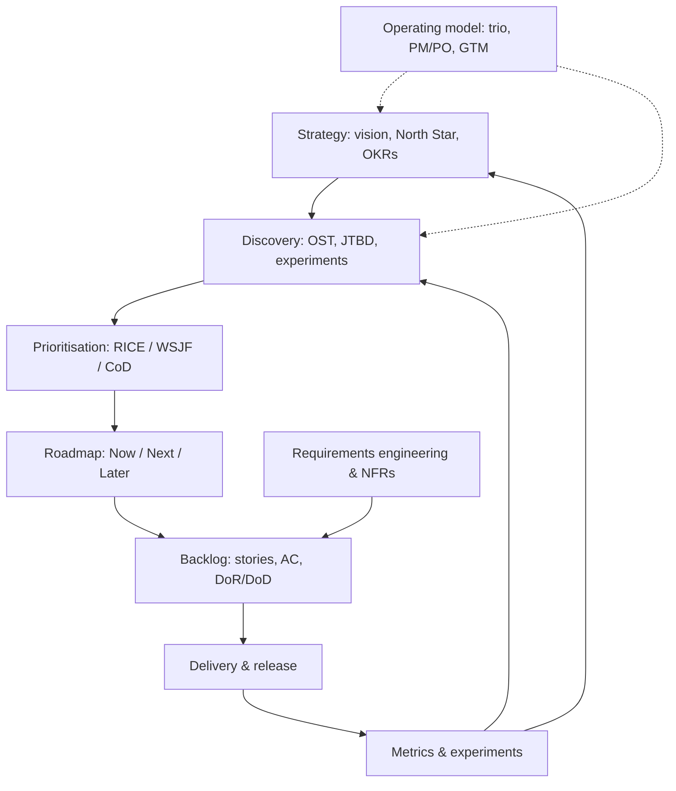

# 02 — Product Management & Product Ownership

> **TL;DR** — How to decide *what* to build and *why*, and how to prove it worked. This section covers discovery (Cagan, Torres, Lean Startup), customer value (JTBD, Value Proposition Canvas, Kano), strategy and goals (vision, North Star, OKRs, PMF), prioritisation (RICE, WSJF, Cost of Delay, story/impact mapping), backlog craft (user stories, INVEST, BDD, splitting), requirements engineering (ISO 25010, use cases, traceability), roadmaps, metrics and A/B testing, the product operating model (trio, PM vs PO, internal/B2B products, pricing, GTM) and ready-to-use templates.

---

## Files

| File | What's inside |
|---|---|
| [product-discovery.md](product-discovery.md) | Four big risks (Cagan), Continuous Discovery & Opportunity Solution Tree (Torres), dual-track agile, assumption mapping, experiment catalogue (fake door, concierge, Wizard of Oz, smoke test), Lean Startup, Lean Canvas, interviewing |
| [jobs-to-be-done-and-value.md](jobs-to-be-done-and-value.md) | JTBD schools (Christensen, Moesta forces, Ulwick ODI with opportunity scoring, Klement job stories), Value Proposition Canvas, Kano model with evaluation table and coefficients |
| [product-strategy.md](product-strategy.md) | Mission/vision/strategy stack, Rumelt kernel, North Star framework, OKRs (scoring, examples), KPIs vs OKRs, product-market fit (Ellis 40%), lifecycle, Crossing the Chasm, Wardley mapping (brief) |
| [prioritization-frameworks.md](prioritization-frameworks.md) | RICE, ICE, MoSCoW, Cost of Delay & CD3, WSJF, value vs effort, weighted scoring, Kano/opportunity scoring, Buy-a-Feature, story mapping, impact mapping — with formulas and worked examples |
| [backlog-and-user-stories.md](backlog-and-user-stories.md) | Backlog hierarchy, Connextra stories, 3 Cs, INVEST, Given/When/Then & example mapping, DoR/DoD, SPIDR and Lawrence's splitting patterns, estimation, refinement, item template |
| [requirements-engineering.md](requirements-engineering.md) | RE activities, requirement types, EARS syntax, ISO/IEC 25010 NFR model, stakeholder analysis, elicitation techniques, use cases, decision tables, traceability matrix, RE for ERP/integration/AI |
| [roadmaps-and-release-planning.md](roadmaps-and-release-planning.md) | Roadmap types, Now/Next/Later, outcome and theme roadmaps, dates vs uncertainty, audiences, release strategies, release readiness checklist |
| [product-metrics-and-analytics.md](product-metrics-and-analytics.md) | Metric types, AARRR, HEART/GSM, NPS/CES/SUS, retention cohorts, churn, funnels, DAU/MAU, LTV/CAC & SaaS metrics, analytics tools & tracking plans, A/B testing statistics (sample size, power, peeking, SRM) |
| [product-operating-model-and-roles.md](product-operating-model-and-roles.md) | Project vs product model, product trio, PM vs PO, internal products & platforms, B2B/enterprise PM, pricing (value-based, tiers, WTP research), go-to-market & launch tiers |
| [templates.md](templates.md) | Opportunity assessment (Cagan's 10 questions), one-pager, Amazon PR/FAQ, product brief, PRD, experiment/learning cards, release notes, decision record, stakeholder update |
| [resources.md](resources.md) | Books, people, newsletters, certifications, tools, standards, free online resources |

---

## How the pieces fit

## Quick reference — most-used formulas

| Name | Formula |
|---|---|
| RICE | (Reach × Impact × Confidence) / Effort |
| ICE | Impact × Confidence × Ease |
| WSJF | (User-Business Value + Time Criticality + RR/OE) / Job Size |
| CD3 | Cost of Delay / Duration |
| Opportunity score (Ulwick) | Importance + max(Importance − Satisfaction, 0) |
| Kano Better / Worse | (A+O)/(A+O+M+I) ; −(O+M)/(A+O+M+I) |
| Sean Ellis PMF | ≥ 40% "very disappointed" |
| NPS | % promoters (9–10) − % detractors (0–6) |
| LTV (simple) | ARPA × gross margin / churn rate |
| LTV:CAC | ≥ 3 healthy |
| NRR | (start MRR − churn − contraction + expansion) / start MRR |
| A/B sample size (per variant, rule of thumb) | n ≈ 16 σ² / δ² (α = 0.05, power 0.8) |
| OKR stretch score | ~0.7 = good |

## Starter checklist for a new product / initiative

- [ ] Opportunity assessment answered (problem, for whom, size, why now, metric)
- [ ] Outcome metric with baseline and target
- [ ] Trio formed; weekly customer touchpoints scheduled
- [ ] Opportunity Solution Tree started; riskiest assumptions mapped
- [ ] First experiments with success criteria defined
- [ ] Story map with walking-skeleton slice
- [ ] Tracking plan and dashboard before first release
- [ ] Now/Next/Later roadmap shared with stakeholders
- [ ] DoD includes quality, security, accessibility, analytics

## Related sections

| Section | Relation |
|---|---|
| [../01-ux-ui/README.md](../01-ux-ui/README.md) | User research, usability testing, design systems |
| [../03-project-management/README.md](../03-project-management/README.md) | Projects, scope/schedule/budget, stakeholders |
| [../04-agile-kanban-scrum/README.md](../04-agile-kanban-scrum/README.md) | Scrum events, Kanban flow, SAFe, forecasting |
| [../05-software-architecture/README.md](../05-software-architecture/README.md) | Quality attributes, ADRs, architecture trade-offs |
| [../06-cloud-architecture/README.md](../06-cloud-architecture/README.md) | Platforms, deployment strategies, cost |
| [../07-data-ai-architecture/README.md](../07-data-ai-architecture/README.md) | Data products, analytics stack, AI features |
| [../08-engineering/README.md](../08-engineering/README.md) | CI/CD, testing, BDD, feature flags, DORA |
| [../09-leadership-teams-facilitation/README.md](../09-leadership-teams-facilitation/README.md) | Team topologies, workshops, stakeholder influence |
| [../10-laws-principles-mental-models/README.md](../10-laws-principles-mental-models/README.md) | Goodhart, Pareto, biases, decision making |
| [../11-enterprise-architecture-business/README.md](../11-enterprise-architecture-business/README.md) | Business strategy, Wardley maps, capability maps |

## References

- SVPG — https://www.svpg.com/
- Product Talk — https://www.producttalk.org/
- Scrum Guide — https://scrumguides.org/
- Product management (Wikipedia) — https://en.wikipedia.org/wiki/Product_management
- Mind the Product — https://www.mindtheproduct.com/
