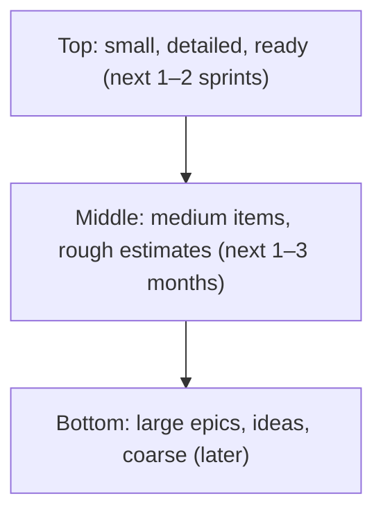
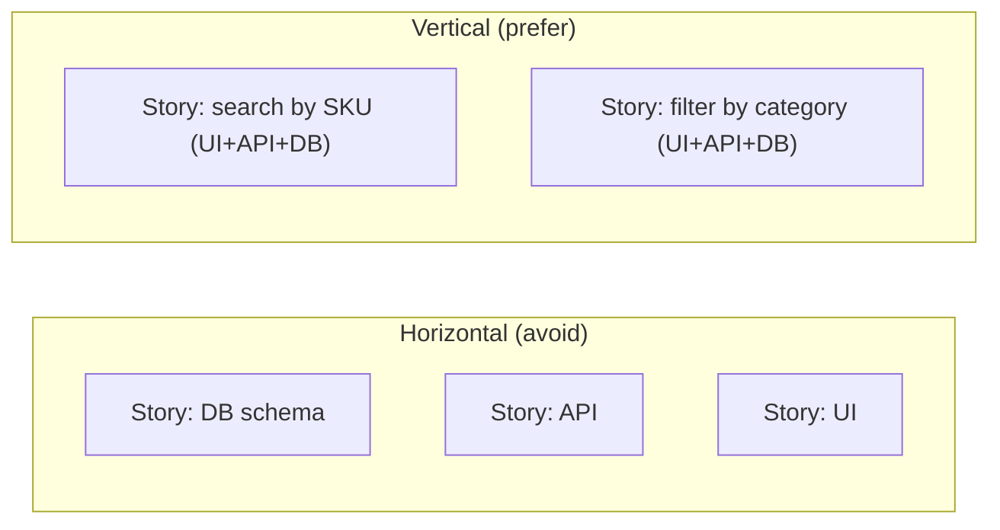

# Backlog Management & User Stories

> **TL;DR** — A product backlog is an ordered list of what the team might do next to reach the product goal; only the top is detailed. Write user stories in the Connextra format ("As a… I want… so that…"), check them against INVEST, treat them as Card–Conversation–Confirmation (3 Cs), express acceptance criteria as Given/When/Then (BDD), and split them vertically (SPIDR, Lawrence's patterns) until each fits comfortably in a few days. Use Definition of Ready sparingly and Definition of Done strictly. Refine continuously (~10% of capacity).

---

## 1. Hierarchy of backlog items

| Level | Typical size | Owner | Example | Notes |
|---|---|---|---|---|
| **Theme / Strategic theme** | Quarters–years | Product leadership | "Customer self-service" | Ties to strategy/OKRs |
| **Initiative** | 1–2 quarters | Product manager | "Self-service ordering for B2B top accounts" | Often = roadmap item |
| **Epic** | Weeks–months | PO/PM | "Contract-aware product catalogue" | Too big for a sprint; hypothesis-driven |
| **Feature** (SAFe, Azure DevOps) | Fits in a PI / a few sprints | PM/PO | "Show contract price per SKU" | Some tools put Feature between Epic and Story |
| **User story / PBI** | 1–5 days | PO + team | "As a buyer I want to see my contract price…" | Fits in a sprint, ideally ≤ ½ sprint |
| **Task / sub-task** | Hours | Developers | "Add price endpoint", "Write migration" | Team-owned; not a PO concern |
| **Bug / defect** | Varies | Team / PO | "Price shows VAT twice" | Prioritised in the same backlog |
| **Spike** | Time-boxed | Team | "Investigate ERP price API limits (2 days)" | Output = knowledge/decision |
| **Enabler / tech debt** | Varies | Tech lead + PO | "Upgrade auth library" | Make value explicit (risk, speed) |

Jira default: Epic → Story/Task/Bug → Sub-task. Azure DevOps Agile: Epic → Feature → User Story → Task. SAFe: Epic → Capability → Feature → Story.

### Product backlog (Scrum Guide 2020)

- "An emergent, ordered list of what is needed to improve the product." Single source of work for the Scrum Team.
- Commitment: **Product Goal**. Product Owner is accountable for ordering and transparency.
- **DEEP** (Roman Pichler & Mike Cohn): **D**etailed appropriately, **E**stimated, **E**mergent, **P**rioritised.
- Keep it short: > ~3–6 months of work at the top-level is usually waste; archive the rest or move to an ideas list.



---

## 2. User stories

Origin: Kent Beck (Extreme Programming, ~1997–99). Connextra format created at Connextra (UK) in 2001 (Rachel Davies et al.). Popularised by Mike Cohn, *User Stories Applied* (2004).

### Connextra format

> **As a** [role/persona], **I want** [capability/goal], **so that** [benefit/value].

| Weak | Better |
|---|---|
| As a user, I want a button to export. | As a **purchasing manager**, I want to **export last quarter's orders per location to Excel** so that **I can reconcile them with our budget**. |
| As the system, I want to sync addresses. | As a **customer admin**, I want **delivery addresses from our ERP to appear in the portal automatically** so that **buyers don't pick outdated addresses**. |
| As a developer, I want to refactor the pricing module. | (Technical enabler — write as task with explicit value: "Refactor pricing module to allow contract-specific rules; unblocks stories X, Y; reduces price-bug rate.") |

Alternatives: **job stories** (When… I want to… so I can… — see [jobs-to-be-done-and-value.md](jobs-to-be-done-and-value.md)), **Feature-Driven Development** format "<action> the <result> <by|for|of|to> a(n) <object>", plain problem statements.

### 3 Cs (Ron Jeffries, 2001)

| C | Meaning |
|---|---|
| **Card** | Short written token; a placeholder, not a spec |
| **Conversation** | The details emerge in discussion between PO, devs, testers, users |
| **Confirmation** | Acceptance criteria / tests that confirm the story is done |

"A story is a promise for a conversation" (Alistair Cockburn).

### INVEST (Bill Wake, 2003)

| Letter | Criterion | Check question |
|---|---|---|
| **I** | Independent | Can it be built and released in any order? (Minimise dependencies) |
| **N** | Negotiable | Is the "how" open for discussion? Not a contract |
| **V** | Valuable | Does it deliver value to a user/customer (or clearly to the business)? |
| **E** | Estimable | Does the team understand it enough to size it? |
| **S** | Small | Fits in a sprint (ideally a few days) |
| **T** | Testable | Can we write acceptance criteria / tests? |

Also for tasks: **SMART** (Specific, Measurable, Achievable, Relevant, Time-boxed).

### Vertical vs horizontal slicing



Vertical slices deliver testable user value through every layer; horizontal slices deliver nothing usable until all layers exist.

---

## 3. Acceptance criteria

Two common styles:

**Rule-oriented (checklist)**

- Contract price is shown per SKU for logged-in users linked to a contract.
- If no contract price exists, list price is shown with label "List price".
- Prices show excl. VAT with currency.
- Price validity date is visible on hover/tap.

**Scenario-oriented (Gherkin / BDD)** — Dan North introduced BDD (~2003–2006); Given/When/Then format; Cucumber (Aslak Hellesøy, 2008) uses Gherkin syntax.

```gherkin
Feature: Contract prices in catalogue

  Scenario: Buyer with a contract sees the contract price
    Given buyer "Anna" belongs to account "ACME" with contract C-12
    And SKU "BOLT-10" has contract price 0.42 EUR in C-12 valid until 2026-12-31
    When Anna views SKU "BOLT-10"
    Then she sees the price "€0.42 excl. VAT"
    And she sees "Contract price, valid until 31 Dec 2026"

  Scenario: No contract price available
    Given buyer "Anna" belongs to account "ACME" with contract C-12
    And SKU "NUT-5" has no price in C-12 and list price 0.10 EUR
    When Anna views SKU "NUT-5"
    Then she sees the price "€0.10 excl. VAT" labelled "List price"

  Scenario Outline: Quantity must respect packaging unit
    Given SKU "<sku>" is sold per <unit>
    When Anna enters quantity <qty>
    Then the quantity is <result>
    Examples:
      | sku     | unit | qty | result          |
      | BOLT-10 | 100  | 250 | rounded to 300  |
      | NUT-5   | 1    | 7   | accepted as 7   |
```

**Good acceptance criteria**: testable, outcome-focused (not UI implementation detail unless it matters), include edge cases and error paths, cover relevant NFRs (performance, permissions, audit), written **before** development (ideally together — the "Three Amigos": business, dev, test).

**Example mapping** (Matt Wynne, 2015): 25-minute session per story with coloured cards: yellow = story, blue = rules, green = examples, red = questions. Too many reds → not ready; too many blues → split the story.

**Specification by Example** (Gojko Adzic, 2011): key examples as living documentation, automated as acceptance tests.

---

## 4. Definition of Ready (DoR)

Not part of the Scrum Guide; a team agreement. Use as a **checklist for conversation**, not a gate that creates mini-waterfall.

**Example DoR**

- [ ] Story has a clear user/value ("so that…") and links to epic/goal
- [ ] Acceptance criteria written and understood by the team
- [ ] Sized by the team; fits in ≤ half a sprint
- [ ] Dependencies identified (and resolved or planned)
- [ ] UX designs / prototypes available where needed
- [ ] Data, test data and environments known
- [ ] Relevant NFRs noted (security, performance, privacy, accessibility)
- [ ] No open "red cards" (questions)

**Anti-pattern**: DoR so strict that stories need full specs before work → kills collaboration.

## 5. Definition of Done (DoD)

Mandatory in Scrum (2020: "a formal description of the state of the Increment when it meets the quality measures required for the product"). Applies to **all** items; acceptance criteria are item-specific.

**Example DoD**

- [ ] Code reviewed and merged to main
- [ ] Unit and integration tests written and passing; coverage not decreased
- [ ] Acceptance criteria verified (automated where feasible)
- [ ] No known critical/high bugs; static analysis & security scan clean
- [ ] Accessibility checked (WCAG 2.2 AA where applicable)
- [ ] Performance budget respected
- [ ] Documentation updated (API docs, user help, ADR if architectural)
- [ ] Feature flag / telemetry/analytics events in place
- [ ] Deployed to staging (or production behind flag)
- [ ] PO accepted

| | Acceptance criteria | Definition of Done |
|---|---|---|
| Scope | One story | All stories / increment |
| Who writes | PO + team per story | Team (+ org standards) |
| Example | "Contract price shown with validity date" | "Code reviewed, tests pass, deployed to staging" |

---

## 6. Story splitting

### SPIDR (Mike Cohn, 2017)

| Technique | Split by | Example |
|---|---|---|
| **S**pikes | Separate research/learning from building | Spike: evaluate ERP price API; then story: show price |
| **P**aths | Alternative paths through the flow | Pay by invoice vs pay by card |
| **I**nterfaces | Different UIs/devices/integrations | Desktop first, mobile later; CSV import before API |
| **D**ata | Subsets of data types/ranges | Single currency first; multi-currency later |
| **R**ules | Relax business rules initially | Ignore packaging-unit rounding in v1; add it next |

### Richard Lawrence's story splitting patterns (Agile for All, 2009/2012)

| # | Pattern | Example |
|---|---|---|
| 1 | **Workflow steps** | Publish order: first just "submit", later "approve", "schedule" |
| 2 | **Business rule variations** | Discount: flat %, then tiered, then contract-specific |
| 3 | **Major effort** | First credit card type is hard; subsequent ones are easy — split "first" from "rest" |
| 4 | **Simple/complex** | Basic search first; then synonyms, fuzzy matching |
| 5 | **Variations in data** | Dutch addresses first; then other EU formats |
| 6 | **Data entry methods** | Plain text input first; date picker later |
| 7 | **Defer system qualities (performance)** | Make it work; then make it fast (< 200 ms) |
| 8 | **Operations (CRUD)** | Create/read address first; update/delete later |
| 9 | **Use case scenarios** | Happy path first; then alternate/exception flows |
| 10 | **Break out a spike** | When the story is not estimable |

Lawrence's flowchart starts with: does the story satisfy INVEST (except small)? → is it too big? → try patterns in order → evaluate splits: choose the split that lets you **deprioritise or throw away** a part, and that yields more equal-sized stories.

### Other heuristics

- **Hamburger method** (Gojko Adzic, 2012): list technical steps as layers; for each, list quality options (simplest → best); take the thinnest "bite" through all layers.
- **Zero/One/Many**: handle one item, then many.
- **Happy path first**, edge cases later.
- **Roles**: one user type first.
- **Acceptance criteria as split lines**: each criterion or scenario can become its own story.
- Avoid splitting by **layer** (front-end/back-end) or by **activity** (design/build/test).

---

## 7. Estimation (brief)

| Technique | How | Notes |
|---|---|---|
| Story points | Relative size (Fibonacci 1, 2, 3, 5, 8, 13) | Team-specific, not comparable across teams |
| Planning Poker | Simultaneous reveal, discuss outliers (James Grenning, 2002; popularised by Cohn) | Wideband Delphi variant |
| T-shirt sizes | XS–XL | Good for epics/roadmap |
| Affinity estimation | Silent sorting on a wall | Fast for large backlogs |
| #NoEstimates | Split to similar size and count throughput | Uses flow metrics (cycle time, throughput); see [../04-agile-kanban-scrum/README.md](../04-agile-kanban-scrum/README.md) |
| Monte Carlo forecasting | Simulate from historical throughput | Probabilistic delivery dates ("85% by 12 May") |

---

## 8. Backlog refinement

Scrum Guide: ongoing activity to break down and further define items; usually ≤ 10% of the Developers' capacity.

**Typical cadence**: 1–2 sessions per week, 45–60 min, PO + developers (+ designer, tester). Look 1–2 sprints ahead.

**Agenda**

1. PO presents the goal and top items (context, why now).
2. Team asks questions; clarify acceptance criteria; example mapping.
3. Split large items.
4. Estimate/size.
5. Identify dependencies, risks, spikes.
6. Re-order if new information changes value or cost.

**Backlog hygiene**

- Delete or archive items untouched for > 6 months ("if it's important, it will come back").
- Keep a separate **ideas/opportunity list** outside the delivery backlog.
- Top 10–20 items should always be ready.
- Each item links to a goal/outcome; orphan items are suspicious.
- Bugs triaged within a defined SLA; not all bugs belong in the backlog (won't-fix is OK).
- Tech debt items described in terms of value/risk.

### Backlog item template

```markdown
**Title:** Show contract price per SKU
**Epic / goal:** Contract-aware catalogue → KR: weekly portal-ordering accounts 50 → 120
**Story:** As a buyer at a contract account, I want to see my contract price per item
so that I can order without calling my account manager.
**Context / evidence:** 34% of AM calls are price questions (call log analysis, Q2); 6/8 interviews mentioned it.
**Acceptance criteria:** (Given/When/Then scenarios)
**Out of scope:** Price history, quantity-break prices
**NFRs:** p95 price lookup < 300 ms; price visible only to users of that account (authZ)
**Design:** Figma link
**Analytics:** event `price_viewed` {sku, price_type}
**Dependencies:** ERP price API v2
**Open questions:** VAT display for EU cross-border?
```

---

## 9. Product Owner responsibilities in the backlog (Scrum Guide 2020)

- Developing and explicitly communicating the **Product Goal**.
- Creating and clearly communicating Product Backlog items.
- **Ordering** Product Backlog items.
- Ensuring the Product Backlog is transparent, visible and understood.
- The PO may delegate work but remains accountable; the PO is one person, not a committee.

## 10. Common mistakes

- Backlog as a dumping ground of every request (1,000+ items).
- Stories written as tasks or technical layers.
- "So that" missing or tautological ("so that I can export").
- Acceptance criteria written after development / by the tester alone.
- Using DoR as a contract → mini-waterfall.
- Weak DoD → hidden undone work ("done-done").
- PO as proxy who never lets the team talk to users.
- Estimates turned into commitments and performance metrics.
- Stories too big: anything > ½ sprint should be split.

## Related sections

- Scrum, Kanban, flow metrics: [../04-agile-kanban-scrum/README.md](../04-agile-kanban-scrum/README.md)
- Requirements engineering and NFRs: [requirements-engineering.md](requirements-engineering.md)
- Testing, BDD, CI/CD: [../08-engineering/README.md](../08-engineering/README.md)
- UX design inputs: [../01-ux-ui/README.md](../01-ux-ui/README.md)

## References

- The Scrum Guide — https://scrumguides.org/
- User story (Wikipedia) — https://en.wikipedia.org/wiki/User_story
- INVEST (Wikipedia) — https://en.wikipedia.org/wiki/INVEST_(mnemonic)
- Agile Alliance glossary — https://www.agilealliance.org/agile101/agile-glossary/
- Mountain Goat Software (Mike Cohn, SPIDR) — https://www.mountaingoatsoftware.com/
- Humanizing Work (Richard Lawrence, splitting patterns) — https://www.humanizingwork.com/the-humanizing-work-guide-to-splitting-user-stories/
- Behavior-driven development (Wikipedia) — https://en.wikipedia.org/wiki/Behavior-driven_development
- Cucumber / Gherkin reference — https://cucumber.io/docs/gherkin/reference/
- Dan North — Introducing BDD — https://dannorth.net/introducing-bdd/
- Ron Jeffries — Essential XP: Card, Conversation, Confirmation — https://ronjeffries.com/xprog/articles/expcardconversationconfirmation/
- Gojko Adzic — https://gojko.net/
- Roman Pichler — https://www.romanpichler.com/
- Planning poker (Wikipedia) — https://en.wikipedia.org/wiki/Planning_poker
