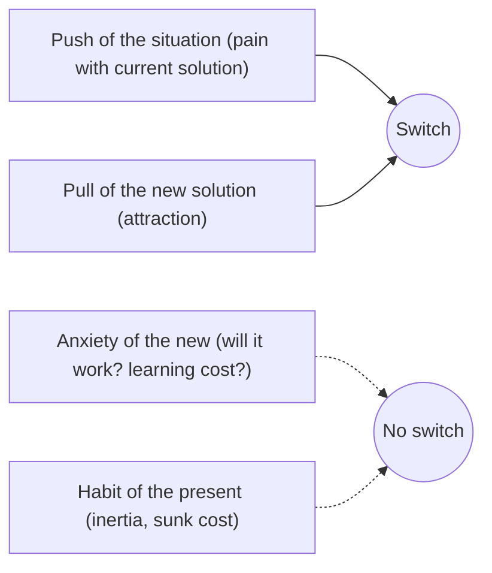
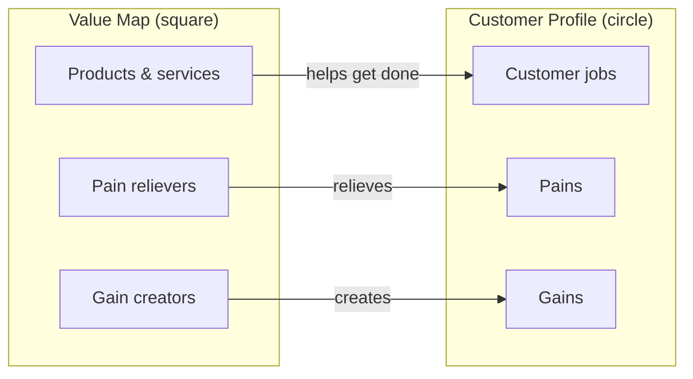
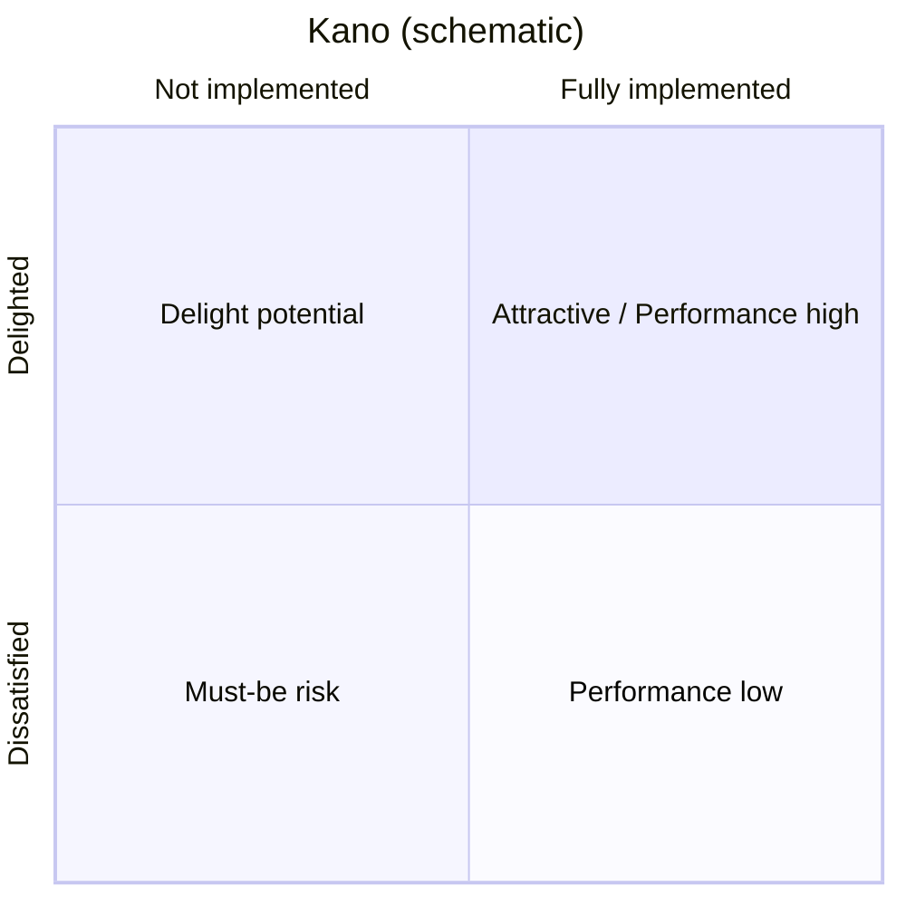
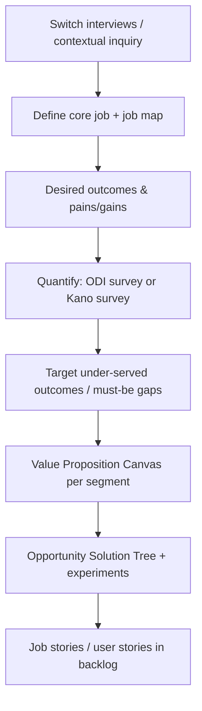

# Jobs To Be Done, Value Proposition Canvas & Kano

> **TL;DR** — Customers "hire" products to make progress in a specific circumstance. Jobs To Be Done (JTBD) gives three practical lenses: Christensen's theory (progress + circumstance + forces), Ulwick's Outcome-Driven Innovation (quantified desired outcomes, opportunity score), and Klement's job stories ("When… I want to… so I can…"). The Value Proposition Canvas maps jobs/pains/gains to products/pain relievers/gain creators. The Kano model classifies features by how they affect satisfaction (must-be, performance, attractive, indifferent, reverse).

---

## 1. JTBD landscape

| School | Key people | Core unit | Output | Best for |
|---|---|---|---|---|
| **Jobs theory** ("milkshake") | Clayton Christensen, Bob Moesta, Taddy Hall, Karen Dillon, David Duncan | Progress a person wants in a circumstance | Understanding of why people switch; forces of progress | New product strategy, positioning, marketing, switching behaviour |
| **Switch / demand-side sales** | Bob Moesta, Chris Spiek (Re-Wired Group) | The switch interview timeline | Timeline (first thought → passive → active looking → deciding → consuming) | Sales, onboarding, understanding purchase decisions |
| **Outcome-Driven Innovation (ODI)** | Anthony Ulwick (Strategyn) | Job map + desired outcome statements | Quantified opportunity scores per outcome | Feature prioritisation, market segmentation, mature markets |
| **Job stories** | Alan Klement (*When Coffee and Kale Compete*, 2016), Intercom (Paul Adams) | Situation + motivation + outcome | Backlog items with context | Design and backlog writing |

All share: **people buy progress, not products**; the job is stable over time while solutions change.

---

## 2. Christensen's Jobs Theory

Sources: Christensen, Hall, Dillon, Duncan, *Competing Against Luck* (2016); HBR "Know Your Customers' Jobs to Be Done" (2016); Christensen's earlier work in *The Innovator's Solution* (2003).

**Definition**: A job is the progress that a person is trying to make in a particular circumstance.

### The milkshake story (summary)

A fast-food chain tried to improve milkshake sales via demographic segmentation and feature tweaks (thicker, chocolatier) with no effect. Researchers observed that ~40% of milkshakes were bought early morning by solo commuters, who "hired" the shake to make a long, boring drive more interesting and stay full until lunch — competing with bagels, bananas and boredom, not other milkshakes. Afternoon buyers (parents with kids) hired it for a different job. Insight: the job (not the customer demographic or product category) is the right unit of analysis.

### Dimensions of a job

| Dimension | Example (ERP purchase approval) |
|---|---|
| Functional | Get a purchase approved before the supplier's price expires |
| Emotional (personal) | Feel confident I won't be blamed for overspending |
| Social | Look competent and in control to my manager |
| Circumstance | End of quarter, approver travelling, urgent production need |

### Four forces of progress (Moesta/Spiek)



Switching happens when **push + pull > anxiety + habit**. Product implications:

- Increase push: show cost of the status quo (quantify errors, time).
- Increase pull: make the new outcome vivid (demo with the customer's own data).
- Reduce anxiety: trials, migration services, guarantees, references, reversibility.
- Reduce habit: import tools, familiar UI patterns, integrations with existing workflows.

### Switch interview timeline

1. **First thought** — when did you first realise something had to change?
2. **Passive looking** — noticing alternatives without acting.
3. **Event #1** — something happened that made you start looking actively.
4. **Active looking** — comparing options.
5. **Event #2 / deciding** — trigger that made you decide (deadline, budget).
6. **Consuming / first use** — did it deliver? Satisfaction or regret.

Interview people who recently switched (to you **or** away from you). Ask for concrete details: date, place, who was there, what they were doing.

### Competing solutions are broader than competitors

For a B2B ordering portal the real competitors are: emailing the account manager, phoning, Excel templates, EDI, the customer's own procurement system, and "doing nothing".

---

## 3. Outcome-Driven Innovation (Ulwick)

Sources: Anthony Ulwick, *What Customers Want* (2005), *Jobs to be Done: Theory to Practice* (2016); Strategyn. Ulwick introduced ODI in 1991 and says he shared it with Christensen in 1999.

### Job map — 8 universal steps

| Step | Question | Example (field technician repairing a machine) |
|---|---|---|
| 1. **Define** | Plan, determine objectives | Determine what repair is needed |
| 2. **Locate** | Gather inputs/resources | Find manuals, parts, history |
| 3. **Prepare** | Set up environment | Gather tools, isolate machine |
| 4. **Confirm** | Verify readiness | Confirm correct part and safety lock-out |
| 5. **Execute** | Do the job | Perform the repair |
| 6. **Monitor** | Verify success while executing | Check readings during test run |
| 7. **Modify** | Make adjustments | Re-calibrate if values off |
| 8. **Conclude** | Finish, clean up | Log work, close ticket, hand back |

### Desired outcome statements

Format: **[Direction] + [Metric] + [Object of control] + [Contextual clarifier]**

- "**Minimise** the **time it takes** to **determine which spare part is required** when the machine shows an unknown error code."
- "**Minimise** the **likelihood** of **ordering the wrong part** for a machine variant."

A typical job has 50–150 outcome statements across the job map.

### Opportunity algorithm

Survey a statistically valid sample (often 180–3,000 respondents) rating each outcome for **importance** and **satisfaction** (1–5 scale). Compute the % rating 4 or 5 ("top-two-box"), scale to 0–10.

```
Opportunity = Importance + max(Importance − Satisfaction, 0)
```

| Score | Interpretation |
|---|---|
| > 15 | Extreme opportunity (under-served) |
| 12–15 | High opportunity |
| 10–12 | Solid opportunity |
| < 10 | Appropriately served / over-served (if satisfaction > importance → over-served, disruption risk) |

**Example**

| Outcome | Importance | Satisfaction | Opportunity |
|---|---|---|---|
| Minimise time to identify correct spare part | 9.1 | 3.2 | 9.1 + 5.9 = **15.0** |
| Minimise likelihood of re-visit | 8.5 | 5.5 | 8.5 + 3.0 = **11.5** |
| Minimise time to log work | 6.0 | 7.5 | 6.0 + 0 = **6.0** (over-served) |

Use the **opportunity landscape** chart (importance on Y, satisfaction on X) to find under-served (top-left) and over-served (bottom-right) segments. Outcome-based segmentation clusters respondents by which outcomes are under-served for them.

---

## 4. Job stories (Klement / Intercom)

Format:

> **When** [situation], **I want to** [motivation], **so I can** [expected outcome].

| User story | Job story equivalent |
|---|---|
| As a buyer, I want to reorder previous orders so that I save time. | When **a recurring weekly order is due and I'm on the warehouse floor**, I want to **repeat last week's order from my phone with adjusted quantities**, so I can **submit it before the 11:00 cut-off without going back to my desk**. |

**Why**: Personas ("As a buyer…") carry assumptions; the situation carries the causal context that drives design decisions (mobile, cut-off, quantities).

**Tips**

- Situation should be specific enough to design for (time, place, trigger, constraints).
- Motivation is what they want to do, not a UI feature.
- Outcome expresses progress (functional + emotional when relevant).
- Use job stories for discovery and design; teams often still use user stories in the backlog — both can coexist (see [backlog-and-user-stories.md](backlog-and-user-stories.md)).

---

## 5. JTBD statements — templates

| Template | Example |
|---|---|
| Core functional job (Ulwick): verb + object + contextual clarifier | "Get raw materials replenished before production runs out" |
| Christensen-style | "Help me feel in control of cash flow at month-end when invoices are late" |
| Job story | When…, I want to…, so I can… |
| Hiring/firing | "Customers fire [current solution] when [trigger] and hire [new solution] because [progress]" |

Good job statements are: solution-agnostic, stable over time, don't include adjectives like "easily/quickly" (those are outcomes), and describe progress from the customer's viewpoint.

---

## 6. Value Proposition Canvas

Alexander Osterwalder, Yves Pigneur, Greg Bernarda, Alan Smith, *Value Proposition Design* (2014), Strategyzer. Zooms into two blocks of the Business Model Canvas.



| Customer profile | Prompts |
|---|---|
| **Jobs** | Functional, social, emotional, supporting jobs (buyer, co-creator, transferrer) |
| **Pains** | Undesired outcomes, obstacles, risks; rank by severity |
| **Gains** | Required, expected, desired, unexpected gains; rank by relevance |

| Value map | Prompts |
|---|---|
| **Products & services** | What you offer (physical, digital, intangible, financial) |
| **Pain relievers** | How you eliminate or reduce specific pains |
| **Gain creators** | How you produce specific gains |

**Fit** levels: (1) problem–solution fit (on paper), (2) product–market fit (in market), (3) business model fit (profitable, scalable).

**Example (contract-pricing portal for B2B buyers)**

| Customer profile | Value map |
|---|---|
| Job: place correct replenishment orders weekly | Product: self-service ordering portal with ERP sync |
| Pain: unsure of negotiated price → calls account manager | Pain reliever: shows contract price per SKU, valid until date |
| Pain: order errors discovered at delivery | Pain reliever: validation of units/packaging at entry |
| Gain: spend less time on ordering | Gain creator: one-click reorder templates |
| Gain (unexpected): spend analytics per location | Gain creator: monthly spend dashboard |

**Common mistakes**: filling the value map first; generic pains ("too expensive"); one canvas for multiple segments (make one per segment); never testing the canvas with real customers.

---

## 7. Kano model

Noriaki Kano et al., "Attractive quality and must-be quality" (1984).

### Categories

| Category | Absent → | Present → | Example (B2B portal) |
|---|---|---|---|
| **Must-be (basic)** | Very dissatisfied | Neutral (taken for granted) | Login works, prices are correct, data is secure |
| **One-dimensional (performance)** | Dissatisfied | Satisfied, linearly | Search speed, number of payment options, page load time |
| **Attractive (delighter)** | Neutral | Delighted | Proactive "you usually order X, stock is low" suggestion |
| **Indifferent** | Neutral | Neutral | Theme colour customisation |
| **Reverse** | Satisfied | Dissatisfied | Forced gamification badges for professional users |
| **Questionable** | Contradictory answers | — | Survey answer inconsistent; discard or re-ask |

Over time, delighters decay into performance and then must-be features (e.g. mobile apps, SSO, dark mode).



### Kano questionnaire

For each feature, ask a **functional** and a **dysfunctional** question, each with five answers: *I like it / I expect it / I'm neutral / I can tolerate it / I dislike it*.

- Functional: "If the portal shows your contract price for each item, how do you feel?"
- Dysfunctional: "If the portal does **not** show your contract price, how do you feel?"

### Evaluation table

| Functional ↓ / Dysfunctional → | Like | Expect | Neutral | Tolerate | Dislike |
|---|---|---|---|---|---|
| **Like** | Q | A | A | A | O |
| **Expect** | R | I | I | I | M |
| **Neutral** | R | I | I | I | M |
| **Tolerate** | R | I | I | I | M |
| **Dislike** | R | R | R | R | Q |

A = Attractive, O = One-dimensional, M = Must-be, I = Indifferent, R = Reverse, Q = Questionable. Classify each feature by the most frequent category across respondents.

### Satisfaction coefficients (Berger et al., 1993)

```
Better (satisfaction) =  (A + O) / (A + O + M + I)          range 0..1
Worse (dissatisfaction) = −(O + M) / (A + O + M + I)         range −1..0
```

Plot features with |Worse| on X and Better on Y: high |Worse| = must protect; high Better = differentiator.

### Kano for prioritisation

1. Cover all **must-be** features (minimum bar; investing beyond "good enough" adds little).
2. Compete on a few **performance** features (where your strategy says you win).
3. Add a few **attractive** features for differentiation.
4. Remove/avoid **indifferent** and **reverse** features (cost without value).

**When not**: tiny user bases (questionnaire needs ~20–30+ respondents per segment to be meaningful), internal mandatory tools where satisfaction isn't the driver, or features users can't imagine without a prototype.

---

## 8. Putting it together — workflow



## 9. Common mistakes

- Writing "jobs" that are really solutions ("Use the dashboard").
- Confusing JTBD with personas; JTBD complements personas by focusing on circumstance.
- Doing ODI-style surveys without qualitative groundwork (bad outcome statements → garbage scores).
- Ignoring emotional/social dimensions in B2B (fear of blame drives many enterprise decisions).
- Treating Kano categories as permanent.
- Asking Kano questions about features users don't understand — show a prototype.

## Related sections

- Personas, journeys, user research: [../01-ux-ui/README.md](../01-ux-ui/README.md)
- Business model and capability thinking: [../11-enterprise-architecture-business/README.md](../11-enterprise-architecture-business/README.md)
- Mental models (first principles, inversion): [../10-laws-principles-mental-models/README.md](../10-laws-principles-mental-models/README.md)

## References

- Christensen Institute — Jobs to Be Done — https://www.christenseninstitute.org/theory/jobs-to-be-done/
- Strategyn (Ulwick, ODI) — https://strategyn.com/
- Outcome-Driven Innovation (Wikipedia) — https://en.wikipedia.org/wiki/Outcome-Driven_Innovation
- Re-Wired Group (Moesta, switch interviews) — https://therewiredgroup.com/
- Jobs to Be Done (Alan Klement) — https://jtbd.info/
- Strategyzer — Value Proposition Canvas — https://www.strategyzer.com/
- Kano model (Wikipedia) — https://en.wikipedia.org/wiki/Kano_model
- Jobs to be done (Wikipedia) — https://en.wikipedia.org/wiki/Jobs_to_be_done
- Clayton Christensen (Wikipedia) — https://en.wikipedia.org/wiki/Clayton_Christensen
