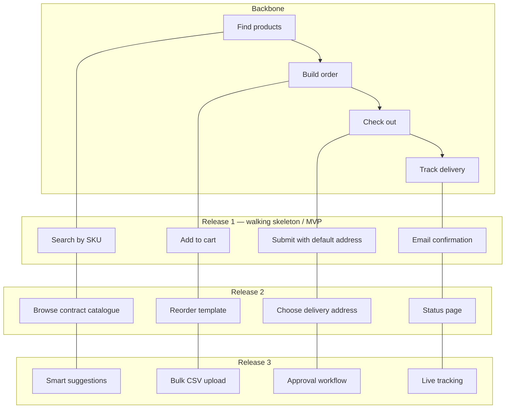
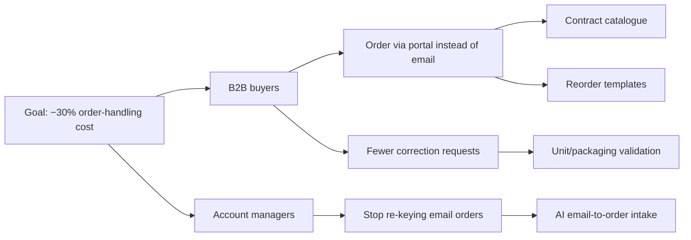

# Prioritization Frameworks

> **TL;DR** — Prioritisation is choosing what **not** to do. Use a scoring model to structure the conversation, not to replace judgement. RICE = Reach × Impact × Confidence / Effort; ICE = Impact × Confidence × Ease; WSJF = Cost of Delay / Job Size; Cost of Delay (Reinertsen) is the economic root of most of them. MoSCoW for scope within a fixed timebox; Kano and opportunity scoring for customer value; story mapping and impact mapping to slice and connect work to goals; Buy-a-Feature to surface stakeholder trade-offs. Prioritise **problems/opportunities first**, solutions second.

---

## 1. Choosing a framework

| Framework | Best for | Inputs needed | Granularity | Weakness |
|---|---|---|---|---|
| **RICE** | Comparing features/initiatives in a product backlog | Reach data, impact estimate, effort | Feature/initiative | False precision; impact is a guess |
| **ICE** | Fast triage of growth experiments | 3 gut scores | Experiment/idea | Very subjective |
| **MoSCoW** | Scope in a fixed-date release/timebox | Stakeholder agreement | Requirement | Everything becomes Must |
| **WSJF** | SAFe portfolios; economic sequencing of features/epics | CoD components + size | Feature/epic | Relative scoring games |
| **Cost of Delay / CD3** | Any queue where delay has economic cost | €/week estimates | Any | Hard to estimate; but estimating is valuable |
| **Kano** | Understanding satisfaction impact | Customer survey | Feature | Needs survey, decays over time |
| **Value vs Effort (2×2)** | Quick workshop sorting | Relative estimates | Any | Ignores risk, dependencies |
| **Opportunity scoring (ODI)** | Choosing under-served outcomes | Importance/satisfaction survey | Outcome | Survey cost |
| **Buy-a-Feature** | Stakeholder/customer alignment | Feature list with prices | Feature | Game, not analysis |
| **Story mapping** | Release slicing, MVP definition | User journey | Story | Not a ranking of disparate items |
| **Impact mapping** | Connecting deliverables to business goals | Goal, actors | Deliverable | Needs facilitation |
| **Eisenhower** | Personal/ops triage | Urgent/important | Task | Too coarse for product |
| **Weighted scoring** | Portfolio with multiple criteria | Criteria, weights | Initiative | Weights become political |

**Principle**: whatever framework, write down assumptions behind every score and revisit after delivery (were estimates right?).

---

## 2. RICE

Intercom (Sean McBride, 2016).

```
RICE score = (Reach × Impact × Confidence) / Effort
```

| Factor | Definition | Scale |
|---|---|---|
| **Reach** | # people/events affected per time period | e.g. customers per quarter (real numbers) |
| **Impact** | Effect on the goal per person | 3 = massive, 2 = high, 1 = medium, 0.5 = low, 0.25 = minimal |
| **Confidence** | How sure are we about reach/impact/effort | 100% high, 80% medium, 50% low (below 50% = moonshot) |
| **Effort** | Total team time | person-months (or person-weeks) |

**Example (goal: increase weekly portal ordering)**

| Initiative | Reach (accounts/qtr) | Impact | Confidence | Effort (pm) | RICE |
|---|---|---|---|---|---|
| Reorder templates | 800 | 2 | 80% | 2 | 800×2×0.8/2 = **640** |
| Contract price display | 1,200 | 1 | 100% | 1.5 | 1200×1×1/1.5 = **800** |
| ERP address sync | 150 | 3 | 50% | 4 | 150×3×0.5/4 = **56** |
| Mobile scan-to-order | 300 | 2 | 50% | 3 | 300×2×0.5/3 = **100** |

→ Contract price display, then reorder templates. ERP sync low despite high impact — maybe discovery first to raise confidence.

**Pitfalls**: inflating confidence; mixing reach units; using RICE across items with different goals (impact must be on the **same** goal).

---

## 3. ICE

Sean Ellis (growth hacking, ~2015).

```
ICE = Impact × Confidence × Ease       (each 1–10)
```

Some variants average instead of multiply. Use for quickly ranking dozens of growth experiments; re-score weekly. Not for large initiatives.

| Idea | I | C | E | ICE |
|---|---|---|---|---|
| Onboarding checklist | 7 | 6 | 8 | 336 |
| Invite-colleague prompt | 5 | 5 | 9 | 225 |
| Rewrite pricing page | 6 | 4 | 6 | 144 |

**ICE vs RICE**: RICE separates reach and uses real effort; ICE is faster but subjective. Itamar Gilad's **Confidence Meter** (2018) suggests calibrating confidence by evidence type (opinions ~0.01–0.1 → test results/launch data up to 10).

---

## 4. MoSCoW

Dai Clegg, Oracle (1994); core of DSDM / Agile Business Consortium.

| Category | Meaning | Test question |
|---|---|---|
| **Must have** | Non-negotiable; without it the release is pointless, illegal, unsafe | "If this isn't delivered, do we cancel the release?" |
| **Should have** | Important, painful to leave out, but workaround exists | "Is there a workaround, even if painful?" |
| **Could have** | Desirable, small impact if left out | First to drop if time runs short |
| **Won't have (this time)** | Agreed out of scope for this timebox | Explicitly recorded; may come later |

**DSDM rule of thumb**: Musts ≤ 60% of effort; Shoulds ~20%; Coulds ~20% (contingency). This creates the buffer that makes the date credible.

**Pitfalls**: 90% Musts; using MoSCoW for long-term backlog ranking (it's for a timebox); Won'ts never written down.

---

## 5. Cost of Delay (Reinertsen)

Don Reinertsen, *The Principles of Product Development Flow* (2009): "If you only quantify one thing, quantify the Cost of Delay."

**Cost of Delay (CoD)** = economic value lost per unit of time by not having the thing (e.g. €/week).

### Urgency profiles (Black Swan Farming / Joshua Arnold, Özlem Yüce)

| Profile | Shape | Example |
|---|---|---|
| Expedite | Very high CoD immediately | Production outage, security breach |
| Fixed date | Low until a deadline, then huge | Regulatory deadline (e-invoicing mandate), trade show |
| Standard | Linear, value lost each week | Most features |
| Intangible | Low now, may spike later | Tech debt, platform upgrades |

### CD3 — Cost of Delay Divided by Duration

```
CD3 = Cost of Delay (€/week) / Duration (weeks)
```

Schedule highest CD3 first. Equivalent to "Weighted Shortest Job First" in scheduling theory (Smith's rule, 1956).

**Example**

| Feature | CoD (€k/week) | Duration (weeks) | CD3 | Order |
|---|---|---|---|---|
| A — auto-invoice | 10 | 5 | 2.0 | 3 |
| B — price display | 8 | 2 | 4.0 | 1 |
| C — address sync | 6 | 2 | 3.0 | 2 |

Total delay cost comparison (sequential delivery, cost accrues until each is delivered):

- Order A, B, C: A waits 5 → 50; B waits 7 → 56; C waits 9 → 54 ⇒ **160k**
- Order B, C, A (CD3): B 2 → 16; C 4 → 24; A 9 → 90 ⇒ **130k** (€30k saved by sequencing alone)

Other Reinertsen lessons: queues are the root of most product development waste; reduce batch size; limit WIP; use economic decision rules decentralised to teams.

---

## 6. WSJF (SAFe)

Scaled Agile Framework adapts CD3 with relative estimates (modified Fibonacci 1, 2, 3, 5, 8, 13, 20).

```
WSJF = Cost of Delay / Job Size
Cost of Delay = User-Business Value + Time Criticality + Risk Reduction / Opportunity Enablement (RR|OE)
```

**How to score**: for each column, set the smallest item to 1 and score others relatively; do one column at a time across all items (reduces bias).

| Feature | UBV | TC | RR/OE | CoD | Job size | WSJF |
|---|---|---|---|---|---|---|
| E-invoicing compliance | 8 | 20 | 5 | 33 | 8 | **4.1** |
| Reorder templates | 13 | 3 | 2 | 18 | 5 | **3.6** |
| Data platform migration | 3 | 5 | 20 | 28 | 13 | **2.2** |
| Dark mode | 2 | 1 | 1 | 4 | 2 | **2.0** |

**Notes**: Job size is a proxy for duration (and only if resources are the constraint). Watch for gaming of time criticality. Re-score each PI planning.

---

## 7. Value vs Effort (2×2)

```mermaid
quadrantChart
  title Value vs Effort
  x-axis Low effort --> High effort
  y-axis Low value --> High value
  quadrant-1 Big bets (plan carefully)
  quadrant-2 Quick wins (do first)
  quadrant-3 Fill-ins (maybe)
  quadrant-4 Money pit (avoid)
  "Contract price display": [0.25, 0.85]
  "Reorder templates": [0.4, 0.75]
  "ERP sync": [0.8, 0.8]
  "Custom themes": [0.6, 0.15]
```

Variants: Value vs Complexity, Impact vs Effort, Value vs Risk. Good for workshops; add a "confidence" dot size for nuance. Beware: effort tends to be underestimated for "quick wins".

---

## 8. Weighted scoring (multi-criteria)

```
Score = Σ (weight_i × score_i)       weights sum to 100%
```

| Criterion | Weight | Initiative A | Initiative B |
|---|---|---|---|
| Strategic fit | 30% | 5 | 3 |
| Customer value | 25% | 4 | 5 |
| Revenue / cost impact | 20% | 3 | 4 |
| Risk reduction | 15% | 2 | 1 |
| Effort (inverse) | 10% | 3 | 4 |
| **Total** | 100% | **3.75** | **3.50** |

Agree criteria and weights **before** scoring items to reduce political bias.

---

## 9. Kano and opportunity scoring

See [jobs-to-be-done-and-value.md](jobs-to-be-done-and-value.md) for full detail.

- **Kano**: satisfy must-bes to "good enough", invest in chosen performance attributes, sprinkle delighters, kill indifferent/reverse.
- **Opportunity scoring (Ulwick)**: `Opportunity = Importance + max(Importance − Satisfaction, 0)`; >10 worth pursuing, >15 extreme.
- A lightweight variant: ask users to rate importance and current satisfaction for 10–20 outcomes/features (1–5); plot; target high-importance/low-satisfaction.

---

## 10. Buy-a-Feature

Luke Hohmann, *Innovation Games* (2006).

**Mechanics**

1. List 10–20 features with a price proportional to cost (e.g. €50–€300).
2. Give each participant (5–8 customers or stakeholders) a budget ≈ 1/3–1/2 of total cost of all features (so they can't buy everything).
3. Some features priced higher than any single budget → forces **negotiation and pooling**.
4. Observe and record conversations: *why* people pool, what they drop.
5. Debrief: purchases show priorities; the discussion shows the reasoning.

**Value**: reveals trade-offs and coalitions; great for B2B advisory boards and internal stakeholder groups. Not statistically representative.

Related Innovation Games: Prune the Product Tree, Speed Boat (anchors = what slows you), Product Box, 20/20 Vision.

---

## 11. Story mapping (Jeff Patton)

Jeff Patton, *User Story Mapping* (2014); original article "The new user story backlog is a map" (2008).

**Structure**

- **Backbone** (horizontal): user activities → steps (user tasks) in narrative order, left to right.
- **Body** (vertical): stories/details under each step, ordered top-to-bottom by priority.
- **Release slices** (horizontal lines): each slice is a thin end-to-end version delivering an outcome.



**How to run** (2–4 hours, cross-functional):

1. Frame: who is the user, what outcome?
2. Map the big picture: tell the story of a day/flow; write activities and steps.
3. Explore: add details, alternatives, exceptions, pain points under each step.
4. Slice: draw lines for releases — each slice must be usable end to end and target a specific outcome/learning.
5. Plan: first slice = **walking skeleton** (thinnest end-to-end); then "opening game → mid game → end game".

**Why it beats a flat backlog**: shows the whole journey, prevents building one step to perfection while others are missing, makes MVP scope visible, reveals gaps.

---

## 12. Impact mapping (Gojko Adzic)

Gojko Adzic, *Impact Mapping* (2012). Mind map with four levels:

| Level | Question | Example |
|---|---|---|
| **Goal (Why)** | Business objective, measurable | Reduce order-handling cost by 30% in 12 months |
| **Actors (Who)** | Who can help/hinder? | B2B buyers, account managers, warehouse staff, IT of customers |
| **Impacts (How)** | How should actor behaviour change? | Buyers place orders themselves; AMs stop re-keying orders |
| **Deliverables (What)** | What can we do to support the impact? | Contract catalogue, reorder templates, AI email intake |



**Rules**: deliverables are options, not commitments; measure impacts (behaviour change), not deliverables; prune branches that don't serve the goal. Great for avoiding "build everything stakeholders asked for".

---

## 13. Other useful lenses

| Lens | Gist |
|---|---|
| **Opportunity cost** | Every "yes" is a "no" to something else — make it explicit |
| **Pareto (80/20)** | 20% of features drive 80% of usage (check analytics) |
| **Eisenhower matrix** | Urgent vs important; keep product time on important-not-urgent |
| **Theme allocation / capacity buckets** | e.g. 60% strategic features, 20% tech debt/platform, 10% bugs, 10% experiments |
| **Risk-first** | Do riskiest (most uncertain) items early to learn |
| **Dependencies / enablers** | Some low-value items unlock high-value ones (SAFe "enablers") |
| **Regret minimisation** | Which choice would we regret more in 1 year? |
| **Hunch + evidence** | Combine expert judgement with data; Itamar Gilad's GIST (Goals, Ideas, Step-projects, Tasks) |

---

## 14. Prioritisation process (practical)

1. Anchor on **goal/outcome** (OKR, North Star input).
2. Collect candidate **opportunities/problems** (not solutions) with evidence.
3. Size: reach, impact estimate, confidence; rough effort from engineers (T-shirt).
4. Score with **one** agreed framework; publish assumptions.
5. Discuss outliers; adjust with judgement (dependencies, risk, strategy).
6. Decide, communicate including **what's not happening and why**.
7. Re-prioritise on a cadence (monthly/quarterly) and when evidence changes.

### Saying no (stakeholder scripts)

- "Here's what we'd have to stop to do this — which would you drop?"
- "What problem is this solving, and how will we know it worked?"
- "Not now: it's on the Later column; we'll revisit when [trigger]."
- Show the scoring and the goal; disagree on inputs, not on the person.

## 15. Common mistakes

- Prioritising solutions without validating the problem.
- Treating scores as truth (false precision), or scoring to justify a decision already made (HiPPO — highest paid person's opinion).
- Ignoring cost of delay and the value of learning.
- Never revisiting estimates after delivery.
- Different goals mixed in one score.
- No capacity for tech debt → velocity decays.
- Everything top priority ("priority" was singular until the 1900s).

## Related sections

- Backlog ordering and refinement: [backlog-and-user-stories.md](backlog-and-user-stories.md)
- Scrum/Kanban flow, WIP limits: [../04-agile-kanban-scrum/README.md](../04-agile-kanban-scrum/README.md)
- Project portfolio prioritisation: [../03-project-management/README.md](../03-project-management/README.md)
- Mental models (opportunity cost, Pareto): [../10-laws-principles-mental-models/README.md](../10-laws-principles-mental-models/README.md)

## References

- Intercom — RICE: simple prioritization for product managers — https://www.intercom.com/blog/rice-simple-prioritization-for-product-managers/
- MoSCoW method (Wikipedia) — https://en.wikipedia.org/wiki/MoSCoW_method
- Agile Business Consortium (DSDM) — https://www.agilebusiness.org/
- Scaled Agile Framework — WSJF — https://framework.scaledagile.com/wsjf
- Black Swan Farming — Cost of Delay — https://blackswanfarming.com/cost-of-delay/
- Cost of delay (Wikipedia) — https://en.wikipedia.org/wiki/Cost_of_delay
- Kano model (Wikipedia) — https://en.wikipedia.org/wiki/Kano_model
- Jeff Patton & Associates (story mapping) — https://jpattonassociates.com/
- Impact Mapping — https://www.impactmapping.org/
- Itamar Gilad (Confidence Meter, GIST) — https://itamargilad.com/
- Eisenhower method (Wikipedia) — https://en.wikipedia.org/wiki/Time_management#The_Eisenhower_Method
- Pareto principle (Wikipedia) — https://en.wikipedia.org/wiki/Pareto_principle
