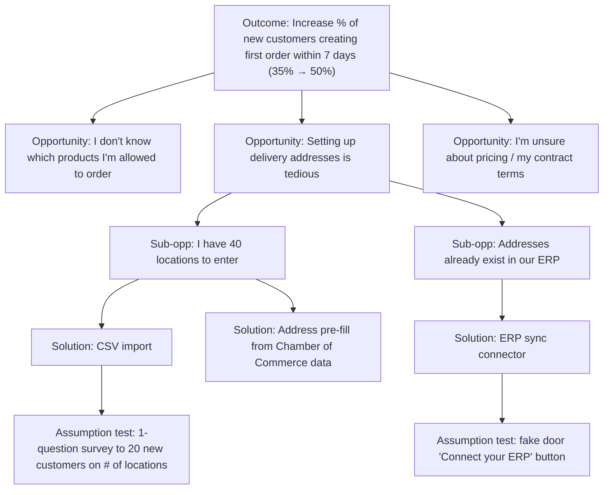
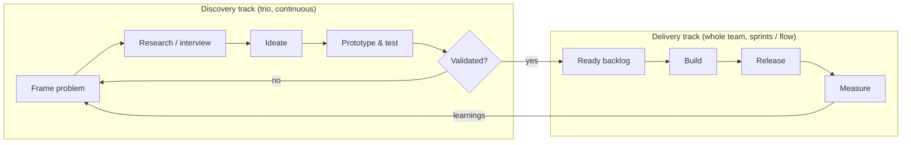
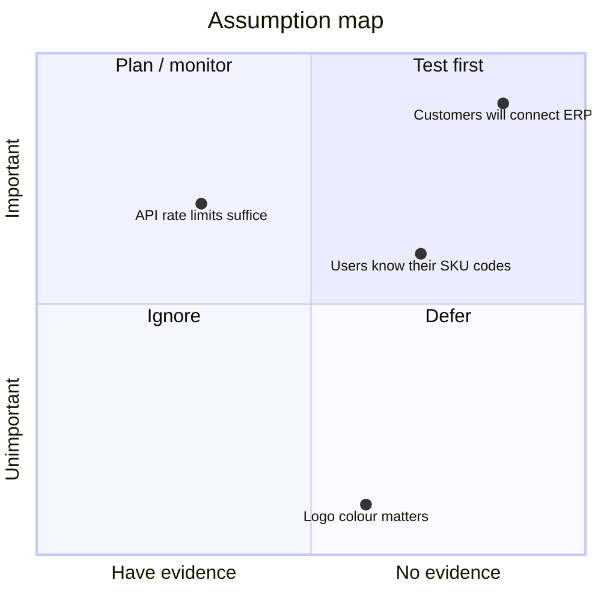
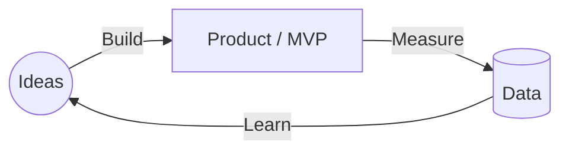

# Product Discovery

> **TL;DR** — Discovery is the work of deciding *what* to build: reducing the four big risks (value, usability, feasibility, viability) **before** committing engineering capacity to delivery. Use Continuous Discovery (weekly customer touchpoints, Opportunity Solution Tree), dual-track agile, assumption mapping and cheap experiments (fake door, concierge, Wizard of Oz, smoke test). Lean Startup's Build-Measure-Learn loop and the Lean Canvas frame the business hypothesis. Rule of thumb: most ideas fail; the goal is to find out cheaply which ones.

---

## 1. Why discovery exists

| Fact / heuristic | Source | Implication |
|---|---|---|
| Most product ideas do not deliver the expected value | Kohavi et al., *Trustworthy Online Controlled Experiments* (2020): at Microsoft roughly 1/3 of experiments positive, 1/3 flat, 1/3 negative; at Bing/Google success rates often 10–20% | Assume your idea is wrong until evidence says otherwise |
| Even good ideas take several iterations to deliver value | Cagan, *Inspired* (2nd ed., 2017) | Plan for iteration, not "big launch" |
| Building is the most expensive way to learn | Lean Startup, Ries (2011) | Prototype/experiment before code |
| Feature-factory teams measure output, not outcome | Cutler, "12 signs you're working in a feature factory" (2016) | Measure behaviour change, not shipped tickets |

**Discovery vs delivery**

| | Discovery | Delivery |
|---|---|---|
| Question | Should we build it? What exactly? | How do we build it well and ship it? |
| Output | Validated backlog items, evidence, decisions | Production-quality, releasable software |
| Artefacts | Prototypes, interview notes, experiment results, OST | Code, tests, release notes |
| Speed | Many ideas per week (Cagan: "10–20 iterations per week") | Sprint / flow cadence |
| Quality bar | Disposable, "just enough" fidelity | Scalable, secure, maintainable |
| Owner | Product trio (PM, design, tech lead) | Whole team |

---

## 2. Marty Cagan / SVPG — the four big risks

From *Inspired* (2008; 2nd ed. 2017) and *Empowered* (2020), Silicon Valley Product Group (svpg.com).

| Risk | Question | Primary owner | Typical techniques |
|---|---|---|---|
| **Value** | Will customers buy it / choose to use it? | Product manager | Interviews, fake door, demand tests, concierge, landing page, pre-sales, A/B |
| **Usability** | Can users figure out how to use it? | Product designer | Prototype usability tests (5 users, Nielsen), task-based testing, first-click tests |
| **Feasibility** | Can we build it with the time, skills, tech and data we have? | Tech lead / engineers | Spikes, feasibility prototypes, architecture review, data audits (esp. ML) |
| **Viability** | Does it work for the business? (legal, finance, sales, brand, compliance, ethics) | Product manager | Stakeholder reviews, pricing tests, legal/security review, unit economics |

Cagan later added **ethics** as a sub-risk of viability ("should we build it?").

### Cagan's key ideas (cheat-sheet)

- **Empowered product teams** solve problems they are given (outcomes), rather than building features they are told to build (output). "Feature teams" vs "delivery teams" vs "empowered product teams".
- **Product trio / core team**: PM + designer + tech lead discover together.
- **Prototypes** taxonomy: feasibility prototype, user prototype (low/high-fidelity), live-data prototype, hybrid (Wizard of Oz).
- **Opportunity assessment**: 10 questions (see [templates.md](templates.md)).
- **Product vision** (2–10 years), **product strategy** (focus, insights, actions, management), **team objectives** (OKRs given to teams as problems).
- **Product operating model** (*Transformed*, 2024): product discovery, product delivery, product culture; principles over process.
- **Missionaries vs mercenaries** (John Doerr phrase, popularised by Cagan).
- **Stakeholder management**: PM must understand constraints of sales, marketing, finance, legal, security, executives.

### Prototype types

| Prototype | Fidelity | Tests | Cost |
|---|---|---|---|
| Paper / sketch | Very low | Concept, flow | Minutes |
| Clickable wireframe (Figma) | Low–medium | Usability, flow, value perception | Hours |
| High-fidelity user prototype | High | Usability, desirability | Days |
| Feasibility prototype / spike | Code (throwaway) | Feasibility, performance, ML accuracy | Days |
| Live-data prototype | Real code, limited scope | Value with real behaviour, analytics | 1–2 weeks |
| Hybrid / Wizard of Oz | Front-end real, back-end human | Value, willingness to use | Days |

---

## 3. Continuous Discovery (Teresa Torres)

Source: Teresa Torres, *Continuous Discovery Habits* (2021), producttalk.org.

**Definition**: "At a minimum, weekly touchpoints with customers, by the team building the product, where they conduct small research activities in pursuit of a desired outcome."

### Core habits

| Habit | Practice |
|---|---|
| Outcome focus | Team is assigned a **product outcome** (leading, team-influenceable metric), not a feature |
| Weekly interviewing | Automated recruiting (in-product intercepts, CS hand-offs) so ≥1 interview/week happens by default |
| Story-based interviews | Ask for specific past stories ("Tell me about the last time you…") not opinions or hypotheticals |
| Interview snapshots | One-page synthesis per interview: quote, quick facts, experience map, opportunities, insights |
| Experience mapping | Map what the team *thinks* the customer journey looks like; reveals shared/divergent understanding |
| Opportunity Solution Tree | Visualise outcome → opportunities → solutions → assumption tests |
| Compare and contrast | Always consider ≥3 solutions per target opportunity; avoid "whether or not" decisions |
| Assumption testing | Identify assumptions (desirability, viability, feasibility, usability, ethical), test the riskiest |
| Measure impact | Connect shipped work back to the outcome |

### Outcome types

| Type | Example | Use |
|---|---|---|
| Business outcome | Revenue, retention, cost-to-serve | Leadership level; lagging |
| Product outcome | % users completing weekly report, time to first invoice | **Give these to teams**; leading, team-controllable |
| Traction metric | Usage of a specific feature | Only for optimisation of known features; risk of output thinking |

### Opportunity Solution Tree (OST)

**Rules for a good OST**

- Opportunities are **customer needs, pain points, desires** framed from the customer's view ("I…"), never solutions in disguise ("We need a CSV import").
- Opportunities come from **interviews**, not brainstorming.
- Break big opportunities into smaller, solvable sub-opportunities; pick a target opportunity at the lowest useful level.
- Siblings should be distinct (mutually exclusive as much as possible).
- Prioritise opportunities (not solutions) using: opportunity sizing, market factors, company factors, customer factors.
- Generate multiple solutions per target opportunity; test assumptions across the set ("compare and contrast").

### Assumption types (Torres)

| Type | Question |
|---|---|
| Desirability | Do they want it? Will they get value? |
| Viability | Should we build it? Does it work for the business? |
| Feasibility | Can we build it? |
| Usability | Can they use it? |
| Ethical | Is there potential harm? |

Story mapping each solution step by step is Torres's recommended way to surface hidden assumptions.

---

## 4. Dual-track agile

Origin: Desiree Sy, "Adapting Usability Investigations for Agile User-centered Design" (2007, Autodesk); popularised by Jeff Patton and Marty Cagan ("dual-track Scrum", 2012).

**Key points**

- It is **one team, two kinds of work**, not two teams. Avoid a "discovery team" handing over specs (that is waterfall with extra steps).
- Discovery typically runs one or two iterations ahead of delivery.
- Engineers participate in discovery (at least the tech lead), designers participate in delivery (QA of UX).
- Discovery output = evidence + small, validated backlog items, not a 40-page spec.
- Typical capacity split for a mature team: trio spends ~50% on discovery; engineers ~10–20%.

**Common mistakes**

- Discovery becomes a phase ("sprint 0") instead of continuous.
- Only validated ideas count but nothing is ever invalidated → confirmation bias; track kill rate.
- Delivery track starved because discovery doesn't produce ready items; or discovery skipped because delivery is "too busy".

---

## 5. Assumption mapping

Origin: David J. Bland, *Testing Business Ideas* (with Osterwalder, 2019); assumption mapping exercise from Bland/Precoil.

**Steps**

1. Write down the idea/solution (use a story map or Lean Canvas to expose assumptions).
2. List assumptions as **testable statements**: "We believe that [customer] will [behaviour] because [reason]."
3. Categorise: desirability, viability, feasibility (+ usability, ethics).
4. Plot on a 2×2: **importance** (if wrong, the idea fails) vs **evidence** (have / don't have).
5. Test the top-right quadrant first: *important + little evidence* ("leap-of-faith assumptions", Ries).

### Hypothesis / experiment card (Strategyzer-style)

| Field | Example |
|---|---|
| We believe that | Distributors with >20 locations will use an ERP connector |
| To verify that, we will | Add a "Connect your ERP" fake-door button on the address page for 2 weeks |
| And measure | Click-through rate among eligible accounts |
| We are right if | ≥15% of eligible accounts click, and ≥5 agree to a follow-up call |
| Cost / duration / reliability | Low / 2 weeks / medium (intent, not usage) |

**Learning card**: We observed… From that we learned… Therefore we will… (decision: persevere / pivot / kill).

---

## 6. Experiment catalogue

| Experiment | What it is | Tests | Evidence strength | Cost | Watch out |
|---|---|---|---|---|---|
| **Customer interview** | Story-based, past behaviour | Problem existence, context | Weak–medium (say) | Very low | Leading questions; "would you use…" |
| **Survey** | Quantify known themes | Prevalence, segmentation | Weak | Low | Opinions ≠ behaviour |
| **Fake door / painted door** | UI entry point to a feature that doesn't exist; click shows "coming soon / join waitlist" | Demand, discoverability | Medium (do) | Very low | Disappoints users; keep short, be honest, cap exposure |
| **Smoke test / landing page** | Landing page or ad describing a product, with signup/pre-order CTA | Market demand, messaging, willingness to pay | Medium–strong if money involved | Low | Traffic quality; vanity signups |
| **Pre-sale / letter of intent** | Ask for money or signed commitment before building | Willingness to pay | Strong | Low–medium | B2B: LOIs are soft; deposits are better |
| **Concierge MVP** | Deliver the service manually and openly to a few customers | Value, workflow, what "done" looks like | Strong (real usage) | Medium (people time) | Doesn't scale; customer knows it's manual |
| **Wizard of Oz** | Customer sees an automated-looking product; humans operate behind the curtain | Value of automation, AI features, UX | Strong | Medium | Ethics/consent; humans behave better than the future algorithm |
| **Piecemeal MVP** | Glue existing tools (Zapier, Airtable, forms) into the experience | Value, workflow | Strong | Low–medium | Tech debt if it stays |
| **Explainer video** | Video demo of a non-existing product (Dropbox 2007 waitlist jumped from 5k to 75k overnight) | Demand, message | Medium | Low | Novelty effect |
| **Prototype usability test** | 5 users per round (Nielsen, 2000) | Usability | Medium–strong | Low | Testing with colleagues |
| **A/B test** | Randomised controlled experiment in product | Causal impact on metric | Strongest | Medium–high (needs traffic) | Sample size, peeking (see [product-metrics-and-analytics.md](product-metrics-and-analytics.md)) |
| **Feature flag / dark launch / beta** | Release to subset | Real-world value, feasibility | Strong | Medium | Selection bias of beta users |
| **Spike** | Time-boxed technical investigation | Feasibility | Strong for tech | Low–medium | Scope creep into production code |
| **Data prototype** (AI/ML) | Offline eval on historical data, notebook | Feasibility of model accuracy | Medium–strong | Medium | Offline ≠ online metric |

**Evidence hierarchy (weak → strong)**: opinions (what people say) → intentions (clicks, signups) → commitments (time, reputation, data) → money (pre-orders, payments) → repeated usage/retention.

### Rule of thumb for experiment design

- Define **success criteria before** running (avoid moving goalposts).
- Prefer the **cheapest test that could change your decision**.
- Time-box (days, not months).
- One riskiest assumption per experiment.
- Record results as learning cards; review kill rate quarterly.

---

## 7. Lean Startup

Eric Ries, *The Lean Startup* (2011), building on Steve Blank's *The Four Steps to the Epiphany* (2005) and Customer Development.

### Build–Measure–Learn

Plan in reverse: decide what you need to **learn**, what you need to **measure** to learn it, then the minimum you need to **build**. Goal: minimise total time through the loop.

### Key concepts

| Concept | Meaning |
|---|---|
| **Leap-of-faith assumptions** | Value hypothesis (does it deliver value?) and growth hypothesis (how will new customers discover it?) |
| **MVP** | "That version of a new product which allows a team to collect the maximum amount of validated learning about customers with the least effort." It's an experiment, not a small v1. |
| **Validated learning** | Learning demonstrated by empirical data from real customers |
| **Innovation accounting** | (1) establish baseline with MVP, (2) tune the engine toward ideal, (3) pivot or persevere |
| **Actionable vs vanity metrics** | Actionable: cohort-based, split-tested, clear cause-effect (3 A's: actionable, accessible, auditable). Vanity: total signups, page views |
| **Pivot** | Structured course correction designed to test a new fundamental hypothesis |
| **Engines of growth** | Sticky (retention), viral (viral coefficient > 1), paid (LTV > CAC) |
| **Small batches, continuous deployment, 5 Whys** | Borrowed from Toyota Production System |

### Pivot types (Ries)

| Pivot | Example |
|---|---|
| Zoom-in | A single feature becomes the whole product (Flickr from a game) |
| Zoom-out | Product becomes a feature of a larger product |
| Customer segment | Same product, different customer |
| Customer need | Same customer, different problem |
| Platform | Application ↔ platform |
| Business architecture | High-margin/low-volume (B2B) ↔ low-margin/high-volume (B2C) |
| Value capture | Monetisation model change |
| Engine of growth | Viral ↔ sticky ↔ paid |
| Channel | Direct sales ↔ self-serve, etc. |
| Technology | Same solution, different technology |

### MVP variants and critique

- **MVP ≠ minimum product**. Henrik Kniberg's skateboard → scooter → bike → motorbike → car illustration (2016): each step is usable and teaches you something.
- Alternatives coined: **MLP** (minimum lovable), **MMP** (minimum marketable product), **MVE** (minimum viable experiment), **RAT** (riskiest assumption test).
- In enterprise/internal tools, an MVP is usually one **workflow end-to-end** for one user group (thin vertical slice), not every screen half-built.

---

## 8. Lean Canvas

Ash Maurya, *Running Lean* (2010; 3rd ed. 2022), adapted from Osterwalder's Business Model Canvas.

| # | Box | Prompt | Example (B2B ordering portal) |
|---|---|---|---|
| 1 | **Problem** | Top 1–3 problems; existing alternatives | Orders come by email/phone; 8% error rate; existing: email + Excel + EDI for large clients |
| 2 | **Customer segments** | Target customers; early adopters | Mid-size wholesalers; early adopters: customers with >10 orders/week |
| 3 | **Unique value proposition** | Single clear message why you're different | "Order in 2 minutes with your contract prices, zero errors" |
| 4 | **Solution** | Top 3 features | Contract-aware catalogue, reorder templates, live delivery status |
| 5 | **Channels** | Path to customers | Account managers, invoice footer, onboarding webinars |
| 6 | **Revenue streams** | Revenue model, LTV | Internal: cost avoidance per order; external: subscription |
| 7 | **Cost structure** | Customer acquisition, hosting, people | 4 FTE team, cloud, integration maintenance |
| 8 | **Key metrics** | Key activities to measure | % orders via portal, order error rate, time-to-order |
| 9 | **Unfair advantage** | Can't be easily copied or bought | Direct ERP integration, existing relationships, proprietary data |

Recommended fill order: 1→2 (problem/segment together), 3, 4, 5, 6, 7, 8, 9.

**Business Model Canvas (Osterwalder & Pigneur, 2010)** blocks for comparison: Key partners, Key activities, Key resources, Value propositions, Customer relationships, Channels, Customer segments, Cost structure, Revenue streams. Lean Canvas replaces partners/activities/resources/relationships with problem/solution/key metrics/unfair advantage — more suited to uncertain new products.

---

## 9. Customer interviewing — practical guide

**Do**

- Ask about **specific past behaviour**: "Tell me about the last time you placed a rush order."
- Follow the story: "What happened next?" "Who else was involved?" "What tools did you use?"
- Ask about workarounds, costs, frequency, emotions.
- Two interviewers: one asks, one notes. Record (with consent).
- Recruit continuously; 30 minutes is enough.
- Synthesise within 24h (interview snapshot).

**Don't**

- Pitch your solution in a problem interview.
- Ask "Would you use…?" / "Would you pay for…?" (Rob Fitzpatrick, *The Mom Test*, 2013: people lie to be nice; ask about their life, not your idea).
- Ask leading or yes/no questions.
- Interview only champions/power users or only internal stakeholders "on behalf of" users.

**The Mom Test rules (Fitzpatrick)**: talk about their life instead of your idea; ask about specifics in the past instead of generics or opinions about the future; talk less and listen more. Look for commitment and advancement (time, reputation, money) as signals.

---

## 10. Discovery for internal tools, data & AI products

| Context | Discovery adaptation |
|---|---|
| Internal tools / ERP | Users are reachable — **shadow** them (contextual inquiry, Gemba walk); measure task time and error rates before/after; process mining on event logs |
| Integration / platform | Developers are customers: API design reviews, docs-first, "golden path" prototypes, DX interviews |
| Data products / dashboards | Ask "what decision will you make differently with this?"; prototype with a spreadsheet or static mock before building pipelines |
| AI / ML features | Wizard of Oz first (human in loop), then offline evaluation dataset, then shadow mode, then A/B. Feasibility risk is much higher — data availability and quality decide. Define acceptable error rate and cost of errors with users |
| Regulated / enterprise | Viability risk dominates: security, compliance (GDPR, AI Act), procurement. Bring legal/security in early |

---

## 11. When to use / when not

| Use heavy discovery when | Lighter discovery is fine when |
|---|---|
| New product, new market, new segment | Regulatory/compliance mandates (still discover *how*) |
| High uncertainty in value or usability | Well-understood bug fixes, small UX improvements |
| Expensive to build or hard to reverse | Cheap, reversible changes behind a flag (just A/B test) |
| AI/ML features with feasibility doubts | Contractual commitments with clear spec (still validate usability) |

Jeff Bezos's **one-way vs two-way doors** (2015 shareholder letter): invest discovery effort proportional to irreversibility.

---

## 12. Common mistakes

- Treating stakeholder requests as validated requirements.
- "Validating" with surveys and opinions only.
- Solution-first: falling in love with an idea and running experiments designed to confirm it.
- Only one solution considered per opportunity.
- Discovery done by PM alone, then thrown over the wall to design and engineering.
- MVPs that are so minimal they can't test value (or so big they take 6 months).
- No pre-defined success criteria → every result is "interesting".
- Ignoring feasibility until late (especially data availability for AI).
- Never killing anything: a healthy discovery practice discards most ideas.

## 13. Discovery checklist

- [ ] Outcome defined and agreed (metric, baseline, target, timeframe)
- [ ] Weekly customer touchpoint scheduled and automated recruiting in place
- [ ] Opportunity Solution Tree up to date
- [ ] ≥3 solutions considered for target opportunity
- [ ] Assumptions listed, categorised, mapped by importance × evidence
- [ ] Riskiest assumption has an experiment with success criteria
- [ ] Engineers involved in feasibility assessment
- [ ] Viability stakeholders (legal, security, finance, sales) consulted where relevant
- [ ] Learnings documented and shared (learning cards, interview snapshots)

---

## Related sections

- UX research methods and usability testing: [../01-ux-ui/README.md](../01-ux-ui/README.md)
- Agile delivery and Scrum/Kanban: [../04-agile-kanban-scrum/README.md](../04-agile-kanban-scrum/README.md)
- AI product feasibility and data: [../07-data-ai-architecture/README.md](../07-data-ai-architecture/README.md)
- Facilitating workshops: [../09-leadership-teams-facilitation/README.md](../09-leadership-teams-facilitation/README.md)
- Cognitive biases (confirmation bias, sunk cost): [../10-laws-principles-mental-models/README.md](../10-laws-principles-mental-models/README.md)

## References

- SVPG (Marty Cagan) — https://www.svpg.com/
- Product Talk (Teresa Torres) — https://www.producttalk.org/
- Opportunity Solution Tree — https://www.producttalk.org/opportunity-solution-tree/
- Lean Startup — https://theleanstartup.com/
- Lean Startup (Wikipedia) — https://en.wikipedia.org/wiki/Lean_startup
- Minimum viable product (Wikipedia) — https://en.wikipedia.org/wiki/Minimum_viable_product
- Customer development (Wikipedia) — https://en.wikipedia.org/wiki/Customer_development
- Lean Canvas (Leanstack) — https://leanstack.com/
- Business Model Canvas (Wikipedia) — https://en.wikipedia.org/wiki/Business_Model_Canvas
- Strategyzer (Testing Business Ideas, VPC) — https://www.strategyzer.com/
- The Mom Test — https://www.momtestbook.com/
- Wizard of Oz experiment (Wikipedia) — https://en.wikipedia.org/wiki/Wizard_of_Oz_experiment
- Nielsen Norman Group: Why you only need to test with 5 users — https://www.nngroup.com/articles/why-you-only-need-to-test-with-5-users/
- Contextual inquiry (Wikipedia) — https://en.wikipedia.org/wiki/Contextual_inquiry
