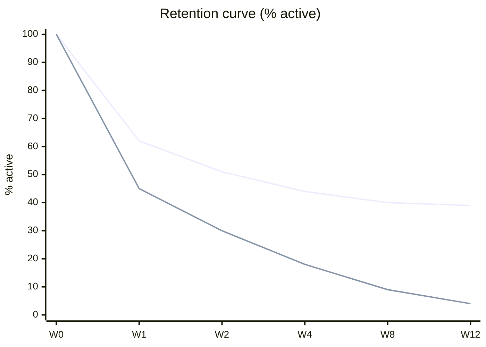

# Product Metrics, Analytics & Experimentation

> **TL;DR** — Measure behaviour that reflects value, not vanity. Use AARRR (acquisition → activation → retention → referral → revenue) for funnel thinking and Google's HEART (+ GSM: goals → signals → metrics) for UX quality. Retention cohorts are the single most honest chart; a curve that flattens means product-market fit for that cohort. Know the unit economics (LTV, CAC, LTV:CAC ≥ 3, payback < 12–18 months, NRR). For A/B tests: fix sample size up front (power 80%, α = 0.05), don't peek (or use sequential methods), watch guardrails and sample-ratio mismatch.

---

## 1. Metric types

| Distinction | A | B | Note |
|---|---|---|---|
| Leading vs lagging | Leading: predicts future (activation, weekly usage) | Lagging: confirms past (revenue, churn) | Teams steer on leading, report lagging |
| Actionable vs vanity | Actionable: changes decisions (cohort retention) | Vanity: always goes up (total signups, page views) | Ries, *Lean Startup* |
| Input vs output | Input: team controls (onboarding completion) | Output: result (revenue) | Amazon "controllable input metrics" |
| Ratio vs absolute | Ratio: conversion %, DAU/MAU | Absolute: # users | Ratios compare across time/size |
| North Star / KPI / guardrail / counter-metric | Guardrail prevents harm (latency, errors, unsubscribe rate) | Counter-metric balances (speed vs quality) | Goodhart's law: "When a measure becomes a target, it ceases to be a good measure" |

---

## 2. AARRR — pirate metrics

Dave McClure, "Startup Metrics for Pirates" (2007). Some add **Awareness** (AAARRR) or reorder to RARRA (retention first; Thomas Petit & Gabor Papp, 2017).

| Stage | Question | Example metrics (B2B SaaS) | Example metrics (internal tool) |
|---|---|---|---|
| **Acquisition** | How do users find us? | Visitors, signups by channel, CAC per channel | % of target employees with access/onboarded |
| **Activation** | Do they have a great first experience ("aha moment")? | % new accounts completing key action within 7 days | % new users completing first real task without help |
| **Retention** | Do they come back? | Week-N retention, logo churn, NRR | Weekly active users / target users; workaround (Excel) usage |
| **Referral** | Do they tell others? | Invites sent, viral coefficient K, NPS | Requests from other departments |
| **Revenue** | Do we make money (or save it)? | MRR/ARR, ARPA, expansion, LTV | Cost-to-serve per transaction, FTE hours saved |


**Activation / aha-moment examples** (often-cited, treat as folklore): Facebook "7 friends in 10 days", Slack "2,000 messages sent by a team", Dropbox "1 file in 1 folder on 1 device". Find yours by correlating early behaviours with long-term retention, then verify causally (experiments).

**Viral coefficient**: `K = invites per user × conversion rate of invites`. K > 1 → exponential growth (rare). Viral cycle time matters as much as K.

---

## 3. HEART framework (Google)

Kerry Rodden, Hilary Hutchinson, Xin Fu, "Measuring the User Experience on a Large Scale" (CHI 2010).

| Dimension | Meaning | Example metric |
|---|---|---|
| **H**appiness | Attitudes: satisfaction, perceived ease | CSAT, SUS, NPS, in-app survey |
| **E**ngagement | Level of involvement | Sessions/user/week, orders per account per week |
| **A**doption | New users of product/feature | % accounts using reorder in first 30 days |
| **R**etention | Rate of returning users | % accounts active in week 4/8/12 |
| **T**ask success | Efficiency, effectiveness, errors | Task completion rate, time on task, error rate |

**Goals → Signals → Metrics (GSM)**

| HEART | Goal | Signal | Metric |
|---|---|---|---|
| Task success | Buyers place orders quickly and correctly | Order submitted; corrections requested | Median time-to-order; correction rate per 1k orders |
| Adoption | Buyers discover reorder | First use of reorder | % active buyers using reorder within 30 days |
| Happiness | Buyers find ordering easy | Survey response | CES (Customer Effort Score) ≥ 5.5/7 |

Apply HEART per feature; you rarely need all five.

### Attitudinal metrics

| Metric | Question / scale | Notes |
|---|---|---|
| **NPS** (Fred Reichheld, HBR 2003) | 0–10 "How likely to recommend?" NPS = %promoters (9–10) − %detractors (0–6) | Range −100..+100; widely criticised as weak predictor; use trend + verbatims |
| **CSAT** | 1–5 satisfied | % 4–5; transactional |
| **CES** (Dixon et al., HBR 2010) | Effort to get issue resolved / task done | Good for support and internal tools |
| **SUS** (John Brooke, 1986) | 10 items, 1–5 | Score 0–100; average ≈ 68; > 80 good |
| **UMUX-Lite** | 2 items | Lightweight SUS proxy |
| **PMF survey** | Ellis "very disappointed" ≥ 40% | See [product-strategy.md](product-strategy.md) |

---

## 4. Retention and cohorts

**Cohort**: group of users sharing a starting event in the same period (e.g. signup week). Track the % still active N periods later.

### Cohort table example (weekly active accounts)

| Signup cohort | Accounts | W0 | W1 | W2 | W4 | W8 | W12 |
|---|---|---|---|---|---|---|---|
| Jan W1 | 120 | 100% | 62% | 51% | 44% | 40% | 39% |
| Jan W2 | 135 | 100% | 64% | 55% | 47% | 43% | — |
| Feb W1 (new onboarding) | 140 | 100% | 71% | 63% | 56% | — | — |

Reading: the Jan curves **flatten** around ~40% (a retained core = PMF signal for that segment). Feb cohort shows onboarding improvement.



(Top line: flattening = healthy; bottom line: decays toward zero = no PMF.)

### Retention definitions

| Type | Definition | Use |
|---|---|---|
| N-day / N-week (bounded) | Active exactly on day/week N | Consumer apps |
| Unbounded / rolling | Active on day N **or later** | Infrequent-use products |
| Bracket | Active within a window (e.g. days 7–13) | Smoother |
| Logo retention (B2B) | % customers retained | Contracts |
| Gross revenue retention (GRR) | (Start MRR − churn − contraction) / start MRR | Max 100% |
| **Net revenue retention (NRR / NDR)** | (Start MRR − churn − contraction + expansion) / start MRR | > 100% = growth from base; best-in-class SaaS 120%+ |

**Choose the usage frequency** that matches the natural cadence of the job (weekly ordering → weekly retention; monthly reporting → monthly).

### Churn

```
Customer churn rate (period) = customers lost during period / customers at start of period
Monthly → annual: annual retention = (1 − monthly churn)^12   e.g. 2% monthly → 78.5% annual retained (21.5% churn)
Average customer lifetime ≈ 1 / churn rate   e.g. 2%/month → 50 months
```

Distinguish voluntary vs involuntary churn (failed payments), logo vs revenue churn. Leading indicators: declining usage, fewer active seats, support escalations, champion leaving.

---

## 5. Funnels

**Funnel**: ordered sequence of steps; measure conversion between steps and time between steps.

| Step | Users | Step conversion | Cumulative |
|---|---|---|---|
| Viewed catalogue | 10,000 | — | 100% |
| Added to cart | 4,200 | 42% | 42% |
| Started checkout | 3,100 | 74% | 31% |
| Submitted order | 2,480 | 80% | 24.8% |

**Tips**: define funnel by user (not session) for multi-session journeys; set a conversion window (e.g. 7 days); segment (device, account size, new vs returning); combine with session replay/qualitative research to learn *why* people drop. Biggest absolute drop × feasibility → where to focus.

---

## 6. Engagement metrics

| Metric | Formula | Benchmarks / notes |
|---|---|---|
| DAU, WAU, MAU | Unique active users per day/week/month | Define "active" as a meaningful action, not login |
| **Stickiness** | DAU / MAU | ~20% is good for many SaaS; 50%+ for messaging/social; irrelevant for weekly-use B2B tools (use WAU/MAU) |
| L7 / L28 (Facebook "L-ness") | # days active in last 7/28 | Distribution histogram shows power users ("power user curve", Andrew Chen) |
| Feature adoption | Users of feature / active users | Plus depth and frequency |
| Time to value (TTV) | Signup → first value event | Shorter = better activation |
| Session length / frequency | — | Not always "more is better" (productivity tools: less time = better) |

---

## 7. Unit economics (SaaS / B2B)

| Metric | Formula | Rule of thumb |
|---|---|---|
| **MRR / ARR** | Monthly/annual recurring revenue | ARR = MRR × 12 |
| **ARPA / ARPU** | Revenue / accounts (users) | — |
| **CAC** | (Sales + marketing spend) / new customers acquired | Use fully loaded, per channel |
| **LTV (simple)** | ARPA × gross margin % / churn rate | e.g. €500 × 80% / 2% = €20,000 |
| **LTV:CAC** | LTV / CAC | ≥ 3:1 healthy; < 1 losing money; > 5 maybe under-investing in growth |
| **CAC payback** | CAC / (ARPA × gross margin %) months | < 12 months good (SMB); < 18–24 enterprise |
| **Gross margin** | (Revenue − COGS) / revenue | SaaS typically 70–80%+; AI features can reduce (inference costs) |
| **Rule of 40** | Revenue growth % + profit (EBITDA/FCF) margin % ≥ 40 | Brad Feld popularised (2015) |
| **Burn multiple** | Net burn / net new ARR | David Sacks (2020): < 1 excellent, > 2 concerning |
| **Magic number** | (ΔQuarterly revenue × 4) / prior-quarter S&M spend | > 0.75 → invest more in S&M |
| **Quick ratio (SaaS)** | (New MRR + expansion MRR) / (churned + contraction MRR) | > 4 strong (Mamoon Hamid) |

**Internal products — equivalent "economics"**: cost per transaction (manual vs automated), hours saved × loaded hourly rate, error cost avoided, licence cost displaced, time-to-onboard new employees, run cost (cloud + support) per user. Build a simple business case model and revisit after release.

---

## 8. Product analytics tooling

| Tool | Type | Notes |
|---|---|---|
| Amplitude | Product analytics | Cohorts, funnels, experimentation, CDP |
| Mixpanel | Product analytics | Event-based, strong funnels/retention |
| PostHog | Open-source suite | Analytics, session replay, flags, experiments, self-hostable (EU data) |
| Heap | Autocapture analytics | Retroactive analysis |
| Pendo | Analytics + in-app guides | Strong for B2B and internal tools (adoption, NPS, guides) |
| Google Analytics 4 | Web analytics | Marketing-centric; event model |
| Matomo | Privacy-friendly web analytics | Self-hosted, GDPR |
| Microsoft Clarity, Hotjar, FullStory | Heatmaps / session replay | Qualitative "why" |
| Statsig, Optimizely, LaunchDarkly, GrowthBook, Eppo | Experimentation & feature flags | Stats engines, CUPED, sequential testing |
| Segment, RudderStack | CDP / event pipelines | Route events to warehouse/tools |
| Warehouse-native (dbt + Snowflake/BigQuery/Databricks + Looker/Power BI/Metabase) | BI on raw events | Single source of truth; see [../07-data-ai-architecture/README.md](../07-data-ai-architecture/README.md) |

### Tracking plan (event taxonomy)

| Event (object_action) | Properties | Trigger | Owner |
|---|---|---|---|
| `order_submitted` | order_id, account_id, lines, value, channel, is_reorder | Server-side on ERP acceptance | Ordering team |
| `price_viewed` | sku, price_type (contract/list) | Client on price render | Catalogue team |
| `reorder_started` | source_order_id | Click "Reorder" | Ordering team |

Conventions: consistent naming (`object_action`, snake_case, past tense), server-side for business-critical events, user + account (group) identifiers for B2B, document in a tracking plan, version it, QA events before release. Respect privacy: consent (ePrivacy/GDPR), minimise PII, pseudonymise, retention limits; internal tools — consult works council where required (EU) before tracking employees.

---

## 9. A/B testing & experimentation statistics

Primary reference: Kohavi, Tang & Xu, *Trustworthy Online Controlled Experiments* (2020).

### Core concepts

| Term | Meaning | Typical value |
|---|---|---|
| Null hypothesis H₀ | No difference between control and treatment | — |
| **Significance level α** | Probability of false positive (Type I error) | 0.05 |
| **p-value** | Probability of observing data at least this extreme if H₀ true | Reject H₀ if p < α |
| **Power (1 − β)** | Probability of detecting a true effect of size MDE | 0.80 (β = 0.2, Type II error) |
| **MDE** | Minimum detectable effect you care about | e.g. +2% relative |
| Confidence interval | Range of plausible effect sizes | Report CI, not just p |
| Baseline conversion p | Control rate | — |
| Variance σ² | For continuous metrics | Reduce with CUPED (Deng et al., Microsoft, 2013) |

### Sample size (two proportions, per variant)

Approximation (two-sided α = 0.05 → z = 1.96; power 80% → z = 0.84):

```
n ≈ (z_{1−α/2} + z_{1−β})² × [p₁(1−p₁) + p₂(1−p₂)] / (p₂ − p₁)²

Rule of thumb (Lehr): n ≈ 16 × σ² / δ²   per variant, where σ² = p(1−p), δ = absolute effect
```

**Worked example**: baseline conversion 10%, want to detect +1 percentage point absolute (10% → 11%, i.e. +10% relative).

- σ² ≈ 0.1 × 0.9 = 0.09; δ = 0.01
- n ≈ 16 × 0.09 / 0.0001 = **14,400 per variant** (≈ 28,800 total)

Detecting +0.5 pp needs 4× as many (~57,600 per variant). Halving MDE quadruples sample size. → Low-traffic B2B/internal products often **can't** run classic A/B tests for small effects: use bigger changes, qualitative evidence, before/after with controls, or Bayesian approaches.

**Duration**: run at least **1–2 full business cycles** (whole weeks) to capture weekday effects, even if sample size is reached earlier.

### The peeking problem

Repeatedly checking significance and stopping when p < 0.05 inflates the false-positive rate dramatically (with frequent peeking, can exceed 20–30% instead of 5%). Remedies:

- Fix sample size/duration in advance; analyse once.
- **Sequential testing** methods (always-valid p-values, mSPRT — Johari et al./Optimizely 2015; group sequential designs with alpha spending, O'Brien–Fleming).
- Bayesian methods (with care — also affected by optional stopping in practice).

### Other pitfalls and checks

| Pitfall | Description | Mitigation |
|---|---|---|
| **Sample Ratio Mismatch (SRM)** | Observed split deviates from design (e.g. 50/50 → 48/52) | Chi-squared test; if SRM, don't trust results — find the bug |
| Multiple comparisons | Many metrics/variants → false positives | Pre-register primary metric; Bonferroni / Benjamini–Hochberg |
| Novelty / primacy effects | Short-term spike or dip from change itself | Run longer; look at new vs returning users |
| Network effects / interference | Units affect each other (marketplaces, B2B accounts with multiple users) | Randomise at account/cluster level |
| Wrong randomisation unit | User-level metric with session-level randomisation | Align unit of randomisation and analysis |
| Simpson's paradox | Aggregate trend reverses in segments | Stratify; consistent traffic allocation |
| Twyman's law | "Any figure that looks interesting or different is usually wrong" | Investigate surprising results |
| Underpowered tests | "No significant difference" ≠ "no effect" | Power analysis upfront |
| HARKing / p-hacking | Hypothesising after results known | Pre-registered hypothesis & analysis plan |
| Guardrails ignored | Primary up, but latency/errors/revenue down | Define guardrail metrics; Overall Evaluation Criterion (OEC) |

### Experiment brief template

```markdown
Hypothesis: Showing contract prices on the catalogue (treatment) will increase
the share of sessions resulting in an order, because buyers no longer need to
call to check prices.
Primary metric: order conversion per active buyer-week
Guardrails: p95 page latency, support calls about pricing, revenue per order
Randomisation unit: account (all users of an account see the same variant)
Allocation: 50/50; MDE: +3 pp absolute; α 0.05; power 0.8 → n = … accounts/variant
Duration: 4 full weeks (fixed); no early stopping except guardrail breach
Decision rule: ship if primary CI excludes 0 and no guardrail degrades > 2%
```

---

## 10. Metrics for internal & platform products

| Area | Metrics |
|---|---|
| Adoption | % target users active weekly; % processes moved to the tool; shadow-IT/spreadsheet retirement |
| Efficiency | Task time, touch time per transaction, first-time-right rate, automation rate |
| Quality | Error/correction rate, data quality scores, incidents |
| Satisfaction | CES, SUS, internal NPS (eNPS-like), qualitative feedback |
| Business | Cost-to-serve, FTE capacity freed, cycle time (order-to-cash, procure-to-pay) |
| Developer platforms | DORA (deployment frequency, lead time for changes, change failure rate, time to restore), SPACE framework, onboarding time, golden-path adoption |

## 11. Common mistakes

- Tracking everything, analysing nothing; no tracking plan.
- "Active user" defined as login.
- Optimising a metric without guardrails (Goodhart).
- Reading averages instead of distributions/cohorts.
- Calling A/B tests early (peeking) or running underpowered tests.
- Confusing correlation (aha-moment) with causation.
- Ignoring data quality (bot traffic, internal users, duplicated events).
- Reporting NPS as the main product health metric.

## Related sections

- Data platforms, BI, metrics layers: [../07-data-ai-architecture/README.md](../07-data-ai-architecture/README.md)
- UX research & usability metrics: [../01-ux-ui/README.md](../01-ux-ui/README.md)
- DORA, observability: [../08-engineering/README.md](../08-engineering/README.md)
- Goodhart's law, Twyman's law, survivorship bias: [../10-laws-principles-mental-models/README.md](../10-laws-principles-mental-models/README.md)

## References

- Dave McClure, Startup Metrics for Pirates (slides) — https://www.slideshare.net/dmc500hats/startup-metrics-for-pirates-long-version
- Google Research publications (HEART paper, Rodden et al. 2010) — https://research.google/pubs/
- Trustworthy Online Controlled Experiments (book site) — https://experimentguide.com/
- A/B testing (Wikipedia) — https://en.wikipedia.org/wiki/A/B_testing
- Statistical power (Wikipedia) — https://en.wikipedia.org/wiki/Power_(statistics)
- Sample size determination (Wikipedia) — https://en.wikipedia.org/wiki/Sample_size_determination
- Evan Miller — How Not To Run an A/B Test (peeking) — https://www.evanmiller.org/how-not-to-run-an-ab-test.html
- Evan Miller — Sample size calculator — https://www.evanmiller.org/ab-testing/sample-size.html
- Cohort analysis (Wikipedia) — https://en.wikipedia.org/wiki/Cohort_analysis
- Net Promoter Score (Wikipedia) — https://en.wikipedia.org/wiki/Net_promoter_score
- System Usability Scale (Wikipedia) — https://en.wikipedia.org/wiki/System_usability_scale
- Customer lifetime value (Wikipedia) — https://en.wikipedia.org/wiki/Customer_lifetime_value
- Goodhart's law (Wikipedia) — https://en.wikipedia.org/wiki/Goodhart%27s_law
- Amplitude — https://amplitude.com/
- Mixpanel — https://mixpanel.com/
- PostHog — https://posthog.com/
- Pendo — https://www.pendo.io/
- DORA — https://dora.dev/
