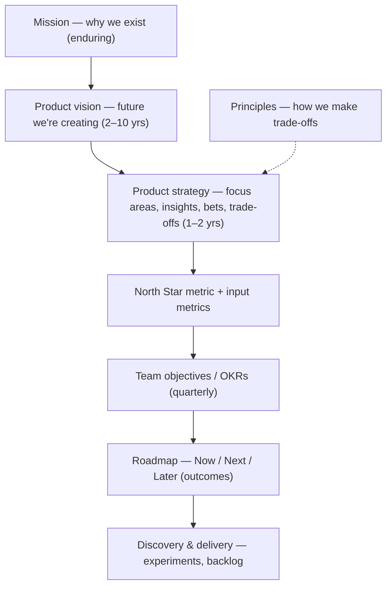
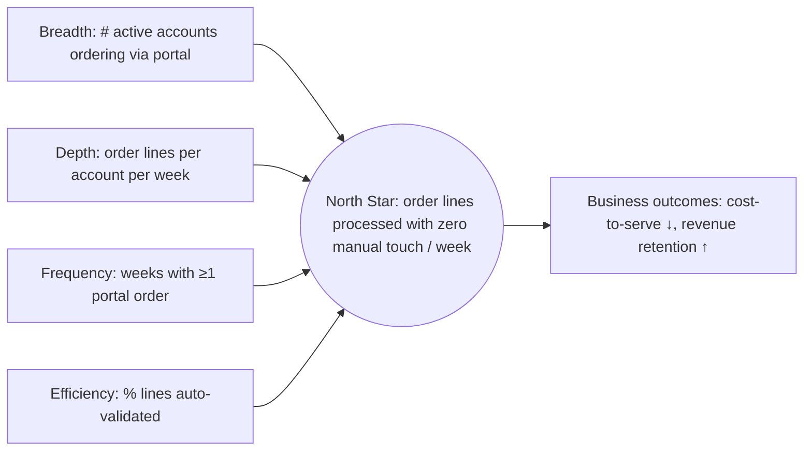
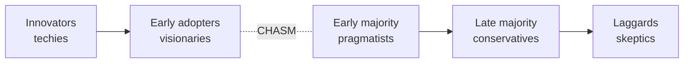

# Product Strategy, Goals & Product-Market Fit

> **TL;DR** — Vision says *where* we're going (2–10 years), mission says *why* we exist, strategy says *which few bets* get us there and what we will **not** do. Translate strategy into outcomes with a North Star metric and its input metrics, and into quarterly team OKRs (stretch, ~0.7 is a good score). KPIs are health metrics you monitor; OKRs are change you drive. Product-market fit is measurable (Sean Ellis 40% "very disappointed" test, flattening retention curves). Know where you are in the lifecycle and on the adoption curve (Crossing the Chasm); use Wardley maps to decide build vs buy.

---

## 1. The strategy stack

| Element | Horizon | Question | Example (internal ERP/ordering platform) |
|---|---|---|---|
| **Mission** | Enduring | Why do we exist? | "Make doing business with us effortless for customers and staff." |
| **Vision** | 2–10 years | What future do we create? | "Every order, from any channel, flows from customer to delivery without a human re-typing it." |
| **Strategy** | 1–2 years | Where do we focus and what don't we do? | Focus 1: self-service for top-200 B2B accounts; Focus 2: automate order intake from email (AI); Not now: consumer webshop |
| **Principles** | Stable | How do we choose between good options? | "Integrate before we build"; "Mobile for the warehouse, desktop for the office" |
| **North Star** | Multi-year | Single metric of value delivered | % of order lines entered without manual touch |
| **OKRs** | Quarter | What change will this team achieve? | O: Make reordering trivial for top accounts. KR: 60% of top-200 accounts place ≥1 order via portal per week (from 25%) |
| **Roadmap** | Now/Next/Later | In which order do we tackle problems? | Now: contract pricing; Next: ERP address sync; Later: AI email intake |

### Good vision checklist (Cagan, *Inspired*)

- Starts with **why**; falls in love with the problem, not the solution.
- Ambitious but plausible (2–10 years).
- Customer-centric; inspiring to missionaries.
- Embraces relevant trends (AI, regulation, platform shifts).
- Communicated relentlessly — often as a **visiontype** (prototype of the future) or narrative.

### Good strategy (Richard Rumelt, *Good Strategy Bad Strategy*, 2011)

**Kernel** of good strategy:

1. **Diagnosis** — what's going on; the critical challenge.
2. **Guiding policy** — overall approach to deal with the challenge.
3. **Coherent actions** — coordinated steps that carry out the policy.

**Bad strategy** hallmarks: fluff, failure to face the challenge, mistaking goals for strategy, bad strategic objectives (a laundry list of "priorities").

Other strategy frames:

| Framework | Author | Gist |
|---|---|---|
| Playing to Win cascade | Lafley & Martin (2013) | Winning aspiration → where to play → how to win → capabilities → management systems |
| Product strategy in 4 parts | Cagan (*Empowered*, 2020) | Focus, insights (quantitative, qualitative, technology, industry), action (team objectives), management |
| Strategy blocks / product strategy canvas | Roman Pichler | Vision, target group, needs, product, business goals |
| Seven Powers | Hamilton Helmer (2016) | Durable advantage: scale economies, network economies, counter-positioning, switching costs, branding, cornered resource, process power |
| Porter's Five Forces / generic strategies | Michael Porter (1979/1980) | Industry attractiveness; cost leadership, differentiation, focus |
| Wardley Mapping | Simon Wardley (2005+) | Situational awareness: value chain × evolution (see §9) |

---

## 2. North Star Metric framework

Popularised by Sean Ellis and Amplitude (North Star Playbook, 2019; John Cutler & Amplitude).

**Definition**: the single metric that best captures the core value your product delivers to customers, and which, if it grows, leads to sustainable business results.

### Criteria for a good North Star

- Expresses **value delivered** to customers (not revenue directly).
- Represents the product vision / strategy.
- Is a **leading indicator** of revenue and retention.
- Is **measurable** and **actionable** by teams.
- Understandable by everyone.
- Not a vanity metric (total signups, page views).

### Three types of games (Amplitude)

| Game | Value comes from | North Star examples |
|---|---|---|
| **Attention** | Time spent | Spotify: time spent listening; Netflix: hours streamed |
| **Transaction** | Number of transactions | Airbnb: nights booked; Amazon: purchases |
| **Productivity** | Efficiency/effectiveness of work | Slack: messages sent within teams; Salesforce: records created; internal tools: tasks completed without manual rework |

### North Star + inputs

Input metrics typically follow breadth / depth / frequency / efficiency. Teams own input metrics; the North Star aligns them.

**Common mistakes**: picking revenue as North Star; picking a metric no team can influence; multiple "North Stars"; not reviewing the North Star when strategy changes; gaming via counter-metric-free optimisation (add **guardrail metrics**, e.g. error rate, support tickets).

---

## 3. OKRs

Origin: Andy Grove at Intel (iMBOs, 1970s; *High Output Management*, 1983); John Doerr brought them to Google in 1999; *Measure What Matters* (2018). Christina Wodtke, *Radical Focus* (2016).

### Structure

- **Objective** — qualitative, inspiring, time-bound *what*. 3–5 per team max (ideally 1–3).
- **Key Results** — 2–5 per objective; measurable *how we know*; outcomes, not tasks.
- **Initiatives** — the work (projects, experiments) expected to move the KRs. Not part of the OKR itself.

Doerr's formula: **"I will [objective] as measured by [key results]."**

### Committed vs aspirational (Google)

| Type | Expectation | Score target |
|---|---|---|
| Committed | Must be achieved; resources adjusted | 1.0 |
| Aspirational / stretch ("moonshots") | Ambitious; expect to miss partly | ~0.6–0.7 is success |

### Scoring

Score each KR 0.0–1.0 at end of period, average for the objective.

| Score | Meaning (Google convention) |
|---|---|
| 0.0–0.3 | Failed to make real progress |
| 0.4–0.6 | Progress but fell short |
| 0.7–1.0 | Delivered (for stretch OKRs ~0.7 is the sweet spot) |

Consistently scoring 1.0 → OKRs not ambitious enough. Consistently < 0.4 → over-committing or wrong KRs. Some orgs use confidence ratings (1–10) weekly instead (Wodtke's 4-square check-in: priorities, OKR confidence, forecast, health).

### Examples

**Product team — B2B ordering portal (Q3)**

- **O:** Make reordering effortless for our largest customers.
  - KR1: Increase weekly portal-ordering accounts among top-200 from 50 to 120.
  - KR2: Reduce median time-to-place a reorder from 9 min to 3 min.
  - KR3: Reduce order-correction tickets per 1,000 orders from 42 to 15.

**Platform / internal developer platform**

- **O:** Product teams ship to production without waiting on us.
  - KR1: Median lead time for a new service to first prod deploy from 10 days to 1 day.
  - KR2: 80% of services on the golden-path template (from 35%).
  - KR3: Platform DX satisfaction score ≥ 4.0/5 (from 3.1).

**Data/AI product**

- **O:** Remove manual typing from email order intake.
  - KR1: 40% of email orders auto-created with ≥ 98% line-level accuracy.
  - KR2: Average handling time for assisted orders down 50%.
  - KR3 (guardrail): Order-error complaints do not increase vs baseline.

### Good vs bad KRs

| Bad KR | Why | Better |
|---|---|---|
| Launch the new reorder feature | Output / task | 60% of active accounts use reorder at least once in 30 days |
| Improve NPS | Not measurable as stated | NPS among portal users from +12 to +30 |
| Write 20 blog posts | Activity | Organic signups from content 300 → 600 / month |
| 100% uptime | Unrealistic & health metric | Keep as KPI/SLO; not an OKR unless it's the focus |

### OKR process (quarterly)

1. Company/product strategy and North Star set context.
2. Teams **propose** OKRs (bottom-up ~50–60%), leadership aligns (not cascades every KR).
3. Weekly check-in on confidence; monthly review.
4. End of quarter: score, retrospective, carry over or drop.

### Common OKR mistakes

- Cascading KRs down as tasks; task lists disguised as KRs.
- Too many OKRs (focus lost); every team has 5 objectives × 5 KRs.
- Tying OKRs to compensation (kills ambition → sandbagging). Doerr and Google advise against it.
- Set-and-forget (no weekly check-ins).
- No baseline → can't judge progress.
- Using OKRs for business-as-usual health (that's KPIs).

---

## 4. KPIs vs OKRs

| | KPI | OKR |
|---|---|---|
| Purpose | Monitor health of ongoing operation | Drive a specific change / improvement |
| Time | Continuous | Time-boxed (quarter/half-year) |
| Target | Thresholds / SLAs ("keep within") | Stretch target ("move from X to Y") |
| Analogy | Car dashboard gauges | Navigation route to a new destination |
| Example | Uptime 99.9%, CSAT ≥ 4.2, churn < 2%/mo | Reduce churn from 2.4% to 1.6% this quarter |
| Relationship | A KPI in the red can become an OKR | A KR achieved can become a maintained KPI |

Also: **SLIs/SLOs** for reliability (see [../08-engineering/README.md](../08-engineering/README.md)), **guardrail metrics** for experiments, **health metrics** in Wodtke's check-in.

---

## 5. Product-market fit (PMF)

Coined by Andy Rachleff (Benchmark); popularised by Marc Andreessen, "The only thing that matters" (2007): "being in a good market with a product that can satisfy that market."

### Sean Ellis test (40% rule)

Survey users who have experienced the core product (used it ≥2 times, recently):

> "How would you feel if you could no longer use [product]?"
> Very disappointed / Somewhat disappointed / Not disappointed / N/A – no longer use

**If ≥ 40% answer "very disappointed"** → likely PMF (benchmark from ~100 startups). Minimum ~30–40 responses for directional signal.

### Superhuman PMF engine (Rahul Vohra, First Round Review, 2018)

1. Survey with the Ellis question + "What type of people would benefit most?", "What is the main benefit?", "How can we improve?"
2. Segment: find the persona with highest "very disappointed" (the HXC — high-expectation customer).
3. Analyse what "very disappointed" users love; analyse what holds back "somewhat disappointed" users whose main benefit matches.
4. Split roadmap ~50% doubling down on what's loved, ~50% addressing blockers for the somewhat-disappointed.
5. Track the PMF score as a metric (Superhuman moved from 22% to 58%).

### Other PMF signals

| Signal | Indicator |
|---|---|
| Retention curve **flattens** (not to zero) | Strongest quantitative signal |
| Organic growth / word of mouth | Referral share of new signups |
| Sales cycle shortens; inbound demand | B2B |
| NRR > 100% | Expansion exceeds churn (B2B SaaS) |
| Usage grows without pushing | Internal tools: voluntary adoption without mandate |

Note for internal products: users often **can't** switch (mandated tools), so measure **voluntary** behaviours (workarounds abandoned, shadow Excel sheets retired, satisfaction, task time) rather than adoption alone.

### Marc Andreessen / Rachleff hierarchy

Market matters most; a great market pulls the product out of the startup. Before PMF focus solely on getting to PMF; after PMF, scale.

---

## 6. Product lifecycle

| Stage | Characteristics | PM focus | Typical metrics |
|---|---|---|---|
| **Introduction** | Low sales, high cost, early adopters | Discovery, PMF, positioning | Activation, retention, PMF score |
| **Growth** | Rapid adoption, competitors appear | Scale, onboarding, channels, reliability | Acquisition, conversion, NRR |
| **Maturity** | Growth slows, competition on price/features | Efficiency, differentiation, adjacent segments | Margin, churn, share |
| **Decline** | Market shrinks, substitutes | Harvest, migrate, sunset | Cost-to-serve, migration rate |

Sunsetting checklist: usage analysis, customer comms with timeline (B2B: 6–12+ months), migration path/data export, contractual obligations, support plan, internal decommissioning (data retention, access removal).

Related: **Three Horizons** (McKinsey, Baghai/Coley/White, *The Alchemy of Growth*, 1999) — H1 core, H2 emerging, H3 future options; balance the portfolio (often ~70/20/10).

---

## 7. Technology adoption & Crossing the Chasm

Everett Rogers, *Diffusion of Innovations* (1962): innovators 2.5%, early adopters 13.5%, early majority 34%, late majority 34%, laggards 16%.

Geoffrey Moore, *Crossing the Chasm* (1991; 3rd ed. 2014): a **chasm** exists between early adopters (visionaries, want breakthrough, tolerate gaps) and early majority (pragmatists, want proven whole product, references from peers).

**Moore's playbook**

- Pick a **beachhead** niche (target customer + compelling reason to buy).
- Deliver the **whole product** (product + services, integrations, support, partners) for that niche.
- Dominate the niche; use it as reference to move to adjacent segments ("bowling pin" strategy).
- Positioning statement template: *For [target customers] who [need], [product] is a [category] that [key benefit]. Unlike [primary alternative], our product [differentiation].*

Internal-tool analogue: pilot with an enthusiastic department (early adopters) ≠ rollout to the whole company (pragmatists need training, integration, support, proof from peer departments).

---

## 8. Positioning (April Dunford)

*Obviously Awesome* (2019). Components: competitive alternatives → unique attributes → value (and proof) → target customers who care → market category → relevant trends. Start from what customers would use if you didn't exist.

---

## 9. Wardley mapping (brief)

Simon Wardley (from ~2005). Map **user needs → value chain of components** (Y-axis: visibility to user) against **evolution** (X-axis: Genesis → Custom-built → Product/Rental → Commodity/Utility).

| Evolution stage | Characteristics | Sourcing approach |
|---|---|---|
| Genesis | Novel, uncertain, rare | Build in-house, explore, agile/experimentation |
| Custom-built | Emerging understanding | Build, small teams |
| Product / rental | Increasingly understood, competing products | Buy / configure; lean |
| Commodity / utility | Standardised, ubiquitous | Outsource / use utility (cloud, SaaS); six-sigma-style efficiency |

Product uses: decide build vs buy, spot where to differentiate (don't custom-build commodities like auth, payments, ERP ledger), anticipate evolution (AI models moving to utility), team topology (Pioneers / Settlers / Town Planners).

Full treatment: [../11-enterprise-architecture-business/README.md](../11-enterprise-architecture-business/README.md).

---

## 10. Strategic analysis toolbox (quick reference)

| Tool | Use for |
|---|---|
| SWOT | Quick internal (strengths/weaknesses) + external (opportunities/threats) scan |
| PESTEL | Macro environment (political, economic, social, technological, environmental, legal) |
| Porter's Five Forces | Industry attractiveness |
| Ansoff matrix | Growth: market penetration, product development, market development, diversification |
| BCG matrix | Portfolio: stars, cash cows, question marks, dogs |
| Blue Ocean / Strategy canvas | Kim & Mauborgne (2005): eliminate-reduce-raise-create grid |
| Competitive analysis matrix | Features/attributes vs competitors (incl. "do nothing", Excel) |
| TAM / SAM / SOM | Market sizing: total, serviceable, obtainable |

Market sizing example (bottom-up): 4,000 target wholesalers × 25% reachable × €12k ARR = SAM-reachable €12M; SOM year-3 at 5% share of TAM.

---

## 11. Common mistakes

- Vision is a feature list; strategy is a roadmap; OKRs are a task list.
- No explicit "not doing" list.
- North Star that teams can't influence weekly.
- Declaring PMF from one enthusiastic pilot customer.
- Ignoring the chasm: scaling sales/rollout before the whole product exists.
- Strategy not communicated beyond leadership; teams can't explain how their work connects.

## Related sections

- Roadmaps from strategy: [roadmaps-and-release-planning.md](roadmaps-and-release-planning.md)
- Business strategy, capability maps, Wardley: [../11-enterprise-architecture-business/README.md](../11-enterprise-architecture-business/README.md)
- Leadership and alignment: [../09-leadership-teams-facilitation/README.md](../09-leadership-teams-facilitation/README.md)
- Mental models (second-order thinking, Goodhart's law): [../10-laws-principles-mental-models/README.md](../10-laws-principles-mental-models/README.md)

## References

- What Matters (John Doerr, OKRs) — https://www.whatmatters.com/
- OKR (Wikipedia) — https://en.wikipedia.org/wiki/OKR
- Google re:Work — Set goals with OKRs — https://rework.withgoogle.com/
- Amplitude (North Star Playbook publisher) — https://amplitude.com/
- Product-market fit (Wikipedia) — https://en.wikipedia.org/wiki/Product-market_fit
- Sean Ellis PMF survey — https://pmfsurvey.com/
- Marc Andreessen, "The only thing that matters" — https://pmarchive.com/guide_to_startups_part4.html
- Superhuman PMF engine (First Round Review) — https://review.firstround.com/how-superhuman-built-an-engine-to-find-product-market-fit/
- Crossing the Chasm (Wikipedia) — https://en.wikipedia.org/wiki/Crossing_the_Chasm
- Diffusion of innovations (Wikipedia) — https://en.wikipedia.org/wiki/Diffusion_of_innovations
- Technology adoption life cycle (Wikipedia) — https://en.wikipedia.org/wiki/Technology_adoption_life_cycle
- Wardley map (Wikipedia) — https://en.wikipedia.org/wiki/Wardley_map
- Learn Wardley Mapping — https://learnwardleymapping.com/
- Richard Rumelt (Wikipedia) — https://en.wikipedia.org/wiki/Richard_Rumelt
- Porter's five forces (Wikipedia) — https://en.wikipedia.org/wiki/Porter%27s_five_forces_analysis
- Blue Ocean Strategy — https://www.blueoceanstrategy.com/
- April Dunford — https://www.aprildunford.com/
- SVPG — Product vision / strategy articles — https://www.svpg.com/articles/
