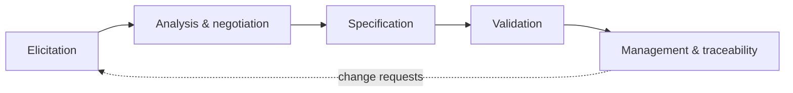
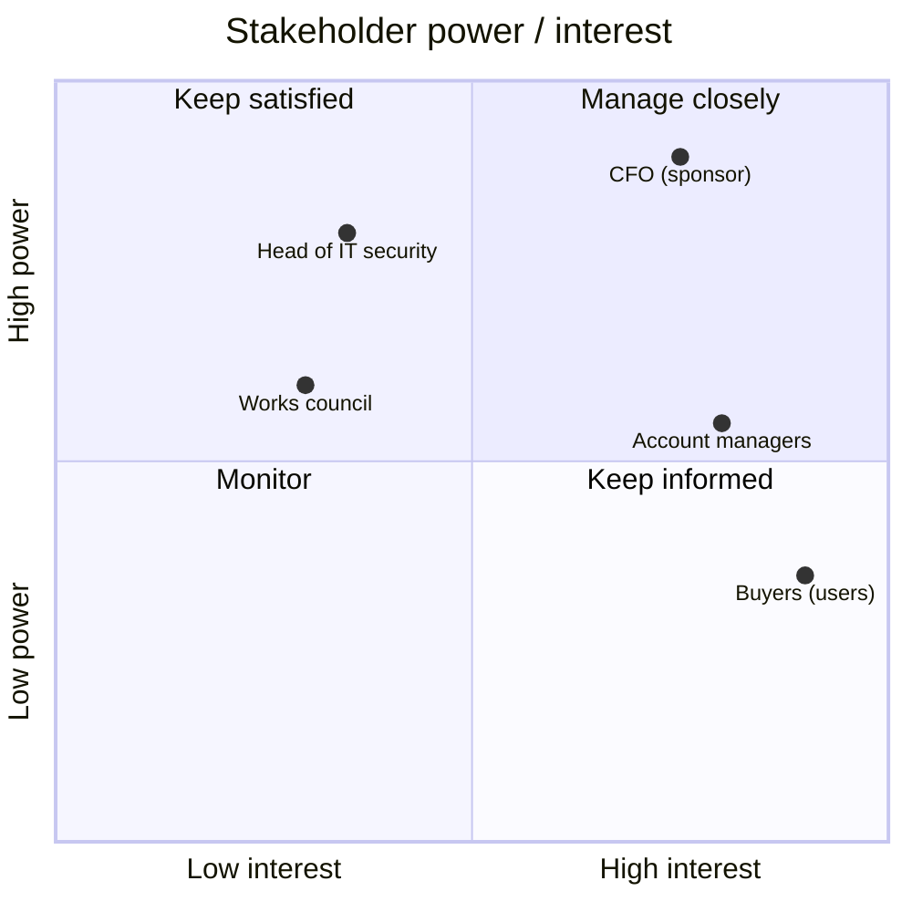
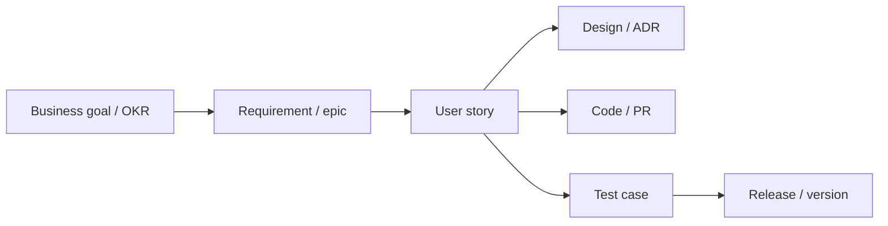

# Requirements Engineering

> **TL;DR** — Requirements engineering (RE) = elicit, analyse, specify, validate and manage what a system must do (functional) and how well (non-functional / quality attributes). Use ISO/IEC 25010 as the checklist for quality attributes, write NFRs as measurable scenarios, map stakeholders by power/interest, choose elicitation techniques by context (observation beats asking), describe interactions with use cases or user stories, and keep lightweight traceability from goal → requirement → test → release. In agile, RE is continuous and conversational, but NFRs and constraints still need explicit, early attention — especially in ERP, integration and regulated enterprise contexts.

---

## 1. RE activities

| Activity | Output | Techniques |
|---|---|---|
| **Elicitation** | Raw needs, goals, constraints | Interviews, workshops, observation, document analysis, prototyping |
| **Analysis** | Consistent, prioritised, feasible requirements | Modelling (use cases, process, data, context), conflict resolution, prioritisation |
| **Specification** | Documented requirements | User stories, use cases, SRS, BDD scenarios, models |
| **Validation** | Agreement that requirements reflect needs | Reviews, walkthroughs, prototypes, acceptance tests |
| **Management** | Baseline, change control, traceability | Backlog tools, requirement IDs, impact analysis |

Standards/bodies: **ISO/IEC/IEEE 29148:2018** (requirements engineering processes & SRS content; replaced IEEE 830-1998), **IREB CPRE** (Certified Professional for Requirements Engineering), **IIBA BABOK v3** (business analysis body of knowledge), **Volere** template (Robertson & Robertson).

---

## 2. Types of requirements

| Type | Definition | Example |
|---|---|---|
| **Business requirement** | Why: organisational goal/objective | Reduce order-handling cost by 30% |
| **Stakeholder / user requirement** | What a user group needs to accomplish | Buyers must be able to reorder previous orders |
| **Functional requirement (FR)** | Behaviour the system must perform | The system shall create a draft order from a previous order |
| **Non-functional requirement (NFR) / quality requirement** | How well; quality attributes | Order submission p95 < 1 s at 200 concurrent users |
| **Constraint** | Limits on solution options | Must run on Azure in EU region; must integrate with SAP S/4HANA via OData |
| **Transition requirement** | Needed temporarily for change | Migrate 5 years of order history; parallel run 4 weeks |
| **Regulatory / compliance** | Laws and standards | GDPR data subject requests; e-invoicing (Peppol); EU AI Act transparency |

### Writing good requirements (ISO 29148 characteristics)

Necessary, appropriate, unambiguous, complete, singular, feasible, verifiable, correct, conforming. As a set: complete, consistent, feasible, comprehensible, able to be validated.

**EARS** (Easy Approach to Requirements Syntax, Alistair Mavin et al., Rolls-Royce, 2009):

| Pattern | Template | Example |
|---|---|---|
| Ubiquitous | The <system> shall <response> | The portal shall display prices excluding VAT. |
| Event-driven | **When** <trigger>, the <system> shall <response> | When a buyer submits an order, the portal shall send a confirmation email within 1 minute. |
| State-driven | **While** <state>, the <system> shall <response> | While the ERP is unavailable, the portal shall queue orders for later submission. |
| Unwanted behaviour | **If** <condition>, **then** the <system> shall <response> | If a quantity is not a multiple of the packaging unit, then the portal shall round up and inform the buyer. |
| Optional feature | **Where** <feature is included>, the <system> shall <response> | Where approval workflow is enabled, the portal shall route orders > €5,000 to an approver. |

**Ambiguity red flags**: "user-friendly", "fast", "flexible", "etc.", "and/or", "as appropriate", "support", "minimise", "state-of-the-art", passive voice without actor, TBD.

---

## 3. Non-functional requirements & ISO/IEC 25010

ISO/IEC 25010:2011 (SQuaRE) product quality model; revised in **ISO/IEC 25010:2023** (9 characteristics: usability renamed *interaction capability*, portability renamed *flexibility*, and **safety** added).

| Characteristic (2011 → 2023) | Sub-characteristics (2023, abridged) | Example measurable NFR |
|---|---|---|
| **Functional suitability** | Completeness, correctness, appropriateness | 100% of contract price rules from ERP applied correctly in test suite |
| **Performance efficiency** | Time behaviour, resource utilisation, capacity | p95 page load < 1.5 s; 500 orders/min peak |
| **Compatibility** | Co-existence, interoperability | Exchanges orders with SAP via OData v4; Peppol BIS 3.0 invoices |
| **Usability → Interaction capability** | Appropriateness recognisability, learnability, operability, user error protection, user engagement, inclusivity, user assistance, self-descriptiveness | New buyer places first order in < 5 min without training; WCAG 2.2 AA |
| **Reliability** | Faultlessness (was maturity), availability, fault tolerance, recoverability | 99.9% monthly availability (≈ 43 min downtime/month); RPO 15 min, RTO 4 h |
| **Security** | Confidentiality, integrity, non-repudiation, accountability, authenticity, resistance | SSO via Entra ID/OIDC; MFA for admins; all order changes audited; OWASP ASVS L2 |
| **Maintainability** | Modularity, reusability, analysability, modifiability, testability | New price rule type deployable in ≤ 2 days; test coverage of pricing ≥ 80% |
| **Portability → Flexibility** | Adaptability, scalability, installability, replaceability | Runs in containers; scale to 3× load without code change |
| **Safety** (new in 2023) | Operational constraint, risk identification, fail safe, hazard warning, safe integration | Relevant for industrial/IoT/medical contexts |

ISO 25010 also defines a **quality-in-use** model (effectiveness, efficiency, satisfaction, freedom from risk, context coverage) — in 2023 split out as ISO/IEC 25019.

Other checklists: **FURPS+** (Functionality, Usability, Reliability, Performance, Supportability + constraints; Robert Grady, HP, 1987).

### Quality attribute scenarios (SEI / Bass, Clements, Kazman)

| Part | Example |
|---|---|
| Source | 200 concurrent buyers |
| Stimulus | Submit orders |
| Artifact | Order service |
| Environment | Normal operation, Monday 08:00 peak |
| Response | Orders accepted and confirmed |
| Response measure | p95 latency < 1 s, 0 lost orders |

Use these in architecture work (ATAM, utility tree) — see [../05-software-architecture/README.md](../05-software-architecture/README.md).

### NFR handling in agile

- Global NFRs → **Definition of Done** (e.g. accessibility, security scans).
- Story-specific NFRs → acceptance criteria.
- Cross-cutting NFRs → **architecture runway / enablers**, fitness functions (automated checks), SLOs.
- Write them early; NFRs discovered late are the most expensive (re-architecture).

---

## 4. Stakeholder analysis

### Identify

Users (primary, secondary), buyers/sponsors, customers' IT, operations/support, sales/account managers, finance, legal/compliance, security, data protection officer, works council (EU), integration partners, regulators, the team itself.

### Power/interest grid (Mendelow, 1991)

### Stakeholder register

| Stakeholder | Role | Interest / goals | Influence | Attitude | Engagement strategy | Owner |
|---|---|---|---|---|---|---|
| CFO | Sponsor | Lower cost-to-serve | High | Supportive | Monthly outcome review | PM |
| Account managers | Users + affected | Keep customer relationship; fear losing role | Medium | Sceptical | Co-design workshops; show time saved | PO |
| IT security | Gatekeeper | Compliance, risk | High | Neutral | Early threat model review | Tech lead |

Other tools: **RACI** (Responsible, Accountable, Consulted, Informed), **Onion model** (Ian Alexander: product → system → containing system → wider environment), **salience model** (Mitchell, Agle & Wood, 1997: power, legitimacy, urgency).

---

## 5. Elicitation techniques

| Technique | Good for | Limitations | Tips |
|---|---|---|---|
| **One-on-one interviews** | Depth, sensitive topics | Say ≠ do; time | Story-based questions; record; 2 interviewers |
| **Workshops (JAD)** | Aligning many stakeholders, resolving conflicts | Groupthink, loud voices | Facilitator; structured techniques (silent writing, dot voting) |
| **Observation / shadowing / contextual inquiry** | Tacit knowledge, real workflows, workarounds | Observer effect; time | Master–apprentice model (Beyer & Holtzblatt); note workarounds and sticky notes on monitors |
| **Document analysis** | Existing processes, rules, regulations | Docs may be outdated | Contracts, SOPs, manuals, legacy screens, report definitions |
| **System archaeology / legacy analysis** | Replacing existing systems (ERP migration) | Replicates old mistakes | Separate "what it does" from "what's needed" |
| **Process mining** | Actual process from event logs (Celonis, Disco, PM4Py) | Needs good logs | Reveals variants, rework loops, bottlenecks |
| **Surveys / questionnaires** | Quantifying across many users | Shallow | After qualitative research |
| **Prototyping** | Validating UI, eliciting reactions | Users focus on visuals | Low fidelity early |
| **Brainstorming / creativity** | New ideas | Unvalidated | Diverge then converge |
| **Focus groups** | Attitudes, perceptions | Groupthink; not behaviour | Use sparingly |
| **Apprenticing / "do the job"** | Deep empathy | Time | A day in the warehouse is worth ten meetings |
| **Event storming** (Alberto Brandolini, 2013) | Domain discovery, events, bounded contexts | Needs facilitator | Orange stickies = domain events on a long wall |
| **Domain storytelling** (Hofer & Schwentner) | Business processes as pictographic stories | — | Good for DDD and process discovery |
| **Data analysis / analytics** | What users actually do | Not why | Combine with interviews |
| **Support tickets / CRM notes** | Pain points, frequency | Biased to complainers | Tag and count themes |

**Kano requirement categories in RE** (IREB): basic factors (dissatisfiers, often unspoken), performance factors (satisfiers, spoken), excitement factors (delighters, unknown). Elicit basic factors via observation/document analysis — users rarely mention them.

---

## 6. Modelling & specification

### Use cases (Ivar Jacobson, 1987; Alistair Cockburn, *Writing Effective Use Cases*, 2000)

**Fully-dressed use case template**

| Field | Example |
|---|---|
| ID / name | UC-07 Reorder previous order |
| Primary actor | Buyer |
| Stakeholders & interests | Buyer: speed; Account manager: correct orders; Finance: correct prices |
| Scope / level | Ordering portal / user goal ("sea level") |
| Preconditions | Buyer authenticated, has ≥1 previous order |
| Trigger | Buyer selects "Reorder" on an order |
| Main success scenario | 1. System shows previous order lines with current prices. 2. Buyer adjusts quantities. 3. System validates availability and packaging units. 4. Buyer submits. 5. System creates order in ERP and shows confirmation. |
| Extensions | 1a. Item discontinued: system flags item and suggests successor. 3a. Quantity invalid: system rounds and informs. 5a. ERP unavailable: order queued, buyer informed. |
| Postconditions (success) | Order exists in ERP with status "received" |
| Minimal guarantee | No duplicate order created |
| NFRs / special requirements | p95 < 1 s for steps 1–3 |
| Frequency | ~2,000/week |

Cockburn goal levels: cloud (summary/strategic) → kite (summary) → sea level (user goal) → fish (sub-function) → clam (too low).

**Use cases vs user stories**

| Use case | User story |
|---|---|
| Complete interaction incl. alternates and exceptions | Small slice of value; placeholder for conversation |
| Good for complex flows, integrations, regulated/contractual contexts | Good for iterative delivery |
| Can be split into multiple stories (one per scenario/extension) — Jacobson's **Use-Case 2.0** (2011) does exactly this with "use-case slices" | Lose overview without story map |

### Other models

| Model | Use |
|---|---|
| Context diagram (C4 level 1) | System boundary, external actors/systems |
| BPMN 2.0 process model | Business processes, swimlanes, handoffs |
| UML activity / sequence / state diagrams | Flows, interactions, lifecycle (e.g. order states) |
| ERD / domain model | Entities and relationships; glossary |
| Decision tables / DMN | Complex business rules (pricing, approvals) |
| Data dictionary / glossary | Ubiquitous language (DDD) |
| Wireframes / prototypes | UI requirements |
| CRUD matrix | Which role creates/reads/updates/deletes which entity |
| Permissions matrix | Role × action authorisation |

**Decision table example (approval rule)**

| Order value | Customer credit status | New supplier item | → Approval required |
|---|---|---|---|
| ≤ €5k | OK | No | No |
| ≤ €5k | OK | Yes | Yes (category manager) |
| > €5k | OK | — | Yes (budget holder) |
| any | Blocked | — | Yes (finance) |

---

## 7. Traceability

**Purpose**: impact analysis (what's affected by a change), coverage (is every requirement tested?), compliance/audit evidence, avoiding gold-plating (is every feature linked to a need?).

| Direction | Question |
|---|---|
| Forward (requirement → test/code) | Is every requirement implemented and tested? |
| Backward (code/test → requirement) | Why does this code exist? |
| Horizontal | Dependencies between requirements |

**Requirements Traceability Matrix (RTM)**

| Req ID | Description | Source | Story IDs | Test IDs | Status | Release |
|---|---|---|---|---|---|---|
| BR-01 | Reduce order-handling cost 30% | CFO | — | KPI dashboard | In progress | — |
| FR-12 | Reorder previous order | Interviews, UC-07 | PORT-231, PORT-232 | TC-88..TC-93 | Done | 2.4 |
| NFR-03 | p95 order submit < 1 s | Architecture | PORT-240 | PERF-07 | Done | 2.4 |

**Lightweight agile traceability**: link items in the tool (Jira/Azure DevOps: epic ↔ story ↔ PR ↔ test run ↔ release), reference story IDs in commit messages/branch names, BDD scenarios as executable specs. Heavy RTMs are needed in regulated domains (medical IEC 62304, automotive ISO 26262, aviation DO-178C, GxP/CSV, financial audit).

---

## 8. Requirements change management

- Baseline per release/contract; changes via backlog reordering (agile) or change request (fixed-scope contracts).
- Impact analysis: scope, cost, schedule, risks, dependent systems, tests.
- In fixed-price/enterprise deals, define a change process and a "budget for change" upfront; consider **money for nothing / change for free** clauses (Jeff Sutherland) for agile contracts.
- Track **requirements volatility** (% changed per period) as a risk indicator.

## 9. RE for specific contexts

| Context | Key RE concerns |
|---|---|
| **ERP implementation / replacement** | Fit-gap analysis vs standard; minimise customisation ("adopt, don't adapt"); master data; migration; reports; roles/authorisations; integrations; period-end processes |
| **Integrations** | Interface contracts (OpenAPI, AsyncAPI), data mapping, error handling, idempotency, volumes, SLAs, ownership |
| **Portals (B2B/B2C)** | Identity (SSO, B2B federation), permissions per account hierarchy, content, multi-language, accessibility (European Accessibility Act, June 2025) |
| **Data products** | Data sources, freshness/latency, quality rules, lineage, definitions of metrics, access policies |
| **AI features** | Acceptable error rates, evaluation datasets, human oversight, explainability, bias, data privacy, EU AI Act risk class, fallback behaviour |
| **Public sector tenders** | Formal requirement lists, MoSCoW/must-criteria, traceability to bid responses |

## 10. Checklist — requirements review

- [ ] Every requirement traces to a goal or stakeholder need
- [ ] FRs testable; NFRs measurable (number + unit + condition)
- [ ] ISO 25010 characteristics considered (even if "not relevant")
- [ ] Constraints explicit (tech, legal, budget, time)
- [ ] Glossary of domain terms agreed
- [ ] Edge cases and error flows described
- [ ] Data requirements (volumes, retention, privacy) captured
- [ ] Roles and permissions defined
- [ ] Conflicts between stakeholders resolved and recorded
- [ ] Validated with real users (prototype/walkthrough)
- [ ] Prioritised (MoSCoW or ranked)

## 11. Common mistakes

- Specifying solutions ("a dropdown") instead of needs.
- Only listening to managers, not to the people doing the work.
- NFRs as adjectives ("fast, secure, scalable").
- Copying the legacy system's behaviour 1:1 into the new one.
- 200-page SRS nobody reads; or the opposite, no shared understanding of complex rules.
- Not capturing the "why", so later trade-offs are impossible.
- Ignoring operational requirements (monitoring, support, backups, admin UIs).

## Related sections

- Architecture quality attributes, ADRs, C4: [../05-software-architecture/README.md](../05-software-architecture/README.md)
- Project scope and change control: [../03-project-management/README.md](../03-project-management/README.md)
- Business analysis, capability and process modelling: [../11-enterprise-architecture-business/README.md](../11-enterprise-architecture-business/README.md)
- Data requirements and governance: [../07-data-ai-architecture/README.md](../07-data-ai-architecture/README.md)
- Workshop facilitation: [../09-leadership-teams-facilitation/README.md](../09-leadership-teams-facilitation/README.md)

## References

- ISO 25000 portal (ISO/IEC 25010) — https://iso25000.com/
- ISO/IEC 25010 (ISO) — https://www.iso.org/standard/78176.html
- ISO/IEC/IEEE 29148 (ISO) — https://www.iso.org/standard/72089.html
- Requirements engineering (Wikipedia) — https://en.wikipedia.org/wiki/Requirements_engineering
- Non-functional requirement (Wikipedia) — https://en.wikipedia.org/wiki/Non-functional_requirement
- IREB — https://www.ireb.org/
- IIBA (BABOK) — https://www.iiba.org/
- Volere — https://www.volere.org/
- Use case (Wikipedia) — https://en.wikipedia.org/wiki/Use_case
- Stakeholder analysis (Wikipedia) — https://en.wikipedia.org/wiki/Stakeholder_analysis
- Requirements elicitation (Wikipedia) — https://en.wikipedia.org/wiki/Requirements_elicitation
- Traceability matrix (Wikipedia) — https://en.wikipedia.org/wiki/Traceability_matrix
- FURPS (Wikipedia) — https://en.wikipedia.org/wiki/FURPS
- EventStorming — https://www.eventstorming.com/
- Domain Storytelling — https://domainstorytelling.org/
- BPMN (OMG) — https://www.bpmn.org/
