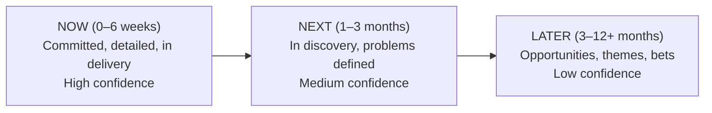
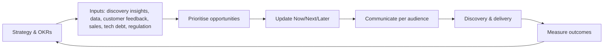

# Roadmaps & Release Planning

> **TL;DR** — A roadmap is a **communication tool for strategy**, not a Gantt chart of features with dates. Prefer outcome-based, theme-based **Now / Next / Later** roadmaps where certainty decreases with time horizon. Commit to dates only where there is a real external constraint, and then manage scope (not quality). Release planning turns the "Now" into increments: story maps, release slices, feature flags, progressive rollout, and release notes. Keep separate views for different audiences (executives, customers, teams).

---

## 1. Roadmap types

| Type | Shows | Good for | Risk |
|---|---|---|---|
| **Feature / timeline roadmap** | Features on a calendar (Gantt-like) | Fixed-scope contracts, regulated deadlines, coordination of many teams | False certainty; output focus; "roadmap as promise" |
| **Now / Next / Later** (Janna Bastow, ProdPad, ~2012) | Problems/opportunities in 3 time horizons, no dates | Most product teams | Stakeholders asking "but when?" |
| **Outcome-based roadmap** | Outcomes/metrics to move per horizon, with candidate solutions | Empowered teams, OKR-driven orgs | Needs metric maturity |
| **Theme-based roadmap** | Strategic themes (e.g. "self-service", "trust") per quarter | Portfolio/exec communication | Too abstract for delivery teams |
| **Goal-oriented (GO) roadmap** (Roman Pichler) | Date/timeframe, name, goal, features, metrics per release | Product with regular releases | Can drift to feature lists |
| **Technology / platform roadmap** | Architecture evolution, migrations, deprecations | Platform/internal teams, EA | Disconnected from business value |
| **Portfolio roadmap** | Multiple products/initiatives across teams | Leadership, PMO | Becomes a project plan |
| **Release plan** | Next 1–3 releases/increments with scope | Delivery coordination | Detail too far ahead |

### Certainty cone

---

## 2. Now / Next / Later — example (B2B ordering platform)

| | **Now** | **Next** | **Later** |
|---|---|---|---|
| **Goal / outcome** | Top accounts order without calling (weekly portal-ordering accounts 50 → 120) | Reduce order errors (correction tickets −60%) | Remove manual intake of email orders |
| **Problems / opportunities** | Buyers don't know contract prices; reorders are slow | Wrong packaging units; outdated addresses | 40% of orders still arrive by email/PDF |
| **Candidate solutions** | Contract price display; reorder templates | Unit validation; ERP address sync | AI email-to-order intake (Wizard of Oz pilot first) |
| **Status** | In delivery | In discovery | Exploring |
| **Confidence** | High | Medium | Low |

Rules: each card = a problem/outcome (solutions as examples underneath); move items between columns as evidence changes; review monthly; show what's **not** on the roadmap.

---

## 3. Outcome-based roadmaps

Format per item: **Outcome** (metric, baseline, target) → **Why now** (evidence) → **Ideas** we'll test → **How we'll measure**.

| Theme | Outcome (KR) | Hypotheses / bets | Horizon |
|---|---|---|---|
| Self-service | 60% of reorders via portal (from 25%) | Reorder templates; mobile reorder | Now |
| Order quality | Correction tickets per 1k orders 42 → 15 | Unit validation; address sync; catalogue clean-up | Next |
| Automation | 40% of email orders auto-created | AI extraction + human review | Later |
| Platform health | Deploy frequency daily; change fail rate < 15% | CI/CD hardening; test automation | Continuous |

Benefits: teams retain solution freedom; stakeholders discuss priorities of problems; progress is measured as impact, not delivery.

Books: C. Todd Lombardo, Bruce McCarthy, Evan Ryan, Michael Connors, *Product Roadmaps Relaunched* (2017) — roadmap components: product vision, business objectives, timeframes, themes, disclaimer; optional: features, confidence, stage of development, target customers.

---

## 4. Theme roadmaps

Group work under 3–6 strategic themes per year, allocate capacity per theme (e.g. 40% self-service, 25% order quality, 20% platform, 15% experiments). Good for executive alignment and investment decisions ("investment allocation" or "lanes"). Each theme should map to a strategic pillar and an outcome metric.

---

## 5. Dates, commitments and uncertainty

| Situation | Approach |
|---|---|
| Hard external deadline (regulation, contract, event) | Fixed date, **flexible scope** (MoSCoW Musts ≤ 60%); start early; track burn-up |
| Internal coordination (marketing launch) | Target window (month/quarter) + confidence level; firm date set late |
| Exploratory work | No date; time-box discovery; decision dates instead ("by 15 May we decide go/no-go") |
| Sales asks for a date for a customer | Commit to the **problem** and a window; avoid feature-level promises; use "planned / exploring" labels |

**Forecasting**: use historical throughput and Monte Carlo ("85% probability by week 34") rather than single-point estimates; communicate ranges. See [../04-agile-kanban-scrum/README.md](../04-agile-kanban-scrum/README.md).

**Disclaimer on every external roadmap**: plans may change; not a contractual commitment (important in B2B, also legally for revenue recognition in public companies).

---

## 6. Audiences and views

| Audience | What they need | Format |
|---|---|---|
| Executives / board | Strategy, themes, outcomes, investment split, risks | 1 slide; themes × quarters; metrics |
| Sales / account managers | What's coming for customers, talking points, what not to promise | Now/Next/Later, customer-facing language |
| Customers | Direction, problems you'll solve, beta opportunities | Public roadmap (portal/Trello-like), no dates or broad windows |
| Engineering / delivery teams | Goals, sequencing, dependencies, technical milestones | Outcome roadmap + release plan + story maps |
| Other product teams / platform | Dependencies, API changes, deprecations | Dependency board, platform roadmap |
| Support / operations | Release timing, training needs | Release calendar, release notes |

---

## 7. Release planning

### Releases vs deployments

- **Deployment**: putting code into production (can be many times per day).
- **Release**: exposing functionality to users (can be decoupled via **feature flags**).
- Decoupling enables trunk-based development, dark launches, progressive delivery.

### Release strategies

| Strategy | Description | Use |
|---|---|---|
| Continuous release | Each change released when ready | SaaS, mature CI/CD |
| Release train | Fixed cadence (e.g. every 2 weeks; SAFe PI every 8–12 weeks) | Multiple teams, enterprise customers needing predictability |
| Feature flags / toggles | Release to segments at will | Most modern products |
| Canary release | Small % of traffic first, monitor, expand | Risky changes |
| Blue/green | Switch traffic between two environments | Fast rollback |
| Beta / early access | Opt-in customers | B2B features; feedback |
| Dark launch | Run new code path without exposing UI | Performance/feasibility validation |
| Big-bang cut-over | Everything at once | Sometimes unavoidable (ERP go-live); mitigate with rehearsals |
| Phased rollout by site/region/BU | Wave plan | Internal tools, ERP rollouts |

### Release planning steps

1. Confirm the **release goal** (outcome + what users can do afterwards).
2. Use a **story map** to choose the slice (walking skeleton first).
3. Size top items; check capacity using historical velocity/throughput.
4. Identify dependencies, NFRs, migrations, legal/security reviews.
5. Define release criteria (quality gates, DoD at release level, performance tests, UAT).
6. Plan **go-to-market**: comms, training, docs, support readiness, release notes (see [templates.md](templates.md)).
7. Plan rollout & rollback (flags, canary, data migration reversibility).
8. Define post-release measurement (analytics events, dashboards, success criteria, review date).

### Release readiness checklist

- [ ] Release goal and success metrics defined; dashboards ready
- [ ] All Must items done (DoD met); known issues documented
- [ ] Performance/load tests passed for expected peak
- [ ] Security review / pen test (if required) passed
- [ ] Data migration rehearsed; rollback plan tested
- [ ] Feature flags configured; rollout plan (cohorts, %)
- [ ] Monitoring, alerting, runbooks updated
- [ ] Support trained; FAQ and help docs published
- [ ] Release notes and customer communication approved
- [ ] Stakeholder sign-off (UAT) where contractually required
- [ ] Go/no-go meeting held; decision recorded

### ERP / internal tool go-live specifics

- Cut-over plan hour by hour; freeze periods; key-user network; hypercare (2–6 weeks) with daily stand-ups; parallel runs for finance; mock go-lives (2–3 rehearsals); avoid period-end (month/quarter/year close) go-lives.

---

## 8. Roadmap process

Cadence: review monthly with team; quarterly with leadership (aligned to OKR planning); publish changes with a short changelog ("what moved and why").

---

## 9. Tools

| Tool | Notes |
|---|---|
| Productboard, Aha!, ProdPad, Airfocus | Dedicated PM tools: insights → prioritisation → roadmap |
| Jira Product Discovery, Jira Plans (Advanced Roadmaps) | Atlassian ecosystem |
| Azure DevOps Delivery Plans | Microsoft ecosystem |
| Linear (Projects, Initiatives) | Lean, engineering-oriented |
| Miro / Mural / FigJam | Workshops, story maps |
| Notion / Confluence | Roadmap docs, one-pagers |
| Spreadsheets / slides | Often sufficient early on |

---

## 10. Rewriting roadmap items: output → outcome

| Output-style item | Outcome-style item |
|---|---|
| "Build mobile app" (Q2) | "Warehouse staff can confirm picks on the floor — pick confirmation time −50%" |
| "Implement SSO" | "Enterprise prospects pass security review without exceptions — 0 deals blocked by IAM requirements" |
| "Dashboard v2" | "Account managers spot at-risk customers 2 weeks earlier — churn among flagged accounts −20%" |
| "Migrate to new ERP API" | "Price and stock data in the portal is never > 5 min stale — price-mismatch tickets −80%" |
| "AI chatbot" | "Customers resolve order-status questions without calling — status calls −40%" |

Test for every item: *Who* changes *what behaviour*, and how will we *know*?

---

## 11. Multi-team & scaled planning

| Practice | Description | Notes |
|---|---|---|
| **PI Planning** (SAFe) | 2-day event every 8–12 weeks; all teams of an Agile Release Train plan together; outputs: team PI objectives (with business value 1–10), program board with dependencies, ROAM'd risks (Resolved, Owned, Accepted, Mitigated), confidence vote (fist of five) | Heavy but effective for many interdependent teams |
| **Quarterly planning / big-room planning** | Lighter version without full SAFe | Common in mid-size orgs |
| **Dependency board** | Visual map of cross-team dependencies by sprint | Reduce dependencies structurally (team design) rather than manage them forever |
| **Shape Up** (Basecamp) | 6-week cycles + 2-week cool-down; work is "shaped" (appetite, boundaries, rabbit holes) and bet on at a betting table; no backlog | Fixed time, variable scope; good for small autonomous teams |
| **Portfolio Kanban** | Epics flow through funnel → reviewing → analysing → ready → implementing → done, with WIP limits | Makes portfolio WIP visible |
| **Capacity allocation** | Fixed % per work type (features / debt / bugs / experiments) | Protects investment in quality |

### Program board (schematic)

| Team | Sprint 1 | Sprint 2 | Sprint 3 | Sprint 4 | Sprint 5 (IP) |
|---|---|---|---|---|---|
| Catalogue | Price API v2 | Contract price UI | → dep: Ordering | | Innovation & planning |
| Ordering | | Reorder templates | Uses contract price | Unit validation | |
| Integration | ERP price endpoint → Catalogue | Address sync | | | |
| Milestones | | | Beta (top-20 accounts) | | GA |

---

## 12. Roadmaps for internal tools, ERP and platforms

- **Mix of drivers**: business process improvements, regulatory deadlines (e-invoicing, tax changes), vendor upgrade cycles (ERP release/support end dates), technical debt, user requests. Make each visible as a lane.
- **Vendor lifecycle constraints**: put end-of-support dates on the roadmap (e.g. ERP versions, frameworks, OS); these are fixed-date items with high cost of delay near the deadline.
- **Business calendar**: avoid releases during period-end close, peak season, inventory counts, audits.
- **Rollout waves**: by site, region, business unit, or user role; each wave has readiness criteria (training, data cleansing, key users).
- **Platform roadmaps**: include deprecation schedules (announce → deprecate → sunset with migration support), API versions, golden-path capabilities; consult consuming teams quarterly.
- **Governance**: a product council (business owners + product + architecture) agrees the cross-department order quarterly; the product team owns solutions.

---

## 13. Communicating roadmap changes

1. State what changed (moved, added, removed).
2. Explain the evidence or constraint behind it (customer data, experiment result, capacity, regulation).
3. Explain impact on stakeholders and what you'll do about it.
4. Point to the next review date.

Template: *"We moved **ERP address sync** from Now to Next. Reason: the contract-price pilot showed price questions drive 60% of calls (vs 30% estimated), so we're doubling down there. Impact: address errors continue for ~6 more weeks; CS will use the interim validation script. Next review: 1 Nov."*

---

## 14. Common mistakes

- Roadmap = list of stakeholder-requested features with dates.
- Committing to dates 9+ months ahead for unvalidated solutions.
- One roadmap view for all audiences.
- No link from roadmap items to strategy/OKRs.
- No capacity for tech debt, maintenance, unplanned work (rule of thumb: plan ≤ 70–80% of capacity).
- Never updating the roadmap; or updating silently without explaining changes.
- Confusing deployment with release; big-bang releases without flags.
- Measuring success as "on-time delivery" instead of outcome achieved.

## Related sections

- Strategy and OKRs: [product-strategy.md](product-strategy.md)
- Project planning, Gantt, dependencies: [../03-project-management/README.md](../03-project-management/README.md)
- Release trains, PI planning, flow metrics: [../04-agile-kanban-scrum/README.md](../04-agile-kanban-scrum/README.md)
- CI/CD, feature flags, progressive delivery: [../08-engineering/README.md](../08-engineering/README.md)
- Cloud deployment strategies: [../06-cloud-architecture/README.md](../06-cloud-architecture/README.md)

## References

- ProdPad (Now/Next/Later) — https://www.prodpad.com/
- Product management (Wikipedia) — https://en.wikipedia.org/wiki/Product_management
- Roman Pichler — GO product roadmap — https://www.romanpichler.com/
- Technology roadmap (Wikipedia) — https://en.wikipedia.org/wiki/Technology_roadmap
- Feature toggle (Wikipedia) — https://en.wikipedia.org/wiki/Feature_toggle
- Martin Fowler — Feature Toggles — https://martinfowler.com/articles/feature-toggles.html
- Martin Fowler — Canary Release — https://martinfowler.com/bliki/CanaryRelease.html
- Martin Fowler — Blue Green Deployment — https://martinfowler.com/bliki/BlueGreenDeployment.html
- SAFe — PI Planning — https://framework.scaledagile.com/pi-planning
- Jeff Patton — story mapping — https://jpattonassociates.com/
