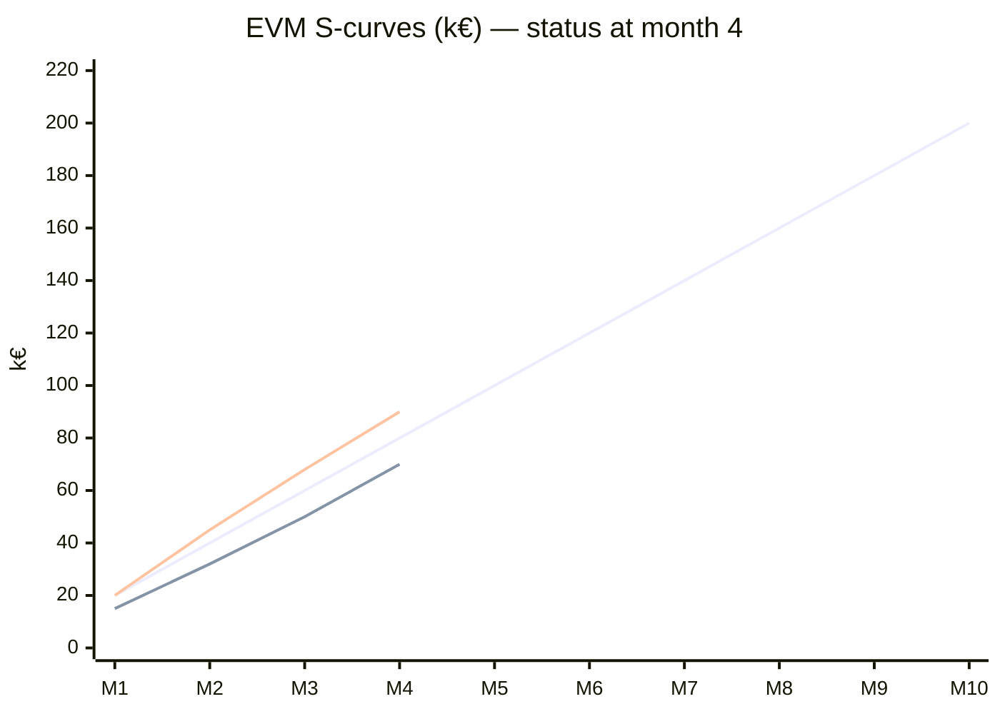

# Cost, Budget and Value

> **TL;DR** Build the budget bottom-up from the WBS, add contingency for identified risks (in the baseline) and management reserve for unknowns (outside it). Track performance with Earned Value Management: compare planned value (PV), earned value (EV) and actual cost (AC) to get variances (CV, SV), indices (CPI, SPI) and forecasts (EAC, ETC, VAC, TCPI). Justify investments with NPV (the primary measure), IRR, payback and ROI, always over full total cost of ownership (TCO), with sensitivity analysis.

---

## 1. Cost estimating and budgeting

### 1.1 Cost categories

| Category | Examples (software/ERP) | Notes |
|---|---|---|
| Direct labour — external | Vendor/consultant fees, system integrator | Usually largest; rate × days |
| Direct labour — internal | Project team, key users, IT staff | Often "free" in business cases — must be included; consider backfill |
| Licences / subscriptions | SaaS subscriptions, perpetual licences, maintenance (typically 18–22%/yr of licence for on-prem) | Starts at contract, not at go-live |
| Infrastructure | Cloud environments (dev/test/QA/prod), hosting, networks | Non-prod environments often forgotten |
| Tools | Test tools, data migration tools, ALM licences | |
| Travel & expenses | Workshops, on-site go-live | |
| Training | Trainers, material, end-user time | |
| Data migration | Cleansing effort, tools, archiving | |
| Contingency | Identified risks | |
| Decommissioning | Legacy shutdown, archive access, contract termination | Often ignored |
| Run costs | Support, AMS, hosting, upgrades | Belongs in TCO |

### 1.2 Capex vs opex

| | Capex | Opex |
|---|---|---|
| Nature | Creates an asset with multi-year benefit | Expensed in the period |
| Software examples | Capitalisable development and implementation costs (per IAS 38 / ASC 350-40 rules) | SaaS subscriptions, training, data cleansing, research/feasibility, post-go-live support |
| Impact | Depreciated/amortised; improves short-term P&L | Hits P&L immediately |

Cloud/SaaS moves spending from capex to opex. Under IFRS (IFRIC agenda decision 2021), most SaaS configuration/customisation costs are expensed unless they create a separately controlled asset. Involve finance early: it affects how the budget is structured and reported.

### 1.3 Budget build-up

```
Work package estimates
  → Activity cost estimates + work package contingency
    → Control accounts
      → Cost baseline (Performance Measurement Baseline, PMB) = Σ control accounts + contingency reserve
        → Project budget = cost baseline + management reserve
          → Funding requirements (by period, matched to cash flow)
```

| Reserve | Typical size (IT) | Release authority |
|---|---|---|
| Contingency (known-unknowns) | 10–20% depending on risk analysis; ideally derived from quantified risk register or Monte Carlo (P80) | PM within tolerance |
| Management reserve (unknown-unknowns) | 5–10% | Sponsor/steering committee via change control |

### 1.4 Funding and cash flow

- Funding limit reconciliation: the spend curve (S-curve) must fit approved funding per period/fiscal year.
- Fiscal year boundaries create pressure ("use it or lose it"); plan procurement accordingly.
- Agile funding: fund persistent teams (cost per sprint × number of sprints) and decide scope dynamically; see **Beyond Budgeting** and **lean portfolio management**.

---

## 2. Earned Value Management (EVM)

EVM integrates scope, schedule and cost to measure performance objectively. Standards: ANSI/EIA-748 (32 guidelines), ISO 21508:2018, PMI *Standard for Earned Value Management*.

### 2.1 Core metrics

| Metric | Name | Definition | Question |
|---|---|---|---|
| **BAC** | Budget at Completion | Total planned budget for the work | What was the whole thing supposed to cost? |
| **PV** (BCWS) | Planned Value | Budgeted cost of work *scheduled* to date | How much work should be done by now (in money)? |
| **EV** (BCWP) | Earned Value | Budgeted cost of work *performed* to date = % complete × BAC | How much work is actually done (in budget terms)? |
| **AC** (ACWP) | Actual Cost | Actual cost of work performed to date | What did we spend? |

### 2.2 Variances and indices

| Metric | Formula | Interpretation |
|---|---|---|
| **CV** Cost Variance | CV = EV − AC | < 0 over budget; > 0 under budget |
| **SV** Schedule Variance | SV = EV − PV | < 0 behind schedule; > 0 ahead |
| **CPI** Cost Performance Index | CPI = EV / AC | < 1 over budget (getting < €1 of work per €1 spent) |
| **SPI** Schedule Performance Index | SPI = EV / PV | < 1 behind schedule |
| CV% | CV / EV | |
| SV% | SV / PV | |
| % complete | EV / BAC | |
| % spent | AC / BAC | |

### 2.3 Forecasts

| Metric | Formula | Assumption — when to use |
|---|---|---|
| **EAC** (typical) | EAC = BAC / CPI | Past cost performance continues (most common) |
| EAC (atypical) | EAC = AC + (BAC − EV) | Variance was one-off; remaining work at planned rate |
| EAC (cost and schedule) | EAC = AC + (BAC − EV) / (CPI × SPI) | Both cost and schedule pressure affect remaining work (e.g., must recover schedule) |
| EAC (weighted) | EAC = AC + (BAC − EV) / (0.8·CPI + 0.2·SPI) | Weighted composite (weights vary) |
| EAC (bottom-up) | EAC = AC + bottom-up ETC | Original plan invalid; re-estimate remaining work |
| **ETC** | ETC = EAC − AC (or re-estimated bottom-up) | Cost to finish the remaining work |
| **VAC** Variance at Completion | VAC = BAC − EAC | < 0 projected overrun |
| **TCPI** (to BAC) | TCPI = (BAC − EV) / (BAC − AC) | Efficiency needed on remaining work to finish within BAC |
| TCPI (to EAC) | TCPI = (BAC − EV) / (EAC − AC) | Efficiency needed to meet a revised EAC |

**Rules of thumb**
- CPI tends to stabilise after ~20% completion (studies of US DoD contracts); a CPI of 0.85 at 20% rarely improves to 1.0.
- TCPI > 1.1 when CPI < 0.9 → finishing within BAC is unrealistic; re-baseline via change control or cut scope.
- SPI converges to 1.0 at project end regardless of lateness (EV = PV = BAC). Use **earned schedule** for late-stage schedule analysis.

### 2.4 Earned schedule (Walt Lipke, 2003)

| Metric | Formula |
|---|---|
| ES (earned schedule) | Time at which PV equalled current EV: ES = C + (EV − PV_C) / (PV_C+1 − PV_C), where C = number of whole periods where PV ≤ EV |
| AT (actual time) | Elapsed time |
| SV(t) | ES − AT (in time units) |
| SPI(t) | ES / AT |
| IEAC(t) | Planned duration / SPI(t) |

### 2.5 Measuring % complete (EV techniques)

| Method | Rule | Use for |
|---|---|---|
| 0/100 | 0% until done, 100% when done | Short tasks (≤ 1 period) — most conservative |
| 50/50 | 50% at start, 50% at finish | Tasks spanning 2 periods |
| 20/80 | 20% at start, 80% at finish | Conservative variant |
| Weighted milestones | % per milestone reached | Longer work packages with clear milestones |
| Physical % complete | Measured units (e.g., 120 of 300 objects migrated) | Repetitive, countable work |
| Level of effort (LOE) | EV = PV automatically | Support activities (PM, admin) — keep < 10–15% of budget, it masks variance |
| Apportioned effort | Proportional to related discrete work | QA tied to build |

Avoid subjective "% complete" estimates ("90% done syndrome"). In software, use 0/100 per story/feature, or acceptance-tested items only.

### 2.6 Worked example

**Plan:** Integration platform project. BAC = €200,000, planned linearly over 10 months (€20,000/month).
**Status at end of month 4:** PV = €80,000. Accepted deliverables represent 35% of scope → EV = 0.35 × 200,000 = €70,000. AC = €90,000.

| Metric | Calculation | Result | Meaning |
|---|---|---|---|
| CV | 70,000 − 90,000 | **−€20,000** | Over budget |
| SV | 70,000 − 80,000 | **−€10,000** | Behind schedule (€10k worth of work) |
| CPI | 70,000 / 90,000 | **0.778** | €0.78 of value per €1 spent |
| SPI | 70,000 / 80,000 | **0.875** | Progressing at 87.5% of planned rate |
| EAC (typical) | 200,000 / 0.778 | **€257,143** | Forecast if inefficiency continues |
| EAC (atypical) | 90,000 + (200,000 − 70,000) | €220,000 | If overrun was one-off |
| EAC (CPI × SPI) | 90,000 + 130,000 / (0.778 × 0.875 = 0.681) | €281,020 | If schedule must also be recovered |
| EAC (0.8/0.2 weighted) | 90,000 + 130,000 / (0.622 + 0.175 = 0.797) | €253,070 | Composite |
| ETC (typical) | 257,143 − 90,000 | **€167,143** | Remaining spend |
| VAC | 200,000 − 257,143 | **−€57,143** | Projected overrun |
| TCPI (BAC) | 130,000 / (200,000 − 90,000) = 130,000 / 110,000 | **1.182** | Must be 18% more efficient than plan — unrealistic given CPI 0.78 |
| TCPI (EAC) | 130,000 / 167,143 | 0.778 | Consistent with current CPI |
| % complete / % spent | 35% / 45% | | Spending ahead of progress |
| ES | 70,000 / 20,000 per month | 3.5 months | |
| SV(t) | 3.5 − 4 | −0.5 months | Two weeks late |
| SPI(t) | 3.5 / 4 | 0.875 | |
| IEAC(t) | 10 / 0.875 | 11.4 months | Forecast duration |

**Conclusion for the steering committee:** forecast €220k–€281k (most likely ≈ €257k) and ≈ 11.4 months. Options: approve additional budget from management reserve, cut scope (~€57k worth), or accept delay. Investigate root cause of the CPI (rate mix? rework? underestimated integrations?).


(Lines: PV — full plan; EV — lower curve; AC — upper curve to date.)

### 2.7 Agile EVM

| Concept | AgileEVM (Sulaiman, Barton, Blackburn 2006) |
|---|---|
| BAC | Release budget |
| PV | (Sprints completed / planned sprints) × BAC |
| EV | (Story points accepted / total release points) × BAC |
| AC | Actual cost to date |
| Scope change | Re-baseline total points when scope changes |

Burn-up charts with a cost axis give similar insight with less ceremony.

### 2.8 When to use / when not

| Use EVM | Don't bother / lighten |
|---|---|
| Fixed-price or cost-reimbursable contracts with large budgets | Small internal projects (< a few months) |
| Government/defence (often mandatory) | Pure discovery/product work with fluid scope |
| Steering committees need objective forecasts | No reliable timesheets or no WBS |
| Multi-vendor programs | When the team will game % complete |

### 2.9 Common EVM mistakes

- EV based on hours spent ("we spent 50% of hours so we are 50% done") — that is AC, not EV.
- Too much level-of-effort work, hiding real variance.
- Baseline changed without change control.
- Ignoring quality: EV credited for deliverables that later fail UAT. Credit EV only on acceptance.
- Reporting indices without explaining causes and actions.

---

## 3. Investment appraisal

### 3.1 Formulas

| Measure | Formula | Decision rule | Strengths | Weaknesses |
|---|---|---|---|---|
| **ROI** | (Total benefits − Total costs) / Total costs | Higher is better; compare to hurdle | Simple, intuitive | Ignores time value of money and timing |
| **NPV** | Σ_{t=0..n} CF_t / (1 + r)^t | > 0 → creates value; choose highest NPV | Accounts for time value and scale; additive | Sensitive to discount rate and forecasts |
| **IRR** | r such that NPV = 0 | IRR > hurdle rate (WACC) | Percentage easy to communicate | Multiple IRRs for non-conventional flows; assumes reinvestment at IRR; poor for ranking different-sized projects |
| **MIRR** | Modified IRR with reinvestment at cost of capital | > hurdle | Fixes IRR reinvestment assumption | Less known |
| **Payback period** | Time until cumulative cash flow ≥ 0 | Shorter is better; < policy limit | Simple; liquidity/risk proxy | Ignores time value and post-payback cash flows |
| **Discounted payback** | Payback using discounted cash flows | Shorter is better | Includes time value | Still ignores later flows |
| **Benefit-cost ratio (BCR)** | PV(benefits) / PV(costs) | > 1 | Public sector standard | Hides scale |
| **Profitability index** | PV(future cash flows) / initial investment | > 1 | Rank under capital rationing | |
| **EVA / economic profit** | NOPAT − (capital × WACC) | > 0 | Corporate finance alignment | Complex |

Discount rate: usually the organisation's **WACC** or a hurdle rate set by finance (often 8–12% for corporate IT; higher for riskier initiatives).

### 3.2 Worked example

Investment €500,000 at t = 0; net benefits €150k, €200k, €250k, €200k in years 1–4; discount rate 8%.

| Year | Cash flow | Discount factor 1/(1.08)^t | Present value | Cumulative CF | Cumulative PV |
|---|---|---|---|---|---|
| 0 | −500,000 | 1.0000 | −500,000 | −500,000 | −500,000 |
| 1 | 150,000 | 0.9259 | 138,889 | −350,000 | −361,111 |
| 2 | 200,000 | 0.8573 | 171,468 | −150,000 | −189,643 |
| 3 | 250,000 | 0.7938 | 198,458 | +100,000 | +8,815 |
| 4 | 200,000 | 0.7350 | 147,006 | +300,000 | +155,821 |

| Measure | Result |
|---|---|
| NPV @ 8% | **€155,821** → accept |
| IRR | **≈ 20.5%** → above 8% hurdle |
| ROI (undiscounted) | (800,000 − 500,000) / 500,000 = **60%** over 4 years |
| Payback | 2 + 150,000 / 250,000 = **2.6 years** |
| Discounted payback | 2 + 189,643 / 198,458 ≈ **2.96 years** |
| BCR | 655,821 / 500,000 = **1.31** |

Spreadsheet equivalents: `=NPV(8%, B2:B5) + B1`, `=IRR(B1:B5)`, `=XNPV()`/`=XIRR()` for irregular dates. Note: Excel's `NPV()` discounts the first value by one period, so add the t=0 flow separately.

### 3.3 Sensitivity and scenario analysis

| Technique | How |
|---|---|
| One-way sensitivity | Vary one input (e.g., benefits −30%) and recompute NPV |
| Tornado chart | Rank inputs by NPV swing |
| Scenarios | Pessimistic / base / optimistic sets |
| Break-even analysis | Find the value of an input at which NPV = 0 ("benefits can fall 24% before NPV turns negative") |
| Monte Carlo | Distributions on costs, benefits, timing → NPV distribution, P(NPV > 0) |

In the example: NPV turns zero if every benefit falls by ≈ 24% (155,821 / 655,821). A 6-month delay in benefits typically reduces NPV more than a 10% cost overrun — **benefit delay is usually the largest value risk**.

### 3.4 Benefits categories

| Category | Example | Measurable in cash? |
|---|---|---|
| Revenue increase | New channel, faster quoting | Yes |
| Cost reduction (cashable) | Licence retirement, headcount not replaced, lower hosting | Yes |
| Cost avoidance | Avoid legacy upgrade, avoid regulatory fine | Yes (estimated) |
| Productivity (non-cashable) | Hours freed for higher-value work | Partially — only if capacity is redeployed |
| Working capital | Faster invoicing → lower DSO | Yes (one-off + financing cost) |
| Risk reduction | End-of-support platform replaced | Expected value of loss avoided |
| Compliance | Meets mandate (e.g., e-invoicing) | Often "mandatory" — no NPV needed, choose least-cost option |
| Strategic / intangible | Customer satisfaction, agility | Hard — use proxies, avoid inflated numbers |

---

## 4. Total Cost of Ownership (TCO)

TCO = all costs to acquire, implement, operate, maintain and retire a solution over its life (typically 5–7 years for ERP; 3–5 for SaaS apps).

### 4.1 TCO components

| Phase | Components |
|---|---|
| Acquisition | Licences/subscription, hardware, vendor selection, contract negotiation |
| Implementation | Integrator fees, internal team, data migration, integrations, testing, training, change management, travel, contingency |
| Operation | Subscriptions/maintenance, hosting/cloud, support (AMS), internal admin, monitoring, security, backups |
| Change & growth | Upgrades (on-prem) or regression testing of vendor releases (SaaS, 2–4 times/year), new functionality, extra users |
| Indirect | End-user productivity dip, downtime, shadow IT, key-user time |
| Retirement | Decommissioning, data archiving, exit fees, migration to successor |

### 4.2 Example — 5-year TCO comparison (illustrative, k€)

| Item | On-premise ERP | SaaS ERP |
|---|---|---|
| Licences (perpetual) | 600 | — |
| Subscription (5 yrs) | — | 1,250 |
| Maintenance 20%/yr × 4 yrs | 480 | — |
| Infrastructure & hosting | 400 | Included |
| Implementation | 1,500 | 1,200 |
| Internal team | 700 | 600 |
| Upgrade (one major) | 300 | — |
| Release regression testing | — | 150 |
| Support/AMS | 500 | 400 |
| **Total 5-yr TCO** | **4,480** | **3,600** |

Always compare on NPV-discounted TCO when cash timing differs (perpetual licence up front vs subscription over time).

### 4.3 Common TCO mistakes

- Comparing licence prices only.
- Ignoring internal effort and opportunity cost.
- Forgetting SaaS price escalation clauses (annual uplift caps) and user-tier thresholds.
- Not including exit costs (data extraction, contract termination) — relevant for vendor lock-in.
- Customisation cost multiplier: every extension adds testing on each release.

---

## 5. Cost control practices

- Weekly/monthly **cost reports**: committed vs actual vs forecast (EAC) vs budget, per control account.
- **Commitments tracking**: purchase orders and signed SOWs are committed before invoices arrive — include them in forecasts.
- **Timesheet discipline** for internal and T&M vendor staff; reconcile vendor invoices to approved timesheets.
- **Burn rate** = cost per period; runway = remaining budget / burn rate.
- **Forecast at completion (FAC)** reviewed monthly by PM and finance controller.
- **Variance thresholds**: e.g., ±5% → explanation; ±10% → corrective action plan; beyond tolerance → exception report to steering committee.

### Cost report (minimal)

| Control account | Budget | Committed | Actual | ETC | EAC | Variance (Budget − EAC) | Comment |
|---|---|---|---|---|---|---|---|
| Design | 150 | 150 | 148 | 0 | 148 | +2 | Closed |
| Build | 600 | 520 | 310 | 360 | 670 | −70 | Interfaces underestimated (CR-12 pending) |
| Data migration | 200 | 120 | 80 | 130 | 210 | −10 | Extra mock load |
| Testing | 250 | 100 | 20 | 230 | 250 | 0 | |
| Contingency | 120 | — | — | — | 40 | +80 | 80 released to Build/Data |
| **Total** | **1,320** | **890** | **558** | **720** | **1,318** | **+2** | |

---

## 6. Value beyond money

- **Outcome metrics** (adoption, cycle time, error rates) matter more to stakeholders than EVM — report both.
- **Benefits realisation**: plan → track → realise → sustain. Benefits owner sits in the business; reviews at 3, 6, 12 months after go-live.
- **Cost of delay** (Don Reinertsen): value lost per unit of time by not delivering — used in WSJF prioritisation (see [../02-product-management/README.md](../02-product-management/README.md) and [../04-agile-kanban-scrum/README.md](../04-agile-kanban-scrum/README.md)).

## Common mistakes

- Presenting single-point business-case numbers without ranges or sensitivity.
- Counting non-cashable productivity as cash savings.
- Double-counting benefits across projects in the same portfolio.
- Contingency treated as "PM's slush fund" or, conversely, never released when risks don't materialise (should return to portfolio).
- Mixing nominal and real cash flows/discount rates.

## References

- Earned value management (Wikipedia): https://en.wikipedia.org/wiki/Earned_value_management
- ISO 21508:2018 (via ISO search): https://www.iso.org/
- PMI standards: https://www.pmi.org/standards/pmbok
- Net present value (Wikipedia): https://en.wikipedia.org/wiki/Net_present_value
- Internal rate of return (Wikipedia): https://en.wikipedia.org/wiki/Internal_rate_of_return
- Modified internal rate of return (Wikipedia): https://en.wikipedia.org/wiki/Modified_internal_rate_of_return
- Payback period (Wikipedia): https://en.wikipedia.org/wiki/Payback_period
- Return on investment (Wikipedia): https://en.wikipedia.org/wiki/Return_on_investment
- Benefit–cost ratio (Wikipedia): https://en.wikipedia.org/wiki/Benefit%E2%80%93cost_ratio
- Weighted average cost of capital (Wikipedia): https://en.wikipedia.org/wiki/Weighted_average_cost_of_capital
- Total cost of ownership (Wikipedia): https://en.wikipedia.org/wiki/Total_cost_of_ownership
- Sensitivity analysis (Wikipedia): https://en.wikipedia.org/wiki/Sensitivity_analysis
- Beyond Budgeting Institute: https://bbrt.org/
- HM Treasury Green Book: https://www.gov.uk/government/publications/the-green-book-appraisal-and-evaluation-in-central-government
- Enterprise architecture & business section: [../11-enterprise-architecture-business/README.md](../11-enterprise-architecture-business/README.md)
