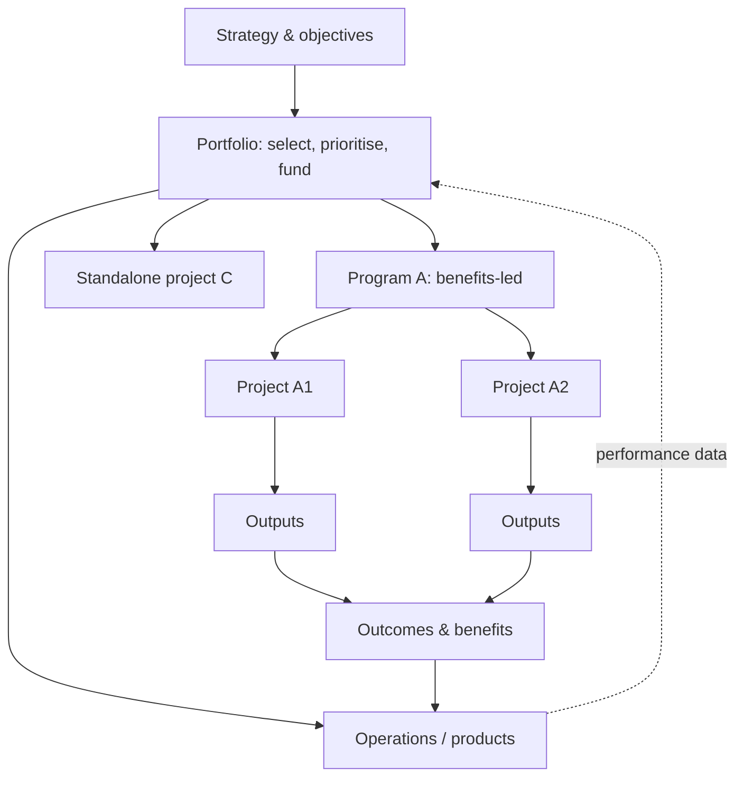
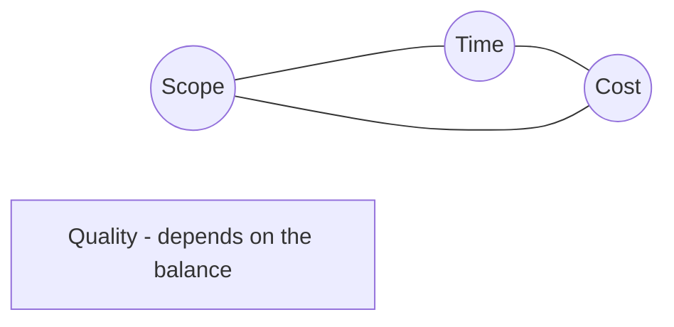
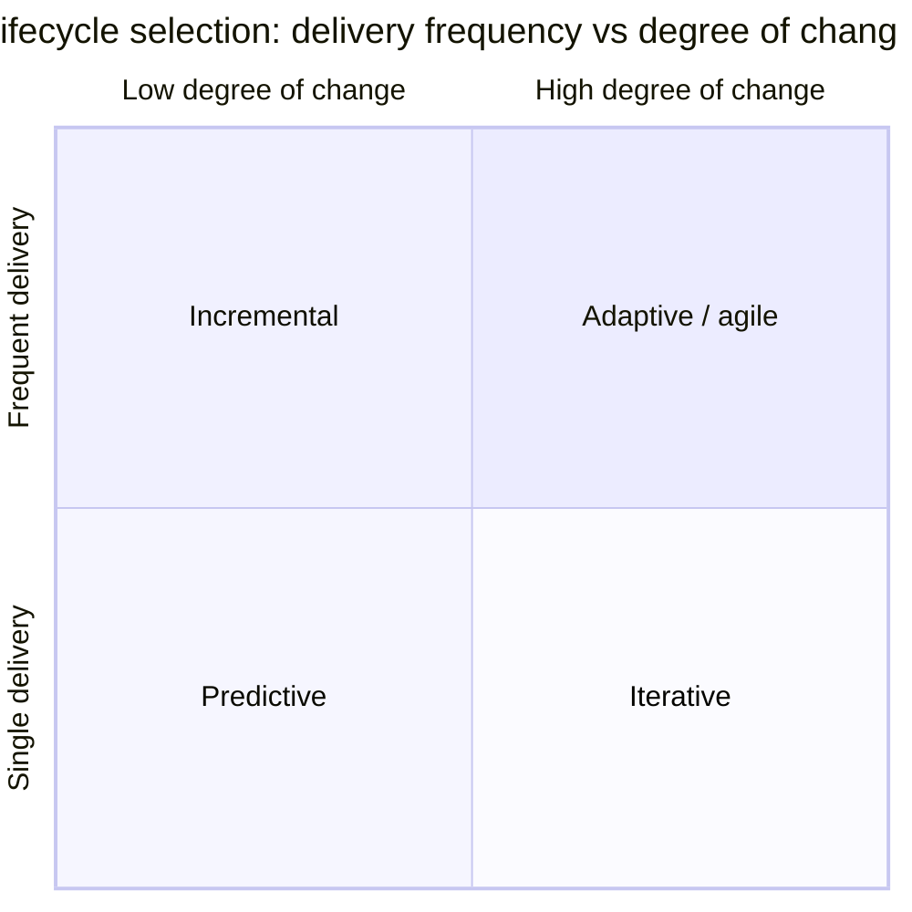
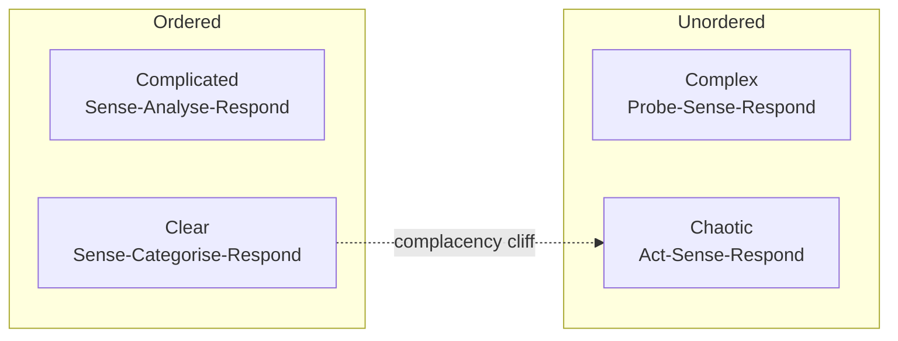
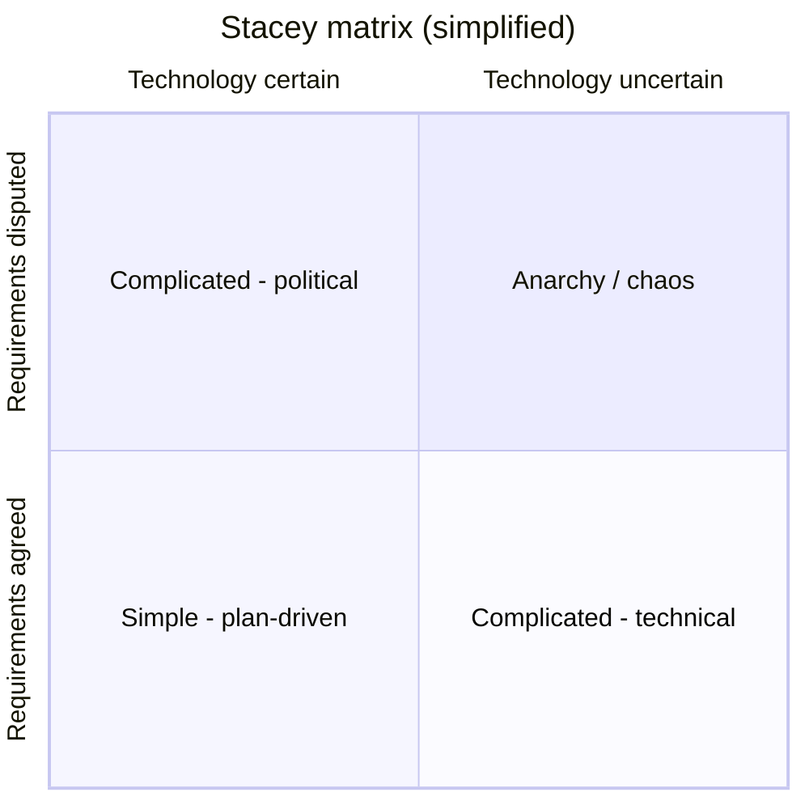

# Project Management Foundations

> **TL;DR** A project is a temporary endeavour that creates a unique output; programs coordinate related projects for benefits; portfolios select and balance investments; operations run the business. Choose a lifecycle (predictive, iterative, incremental, adaptive, hybrid) based on how well the requirements and the technology are understood. Cynefin and the Stacey matrix are the two standard lenses for that choice. The iron triangle (scope, time, cost, with quality in the middle) describes the trade-offs, but success today is judged on value and benefits, not just on staying inside the triangle.

---

## 1. Core definitions

| Term | Definition | Primary goal | Time horizon | Success measured by | Typical owner |
|---|---|---|---|---|---|
| **Project** | Temporary endeavour undertaken to create a unique product, service or result | Deliver defined outputs | Fixed start and end | Outputs delivered within agreed tolerances (scope/time/cost/quality) and handed over | Project manager, project sponsor/Executive |
| **Program (programme)** | Group of related projects, subsidiary programs and activities managed in a coordinated way to get benefits not available from managing them individually | Realise outcomes and benefits | Months to years; ends when benefits are embedded | Benefits realised, capability transitioned into operations | Program manager, Senior Responsible Owner (SRO) |
| **Portfolio** | Collection of projects, programs, sub-portfolios and operations managed as a group to achieve strategic objectives | Do the *right* things; optimise investment mix | Ongoing, budget-cycle driven | Aggregate return, strategic alignment, risk balance | Portfolio manager, investment board, PMO |
| **Operations** | Ongoing, repetitive work that sustains the organisation | Keep the business running efficiently | Indefinite | SLAs, KPIs, unit cost, availability | Line/operations management |
| **Product** | An artefact or service with a lifecycle beyond any single project | Customer/user value over time | Product lifetime | Outcomes, adoption, revenue, retention | Product manager/owner (see [02 Product Management](../02-product-management/README.md)) |

### Key distinctions

- **Outputs → outcomes → benefits.** Projects produce *outputs* (a new ERP instance). Outputs enable *outcomes* (orders are processed in one system). Outcomes create measurable *benefits* (order-to-cash cycle reduced 20%). Programs own the chain from output to benefit; projects usually stop at handover.
- **Temporary ≠ short.** A project can last five years; what makes it a project is the defined end and the unique deliverable.
- **Projects vs products.** In product-centric organisations, long-lived teams own products and the "project" disappears as a funding unit (project-to-product shift; see Mik Kersten, *Project to Product*). Projects still exist for one-off changes: ERP replacements, mergers, regulatory deadlines, data centre exits.
- **Project vs BAU change.** Small enhancements flow through operational/product backlogs; anything that needs its own budget, governance, or cross-team coordination usually becomes a project.

### Project, program, portfolio relationships

### PMO variants

| Type | Role | Control level |
|---|---|---|
| Supportive PMO | Templates, training, lessons learned repository | Low |
| Controlling PMO | Enforces methodology, conducts audits/gate reviews | Medium |
| Directive PMO | Directly manages projects, assigns PMs | High |
| Enterprise PMO (EPMO) | Portfolio-level: investment decisions, capacity, strategic alignment | High, strategic |
| Value Management Office (VMO) / Lean PMO | Agile-era evolution: flow, outcome metrics, lean portfolio management | Variable |
| Centre of Excellence (CoE) | Methods, coaching, community of practice | Advisory |

P3O (Portfolio, Programme and Project Offices) models how these offices combine — see [frameworks-and-standards.md](frameworks-and-standards.md).

---

## 2. The triple constraint / iron triangle

The **iron triangle** (attributed to Martin Barnes, 1969) states that scope, time and cost are interdependent: changing one changes at least one other. Quality is often placed in the centre as the result of the balance.

### Variants

| Model | Dimensions | Notes |
|---|---|---|
| Classic iron triangle | Scope, Time, Cost | Quality implied |
| Project Management Diamond | Scope, Time, Cost, Quality | Quality as its own constraint |
| PMBOK 6 "competing constraints" | Scope, quality, schedule, budget, resources, risk | Six constraints |
| PRINCE2 six performance targets / tolerances | Time, cost, quality, scope, benefits, risk (PRINCE2 7 adds sustainability) | Tolerances set per level of management |
| Agile inverted triangle | **Time and cost fixed**, scope variable | Used by DSDM/AgilePM, Scrum release planning |
| Value triangle (Jim Highsmith) | Value, Quality, Constraints (scope/schedule/cost) | Success = value delivered; constraints are just constraints |

### Waterfall vs agile triangle

| | Fixed | Estimated / variable |
|---|---|---|
| Predictive (traditional) | Scope (requirements) | Time, cost |
| Adaptive (agile, DSDM) | Time, cost, quality | Scope (features, prioritised with MoSCoW) |

### Practical use

- Ask the sponsor to **rank** the constraints: "If we must give, what gives first?" Write the answer into the charter. Typical answer for regulatory projects: date fixed, scope fixed, cost flexes. For internal tools: cost fixed, scope flexes.
- A **flexibility matrix** makes this explicit:

| Dimension | Least flexible (constrain) | Moderately flexible (optimise) | Most flexible (accept) |
|---|---|---|---|
| Scope | | X | |
| Schedule | X | | |
| Cost | | | X |
| Quality | X | | |

Rule: only one dimension per column. Two "least flexible" means the sponsor has not made a choice.

### Common mistakes

- Treating quality as a free variable: cutting testing to hit dates silently moves cost into operations (technical debt, incidents).
- Assuming all three can be fixed. A project with fixed scope, fixed date and fixed budget has no room for error; the risk ends up hidden in quality or in team overtime.
- Measuring success only by the triangle. A project can finish on time and budget and still deliver nothing useful; see Shenhar & Dvir's success dimensions (efficiency, impact on customer, business success, preparing for the future).

---

## 3. Project lifecycle types

PMBOK 6/7 and ISO 21502 describe a continuum based on two variables: **frequency of delivery** and **degree of change** (how much requirements are expected to change).

| Lifecycle | Requirements | Activities | Delivery | Goal | Examples |
|---|---|---|---|---|---|
| **Predictive** (plan-driven, waterfall) | Fixed up front | Performed once for the whole project | Single delivery at end | Manage cost | Construction, hardware rollout, data centre move, well-understood ERP template rollout |
| **Iterative** | Elaborated through repeated cycles | Repeated until correct | Single delivery (or few) | Correctness of solution | Prototyping, R&D, UX discovery, solution design of a complex integration |
| **Incremental** | Can be elaborated per increment | Performed once per increment | Frequent smaller deliveries | Speed of delivery | Phased country rollouts, module-by-module ERP go-lives |
| **Adaptive** (agile) | Elaborated frequently during delivery | Repeated until correct | Frequent small deliveries | Customer value via feedback | Product development, digital services, internal platforms |
| **Hybrid** | Mixed | Mixed | Mixed | Fit-for-purpose | ERP with predictive data migration and cutover, agile configuration sprints |

### Hybrid patterns

| Pattern | Description | Typical use |
|---|---|---|
| Agile delivery inside predictive governance ("water-scrum-fall") | Stage gates, business case and funding are predictive; build is in sprints | Corporate IT, public sector |
| Predictive front, agile build | Requirements and architecture up front, then iterative build | ERP: global design then build sprints |
| Agile front, predictive deployment | Discovery and prototyping in sprints; rollout predictive | Hardware + software, physical rollouts |
| Parallel components | Some workstreams agile (custom apps), others predictive (infrastructure, procurement, training) | Large transformations |
| Agile with fixed milestones | Sprints, but hard dates for regulatory deadlines or go-lives | Compliance projects |

### Tailoring factors (PMBOK 7)

- **Product/deliverable:** degree of innovation, requirements certainty, scope stability, ease of change, delivery options, risk, safety, regulation.
- **Project:** stakeholders, schedule constraints, funding availability.
- **Organisation:** structure, culture, capability, team size and location.

### Suitability filter (quick self-assessment)

Adapted from the PMI/Agile Alliance *Agile Practice Guide* suitability filter. Score 1 (agile-friendly) to 10 (predictive-friendly):

| Category | Question |
|---|---|
| Culture | Is there buy-in from sponsor for an agile approach? |
| Culture | Does the team trust each other and have the right working environment? |
| Culture | Will the team have decision-making autonomy? |
| Team | Is the core team 3–9 people? |
| Team | Do core members have relevant experience? |
| Team | Is there daily access to at least one business/product representative? |
| Project | Is the probability of change high? |
| Project | Is incremental delivery possible and valuable? |
| Project | Is the project low-criticality (no loss of life/large financial loss on failure)? |

Mostly low scores → adaptive; mostly high → predictive; mixed → hybrid.

### When to use predictive

- Requirements stable and well understood; technology known.
- Contract or regulator demands a full specification and fixed price.
- Physical work with expensive rework (hardware, construction, network cabling).
- Strong sequential dependencies (procurement lead times, migration cutover).

### When not to use predictive

- New product or unknown user needs.
- Fast-moving market or technology.
- Stakeholders cannot articulate requirements until they see something.

---

## 4. Cynefin for choosing an approach

**Cynefin** (Dave Snowden, 1999; Welsh for "habitat") is a sense-making framework with five domains. It tells you *how to act* given the relationship between cause and effect.

| Domain | Cause–effect | Approach | Practice type | Project implication |
|---|---|---|---|---|
| **Clear** (formerly Simple/Obvious) | Obvious to all | Sense → Categorise → Respond | Best practice | Checklists, standard operating procedures, no project needed or a light one |
| **Complicated** | Knowable by analysis/experts | Sense → Analyse → Respond | Good practice (several right answers) | Predictive planning works; invest in expert analysis, design up front |
| **Complex** | Only coherent in retrospect | Probe → Sense → Respond | Emergent practice | Adaptive/iterative; safe-to-fail experiments, short feedback loops |
| **Chaotic** | No perceivable relationship | Act → Sense → Respond | Novel practice | Crisis management; stabilise first (incident command), then move to complex |
| **Confused** (formerly Disorder; the centre) | Unknown which domain applies | Break the situation into parts and assign each to a domain | — | The default state at project start; decompose |

### Applying Cynefin to a software project

A single project contains elements in every domain. Example: an ERP replacement.

| Element | Domain | Approach |
|---|---|---|
| Installing the standard platform, setting up environments | Clear | Runbooks, vendor checklists |
| Financial posting logic, tax configuration, integration architecture | Complicated | Expert design, specification, peer review |
| Changing how warehouse staff work, adoption, new KPIs | Complex | Pilots, iterate on training, feedback loops |
| Go-live failure with orders not shipping | Chaotic | War room, act immediately, then analyse |

### Common mistakes

- Treating complex problems as complicated: writing a 200-page spec for a user-facing product nobody has validated.
- Treating complicated problems as complex: "we'll iterate" on a bank reconciliation interface that just needs an expert to design it correctly.
- The **complacency cliff**: over-confident "clear" processes collapse into chaos (e.g., a "routine" release with no rollback plan).

---

## 5. Stacey matrix

**Ralph Stacey's** agreement–certainty matrix (1990s; Stacey later distanced himself from its prescriptive use) plots work on two axes:

- **Certainty** about the technology / how to build it (x-axis: close to certain → far from certain).
- **Agreement** on requirements / what to build (y-axis: close to agreement → far from agreement).

| Zone | Position | Approach |
|---|---|---|
| **Simple** | Close to certainty, close to agreement | Predictive planning, standard processes |
| **Complicated (technical)** | Agreement high, technology uncertain | Expert-led analysis, spikes, prototypes |
| **Complicated (political)** | Technology known, agreement low | Negotiation, stakeholder management, coalition-building |
| **Complex** | Both moderately far | Agile/adaptive, iterative discovery |
| **Anarchy / chaos** | Both far | Avoid or stabilise first; rethink whether the project should start |

### Using it in practice

1. List the main workstreams or features.
2. Have the team and key stakeholders place each one on the matrix (sticky notes, quick vote).
3. Plan **simple** items predictively; run **complex** items in time-boxed iterations; resolve **political** items through governance and stakeholder work before building; push **chaotic** items back to discovery.
4. Revisit at each stage gate; items move toward simple as knowledge grows.

### Cynefin vs Stacey

| | Cynefin | Stacey |
|---|---|---|
| Nature | Sense-making (descriptive) | Categorisation (often used prescriptively) |
| Axes | None; domains defined by causality | Agreement × certainty |
| Strength | Explains *why* different methods work | Simple to explain to sponsors; highlights political disagreement as a separate problem |
| Weakness | Abstract for non-specialists | Oversimplifies; its author withdrew support for it as a tool |

---

## 6. Project success and failure criteria

| Lens | Measures |
|---|---|
| Project management success | On time, on budget, in scope, quality met |
| Product success | Product works, is used, meets requirements |
| Business success | Benefits realised, ROI, strategic goals |
| Stakeholder success | Satisfaction of sponsor, users, team |
| Future readiness | Capabilities, learning, reusable assets |

**Rule of thumb:** define success criteria and *how they will be measured, by whom and when* in the charter. Benefits often only appear 6–24 months after closure; assign a benefits owner in operations.

---

## 7. Organisational structures

| Structure | PM authority | Resource availability | Who controls budget | Typical in |
|---|---|---|---|---|
| Functional | Little or none | Little | Functional manager | Small internal improvements |
| Weak matrix | Low | Low | Functional manager | PM as coordinator/expediter |
| Balanced matrix | Low to moderate | Low to moderate | Mixed | Most corporate IT |
| Strong matrix | Moderate to high | Moderate to high | PM | PMO-driven organisations |
| Projectized | High to almost total | High | PM | Consultancies, construction, system integrators |
| Product/stream-aligned | Team owns delivery; no PM role or PM as delivery lead | Stable teams | Product/value stream | Product-led software companies |

Consultancy engagements are typically projectized on the supplier side and matrix on the client side — the gap between the two authority models is a frequent source of friction (who can tell client staff what to do?).

---

## 8. Roles overview

| Role | Responsibility | PRINCE2 equivalent | Agile equivalent |
|---|---|---|---|
| Sponsor | Owns the business case, provides funding, champions the project | Executive | Business owner / product sponsor |
| Steering committee | Decisions beyond PM tolerance, direction | Project Board (Executive, Senior User, Senior Supplier) | Stakeholder/portfolio review |
| Project manager | Day-to-day management within tolerances | Project Manager | Split across Product Owner, Scrum Master, team |
| Team manager / lead | Delivers work packages | Team Manager | Development team |
| Project assurance | Independent check that the project is on track | Project Assurance | Retrospectives, external reviews |
| Change authority | Approves changes within delegated limits | Change Authority | Product Owner (for backlog) |
| PMO / project support | Administration, reporting, tools | Project Support | Agile PMO / VMO |
| Benefits owner | Realises benefits after handover | Senior User | Product manager |

See [initiation.md](initiation.md) for RACI and stakeholder analysis, and [../09-leadership-teams-facilitation/README.md](../09-leadership-teams-facilitation/README.md) for leading teams.

---

## 9. Project manager competences

Based on the PMI Talent Triangle (updated 2022) and IPMA ICB4:

| Area | PMI Talent Triangle | IPMA ICB4 |
|---|---|---|
| Methods/technical | **Ways of Working** (predictive, agile, hybrid, design thinking) | **Practice** (14 elements: scope, time, finance, risk, etc.) |
| Leadership/people | **Power Skills** (communication, leadership, collaboration, strategic thinking) | **People** (10 elements: self-reflection, integrity, leadership, negotiation, etc.) |
| Business/context | **Business Acumen** | **Perspective** (5 elements: strategy, governance, compliance, power & interest, culture & values) |

---

## 10. Checklist: before choosing an approach

- [ ] Is this a project, a program, a product increment, or BAU work?
- [ ] What are the outputs, outcomes and benefits, and who owns each?
- [ ] Which constraint is fixed, which is optimised, which is flexible?
- [ ] Where do the main workstreams sit on Cynefin / Stacey?
- [ ] What does the contract and governance environment demand (fixed price, gates, regulator)?
- [ ] Can value be delivered incrementally?
- [ ] How available are business representatives?
- [ ] What lifecycle per workstream (predictive / iterative / incremental / adaptive)?
- [ ] What is the integration point between workstreams with different lifecycles (milestones, PI planning, stage gates)?

---

## Common mistakes

- Calling everything a project, including ongoing product work, which creates artificial ends, handovers and lost knowledge.
- Calling a program a project: one PM, one plan, no benefits management, for a multi-year transformation.
- Choosing a method by ideology ("we are agile") rather than by problem type.
- Ignoring the political zone of the Stacey matrix: no amount of sprints fixes stakeholders who disagree about the goal.
- Defining success as "on time, on budget" only, with no benefits measurement after closure.

## Related sections

- Agile frameworks (Scrum, Kanban, SAFe): [../04-agile-kanban-scrum/README.md](../04-agile-kanban-scrum/README.md)
- Product management (outcomes, discovery): [../02-product-management/README.md](../02-product-management/README.md)
- Mental models (Cynefin, second-order thinking): [../10-laws-principles-mental-models/README.md](../10-laws-principles-mental-models/README.md)
- Enterprise architecture & portfolio: [../11-enterprise-architecture-business/README.md](../11-enterprise-architecture-business/README.md)

## References

- PMI — *A Guide to the Project Management Body of Knowledge (PMBOK Guide)*: https://www.pmi.org/standards/pmbok
- PMI: https://www.pmi.org/
- ISO 21502:2020 Guidance on project management: https://www.iso.org/standard/74947.html
- Project management (Wikipedia): https://en.wikipedia.org/wiki/Project_management
- Program management (Wikipedia): https://en.wikipedia.org/wiki/Program_management
- Project portfolio management (Wikipedia): https://en.wikipedia.org/wiki/Project_portfolio_management
- Project management triangle (Wikipedia): https://en.wikipedia.org/wiki/Project_management_triangle
- Project management office (Wikipedia): https://en.wikipedia.org/wiki/Project_management_office
- Cynefin framework (Wikipedia): https://en.wikipedia.org/wiki/Cynefin_framework
- The Cynefin Company: https://thecynefin.co/
- Ralph Stacey (Wikipedia): https://en.wikipedia.org/wiki/Ralph_Stacey
- Agile Alliance: https://www.agilealliance.org/
- IPMA: https://www.ipma.world/
