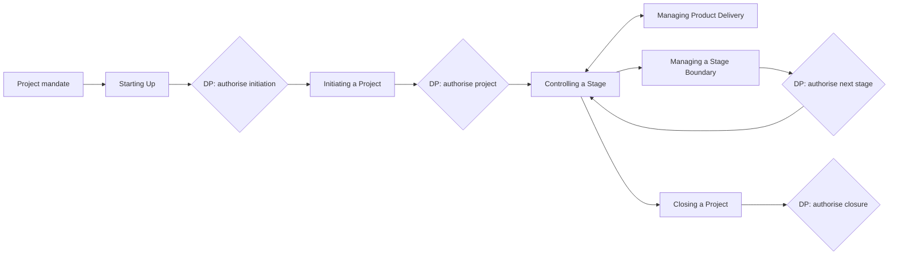
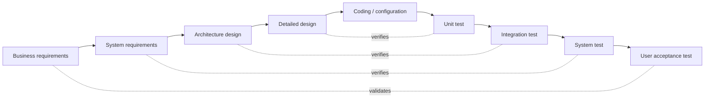

# Project Management Frameworks and Standards

> **TL;DR** PMBOK 7 is principle-based (12 principles, 8 performance domains); PMBOK 6 is process-based (5 process groups × 10 knowledge areas, 49 processes) and still useful as a checklist. PRINCE2 is a governance method (7 principles, 7 practices/themes, 7 processes) built on management by exception. IPMA ICB4 defines competences, ISO 21502 is the international guidance standard. Waterfall/V-model, critical chain, MSP (programs), P3O (offices), PRINCE2 Agile and DSDM/AgilePM fill specific gaps. Agile frameworks themselves are in [../04-agile-kanban-scrum/README.md](../04-agile-kanban-scrum/README.md).

---

## 1. Landscape at a glance

| Framework / standard | Owner | Type | Scope | Best for |
|---|---|---|---|---|
| PMBOK Guide 7th ed. (2021) | PMI | Standard + guide, principle-based | Projects (any approach) | Shared vocabulary, PMP certification, tailoring |
| PMBOK Guide 6th ed. (2017) | PMI | Process-based guide | Projects (predictive focus) | Detailed process checklist |
| PMBOK Guide 8th ed. (2025) | PMI | Combines principles with a return of processes | Projects | Latest PMI edition; reintroduces process guidance alongside principles |
| PRINCE2 7th ed. (2023) | PeopleCert (formerly AXELOS) | Method | Projects | Governance, roles, stage control, UK/EU/public sector |
| PRINCE2 Agile | PeopleCert | Method extension | Projects using agile delivery | Agile teams within PRINCE2 governance |
| IPMA ICB4 | IPMA | Competence baseline | Individuals, projects, programs, portfolios | Competence assessment and certification (levels A–D) |
| ISO 21502:2020 | ISO TC 258 | International guidance standard | Projects | Organisational policy, procurement requirements, neutral baseline |
| ISO 21503 / 21504 | ISO | Guidance | Programs / portfolios | Program and portfolio governance |
| MSP 5th ed. | PeopleCert | Method | Programs | Benefits-led transformation |
| P3O | PeopleCert | Guidance | PMOs | Designing portfolio/program/project offices |
| MoP | PeopleCert | Guidance | Portfolios | Portfolio management |
| MoR | PeopleCert | Guidance | Risk | Enterprise and project risk management |
| Critical Chain (CCPM) | Goldratt / TOC | Scheduling method | Schedules, multi-project | Resource-constrained environments |
| DSDM / AgilePM | Agile Business Consortium | Agile project framework | Projects | Agile with governance; fixed time and cost |
| Waterfall / V-model | Industry practice | Lifecycle model | Projects | Predictable, regulated, safety-critical |
| APM Body of Knowledge 7th ed. | APM (UK) | Body of knowledge | Projects, programs, portfolios | UK chartered PM route |

---

## 2. PMBOK Guide 7th edition

PMBOK 7 (2021) replaced the process-based structure with **principles** and **performance domains**. It is paired with *The Standard for Project Management* (ANSI standard) and supported by PMIstandards+ (models, methods and artefacts library).

### 2.1 The 12 project management principles

| # | Principle (paraphrased label) | What it means in practice |
|---|---|---|
| 1 | Be a diligent, respectful and caring **steward** | Integrity, care, trustworthiness, compliance; responsibility for financial, social and environmental impact |
| 2 | Create a collaborative project **team environment** | Team agreements, structures, processes that enable collaboration and accountability |
| 3 | Effectively engage with **stakeholders** | Proactive engagement to understand interests and needs; contributes to value |
| 4 | Focus on **value** | Continuously evaluate alignment with business objectives and intended benefits |
| 5 | Recognise, evaluate and respond to **system interactions** | Think holistically; project is a system of interdependent parts within larger systems |
| 6 | Demonstrate **leadership** behaviours | Adapt leadership style to situation; anyone can lead |
| 7 | **Tailor** based on context | Adapt approach to project, organisation, and environment ("just enough" process) |
| 8 | Build **quality** into processes and deliverables | Meet acceptance criteria and stakeholder expectations; prevention over inspection |
| 9 | Navigate **complexity** | Assess and respond to complexity from human behaviour, system behaviour, uncertainty, technical innovation |
| 10 | Optimise **risk** responses | Address threats and opportunities; responses appropriate, timely, cost-effective, owned |
| 11 | Embrace **adaptability and resiliency** | Absorb impacts, recover quickly, adapt to change |
| 12 | Enable **change** to achieve the envisioned future state | Prepare stakeholders to adopt and sustain new behaviours |

### 2.2 The 8 performance domains

| Domain | Focus | Desired outcomes (examples) | Key artefacts/methods |
|---|---|---|---|
| **Stakeholders** | Identify, understand, engage | Productive relationships; agreement on objectives; satisfied stakeholders | Stakeholder register, power/interest grid, engagement assessment matrix |
| **Team** | High-performing team, leadership | Shared ownership, high performance, appropriate leadership | Team charter, RACI, Tuckman, retrospectives |
| **Development approach & life cycle** | Choosing cadence and approach | Approach consistent with deliverables; phases connect value delivery | Suitability filter, lifecycle selection |
| **Planning** | Organisation, elaboration, coordination | Progress organised; holistic approach; evolving info elaborated | WBS, schedule, estimates, budgets, backlog |
| **Project work** | Processes, resources, physical resources, procurement, knowledge | Efficient performance; appropriate processes; communication; learning | Kanban, issue log, procurement docs, lessons learned |
| **Delivery** | Scope, quality, value delivery | Contribute to objectives; benefits realised; acceptance | Requirements, DoD, acceptance criteria, quality metrics |
| **Measurement** | Assessing performance | Reliable understanding of status; actionable data; timely decisions | EVM, burn charts, KPIs, dashboards, forecasts |
| **Uncertainty** | Risk, ambiguity, complexity, volatility | Awareness of environment; proactive responses; capture opportunities | Risk register, Monte Carlo, reserves, prototyping |

### 2.3 Value delivery system

PMBOK 7 frames projects within a **value delivery system**: portfolios, programs, projects, products and operations all contribute to value. Governance, functions (oversight, facilitation, contribution), and the internal/external environment shape it.

### 2.4 Models, methods and artefacts (PMBOK 7 section 4)

| Category | Examples |
|---|---|
| Models | Situational leadership, OSCAR coaching, Tuckman, Drexler/Sibbet, Cynefin, Stacey, Kano, salience, conflict model (Thomas-Kilmann), Kotter, ADKAR, Virginia Satir change model |
| Methods | Estimating (analogous, parametric, multipoint), CPM, EVM, Monte Carlo, decision tree, root cause analysis, prioritisation, impact mapping |
| Artefacts | Charter, business case, roadmap, backlog, WBS, schedule, burndown, logs/registers (risk, issue, change, assumption, lessons learned), RACI, contracts, reports |

---

## 3. PMBOK Guide 6th edition (reference)

PMBOK 6 is still widely used as a structured checklist and underlies many organisational methodologies. It defines **49 processes** grouped by **5 process groups** and **10 knowledge areas**.

### 3.1 Process groups

| Process group | Purpose |
|---|---|
| Initiating | Define a new project or phase; obtain authorisation |
| Planning | Establish scope, refine objectives, define course of action |
| Executing | Complete the work defined in the plan |
| Monitoring & Controlling | Track, review and regulate progress; identify and initiate changes |
| Closing | Formally complete or close the project, phase, or contract |

### 3.2 Knowledge areas × process groups (49 processes)

| Knowledge area | Initiating | Planning | Executing | Monitoring & Controlling | Closing |
|---|---|---|---|---|---|
| **4 Integration** | 4.1 Develop Project Charter | 4.2 Develop PM Plan | 4.3 Direct & Manage Work; 4.4 Manage Project Knowledge | 4.5 Monitor & Control Work; 4.6 Perform Integrated Change Control | 4.7 Close Project or Phase |
| **5 Scope** | | 5.1 Plan Scope Mgmt; 5.2 Collect Requirements; 5.3 Define Scope; 5.4 Create WBS | | 5.5 Validate Scope; 5.6 Control Scope | |
| **6 Schedule** | | 6.1 Plan Schedule Mgmt; 6.2 Define Activities; 6.3 Sequence Activities; 6.4 Estimate Durations; 6.5 Develop Schedule | | 6.6 Control Schedule | |
| **7 Cost** | | 7.1 Plan Cost Mgmt; 7.2 Estimate Costs; 7.3 Determine Budget | | 7.4 Control Costs | |
| **8 Quality** | | 8.1 Plan Quality Mgmt | 8.2 Manage Quality | 8.3 Control Quality | |
| **9 Resource** | | 9.1 Plan Resource Mgmt; 9.2 Estimate Activity Resources | 9.3 Acquire Resources; 9.4 Develop Team; 9.5 Manage Team | 9.6 Control Resources | |
| **10 Communications** | | 10.1 Plan Communications Mgmt | 10.2 Manage Communications | 10.3 Monitor Communications | |
| **11 Risk** | | 11.1 Plan Risk Mgmt; 11.2 Identify Risks; 11.3 Qualitative Analysis; 11.4 Quantitative Analysis; 11.5 Plan Risk Responses | 11.6 Implement Risk Responses | 11.7 Monitor Risks | |
| **12 Procurement** | | 12.1 Plan Procurement Mgmt | 12.2 Conduct Procurements | 12.3 Control Procurements | |
| **13 Stakeholder** | 13.1 Identify Stakeholders | 13.2 Plan Stakeholder Engagement | 13.3 Manage Stakeholder Engagement | 13.4 Monitor Stakeholder Engagement | |

Count per group: Initiating 2, Planning 24, Executing 10, M&C 12, Closing 1 = **49**.

### 3.3 PMBOK 6 vs PMBOK 7

| Aspect | PMBOK 6 | PMBOK 7 |
|---|---|---|
| Structure | Processes (ITTOs: inputs, tools & techniques, outputs) | Principles + performance domains |
| Orientation | Deliverables | Value and outcomes |
| Approach | Primarily predictive (agile in appendix + separate Agile Practice Guide) | All approaches (predictive, agile, hybrid) |
| Length | ~750 pages | ~370 pages |
| Prescriptiveness | Higher | Lower; tailoring emphasised |
| Use | Checklists, exam prep (historically), methodology design | Mindset, tailoring, cross-approach vocabulary |

**Practical advice:** design an organisational methodology using PMBOK 7 principles for *why*, PMBOK 6 processes as a *completeness checklist*, and PRINCE2 for *governance roles and stage control*.

---

## 4. PRINCE2 (7th edition, 2023)

PRINCE2 (PRojects IN Controlled Environments) originated with the UK government (CCTA) in 1989 from PROMPT II; PRINCE2 appeared in 1996. AXELOS owned it from 2013; PeopleCert acquired AXELOS in 2021. The 7th edition (2023) added **people** as a core element, sustainability as a performance target, and renamed themes to **practices**.

### 4.1 Structure (7th edition)

The method integrates five elements: **principles, people, practices, processes, project context**.

### 4.2 The 7 principles

| Principle | Meaning | Test question |
|---|---|---|
| **Ensure continued business justification** | Valid business case throughout; stop if not justified | "Is it still worth doing?" (checked at every stage boundary) |
| **Learn from experience** | Seek, record, act on lessons throughout | "What did we learn last time?" |
| **Define roles, responsibilities and relationships** | Clear organisation structure representing business, user, supplier | "Who decides what?" |
| **Manage by stages** | Plan, monitor and control stage by stage | "Is the next stage authorised?" |
| **Manage by exception** | Tolerances delegated per level; escalate only when forecast to exceed | "Are we within tolerance?" |
| **Focus on products** | Define and agree products (deliverables) and quality criteria first | "What exactly are we delivering?" |
| **Tailor to suit the project** | Adapt to environment, size, complexity, risk | "Is this right-sized?" |

### 4.3 The 7 practices (formerly themes)

| Practice (7th ed.) | 6th ed. theme | Question answered | Key management products |
|---|---|---|---|
| Business case | Business Case | Why? | Business case, benefits management approach |
| Organizing | Organization | Who? | Project management team structure, role descriptions, communication management approach |
| Plans | Plans | How? How much? When? | Project plan, stage plans, team plans, exception plans, product descriptions |
| Quality | Quality | What? | Quality management approach, product descriptions, quality register |
| Risk | Risk | What if? | Risk management approach, risk register |
| Issues | Change | What's the impact? | Issue management approach, issue register, issue reports, change control |
| Progress | Progress | Where are we now? Where are we going? Should we carry on? | Checkpoint reports, highlight reports, end stage report, exception report, end project report |

### 4.4 Tolerances

Six (seven in PRINCE2 7) performance targets with tolerances: **time, cost, scope, quality, benefits, risk, sustainability**.

| Level | Sets tolerance for | Escalation if exceeded |
|---|---|---|
| Business / corporate | Project (via project mandate) | — |
| Project Board | Stages | Project Board escalates to corporate/business |
| Project Manager | Work packages | PM raises exception report to Project Board |
| Team Manager | Own work | Raises issue to PM |

### 4.5 The 7 processes

| Process | Abbrev. | Who | Purpose | Key outputs |
|---|---|---|---|---|
| Starting Up a Project | SU | Executive, PM | Is the project viable and worthwhile? Pre-project | Project brief, outline business case, initiation stage plan, appointed team |
| Directing a Project | DP | Project Board | Decisions, authorisations, direction throughout | Authorisations (initiation, project, stages, closure) |
| Initiating a Project | IP | PM | Establish solid foundation; PID | Project Initiation Documentation (PID), project plan, approaches |
| Controlling a Stage | CS | PM | Assign work, monitor, report, handle issues | Work packages, highlight reports, issue/risk updates |
| Managing Product Delivery | MP | Team Manager | Control link between PM and teams | Completed products, checkpoint reports |
| Managing a Stage Boundary | SB | PM | Report stage performance, plan next stage, update business case | End stage report, next stage plan, exception plan |
| Closing a Project | CP | PM | Confirm acceptance, handover, evaluate, recommend closure | End project report, lessons report, follow-on actions |

### 4.6 PRINCE2 roles

| Role | Represents | Notes |
|---|---|---|
| Executive | Business | Single point of accountability; owns business case; chairs board |
| Senior User(s) | Users | Specifies needs, owns benefits realisation |
| Senior Supplier(s) | Suppliers (internal/external) | Provides resources and technical integrity |
| Project Assurance | Each board interest | Independent of PM |
| Change Authority | Delegated by board | Approves changes within limits |
| Project Manager | — | Day-to-day management within stage tolerances |
| Team Manager | — | Optional; manages delivery of work packages |
| Project Support | — | Administration, configuration management |

### 4.7 When to use / when not

| Use PRINCE2 when | Avoid or lighten when |
|---|---|
| Multiple organisations, contracts, public funding | Small team, single stakeholder, low risk |
| Need clear governance and audit trail | Pure product development with stable team |
| Sponsor needs stage-gated investment decisions | Org already runs lean portfolio management |
| Customer/supplier relationship needs formal structure | Team will treat it as paperwork |

### 4.8 Common mistakes

- "PINO" (PRINCE2 In Name Only): templates filled in, principles ignored.
- No real Executive: board by committee, no single accountable decision-maker.
- Stages aligned to technical phases only, not to decision points.
- Tolerances never set, so management by exception cannot work and everything gets escalated.

---

## 5. PRINCE2 Agile

Combines PRINCE2 governance with agile delivery (Scrum, Kanban, Lean Startup).

| Concept | Description |
|---|---|
| **Flex on what, fix the rest** | Time and cost tolerances near zero; scope and quality criteria flex (unlike classic PRINCE2) |
| **Hexagon** | Six aspects: time and cost fixed; scope, quality, benefits, risk flex |
| **Five targets** | Be on time and hit deadlines; protect the level of quality; embrace change; keep teams stable; accept that the customer doesn't need everything |
| **Behaviours** | Transparency, collaboration, rich communication, self-organisation, exploration |
| **Focus areas** | Agilometer (assess suitability), requirements, rich communication, frequent releases, contracts |
| **Agilometer** | Six sliders: flexibility on what is delivered; level of collaboration; ease of communication; ability to work iteratively and deliver incrementally; advantageous environmental conditions; acceptance of agile |
| Mapping | Project Board ≈ stakeholders; Senior User ↔ Product Owner influence; Team Manager role often taken by Scrum Master/team; Managing Product Delivery ↔ sprints |

---

## 6. IPMA ICB4 (Individual Competence Baseline v4)

Published 2015 by the International Project Management Association. Defines **29 competence elements** across three areas ("Eye of Competence"), applicable to project, program and portfolio managers.

| Area | Elements (projects) |
|---|---|
| **Perspective** (5) | Strategy; Governance, structures and processes; Compliance, standards and regulations; Power and interest; Culture and values |
| **People** (10) | Self-reflection and self-management; Personal integrity and reliability; Personal communication; Relationships and engagement; Leadership; Teamwork; Conflict and crisis; Resourcefulness; Negotiation; Results orientation |
| **Practice** (14) | Project design; Requirements and objectives; Scope; Time; Organisation and information; Quality; Finance; Resources; Procurement; Plan and control; Risk and opportunity; Stakeholders; Change and transformation; Select and balance (programs/portfolios) |

### IPMA 4-L-C certification levels

| Level | Title | Requirement |
|---|---|---|
| A | Certified Projects Director | Manages complex portfolios/programs, 5+ years at strategic level |
| B | Certified Senior Project Manager | Manages complex projects, 5+ years |
| C | Certified Project Manager | Manages moderately complex projects, 3+ years |
| D | Certified Project Management Associate | Knowledge; no experience required |

IPMA also publishes the **Project Excellence Baseline (PEB)** for organisational excellence and **OCB** (Organisational Competence Baseline). IPMA is strong in continental Europe (e.g., Germany via GPM, Netherlands via IPMA-NL, Poland via IPMA Polska).

---

## 7. ISO 21502:2020

*Project, programme and portfolio management — Guidance on project management*. Replaced ISO 21500:2012. Prepared by ISO/TC 258. Guidance (not certifiable), applicable to any organisation and any delivery approach (predictive, incremental, iterative, adaptive, hybrid).

| Clause | Content |
|---|---|
| 4 | Concepts: project, organisational context, project lifecycle, constraints, relationships to programs/portfolios |
| 5 | Prerequisites for project management: governance, organisational environment, competences |
| 6 | Integrated project management practices: pre-project, overseeing, directing, initiating, controlling, managing delivery, closing, post-project |
| 7 | Management practices: planning, benefits, scope, resources, schedule, cost, risk, issues, change control, quality, stakeholder engagement, communication, organisational change and societal impact, reporting, information and documentation, procurement, lessons learned, closure |

Related standards in the family:

| Standard | Subject |
|---|---|
| ISO 21500:2021 | Context and concepts (overview of the family) |
| ISO 21502:2020 | Guidance on project management |
| ISO 21503:2022 | Guidance on programme management |
| ISO 21504:2022 | Guidance on portfolio management |
| ISO 21505:2017 | Guidance on governance |
| ISO 21506:2018 | Vocabulary |
| ISO 21508:2018 | Earned value management |
| ISO 21511:2018 | Work breakdown structures |
| ISO 31000:2018 | Risk management (see [risk-management.md](risk-management.md)) |

**When to use:** writing a corporate PM policy that must reference a neutral international standard; public tenders requiring "ISO-aligned" methodology.

---

## 8. Waterfall and the V-model

### 8.1 Waterfall

Sequential phases: requirements → design → implementation → verification → maintenance. Winston Royce's 1970 paper is commonly cited as its origin, though Royce himself described the purely sequential model as risky and recommended iteration and prototyping ("do it twice").

| Strengths | Weaknesses |
|---|---|
| Clear milestones and documentation | Late discovery of requirement errors |
| Easy to contract (fixed scope) | Working software only at the end |
| Suits stable requirements, regulated contexts | Change is expensive; encourages change resistance |
| Simple to explain and report | Testing squeezed at the end |

### 8.2 V-model

Each development phase on the left has a corresponding test phase on the right. Origin: German government's V-Modell (1986; V-Modell XT since 2005) and systems engineering.

| Left (definition) | Right (verification/validation) | Test basis |
|---|---|---|
| Business/user requirements | User acceptance testing (UAT) | Business processes, acceptance criteria |
| System requirements / functional spec | System testing | Functional spec |
| Architecture / high-level design | Integration testing | Interface specs |
| Detailed design | Unit/component testing | Design spec, code |

**Variants:** W-model (test activities start in parallel with each development phase), Dual-Vee (systems engineering), V-model in ERP: fit-gap → functional design → technical design → build → unit test → string/integration test → UAT → cutover.

**When to use:** safety-critical (medical, automotive, aviation), regulated validation (GxP/GAMP 5 in pharma), ERP implementations where traceability from requirement to test is mandatory.

---

## 9. Critical Chain Project Management (CCPM)

Introduced by Eliyahu M. Goldratt in *Critical Chain* (1997), applying the Theory of Constraints (TOC) to projects.

### 9.1 Problems CCPM addresses

| Behaviour | Description | Effect |
|---|---|---|
| **Student syndrome** | Starting work at the last possible moment | Safety margin wasted |
| **Parkinson's law** | Work expands to fill the time available | Early finishes not reported |
| **Multitasking** (bad) | Switching between projects | Every project slows down |
| **Padding** | Each estimator adds individual safety | Bloated, yet still late |
| **Merge bias** | Delays at merging paths pass on; gains don't | Systematic lateness |

### 9.2 Mechanics

1. Estimate each task at **aggressive but possible** duration (≈50% confidence) instead of padded (≈90%).
2. Remove individual buffers; aggregate them.
3. Identify the **critical chain**: longest chain of dependent tasks considering *both* task dependencies *and* resource contention (unlike CPM which ignores resources).
4. Add buffers:
   - **Project buffer** at the end of the critical chain (often ≈50% of the removed safety, or root-sum-of-squares of removed safety).
   - **Feeding buffers** where non-critical chains join the critical chain.
   - **Resource buffers**: alerts to make critical resources ready.
5. Execute with **relay-runner** behaviour: start as soon as input is ready, finish as fast as possible, hand over immediately.
6. Manage with **buffer consumption** via the **fever chart** (buffer consumed % vs chain completed %).

### 9.3 Fever chart zones

| Zone | Meaning | Action |
|---|---|---|
| Green | Buffer consumption proportional or lower than progress | None |
| Yellow | Consumption ahead of progress | Plan recovery actions |
| Red | Buffer at risk | Execute recovery; escalate |

Buffer sizing methods: **cut-and-paste (50%)**: buffer = 50% of the sum of removed safety; **root square error (RSE)**: buffer = √Σ(safe_i − aggressive_i)².

### 9.4 Multi-project CCPM

Stagger project starts based on the **drum** resource (organisation's constraint); limit work in progress; prioritise by buffer status across projects. Closely related to Kanban WIP limits (see [../04-agile-kanban-scrum/README.md](../04-agile-kanban-scrum/README.md)).

---

## 10. MSP — Managing Successful Programmes

MSP (5th edition, 2020) is the PeopleCert method for programs: transformational change delivered through projects, with benefits as the central concept.

| Element | Content |
|---|---|
| **7 principles** | Remain aligned with corporate strategy; lead change; envision and communicate a better future; focus on benefits and threats to them; add value; design and deliver a coherent capability; learn from experience |
| **9 themes** | Organisation; Design; Justification; Structure; Knowledge; Assurance; Decisions; Stakeholders and engagement; Risk and issues |
| **7 processes** | Identify the programme; Design the outcomes; Plan progressive delivery; Deliver the capabilities; Embed the outcomes; Evaluate new information; Close the programme |
| **Key roles** | Sponsoring group; Senior Responsible Owner (SRO); Programme Manager; Business Change Manager (BCM) |
| **Key documents** | Programme mandate, programme brief, vision statement, blueprint (target operating model), benefits map/profiles, programme plan, tranches |

**Tranches**: groups of projects delivering a step change in capability, ending in a review. Benefits are tracked through a **benefits map** (enablers → outputs → capabilities → outcomes → benefits → strategic objectives).

---

## 11. P3O — Portfolio, Programme and Project Offices

P3O provides guidance on designing and running support offices.

| Office | Abbrev. | Purpose |
|---|---|---|
| Portfolio Office | PfO / COE | Strategic: prioritisation, investment, capacity, best practice |
| Programme Office | PgO | Supports a specific program |
| Project Office | PjO | Supports a specific (large) project |
| Centre of Excellence | CoE | Standards, methods, training, assurance |
| Hub | — | Regional or divisional office |

P3O model sizes range from a single permanent PMO to a full hierarchy with temporary program/project offices. Functions include: planning, reporting, risk, finance, resource management, assurance, information management, benefits tracking, training, and tools.

**Related:** MoP (Management of Portfolios), MoV (Management of Value), MoR (Management of Risk), M_o_R 4.

---

## 12. DSDM / AgilePM

**DSDM** (Dynamic Systems Development Method, 1994; now *the DSDM Agile Project Framework*) by the Agile Business Consortium. **AgilePM** is the certification aimed at project managers.

### 12.1 Eight principles

1. Focus on the business need
2. Deliver on time
3. Collaborate
4. Never compromise quality
5. Build incrementally from firm foundations
6. Develop iteratively
7. Communicate continuously and clearly
8. Demonstrate control

### 12.2 Lifecycle

| Phase | Purpose |
|---|---|
| Pre-Project | Ensure only the right projects start |
| Feasibility | Is the project likely to be feasible technically and commercially? (short) |
| Foundations | Fundamental understanding: business rationale, solution, management approach — "enough design up front" |
| Evolutionary Development | Iterative, timeboxed development of the solution |
| Deployment | Release into operational use; assemble, review, deploy |
| Post-Project | Benefits assessment |

### 12.3 Key practices

- **MoSCoW prioritisation**: Must have (≤60% of effort), Should have, Could have (~20% contingency), Won't have this time.
- **Timeboxing**: fixed deadlines; scope flexes using Could/Should items.
- **Facilitated workshops, modelling, iterative development.**
- **Roles**: Business Sponsor, Business Visionary, Technical Coordinator, Project Manager, Business Analyst, Team Leader, Business Ambassador, Solution Developer, Solution Tester, Business Advisor, Technical Advisor, Workshop Facilitator, DSDM Coach.

### 12.4 Why it matters

DSDM is the agile framework most compatible with corporate project governance: it keeps a project manager role, a business case, and a phased lifecycle, while fixing time and cost and flexing scope. Useful for hybrid ERP or integration projects.

---

## 13. Choosing a framework

| Situation | Recommended combination |
|---|---|
| Corporate IT, mixed portfolio, needs governance | PRINCE2 (governance) + Scrum/Kanban (delivery) + PMBOK 7 principles |
| Public sector tender | PRINCE2 or ISO 21502-aligned method; V-model for testing |
| ERP implementation | Vendor method (SAP Activate, Success by Design) + PRINCE2/PMBOK governance + V-model testing; see [software-and-erp-delivery.md](software-and-erp-delivery.md) |
| Multi-year transformation | MSP for the program, PRINCE2/agile for projects, P3O for offices |
| Resource-constrained multi-project environment | CCPM + Kanban WIP limits |
| Agile with fixed deadline and budget | DSDM/AgilePM or PRINCE2 Agile |
| Product company | Agile/product frameworks; minimal project methodology |
| Safety-critical or validated systems | V-model, ISO-based, GAMP 5 (pharma) |

## Common mistakes

- Adopting a framework wholesale instead of tailoring (all PRINCE2 products for a six-week project).
- Mixing vocabularies without a glossary ("stage", "phase", "sprint", "release", "wave" all meaning different things to different stakeholders).
- Assuming certification equals competence.
- Using PMBOK 6 process counts as a project plan.
- Treating hybrid as "agile without discipline" or "waterfall with stand-ups".

## References

- PMI PMBOK Guide: https://www.pmi.org/standards/pmbok
- PMI: https://www.pmi.org/
- PMBOK (Wikipedia): https://en.wikipedia.org/wiki/Project_Management_Body_of_Knowledge
- PRINCE2 (Wikipedia): https://en.wikipedia.org/wiki/PRINCE2
- AXELOS / PeopleCert: https://www.axelos.com/ and https://www.peoplecert.org/
- IPMA: https://www.ipma.world/
- ISO 21502:2020: https://www.iso.org/standard/74947.html
- Waterfall model (Wikipedia): https://en.wikipedia.org/wiki/Waterfall_model
- V-model (software development) (Wikipedia): https://en.wikipedia.org/wiki/V-model_(software_development)
- Critical chain project management (Wikipedia): https://en.wikipedia.org/wiki/Critical_chain_project_management
- Theory of constraints (Wikipedia): https://en.wikipedia.org/wiki/Theory_of_constraints
- Eliyahu M. Goldratt (Wikipedia): https://en.wikipedia.org/wiki/Eliyahu_M._Goldratt
- Dynamic systems development method (Wikipedia): https://en.wikipedia.org/wiki/Dynamic_systems_development_method
- Agile Business Consortium: https://www.agilebusiness.org/
- MoSCoW method (Wikipedia): https://en.wikipedia.org/wiki/MoSCoW_method
- APM (Association for Project Management): https://www.apm.org.uk/
- Agile frameworks in this knowledgebase: [../04-agile-kanban-scrum/README.md](../04-agile-kanban-scrum/README.md)
