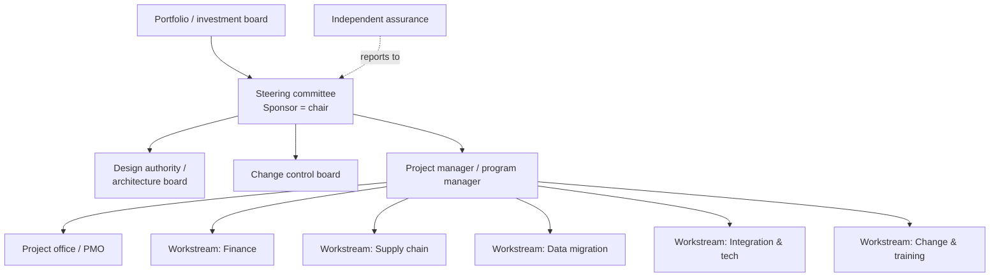
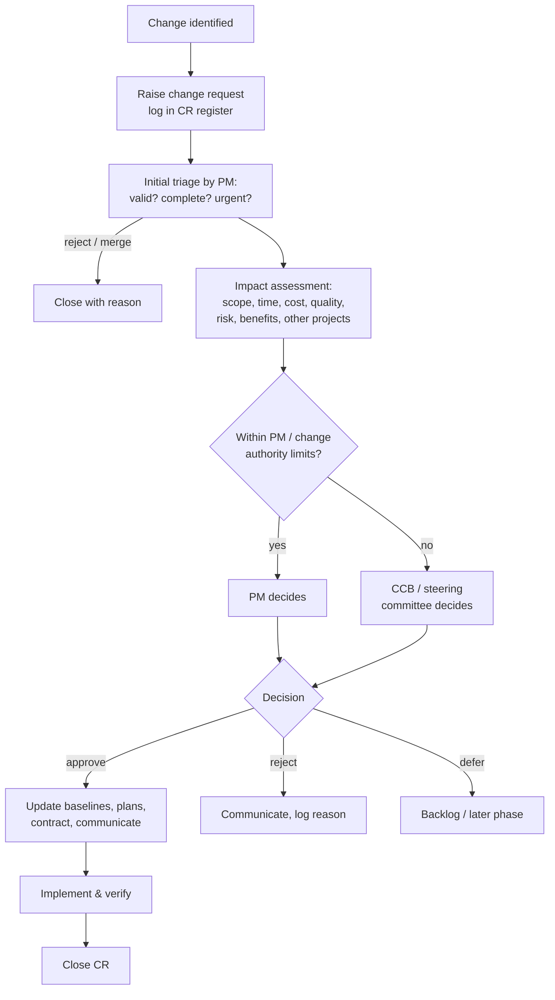
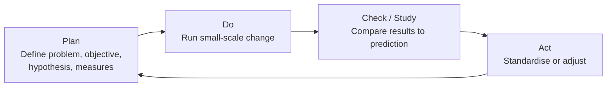

# Governance, Communication and Quality

> **TL;DR** Governance defines who decides what, how, and when; communication makes decisions and status visible. Set up a steering committee with a single accountable sponsor, clear tolerances and an escalation path. Plan communication per stakeholder group (what, why, channel, frequency, owner). Report status with honest RAG ratings defined by objective criteria. Control the baseline with a lightweight but real change request process, keep a decision log, and close every phase with lessons learned that actually change the next phase. Build quality in rather than inspecting it in: PDCA, cost of quality, quality gates, a Definition of Done and structured reviews (section 10).

---

## 1. Governance

### 1.1 Purpose

Project governance provides the framework for decision-making, accountability, and oversight: **direction** (what and why), **control** (are we on track?), **assurance** (is the information true?), **decision rights** (who can approve which change).

### 1.2 Governance structure (typical)

### 1.3 Governance models

| Model | Description | Fits |
|---|---|---|
| Single sponsor + steering committee | Classic; sponsor accountable, committee advises/decides | Most projects |
| PRINCE2 Project Board | Executive + Senior User(s) + Senior Supplier(s) | Customer/supplier projects |
| Joint governance (client–vendor) | Mirrored roles at each level: executive, steering, project, workstream | Outsourcing, SI engagements |
| Program board / SRO | Program level, benefits-driven (MSP) | Transformations |
| Lean/agile governance | Lean portfolio management, quarterly business reviews, guardrails, metrics instead of stage gates | Product organisations, SAFe |
| Federated / hub-and-spoke | Central standards, local execution | Multi-country rollouts |

### 1.4 Joint client–vendor governance (multi-level)

| Level | Client | Vendor | Frequency | Purpose |
|---|---|---|---|---|
| Executive | Sponsor / CxO | Account executive / partner | Quarterly | Relationship, strategic issues, contract escalations |
| Steering committee | Sponsor, business owners, CIO | Engagement manager | Monthly (bi-weekly in critical phases) | Decisions, tolerances, risk, change approval |
| Project management | Client PM | Vendor PM | Weekly | Plan, RAID, resources, commercial |
| Workstream | Process owners, key users | Consultants, leads | Daily/weekly | Delivery |
| Design authority | Enterprise/solution architect, process owners | Solution architect | Weekly/bi-weekly | Design decisions, standards, deviations |

### 1.5 Steering committee

**Terms of reference (contents):**
- Purpose and authority (decision rights, budget authority, tolerances)
- Membership (named roles), chair, quorum, deputies policy
- Meeting frequency, duration, format
- Inputs: status report, RAID, change requests, decisions needed (sent ≥ 2 working days ahead)
- Outputs: decisions, actions, minutes (within 2 days)
- Escalation route to portfolio/executive

**Agenda (60–90 min):**

| # | Item | Time |
|---|---|---|
| 1 | Actions from last meeting | 5 |
| 2 | Status summary: RAG, progress vs milestones, forecast | 10 |
| 3 | Financials: budget, actuals, EAC | 10 |
| 4 | Top risks and issues requiring attention | 15 |
| 5 | **Decisions required** (change requests, go/no-go, scope trade-offs) | 25 |
| 6 | Look-ahead: next period milestones, upcoming decisions | 10 |
| 7 | AOB, confirmation of decisions and actions | 5 |

**Rules of thumb:**
- A steering committee meeting without a decision is a status meeting — move status to the pre-read.
- Bring options with a recommendation, not open questions.
- Sponsor attends personally; deputies only with decision authority.
- 5–8 members; above that, decisions slow down.

### 1.6 Tolerances and management by exception

| Dimension | Example project tolerance | Stage tolerance (delegated to PM) |
|---|---|---|
| Time | +4 weeks on go-live | +1 week per stage |
| Cost | +10% of budget | +5% per stage |
| Scope | Must-haves fixed | Could-haves may be descoped |
| Quality | 0 sev 1 at go-live | Per gate criteria |
| Risk | No risks with score ≥ 20 unaddressed | Report any new red risk |
| Benefits | −10% of business case NPV | — |

If a forecast exceeds tolerance → **exception report** → steering committee decides (approve exception plan, change scope, stop).

### 1.7 Decision rights matrix (example)

| Decision | Team | PM | Design authority | Steering committee | Sponsor |
|---|---|---|---|---|---|
| Implementation detail within design | Decide | — | — | — | — |
| Change within stage tolerance, no scope impact | — | Decide | — | Informed | — |
| Deviation from standard / customisation | Propose | Consult | **Decide** | Informed | — |
| Scope change with cost > tolerance | — | Propose | Consult | **Decide** | — |
| Go/no-go | — | Recommend | Consult | **Decide** | Accountable |
| Stop the project | — | Recommend | — | Recommend | **Decide** (with portfolio board) |

---

## 2. Communication management

### 2.1 Communication planning questions

Who needs what information, why, when, in what format, through which channel, from whom, and how do we confirm it was understood?

### 2.2 Communication plan (example)

| Communication | Audience | Purpose | Content | Channel | Frequency | Owner |
|---|---|---|---|---|---|---|
| Steering committee pack | Steering committee | Decisions, oversight | Status, RAG, financials, RAID, decisions | Meeting + pre-read | Monthly | PM |
| Status report | Sponsor, stakeholders | Transparency | RAG, progress, next steps, risks | Email/SharePoint/Confluence | Bi-weekly | PM |
| Team stand-up | Team | Coordination | Progress, blockers | Meeting (15 min) | Daily | Scrum Master / lead |
| Workstream sync | Leads | Cross-team dependencies | Dependencies, integration | Meeting | Weekly | PM |
| Sprint review / demo | Stakeholders, key users | Feedback | Working increment | Demo | Per sprint | PO |
| Newsletter / intranet | All affected staff | Awareness, change | Why, what changes, when, where to learn | Intranet, email | Monthly | Change lead |
| Key-user network | Key users / champions | Readiness | Training, process changes, FAQs | Teams channel, workshops | Weekly in deploy | Change lead |
| Works council briefing | Works council | Consultation (legal) | Impact on jobs, monitoring, data | Formal meeting | As required | HR / sponsor |
| Go-live comms | All users, customers, suppliers | Readiness, cutover impact | Dates, freeze periods, support contacts | Email, portal, letters | T-6w, T-2w, T-1d, T+1d | Change lead |
| Incident/hypercare updates | Users, management | Situational awareness | Known issues, workarounds | Status page, Teams | Daily during hypercare | Hypercare lead |

### 2.3 Communication channels

| Channel | Richness | Best for |
|---|---|---|
| Face-to-face / video | High | Bad news, conflict, negotiation, complex decisions |
| Workshop | High | Design, alignment, risk identification |
| Phone / call | Medium-high | Quick clarification, escalation |
| Chat (Teams/Slack) | Medium | Coordination, quick questions |
| Email | Low-medium | Formal records, decisions confirmation, broad updates |
| Wiki/Confluence/SharePoint | Low | Reference documentation |
| Dashboards | Low (pull) | Self-service status |

Communication channels formula: n(n − 1) / 2 — 10 people = 45 channels, 20 people = 190.

### 2.4 Push / pull / interactive

| Type | Examples | Use |
|---|---|---|
| Push | Email, reports, newsletters | Ensure delivery; don't assume reading |
| Pull | Intranet, dashboards, wiki | Large audiences, reference |
| Interactive | Meetings, workshops, calls | Understanding, decisions, sensitive topics |

---

## 3. Status reporting

### 3.1 RAG definitions (agree them in advance)

| Status | Definition (example) | Required action |
|---|---|---|
| 🟢 **Green** | On track; within tolerances; no issues requiring escalation | None |
| 🟡 **Amber** | At risk; forecast to breach stage tolerance without action, but recovery plan in place within PM authority | PM executes recovery plan; informs steering committee |
| 🔴 **Red** | Forecast to breach project tolerance or recovery requires decisions/resources beyond PM authority | Escalate; decision required |
| 🔵 Blue / ⚪ Grey (optional) | Complete / not started | — |

Objective criteria examples:

| Dimension | Green | Amber | Red |
|---|---|---|---|
| Schedule | Milestones forecast ≤ 1 week late | 1–3 weeks late | > 3 weeks late or go-live at risk |
| Cost | EAC within +3% | +3% to +10% | > +10% |
| Scope | No unapproved changes | Changes pending | Disputed scope / uncontrolled growth |
| Resources | Fully staffed | Gaps ≤ 2 weeks | Critical role vacant |
| Risk | No red risks | Red risks with responses | Red risks without responses |

### 3.2 Watermelon reporting

"Green outside, red inside": status stays green until it suddenly turns red. Causes: fear of bad news, optimism, unclear criteria, punishing messengers. Countermeasures:
- Objective RAG criteria and trend arrows (↑ → ↓).
- Separate **current status** from **confidence in forecast**.
- Leaders respond to amber with help, not blame.
- Independent assurance / PMO challenge.
- Use leading indicators (test execution rate, defect closure, data quality) not just milestone dates.

### 3.3 Status report structure (one page)

| Section | Content |
|---|---|
| Header | Project, period, PM, overall RAG + trend |
| Executive summary | 3–5 bullets: what happened, what's next, what's needed |
| RAG by dimension | Schedule, cost, scope, quality, resources, risk, benefits |
| Milestones | Baseline vs forecast vs actual |
| Accomplishments this period | |
| Planned next period | |
| Top risks & issues | Top 3–5 with owners, actions |
| Decisions needed | With deadline |
| Financials | Budget, actual, EAC |
| Change requests | Pending/approved |

Template: [templates.md](templates.md#4-status-report).

---

## 4. Meetings cadence (hybrid project example)

| Meeting | Frequency | Duration | Attendees | Output |
|---|---|---|---|---|
| Daily stand-up (per team) | Daily | 15 min | Team | Blockers |
| Scrum of scrums / workstream sync | 2–3×/week | 30 min | Leads | Cross-team issues |
| PM / RAID review | Weekly | 60 min | PM, leads, PMO | Updated RAID, actions |
| Design authority | Weekly | 60–90 min | Architects, process owners | Design decisions |
| Change control board | Bi-weekly | 30–60 min | CCB members | CR decisions |
| Sprint review / planning | Per sprint | 1–4 h | Team, PO, stakeholders | Feedback, plan |
| Steering committee | Monthly | 60–90 min | Sponsor, members | Decisions |
| Vendor commercial review | Monthly | 60 min | PMs, procurement | Invoices, CRs, performance |

---

## 5. Change control

### 5.1 Integrated change control

Any change to a **baseline** (scope, schedule, cost, quality criteria, or approved documents) goes through a defined process. In agile, changes to backlog content are normal and managed by the PO; changes to the **release goal, budget, date, or contract** still need formal control.

### 5.2 Change request process

### 5.3 Change request fields

| Field | Description |
|---|---|
| CR ID, date, requester | |
| Title and description | What change, why |
| Reason / driver | Regulatory, business need, defect, error in spec, vendor |
| Benefit of change | Value |
| Impact: scope | Added/removed deliverables |
| Impact: schedule | Days, milestones affected, critical path? |
| Impact: cost | Effort, money, contingency use |
| Impact: quality/risk | New risks, testing needed |
| Impact: other projects/contracts | |
| Options | Including "do nothing" |
| Recommendation | |
| Decision, decided by, date | |
| Implementation status | |

Template: [templates.md](templates.md#5-change-request).

### 5.4 Change authority levels (example)

| Impact | Authority |
|---|---|
| ≤ 2 days effort, no milestone impact | Workstream lead (logged) |
| ≤ €10k and ≤ 1 week, within contingency | PM |
| ≤ €50k or ≤ 2 weeks, no go-live impact | Change control board |
| > €50k, go-live impact, or scope of business case | Steering committee |

### 5.5 Change control in fixed-price contracts

- Vendor raises CRs for anything outside the SOW; client checks against SOW and assumptions.
- Agree day rates and CR pricing method in the contract upfront.
- **Change budget pool**: pre-approved amount (e.g., 10% of contract) managed by CCB to avoid every CR going to procurement.
- **Swap rule** (agile contracts): exchange new scope for unstarted scope of equal size at no cost.

### 5.6 Configuration management

Controls versions of products/deliverables: identification, control, status accounting, verification/audit. For software: version control, branching strategy, environment management, release records ([../08-engineering/README.md](../08-engineering/README.md)).

---

## 6. Decision log

Decisions are the most frequently lost project knowledge ("why did we do it this way?").

| Field | Description |
|---|---|
| ID | D-001 |
| Date | |
| Decision | Clear statement |
| Context / problem | Why the decision was needed |
| Options considered | With pros/cons |
| Rationale | Why this option |
| Decided by | Person/forum (per decision rights) |
| Consulted | |
| Impact | Scope/time/cost; related CRs |
| Review date / reversibility | One-way vs two-way door |
| Links | Minutes, CR, design doc |

Architecture decisions: use **ADRs** (Architecture Decision Records) in the repository — see [../05-software-architecture/README.md](../05-software-architecture/README.md).

---

## 7. Escalation

### 7.1 Principles

- Escalation is a normal management tool, not a failure; define the path in the charter.
- Escalate **early** with facts, impact, options and a recommendation.
- Escalate the **problem**, not the person.
- Agree time limits: unresolved at level N after X days → level N+1.

### 7.2 Escalation message format

1. **Situation:** what happened (facts, data).
2. **Impact:** on milestones, cost, scope, benefits; when it hits.
3. **What has been tried.**
4. **Options** with consequences.
5. **Recommendation.**
6. **Decision needed by:** date.

(Variant of the SBAR format — Situation, Background, Assessment, Recommendation.)

### 7.3 Escalation ladder (example)

| Level | Client | Vendor | Time to resolve before next level |
|---|---|---|---|
| 1 | Workstream lead | Workstream lead | 2 working days |
| 2 | Project manager | Project manager | 5 working days |
| 3 | Steering committee | Engagement manager | Next steering / 10 days |
| 4 | Sponsor / executive | Account executive | Per contract |

---

## 8. Lessons learned and retrospectives

### 8.1 Comparison

| | Lessons learned (classic) | Retrospective (agile) |
|---|---|---|
| When | End of phase/project (ideally continuous) | End of every iteration |
| Focus | Organisation-level learning, future projects | Team improvement now |
| Output | Lessons report, knowledge base | 1–3 improvement actions for next sprint |
| Risk | Written and never read | Same complaints every sprint, no follow-through |

### 8.2 Retrospective formats

| Format | Prompts |
|---|---|
| Start / Stop / Continue | What should we start, stop, continue doing? |
| Mad / Sad / Glad | Emotional lens |
| 4Ls | Liked, Learned, Lacked, Longed for |
| Sailboat / Speedboat | Wind (helps), anchors (slows), rocks (risks), island (goal) |
| Timeline | Plot events and feelings across the period (good for phase-end/project retros) |
| Starfish | Keep, more of, less of, stop, start |
| DAKI | Drop, Add, Keep, Improve |

Five-phase structure (Derby & Larsen, *Agile Retrospectives*): **Set the stage → Gather data → Generate insights → Decide what to do → Close the retrospective.**

Norm Kerth's Prime Directive (paraphrased): assume everyone did the best job they could with the knowledge, skills, resources and situation they had at the time — the retrospective examines the system, not individual blame. Facilitation details: [../09-leadership-teams-facilitation/README.md](../09-leadership-teams-facilitation/README.md).

### 8.3 Making lessons stick

- Capture continuously (lessons log), not only at closure.
- Each lesson: context, what happened, impact, root cause, recommendation, **owner of follow-up**.
- Feed lessons into templates, checklists, estimation data, and the PMO method — otherwise they are "lessons documented", not learned.
- Start each project with a review of lessons from similar projects (PRINCE2 principle "learn from experience").
- Prefer **After Action Reviews** (US Army): What was supposed to happen? What actually happened? Why the difference? What will we sustain/improve?

Template: [templates.md](templates.md#7-lessons-learned).

---

## 9. Project closure

| Activity | Checklist |
|---|---|
| Acceptance | Formal acceptance of deliverables by customer/sponsor |
| Handover | To operations/support: documentation, runbooks, knowledge transfer, SLAs, open defects |
| Contracts | Close procurements, final invoices, release retentions, return equipment |
| Financials | Close cost codes, final cost report, release remaining contingency |
| Resources | Release team members; feedback/appraisals |
| Documentation | Archive project records per retention policy |
| Benefits | Handover benefits tracking to benefits owner; schedule post-implementation review |
| Lessons | Final lessons learned session and report |
| Communication | Closure announcement, recognition/celebration |
| Premature closure | If stopped: document reasons, salvage value, lessons |

---

---

## 10. Quality management

### 10.1 Concepts

| Term | Meaning |
|---|---|
| **Quality** | Degree to which a set of inherent characteristics fulfils requirements (ISO 9000) |
| **Grade** | Category for products with the same use but different characteristics (low grade is acceptable; low quality is not) |
| **Precision vs accuracy** | Consistency of repeated measurements vs closeness to the true value |
| **Quality assurance (QA)** | Process-focused; confidence that requirements will be met (audits, standards, process design) — *prevention* |
| **Quality control (QC)** | Product-focused; inspection and testing of deliverables — *detection* |
| **Verification** | "Did we build it right?" — conforms to specification |
| **Validation** | "Did we build the right thing?" — meets user needs |
| **Acceptance criteria** | Conditions a deliverable must satisfy to be accepted |
| **Quality tolerance** | Allowed deviation from a quality target (PRINCE2) |
| **Customer quality expectations** | High-level, from the customer, captured at start (PRINCE2 project product description) |

#### Quality gurus — what each contributed

| Person | Contribution |
|---|---|
| W. Edwards Deming | PDCA (Deming cycle), 14 points, system of profound knowledge; "quality is everyone's responsibility" |
| Joseph Juran | Quality trilogy (planning, control, improvement); Pareto principle in quality ("vital few, trivial many"); fitness for use |
| Philip Crosby | Zero defects; cost of quality; "quality is free"; conformance to requirements |
| Kaoru Ishikawa | Fishbone diagram; quality circles; seven basic tools |
| Walter Shewhart | Control charts; statistical process control; original PDSA |
| Genichi Taguchi | Loss function; robust design |

---

### 10.2 PDCA (Plan-Do-Check-Act)

| Step | Questions | Project examples |
|---|---|---|
| Plan | What are we trying to improve? How will we know? What change will we test? | "Defect leakage to UAT is 40%. Hypothesis: adding peer review of configuration reduces it to < 20%." |
| Do | Run the experiment, collect data | Two sprints with configuration peer reviews |
| Check (Study — PDSA) | Did results match prediction? | Leakage dropped to 22% |
| Act | Adopt, adapt or abandon; standardise | Make peer review part of DoD; next cycle targets test data |

Related improvement cycles: **DMAIC** (Six Sigma: Define, Measure, Analyse, Improve, Control), **OODA** (Observe, Orient, Decide, Act), **Build-Measure-Learn** (Lean Startup), **Scrum retrospectives**, **Kaizen**.

---

### 10.3 Cost of quality (CoQ)

Total cost of quality = cost of conformance + cost of non-conformance (Crosby; Juran; Feigenbaum's PAF model).

| Category | Sub-category | Software/ERP examples |
|---|---|---|
| **Cost of conformance** | **Prevention** | Training, standards, design reviews, architecture decisions, test automation framework, static analysis, data quality rules, coding guidelines |
| | **Appraisal** | Testing (unit, SIT, UAT), inspections, audits, code reviews, data reconciliation |
| **Cost of non-conformance** | **Internal failure** (before release) | Rework, retesting, defect fixing, scrap, delays |
| | **External failure** (after release) | Production incidents, hotfixes, hypercare overruns, lost revenue, penalties, reputation, manual workarounds |

#### The 1–10–100 rule (heuristic)

| Detected during | Relative cost to fix (indicative) |
|---|---|
| Requirements / design | 1× |
| Build / unit test | ~5–10× |
| System/integration testing | ~10–20× |
| UAT | ~20–50× |
| Production | 50–100×+ |

Exact multipliers are disputed (the original Boehm/IBM data is old and varies by context), but the direction holds strongly for ERP and integration projects: a wrong master-data design found in production can mean data correction across thousands of documents.

#### Using CoQ in decisions

- Justify a test-automation investment by estimating avoided internal/external failure cost per release (especially for SaaS ERP with quarterly vendor updates).
- Track defects found per phase (**defect removal efficiency**, DRE = defects found before release / total defects). Target > 85–95%.

---

### 10.4 Quality planning

#### 10.4.1 Quality management plan / approach — contents

| Section | Content |
|---|---|
| Quality objectives and standards | Customer quality expectations, acceptance criteria, applicable standards (ISO 9001, ISO 25010, GxP, SOX) |
| Roles | Quality manager, test manager, reviewers, assurance, approvers |
| Quality activities | Reviews, testing levels, audits, inspections per deliverable |
| Quality gates | Entry/exit criteria per phase |
| Tools | Test management, defect tracking, static analysis |
| Metrics | Defect density, test coverage, DRE, pass rate, open defects by severity |
| Records | Quality register, test reports, sign-offs |
| Non-conformance handling | Defect workflow, severity definitions, concessions |

#### 10.4.2 Product description (PRINCE2) fields

Identifier, title, purpose, composition, derivation, format and presentation, development skills required, **quality criteria**, **quality tolerance**, **quality method**, quality skills required, **quality responsibilities** (producer, reviewer, approver).

#### 10.4.3 ISO/IEC 25010 software product quality characteristics (2023 revision)

Functional suitability, performance efficiency, compatibility, interaction capability (formerly usability), reliability, security, maintainability, flexibility (formerly portability), safety. Use as a checklist for non-functional requirements; see [../05-software-architecture/README.md](../05-software-architecture/README.md).

---

### 10.5 Quality gates

A **quality gate** is a checkpoint with explicit entry/exit criteria; work cannot proceed until criteria are met (or a formal waiver is granted). Stage gates (Cooper's Stage-Gate) are business decisions; quality gates are technical readiness checks — often combined.

#### 10.5.1 Example gate criteria (ERP/V-model)

| Gate | Exit criteria |
|---|---|
| G1 Design complete | All in-scope processes have signed functional designs; fit-gap documented; gaps approved by design authority; integration specs agreed; data migration strategy approved |
| G2 Build complete | All configuration/development items unit tested; code reviewed; no open severity 1–2 defects from unit test; technical documentation complete |
| G3 SIT exit / UAT entry | ≥ 95% SIT test cases passed; 0 open severity 1; ≤ 5 open severity 2 with workarounds; interfaces tested end-to-end; mock migration 2 reconciled; UAT environment refreshed; test users and data ready |
| G4 UAT exit | All critical business scenarios passed; 0 severity 1/2 open; process owners signed off; training materials validated |
| G5 Go/no-go | Dress rehearsal succeeded within cutover window; data reconciliation signed off; support model ready; rollback plan tested; business readiness confirmed; see [software-and-erp-delivery.md](software-and-erp-delivery.md) |

#### 10.5.2 Defect severity definitions (example)

| Severity | Definition | UAT exit rule |
|---|---|---|
| 1 Critical | Business process stopped; no workaround; data corruption; legal non-compliance | 0 open |
| 2 High | Major function impaired; workaround is costly/manual | 0 open (or explicit sponsor waiver) |
| 3 Medium | Function impaired; reasonable workaround | Agreed limit, fix plan |
| 4 Low | Cosmetic, minor inconvenience | Backlog |

Severity (impact) ≠ priority (order of fixing).

#### 10.5.3 CI/CD quality gates (software)

Automated gates in pipelines: build passes, unit test coverage threshold, static analysis (e.g., SonarQube quality gate), security scanning (SAST/DAST/dependency), integration tests, performance smoke tests, approval for production. Details: [../08-engineering/README.md](../08-engineering/README.md).

---

### 10.6 Definition of Done (DoD) and Definition of Ready (DoR)

#### 10.6.1 DoD

A shared, explicit checklist that every increment/backlog item must satisfy to be "done". In Scrum, the DoD is a commitment for the Increment. Levels: story DoD, sprint DoD, release DoD.

Example story-level DoD:
- [ ] Acceptance criteria met and demonstrated to PO
- [ ] Code/configuration peer reviewed
- [ ] Unit tests written and passing; coverage not decreased
- [ ] Integrated into main branch; CI pipeline green
- [ ] Functional test executed in test environment
- [ ] No open defects of severity 1–2
- [ ] Documentation updated (functional design, user guide, release notes)
- [ ] Security and privacy checks done (data classification, access roles)
- [ ] Deployed to the QA/staging environment
- [ ] Training material impact assessed

Example release-level DoD (additional):
- [ ] Regression suite passed
- [ ] Performance test passed
- [ ] Release notes and change record approved
- [ ] Support team briefed / knowledge articles published
- [ ] Rollback tested

#### 10.6.2 DoR (optional)

Criteria for an item to enter a sprint: clear value statement, acceptance criteria, dependencies identified, estimated, small enough, testable, designs available. Caution: an over-strict DoR becomes a stage gate in disguise.

#### 10.6.3 DoD vs acceptance criteria

| DoD | Acceptance criteria |
|---|---|
| Applies to all items | Specific to one item |
| Quality standard / process | Functional behaviour |
| Owned by team (and organisation) | Agreed with PO / customer |

---

### 10.7 Reviews

| Review type | Purpose | Participants | Formality |
|---|---|---|---|
| Peer review / pair work | Catch defects early | Peers | Low–medium |
| Walkthrough | Author leads reviewers through a document/design for understanding and feedback | Author, peers, stakeholders | Low |
| Technical review | Evaluate technical suitability; consensus | Experts, architect | Medium |
| Inspection (Fagan) | Formal defect detection with roles (moderator, reader, recorder), checklists, metrics | Trained team | High |
| Design authority / architecture board | Approve designs and deviations from standards | Architects, process owners | Medium–high |
| Quality review (PRINCE2) | Check product against quality criteria; roles: chair, presenter, reviewer, administrator | | Medium |
| Stage-gate review | Go/no-go for next stage | Steering committee | High |
| Independent assurance / health check | Objective view of project health | Internal audit, PMO, external experts | High |
| Gateway review (UK OGC Gateway) | Six gateways: 0 strategic assessment, 1 business justification, 2 delivery strategy, 3 investment decision, 4 readiness for service, 5 operations review and benefits realisation | Independent review team | High |
| Post-implementation review (PIR) | Did the project achieve objectives and benefits? | Sponsor, benefits owner | Medium |
| Sprint review | Inspect increment, adapt backlog | Scrum team, stakeholders | Low |

#### 10.7.1 Project health check — question set

| Area | Questions |
|---|---|
| Business case | Is it still valid? Benefits still achievable? |
| Sponsorship | Is the sponsor active and accountable? |
| Scope | Is scope controlled? Change volume? |
| Schedule | Realistic? Critical path known? Trend? |
| Cost | EAC vs budget; CPI trend? |
| Risk | Register current? Top risks owned with actions? |
| Team | Right skills, capacity, morale, turnover? |
| Vendor | Performance vs contract? Relationship? |
| Quality | Defect trends, test coverage, technical debt? |
| Stakeholders | Engagement, resistance, communication? |
| Readiness | Is the organisation ready to adopt? |

---

### 10.8 Seven basic quality tools (Ishikawa)

| Tool | Use in projects |
|---|---|
| Cause-and-effect (fishbone) diagram | Root cause of recurring defects (categories: people, process, technology, data, environment, vendor) |
| Check sheet | Tally defects by type |
| Control chart | Is a process stable? (e.g., cycle time, defect arrival) |
| Histogram | Distribution (e.g., defect age) |
| Pareto chart | 80/20: which few modules cause most defects |
| Scatter diagram | Correlation (e.g., story size vs defects) |
| Flowchart / stratification | Process mapping; split data by category |

Plus **5 Whys** (Toyota) for quick root-cause analysis.

---

### 10.9 Quality metrics (software projects)

| Metric | Formula / description | Signal |
|---|---|---|
| Defect density | Defects / size (KLOC, function points, stories) | Hotspots |
| Defect removal efficiency | Pre-release defects / total defects | Effectiveness of testing |
| Defect leakage | Defects found in later phase / total | Phase effectiveness |
| Test pass rate | Passed / executed | Readiness |
| Test execution progress | Executed / planned | Schedule |
| Open defects by severity and age | Count, trend | Go-live readiness |
| Defect arrival vs closure rate | Find rate vs fix rate | Convergence (S-curve flattening) |
| Change failure rate (DORA) | Failed deployments / total | Release quality |
| Mean time to restore (DORA) | | Operational resilience |
| Requirements volatility | Changed requirements / total | Scope stability |

---

### 10.10 Quality standards (reference)

| Standard | Scope |
|---|---|
| ISO 9001:2015 | Quality management systems (certifiable) |
| ISO 10006:2017 | Quality management in projects (guidelines) |
| ISO/IEC 25010 | Software product quality model |
| ISO/IEC/IEEE 29119 | Software testing |
| ISTQB | Testing body of knowledge and certification |
| CMMI | Process maturity |
| GAMP 5 | Computerised system validation in pharma |

---

## When to use / when not

- Heavy governance (multi-level boards, CCB) is justified for large, multi-party, contract-bound projects. For a small internal team, a monthly sponsor check-in plus a backlog may be enough.
- Status reports should be proportional: one page beats twenty slides.

| Practice | Use | Lighten |
|---|---|---|
| Formal quality gates | Multi-vendor, regulated, ERP, safety-critical | Small product teams with CI/CD and strong DoD |
| Fagan inspections | Safety-critical, high-cost-of-failure specs | Most business software (use lightweight reviews) |
| Independent assurance | Large spend, poor visibility, recovery situations | Small low-risk projects |

## Common mistakes

- Steering committee as a status audience with no decisions.
- Several "sponsors", none accountable.
- RAG status based on PM feeling, without agreed criteria.
- Change control so heavy that people bypass it, or so light that scope grows invisibly.
- Decisions taken in corridors and never logged.
- Lessons learned held only at the end, when the team has already left.
- Communication plan focused on management, ignoring end users and front-line staff.

- Quality as a phase at the end ("testing will catch it").
- Exit criteria waived under schedule pressure without a recorded decision and owner.
- DoD that exists on a wiki but isn't applied in sprint reviews.
- Measuring test case counts instead of business risk coverage.
- Treating UAT as the first time users see the system (should have seen it in demos).
- No severity definitions agreed between client and vendor — endless debates during UAT.

## References

- Project governance (Wikipedia): https://en.wikipedia.org/wiki/Project_governance
- Change control (Wikipedia): https://en.wikipedia.org/wiki/Change_control
- Change control board (Wikipedia): https://en.wikipedia.org/wiki/Change_control_board
- Configuration management (Wikipedia): https://en.wikipedia.org/wiki/Configuration_management
- Steering committee (Wikipedia): https://en.wikipedia.org/wiki/Steering_committee
- Lessons learned (Wikipedia): https://en.wikipedia.org/wiki/Lessons_learned
- After-action review (Wikipedia): https://en.wikipedia.org/wiki/After-action_review
- Retrospective (Wikipedia): https://en.wikipedia.org/wiki/Retrospective
- SBAR (Wikipedia): https://en.wikipedia.org/wiki/SBAR
- PRINCE2 (Wikipedia): https://en.wikipedia.org/wiki/PRINCE2
- PMI: https://www.pmi.org/
- Retromat (retrospective activities): https://retromat.org/
- Leadership & facilitation section: [../09-leadership-teams-facilitation/README.md](../09-leadership-teams-facilitation/README.md)
- Agile section: [../04-agile-kanban-scrum/README.md](../04-agile-kanban-scrum/README.md)
- PDCA (Wikipedia): https://en.wikipedia.org/wiki/PDCA
- Cost of poor quality (Wikipedia): https://en.wikipedia.org/wiki/Cost_of_poor_quality
- Quality management (Wikipedia): https://en.wikipedia.org/wiki/Quality_management
- ISO 9001 family (ISO): https://www.iso.org/iso-9001-quality-management.html
- ISO/IEC 25010 (Wikipedia): https://en.wikipedia.org/wiki/ISO/IEC_25010
- Seven basic tools of quality (Wikipedia): https://en.wikipedia.org/wiki/Seven_basic_tools_of_quality
- Fagan inspection (Wikipedia): https://en.wikipedia.org/wiki/Fagan_inspection
- Five whys (Wikipedia): https://en.wikipedia.org/wiki/Five_whys
- W. Edwards Deming (Wikipedia): https://en.wikipedia.org/wiki/W._Edwards_Deming
- Joseph M. Juran (Wikipedia): https://en.wikipedia.org/wiki/Joseph_M._Juran
- Philip B. Crosby (Wikipedia): https://en.wikipedia.org/wiki/Philip_B._Crosby
- Phase-gate model (Wikipedia): https://en.wikipedia.org/wiki/Phase-gate_model
- The Scrum Guide (Definition of Done): https://scrumguides.org/
- ISTQB: https://www.istqb.org/
- DORA research: https://dora.dev/
- Engineering section: [../08-engineering/README.md](../08-engineering/README.md)
