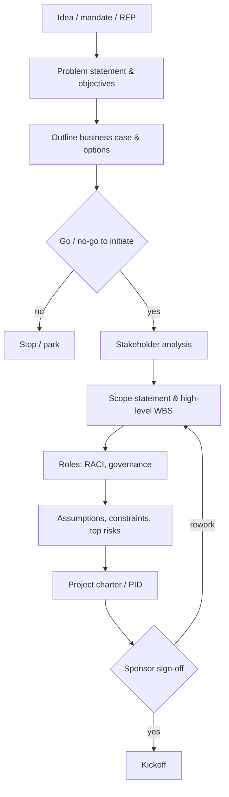
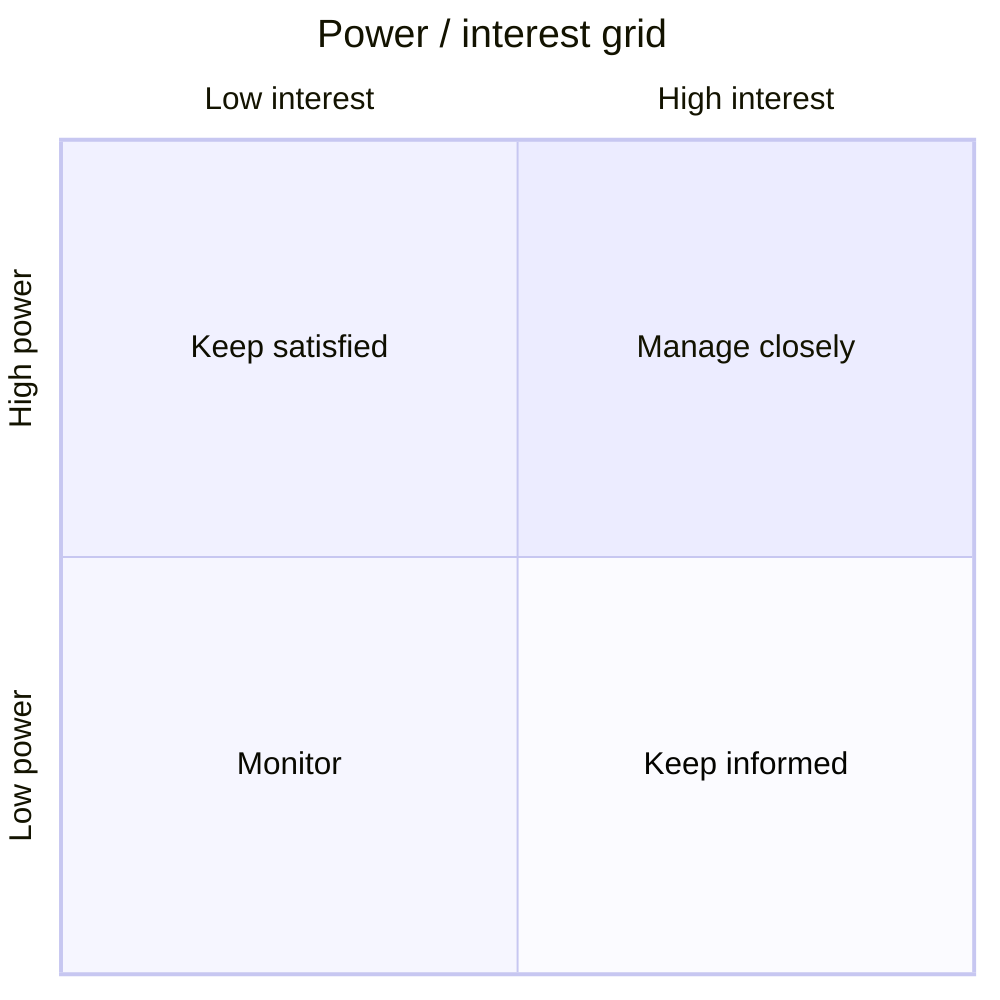

# Project Initiation

> **TL;DR** Initiation answers *why*, *what*, *who* and *how we decide* before significant money is spent. The core artefacts are the business case (why), the charter (authorisation), stakeholder analysis (who cares and how much), a responsibility matrix (RACI/RASCI/DACI), the scope statement and WBS (what, applying the 100% rule), and the assumption/constraint log. Finish with a kickoff meeting that turns paper into shared understanding. Ready-to-copy templates are in [templates.md](templates.md).

---

## 1. Initiation flow

### Outputs by framework

| Concept | PMBOK | PRINCE2 | Agile/product |
|---|---|---|---|
| Authorisation document | Project charter | Project brief → PID | Product vision, lean canvas, inception deck |
| Justification | Business case, benefits management plan | Business case | Opportunity canvas, outcome hypothesis |
| Detailed baseline | Project management plan | PID (incl. project plan, approaches) | Release plan, roadmap, backlog |
| Start event | Kickoff meeting | Initiation stage complete | Inception/liftoff workshop, sprint 0 |

---

## 2. Business case

### 2.1 Purpose

The business case justifies investment by comparing options on costs, benefits, risks and timing. It is a living document: it is revisited at each stage gate (PRINCE2: "continued business justification").

### 2.2 Structure

| Section | Content | Tips |
|---|---|---|
| Executive summary | One-paragraph problem, recommendation, cost, benefit, payback | Write last; one page max |
| Background & problem | Current situation, pain points, evidence (data, incidents, cost) | Quantify ("8 FTE spend 40% of time on manual reconciliation") |
| Strategic fit | Link to strategy, objectives, regulatory drivers | Name the strategic objective explicitly |
| Options considered | At least: do nothing, do minimum, recommended option, (alternative) | "Do nothing" is the baseline for all comparisons |
| Expected benefits | Measurable, owned, dated; financial and non-financial | Each benefit: metric, baseline, target, owner, timing |
| Dis-benefits | Negative consequences (e.g., productivity dip during adoption) | Often omitted, always present |
| Costs | One-off (capex/opex), run costs, internal effort, TCO over 3–5 years | Include internal staff, training, backfill, decommissioning |
| Investment appraisal | NPV, IRR, payback, ROI; sensitivity analysis | See [cost-and-value.md](cost-and-value.md) |
| Timescales | Major milestones, benefit realisation timeline | |
| Major risks | Top 5–10 risks with mitigation | Link to risk register |
| Dependencies | Other projects, vendors, regulations | |
| Recommendation & decision required | What the decision-maker is asked to approve | Be explicit: amount, scope, stage |

### 2.3 Five Case Model (UK HM Treasury Green Book)

Used in public-sector and large private investments.

| Case | Question |
|---|---|
| Strategic | Is there a compelling case for change? |
| Economic | Does it offer best public/organisational value (options appraisal)? |
| Commercial | Is it commercially viable (procurement route, contract)? |
| Financial | Is it affordable? |
| Management | Can it be delivered successfully? |

### 2.4 Benefit definition (benefit profile)

| Field | Example |
|---|---|
| Benefit | Reduced month-end close duration |
| Category | Efficiency (cashable / non-cashable) |
| Metric | Working days from period end to close |
| Baseline | 10 days |
| Target | 5 days |
| Measurement method | Finance calendar, close checklist timestamps |
| Owner | CFO / Group controller |
| Expected from | 6 months after go-live |
| Dependencies | Automated intercompany reconciliation, user training |

### 2.5 Common mistakes

- Benefits not measurable or with no baseline — impossible to prove later.
- Only one option (the one already chosen).
- Costs exclude internal effort and run costs.
- Optimism bias: no reference class adjustment (see [planning-and-scheduling.md](planning-and-scheduling.md)).
- Business case written once to get funding and never revisited.

---

## 3. Project charter

### 3.1 Purpose

Formally authorises the project, names the PM, and gives authority to use organisational resources. Short (2–6 pages). Sponsor signs it.

### 3.2 Contents checklist

- [ ] Project name, ID, sponsor, project manager
- [ ] Purpose / problem statement and justification (reference to business case)
- [ ] Measurable objectives and success criteria (SMART)
- [ ] High-level scope: in-scope, out-of-scope
- [ ] Key deliverables
- [ ] High-level requirements
- [ ] Summary milestone schedule
- [ ] Summary budget and funding source
- [ ] Constraints and flexibility (which of scope/time/cost flexes)
- [ ] Key assumptions
- [ ] High-level risks
- [ ] Key stakeholders
- [ ] Governance: steering committee, decision rights, escalation path
- [ ] PM authority level (budget, staffing, change approvals)
- [ ] Exit criteria / acceptance and approval requirements
- [ ] Signatures

Template: [templates.md#project-charter](templates.md#1-project-charter).

### 3.3 SMART objectives

| Letter | Meaning | Bad | Good |
|---|---|---|---|
| S | Specific | "Improve invoicing" | "Automate supplier invoice matching for EU entities" |
| M | Measurable | "Faster" | "80% of invoices matched without manual touch" |
| A | Achievable | "100% automation" | "80% within 6 months of go-live" |
| R | Relevant | Unrelated KPI | Linked to working-capital objective |
| T | Time-bound | "Eventually" | "By Q3 next year" |

### 3.4 Agile alternatives

- **Inception deck** (Jonathan Rasmusson, *The Agile Samurai*): 10 questions — Why are we here? Elevator pitch; Product box; NOT list; Meet the neighbours; Show the solution; What keeps us up at night; Size it; What's going to give (trade-off sliders); What's it going to take.
- **Liftoff** (Larsen & Nies): purpose, alignment, context, team charter.
- **Lean canvas / opportunity canvas** for product-led initiatives (see [../02-product-management/README.md](../02-product-management/README.md)).

---

## 4. Stakeholder analysis

### 4.1 Process

1. **Identify** — brainstorm, org charts, previous projects, contracts, "who can say no?", "who will be affected?"
2. **Analyse** — interest, influence/power, attitude, impact, needs.
3. **Prioritise** — grids/models below.
4. **Plan engagement** — current vs desired engagement; communication approach.
5. **Engage and monitor** — revisit regularly; stakeholders move.

### 4.2 Stakeholder register (fields)

| Field | Notes |
|---|---|
| Name / role / organisation | |
| Category | Sponsor, user, supplier, regulator, works council, IT ops, etc. |
| Interest (H/M/L) | How much they are affected or care |
| Power/influence (H/M/L) | Ability to affect outcomes |
| Attitude | Champion, supporter, neutral, critic, blocker |
| Current engagement | Unaware / Resistant / Neutral / Supportive / Leading |
| Desired engagement | |
| Key concerns / what's in it for them | |
| Engagement strategy | |
| Owner | Who manages the relationship |

### 4.3 Power/interest grid (Mendelow)

| Quadrant | Strategy | Typical stakeholders |
|---|---|---|
| High power, high interest — **Manage closely** | Involve in decisions, frequent 1:1s, steering committee | Sponsor, business owner, CIO |
| High power, low interest — **Keep satisfied** | Concise updates, consult on items that affect them, no overload | CFO, other division heads, group IT security |
| Low power, high interest — **Keep informed** | Regular communication, demos, involve as testers/key users | End users, key users, support teams |
| Low power, low interest — **Monitor** | Minimal effort, general comms | Peripheral departments |

Variants: power/influence, influence/impact, and the 3D **stakeholder cube** (power, interest, attitude).

### 4.4 Salience model (Mitchell, Agle & Wood, 1997)

Classifies stakeholders by three attributes: **Power** (ability to impose will), **Legitimacy** (valid claim), **Urgency** (time-sensitivity/criticality).

| Type | Attributes | Class | Treatment |
|---|---|---|---|
| Dormant | Power | Latent | Monitor; could become important |
| Discretionary | Legitimacy | Latent | Inform as appropriate |
| Demanding | Urgency | Latent | Acknowledge; don't let noise distract |
| Dominant | Power + Legitimacy | Expectant | Engage formally; keep satisfied |
| Dangerous | Power + Urgency | Expectant | Handle carefully; may act coercively |
| Dependent | Legitimacy + Urgency | Expectant | Need advocacy from powerful others |
| **Definitive** | Power + Legitimacy + Urgency | Definitive | Highest priority; immediate attention |
| Non-stakeholder | None | — | — |

### 4.5 Stakeholder engagement assessment matrix

| Stakeholder | Unaware | Resistant | Neutral | Supportive | Leading |
|---|---|---|---|---|---|
| CFO | | C | | D | |
| Warehouse manager | | | C | | D |
| Works council | C | | D | | |
| IT operations | | | | C, D | |

C = current, D = desired. The gap drives the engagement plan.

### 4.6 Other useful tools

- **Influence/relationship maps** — who influences whom (often more useful than the org chart).
- **Onion diagram** — concentric rings: product → team → organisation → wider environment.
- **Empathy map** — what they think, feel, say, do.

### 4.7 Common mistakes

- Analysing once at start, never updating.
- Missing "invisible" stakeholders: works council, data protection officer, internal audit, IT operations, end-of-chain users, the vendor's subcontractors.
- Publishing the attitude column — keep sensitive assessments private.

---

## 5. Responsibility assignment matrices

### 5.1 RACI

| Letter | Meaning | Rule |
|---|---|---|
| **R** Responsible | Does the work | At least one per task |
| **A** Accountable | Owns the outcome, approves, "the buck stops here" | **Exactly one** per task |
| **C** Consulted | Gives input before (two-way) | Keep few |
| **I** Informed | Notified after (one-way) | |

### 5.2 Variants

| Model | Letters | When to use |
|---|---|---|
| **RASCI** / RASIC | adds **S** Support (provides resources/assistance to R) | Shared-service or vendor support roles |
| **RACI-VS** | adds **V** Verify (checks against criteria), **S** Sign-off | Regulated / quality-heavy work |
| **CAIRO** | adds **O** Out of the loop | Explicitly excluding parties |
| **DACI** | **D**river, **A**pprover, **C**ontributors, **I**nformed | Decisions (Atlassian/Intuit); one driver, one approver |
| **RAPID** (Bain) | **R**ecommend, **A**gree, **P**erform, **I**nput, **D**ecide | Organisational decision rights |
| **RACIQ** | adds **Q** Quality review | |

### 5.3 Example RACI — ERP implementation (extract)

| Activity | Sponsor | Steering Cttee | PM | Solution Architect | Process Owner | Key User | Vendor | IT Ops |
|---|---|---|---|---|---|---|---|---|
| Approve business case | A | R | C | C | C | I | I | I |
| Global process design | I | I | C | R | A | C | R | I |
| Configuration | I | I | I | A | C | C | R | I |
| Data migration rules | I | I | C | C | A | R | R | C |
| UAT execution | I | I | C | C | A | R | S | I |
| Go/no-go decision | A | R | R | C | C | I | C | C |
| Cutover execution | I | I | A | R | C | C | R | R |
| Hypercare | I | I | A | C | C | C | R | R |

### 5.4 Validation rules

- Every row: exactly one **A**, at least one **R**.
- A column with many **A**s → person is a bottleneck.
- A column with no empty cells → person over-involved; decision paralysis.
- Too many **C**s → slow; convert to **I** where possible.
- Rows with A but no R → nobody does the work.
- Use roles, not names (names go in the resource plan).

### 5.5 DACI example — "Select data migration tool"

| Role | Person |
|---|---|
| Driver | Data migration lead |
| Approver | Solution architect |
| Contributors | Vendor architect, IT ops, security, key user finance |
| Informed | Steering committee, PMO |

Record outcome in the decision log (see [governance-communication-and-quality.md](governance-communication-and-quality.md)).

---

## 6. Scope statement

### 6.1 Contents

| Element | Description |
|---|---|
| Product scope description | Characteristics of the product/service/result |
| Project scope | Work required to deliver it |
| Deliverables | Tangible outputs incl. management deliverables (docs, training) |
| Acceptance criteria | Conditions to be met before acceptance |
| **Exclusions (out of scope)** | Explicit — the most valuable section |
| Constraints | Fixed limits (budget, dates, regulation, technology mandates) |
| Assumptions | Things believed true without proof |

### 6.2 In/out scope table (ERP example)

| Area | In scope | Out of scope |
|---|---|---|
| Entities | NL, BE, DE legal entities | UK (phase 2), US |
| Processes | Order-to-cash, procure-to-pay, record-to-report, inventory | Manufacturing execution, HR/payroll |
| Data | Open items, master data, 2 years GL balances | Historical transactions older than 2 years (archive read-only) |
| Integrations | Bank, EDI with top 20 customers, e-invoicing, WMS | CRM integration (separate project) |
| Reporting | Statutory reports, 15 operational reports | Group BI redesign |
| Training | Train-the-trainer for key users | End-user training delivery (business-led) |

### 6.3 Scope creep vs gold plating

| | Scope creep | Gold plating |
|---|---|---|
| Source | Stakeholders adding requirements without control | Team adding features nobody asked for |
| Cause | Weak change control, vague scope | Perfectionism, misunderstanding of value |
| Fix | Change control, explicit exclusions, backlog with priorities | DoD, acceptance criteria, PO review |

---

## 7. Work Breakdown Structure (WBS)

### 7.1 Definition

A hierarchical decomposition of the **total scope of work** into deliverables and work packages. Deliverable-oriented (nouns), not activity-oriented (verbs). Standard: ISO 21511:2018; PMI *Practice Standard for WBS*.

### 7.2 Rules

| Rule | Description |
|---|---|
| **100% rule** | The WBS includes 100% of the work defined by the scope — and nothing more. Children sum to 100% of the parent at every level. Applies to project management work too. |
| Mutually exclusive | No overlap between elements; avoids double counting |
| Outcomes, not actions | Elements are deliverables; activities come later in the schedule |
| **8/80 rule** (heuristic) | Work package effort between 8 and 80 hours (or ≤ one reporting period) |
| Decompose to manageable | Stop when the package can be estimated, assigned to one owner, and tracked |
| Rolling wave | Decompose near-term work in detail; far-term at higher levels |
| WBS dictionary | Each work package: ID, description, owner, acceptance criteria, estimate, dependencies |

### 7.3 Decomposition approaches

| Approach | Level 2 organised by | Good for |
|---|---|---|
| Phase-based | Lifecycle phases | Predictive projects |
| Deliverable/product-based | Major deliverables/components | Most projects; PRINCE2 product breakdown structure |
| Organisational/geographic | Location or business unit | Rollouts |
| Workstream-based | Functional streams (finance, logistics, data, integration) | ERP and transformations |

### 7.4 Example WBS (ERP, deliverable/workstream mix)

```mermaid
flowchart TD
    P[1 ERP Implementation] --> PM[1.1 Project Management]
    P --> D[1.2 Solution Design]
    P --> B[1.3 Build]
    P --> DM[1.4 Data Migration]
    P --> T[1.5 Testing]
    P --> CM[1.6 Change & Training]
    P --> DEP[1.7 Deployment]
    PM --> PM1[1.1.1 Plans & governance]
    PM --> PM2[1.1.2 Reporting]
    D --> D1[1.2.1 Fit-gap analysis]
    D --> D2[1.2.2 Functional designs]
    D --> D3[1.2.3 Integration architecture]
    B --> B1[1.3.1 Configuration]
    B --> B2[1.3.2 Extensions]
    B --> B3[1.3.3 Interfaces]
    B --> B4[1.3.4 Reports & forms]
    DM --> DM1[1.4.1 Migration strategy]
    DM --> DM2[1.4.2 Extract/transform scripts]
    DM --> DM3[1.4.3 Mock loads]
    T --> T1[1.5.1 Test strategy]
    T --> T2[1.5.2 SIT]
    T --> T3[1.5.3 UAT]
    CM --> CM1[1.6.1 Training materials]
    CM --> CM2[1.6.2 Key-user training]
    DEP --> DEP1[1.7.1 Cutover plan]
    DEP --> DEP2[1.7.2 Go-live]
    DEP --> DEP3[1.7.3 Hypercare]
```

### 7.5 WBS dictionary entry

| Field | Value |
|---|---|
| WBS ID | 1.4.3 |
| Name | Mock data loads |
| Description | Three full trial migrations into the QA environment with reconciliation |
| Owner | Data migration lead |
| Deliverables | Mock 1/2/3 reports, reconciliation sign-offs |
| Acceptance | ≥ 98% records loaded (mock 2), 100% financial balances reconciled (mock 3) |
| Estimate | 240 hours |
| Dependencies | 1.4.2 scripts; QA environment available |
| Risks | Source data quality |

### 7.6 Agile equivalent

Epics → features → user stories form a scope hierarchy similar to a WBS, but it is reprioritised continuously. **Story mapping** (Jeff Patton) is the closest agile counterpart. The 100% idea still applies to a release: the release backlog should hold all work, including non-functional work, data migration, and documentation.

### 7.7 Common mistakes

- Activity-based WBS (a list of verbs) — duplicates the schedule and misses deliverables.
- Forgetting project management, testing, training, data migration, decommissioning, documentation.
- Too deep (micro-management) or too shallow (cannot estimate).
- WBS copied from the vendor proposal without client-side work (internal testing, business readiness).

---

## 8. Assumptions and constraints

| | Assumption | Constraint |
|---|---|---|
| Definition | Believed true for planning, without proof | A limiting factor known to be true |
| Example | "Key users available 50% from March" | "Go-live must be 1 January (fiscal year start)" |
| Management | Validate; if false → becomes risk or issue | Plan within; challenge if unreasonable |
| Log | Assumption log (owner, validation date, status) | Charter / scope statement |

### Assumption log fields

| ID | Assumption | Category | Owner | Validate by | Status | If false, impact |
|---|---|---|---|---|---|---|
| A-01 | Source system data can be extracted via existing database views | Technical | Data lead | 15 Feb | Open | +4 weeks custom extraction; risk R-07 |
| A-02 | Vendor provides 2 senior consultants from M1 | Resource | PM | Contract signature | Validated | — |

**Rule:** every assumption gets an owner and a validation date. Invalidated assumptions move to the risk or issue log. RAID log: [risk-management.md](risk-management.md).

### Typical constraint categories

Time (fixed dates, fiscal year, blackout periods such as retail peak season, year-end close), budget, resources (named experts, union rules), technology (mandated platform, cloud policy), legal/regulatory (GDPR, e-invoicing mandates, SOX), contractual, organisational (works council consultation timelines).

---

## 9. Kickoff meeting

### 9.1 Two kickoffs

| Kickoff | Audience | Purpose |
|---|---|---|
| Internal / team kickoff | Project team (client + vendor) | Ways of working, roles, plans, tools |
| External / sponsor kickoff | Sponsor, steering committee, stakeholders, team | Alignment on why, what, success, governance; visible sponsor commitment |

### 9.2 Agenda (≈2–3 hours; half day for large projects)

| # | Item | Owner | Time |
|---|---|---|---|
| 1 | Welcome, introductions, purpose of the meeting | Sponsor | 10 min |
| 2 | Why this project: business context, problem, objectives, benefits | Sponsor | 20 min |
| 3 | Scope: in/out, key deliverables, success criteria | PM | 20 min |
| 4 | Approach: lifecycle, phases/stages, sprints, milestones | PM | 20 min |
| 5 | Organisation: governance, roles, RACI, decision rights | PM | 15 min |
| 6 | Plan: high-level timeline, upcoming 4–6 weeks | PM | 15 min |
| 7 | Risks, assumptions, constraints, dependencies | PM / team | 15 min |
| 8 | Ways of working: meetings cadence, tools, communication plan, documentation, definition of done | PM / Scrum Master | 15 min |
| 9 | Team agreements / working norms | Team | 15 min |
| 10 | Q&A, concerns, open issues | All | 15 min |
| 11 | Next steps, actions, owners | PM | 10 min |

### 9.3 Kickoff checklist

- [ ] Charter signed before kickoff
- [ ] Sponsor attends in person and speaks first
- [ ] Deck shared in advance; key decisions not made in the meeting itself
- [ ] Tools access (Jira/ADO, SharePoint/Confluence, Teams/Slack) prepared
- [ ] Meeting series invited (stand-ups, weekly status, steering)
- [ ] Action log started
- [ ] Follow-up: minutes and decisions within 24 h

---

## 10. Initiation stage gate checklist

- [ ] Business case approved with options and baseline
- [ ] Charter/PID signed by sponsor
- [ ] Governance in place: steering committee members, cadence, tolerances
- [ ] Stakeholders identified and analysed
- [ ] RACI agreed by all role holders
- [ ] Scope statement with exclusions
- [ ] WBS to work-package level for the next stage
- [ ] Assumptions/constraints logged with owners
- [ ] Top risks with owners and responses
- [ ] Budget released for next stage
- [ ] Contracts/SOWs signed for suppliers needed in next stage
- [ ] Tools, environments and access ready
- [ ] Kickoff held

## Common mistakes

- Starting work before the charter (common in consultancy: "start Monday, contract follows") — scope disputes later.
- Sponsor delegates the project entirely and disappears after kickoff.
- No explicit exclusions; the vendor's and client's scope assumptions differ.
- RACI with multiple "A"s for critical decisions.
- Treating initiation documents as bureaucracy rather than as alignment tools; ask each document "what decision does this support?"

## References

- PMI PMBOK Guide: https://www.pmi.org/standards/pmbok
- Business case (Wikipedia): https://en.wikipedia.org/wiki/Business_case
- Project charter (Wikipedia): https://en.wikipedia.org/wiki/Project_charter
- Stakeholder analysis (Wikipedia): https://en.wikipedia.org/wiki/Stakeholder_analysis
- Responsibility assignment matrix (Wikipedia): https://en.wikipedia.org/wiki/Responsibility_assignment_matrix
- Work breakdown structure (Wikipedia): https://en.wikipedia.org/wiki/Work_breakdown_structure
- Scope creep (Wikipedia): https://en.wikipedia.org/wiki/Scope_creep
- SMART criteria (Wikipedia): https://en.wikipedia.org/wiki/SMART_criteria
- HM Treasury Green Book (GOV.UK): https://www.gov.uk/government/publications/the-green-book-appraisal-and-evaluation-in-central-government
- Atlassian Team Playbook (DACI and more): https://www.atlassian.com/team-playbook
- PRINCE2 (Wikipedia): https://en.wikipedia.org/wiki/PRINCE2
- Product management section: [../02-product-management/README.md](../02-product-management/README.md)
- Facilitation section: [../09-leadership-teams-facilitation/README.md](../09-leadership-teams-facilitation/README.md)
