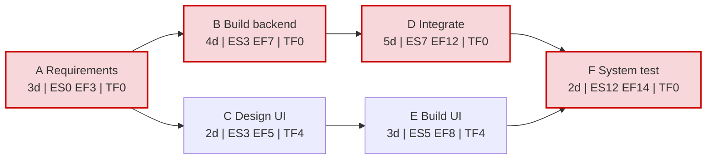
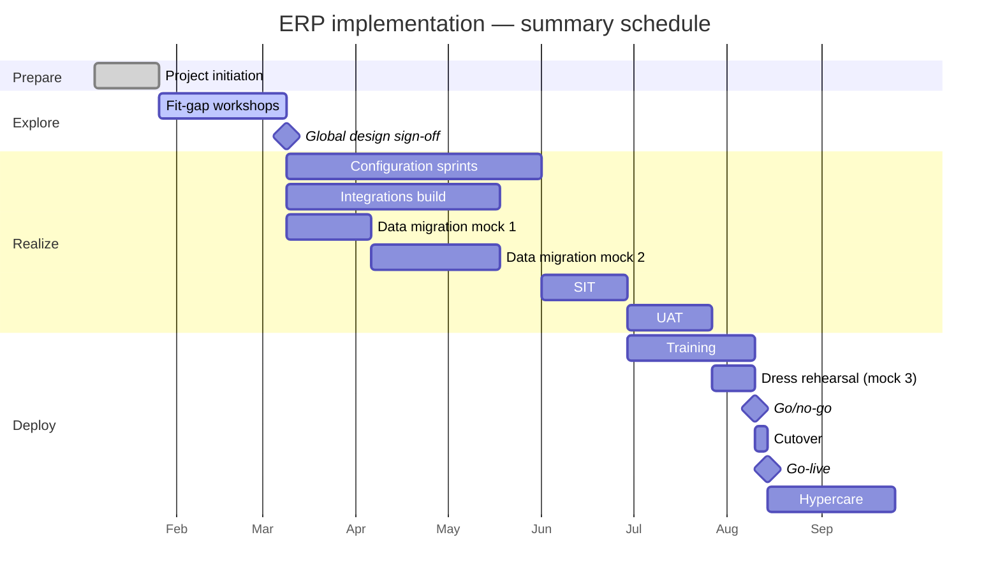

# Planning, Estimation and Scheduling

> **TL;DR** Estimates are probability distributions, not numbers: give ranges with confidence levels. Use analogous estimates early, parametric when you have data, three-point/PERT for uncertain tasks, relative sizing for agile backlogs, and probabilistic forecasting (Monte Carlo on historical throughput) for delivery dates. Correct for optimism with reference class forecasting. Build schedules with the critical path method (forward/backward pass, float), model dependencies (FS/SS/FF/SF), level resources, and protect commitments with explicit buffers rather than hidden padding.

---

## 1. Planning levels

| Level | Horizon | Detail | Owner | Artefact |
|---|---|---|---|---|
| Strategic / roadmap | 1–3 years | Themes, initiatives, quarters | Portfolio / sponsor | Roadmap |
| Project / release | Whole project | Phases, milestones, major deliverables | PM | Master schedule, release plan |
| Stage / PI | 1–3 months | Work packages, features | PM / team leads | Stage plan, PI objectives |
| Team / iteration | 1–4 weeks | Tasks, stories | Team | Sprint backlog, team plan |
| Daily | 1 day | Tasks | Individuals | Board |

**Rolling wave planning:** plan near-term work in detail and far-term work at summary level; refine at each stage boundary. **Progressive elaboration:** the plan gets more detailed and accurate as information becomes available.

---

## 2. Estimation techniques

### 2.1 Overview

| Technique | How | Accuracy | Effort | When to use |
|---|---|---|---|---|
| **Expert judgement** | Ask experienced people | Varies widely | Low | Always as input; never alone for big decisions |
| **Analogous (top-down)** | Use actual duration/cost of a similar past project, adjusted | −25% to +75% (rough order of magnitude) | Low | Early, little detail; feasibility |
| **Parametric** | Statistical relationship: quantity × unit rate (e.g., interfaces × 12 days) | Good if model calibrated | Medium | Repetitive, scalable work (migration objects, reports, interfaces) |
| **Bottom-up** | Estimate each work package, aggregate | −5% to +10% (definitive) | High | Detailed planning; WBS available |
| **Three-point / PERT** | Optimistic, most likely, pessimistic → weighted mean and std dev | Expresses uncertainty | Medium | Uncertain tasks; risk analysis |
| **Wideband Delphi** | Anonymous expert rounds converging on consensus | Reduces anchoring | Medium | Important estimates, divergent opinions |
| **Planning poker** | Team votes simultaneously with Fibonacci-like cards; discuss outliers | Relative, team-calibrated | Low–medium | Agile backlog refinement |
| **T-shirt sizing** | XS/S/M/L/XL buckets | Coarse | Very low | Roadmaps, portfolio, epic sizing |
| **Affinity estimation / magic estimation** | Silently place items on a scale, then adjust | Coarse | Very low | Sizing large backlogs fast |
| **#NoEstimates** | Slice work small and similar, count items, forecast by throughput | Good if items are right-sized | Very low | Stable teams with flow metrics |
| **Reference class forecasting** | Base estimate on the distribution of outcomes of similar past projects | Corrects optimism bias | Medium | Business cases, large projects |
| **Monte Carlo simulation** | Simulate thousands of outcomes from distributions or historic data | Probabilistic range | Medium (with tools) | Release dates, schedule risk, budgets |
| **Function points / COCOMO** | Size from functional components; effort models | Calibrated organisations | High | Contracts, benchmarking, outsourcing |

### 2.2 Estimate classes (AACE-style, adapted)

| Class | Stage | Accuracy range | Basis |
|---|---|---|---|
| Rough order of magnitude (ROM) | Idea / feasibility | −25% to +75% (often −50% to +100% in IT) | Analogy |
| Budget estimate | Business case / planning | −10% to +25% | Parametric, high-level WBS |
| Definitive estimate | Detailed planning | −5% to +10% | Bottom-up |

### 2.3 Three-point estimation and PERT

Inputs per task: **O** (optimistic), **M** (most likely), **P** (pessimistic).

| Formula | Expression |
|---|---|
| Triangular mean | E = (O + M + P) / 3 |
| **PERT (beta) mean** | **E = (O + 4M + P) / 6** |
| PERT standard deviation | σ = (P − O) / 6 |
| PERT variance | σ² = ((P − O) / 6)² |
| Path mean | E_path = Σ E_i |
| Path standard deviation | σ_path = √(Σ σ_i²)  (assumes independent tasks) |

Confidence intervals (normal approximation of path total):

| Range | Probability |
|---|---|
| E ± 1σ | ≈ 68.3% |
| E ± 2σ | ≈ 95.4% |
| E ± 3σ | ≈ 99.7% |
| ≤ E + 1.645σ | ≈ 95% (one-sided, "P95") |
| ≤ E + 1.28σ | ≈ 90% ("P90") |
| ≤ E | ≈ 50% ("P50") |

#### Worked example

| Task | O | M | P | E = (O+4M+P)/6 | σ = (P−O)/6 | σ² |
|---|---|---|---|---|---|---|
| Design interface | 2 | 4 | 6 | 4.00 | 0.67 | 0.44 |
| Build interface | 3 | 5 | 13 | 6.00 | 1.67 | 2.78 |
| Test interface | 4 | 6 | 14 | 7.00 | 1.67 | 2.78 |
| **Path total** | 9 | 15 | 33 | **17.00** | **√6.00 = 2.45** | 6.00 |

- Sum of most-likely values = 15 days, but the expected value is 17 days: skewed pessimistic tails add up.
- P50 ≈ 17 days; P90 ≈ 17 + 1.28 × 2.45 ≈ 20.1 days; P95 ≈ 17 + 1.645 × 2.45 ≈ 21.0 days.
- **Commit to P80–P90, plan the team to P50**, and hold the difference as a buffer.

Probability of finishing by a target T: Z = (T − E) / σ. For T = 19: Z = (19 − 17) / 2.45 = 0.82 → ≈ 79%.

### 2.4 Relative estimation (agile)

| Technique | Scale | Notes |
|---|---|---|
| Story points | Modified Fibonacci 1, 2, 3, 5, 8, 13, 20, 40, 100 | Measures effort + complexity + uncertainty, relative to a reference story |
| Planning poker | Cards; simultaneous reveal | Highest and lowest explain, re-vote; avoids anchoring |
| T-shirt sizes | XS, S, M, L, XL (XXL = split it) | Map to ranges (e.g., S = 1–2 sprints for epics) |
| Ideal days | Days without interruptions | Easy to explain; easily confused with calendar days |

Planning poker steps:
1. PO reads the story; team asks questions.
2. Everyone chooses a card privately.
3. Simultaneous reveal.
4. Highest and lowest estimators explain reasoning.
5. Re-vote until convergence (or take the higher value after 2–3 rounds).

Velocity-based forecasting: remaining points / average velocity = sprints remaining. Use a **range** of velocities (e.g., lowest 3 and highest 3 of the last 8 sprints) rather than an average.

### 2.5 #NoEstimates

Popularised by Woody Zuill, Neil Killick and Vasco Duarte (~2012). Not "no forecasting" but "no effort estimation of individual items".

- Split work into small, roughly similar-sized items (e.g., ≤ 2–3 days each).
- Track **throughput** (items finished per week) and **cycle time**.
- Forecast with counts × throughput, ideally with Monte Carlo.
- Works when: stable team, consistent slicing discipline, flow-based process.
- Fails when: contracts require fixed-price estimates, items vary hugely, team is new.

### 2.6 Reference class forecasting (RCF)

Developed from Kahneman & Tversky's work on the **planning fallacy**; operationalised for projects by Bent Flyvbjerg (UK Treasury and Danish government guidance).

Steps:
1. **Identify a reference class** of past, similar projects (e.g., ERP implementations, IT projects of similar size).
2. **Establish the distribution** of outcomes for that class (e.g., cost overrun distribution).
3. **Position your project** in that distribution and adjust (uplift) the estimate to the desired confidence level.

Example (illustrative): if the reference class shows that 80% of comparable IT projects overran by ≤ 40%, a P80 budget = base estimate × 1.40.

| Concept | Description |
|---|---|
| Inside view | Building the estimate from the specifics of your project (what PMs usually do) |
| Outside view | Asking "how did projects like this actually go?" — RCF |
| Optimism bias uplift | Percentage added to base estimate per project type (UK Green Book supplementary guidance) |

### 2.7 Monte Carlo forecasting

Simulate the project thousands of times by sampling task durations (from three-point distributions) or weekly throughput (from historical data).

#### Throughput-based ("how many weeks for 60 items?")

```python
import random

history = [4, 6, 3, 7, 5, 5, 2, 6, 4, 8]  # items completed per week, last 10 weeks
backlog = 60
trials = 10_000
results = []
for _ in range(trials):
    done, weeks = 0, 0
    while done < backlog:
        done += random.choice(history)
        weeks += 1
    results.append(weeks)
results.sort()
for p in (50, 70, 85, 95):
    print(f"P{p}: {results[int(trials * p / 100) - 1]} weeks")
```

Output reads like "85% of simulations finished within 14 weeks". Communicate as: *"We are 85% confident to finish by <date>."*

#### Schedule-based

- Model tasks with triangular/PERT/lognormal distributions in the schedule tool (e.g., Safran Risk, Oracle Primavera Risk Analysis, @RISK, or spreadsheet).
- Output: S-curve of finish dates; **criticality index** (% of runs a task was on the critical path); **sensitivity (tornado)** charts.
- Captures **merge bias**: where parallel paths join, the expected finish is later than any single path suggests.

### 2.8 The Cone of Uncertainty

Concept from Barry Boehm (1981), named and popularised by Steve McConnell (*Software Estimation*, 2006). Estimate variability narrows as decisions are made — *if* the project actively reduces uncertainty.

| Milestone | Low multiplier | High multiplier |
|---|---|---|
| Initial concept | 0.25× | 4× |
| Approved product definition | 0.5× | 2× |
| Requirements complete | 0.67× | 1.5× |
| User interface design complete | 0.8× | 1.25× |
| Detailed design complete | 0.9× | 1.1× |
| Software complete | 1× | 1× |

Implications:
- Don't commit to a fixed number at initial concept; offer a range and a plan to narrow it.
- The cone does not narrow by itself — only through decisions and learning (spikes, prototypes, design).
- The range is best case; real projects can sit outside it (Todd Little's data shows many projects exceeding it).

### 2.9 Estimation biases

| Bias | Effect | Countermeasure |
|---|---|---|
| Planning fallacy | Underestimating own tasks' time | Outside view, RCF, historical data |
| Anchoring | First number heard dominates | Planning poker simultaneous reveal, Delphi |
| Optimism bias | Overestimating benefits, underestimating costs | Independent review, pre-mortem |
| Strategic misrepresentation | Deliberately low estimates to get approval | Accountability, RCF, independent estimates |
| Student syndrome / Parkinson's law | Padding gets consumed | Aggregate buffers (CCPM) |
| Hofstadter's law | Work overruns expectations even after you correct for this very tendency | Track actuals, recalibrate |
| Unknown unknowns | Missing scope | Contingency reserves, discovery |

---

## 3. Dependencies

### 3.1 Logical relationships

| Type | Name | Meaning | Example |
|---|---|---|---|
| **FS** | Finish-to-Start | B cannot start until A finishes (most common, ~90%) | UAT starts after SIT finishes |
| **SS** | Start-to-Start | B cannot start until A starts | Training material writing starts when configuration starts |
| **FF** | Finish-to-Finish | B cannot finish until A finishes | Documentation finishes when development finishes |
| **SF** | Start-to-Finish | B cannot finish until A starts (rare) | Old system support cannot end until the new system goes live |

**Lead** = overlap (negative lag): FS −5d means B starts 5 days before A finishes. **Lag** = waiting time: FS +3d (e.g., concrete curing, data sync window, vendor notice period).

### 3.2 Dependency categories

| Category | Description | Example |
|---|---|---|
| Mandatory (hard logic) | Inherent in the work | Cannot test before build |
| Discretionary (soft/preferred logic) | Best practice, can be changed to fast-track | Design review before build |
| External | Outside the project's control | Vendor delivery, regulator approval, another project's API |
| Internal | Within the project | Team A's component needed by team B |

Track cross-team/external dependencies on a **dependency board** or in the RAID log; in scaled agile, the **program board** (SAFe) visualises them.

---

## 4. Critical Path Method (CPM)

Developed by Kelley (Remington Rand) and Walker (DuPont) in 1957; PERT developed by the US Navy (Polaris program) 1958.

### 4.1 Definitions

| Term | Abbrev. | Definition |
|---|---|---|
| Early start | ES | Earliest an activity can start |
| Early finish | EF | ES + duration |
| Late start | LS | Latest start without delaying the project |
| Late finish | LF | Latest finish without delaying the project |
| **Total float** (slack) | TF | LS − ES = LF − EF. Delay possible without delaying the project end |
| **Free float** | FF | ES(successor, earliest) − EF(activity). Delay possible without delaying any successor |
| Critical path | — | Longest path through the network; activities with TF = 0 (in an unconstrained schedule) |
| Near-critical path | — | Paths with small float; watch them too |

### 4.2 Algorithm

1. **Forward pass:** start at 0. ES = max(EF of all predecessors). EF = ES + duration.
2. **Backward pass:** LF of the last activity = project EF. LF = min(LS of all successors). LS = LF − duration.
3. **Float:** TF = LS − ES.
4. **Critical path:** activities with TF = 0.

(Convention here: time 0 start, EF = ES + D. Some tools use "day 1" convention with ES + D − 1.)

### 4.3 Worked example

| Activity | Duration (days) | Predecessors |
|---|---|---|
| A — Requirements | 3 | — |
| B — Build backend | 4 | A |
| C — Design UI | 2 | A |
| D — Integrate backend | 5 | B |
| E — Build UI | 3 | C |
| F — System test | 2 | D, E |

**Forward pass**

| Activity | ES | EF |
|---|---|---|
| A | 0 | 3 |
| B | 3 | 7 |
| C | 3 | 5 |
| D | 7 | 12 |
| E | 5 | 8 |
| F | max(12, 8) = 12 | 14 |

**Backward pass** (project duration = 14)

| Activity | LF | LS | TF = LS − ES | FF |
|---|---|---|---|---|
| F | 14 | 12 | 0 | 0 |
| D | 12 | 7 | 0 | 0 |
| E | 12 | 9 | 4 | 12 − 8 = 4 |
| B | 7 | 3 | 0 | 0 |
| C | min(LS E = 9) = 9 | 7 | 4 | 5 − 5 = 0 |
| A | min(LS B = 3, LS C = 7) = 3 | 0 | 0 | 0 |

**Critical path: A → B → D → F = 14 days.** C and E share 4 days of total float; C has zero free float (delaying C delays E's early start) while E has 4 days free float.



### 4.4 Schedule compression

| Technique | How | Trade-off |
|---|---|---|
| **Crashing** | Add resources to critical path activities (cheapest cost per day first) | Higher cost; Brooks's law in software |
| **Fast-tracking** | Overlap activities normally sequential (FS → SS with lag) | More rework risk |
| Scope reduction | Remove/defer scope (MoSCoW) | Less value now |
| Re-sequencing | Change discretionary dependencies | May reduce quality checks |

Crash cost slope = (crash cost − normal cost) / (normal time − crash time). Crash the critical activity with the lowest slope first; re-check the critical path after each step (it can shift).

### 4.5 Common CPM mistakes

- Missing dependencies → false float ("dangling" activities with no successor).
- Hard date constraints everywhere → the tool cannot compute a real critical path.
- Ignoring resource constraints (CPM assumes unlimited resources) → use resource leveling or critical chain.
- Hundreds of tiny tasks → schedule unmaintainable; keep the master schedule at work-package level.
- Not re-analysing the critical path after changes.

---

## 5. Gantt charts and milestones

Gantt charts (Henry Gantt, ~1910–1915) display activities against time. Good for communicating timelines and dependencies; poor at showing uncertainty or progress on knowledge work.



### Milestones

| Good milestone | Bad milestone |
|---|---|
| Binary, verifiable ("UAT sign-off by process owners") | Vague ("Testing mostly done") |
| Has an owner and acceptance criteria | Owned by "the team" |
| Marks a decision point or deliverable acceptance | Just a calendar date |
| Few and meaningful (10–20 per project) | Hundreds |

**Milestone trend analysis (MTA):** plot forecast milestone dates at each reporting date. A rising line = slippage; a flat diagonal = stable. Simple, visual, and good for steering committees.

---

## 6. Resource management

### 6.1 Resource leveling vs smoothing

| Technique | What it does | Effect on end date |
|---|---|---|
| **Resource leveling** | Adjusts start/finish to resolve over-allocation (resource constrained) | Can extend critical path |
| **Resource smoothing** | Adjusts within float only, to even out peaks | End date unchanged; may not resolve all conflicts |

### 6.2 Practical rules

- Plan named key people (solution architect, data lead, finance process owner) explicitly; they are the real constraint.
- Assume **≤ 70–80% productive capacity** for full-time staff (meetings, support, admin); for business key users seconded "part-time", assume less than promised.
- Avoid multitasking across projects: each switch costs time (Weinberg's rule of thumb: ~20% lost per additional concurrent project).
- Use a **resource histogram** to visualise over-allocation.
- Account for holidays, year-end close, peak seasons, and vendor bench availability.

### 6.3 Brooks's law

"Adding manpower to a late software project makes it later" (Fred Brooks, *The Mythical Man-Month*, 1975). Causes: ramp-up time, communication overhead (n(n−1)/2 channels), and work that cannot be partitioned. Exceptions: adding people early, adding to well-partitioned work, adding experienced people already familiar with the system.

---

## 7. Buffers and reserves

| Reserve | Covers | Controlled by | In baseline? |
|---|---|---|---|
| **Contingency reserve** | Known-unknowns (identified risks) | PM (within tolerance) | Yes — part of cost baseline |
| **Management reserve** | Unknown-unknowns | Sponsor / management | No — part of budget, not baseline |
| Schedule buffer / project buffer | Duration uncertainty | PM; consumption tracked (CCPM fever chart) | Visible at end of chain |
| Feeding buffer | Non-critical chains joining critical chain | PM | Yes |
| Capacity buffer | Unplanned work, support, interruptions | Team | Sprint capacity planning |
| Scope buffer | Could-haves (MoSCoW) | PO/sponsor | Release plan |

**Guidance:** make buffers explicit and owned; hidden padding in individual tasks gets consumed (Parkinson). Report buffer consumption against progress.

Budget hierarchy:
```
Project budget = Cost baseline + Management reserve
Cost baseline (PMB) = Σ control accounts + Contingency reserve
Control account = Σ work packages
```

---

## 8. Planning in agile and hybrid contexts

| Predictive concept | Agile counterpart |
|---|---|
| WBS | Product backlog / story map |
| Schedule baseline | Release plan, roadmap, PI objectives |
| Critical path | Dependencies across teams; program board |
| Milestones | Release dates, sprint reviews, PI system demo |
| Earned value | Burn-up charts, AgileEVM (see [cost-and-value.md](cost-and-value.md)) |
| Change control | Backlog reprioritisation by PO |
| Resource leveling | Stable teams; pull system; WIP limits |

**Hybrid approach (common in ERP and enterprise IT):**
1. Predictive master schedule with ~10–20 milestones (design sign-off, mock loads, SIT, UAT, go-live).
2. Agile sprints within the build/realise phase; sprint goals mapped to milestones.
3. Monthly re-forecast using burn-up of features plus Monte Carlo.
4. Critical path tracked only across workstreams (environments, data, integrations, cutover).

Burn-up charts show both completed work and total scope over time — scope growth is visible, unlike a burndown.

Details on Scrum/Kanban planning: [../04-agile-kanban-scrum/README.md](../04-agile-kanban-scrum/README.md).

---

## 9. Schedule quality checklist (inspired by DCMA 14-point assessment)

- [ ] Every activity (except start/finish) has a predecessor and successor
- [ ] < 5% of activities with hard constraints
- [ ] Few leads; lags documented
- [ ] FS is the dominant relationship type (> 90%)
- [ ] No activities with high float (> 44 working days) without explanation
- [ ] No negative float (or explained, with recovery plan)
- [ ] Activities ≤ 44 working days (or one reporting period × 2)
- [ ] Resources assigned to activities
- [ ] Baseline set; variances tracked
- [ ] Critical path test: delaying a critical task delays the end date
- [ ] Actual dates in the past only; no forecast dates in the past
- [ ] Milestones have owners and acceptance criteria

## When to use / when not

| Technique | Use | Avoid |
|---|---|---|
| Detailed CPM schedule | Construction-like, hardware, cutover, multi-vendor coordination | Exploratory product development |
| PERT three-point | Uncertain tasks, risk analysis, contract bids | Trivial tasks |
| Story points | Stable teams, backlog refinement | Comparing teams, contracts, productivity targets |
| Monte Carlo | Delivery date forecasting, budget confidence | Without data or without sensible distributions |
| Reference class forecasting | Business cases, large capex | When no comparable class exists (rare — usually one can be found) |

## Common mistakes

- Single-point estimates presented as commitments.
- Estimating in a hurry under pressure from a desired date ("the date is the estimate").
- Summing most-likely values and ignoring skew — systematically late.
- Using velocity as a performance target (it inflates).
- Forgetting non-development work: environments, data migration, testing, training, cutover, hypercare, documentation, approvals, procurement lead times.
- Re-baselining silently to make the variance disappear.

## References

- Program evaluation and review technique (Wikipedia): https://en.wikipedia.org/wiki/Program_evaluation_and_review_technique
- Three-point estimation (Wikipedia): https://en.wikipedia.org/wiki/Three-point_estimation
- Critical path method (Wikipedia): https://en.wikipedia.org/wiki/Critical_path_method
- Float (project management) (Wikipedia): https://en.wikipedia.org/wiki/Float_(project_management)
- Gantt chart (Wikipedia): https://en.wikipedia.org/wiki/Gantt_chart
- Planning poker (Wikipedia): https://en.wikipedia.org/wiki/Planning_poker
- Wideband delphi (Wikipedia): https://en.wikipedia.org/wiki/Wideband_delphi
- Reference class forecasting (Wikipedia): https://en.wikipedia.org/wiki/Reference_class_forecasting
- Planning fallacy (Wikipedia): https://en.wikipedia.org/wiki/Planning_fallacy
- Monte Carlo method (Wikipedia): https://en.wikipedia.org/wiki/Monte_Carlo_method
- Cone of Uncertainty (Wikipedia): https://en.wikipedia.org/wiki/Cone_of_Uncertainty
- Brooks's law (Wikipedia): https://en.wikipedia.org/wiki/Brooks%27s_law
- Hofstadter's law (Wikipedia): https://en.wikipedia.org/wiki/Hofstadter%27s_law
- Parkinson's law (Wikipedia): https://en.wikipedia.org/wiki/Parkinson%27s_law
- Student syndrome (Wikipedia): https://en.wikipedia.org/wiki/Student_syndrome
- Resource leveling (Wikipedia): https://en.wikipedia.org/wiki/Resource_leveling
- Function point (Wikipedia): https://en.wikipedia.org/wiki/Function_point
- COCOMO (Wikipedia): https://en.wikipedia.org/wiki/COCOMO
- Focused Objective (Troy Magennis, forecasting tools): https://www.focusedobjective.com/
- Steve McConnell, *Software Estimation: Demystifying the Black Art* (Microsoft Press, 2006)
- Laws and mental models section: [../10-laws-principles-mental-models/README.md](../10-laws-principles-mental-models/README.md)
