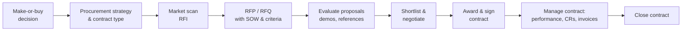

# Procurement, Contracts and Vendor Management

> **TL;DR** The contract type allocates risk: fixed price puts cost risk on the supplier (who prices it in), time and materials (T&M) leaves it with the buyer, and capped T&M, target cost and agile contracts sit in between. Fixed price only works with stable, well-specified scope. For uncertain software work, prefer T&M with strong governance, capped or phased contracts, or agile contracts such as "money for nothing, change for free". A good statement of work (SOW), measurable SLAs and a structured, weighted vendor selection matter more than legal boilerplate.

---

## 1. Procurement process

| Step | Key outputs | Tips |
|---|---|---|
| Make-or-buy | Build vs buy vs SaaS vs outsource analysis | Consider core vs context: buy commodity, build differentiators |
| Procurement strategy | Contract type, sourcing (single/multi-vendor), timeline, evaluation method | Align with risk allocation and internal capability |
| RFI (Request for Information) | Market overview, long list | Low effort for vendors; non-binding |
| RFP (Request for Proposal) | Requirements, SOW, evaluation criteria, commercial template | Ask for approach and team, not just price |
| RFQ (Request for Quotation) | Price for well-defined goods/services | Commodities, licences, hardware |
| Evaluation | Scoring, scripted demos, references, proof of concept | Weighted scoring defined **before** opening proposals |
| Negotiation | Term sheet, final terms | Negotiate on risk, team, IP, exit, not only rates |
| Contract administration | CR log, invoice approvals, performance reviews | Assign a contract manager |
| Closure | Final acceptance, release of retentions, lessons | Check obligations (warranty, transition) |

Public sector: EU procurement directives (2014/24/EU) define open, restricted, competitive dialogue, competitive procedure with negotiation, and innovation partnership procedures, with thresholds and standstill periods.

---

## 2. Contract types

### 2.1 Overview

| Type | Payment basis | Cost risk | Scope flexibility | Supplier incentive | Best for |
|---|---|---|---|---|---|
| **Fixed price (FP / FFP / lump sum)** | Agreed price for defined deliverables | Supplier (priced in as risk premium: often +20–50%) | Low — changes via CR | Minimise effort; deliver to the letter of the spec | Well-defined scope, stable requirements, repeatable work (e.g., standard rollout to another country) |
| **Fixed price per unit / per deliverable** | Price per item (report, interface, migration object, sprint) | Shared | Medium | Efficiency per unit | Parametric work; agile "price per story point" (careful) |
| **Time & materials (T&M)** | Hours/days × rate + expenses | Buyer | High | Bill more hours (mitigate with governance) | Uncertain scope, discovery, agile, staff augmentation |
| **Capped T&M (not-to-exceed)** | T&M up to a cap | Mostly supplier above cap | Medium | Finish below cap | Uncertain but bounded scope |
| **Cost-plus / cost-reimbursable** | Actual costs + fee (CPFF, CPIF, CPAF) | Buyer | High | Fee type drives incentive | R&D, government, high uncertainty |
| **Target cost / pain-gain share** | Target price; over/underrun shared by agreed ratio | Shared | Medium | Both want to beat target | Collaborative large projects (NEC4 Option C) |
| **Fixed price incentive fee (FPIF)** | Target cost + target profit + share ratio + ceiling price | Shared up to ceiling | Medium | Cost efficiency | Defence, large engineering |
| **Outcome/value-based** | Payment linked to business outcomes | Supplier (partly) | Varies | Achieve outcome | Measurable outcomes the supplier can influence |
| **Managed service / SLA-based** | Monthly fee for service levels | Supplier | Service catalogue | Meet SLAs efficiently | Application management, hosting, support |
| **Retainer / capacity** | Fixed monthly capacity (e.g., team of 6) | Buyer for output, supplier for staffing | High | Retain client | Long-running agile teams |

### 2.2 Fixed price — pros, cons, conditions

| Pros | Cons |
|---|---|
| Budget certainty (on paper) | Risk premium in price |
| Simple to compare bids | Requires detailed spec — expensive and slow upfront |
| Less buyer oversight of effort | Every change = CR, negotiation, delay; adversarial dynamic |
| | Supplier incentive to cut quality or interpret scope narrowly |
| | "Fixed price, variable scope" in practice when spec is ambiguous |

**Fixed price works when:** requirements are stable and testable, the supplier has done it before, acceptance criteria are objective, and the buyer can write a complete specification.

### 2.3 T&M — making it work

- Rate card by role; named key personnel with replacement clauses.
- Monthly budgets/forecasts and burn reports; caps per phase.
- Buyer controls backlog and priorities; supplier accountable for productivity and quality.
- Right to reduce team with notice (e.g., 2–4 weeks).
- Clear acceptance of deliverables even under T&M (DoD).
- Productivity transparency (velocity, throughput, defect rates — not as targets, as signals).

### 2.4 Phased / hybrid approaches

| Approach | Description |
|---|---|
| **Two-step (discovery + build)** | T&M or small fixed price for discovery/design; then fixed price or capped T&M for build once scope is known |
| **Fixed price per phase / stage** | Each stage priced when the previous ends (PRINCE2 stage-aligned) |
| **Fixed price per sprint/release** | Price per sprint for an agreed team; scope flexible within sprint goals |
| **Fixed budget, variable scope** | Budget and date fixed; scope prioritised by PO (DSDM style) |
| **Capped T&M with gain share** | Under-cap savings shared (e.g., 50/50) |

### 2.5 Agile contracts

**"Money for nothing, change for free"** (Jeff Sutherland, ~2008) — added to a fixed-price/fixed-scope agile contract:

| Clause | Mechanism | Benefit |
|---|---|---|
| **Change for free** | Customer may swap any unstarted backlog item for new items of equal size at no cost; priorities can change each sprint | Flexibility without CR overhead |
| **Money for nothing** | Customer may terminate early once enough value is delivered, paying a percentage (often ~20%) of the remaining contract value | Customer saves the rest; supplier gets margin without effort |
| Conditions | Customer must participate actively (PO, sprint reviews); if not, revert to T&M | Protects supplier |

Other agile contract elements:
- **Incremental delivery with acceptance per sprint/release.**
- **Termination for convenience** with short notice.
- **Scope defined as goals and product backlog**, not detailed spec.
- **Joint governance**: PO from customer, sprint reviews as acceptance points.
- **Shared risk/reward** on total release cost.
- References: *Agile Contracts* by Opelt, Gloger, Pfarl & Mittermayr (the "agile fixed price"), the agile contract primer by Arbogast, Larman & Vodde (published on less.works).

**Agile fixed price** (Opelt et al.): joint analysis phase → indicative fixed price range → checkpoint phase (first sprints validate assumptions; either side may exit) → riskshare (both bear part of overruns) → exchangeable scope.

---

## 3. Statement of Work (SOW)

### 3.1 Contents

| Section | Content |
|---|---|
| Background & objectives | Context; business objectives the work supports |
| Scope of work | Activities and services in scope |
| **Out of scope** | Explicit exclusions |
| Deliverables | Each with description, format, acceptance criteria |
| Approach & methodology | Lifecycle, ceremonies, tools |
| Schedule & milestones | Dates, dependencies |
| Roles & responsibilities | Supplier, customer (customer obligations are critical!), third parties — RACI |
| **Customer dependencies / assumptions** | E.g., key users available X days/week, environments by date, decisions within 5 days |
| Acceptance process | Review period (e.g., 10 working days), deemed acceptance, defect classification, re-test cycles |
| Staffing | Key personnel, location, travel |
| Governance & reporting | Meetings, reports, escalation |
| Change management | CR process, pricing basis |
| Commercials | Price, payment schedule (milestones), invoicing, expenses, rates for changes |
| Service levels (if applicable) | SLAs, credits |
| Warranty | Period, coverage |
| Transition/exit | Knowledge transfer, documentation |

### 3.2 SOW quality checklist

- [ ] Deliverables are nouns with acceptance criteria, not activities ("support", "assist")
- [ ] Customer obligations are specific and measurable
- [ ] Assumptions listed; consequences if wrong (CR trigger) stated
- [ ] Acceptance process with timelines and deemed acceptance
- [ ] Defect definition and warranty linked to severity levels
- [ ] Payment milestones tied to accepted deliverables, not elapsed time (for FP)
- [ ] Retention (e.g., 10%) until final acceptance or end of hypercare
- [ ] Key personnel named; replacement requires approval
- [ ] IP ownership, confidentiality, data protection (GDPR DPA) addressed in MSA or SOW
- [ ] Exit/transition assistance defined

### 3.3 Contract structure

| Document | Role |
|---|---|
| Master Services Agreement (MSA) / framework agreement | Legal terms: liability, IP, confidentiality, warranties, termination, governing law |
| SOW / work order | Specific project scope, price, deliverables |
| Data Processing Agreement (DPA) | GDPR Art. 28 processor obligations |
| SLA schedule | Service levels and credits |
| Change orders | Amendments to SOW |
| Order of precedence clause | Which document wins in conflict |

---

## 4. Service Level Agreements (SLAs)

### 4.1 SLA vs SLO vs SLI vs OLA vs UC

| Term | Meaning |
|---|---|
| SLI (indicator) | Measured value (e.g., % successful requests) |
| SLO (objective) | Target for an SLI (e.g., 99.9% monthly) |
| SLA (agreement) | Contractual commitment, with consequences (service credits) |
| OLA | Operational level agreement between internal teams |
| UC | Underpinning contract with third-party supplier |
| XLA | Experience level agreement (user experience-focused) |

SRE practice for SLIs/SLOs: [../06-cloud-architecture/README.md](../06-cloud-architecture/README.md), [../08-engineering/README.md](../08-engineering/README.md).

### 4.2 Typical SLA metrics (application management / support)

| Metric | Example target |
|---|---|
| Availability | 99.9% monthly (≈ 43 min downtime/month) during service hours |
| Incident response time | P1: 15 min; P2: 1 h; P3: 4 h; P4: next business day |
| Incident resolution / restore time | P1: 4 h; P2: 1 business day; P3: 5 days; P4: next release |
| Service request fulfilment | 95% within 3 business days |
| First-call resolution | ≥ 70% |
| Customer satisfaction | ≥ 4/5 |
| Backlog ageing | No P3 older than 30 days |

### 4.3 Availability reference

| Availability | Downtime per year | Per month (30 d) |
|---|---|---|
| 99% | 3.65 days | 7.2 h |
| 99.5% | 1.83 days | 3.6 h |
| 99.9% | 8.76 h | 43.2 min |
| 99.95% | 4.38 h | 21.6 min |
| 99.99% | 52.6 min | 4.32 min |

### 4.4 SLA design tips

- Define measurement method, period, exclusions (planned maintenance, customer-caused), and reporting.
- Service credits should hurt enough to matter but are not a substitute for good service; add termination rights for chronic failure.
- Fewer, meaningful SLAs beat dozens; beware "watermelon SLAs" (all green while users are unhappy) — add XLAs or satisfaction measures.
- Align priority definitions with business impact (and with project severity definitions for hypercare).

---

## 5. Vendor selection

### 5.1 Evaluation criteria (weighted scoring example — ERP integrator)

| Criterion | Weight | Vendor A score (1–5) | A weighted | Vendor B | B weighted | Vendor C | C weighted |
|---|---|---|---|---|---|---|---|
| Functional fit / solution approach | 25% | 4 | 1.00 | 3 | 0.75 | 4 | 1.00 |
| Industry & product experience, references | 20% | 5 | 1.00 | 3 | 0.60 | 4 | 0.80 |
| Team quality (named key people, CVs, interview) | 15% | 3 | 0.45 | 4 | 0.60 | 4 | 0.60 |
| Methodology & governance | 10% | 4 | 0.40 | 3 | 0.30 | 4 | 0.40 |
| Price / TCO | 20% | 2 | 0.40 | 5 | 1.00 | 3 | 0.60 |
| Commercial terms & risk sharing | 5% | 3 | 0.15 | 3 | 0.15 | 4 | 0.20 |
| Cultural fit, location, language | 5% | 4 | 0.20 | 3 | 0.15 | 4 | 0.20 |
| **Total** | **100%** | | **3.60** | | **3.55** | | **3.80** |

Practices:
- Fix weights before receiving proposals; score independently, then calibrate.
- Use **knockout (must-have) criteria** first: certifications, financial stability, data residency, security.
- **Scripted demos** using your own scenarios and data (not the vendor's standard demo).
- **Reference calls** with similar-size customers; ask "what would you do differently?"
- **Proof of concept** for the riskiest requirement.
- Interview the **actual proposed team**, not the sales team ("bait and switch" risk).
- Check vendor financial health and dependency (e.g., niche partner with 15 staff).
- Score price using a formula (e.g., lowest price / bid price × max points) to avoid subjectivity.

### 5.2 Software product selection specifics

| Area | Questions |
|---|---|
| Fit | % standard fit to processes; required extensions |
| Architecture | Cloud/SaaS model, multi-tenancy, extensibility, APIs, integration platform |
| Roadmap | Product roadmap, release cadence, vendor viability |
| Licensing | Model (user, transaction, revenue), tiers, price protection, minimum terms |
| Compliance | Localisation (tax, e-invoicing), certifications (ISO 27001, SOC 2), data residency |
| Ecosystem | Partner availability locally, community, talent market |
| Exit | Data export, contract termination, lock-in |

Architecture evaluation details: [../05-software-architecture/README.md](../05-software-architecture/README.md), [../11-enterprise-architecture-business/README.md](../11-enterprise-architecture-business/README.md).

---

## 6. Contract and vendor management during the project

| Activity | Practice |
|---|---|
| Performance reviews | Monthly scorecard: delivery, quality, staffing stability, responsiveness, CR fairness |
| Invoice validation | Against accepted milestones or approved timesheets |
| CR management | CR log with cumulative impact; watch for "CR farming" |
| Relationship | Joint governance, shared tools, co-location for key phases |
| Key personnel | Track turnover; enforce replacement approval and overlap |
| Dispute resolution | Escalation ladder → mediation → arbitration/litigation (last resort) |
| Multi-vendor | Integrator responsibility clear (who owns end-to-end integration and testing?) — or client acts as integrator with a strong PMO |

### Supplier scorecard (example)

| KPI | Target | Actual | RAG |
|---|---|---|---|
| Milestones met on time | ≥ 90% | 80% | 🟡 |
| Defect leakage to UAT | ≤ 15% | 22% | 🔴 |
| Key personnel turnover | 0 unplanned | 1 | 🟡 |
| CR response time (impact assessment) | ≤ 5 days | 4 days | 🟢 |
| Invoice accuracy | 100% | 100% | 🟢 |

---

## 7. Key contract clauses (non-legal checklist)

| Clause | What to check |
|---|---|
| Limitation of liability | Cap (often 100–150% of fees); exclusions (data breach, IP infringement, gross negligence) |
| Warranty | Period (e.g., 90 days after go-live), remedies |
| Acceptance | Criteria, timelines, deemed acceptance, partial acceptance |
| IP ownership | Customer owns bespoke work? Vendor retains tools/accelerators with licence to customer |
| Confidentiality & data protection | NDA terms; GDPR DPA; sub-processors |
| Termination | For cause, for convenience (notice, fees), on insolvency |
| Transition/exit assistance | Duration, cost, data return format |
| Key personnel | Named, replacement process |
| Subcontracting | Approval required |
| Change control | Process, pricing |
| Payment terms | Milestones, retention, late payment |
| Escrow | Source code escrow for critical bespoke software |
| Audit rights | Licence and security audits (both directions) |
| Governing law, jurisdiction | |
| Force majeure | |
| Non-solicitation | Staff poaching restrictions |

Always involve legal and procurement; this list is a PM-level checklist, not legal advice.

---

## When to use / when not

| Situation | Recommended contract |
|---|---|
| Standard rollout of a proven template to another country | Fixed price per country |
| Greenfield ERP with unclear processes | T&M discovery → fixed price or capped T&M for build |
| Product development, evolving backlog | T&M / capacity contract with agile governance; agile fixed price |
| Staff augmentation | T&M |
| Ongoing application support | Managed service with SLAs |
| Large collaborative program with shared risk | Target cost / alliance contract |

## Common mistakes

- Choosing fixed price for uncertain scope "to transfer risk" — the risk returns as CRs, disputes and poor quality.
- SOW full of activities ("consultant will support UAT") instead of deliverables.
- Customer obligations missing → supplier claims delays caused by customer.
- Choosing the cheapest bid with a weak team; day rate × days ≠ total cost.
- Evaluating only the sales demo; not checking the actual team.
- No exit plan; vendor lock-in discovered at renewal.
- Treating the vendor as an adversary by default; joint success requires shared incentives and governance.

## References

- Request for proposal (Wikipedia): https://en.wikipedia.org/wiki/Request_for_proposal
- Request for information (Wikipedia): https://en.wikipedia.org/wiki/Request_for_information
- Statement of work (Wikipedia): https://en.wikipedia.org/wiki/Statement_of_work
- Service-level agreement (Wikipedia): https://en.wikipedia.org/wiki/Service-level_agreement
- Fixed-price contract (Wikipedia): https://en.wikipedia.org/wiki/Fixed-price_contract
- Time and materials (Wikipedia): https://en.wikipedia.org/wiki/Time_and_materials
- Cost-plus contract (Wikipedia): https://en.wikipedia.org/wiki/Cost-plus_contract
- Make-or-buy decision (Wikipedia): https://en.wikipedia.org/wiki/Make-or-buy_decision
- Vendor lock-in (Wikipedia): https://en.wikipedia.org/wiki/Vendor_lock-in
- Source code escrow (Wikipedia): https://en.wikipedia.org/wiki/Source_code_escrow
- Large-Scale Scrum (LeSS) site, incl. agile contracts primer: https://less.works/
- Scrum Inc. (Jeff Sutherland): https://www.scruminc.com/
- NEC contracts: https://www.neccontract.com/
- Cloud architecture section: [../06-cloud-architecture/README.md](../06-cloud-architecture/README.md)
