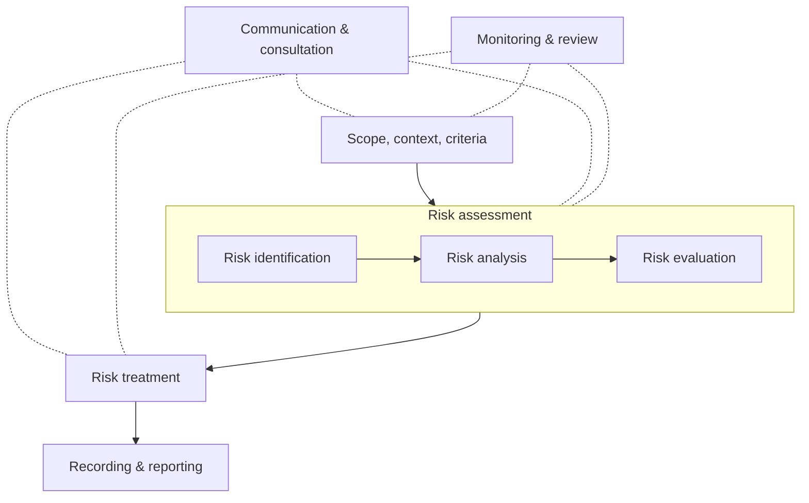
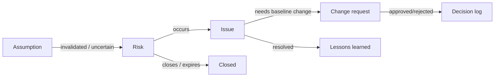

# Risk, Issue and RAID Management

> **TL;DR** A risk is an uncertain event that would affect objectives if it happened (threat or opportunity); an issue is something that has already happened. Identify risks early and continuously (pre-mortem, checklists, assumption analysis), assess them with a probability-impact matrix, assign one owner and a concrete response per risk (avoid/mitigate/transfer/accept for threats; exploit/enhance/share/accept for opportunities; escalate if outside the project's authority), and quantify the big ones (expected monetary value, Monte Carlo). ISO 31000 provides the overarching framework. Keep risks, assumptions, issues and dependencies together in a RAID log and review it weekly.

---

## 1. Core concepts

| Term | Definition | Example |
|---|---|---|
| **Risk** | Uncertain event or condition that, if it occurs, has a positive or negative effect on objectives (ISO 31000: "effect of uncertainty on objectives") | Key-user availability may drop during year-end close |
| **Threat** | Risk with negative impact | Vendor may not deliver the EDI adapter on time |
| **Opportunity** | Risk with positive impact | New SaaS release may include a standard feature we planned to build |
| **Issue** | Event that has occurred and requires action | Test environment is down for 3 days |
| **Risk cause** | Fact or condition that gives rise to risk | Only one person understands the legacy pricing logic |
| **Risk effect** | Impact on objectives | Migration rules incorrect → invoicing errors |
| **Risk appetite** | Amount of risk the organisation is willing to pursue/retain | "Low appetite for regulatory non-compliance" |
| **Risk tolerance / threshold** | Measurable limits per objective | "No go-live with > 0 open severity-1 defects" |
| **Residual risk** | Risk remaining after response | |
| **Secondary risk** | New risk created by a response | Adding a second vendor creates coordination risk |
| **Trigger** | Warning sign that a risk is about to occur | Vendor misses the design-review date |
| **Overall project risk** | Effect of uncertainty on the project as a whole | Program-level confidence of meeting the go-live date |

### Risk statement format (cause–event–effect)

> *Because of* <cause>, *there is a risk that* <uncertain event> *which would lead to* <effect on objectives>.

Example: *Because* the finance process owner is also leading year-end close, *there is a risk that* design sign-off for record-to-report is delayed by 3–4 weeks, *which would lead to* a delay to the build sprint plan and potentially the go-live.

Avoid vague risks ("resources", "budget", "communication") — they cannot be owned or acted on.

---

## 2. ISO 31000:2018 — risk management framework

Guidance standard (not certifiable) applicable to any organisation. Three parts: **principles, framework, process**.

### 2.1 Principles (8 + purpose)

Purpose: creation and protection of value. Principles: **integrated**, **structured and comprehensive**, **customised**, **inclusive**, **dynamic**, **best available information**, **human and cultural factors**, **continual improvement**.

### 2.2 Framework

Leadership and commitment at the centre; **integration, design, implementation, evaluation, improvement** around it.

### 2.3 Process

### 2.4 Related standards and methods

| Standard / method | Focus |
|---|---|
| ISO 31000:2018 | Risk management guidelines |
| IEC 31010:2019 | Risk assessment techniques (≈ 40 techniques: HAZOP, FMEA, bow-tie, Monte Carlo, Delphi…) |
| ISO Guide 73 | Risk vocabulary |
| COSO ERM (2017) | Enterprise risk management integrated with strategy and performance |
| M_o_R 4 (PeopleCert) | Management of Risk; UK |
| PMI *Standard for Risk Management in Portfolios, Programs, and Projects* | PMI risk standard |
| ISO 27005 | Information security risk |

---

## 3. Risk management process (project level)

| Step | Activities | Outputs |
|---|---|---|
| 1. Plan | Define methodology, roles, budget, categories (RBS), P/I scales, appetite, reporting | Risk management plan/approach |
| 2. Identify | Workshops, interviews, checklists, pre-mortem, assumption analysis, SWOT, RBS walk-through, lessons learned | Risk register entries |
| 3. Analyse (qualitative) | Probability and impact scoring, urgency, proximity | Prioritised register, heat map |
| 4. Analyse (quantitative) | EMV, decision trees, Monte Carlo, sensitivity | Contingency, confidence levels |
| 5. Plan responses | Strategy, actions, owner, cost, trigger, fallback | Updated register, plan/budget changes |
| 6. Implement responses | Execute actions | Action status |
| 7. Monitor | Review weekly, reassess, close, identify new | Updated register, reports, lessons |

### 3.1 Identification techniques

| Technique | How | Strength |
|---|---|---|
| Brainstorming workshop | Team + stakeholders, structured by RBS | Breadth |
| **Pre-mortem** (Gary Klein) | "Imagine it is 6 months after go-live and the project failed spectacularly. Write down why." | Overcomes optimism and groupthink; legitimises dissent |
| Checklists | Category lists from past projects | Don't forget the usual suspects |
| Assumption & constraint analysis | Each assumption: what if false? | Converts hidden assumptions into risks |
| SWOT | Strengths, weaknesses (internal); opportunities, threats (external) | Strategic view |
| Root cause / Ishikawa | Cause categories | Depth |
| Interviews / Delphi | Experts anonymously | Avoids dominance by senior voices |
| Prompt lists: PESTLE, TECOP, VUCA | External environment categories | Completeness |
| Lessons learned | Past project databases | Organisational memory |

### 3.2 Pre-mortem — facilitation script (45–60 min)

1. Brief: plan summary (5 min).
2. "It is <date after go-live>. The project has been a disaster." Everyone silently writes reasons (10 min).
3. Round-robin: each person reads one reason; scribe captures; repeat until exhausted (15 min).
4. Cluster and dot-vote top 5–10 (10 min).
5. For each top item: early warning signs and preventive actions, owner (15 min).
6. Add to risk register; revisit at next stage gate.

### 3.3 Risk Breakdown Structure (RBS) — IT project example

| Level 1 | Level 2 examples |
|---|---|
| Technical | Requirements, technology maturity, integrations, performance, data quality, security, environments |
| External | Vendors, regulation, market, legal, currency, pandemic/force majeure |
| Organisational | Sponsorship, priorities, resources, funding, other projects, culture, works council |
| Project management | Estimation, planning, control, communication, governance |
| Commercial | Contract terms, vendor viability, licensing, pricing |
| People/change | Adoption, skills, resistance, key-person dependency |

---

## 4. Qualitative analysis

### 4.1 Probability and impact scales (example)

| Score | Probability | Schedule impact | Cost impact | Scope/quality impact |
|---|---|---|---|---|
| 1 Very low | < 10% | < 1 week | < 1% of budget | Barely noticeable |
| 2 Low | 10–30% | 1–2 weeks | 1–3% | Minor areas affected |
| 3 Medium | 30–50% | 2–4 weeks | 3–5% | Major areas affected, workaround |
| 4 High | 50–70% | 1–2 months | 5–10% | Unacceptable to sponsor |
| 5 Very high | > 70% | > 2 months / go-live missed | > 10% | Product effectively useless |

Score impact as the **highest** across dimensions. Some organisations use non-linear impact scales (1, 2, 4, 8, 16) to emphasise severe impacts.

### 4.2 Probability-impact matrix (5×5)

| Probability ↓ / Impact → | 1 Very low | 2 Low | 3 Medium | 4 High | 5 Very high |
|---|---|---|---|---|---|
| **5 Very high** | 5 🟨 | 10 🟨 | 15 🟥 | 20 🟥 | 25 🟥 |
| **4 High** | 4 🟩 | 8 🟨 | 12 🟨 | 16 🟥 | 20 🟥 |
| **3 Medium** | 3 🟩 | 6 🟨 | 9 🟨 | 12 🟨 | 15 🟥 |
| **2 Low** | 2 🟩 | 4 🟩 | 6 🟨 | 8 🟨 | 10 🟨 |
| **1 Very low** | 1 🟩 | 2 🟩 | 3 🟩 | 4 🟩 | 5 🟨 |

Thresholds (example): **1–4 green** (monitor), **5–12 amber** (active response, PM-level), **15–25 red** (response mandatory, report to steering committee). Use the same grid for opportunities (mirror image).

### 4.3 Additional dimensions

| Dimension | Use |
|---|---|
| Proximity / urgency | When could it occur? Near-term risks first |
| Detectability | How early can we see it coming? (FMEA: RPN = Severity × Occurrence × Detection) |
| Manageability | Can we influence it? |
| Connectivity | Linked risks; risk clusters |
| Strategic impact | Effect on benefits beyond the project |

### 4.4 Limitations of heat maps

- Ordinal scores multiplied produce false precision ("12" vs "10").
- Range compression: very different risks get the same score.
- Ignore correlations between risks.
- Use them for prioritisation and communication; use quantitative methods for contingency.

---

## 5. Quantitative analysis

### 5.1 Expected Monetary Value (EMV)

EMV = Probability × Impact (impact negative for threats, positive for opportunities).

| Risk | P | Impact | EMV |
|---|---|---|---|
| R1 Interface vendor late | 40% | −€60,000 | −€24,000 |
| R2 Data quality worse than assumed | 50% | −€80,000 | −€40,000 |
| R3 Standard feature in new release replaces custom build | 30% | +€30,000 | +€9,000 |
| **Contingency estimate (sum)** | | | **−€55,000** |

Sum of EMVs is a simple contingency estimate; Monte Carlo is better when risks are few and large (EMV of a 10% chance of €1M is €100k, but the outcome is either €0 or €1M).

### 5.2 Decision tree example

Choice: build custom integration (€100k, 30% chance of +€50k overrun) vs buy middleware (€130k, 10% chance of +€20k).

| Option | EMV cost |
|---|---|
| Build | 100 + 0.3 × 50 = €115k |
| Buy | 130 + 0.1 × 20 = €132k |

Build has the lower expected cost; buy has lower variance. Consider risk appetite and strategic factors (maintainability, skills).

### 5.3 Monte Carlo for schedule and cost

1. Assign distributions (three-point, triangular, PERT, lognormal) to durations/costs.
2. Add risk events (probability + impact distribution) to specific activities.
3. Model correlations between related estimates.
4. Run 5,000–10,000 iterations.
5. Read off P50/P80/P90; set contingency = P80 − deterministic estimate (or chosen confidence).
6. Use tornado/sensitivity charts to find the drivers; target responses there.

See [planning-and-scheduling.md](planning-and-scheduling.md#27-monte-carlo-forecasting) for a code example.

---

## 6. Risk responses

### 6.1 Strategies

| For threats | Description | Example |
|---|---|---|
| **Escalate** | Outside project scope or PM authority → hand to program/portfolio/sponsor | Group-wide license policy blocks cloud deployment |
| **Avoid** | Eliminate the threat (change plan, scope, approach) | Drop the custom warehouse module; use standard |
| **Transfer** | Shift impact/ownership to third party (doesn't remove the risk) | Fixed-price contract, insurance, warranty, performance bond |
| **Mitigate** | Reduce probability and/or impact | Early prototype of the risky integration; data cleansing starting now |
| **Accept** — active | Acknowledge; set aside contingency, define fallback plan | Contingency of 2 weeks for UAT |
| **Accept** — passive | Acknowledge; deal with it if it occurs | Low-score risks |

| For opportunities | Description | Example |
|---|---|---|
| **Escalate** | Beyond project authority | Opportunity to reuse design for other countries |
| **Exploit** | Ensure the opportunity happens | Assign best architect to secure an earlier standard-feature adoption |
| **Enhance** | Increase probability and/or impact | Join vendor's early adopter program |
| **Share** | Partner with a party better able to capture it | Joint development with another business unit; gain-share contract |
| **Accept** | Take it if it comes | |

PRINCE2 uses: avoid, reduce, fallback, transfer, share, accept (threats); exploit, enhance, share, reject (opportunities).

### 6.2 Response quality checklist

- [ ] Appropriate to the significance of the risk
- [ ] Cost-effective (response cost < expected value reduction)
- [ ] Realistic and achievable
- [ ] Timely (before the trigger)
- [ ] Agreed by all parties involved
- [ ] **One** named owner (a person, not a team), plus action owners
- [ ] Trigger condition defined
- [ ] Fallback/contingency plan for high risks
- [ ] Secondary and residual risks assessed

### 6.3 Contingency vs fallback

- **Contingency plan:** actions executed if the trigger occurs.
- **Fallback plan:** actions if the contingency plan itself fails or is ineffective.

---

## 7. Risk register

### 7.1 Fields

| Field | Description |
|---|---|
| ID | R-001 |
| Date raised / raised by | |
| Category | From RBS |
| Risk statement | Cause–event–effect |
| Type | Threat / opportunity |
| Probability (1–5) | Pre-response |
| Impact (1–5) | Pre-response; dimension |
| Score / RAG | P × I |
| Proximity | Date window |
| Owner | One person |
| Response strategy | Avoid / mitigate / transfer / accept / escalate … |
| Actions | Specific, with action owners and due dates |
| Trigger | Early warning sign |
| Residual P / I / score | Post-response |
| Contingency (time/cost) | Reserved amount |
| Status | Open / monitoring / occurred (→ issue) / closed |
| Last reviewed | Date |

### 7.2 Example entries

| ID | Risk | P | I | Score | Owner | Response | Actions | Trigger | Residual |
|---|---|---|---|---|---|---|---|---|---|
| R-01 | Because legacy customer data has duplicates and missing VAT IDs, data may fail validation at migration, leading to delayed invoicing at go-live | 4 | 4 | 16 🟥 | Data owner (Sales Ops) | Mitigate | Start cleansing in month 2; data quality dashboard; mock load 1 by month 4 | Mock 1 error rate > 5% | 2×4 = 8 |
| R-02 | Because the e-invoicing provider is new to our country, its connector may not be certified in time, delaying go-live | 3 | 5 | 15 🟥 | Procurement lead | Transfer + mitigate | Contract SLA with penalties; identify alternative provider; certification milestone | Certification not started by month 5 | 2×5 = 10 |
| R-03 | Because key users also run year-end close, they may be unavailable for UAT in January | 4 | 3 | 12 🟨 | Business sponsor | Avoid | Move UAT to November; backfill with temp staff | — | 1×3 = 3 |
| R-04 | Vendor's next release may include standard intercompany automation, saving custom build | 3 | 3 | 9 🟨 | Solution architect | Enhance | Join preview program; design for replaceability | Release notes published | — |

Full template: [templates.md](templates.md#3-risk-register).

---

## 8. Issue management

### 8.1 Issue types (PRINCE2)

| Type | Description | Route |
|---|---|---|
| **Request for change** | Proposal to change a baseline | Change control (see [governance-communication-and-quality.md](governance-communication-and-quality.md#5-change-control)) |
| **Off-specification** | Something that should be provided isn't, or doesn't meet spec | Concession or fix |
| **Problem/concern** | Any other issue | PM resolves or escalates |

### 8.2 Issue log fields

| Field | Description |
|---|---|
| ID, date, raised by | |
| Description | What happened; evidence |
| Type | Problem, change request, off-spec, decision needed |
| Priority / severity | Critical / high / medium / low |
| Impact | On time, cost, scope, quality, benefits, risk |
| Owner | Person responsible for resolution |
| Actions & due date | |
| Escalation level | Team / PM / steering committee |
| Status | Open / in progress / escalated / resolved / closed |
| Resolution | What was done; link to decision log |

### 8.3 Issue priority matrix

| | Low urgency | High urgency |
|---|---|---|
| **High impact** | Plan resolution; schedule into next stage/sprint | Resolve now; escalate if beyond tolerance |
| **Low impact** | Batch; maybe accept | Quick fix; delegate |

### 8.4 Escalation rules (example)

| Condition | Escalate to | Within |
|---|---|---|
| Blocks team > 1 day, solvable within project | PM | Same day |
| Forecast breach of stage tolerance (time > 2 weeks, cost > 5%) | Sponsor / steering committee via exception report | 2 working days |
| Affects other projects / enterprise policy | Portfolio board / PMO | Next board |
| Contractual dispute | Contract managers, then executive sponsors (per contract escalation clause) | Per contract |

---

## 9. RAID log

Single register combining four lists — used in most consulting engagements and steering-committee packs.

| Element | Meaning | Key fields |
|---|---|---|
| **R** Risks | Might happen | P, I, owner, response, trigger |
| **A** Assumptions (or Actions) | Believed true / things to do | Owner, validation date, impact if false |
| **I** Issues | Happening now | Severity, owner, resolution date |
| **D** Dependencies (or Decisions) | Relying on / relied upon | Provider, consumer, due date, status |

Variants: **RAIDD** (adds Decisions), **RAAIDD**, **ROAM** (SAFe: Resolved, Owned, Accepted, Mitigated — for PI planning risks).

### 9.1 RAID review cadence

| Forum | Frequency | Scope |
|---|---|---|
| Team stand-up | Daily | Blockers (issues) |
| PM/workstream leads | Weekly | Full RAID review, new items, overdue actions |
| Steering committee | Monthly | Top 5–10 risks, escalated issues, decisions needed |
| Stage gate | Per stage | Full reassessment, contingency status |

### 9.2 Lifecycle between logs

---

## 10. Risk in agile delivery

| Practice | How it reduces risk |
|---|---|
| Short iterations | Limit the size of any wrong bet |
| Risk-adjusted backlog | Prioritise risky items early (spikes, walking skeleton) |
| Definition of Done | Prevents hidden quality debt |
| Sprint review / demos | Validates requirements early |
| Retrospectives | Detects process risk |
| Continuous integration/delivery | Integration risk addressed daily |
| ROAM board in PI planning | Makes cross-team risks visible |
| Risk burndown chart | Plots total risk exposure over sprints |

See [../04-agile-kanban-scrum/README.md](../04-agile-kanban-scrum/README.md) and [../08-engineering/README.md](../08-engineering/README.md).

---

## 11. Typical risks in software/ERP projects

| Risk | Typical response |
|---|---|
| Unclear or changing requirements | Fit-to-standard workshops, prototypes, change control, MoSCoW |
| Key-user unavailability | Backfill budget, formal secondment agreements, sponsor commitment |
| Data quality | Early profiling, cleansing owners, multiple mock loads |
| Integration complexity | Early proof of concept, interface contracts, integration test environment |
| Customisation creep | Design authority, "standard first" principle, CR cost visibility |
| Vendor resource turnover | Contract named key personnel, knowledge base, overlap periods |
| Performance at volume | Performance testing with production-like data |
| Cutover window too short | Rehearsals, timing measurement, delta loads |
| Adoption/resistance | Change management, champions network, training in context |
| Scope/time/budget fixed simultaneously | Make trade-offs explicit, contingency, phasing |
| Single point of knowledge | Pairing, documentation, cross-training |
| Regulatory deadline | Early compliance checks, legal review, buffer |

## When to use / when not

- Use the full process (quantitative analysis, Monte Carlo) for large, high-uncertainty or contractually exposed projects.
- For small projects, a top-10 risk list reviewed weekly is enough.
- Don't create 200-line risk registers no one reads; quality over quantity.

## Common mistakes

- Risk register created at initiation and never updated ("risk theatre").
- Issues logged as risks (and vice versa).
- Generic risks with no cause or effect.
- Owners are teams, vendors, or "PM" for everything.
- Responses are "monitor" for every risk.
- Ignoring opportunities completely.
- No contingency linked to risk analysis; contingency set as a flat percentage without reasoning.
- Hiding red risks from the steering committee to avoid "bad news" — destroys trust when they materialise.

## References

- ISO 31000 Risk management (ISO): https://www.iso.org/iso-31000-risk-management.html
- ISO 31000 (Wikipedia): https://en.wikipedia.org/wiki/ISO_31000
- Risk management (Wikipedia): https://en.wikipedia.org/wiki/Risk_management
- Risk matrix (Wikipedia): https://en.wikipedia.org/wiki/Risk_matrix
- Risk register (Wikipedia): https://en.wikipedia.org/wiki/Risk_register
- Pre-mortem (Wikipedia): https://en.wikipedia.org/wiki/Pre-mortem
- Expected value (Wikipedia): https://en.wikipedia.org/wiki/Expected_value
- Decision tree (Wikipedia): https://en.wikipedia.org/wiki/Decision_tree
- Monte Carlo method (Wikipedia): https://en.wikipedia.org/wiki/Monte_Carlo_method
- Failure mode and effects analysis (Wikipedia): https://en.wikipedia.org/wiki/Failure_mode_and_effects_analysis
- Ishikawa diagram (Wikipedia): https://en.wikipedia.org/wiki/Ishikawa_diagram
- SWOT analysis (Wikipedia): https://en.wikipedia.org/wiki/SWOT_analysis
- COSO: https://www.coso.org/
- PMI: https://www.pmi.org/
- Gary Klein, "Performing a Project Premortem", *Harvard Business Review* (2007): https://hbr.org/2007/09/performing-a-project-premortem
