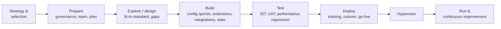
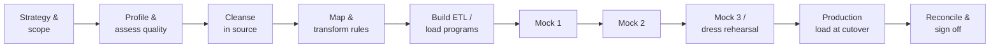
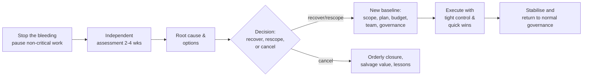

# Software and ERP Project Delivery

> **TL;DR** ERP and enterprise software projects fail less often on technology than on scope, data, people and cutover. Use the vendor methodology (SAP Activate, Microsoft Success by Design) for structure, apply "fit-to-standard" ruthlessly, start data migration on day one with multiple mock loads, rehearse the cutover until it fits the window, decide go-live on objective criteria, and resource hypercare properly. Big IT projects overrun because of optimism and poor up-front thinking (Flyvbjerg: "think slow, act fast"); recovery starts with an honest re-baseline. Tool choice matters less than consistent use.

---

## 1. ERP implementation methodologies

### 1.1 SAP Activate

SAP's implementation framework for S/4HANA (cloud and on-premise) and other SAP products, combining SAP Best Practices (pre-configured content), guided configuration, and an agile-flavoured method. Accessed via the SAP Activate Roadmap Viewer.

| Phase | Purpose | Key deliverables / activities |
|---|---|---|
| **Discover** | Understand the solution and value; build the case | Trial system, value assessment, implementation strategy, business case |
| **Prepare** | Initiate and plan the project | Project charter, plan, team onboarding, system provisioning (starter system), governance, transition approach (new implementation, system conversion, selective data transition) |
| **Explore** | Fit-to-standard analysis | Fit-to-standard workshops with best-practice processes, delta (gap) requirements, backlog, design for extensions/integrations, data migration design |
| **Realize** | Build and test incrementally | Configuration in sprints, extensions, integrations, data migration loads, unit/string tests, integration testing, UAT, training preparation |
| **Deploy** | Prepare for and execute go-live | Production readiness, end-user training, cutover rehearsal, go-live, hypercare |
| **Run** | Operate and improve | Operations, continuous improvement, upgrades/innovation adoption |

Quality gates sit at phase transitions. Workstreams run across phases (project management, solution adoption, customer team enablement, application design & configuration, extensibility, integration, data management, testing, technical architecture & infrastructure, operations & support).

**Clean core** principle (SAP, especially for S/4HANA Cloud): keep the standard core unmodified; build extensions side-by-side (SAP BTP) or via released APIs, so upgrades stay cheap.

### 1.2 Microsoft Dynamics 365: Sure Step → Success by Design

| Method | Status | Structure |
|---|---|---|
| **Sure Step** (legacy) | Older Dynamics methodology (AX, NAV, CRM) | Phases: Diagnostic, Analysis, Design, Development, Deployment, Operation; project types (Standard, Enterprise, Rapid, Agile, Upgrade) |
| **Success by Design** | Current Microsoft framework for Dynamics 365, documented in the Dynamics 365 Implementation Guide on Microsoft Learn | Stages: **Strategize, Initiate, Implement, Prepare, Operate**; review-based approach with FastTrack architects for eligible customers |

Success by Design reviews (examples): solution blueprint review (early, holistic design review), and topic-specific reviews (data migration, integration, performance, security, ALM, testing, go-live readiness). It is not a full project method; partners combine it with their own delivery methodology (often agile/hybrid).

Business Central (SMB) projects often use lighter, partner-specific methods (rapid implementation, configuration packages, RapidStart).

### 1.3 Other vendor/partner methods

| Vendor | Method |
|---|---|
| Oracle | Oracle Unified Method (OUM); Oracle Cloud Success Navigator |
| Infor | Infor Deployment Methodology / Agile Deployment Methodology |
| Workday | Workday Deployment methodology (Plan, Architect, Configure & Prototype, Test, Deploy) |
| Odoo | Partner-driven, lightweight phases |

### 1.4 Generic ERP lifecycle and the hybrid model

| Element | Predictive | Agile |
|---|---|---|
| Governance, budget, milestones | ✓ | |
| Design (fit-to-standard) | Timeboxed workshops per process area | Iterative refinement |
| Build/configuration | | Sprints with demos to key users |
| Integrations | Specs agreed early (contracts with other systems) | Build iteratively |
| Data migration | Planned mock cycles (predictive) | |
| Testing | SIT/UAT phases (V-model) | Continuous testing within sprints |
| Training, cutover | Predictive, detailed | |

### 1.5 Fit-to-standard vs fit-gap

| Fit-gap (traditional) | Fit-to-standard (modern) |
|---|---|
| Starts from current (as-is) processes; documents gaps | Starts from standard best-practice processes demoed in a system |
| Many gaps → customisations | Gaps challenged: "Is this a true differentiator or habit?" |
| Long requirement documents | Backlog of deltas with business justification |

**Gap resolution options (preferred order):** 1) change the process to the standard; 2) configuration; 3) standard add-on / ISV solution; 4) workflow/low-code extension; 5) side-by-side extension; 6) core modification (avoid).

**Design authority** decides all gaps above configuration level, recording cost and rationale.

### 1.6 Deployment strategies

| Strategy | Description | Pros | Cons |
|---|---|---|---|
| **Big bang** | All sites/modules go live at once | Single cutover, no temporary interfaces, faster benefits | High risk; massive training and support load |
| **Phased by module** | E.g., finance first, then supply chain | Lower risk per step | Temporary interfaces to legacy; longer overall |
| **Phased by site/country (waves)** | Pilot site then rollout waves | Learn from pilot; template refined | Long duration; template drift |
| **Parallel run** | Old and new systems run simultaneously | Safety net; comparison | Double work for users; reconciliation burden; rarely practical for ERP |
| **Pilot** | One site/unit first | Real-world validation | Pilot site may not be representative |

### 1.7 Key ERP roles

| Role | Responsibility |
|---|---|
| Executive sponsor | Accountable; resolves cross-functional conflicts |
| Program/project manager (client) | Overall delivery, governance |
| Partner/SI engagement manager & PM | Supplier delivery |
| Solution architect | End-to-end design integrity |
| Process owners (business) | Own design decisions and sign-off per process (O2C, P2P, R2R…) |
| Key users / super users | Design input, testing, training others, first-line support after go-live |
| Functional consultants | Configuration, design |
| Technical/integration consultants | Extensions, interfaces |
| Data migration lead & data owners | Strategy, cleansing, reconciliation |
| Test manager | Test strategy, SIT/UAT management |
| Change & training lead | Adoption, communication, training |
| IT operations / AMS | Environments, transition to support |

**Rule:** backfill key users. Business staff asked to do a full-time job plus 50% ERP project work deliver neither well.

---

## 2. Data migration

### 2.1 Principles

- Data migration is a **project within the project**: start in the first month, not after build.
- The **business owns the data** (quality, rules, sign-off); IT/vendor own the tooling and process.
- Migrate **only what is needed**: master data + open items + balances; archive history in a read-only store.
- Rehearse until boring: **at least 3 mock loads**, the last one a full dress rehearsal in a production-like environment with timings.

### 2.2 Migration lifecycle

### 2.3 Data objects and sequence

| Type | Examples | Typical load order |
|---|---|---|
| Configuration / reference data | Company codes, currencies, tax codes, units, payment terms | 1 (often transported, not migrated) |
| Master data | Chart of accounts, customers, vendors, materials/items, BOMs, routings, price lists, employees | 2 |
| Open transactional data | Open sales/purchase orders, open AR/AP items, stock on hand, open production orders, fixed assets | 3 |
| Balances | GL balances (period-end), asset values | 4 |
| Historical data | Closed transactions | Usually **not** migrated — archive / data warehouse |

### 2.4 Migration plan contents

- Scope: objects, entities, volumes, history cut-off
- Source systems and owners
- Approach per object: automatic load, manual entry (low volume), or not migrated
- Tools (e.g., SAP Migration Cockpit, Dynamics 365 Data management framework/data entities, ETL tools)
- Data quality rules and cleansing responsibilities
- Mapping specifications (field-level), value mapping tables (e.g., old → new payment terms)
- Mock load schedule with entry/exit criteria
- Reconciliation approach per object: record counts, control totals (sum of AR open items, stock value), sample checks, business validation
- Cutover sequence and timings, delta/catch-up strategy
- Archive strategy for legacy data, legal retention requirements
- Sign-off roles (data owners)

### 2.5 Mock load targets (example)

| Mock | Scope | Target |
|---|---|---|
| Mock 1 | Master data, subset | Process works end-to-end; error rate measured (often 10–30%) |
| Mock 2 | All objects, full volume | ≥ 95–98% records loaded; reconciliation tested; timings measured |
| Mock 3 / dress rehearsal | Full cutover simulation | ≥ 99.5% loaded, 100% financial balances reconciled, within cutover window, sign-offs rehearsed |

### 2.6 Common data migration mistakes

- Starting late; assuming legacy data is clean.
- No business owner per data object.
- Migrating years of history "just in case".
- No reconciliation design until the last mock.
- Cleansing in staging tables instead of the source (dirty data reappears in the next extract).
- Data freeze windows not agreed with the business.

Data architecture detail: [../07-data-ai-architecture/README.md](../07-data-ai-architecture/README.md).

---

## 3. Cutover planning

### 3.1 What cutover is

The controlled transition from legacy to new system: final data loads, configuration, integration switch-over, legacy freeze, business transactions catch-up, and go/no-go. Cutover plan = minute-by-minute runbook.

### 3.2 Cutover phases

| Phase | Timing | Activities |
|---|---|---|
| Preparation | T−8 to T−2 weeks | Cutover plan v1, rehearsals, production environment build, user access set-up, master data pre-load, communications to customers/suppliers |
| Pre-cutover | T−2 weeks to T−1 day | Change freeze, legacy cleanup, final master data load, open item preparation, period-end close in legacy, go/no-go readiness review |
| Cutover execution | T−0 (weekend / blackout) | Legacy freeze/read-only, final extracts, transactional loads, reconciliation, integration switch, smoke tests, business validation |
| Go/no-go decision | End of execution | Final decision against criteria; point of no return |
| Go-live & catch-up | T+0 to T+5 days | Users start; backlog of transactions entered during the blackout; hypercare starts |

### 3.3 Cutover runbook columns

| ID | Task | Owner | Backup | Predecessor | Planned start | Duration | Planned end | Actual start | Actual end | Status | Verification/sign-off | Notes / rollback step |
|---|---|---|---|---|---|---|---|---|---|---|---|---|

Rules:
- Every task has an owner **and** a backup (people get sick on go-live weekends).
- Times measured in rehearsals, not guessed.
- Define the **point of no return** and rollback steps before it.
- Command centre (war room), call bridge, check-in times (e.g., every 2 h), escalation contacts including vendor 24/7 support.

### 3.4 Go/no-go criteria (example)

| Area | Criterion | Owner |
|---|---|---|
| Testing | UAT signed off; 0 open sev 1/2; regression passed | Test manager / process owners |
| Data | Mock 3 reconciled; final load reconciled within thresholds | Data owners |
| Cutover | Dress rehearsal completed within window | Cutover manager |
| Integrations | All interfaces tested end-to-end with partners (banks, EDI, carriers) | Integration lead |
| Infrastructure | Production sized, monitored, backups and DR tested | IT ops |
| Security | Roles and access provisioned; SoD reviewed | Security / GRC |
| Users | ≥ 90% of end users trained; key users ready on site | Change lead |
| Support | Hypercare team, service desk scripts, escalation paths, vendor support confirmed | Support lead |
| Business | Business continuity plan; contingency for critical processes (manual shipping, invoicing) | Process owners |
| Legal / compliance | Tax/e-invoicing registration, statutory requirements | Finance |
| Rollback | Rollback plan documented and decision deadline set | Cutover manager |

Decision formats: **Go**, **Go with conditions** (documented accepted risks, owners), **No-go** (with re-plan date).

### 3.5 Go-live checklist

- [ ] Go/no-go meeting held; decision and conditions recorded in decision log
- [ ] Legacy system set to read-only / access removed for transactional users
- [ ] Final data loads completed and reconciled; sign-offs received
- [ ] Interfaces switched to production endpoints; certificates/credentials valid
- [ ] Batch jobs / schedules activated
- [ ] Number ranges, periods open, exchange rates loaded
- [ ] Printers, labels, forms, e-mail outputs tested in production
- [ ] User access verified (sample login per role)
- [ ] Smoke tests per critical process (create order → ship → invoice → post payment)
- [ ] Monitoring and alerting active
- [ ] Hypercare rota and war room in place
- [ ] Communication sent: "We are live" + support contacts + known limitations
- [ ] Customers/suppliers informed of any changes (bank details, EDI, invoice formats)
- [ ] Rollback window and criteria still monitored until point of no return passes

Template: [templates.md](templates.md#8-cutover-and-go-live-checklist).

---

## 4. Hypercare

### 4.1 Definition

An intensified support period after go-live (typically **2–8 weeks** for ERP; until KPIs stabilise) with the project team still engaged, before handover to normal support (BAU/AMS).

### 4.2 Hypercare organisation

| Element | Practice |
|---|---|
| War room / command centre | Physical or virtual; project leads, key users, vendor experts |
| Floor walkers / super users | On site in warehouses, finance, customer service |
| Triage | Single intake (service desk/ticket tool); classify incident vs training issue vs change request |
| Daily stand-up | 2× daily first week, daily later: top issues, KPIs |
| KPIs monitored | Orders shipped/day, invoices posted, interface errors, backlog of open tickets, period-end close progress, user log-ins |
| Communications | Daily status to management; known-issues list and workarounds to users |
| Change freeze | Only emergency fixes; batch non-urgent changes |

### 4.3 Exit criteria (handover to BAU)

- Open incident count below threshold and stable/declining for ≥ 2 weeks
- No open sev 1; sev 2 with agreed plan
- First period-end close completed successfully
- Business KPIs back to (or above) pre-go-live baseline
- Knowledge transfer to support organisation complete; runbooks and documentation handed over
- Support SLA in effect; vendor AMS contract active
- Formal sign-off by sponsor/process owners

### 4.4 Common hypercare mistakes

- Releasing consultants on go-live day +3 to save money.
- No distinction between defects, training gaps, and new requirements — the CR backlog explodes.
- No business KPI monitoring (system "works" but orders aren't shipping).
- Underestimating the first month-end close.

---

## 5. Release management

### 5.1 Concepts

| Term | Meaning |
|---|---|
| Release | Set of changes deployed together into production |
| Deployment | Technical act of installing a release in an environment |
| Release management | Planning, scheduling, controlling releases through environments (ITIL 4 practice) |
| Change enablement (ITIL 4) | Assessing and authorising changes (standard, normal, emergency); CAB as needed |
| Release train | Fixed cadence releases (e.g., every 2 weeks, every PI) |
| Feature toggles | Decouple deployment from release |

### 5.2 Release types

| Type | Example |
|---|---|
| Major | New modules, upgrades, process changes; full regression, training |
| Minor | Enhancements; targeted regression |
| Patch / hotfix | Defect fixes; emergency change process |
| Vendor release (SaaS) | Mandatory updates (e.g., Dynamics 365 service updates, SAP S/4HANA Cloud releases) — regression testing window required; automate tests |

### 5.3 Release readiness checklist

- [ ] Scope frozen; release notes drafted
- [ ] All items meet DoD; regression passed
- [ ] Change record approved (CAB/change authority) where required
- [ ] Deployment runbook and rollback plan
- [ ] Downtime communicated; maintenance window booked
- [ ] Support briefed; knowledge articles updated
- [ ] Monitoring/alerts for new functionality
- [ ] Post-deployment verification steps defined

### 5.4 Environment strategy (typical ERP)

| Environment | Purpose |
|---|---|
| Sandbox / prototype | Fit-to-standard demos, experimentation |
| DEV | Configuration and development |
| TEST / QA | SIT, regression |
| UAT / pre-production | UAT, training, dress rehearsals (production-like data volume) |
| TRAINING | End-user training (refreshable) |
| PROD | Production |

Engineering practices (CI/CD, branching, DORA metrics): [../08-engineering/README.md](../08-engineering/README.md). Cloud environments: [../06-cloud-architecture/README.md](../06-cloud-architecture/README.md).

---

## 6. Why IT projects fail

### 6.1 Standish Group CHAOS report

Since 1994 the Standish Group publishes the CHAOS report classifying software projects as **successful** (on time, on budget, with required features — later redefined around "on time, on budget, satisfactory result"), **challenged** (late, over budget, and/or reduced features), or **failed** (cancelled or never used). Headlines often cited: in 1994 roughly 16% successful, 53% challenged, 31% failed; later editions report around 30% successful and higher success for small and agile projects.

Frequently cited success factors (vary per edition): executive sponsorship, emotional maturity, user involvement, optimisation (small scope), skilled resources, standard architecture, agile process, modest execution, project management expertise, clear business objectives.

**Critique:**
- Methodology and data not public; sample not representative (projects reported to Standish, possibly biased toward problems) — Jørgensen & Moløkken-Østvold (2006), Glass (2006), Eveleens & Verhoef (2010, *IEEE Software*: "The Rise and Fall of the Chaos Report Figures").
- Measures conformance to the **initial estimate**, not value — a project with an over-optimistic estimate is "challenged" by definition.
- Definitions changed over time, making trend comparisons unreliable.
- **Takeaway:** use CHAOS as a conversation starter, not as evidence; directionally, smaller projects and incremental delivery succeed more often.

### 6.2 Flyvbjerg — *How Big Things Get Done* (2023, with Dan Gardner)

Based on a database of 16,000+ projects across 136 countries:
- Only **8.5%** of projects hit both cost and schedule targets; only **0.5%** hit cost, schedule *and* benefits.
- **IT projects have fat tails**: a significant share overrun cost by very large factors (≥ 50%), unlike a normal distribution; averages hide catastrophic outliers ("black swans").
- **Iron law of megaprojects**: over budget, over time, under benefits, over and over again.

Key lessons:

| Lesson | Meaning |
|---|---|
| **Think slow, act fast** | Invest in planning (cheap, reversible) to shorten delivery (expensive, irreversible); delivery is when windows for disaster open |
| **Think from right to left** | Start from the goal/"why" and work backwards to the solution (cf. Amazon working backwards) |
| **Pixar planning** | Iterate plans through simulation, prototypes, experiments ("Experiri") until they're right |
| **Get experienced people** | Experienced leaders and teams; "masterbuilders" |
| **Use reference class forecasting** | Outside view; adjust estimates to the distribution of similar projects |
| **Modularity** | Build with repeatable, small units ("Lego") — like solar/wind farms; enables learning curves and scaling |
| **Know your biggest risk is you** | Behavioural biases (optimism, uncertainty, power) and strategic misrepresentation |
| **Watch the black swans** | Mitigate fat-tail risks explicitly (avoid them, not just plan contingency) |
| **Build a team** | Shared identity, aligned incentives |

### 6.3 Planning fallacy and related biases

| Concept | Source | Implication |
|---|---|---|
| Planning fallacy | Kahneman & Tversky (1979) | People underestimate time/cost of their own tasks even knowing past overruns → use outside view |
| Optimism bias | Kahneman, Lovallo | Overestimate benefits, underestimate costs |
| Strategic misrepresentation | Flyvbjerg | Deliberate underestimation to win approval |
| Sunk cost fallacy | — | Continuing failing projects because of past investment → stage gates with real kill options |
| Escalation of commitment | Staw (1976) | Increasing investment in failing course of action |
| Hofstadter's law, Parkinson's law, student syndrome | — | See [planning-and-scheduling.md](planning-and-scheduling.md) |

### 6.4 Brooks's law and *The Mythical Man-Month*

Key ideas (Fred Brooks, 1975; anniversary edition 1995):
- Adding people to a late project makes it later (ramp-up + communication overhead).
- Man-months are not interchangeable with months for tasks with sequential constraints ("nine women can't make a baby in one month").
- **Second-system effect**: designers over-engineer the successor to a successful system.
- **Plan to throw one away** (later moderated by Brooks in favour of incremental development).
- **Conceptual integrity** — architecture by a small group.
- *No Silver Bullet* (1986): no single technology gives an order-of-magnitude productivity gain; essential vs accidental complexity.

Laws and mental models: [../10-laws-principles-mental-models/README.md](../10-laws-principles-mental-models/README.md).

### 6.5 Typical root causes in ERP/IT projects

| Root cause | Symptoms | Prevention |
|---|---|---|
| Unclear objectives / weak business case | Scope wars, no prioritisation basis | Business case with measurable benefits, sponsor ownership |
| Weak or absent sponsorship | Decisions delayed, conflicts unresolved | Active executive sponsor; steering committee with decisions |
| Over-customisation | Rising cost, upgrade pain, testing explosion | Fit-to-standard, design authority, clean core |
| Underestimated data migration | Late mocks, go-live delays | Start day one, business ownership, 3+ mocks |
| Insufficient business involvement | Late UAT surprises, low adoption | Backfilled key users; demos per sprint |
| Optimistic plan | Continuous slippage | RCF, Monte Carlo, buffers, independent estimate |
| Change management neglected | Resistance, workarounds, shadow Excel | Change plan, champions, training in context |
| Vendor-client misalignment | CR disputes, blame | Clear SOW, joint governance, aligned incentives |
| Testing squeezed | Defects in production | Fixed test windows, quality gates, test automation |
| Big bang with no rehearsal | Go-live chaos | Dress rehearsals, go/no-go criteria, rollback plan |
| Watermelon reporting | Sudden red status | Objective RAG, independent assurance, psychological safety |

---

## 7. Project recovery

### 7.1 Warning signs

- Repeated milestone slips; re-baselining more than once
- CPI/SPI < 0.85 and declining
- Rising defect backlog; UAT entry criteria repeatedly waived
- Key people leaving; vendor team churn
- Sponsor disengaged or new sponsor with different priorities
- Steering meetings without decisions
- Team overtime as the plan
- Stakeholders bypassing the project to vendors or IT directly

### 7.2 Recovery process

| Step | Activities |
|---|---|
| 1. Pause & triage | Freeze scope changes; stop work on low-value items; protect critical path; communicate a recovery effort is starting |
| 2. Independent assessment | Interviews (sponsor, team, vendor, users), document review, data (EVM, defect trends, backlog), technical review of solution and code/config quality |
| 3. Root cause | Separate symptoms from causes (often: scope, estimates, sponsorship, capability, vendor model) |
| 4. Options | Continue as is (rarely right), descope to MVP/phase 1, re-plan with more time/money, change vendor or team, change approach (e.g., to incremental), cancel |
| 5. Decision | Sponsor/steering decides with honest forecasts (ranges, confidence); treat sunk costs as sunk |
| 6. Re-baseline | Realistic plan built bottom-up with RCF sanity check; buffers explicit; contract renegotiation if needed |
| 7. Execute | Short cycles, weekly visible progress, quick wins to rebuild trust, daily issue resolution |
| 8. Strengthen governance | Decision rights, smaller steering committee, independent assurance until stable |

### 7.3 Recovery principles

- **Honesty first:** the new plan must be believable; a second failed re-plan destroys credibility.
- **Reduce scope before adding people** (Brooks).
- **Kill or reduce work in progress**; finish things.
- **Fix the team**: right skills in key roles; sometimes replace the PM or vendor lead to signal change.
- **Re-engage the sponsor** with clear decisions and visible progress.
- **Cancellation is a valid outcome**; recovering salvageable assets and learning has value.

---

## 8. Tools

| Tool | Type | Strengths | Limitations | Fits |
|---|---|---|---|---|
| **Jira** (Atlassian) | Agile work management | Scrum/Kanban boards, workflows, huge ecosystem (Confluence, JSM), Advanced Roadmaps / Plans for cross-team planning | Configuration sprawl; weak cost/EVM; classic PM via add-ons | Software teams, agile/hybrid |
| **Azure DevOps Boards** (Microsoft) | ALM work tracking | Integrated with Repos, Pipelines, Test Plans; process templates (Basic, Agile, Scrum, CMMI); Delivery Plans; good for Microsoft/Dynamics projects (LCS/Power Platform ALM) | UI less flexible; portfolio views limited | Microsoft-stack development, Dynamics 365 projects |
| **Microsoft Project** (desktop/Project Online; moving into **Planner** premium plans) | Scheduling | CPM, Gantt, resource leveling, baselines, EVM fields | Licence cost; collaboration weaker; desktop legacy | Predictive schedules, cutover, master plans |
| **Microsoft Planner** | Task management | Simple boards, Microsoft 365/Teams integration; premium plans add Gantt, dependencies, goals | Limited for complex portfolios | Small teams, Microsoft 365 organisations |
| **Linear** | Issue tracking | Fast, opinionated, cycles, projects, roadmaps | Less configurable; smaller ecosystem | Product/engineering teams, startups |
| **Notion** | Docs + databases | Flexible wiki + lightweight trackers, templates | Not a scheduler; governance needs discipline | Documentation, small team tracking, knowledge bases |
| **Confluence** | Wiki | Documentation, decision logs, requirements, Jira integration | Information sprawl | Project documentation |
| **Smartsheet** | Spreadsheet-style PM | Gantt, dashboards, automation; business-user friendly | Scale for complex dependencies | Business-led projects, PMOs |
| **Primavera P6** (Oracle) | Enterprise scheduling | Large, complex CPM schedules, risk analysis | Heavy, specialist | Construction, engineering, megaprojects |
| **Asana / Monday.com / ClickUp / Wrike** | Work management | Easy adoption, templates, portfolios | Depth varies | Cross-functional business teams |
| **ServiceNow SPM / Planview / Clarity** | PPM | Portfolio, demand, resource, financial management | Cost, implementation effort | Enterprise PMOs |
| **Miro / Mural** | Whiteboard | Workshops, story maps, PI planning boards, retrospectives | Not a system of record | Collaboration |

### Tool selection principles

- Choose the **system of record** per artefact: backlog (Jira/ADO), schedule (MS Project/Planner), documents (Confluence/SharePoint/Notion), RAID (one place, linked).
- Integrate rather than duplicate; avoid copying status between tools manually.
- Configure minimal workflows; every extra status costs adoption.
- For client engagements, use the client's tools where possible (access, data ownership, continuity after the engagement).
- Tools don't fix process: define the process first, then configure.

---

## When to use / when not

| Practice | Use | Avoid / adapt |
|---|---|---|
| Big bang go-live | Tightly integrated processes, small/medium org, strong rehearsal | Large multi-country org, low readiness |
| Formal hypercare | Any ERP or business-critical go-live | Small incremental releases with CD (normal on-call suffices) |
| Vendor methodology as-is | Standard SaaS implementations | Complex landscapes — tailor and add governance |

## Common mistakes

- Treating ERP as an IT project rather than a business transformation.
- Copying legacy processes into the new system ("paving the cow path").
- Under-budgeting change management, data, testing and hypercare (often 30–50% of real effort).
- Go-live date set by fiscal calendar without checking readiness — then defended at all costs.
- Choosing tools before agreeing on ways of working.

## References

- SAP Activate (SAP Community): https://community.sap.com/topics/activate/implementation-and-deployment
- SAP: https://www.sap.com/
- Dynamics 365 Implementation Guide (Microsoft Learn): https://learn.microsoft.com/en-us/dynamics365/guidance/implementation-guide/overview
- Success by Design (Microsoft Learn): https://learn.microsoft.com/en-us/dynamics365/guidance/implementation-guide/success-by-design
- Enterprise resource planning (Wikipedia): https://en.wikipedia.org/wiki/Enterprise_resource_planning
- Data migration (Wikipedia): https://en.wikipedia.org/wiki/Data_migration
- Release management (Wikipedia): https://en.wikipedia.org/wiki/Release_management
- ITIL (Wikipedia): https://en.wikipedia.org/wiki/ITIL
- Standish Group: https://www.standishgroup.com/
- Bent Flyvbjerg (Wikipedia): https://en.wikipedia.org/wiki/Bent_Flyvbjerg
- Planning fallacy (Wikipedia): https://en.wikipedia.org/wiki/Planning_fallacy
- Reference class forecasting (Wikipedia): https://en.wikipedia.org/wiki/Reference_class_forecasting
- Brooks's law (Wikipedia): https://en.wikipedia.org/wiki/Brooks%27s_law
- The Mythical Man-Month (Wikipedia): https://en.wikipedia.org/wiki/The_Mythical_Man-Month
- No Silver Bullet (Wikipedia): https://en.wikipedia.org/wiki/No_Silver_Bullet
- Second-system effect (Wikipedia): https://en.wikipedia.org/wiki/Second-system_effect
- Escalation of commitment (Wikipedia): https://en.wikipedia.org/wiki/Escalation_of_commitment
- Sunk cost (Wikipedia): https://en.wikipedia.org/wiki/Sunk_cost
- Jira: https://www.atlassian.com/software/jira
- Azure Boards: https://azure.microsoft.com/en-us/products/devops/boards
- Microsoft Project (Wikipedia): https://en.wikipedia.org/wiki/Microsoft_Project
- Linear: https://linear.app/
- Notion: https://www.notion.so/
- Smartsheet: https://www.smartsheet.com/
- Data & AI architecture section: [../07-data-ai-architecture/README.md](../07-data-ai-architecture/README.md)
