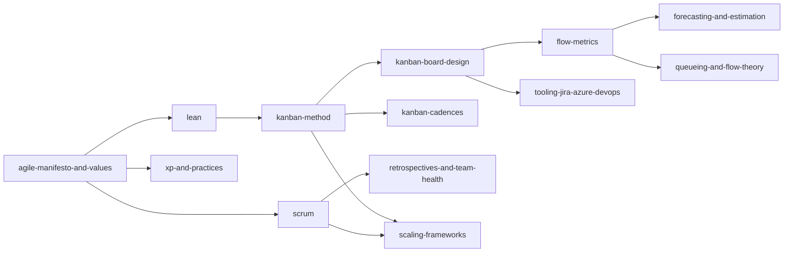

# 04 — Agile, Kanban, Scrum, Lean and Flow

> **TL;DR** — This section covers agile values and methods with Kanban and flow as the centre of gravity: the Agile Manifesto and its reframings, Lean (TPS, wastes, value stream mapping), the Kanban Method and Kanban Guide (practices, board design, classes of service, cadences, maturity), flow metrics and probabilistic forecasting, queueing theory and Theory of Constraints, Scrum (2020 guide), retrospectives and team health, scaling frameworks, XP engineering practices, and Jira/Azure DevOps configuration.

---

## Files

| # | File | One-line description |
|---|---|---|
| 1 | [agile-manifesto-and-values.md](agile-manifesto-and-values.md) | Snowbird 2001 history, 4 values, 12 principles mapped to methods, agile myths, Heart of Agile, Modern Agile, Agile Fluency |
| 2 | [lean.md](lean.md) | Toyota Production System, TIMWOODS and software wastes, Womack & Jones 5 principles, Poppendieck 7 principles, kaizen, gemba, jidoka, poka-yoke, 5 Whys, A3, value stream mapping with worked metrics |
| 3 | [kanban-method.md](kanban-method.md) | **Deep dive**: origins, Kanban Method (principles, 6 practices, STATIK, KMM) vs Kanban Guide (3 practices, 4 measures), classes of service, cost of delay, WIP limit heuristics, commitment/delivery points, upstream, Personal/Portfolio Kanban, Flight Levels, Scrumban |
| 4 | [kanban-board-design.md](kanban-board-design.md) | Columns, Doing/Done splits, buffers, swimlanes, card design, blockers, dependencies, explicit policies, workflow patterns, board anti-patterns, worked redesign |
| 5 | [kanban-cadences.md](kanban-cadences.md) | The 7 Kanban cadences (daily, replenishment, delivery planning, service delivery review, operations, risk, strategy review) with agendas and inputs/outputs |
| 6 | [flow-metrics.md](flow-metrics.md) | WIP, throughput, cycle/lead time, age, flow efficiency; Little's Law with assumptions; CFD patterns, scatterplot percentiles, aging WIP, SLEs, Flow Framework, DORA, Goodhart and metrics anti-patterns |
| 7 | [forecasting-and-estimation.md](forecasting-and-estimation.md) | Deterministic vs probabilistic, story points, Fibonacci, planning poker, #NoEstimates, Monte Carlo (how many / when) with code and worked example |
| 8 | [queueing-and-flow-theory.md](queueing-and-flow-theory.md) | Utilisation vs wait time, M/M/1, Kingman's formula, Reinertsen's flow principles, cost of delay & CD3/WSJF, Theory of Constraints, 5 focusing steps, Drum-Buffer-Rope |
| 9 | [scrum.md](scrum.md) | Scrum Guide 2020: pillars, values, accountabilities, events & timeboxes, artifacts & commitments, velocity pitfalls, burn charts, anti-patterns |
| 10 | [retrospectives-and-team-health.md](retrospectives-and-team-health.md) | Prime Directive, Derby & Larsen 5 phases, retro formats, facilitation, Spotify Squad Health Check, coaching and metrics anti-patterns |
| 11 | [scaling-frameworks.md](scaling-frameworks.md) | SAFe 6 (ARTs, PI Planning), LeSS, Nexus, Scrum@Scale, Spotify model caveats, Disciplined Agile, Flight Levels, unFIX, critique and selection guide |
| 12 | [xp-and-practices.md](xp-and-practices.md) | XP values and practices, TDD, pair/mob programming, CI/CD, collective ownership, simple design, sustainable pace, DevOps link |
| 13 | [tooling-jira-azure-devops.md](tooling-jira-azure-devops.md) | Jira and Azure Boards Kanban setup: columns, WIP, split columns, swimlanes, JQL/WIQL examples, CFD/control chart, automation, other tools |
| 14 | [resources.md](resources.md) | Official guides, books by topic, sites, tools, certifications, reading paths |

---

## Suggested reading order

## Quick reference

| Need | Go to |
|---|---|
| Set initial WIP limits | [kanban-method.md §6](kanban-method.md) |
| Define classes of service | [kanban-method.md §5](kanban-method.md) |
| Read a CFD | [flow-metrics.md §4.1](flow-metrics.md) |
| Little's Law formula and assumptions | [flow-metrics.md §3](flow-metrics.md) |
| Answer "when will it be done?" | [forecasting-and-estimation.md §6](forecasting-and-estimation.md) |
| Explain why 100% utilisation is bad | [queueing-and-flow-theory.md §1](queueing-and-flow-theory.md) |
| Run a replenishment meeting | [kanban-cadences.md §3](kanban-cadences.md) |
| Scrum timeboxes | [scrum.md §4](scrum.md) |
| Pick a retro format | [retrospectives-and-team-health.md §3](retrospectives-and-team-health.md) |
| Compare scaling frameworks | [scaling-frameworks.md §2](scaling-frameworks.md) |
| JQL for flow metrics | [tooling-jira-azure-devops.md §2.4](tooling-jira-azure-devops.md) |

## Related sections

- [../01-ux-ui/README.md](../01-ux-ui/README.md) — UX/UI design
- [../02-product-management/README.md](../02-product-management/README.md) — discovery, backlogs, roadmaps, Lean Startup
- [../03-project-management/README.md](../03-project-management/README.md) — traditional/hybrid PM, CCPM, contracts
- [../05-software-architecture/README.md](../05-software-architecture/README.md) — Conway's law, modularity, decoupling for team autonomy
- [../06-cloud-architecture/README.md](../06-cloud-architecture/README.md) — delivery platforms, CI/CD infrastructure
- [../07-data-ai-architecture/README.md](../07-data-ai-architecture/README.md) — data/ML delivery
- [../08-engineering/README.md](../08-engineering/README.md) — engineering practices, DevOps, testing
- [../09-leadership-teams-facilitation/README.md](../09-leadership-teams-facilitation/README.md) — leadership, team dynamics, facilitation
- [../10-laws-principles-mental-models/README.md](../10-laws-principles-mental-models/README.md) — Goodhart, Conway, Little, Cynefin
- [../11-enterprise-architecture-business/README.md](../11-enterprise-architecture-business/README.md) — portfolio, value streams, strategy

## References

- Agile Manifesto — <https://agilemanifesto.org/>
- Scrum Guides — <https://scrumguides.org/>
- The Kanban Guide — <https://kanbanguides.org/>
- Kanban University — <https://kanban.university/>
- Full list: [resources.md](resources.md)
