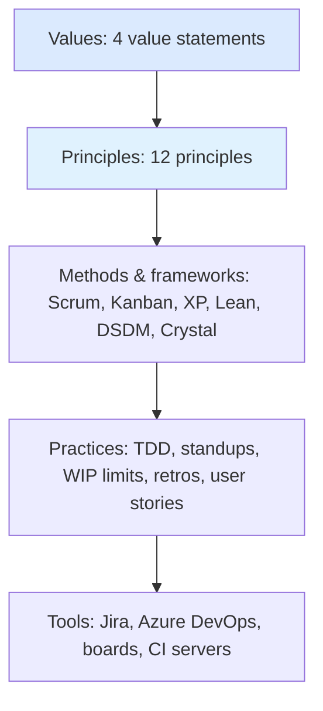

# Agile Manifesto, Values and Principles

> **TL;DR** — The Agile Manifesto (Snowbird, Utah, February 2001) is a short statement of 4 value preferences and 12 principles written by 17 practitioners of "lightweight" methods. It is not a method; it is a value system. Scrum, XP, Kanban, Crystal, DSDM, FDD etc. are the methods. Later reframings (Heart of Agile, Modern Agile) strip agility down to a handful of verbs or guiding principles. Most "agile failures" are failures to apply the values, not the ceremonies.

---

## 1. History and context

### 1.1 Timeline

| Year | Event | Why it matters |
|---|---|---|
| 1950s–1970s | Iterative and incremental development used at NASA, IBM (e.g. Project Mercury, IBM FSD) | Iteration predates "agile" by decades |
| 1970 | Winston Royce's paper "Managing the Development of Large Software Systems" | Often cited as the origin of "waterfall" — but Royce himself warned against the pure sequential model |
| 1986 | Takeuchi & Nonaka, "The New New Product Development Game" (HBR) | Rugby metaphor, "scrum", self-organizing cross-functional teams |
| 1988 | Barry Boehm's Spiral Model | Risk-driven iteration |
| 1991 | James Martin, Rapid Application Development (RAD) | Timeboxing, prototyping |
| 1994 | DSDM Consortium formed | MoSCoW prioritisation, timeboxes |
| 1995 | Schwaber & Sutherland present Scrum at OOPSLA | Scrum formalised |
| 1996–1999 | Kent Beck et al., Extreme Programming at Chrysler C3 project; "Extreme Programming Explained" (1999) | Engineering practices: TDD, pairing, CI |
| 1997 | Feature-Driven Development (Jeff De Luca, Peter Coad) | Feature lists, model-driven |
| 1990s | Alistair Cockburn's Crystal family | People-centric, tailoring by team size/criticality |
| 1999 | Highsmith, Adaptive Software Development | Speculate–collaborate–learn |
| **Feb 2001** | **17 people meet at The Lodge at Snowbird ski resort, Utah; write the Manifesto for Agile Software Development** | Coins "agile" as umbrella term |
| 2001 | Agile Alliance founded | Non-profit stewarding the community |
| 2003 | Poppendieck, "Lean Software Development" | Lean thinking applied to software |
| 2005 | Declaration of Interdependence (PM-focused) | Extension towards project management |
| 2009 | Software Craftsmanship Manifesto | "Not only... but also" — well-crafted software, steadily adding value |
| 2010 | David J. Anderson, "Kanban: Successful Evolutionary Change" | Kanban Method |
| 2010 | First Scrum Guide published | Canonical Scrum definition |
| 2011 | SAFe 1.0 | Scaling frameworks era begins |
| ~2015–2016 | Cockburn's Heart of Agile; Joshua Kerievsky's Modern Agile | Back-to-basics reframings |
| 2020 | Scrum Guide 2020 | Less prescriptive, "Product Goal", "accountabilities" |

### 1.2 The 17 signatories

Kent Beck, Mike Beedle, Arie van Bennekum, Alistair Cockburn, Ward Cunningham, Martin Fowler, James Grenning, Jim Highsmith, Andrew Hunt, Ron Jeffries, Jon Kern, Brian Marick, Robert C. Martin, Steve Mellor, Ken Schwaber, Jeff Sutherland, Dave Thomas.

Represented methods: XP, Scrum, DSDM, ASD, Crystal, FDD, Pragmatic Programming. Note: no women, no Lean/Kanban representatives, mostly consultants — a frequently made critique.

### 1.3 Why "agile"?

Alternatives discussed reportedly included "lightweight" (rejected because it sounded insubstantial) and "adaptive". "Agile" was chosen to emphasise the ability to respond to change.

---

## 2. The four values (paraphrased)

The manifesto states that, through doing and helping others do software development, its authors have come to value:

| We value more... | ...than (still valuable) | Practical meaning |
|---|---|---|
| **Individuals and interactions** | processes and tools | Tools serve people. Face-to-face conversation beats tickets bouncing between queues. A Jira workflow is not a team. |
| **Working software** | comprehensive documentation | Progress is measured by running, usable increments. Documentation should be "just enough" and close to the code (ADRs, READMEs, tests as specs). |
| **Customer collaboration** | contract negotiation | Shared discovery with the customer rather than adversarial scope fights. Contracts that enable change (e.g. time-and-materials with capped scope, "money for nothing, change for free"). |
| **Responding to change** | following a plan | Plans are hypotheses. Plan continuously, at multiple horizons, cheaply. |

**Key nuance:** the right-hand items have value. The manifesto is about *preference under tension*, not rejection. "We don't do documentation because we're agile" is a misreading.

---

## 3. The twelve principles (paraphrased and grouped)

| # | Principle (paraphrased) | Theme | What it looks like in practice | Anti-pattern |
|---|---|---|---|---|
| 1 | Highest priority: satisfy the customer through early and continuous delivery of valuable software | Value delivery | Release small increments often; measure outcomes | Big-bang release after 9 months |
| 2 | Welcome changing requirements, even late; agile processes harness change for competitive advantage | Change | Cheap re-prioritisation; backlog is fluid; options thinking | Change-control board for every story |
| 3 | Deliver working software frequently — weeks rather than months, preferring shorter timescales | Cadence | Continuous delivery; sprint ≤ 1 month; daily deploys | "Hardening sprints" every quarter |
| 4 | Business people and developers work together daily | Collaboration | PO/stakeholders embedded; three amigos | Requirements thrown over the wall |
| 5 | Build projects around motivated individuals; give them environment and support; trust them | Motivation | Autonomy, mastery, purpose; manager as enabler | Micromanagement, ticket-level assignment by manager |
| 6 | Face-to-face conversation is the most efficient and effective way to convey information | Communication | Co-location or high-bandwidth remote (video, pairing, whiteboards) | Spec documents as only channel |
| 7 | Working software is the primary measure of progress | Progress | Demos of running software; Done = usable | % complete, story points burned as progress |
| 8 | Sustainable development; sponsors, developers and users should maintain a constant pace indefinitely | Sustainability | No permanent crunch; WIP limits; slack | Heroics, sprint "commitment" overtime |
| 9 | Continuous attention to technical excellence and good design enhances agility | Quality | TDD, refactoring, CI, clean architecture | "We'll fix tech debt later" |
| 10 | Simplicity — the art of maximising the amount of work not done — is essential | Simplicity | YAGNI, thin slices, kill features | Gold plating, speculative generality |
| 11 | The best architectures, requirements and designs emerge from self-organising teams | Self-organisation | Team owns how; architects as coaches/enablers | Ivory-tower architecture handed down |
| 12 | At regular intervals, the team reflects and adjusts its behaviour | Improvement | Retrospectives, kaizen, experiments | Retro without actions; same issues forever |

### 3.1 Mapping principles to methods

| Principle | Scrum | Kanban | XP | Lean |
|---|---|---|---|---|
| 1 Early continuous delivery | Increment every sprint | Flow, short lead time | Small releases | Deliver fast |
| 2 Welcome change | Backlog refinement | Just-in-time replenishment | Planning game | Defer commitment |
| 3 Frequent delivery | Sprint ≤ 1 month | Delivery cadence decoupled | Small releases, CI | Deliver fast |
| 4 Business + dev daily | PO accountability | Replenishment, service delivery review | On-site customer | Respect people |
| 5 Motivated individuals | Self-managing team | Leadership at every level | Whole team | Respect people |
| 6 Face-to-face | Daily Scrum | Daily Kanban meeting | Sit together | Gemba |
| 7 Working software | Increment + DoD | Delivered items, throughput | Acceptance tests | Value |
| 8 Sustainable pace | Sprint capacity | WIP limits | Sustainable pace / 40-hour week | Heijunka |
| 9 Technical excellence | DoD | Explicit policies on quality | TDD, refactoring, CI | Build quality in |
| 10 Simplicity | Sprint Goal focus | Limit WIP, stop starting | Simple design, YAGNI | Eliminate waste |
| 11 Self-organising | Self-managing | Evolve experimentally | Collective ownership | Empower the team |
| 12 Reflect & adjust | Sprint Retrospective | Feedback loops, kaizen | Retros | Kaizen, PDCA |

---

## 4. Agile is a mindset, a method, or what?



The "agile onion": tools at the outside are the most visible and least important; values in the centre are the least visible and most important. Organisations that change only the outer layers ("doing agile") rarely get the benefits of "being agile".

---

## 5. Common agile myths

| Myth | Reality |
|---|---|
| Agile means no planning | Agile plans *more often*, at multiple horizons (strategy → release → iteration → day). Planning is continuous, plans are lightweight. |
| Agile means no documentation | Value preference: working software over comprehensive docs. Necessary docs (APIs, ADRs, runbooks, compliance) still exist. |
| Agile = Scrum | Scrum is one framework. Kanban, XP, Lean, DSDM, Crystal etc. also fit the manifesto. |
| Agile is faster | Agile delivers *value earlier* and reduces risk of building the wrong thing. Raw output may not increase. |
| Agile has no deadlines | Fixed dates are common; scope is the variable. Forecasting handles dates probabilistically. |
| Agile has no architecture | Principle 9 and 11: architecture emerges *and* is intentional. SAFe calls it "architectural runway". |
| Agile has no managers | Roles change: managers shift to system design, capability building, removing impediments. |
| Agile is only for software | Lean/Kanban originate in manufacturing; agile used in marketing, HR, hardware, legal. |
| Velocity measures productivity | Velocity is a team-internal planning aid, not comparable across teams; gaming it is trivial. |
| Standups are status reports to the manager | Daily Scrum is for the developers to plan the next 24 hours toward the goal. |
| Agile = sprints | Kanban has no sprints; continuous flow is perfectly agile. |
| Agile means the customer can change anything at any time | In Scrum, the Sprint Goal is protected; in Kanban, commitment point defines when change gets costly. |
| You must be co-located | Distributed agile works with deliberate practices (overlap hours, async docs, pairing tools). |
| A certification makes you agile | Certificates verify knowledge of a framework, not ability to deliver value. |
| Agile scales by adding a framework | Scaling first requires descaling (fewer dependencies, better architecture); see [scaling-frameworks.md](scaling-frameworks.md). |
| "Dark Scrum"/"Fake Agile" is agile's fault | Ron Jeffries' "Dark Scrum" describes the framework applied as control. That is the opposite of the values. |

---

## 6. Heart of Agile (Alistair Cockburn)

Cockburn (a manifesto signatory) proposed reducing agile to four imperative verbs, arranged as a circle with no starting point:

| Verb | Meaning | Example practices |
|---|---|---|
| **Collaborate** | Work together; build trust; improve communication | Pairing, mobbing, joint design sessions |
| **Deliver** | Deliver small, learn how the world reacts | Small releases, MVPs, feature toggles |
| **Reflect** | Think about what happened, what worked | Retros, post-incident reviews |
| **Improve** | Try new things in process, product, technique | Experiments, kaizen |

The circle repeats: collaborate → deliver → reflect → improve → collaborate... Cockburn also describes deeper "rings" (e.g. under Collaborate: build trust, hold collaborative events, ...). Use it to cut through ceremony debates: "Which of the four is this meeting serving?"

Site: <https://heartofagile.com/>

---

## 7. Modern Agile (Joshua Kerievsky, Industrial Logic)

Four guiding principles, intentionally framework-agnostic:

| Principle | Meaning | Questions to ask |
|---|---|---|
| **Make people awesome** | Focus on making users, customers, and team members more capable (Kathy Sierra influence) | Who are we making awesome? How do they feel about using our product? |
| **Make safety a prerequisite** | Psychological safety *and* safety of systems, money, time | Is it safe to speak up? Can we deploy without fear? Can we roll back? |
| **Experiment & learn rapidly** | Frequent, cheap, safe experiments | What's the smallest experiment to test this? |
| **Deliver value continuously** | Divide work into small valuable chunks, deliver often | What value can we deliver this week? |

Site: <https://modernagile.org/>

### 7.1 Comparison

| Aspect | Manifesto (2001) | Heart of Agile | Modern Agile |
|---|---|---|---|
| Form | 4 values + 12 principles | 4 verbs | 4 principles |
| Scope | Software development | Any collaborative work | Any domain |
| Emphasis | Software, customer, change | Simplicity of action | Safety, people, experiments |
| Prescriptiveness | Low | Very low | Very low |
| Missing from manifesto | — | Explicit "reflect/improve" loop at center | Psychological safety, experimentation |

---

## 8. Related manifestos and declarations

| Document | Year | Gist |
|---|---|---|
| Declaration of Interdependence | 2005 | Six principles for agile project/leadership: value, outcomes, uncertainty, creativity, team performance, situational effectiveness |
| Software Craftsmanship Manifesto | 2009 | Well-crafted software, steadily adding value, community of professionals, productive partnerships |
| Kanban Method values | 2010s | Transparency, balance, collaboration, customer focus, flow, leadership, understanding, agreement, respect (see [kanban-method.md](kanban-method.md)) |
| Scrum values | 2016 added to guide | Commitment, focus, openness, respect, courage (see [scrum.md](scrum.md)) |
| XP values | 1999/2004 | Communication, simplicity, feedback, courage, respect (see [xp-and-practices.md](xp-and-practices.md)) |
| DevOps "CALMS" | ~2010 | Culture, Automation, Lean, Measurement, Sharing |

---

## 9. Agile vs plan-driven: when to use what

Use the **Stacey matrix** / **Cynefin** idea: agility pays off when uncertainty in requirements and/or technology is high.

| Situation | Approach |
|---|---|
| Known requirements, known technology (simple/clear) | Plan-driven is fine; checklists; best practice |
| Some uncertainty (complicated) | Expert analysis + iterative delivery |
| High uncertainty (complex) | Empirical, iterative, probe-sense-respond — agile sweet spot |
| Chaos (incident) | Act first, stabilise, then analyse |

```mermaid
quadrantChart
    title Stacey-style matrix (simplified)
    x-axis Technology certain --> Technology uncertain
    y-axis Requirements agreed --> Requirements unclear
    quadrant-1 Complex / anarchy edge
    quadrant-2 Complex (agile sweet spot)
    quadrant-3 Simple (plan-driven ok)
    quadrant-4 Complicated
```

### When agile is a poor fit

- Work is truly repeatable and well understood (e.g. routine infrastructure provisioning) — standard work and automation beat iterations.
- Regulatory/contractual constraints force fixed scope with no feedback loop (still: use agile *internally* where possible).
- No access to customers/users, and no possibility of feedback — agile's main benefit (learning) is lost.
- Organisation will not change governance/funding — "water-scrum-fall".

---

## 10. Agile fluency (Diana Larsen & James Shore)

The Agile Fluency Model describes zones a team can become fluent in:

| Zone | Team can... | Investment needed |
|---|---|---|
| Focusing | Plan and work in terms of business value; show progress | Team process training, coaching |
| Delivering | Ship on the market's cadence with low defects | Engineering practices (XP/CD), lots of time |
| Optimizing | Lead the market; make product decisions | Embedded product/business expertise |
| Strengthening | Improve the wider organisation | Org-level learning (rare) |

Use it to set realistic expectations: a team doing "focusing" practices will not magically get "delivering" benefits without technical investment.

---

## 11. Diagnostic checklist: are we agile or just doing ceremonies?

- [ ] Can we release to real users at least monthly (ideally on demand)?
- [ ] Do we talk with real users/customers at least every iteration?
- [ ] Did we change plans in the last month based on feedback?
- [ ] Is quality built in (automated tests, CI) rather than inspected at the end?
- [ ] Does the team decide *how* to do the work?
- [ ] Can anyone say "this isn't working" without fear?
- [ ] Do retros lead to changes that stick?
- [ ] Is the pace sustainable (no chronic overtime)?
- [ ] Is progress measured by delivered outcomes rather than activity?
- [ ] Do we deliberately not build things (simplicity)?

Score below 6/10 → focus on values and engineering practices before adding framework layers.

---

## 12. Common mistakes

1. **Cargo cult** — adopting rituals (standups, sprints, boards) without the feedback loops that make them meaningful.
2. **Agile as a management control system** — velocity targets, story-point quotas, burndown policing (see Goodhart in [flow-metrics.md](flow-metrics.md)).
3. **Ignoring principle 9** — "Flaccid Scrum" (Martin Fowler): process without technical practices → tech debt explosion.
4. **Water-Scrum-Fall** — upfront analysis and a big test phase wrapped around "sprints".
5. **Agile transformation as a project** with a fixed end date and a big framework rollout.
6. **Proxy everything** — proxy POs, proxy users, proxy feedback.
7. **Treating values as optional** — "we don't have time for retros".
8. **Dogma** — "the Scrum Guide says..." used to win arguments rather than to solve problems.

---

## 13. Related sections

- Product discovery, outcomes, roadmaps: [../02-product-management/README.md](../02-product-management/README.md)
- Traditional and hybrid project management: [../03-project-management/README.md](../03-project-management/README.md)
- Facilitation, team dynamics, psychological safety: [../09-leadership-teams-facilitation/README.md](../09-leadership-teams-facilitation/README.md)
- Laws and mental models (Conway, Goodhart, Cynefin): [../10-laws-principles-mental-models/README.md](../10-laws-principles-mental-models/README.md)

## References

- Manifesto for Agile Software Development — <https://agilemanifesto.org/>
- Twelve Principles — <https://agilemanifesto.org/principles.html>
- History of the Manifesto (Jim Highsmith) — <https://agilemanifesto.org/history.html>
- Agile Alliance — <https://www.agilealliance.org/>
- Heart of Agile — <https://heartofagile.com/>
- Modern Agile — <https://modernagile.org/>
- Wikipedia: Agile software development — <https://en.wikipedia.org/wiki/Agile_software_development>
- Wikipedia: Cynefin framework — <https://en.wikipedia.org/wiki/Cynefin_framework>
- Takeuchi & Nonaka, "The New New Product Development Game", HBR 1986
- Kent Beck, *Extreme Programming Explained* (2nd ed., 2004)
- Alistair Cockburn, *Agile Software Development: The Cooperative Game* (2006)
- James Shore & Diana Larsen, Agile Fluency Model — <https://www.agilefluency.org/>
