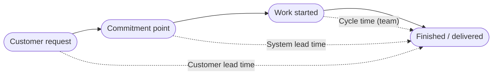
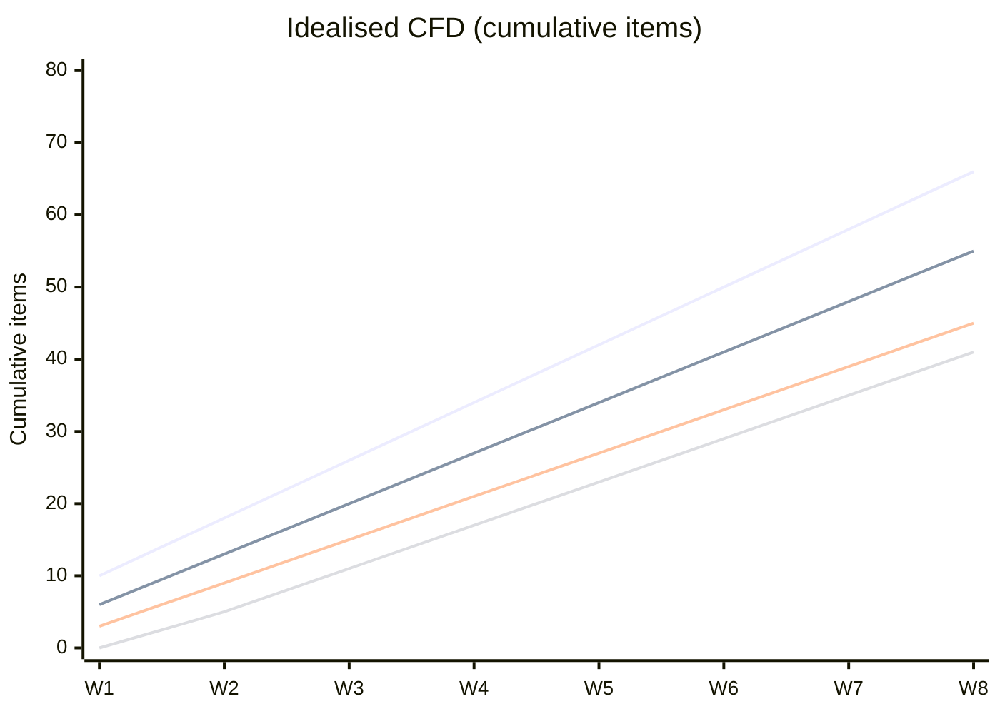
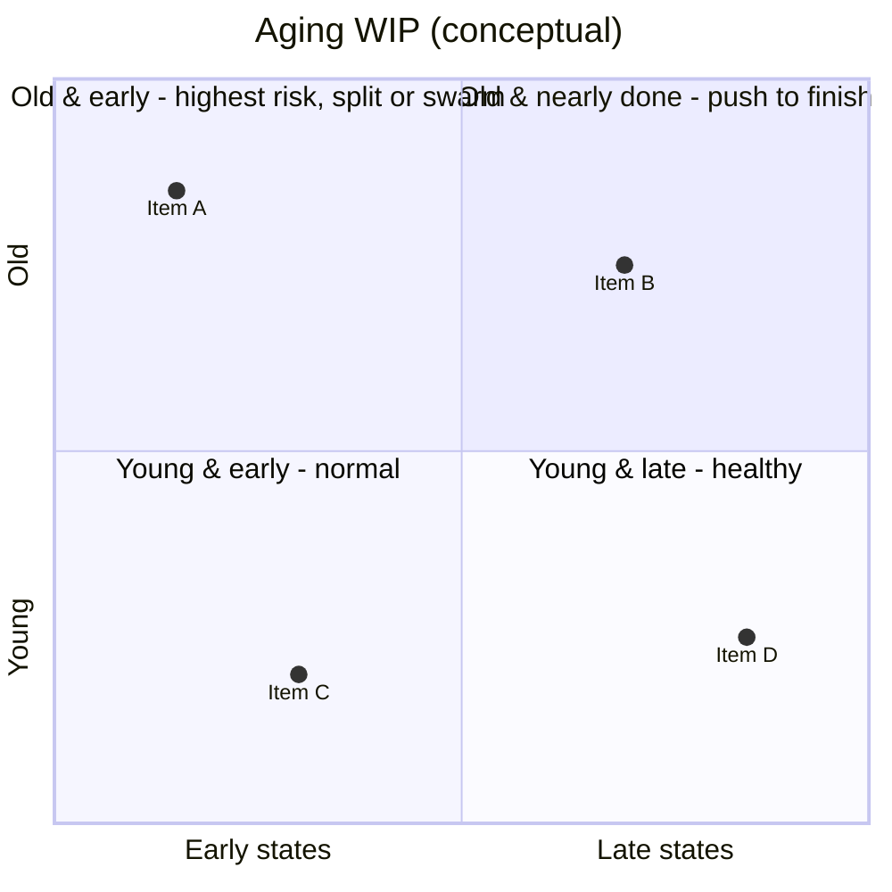

# Flow Metrics and Charts

> **TL;DR** — Four core flow measures: **WIP** (items started, not finished), **Throughput** (items finished per time unit), **Cycle/Lead time** (elapsed time start→finish), **Work Item Age** (elapsed time for items still in progress). They are linked by **Little's Law**: avg Cycle Time = avg WIP / avg Throughput (under assumptions). Visualise with the **Cumulative Flow Diagram**, **cycle time scatterplot** (with 50/85/95th percentiles), **aging WIP chart**, **throughput run chart** and **histogram**. Use percentiles to set **Service Level Expectations** and Monte Carlo for forecasts. Flow Framework (Mik Kersten) extends this to business level: flow velocity, time, load, efficiency, distribution. Measure systems, not people (Goodhart).

---

## 1. Terminology (reconciled)

Different communities use these terms differently. Always define them on your team's board.

| Term | Kanban Guide (Vacanti) | Kanban Method (Anderson) | Common Jira/ADO usage | Recommended definition |
|---|---|---|---|---|
| **Cycle time** | Started → finished (commitment → delivery) | Time in a specific part of the workflow | "In Progress" → "Done" | Time between two defined points; state which points |
| **Lead time** | Not used (one term only) | Commitment → delivery (system lead time) | Created → Done | Customer request → delivered (customer lead time) or commitment → delivery (system) |
| **Throughput** | Items finished per unit of time | "Delivery rate" | Items done per week | Count of items crossing the finish point per period |
| **WIP** | Items started but not finished | Items between commitment & delivery | Items in in-progress status categories | Same |
| **Work item age** | Time since start for unfinished item | "Age" | "Days in column" (dots) / Aging chart | Same |
| **Takt time** | — | — | — | Time between deliveries (1/throughput) |
| **Process/touch time** | — | Value-add time | — | Time actively worked on |
| **Velocity** | — | — | Story points per sprint | Scrum-specific; not a flow metric |

**Unit-of-measure tip:** count elapsed calendar days, inclusive (an item started and finished on the same day = 1 day) — Vacanti's convention; be consistent.



---

## 2. The core measures

### 2.1 WIP
- Count of items between start and finish points.
- Leading indicator: rising WIP predicts rising cycle time.
- Control it with WIP limits; see [kanban-method.md](kanban-method.md).

### 2.2 Throughput
- Count per day/week. Use **counts of items**, not points.
- Variation is natural; look at distribution, not just average.
- Used for **Monte Carlo** forecasts ("how many / when").

### 2.3 Cycle time / lead time
- Lagging indicator (known only when an item finishes).
- Distribution is **right-skewed** (long tail; often Weibull/log-normal-like) → averages mislead; use percentiles.

### 2.4 Work item age
- The only **leading** per-item indicator of flow problems.
- Compare age against historical cycle time percentiles → act before an item becomes an outlier.
- "An item that's older than 85% of our finished items is at risk."

### 2.5 Flow efficiency
- `Flow efficiency = Active time / (Active time + Wait time) × 100%`
- Typical knowledge-work values: 5–15%; >40% is excellent.
- Requires Doing/Done column split (active vs queued) or blocked-time tracking.

### 2.6 Flow load (Flow Framework)
- WIP measured across a value stream (all flow items active or waiting). High flow load → lower velocity and longer flow time.

### 2.7 Other useful measures

| Measure | Definition | Use |
|---|---|---|
| Arrival rate | Items crossing commitment point per period | Compare to throughput — balance demand vs capability |
| Blocked time / blocker count | Days blocked per item; blocker categories | Risk review |
| Escaped defects | Defects found after delivery | Quality |
| Abandonment rate | Items abandoned after commitment | Commitment discipline |
| Discard rate (upstream) | Options discarded before commitment | Healthy if meaningful |
| SLE adherence | % of items finished within SLE | Service delivery review |
| Due-date performance | % fixed-date items delivered on time | CoS effectiveness |
| Rework rate | % items moving backward | Quality of handoffs (%C&A) |

---

## 3. Little's Law

### 3.1 Formula

```
L = λ × W
```

In flow terms (rearranged):

```
Average Cycle Time = Average WIP / Average Throughput
```

- L = average number of items in the system (WIP)
- λ = average arrival rate (= average throughput in a stable system)
- W = average time an item spends in the system (cycle time)

Proven by John D. C. Little (1961) for queuing systems.

### 3.2 Assumptions (Vacanti's formulation for flow systems)

For the relationship to hold over a time interval:

1. Average **arrival rate equals average departure rate** (throughput).
2. All work that is started will eventually be **completed** and exit the system.
3. The amount of **WIP should be roughly the same** at the start and end of the interval.
4. The **average age of WIP** is neither increasing nor decreasing.
5. Cycle time, WIP and throughput must all be measured in **consistent units**.

### 3.3 What Little's Law is (and isn't) for

| ✔ Use it to | ✘ Don't use it to |
|---|---|
| Explain why reducing WIP reduces cycle time | Forecast individual item completion dates |
| Sanity-check WIP limits vs target cycle time | Forecast precise delivery dates for a backlog (use Monte Carlo) |
| Diagnose instability (when the assumptions are violated, the process is unstable — that's information) | Assume causality in all cases — reducing WIP below a point starves the system and lowers throughput |

### 3.4 Worked examples

**Example 1 — current state:** WIP = 24 items, throughput = 6 items/week → avg cycle time ≈ 24 / 6 = **4 weeks**.

**Example 2 — WIP reduction:** Reduce WIP to 12, throughput unchanged → avg cycle time ≈ **2 weeks**. Often throughput even rises due to less context switching.

**Example 3 — set WIP for target:** Target avg cycle time 5 days, throughput 1.6 items/day → WIP ≈ 1.6 × 5 = **8**.

**Example 4 — violation detection:** Arrivals 10/week, throughput 6/week → WIP grows by 4/week; cycle time keeps increasing. The system is not stable; fix arrival control (replenishment/commitment discipline).

---

## 4. Charts

### 4.1 Cumulative Flow Diagram (CFD)

**What it is:** stacked area chart. X-axis = time; Y-axis = cumulative count of items that have *arrived* in each state (or are in each state). Each band = a workflow state; top band = arrivals/backlog, bottom band = done.

**How to read:**

| Reading | Meaning |
|---|---|
| **Vertical distance** between two lines (band thickness) | WIP in that state(s) at that moment |
| **Horizontal distance** between top line of "in progress" and "done" line | Approximate average cycle time for items in that interval |
| **Slope** of bottom (Done) line | Throughput (departure rate) |
| **Slope** of top line of committed area | Arrival rate |
| Lines **parallel** | Stable flow |



Lines from top: arrived (committed), in development, in review, done. Parallel lines = stable flow.

**Patterns to recognise:**

| Pattern | Looks like | Likely cause | Action |
|---|---|---|---|
| Widening band | One band gets thicker over time | Bottleneck in that state (or downstream) | Swarm; check WIP limits; elevate constraint |
| Flat Done line | No departures | Batch release / blocked delivery | Investigate delivery; smaller batches |
| Stair steps on Done | Periodic jumps | Batch releases / sprint-end completion | Fine if intended; else continuous delivery |
| Top line steeper than Done line | Arrivals > departures | Over-commitment | Limit commitment; replenishment discipline |
| Band narrows to zero | Starvation | Upstream not feeding, or limit too low | Replenish; check upstream |
| Bulging / "S-curve" | Thickening then thinning | Batch of work entering then flushing | Smooth arrivals (heijunka) |
| Lines converge | Everything waiting on last step | Final stage bottleneck (e.g. release) | Automate release |
| Done line flattens before deadline | Work started but not finishing | Too much WIP; "starting not finishing" | Stop starting |
| Backlog band growing endlessly | Uncontrolled demand | No upstream limit | Prune; limit options |

**Common CFD mistakes:** including the unlimited backlog (dwarfs everything — exclude or use separate scale); items moving backwards (rework) distorting the chart; unclear done definition.

### 4.2 Cycle time scatterplot

**What:** each dot = a finished item; X = completion date; Y = cycle time. Horizontal lines at percentiles (50th, 70th, 85th, 95th).

| Percentile line | Interpretation |
|---|---|
| 50th | Half of items finished within this time — "coin flip" |
| 70th | Good for internal targets |
| **85th** | Common SLE basis; "most items" |
| 95th | Risk-averse commitments, fixed-date start buffers |

**Reading patterns:**
- Rising trend → system degrading (WIP growth, bigger items).
- Clusters/bands → different work types; split the chart by type.
- Big gaps between 50th and 95th → high variability → improve predictability (smaller items, fewer blockers, less WIP).
- Dots far above 95th → outliers; investigate (blocked? too big? forgotten?).
- Vertical columns of dots on same date → batch completions.

**Example:** 85th percentile = 11 days → SLE "85% of items finish within 11 days of starting".

### 4.3 Aging WIP chart

**What:** columns = workflow states; each dot = an in-progress item placed at its current state with Y = its current age. Background bands/lines show historical cycle-time percentiles (usually 50/70/85/95 per state).

**Use daily:**
- Items above the 85th line in early columns = high risk; act now (swarm, split, unblock).
- Item "colour" by percentile zone (green < 50th, yellow 50–85th, red > 85th).
- Key daily meeting tool: "Which items are aging? What will we do today?"



### 4.4 Throughput run chart

- X = time (day/week); Y = items finished.
- Shows trend and variability; feeds Monte Carlo.
- Add a median line; look for trends (process change), not single-week noise.
- Pair with a **throughput histogram** to see distribution (e.g. weeks with 0 items).

### 4.5 Cycle time histogram

- X = cycle time (days); Y = frequency.
- Shows distribution shape: right-skewed long tail typical.
- Multi-modal → mixed work types or two processes (e.g. "fast-lane" fixes vs features).
- Percentile markers same as scatterplot.

### 4.6 Control chart (Jira terminology)

- Jira's "control chart" is essentially a cycle time scatterplot with rolling average and standard deviation band. Standard deviation is not meaningful for skewed distributions → prefer percentiles.

### 4.7 Burn-up / burndown

- Scope-based progress (Scrum/release). Burn-up shows scope changes explicitly; preferred over burndown. See [scrum.md](scrum.md).

### 4.8 Chart selection guide

| Question | Chart |
|---|---|
| Is our flow stable? Where's the bottleneck? | CFD |
| How long do items take? How predictable? | Cycle time scatterplot / histogram |
| What should we act on today? | Aging WIP chart |
| How much do we deliver? Is it changing? | Throughput run chart |
| When will this batch be done? | Monte Carlo ([forecasting-and-estimation.md](forecasting-and-estimation.md)) |
| Are we meeting customer expectations? | SLE adherence over time |

---

## 5. Service Level Expectations (SLE)

### 5.1 Definition
A forecast of how long a single item should take from start to finish, expressed as a **time + probability**: "85% of items finish within 10 days."

### 5.2 Setting an SLE
1. Gather ≥ 20–30 completed items (more is better; recent 3–6 months).
2. Compute percentiles of cycle time (per work type/CoS if behaviour differs).
3. Choose a percentile (often 85th) — balance ambition and reliability.
4. Communicate the SLE to customers; review in Service Delivery Review.
5. Use SLE as a **daily management trigger**: items approaching SLE age → act.

| SLE vs SLA | |
|---|---|
| SLE | Internal/external expectation, data-derived, used for flow management |
| SLA | Contractual agreement with penalties; derive from SLE with margin (e.g. 95th percentile) |

### 5.3 Right-sizing
Instead of estimating, check at commitment: "Can this item be finished within our SLE?" If not, split it. Over time this narrows the distribution.

---

## 6. Flow Framework (Mik Kersten)

From *Project to Product* (2018). Focus: measure end-to-end flow of business value across a value stream rather than team-level activity.

### 6.1 Four flow items (MECE work types)

| Flow item | Delivers | Example |
|---|---|---|
| **Features** | New business value | New capability |
| **Defects** | Quality | Bug fix |
| **Risks** | Security, compliance, governance | Vulnerability patch, audit work |
| **Debts** | Improvement of future delivery | Refactoring, infra upgrade |

### 6.2 Five flow metrics

| Flow metric | Definition | Traditional analog |
|---|---|---|
| **Flow velocity** | Number of flow items completed in a period | Throughput |
| **Flow time** | Time from work start (accepted into value stream) to completion | Lead/cycle time |
| **Flow load** | Number of flow items in progress (active or waiting) | WIP |
| **Flow efficiency** | Active time ÷ flow time | Flow efficiency |
| **Flow distribution** | Ratio of the four flow item types in a period | Capacity allocation |

### 6.3 Business results metrics
Value, cost, quality, happiness — correlated with flow metrics to make investment decisions.

### 6.4 Use
- Flow distribution as an explicit investment decision ("this quarter 20% debts").
- Flow load ↔ flow velocity relationship reveals overloaded value streams.
- Tooling: value stream management (VSM) platforms; or derive from Jira/ADO.

---

## 7. DORA metrics (link to DevOps)

| Metric | Measures | Relationship to flow |
|---|---|---|
| Deployment frequency | Throughput of deployments | Delivery cadence |
| Lead time for changes | Commit → production | Downstream cycle time |
| Change failure rate | % deployments causing failure | Quality / %C&A |
| Failed deployment recovery time (formerly MTTR) | Restore time | Resilience |

DORA metrics measure the delivery pipeline; flow metrics measure the whole work item journey. Use both. See [xp-and-practices.md](xp-and-practices.md) and [../08-engineering/README.md](../08-engineering/README.md).

---

## 8. Metrics anti-patterns and Goodhart's Law

> **Goodhart's Law** (paraphrased, after Marilyn Strathern): when a measure becomes a target, it ceases to be a good measure.

| Anti-pattern | Why it fails | Better |
|---|---|---|
| Velocity targets ("increase velocity 20%") | Point inflation; quality cuts | Use velocity only for team planning, if at all |
| Comparing velocity across teams | Points are team-relative | Compare flow outcomes (lead time trends), not points |
| Individual throughput leaderboards | Destroys collaboration, swarming, pairing | Team-level metrics |
| Utilisation targets (100% busy) | Queueing theory: wait time explodes | Target flow; keep slack |
| Measuring lines of code / commits | Rewards verbosity | Outcomes, DORA |
| Cycle time targets enforced on people | Splitting games; closing items prematurely | SLE as system expectation; inspect outliers with curiosity |
| Average cycle time only | Skewed distribution hides tail | Percentiles |
| Metrics without action | Dashboard theatre | Each metric linked to a decision/cadence |
| Vanity metrics (story count, tickets closed) | Not tied to value | Outcome metrics (usage, conversion, satisfaction) |
| Watermelon metrics (green outside, red inside) | Reporting optimism | Leading indicators (age) + gemba |
| Changing definitions silently | Breaks trends | Version metric definitions |

**Principles for healthy metrics:**
1. Measure the **system**, not individuals.
2. Pair metrics to balance (speed + quality; throughput + lead time; flow + satisfaction).
3. Make metrics **visible to the team first**; team owns them.
4. Prefer **trends and distributions** over point values.
5. Every metric should answer a question someone is asking (GQM: Goal–Question–Metric).
6. Leading indicators (WIP, age) for action; lagging (cycle time, throughput) for learning.

See also: [retrospectives-and-team-health.md](retrospectives-and-team-health.md) and [../10-laws-principles-mental-models/README.md](../10-laws-principles-mental-models/README.md).

---

## 9. Data hygiene for good metrics

- [ ] Workflow states map unambiguously to start/finish points (status categories).
- [ ] Items aren't created retroactively in Done.
- [ ] Items don't skip states via bulk updates at sprint end.
- [ ] Cancelled/abandoned items are marked distinctly (resolution) and excluded or analysed separately.
- [ ] Backward moves are tracked (rework) and policy says how to count them.
- [ ] Item types are consistent (no "story" used for epics).
- [ ] Time zone/day boundaries are consistent.
- [ ] Sample size is adequate (≥ 20–30 items for percentiles).
- [ ] Data window reflects the current process (exclude data before major process changes).

---

## 10. Worked example: diagnosing from metrics

**Data (last 8 weeks):** WIP average 22; throughput median 5/week; cycle time 50th = 12 d, 85th = 31 d, 95th = 48 d; arrivals 7/week.

**Analysis:**
1. Little's Law: 22 / 5 ≈ 4.4 weeks ≈ 31 calendar days average — consistent with the 85th, meaning the mean is pulled by the tail.
2. Arrivals (7) > throughput (5) → WIP growing ~2/week → instability.
3. 50th→95th spread (12 → 48) = 4× → low predictability.
4. CFD shows "Review" band widening → review bottleneck.

**Actions:**
- Set CONWIP 14; replenish only on free slots (arrival = departure).
- Review policy: reviews before starting new work; pair reviews; WIP limit 3 on review.
- Right-size at commitment: split anything unlikely to finish within 12 days.
- Expected: WIP 14 / TP 5 ≈ 2.8 weeks average; tail shrinks; reassess in 4 weeks.

---

## References

- Wikipedia: Little's law — <https://en.wikipedia.org/wiki/Little%27s_law>
- Wikipedia: Cumulative flow diagram — <https://en.wikipedia.org/wiki/Cumulative_flow_diagram>
- Wikipedia: Goodhart's law — <https://en.wikipedia.org/wiki/Goodhart%27s_law>
- Wikipedia: Lead time — <https://en.wikipedia.org/wiki/Lead_time>
- The Kanban Guide — <https://kanbanguides.org/>
- ProKanban.org — <https://www.prokanban.org/>
- Flow Framework — <https://flowframework.org/>
- DORA — <https://dora.dev/>
- Daniel Vacanti, *Actionable Agile Metrics for Predictability* (2015)
- Daniel Vacanti, *When Will It Be Done?* (2020)
- Mik Kersten, *Project to Product* (2018)
- John D. C. Little, "A Proof for the Queuing Formula L = λW", *Operations Research* (1961)
- Troy Magennis, Focused Objective — forecasting resources — <https://www.focusedobjective.com/>
- Atlassian: Kanban metrics/CFD docs — <https://www.atlassian.com/agile/kanban>
