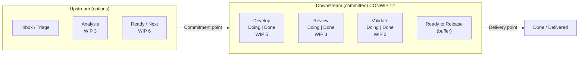

# Kanban Board Design

> **TL;DR** — A good board models *how knowledge is discovered* (workflow states), not who does the work. Split active states into **Doing/Done** sub-columns so queues are visible, put explicit **WIP limits** on states or column groups, mark the **commitment** and **delivery** points, use **swimlanes** for classes of service or work types (not people), make **blockers** loud, and design cards so age, type, CoS and dependencies are readable at a glance. Write policies on the board. Redesign the board as the process evolves.

---

## 1. Design principles

| Principle | Explanation |
|---|---|
| Model the actual workflow | Start with what you do now; don't draw the ideal process |
| States = knowledge discovery activities | "Analysing", "Building", "Validating" rather than "Alice", "QA team" |
| Make queues visible | Waiting work is where lead time hides — split Doing/Done |
| Visualise WIP limits | Number in the column header; colour when breached |
| One card = one work item | Not one card per task per person |
| Left-to-right flow toward the customer | Pull from the right: "walk the board" right to left |
| Make policies explicit | Exit criteria per column printed on the board |
| Show risk | Blockers, age, due dates, dependencies |
| Keep it as simple as possible | Every column adds overhead; merge where no handoff/queue matters |
| Evolve | Board design is an experiment; review every few weeks |

---

## 2. Anatomy of a board

### 2.1 Column types

| Column type | Purpose | WIP limit? | Example |
|---|---|---|---|
| **Backlog / Inbox / Funnel** | Unfiltered requests | Usually no (but prune by age) | "Requests" |
| **Upstream analysis** | Discovery, refinement, sizing | Yes | "Analysing", "Refining" |
| **Ready / Next / Selected** | Committed queue replenished by replenishment meeting | Yes (small) | "Next (6)" |
| **Active state "Doing"** | Work actively in progress | Yes | "Develop — In progress" |
| **Active state "Done" (sub-column)** | Finished this step, waiting to be pulled | Shares limit with "Doing" | "Develop — Done" |
| **Buffer / queue column** | Deliberate inventory in front of a constraint or batch step | Yes, small | "Ready for Release" |
| **Done / Delivered** | At delivery point | No; clear on cadence | "Released" |
| **Discarded / Abandoned** | Options rejected, or aborted commitments | No | Keep for metrics |

### 2.2 Doing / Done split

Without a split, a column "Development (5)" mixes items being worked on with items waiting for review. With the split:

| Develop (5) | | Review (3) | |
|---|---|---|---|
| Doing | Done | Doing | Done |
| A, B, C | D, E | F | G |

- D and E are **queued** — visible waiting time.
- Shared WIP limit across Doing + Done prevents finishing new dev work while review is backed up → developers pull from "Develop – Done" into "Review" (swarm).
- CFD then distinguishes active vs waiting time → flow efficiency.

### 2.3 Buffer columns — when

- In front of a **bottleneck** (TOC "buffer" protecting the constraint from starvation).
- Before a **batch transfer** (e.g. weekly release, external pen-test).
- At **team boundaries** (handoff to another team's system).

Size: as small as possible to keep the constraint busy; e.g. 2–3 items or 1–2 days of constraint throughput. Large buffers hide problems.

### 2.4 Done columns and archiving

- Keep "Done" visible until the next **delivery/review cadence** (celebrate, demo), then archive.
- In tools, use a resolution/status category "Done" for metrics; archive or use a "sub-filter" to hide old done items (Jira) or limit visible done items (ADO).

---

## 3. Commitment & delivery points on the board

| Marker | Visual | Policy example |
|---|---|---|
| Commitment point | Thick vertical line / colour change between "Ready" and first active state | "Pulling across this line means we intend to deliver. Items must meet Definition of Ready-lite: clear acceptance criteria, right-sized, dependencies known" |
| Delivery point | Line before "Done/Delivered" | "Item is in production and usable by customer (feature flag on for target users)" |
| Lead-time clock | Start date on card when crossing commitment | Tool: status category change timestamp |

---

## 4. Swimlanes

### 4.1 Swimlane options

| Swimlane by | Use when | Caveat |
|---|---|---|
| **Class of service** (Expedite / Fixed date / Standard / Intangible) | You use CoS; expedite visibility needed | Most common & recommended |
| **Work item type** (Feature / Defect / Tech debt / Support) | Capacity allocation per type | Combine with lane WIP limits |
| **Epic / feature / initiative** | Two-tier boards; tracking feature completion | Many lanes → messy; limit active epics |
| **Product / service / customer** | Team serves multiple products | May hide shared bottlenecks |
| **Team** (multi-team board) | Coordination boards (Flight Level 2) | Use for visibility, not to compare teams |
| **Person** | Rarely — personal WIP view | Encourages individual ownership, discourages swarming; prefer avatars |

### 4.2 Expedite lane rules

- Top of board; max 1 item.
- Bypasses column WIP limits but is still counted in metrics.
- Everyone helps if needed; others' work may pause.
- Track expedite count per month; review in service delivery/ops review.

---

## 5. Card design

### 5.1 What to show on a card

| Element | Purpose | How |
|---|---|---|
| Title (verb + object) | What value | "Allow refunds over €500 with approval" |
| ID / link | Traceability | Tool key |
| Work item type | Mix and allocation | Card colour or icon |
| Class of service | Treatment | Colour/border/lane |
| Due date (fixed date) | Risk | Date badge |
| Age / days in column | Flow risk | Tool "card aging" dots; WIA badge |
| Blocker | Impediment | Red flag/sticker + reason + date blocked |
| Assignee avatars | Who's working on it (not ownership) | Max 1–2 avatars per card; limited avatars per person |
| Dependencies | External waits | Tag or linked icon |
| Size class (S/M/L) or "right-sized" check | Predictability | Tag; avoid points if not used |
| Acceptance criteria / checklist | Exit criteria | Inside the card |
| Parent epic | Context | Epic colour bar |

### 5.2 Card colour conventions (example)

| Colour | Meaning |
|---|---|
| Red | Expedite |
| Purple | Fixed date |
| Yellow/white | Standard feature |
| Orange | Defect |
| Green | Intangible / tech improvement |
| Blue | Discovery / spike |
| Pink sticky on card | Blocker |

Keep the legend on the board. Accessibility: never rely on colour alone — add icons/labels.

### 5.3 Blocker visualisation and handling

| Practice | Detail |
|---|---|
| Flag | Red marker on card with reason, owner, date blocked |
| Blocker clustering | Collect resolved blocker stickers; categorise monthly (e.g. "waiting for env", "unclear requirement", "external team") → Pareto → systemic fixes |
| Blocker policy | Blocked items stay in their column and count toward WIP; daily meeting discusses blockers first |
| Escalation | If blocked > N days, escalate to SDM/manager; visible "escalated" tag |
| Blocked vs waiting | *Blocked*: cannot progress due to impediment. *Waiting/queued*: ready to be pulled. Don't conflate — queues are in "Done" sub-columns |

### 5.4 Dependencies

- Mark with a tag (e.g. "DEP: Payments team").
- Optional "Waiting on external" state *within* a column group (counts toward WIP).
- For recurring dependencies: dependency board at Flight Level 2, or a shared swimlane.
- Long-term: reduce dependencies via team topology / architecture (see [../05-software-architecture/README.md](../05-software-architecture/README.md) and [../09-leadership-teams-facilitation/README.md](../09-leadership-teams-facilitation/README.md)).

---

## 6. Explicit policies

### 6.1 What to make explicit

| Policy | Example |
|---|---|
| Pull criteria (entry) per column | "Pull into Develop only if acceptance criteria exist and item is right-sized (≤ 85th percentile CT)" |
| Exit criteria (DoD per column) | "Review done: 1 approval, CI green, no unresolved comments" |
| WIP limits | Numbers in headers; system CONWIP |
| Replenishment | "Every Tuesday; SRM + team; Ready column topped up to 6" |
| Class of service rules | See [kanban-method.md](kanban-method.md) |
| Blocker handling | "Blocked > 2 days → escalate in daily" |
| Selection order | "Within Standard: oldest first unless SRM orders otherwise" |
| Item size | "If an item exceeds SLE age, split it" |
| Defect policy | "Production defects S1 → expedite; S2 → next replenishment top; S3 → backlog" |
| Delivery | "Deploy on merge to main via pipeline; release toggles per feature" |

### 6.2 Format

Short bullet text directly under column headers (physical) or in column descriptions/tooltips (digital: Jira column/status description; ADO "Definition of Done" per column).

---

## 7. Workflow modelling — patterns

### 7.1 Simple software team

`Backlog → Ready (6) → Develop [Doing|Done] (5) → Review [Doing|Done] (3) → Test [Doing|Done] (3) → Ready to Release → Done`

### 7.2 Team with continuous deployment

`Options → Next (5) → Build [Doing|Done] (6) → Verify in Prod (2) → Done`
— code review and testing are part of "Build" policies (pairing/mob + CI).

### 7.3 Ops / platform / support team

`Inbox → Triage (2) → Ready (4) → In Progress (4) → Waiting on Customer → Resolved`
Lanes: Expedite (incidents), Requests, Improvements (allocation 20%).

### 7.4 Discovery (upstream) board

`Idea → Problem framing (3) → Research/Experiment (3) → Validated (option pool, 8) → Discarded`

### 7.5 Two-tiered board (feature + stories)

- Top tier: features (MMFs) — `Next | In Progress | Feature Validation | Done` with feature WIP (e.g. 2–3).
- Lower tier: stories of the in-progress features flow through the team workflow.
- Limits feature WIP → finish features, not stories scattered across many features.

### 7.6 Multi-team coordination board (Flight Level 2)

Columns: `Funnel → Ready → Implementing (team A / team B / team C) → Integration → Released → Validating outcome`. Cards are features/epics; swimlanes optionally by team.

---

## 8. Avoiding common board design anti-patterns

| Anti-pattern | Problem | Fix |
|---|---|---|
| Column per person/role ("Bob", "QA") | Handoffs, silos | States based on activity |
| 12+ columns | Noise, micro-handoffs | Merge states without queues |
| No Doing/Done split | Hidden queues | Split active columns |
| Backlog with 500 items on board | Visual clutter; false sense of commitment | Separate backlog view; prune; limit Ready |
| "Blocked" column | Loses position info; frees WIP | Use blocker flag in place |
| "On hold" column with no limit | Infinite parking lot | Limit or abandon items |
| Stories and tasks on same board | Mixed granularity | Tasks as checklist/subtasks |
| Done column never cleared | Clutter | Archive on cadence |
| Different boards for dev/test | Handoff split hides end-to-end flow | One board end-to-end |
| WIP limits in header only, never enforced | Theatre | Visual breach alerts; discuss in daily |

---

## 9. Physical vs digital boards

| Aspect | Physical | Digital (Jira, ADO, etc.) |
|---|---|---|
| Visibility | High in co-located teams; ambient | Requires opening; use big screen |
| Flexibility | Very high | Constrained by tool workflow |
| Metrics | Manual | Automatic (CFD, control chart) |
| Remote | Poor | Good |
| Customisation of cards | Unlimited | Card fields, colours, rules |
| Recommended | Early design experiments; workshops | Distributed teams; metrics |

Tip: design the board on a whiteboard/Miro first, then configure the tool to match, not the other way round. See [tooling-jira-azure-devops.md](tooling-jira-azure-devops.md).

---

## 10. Board review checklist

- [ ] Can a stranger tell in 30 seconds what is in progress, blocked and next?
- [ ] Are commitment and delivery points visible?
- [ ] Is every active state split into Doing/Done (or has a reason not to)?
- [ ] Do WIP limits exist and are they respected?
- [ ] Are blocked items flagged with reason and date?
- [ ] Can you see item age?
- [ ] Are policies written on the board?
- [ ] Do swimlanes represent CoS or work types, not people?
- [ ] Is all work on the board (including support, meetings-driven work, unplanned)?
- [ ] Is the Ready column small and ordered?
- [ ] Is the board design reviewed regularly?

---

## 11. Worked example: redesigning a board

**Before:** `To Do (247) | In Progress | Code Review | QA | Done`, no limits; 6 developers, 1 tester.

**Observations:** 18 items in progress; 9 in QA; average lead time 24 days; QA is the bottleneck; many "almost done" items.

**After (iteration 1):**

| Ready (6) | Develop (6) Doing / Done | Review (3) Doing / Done | Test (3) Doing / Done | Ready to Release | Done |
|---|---|---|---|---|---|

Policies: developers pull from "Test – Doing" help (pair testing) before starting new items when Test is full; "Review – Done" items can be tested by any team member using the test checklist; blocked items flagged.

**Expected effect (Little's Law):** WIP from 18 → ~12, throughput ~4/week constant at first → lead time from ~4.5 weeks to ~3 weeks; then improve throughput by eliminating QA bottleneck (test automation, shared testing).

**Iteration 2 (after 6 weeks):** merge Review + Test into "Validate" with pairing; add Expedite lane; CONWIP 10.

---

## References

- Kanban University — <https://kanban.university/>
- The Kanban Guide — <https://kanbanguides.org/>
- Atlassian: Kanban — <https://www.atlassian.com/agile/kanban>
- Microsoft Learn: Kanban overview (Azure Boards) — <https://learn.microsoft.com/en-us/azure/devops/boards/boards/kanban-overview>
- Wikipedia: Kanban board — <https://en.wikipedia.org/wiki/Kanban_board>
- David J. Anderson, *Kanban* (2010) — ch. on visualisation, WIP, CoS
- Mike Burrows, *Kanban from the Inside* (2014)
- Klaus Leopold, *Practical Kanban* (2017)
- Mattias Skarin, *Real-World Kanban* (2015)
- Henrik Kniberg, *Lean from the Trenches* (2011)
