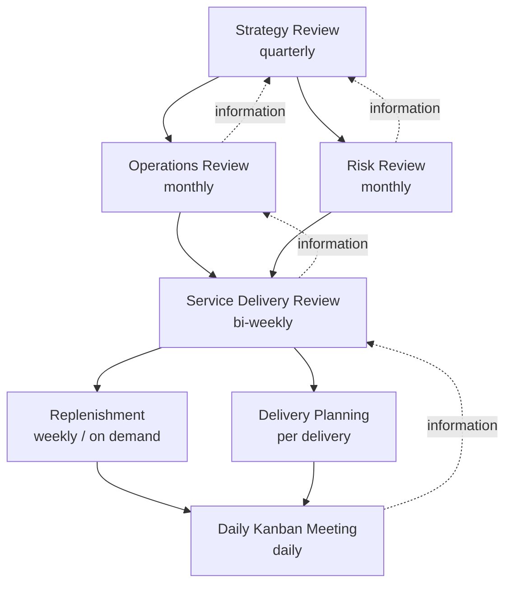

# Kanban Cadences (Feedback Loops)

> **TL;DR** — The Kanban Method suggests seven cadences that form a network of feedback loops: **Daily Kanban Meeting** (daily), **Replenishment** (weekly/on demand), **Delivery Planning** (per delivery), **Service Delivery Review** (bi-weekly), **Operations Review** (monthly), **Risk Review** (monthly), **Strategy Review** (quarterly). They decouple planning, delivery and review — unlike Scrum where all are tied to the sprint. Start with daily + replenishment + a retrospective-like review; add the rest as the organisation matures (KMM level 2–4). Each cadence should produce decisions, not status reports.

---

## 1. Overview

Downward arrows: decisions/direction. Dotted upward arrows: information/feedback.

| # | Cadence | Suggested frequency | Duration | Participants | Main question | Inputs | Outputs |
|---|---|---|---|---|---|---|---|
| 1 | **Daily Kanban Meeting** (Kanban standup) | Daily | ≤ 15 min | Team, SDM (facilitator); anyone can observe | How do we finish work in progress? What's blocked/aging? | Board, aging WIP, blockers | Unblocking actions, swarming, pull decisions |
| 2 | **Replenishment Meeting** | Weekly (or when Ready < threshold) | 30–60 min | SRM, customer/stakeholder reps, team reps | What should we commit to next? | Options (upstream), capacity (free slots), CoS, CoD | Items pulled across commitment point; ordered Ready |
| 3 | **Delivery Planning Meeting** | Per delivery cadence (e.g. bi-weekly, per release) | 30–60 min | SDM, team, downstream (ops, customers) | What will be delivered, how, and when? | Completed items, release constraints | Delivery plan; communication to customers |
| 4 | **Service Delivery Review** | Bi-weekly | 30–60 min | SDM, SRM, team, customer(s) | Are we fit for purpose? Are we meeting customer expectations (SLE)? | Lead time distribution, SLE adherence, blockers, quality, customer feedback | Policy changes, improvement actions, expectation adjustments |
| 5 | **Operations Review** | Monthly | 1–2 h | Managers of interdependent services, SDMs | How does the network of services perform? Inter-service dependencies? | Service delivery review outputs, demand/capability across services | Cross-service improvements, capacity reallocation |
| 6 | **Risk Review** | Monthly | 1 h | SDMs, SRMs, managers | What risks threaten delivery? What systemic blockers? | Blocker clusters, aging items, dependency data | Risk mitigation; changes to policies/CoS; hedging |
| 7 | **Strategy Review** | Quarterly | half-day | Senior leaders, SRMs | What services should we offer? Are we addressing the right markets? | Market data, ops review outcomes, risk review | Strategic direction, service portfolio changes, fitness criteria |

> The Kanban Method also references **Team Retrospective** as a common addition at team level (bi-weekly), focused on the team's way of working; Service Delivery Review is customer/service-focused.

---

## 2. Daily Kanban Meeting

### 2.1 Purpose
Coordinate the team to **finish** work and keep flow going. Not a status report; not "what did I do yesterday".

### 2.2 Format: walk the board right to left

1. Start at the column nearest Done; for each item ask: *What does it need to move right?*
2. Focus on: **blocked items**, **aging items** (exceeding SLE percentiles), **items in "Done" sub-columns** (queues), WIP limit breaches.
3. Expedite lane first.
4. Only after existing items: is there capacity to pull new work?
5. Capture issues needing deeper discussion → "after-party" (only relevant people stay).

### 2.3 Questions toolkit

- Which item is closest to done, and what's stopping it?
- Which items are older than our 85th percentile? Why? Split, swarm or escalate?
- What's blocked, since when, who's working on unblocking?
- Where are we breaching WIP limits? What will we stop starting?
- Who can help with the bottleneck column today?
- Is anything on the board not reflecting reality?

### 2.4 Daily Kanban vs Daily Scrum

| | Daily Kanban | Daily Scrum |
|---|---|---|
| Focus | Flow of items | Progress toward Sprint Goal |
| Structure | Walk the board (right to left) | Developers choose structure (2020 guide); three questions optional |
| Participants | Team; anyone may attend | Developers (PO/SM optional as developers) |
| Timebox | ~15 min (not prescribed) | 15 min |

Both work best when item-focused rather than person-focused.

### 2.5 Anti-patterns

- Round-robin per person ("Yesterday I...").
- Manager asking for status and assigning work.
- Discussing solutions in depth for 30 minutes.
- Ignoring the oldest items because they're "big".
- Not updating the board before the meeting.

---

## 3. Replenishment Meeting

### 3.1 Purpose
Select items from the option pool (upstream) to move across the **commitment point**, keeping the downstream system appropriately fed.

### 3.2 Inputs
- Free capacity: Ready column count vs limit; throughput forecast.
- Candidate items with: value/CoD estimate, class of service, size check (fits SLE?), dependencies.
- Capacity allocation per work type/CoS.

### 3.3 Agenda (≈45 min)

1. Review current state of Ready column & board (5 min).
2. Review fixed-date items: any that must start now based on lead-time percentiles? (5 min)
3. Present candidate options (SRM) with CoD rationale (15 min).
4. Check readiness: acceptance criteria, size, dependencies (10 min).
5. Select & order up to the free slots; respect allocation (5 min).
6. Communicate decisions to stakeholders not present (5 min).

### 3.4 Frequency heuristics

- **Order point**: replenish when Ready falls to N (e.g. 2). Size the Ready limit ≈ throughput × replenishment interval (+ safety). E.g. throughput 6/week, weekly replenishment → Ready ≈ 6–8.
- More frequent replenishment → smaller Ready → fresher prioritisation, less waste of stale commitment.
- On-demand replenishment possible for small teams with available SRM.

### 3.5 Selection techniques

| Technique | Description |
|---|---|
| CD3 / WSJF | Cost of delay ÷ duration — see [queueing-and-flow-theory.md](queueing-and-flow-theory.md) |
| Capacity allocation | Fill slots per type: e.g. 4 features, 1 defect, 1 tech |
| Fixed-date scheduling | Start date = due date − 85th/95th percentile lead time |
| Dot voting by stakeholders | Simple, transparent; risk of politics |
| Customer-driven | Rotating customer allocation of slots (multi-customer services) |

### 3.6 Anti-patterns

- Committing more than free capacity (overfilling Ready).
- Re-ordering Ready every day (thrash).
- Replenishment by individual stakeholders bypassing the meeting.
- No upstream: items arrive unrefined; replenishment becomes refinement.

---

## 4. Delivery Planning Meeting

### 4.1 Purpose
Plan the hand-off of completed work to customers — especially when delivery isn't continuous (mobile app store releases, hardware, regulated releases, client deliveries).

### 4.2 Agenda
1. What's done or expected done by the delivery date (using cycle time percentiles for in-flight items)?
2. Dependencies/coordination with ops, support, marketing, customers.
3. Risks: release notes, migrations, rollback plan, feature toggles.
4. Decide content and communicate.

### 4.3 Notes
- In continuous deployment environments, this cadence collapses into automated pipeline + occasional release communication planning.
- Decoupling **replenishment cadence** from **delivery cadence** is a key Kanban advantage over sprints.

---

## 5. Service Delivery Review (SDR)

### 5.1 Purpose
Customer-focused review: *Is our service fit for purpose?* Compare actual performance to customer expectations, then evolve policies.

### 5.2 Typical agenda (45–60 min)

| Section | Content |
|---|---|
| Metrics | Lead time distribution vs SLE (per work type/CoS), throughput trend, WIP trend, aging, flow efficiency |
| Quality | Escaped defects, incidents, rework |
| Blockers | Blocker clustering results (Pareto) |
| Customer feedback | Satisfaction, complaints, NPS-like signals |
| Policies | Proposed policy changes (WIP, CoS, pull criteria) |
| Expectations | Adjust SLE or customer expectations if needed |
| Actions | Owners, experiments, review date |

### 5.3 Example SLE review

| Work type | SLE | Achieved last 4 weeks | Action |
|---|---|---|---|
| Feature (standard) | 85% ≤ 12 days | 78% | Check aging items > 12d; 3 were too large → enforce split at replenishment |
| Defect S2 | 85% ≤ 3 days | 92% | OK |
| Support request | 85% ≤ 1 day | 70% | Add "Triage" policy; dedicate 1 person rotation |

### 5.4 SDR vs Sprint Review vs Retrospective

| | SDR | Sprint Review | Retro |
|---|---|---|---|
| Focus | Service performance vs customer expectations | Product increment & adaptation of Product Backlog | Team's way of working |
| Audience | Team + customers | Scrum Team + stakeholders | Scrum Team |
| Uses metrics | Heavily | Optional | Optional |

---

## 6. Operations Review

### 6.1 Purpose
System-of-systems view: review demand and capability across **multiple interdependent services**; resolve cross-service problems; allocate capacity. Anderson considers it the keystone cadence for organisational improvement ("the operations review is the keystone of Kanban at scale").

### 6.2 Agenda (60–120 min)
1. Previous actions follow-up.
2. Per service: short dashboard (lead time, throughput, SLE adherence, blockers, demand trend) — 5 min each, standardised format.
3. Cross-cutting issues: dependency delays, shared bottlenecks, staffing.
4. Decisions: capacity shifts, policy changes across services, improvement initiatives.
5. Actions with owners.

### 6.3 Tips
- Standardised one-page service report.
- Data-driven; disallow anecdotes without data (or bring both).
- Keep it at the system level; no individual performance discussion.

---

## 7. Risk Review

### 7.1 Purpose
Understand and respond to risks to delivery: blockers, dependencies, technical risk, people risk, market risk.

### 7.2 Inputs & tools
- **Blocker clustering**: categorise blocker stickers/flags, Pareto by count and total days blocked.
- Aging items & dependency maps.
- Risk taxonomy per service.
- Monte Carlo forecasts for key deliveries (probability of hitting dates).

### 7.3 Outputs
- Mitigation actions (e.g. negotiate SLA with dependent team, change architecture to remove dependency).
- Policy changes (e.g. "don't commit items with unresolved external dependencies").
- Adjustments to classes of service / hedging capacity.

### 7.4 Blocker clustering example

| Blocker category | Count (month) | Total blocked days | Countermeasure |
|---|---|---|---|
| Waiting for test environment | 11 | 34 | Ephemeral environments per PR |
| Waiting for other team's API | 6 | 41 | Contract-first API + stubs; dependency SLE |
| Unclear requirements | 8 | 15 | Three amigos before commitment |
| Access/permissions | 4 | 9 | Self-service access request automation |

Prioritise by total blocked days (impact), not just count.

---

## 8. Strategy Review

### 8.1 Purpose
Align service portfolio with business strategy and market: what services to offer, to whom, with what fitness criteria; which to retire.

### 8.2 Agenda (half-day, quarterly)
1. Market/environment changes; customer segment review.
2. Fitness criteria per segment (lead time, quality, predictability expectations).
3. Inputs from operations & risk reviews.
4. Decide: new services, retire services, changes to investment allocation (e.g. run/grow/transform).
5. Communicate strategic changes into replenishment policies.

### 8.3 Link to other frameworks
- OKRs/hoshin kanri: strategy review sets objectives; portfolio replenishment pulls initiatives.
- Flight Level 3 strategy board.
- SAFe: Lean Portfolio Management / Portfolio Sync / strategic portfolio review.

---

## 9. Mapping cadences to Scrum events

| Kanban cadence | Closest Scrum equivalent | Difference |
|---|---|---|
| Daily Kanban Meeting | Daily Scrum | Flow vs Sprint Goal |
| Replenishment | Sprint Planning (what) / Backlog refinement | Continuous, decoupled from sprint |
| Delivery Planning | Release planning (not in Scrum Guide) | Per delivery |
| Service Delivery Review | Sprint Review + part of Retro | Service/customer fitness |
| Operations Review | Scrum of Scrums / Nexus / SoS (partial) | Data-driven, cross-service |
| Risk Review | (none) — ROAM in SAFe PI planning | Ongoing risk management |
| Strategy Review | (none) — portfolio planning | Strategic |
| Retrospective | Sprint Retrospective | Same purpose |

---

## 10. Minimum viable cadence set

| Maturity | Cadences |
|---|---|
| Starting team | Daily + Replenishment + Retrospective (bi-weekly) |
| Customer-driven (KMM 2) | + Service Delivery Review (can merge with retro initially) |
| Fit-for-purpose (KMM 3) | + Delivery Planning (if non-continuous) |
| Multi-service (KMM 3–4) | + Operations Review + Risk Review |
| Enterprise (KMM 4–5) | + Strategy Review |

Combine where sensible: a small org can run "Ops + Risk Review" as one monthly meeting.

---

## 11. Example cadence calendar (two-week rhythm)

| Week | Mon | Tue | Wed | Thu | Fri |
|---|---|---|---|---|---|
| 1 | Daily | Daily + **Replenishment** | Daily | Daily | Daily |
| 2 | Daily | Daily + **Replenishment** | Daily | Daily + **Service Delivery Review** | Daily + **Retro** |
| Monthly (first Thu) | | | | **Ops + Risk Review** | |
| Quarterly | | | **Strategy Review** | | |

---

## 12. Common mistakes

1. **All cadences at once** — overhead with no maturity; start minimal.
2. **Status meetings in disguise** — no decisions, only reporting.
3. **No metrics prepared** — reviews become opinion contests; automate dashboards.
4. **Customers absent from SDR** — becomes an internal retro.
5. **Ops review blaming teams** — creates fear; data gets gamed.
6. **Action items without follow-up** — always start with last actions.
7. **Replenishment overrides** — stakeholders injecting work mid-week without CoS → policies are fiction.

---

## References

- Kanban University — <https://kanban.university/>
- The Kanban Guide — <https://kanbanguides.org/>
- David J. Anderson & Andy Carmichael, *Essential Kanban Condensed* (2016) — cadences chapter
- David J. Anderson, *Kanban* (2010) — ch. "Operations Review"
- Mike Burrows, *Kanban from the Inside* (2014)
- Wikipedia: Kanban (development) — <https://en.wikipedia.org/wiki/Kanban_(development)>
- Related: [kanban-method.md](kanban-method.md), [flow-metrics.md](flow-metrics.md), [retrospectives-and-team-health.md](retrospectives-and-team-health.md)
- Facilitation techniques: [../09-leadership-teams-facilitation/README.md](../09-leadership-teams-facilitation/README.md)
