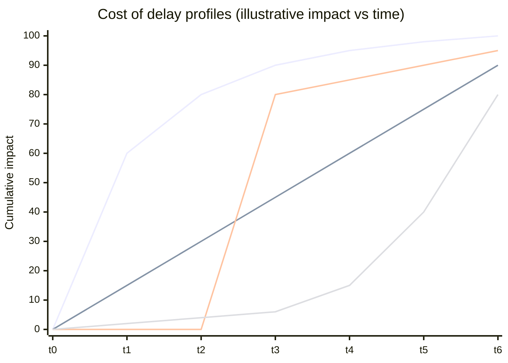
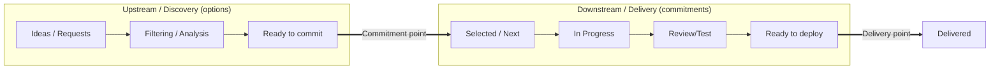

# The Kanban Method

> **TL;DR** — Kanban for knowledge work is an evolutionary approach to managing and improving services by visualising work, limiting work in progress (WIP) and managing flow. Two main "schools": the **Kanban Method** (David J. Anderson, Kanban University: foundational principles + 6 general practices, cadences, STATIK, Kanban Maturity Model) and **The Kanban Guide** (Daniel Vacanti & Yuval Yeret / ProKanban.org, 2020 & later revisions: 3 practices — defining & visualising the workflow, actively managing items, improving the workflow — plus 4 flow metrics). Both: start with what you do now, pull work when capacity is available, make policies explicit, improve with data. Kanban has no prescribed roles, iterations or estimates.

---

## 1. Origins

| Year | Milestone |
|---|---|
| 1940s–50s | Taiichi Ohno introduces kanban (看板, "signboard/visual card") at Toyota: cards authorise production/withdrawal; number of cards caps inventory |
| 2004 | David J. Anderson applies a virtual kanban system at Microsoft (XIT sustained engineering team) — lead times drop dramatically, throughput rises |
| 2006–2007 | Corbis — board with WIP limits, classes of service, cadences; Kanban Method takes shape. Lean Kanban community forms (Anderson, Donald Reinertsen, Jim Benson, Corey Ladas, Karl Scotland, David Joyce) |
| 2008 | Corey Ladas, *Scrumban* |
| 2009 | Lean Kanban University founded (later Kanban University) |
| 2010 | Anderson, *Kanban: Successful Evolutionary Change for Your Technology Business* ("the blue book") |
| 2011 | Jim Benson & Tonianne DeMaria Barry, *Personal Kanban* |
| 2013 | Daniel Vacanti, *Actionable Agile Metrics for Predictability* (2015) — flow metrics emphasis |
| 2016 | Anderson & Carmichael, *Essential Kanban Condensed* |
| 2018 | Kanban Maturity Model (Anderson & Bozheva) |
| 2020 | *The Kanban Guide for Scrum Teams* (Scrum.org, Vacanti & Yeret); *The Kanban Guide* (Vacanti & Coleman), kanbanguides.org; ProKanban.org founded |
| 2020s | Kanban University publishes *The Official Guide to the Kanban Method*; Flight Levels, Kanban at scale |

### 1.1 Physical kanban vs virtual kanban

| Toyota (physical) | Knowledge work (virtual) |
|---|---|
| Card *is* the signal to produce/withdraw | Free WIP slot *is* the signal to pull |
| Number of cards = inventory cap | WIP limit = cap on work in progress |
| Repetitive, low-variability work | High variability, unique items |
| Optimise for takt | Optimise for lead time & predictability |

A board **without WIP limits** is a visual task board, not a kanban system — there is no pull signal.

---

## 2. The two definitions compared

| Aspect | Kanban Method (Kanban University) | Kanban Guide (kanbanguides.org / ProKanban) |
|---|---|---|
| Authors | David J. Anderson & community | Daniel Vacanti, Jim Coleman (and earlier Yuval Yeret for Scrum teams) |
| Definition | Method for defining, managing and improving services that deliver knowledge work | Strategy for optimising the flow of value through a process using a visual, pull-based system |
| Core | Values, agendas, foundational principles (change management + service delivery), 6 general practices | 3 practices + 4 measures of flow |
| Scope | Organisational change; services; scaling; cadences; maturity model | Minimal; deliberately small (~10 pages) |
| Cadences | 7 suggested meetings | Not prescribed |
| Classes of service | Core concept | Optional |
| Metrics | Lead time, delivery rate, CFD, etc. | WIP, throughput, work item age, cycle time (mandatory) |
| Roles | None prescribed; SDM & SRM emerged as typical | None |
| Training | KMP I/II, TKP, KCP, AKT | PKT, PKT-AM, etc. (ProKanban) |
| Size | Large body of knowledge | "Minimal viable" guide |

Both are compatible. Teams commonly use the Kanban Guide's metrics with the Kanban Method's cadences and change-management approach.

---

## 3. Kanban Method (Kanban University)

### 3.1 Values (9)

Transparency, Balance, Collaboration, Customer focus, Flow, Leadership, Understanding, Agreement, Respect.

### 3.2 Three agendas

| Agenda | Focus |
|---|---|
| **Sustainability** | Balance demand with capability; avoid overburdening; sustainable pace |
| **Service orientation** | Fitness for purpose from the customer's perspective; meet service level expectations |
| **Survivability** | Adapt to remain competitive; strategic agility; long-term |

### 3.3 Foundational principles

**Change management principles**

1. **Start with what you do now** — understand current processes as actually practiced; respect current roles, responsibilities and job titles.
2. **Agree to pursue improvement through evolutionary change** — incremental, not big-bang.
3. **Encourage acts of leadership at every level** — from individual contributor to senior management.

**Service delivery principles**

1. **Understand and focus on customers' needs and expectations.**
2. **Manage the work; let people self-organise around it.**
3. **Evolve policies to improve customer and business outcomes.**

(Older formulations: "Respect the current process, roles, responsibilities and titles" was separate; the wording varies slightly across editions.)

### 3.4 The six general practices

| # | Practice | What you do | Typical artefacts | Signs it's missing |
|---|---|---|---|---|
| 1 | **Visualise** (the work, workflow and business risks) | Map workflow states; one card per work item; show blockers, classes of service, types, age | Board, card design, blocker tags, swimlanes | Hidden work, side-channel requests, "invisible" support load |
| 2 | **Limit WIP** | Set limits per column/swimlane/person/system; pull only when below limit | WIP limits, CONWIP, buffers | Everyone busy, nothing finishing, long lead times |
| 3 | **Manage flow** | Monitor and actively manage movement; reduce delays; unblock; swarm | CFD, aging chart, daily Kanban meeting | Items age silently; firefighting |
| 4 | **Make policies explicit** | Write down pull criteria, DoD per column, WIP limits, CoS rules, replenishment rules | Policy text on board, column exit criteria | Arguments about "is this done?", inconsistent decisions |
| 5 | **Implement feedback loops** | Regular cadences for review and decision-making | 7 Kanban cadences, metrics review | Same problems recur; no learning |
| 6 | **Improve collaboratively, evolve experimentally** (using models and the scientific method) | Use models (TOC, queueing, Lean, Real Options) to propose changes; run experiments | A3s, PDCA, hypotheses | Changes by opinion; no measurement |

### 3.5 Kanban "lens" — service-oriented thinking

- Every team provides one or more **services** to customers (internal or external).
- A **kanban system** is a WIP-limited pull system implementing a service's workflow.
- Network of services: organisation = interdependent services; scale by connecting kanban systems (not by imposing a framework).
- Each service has: customers, request types, service level expectations, a commitment point, a delivery point, policies, and cadences.

### 3.6 Roles that emerged

| Role | Responsibility | Analogous to |
|---|---|---|
| **Service Request Manager (SRM)** | Understands customer needs; facilitates replenishment and upstream; owns ordering/selection policies | Product Owner / product manager (but service-focused) |
| **Service Delivery Manager (SDM)** | Owns flow of work downstream; facilitates daily meeting, delivery planning; removes impediments | Flow manager / Scrum Master-ish / delivery lead |

Both are *roles*, not job titles, and often added later; Kanban starts with existing roles.

### 3.7 STATIK — Systems Thinking Approach To Introducing Kanban

| Step | Activity | Output | Key questions |
|---|---|---|---|
| 0 | Identify services | Service list | Which services do we provide? Start with one. |
| 1 | **Understand what makes the service fit for purpose** (sources of dissatisfaction) | Internal (team) and external (customer) pain points | What do customers complain about? What frustrates the team? |
| 2 | **Analyse demand** — sources, types, arrival rates, patterns | Demand analysis | Where does work come from? How much? How variable? |
| 3 | **Analyse capability** — current lead times, delivery rate, quality | Lead time distribution, throughput | How long do things actually take (per type)? |
| 4 | **Model the workflow** — knowledge discovery activities | Workflow states | What dominant learning activity happens in each phase? |
| 5 | **Identify classes of service** | CoS definitions & policies | Which items have different urgency/cost of delay profiles? |
| 6 | **Design the kanban system** — WIP limits, commitment & delivery points, replenishment | System design | Where is the commitment point? What limits? What cadences? |
| 7 | **Socialise the design and negotiate implementation** | Agreement, rollout plan | Who must agree? What's the smallest safe start? |

STATIK is iterative — rerun when the service, demand, or context changes.

### 3.8 Kanban Maturity Model (KMM)

Seven maturity levels (Anderson & Bozheva), each with specific practices across the six general practices plus "values" and "culture". Simplified:

| Level | Name | Characteristics | Typical practices |
|---|---|---|---|
| 0 | **Oblivious** | Individuals; no notion of process | Personal kanban |
| 1 | **Team-focused** | Team aware of its process; inconsistent outcomes | Team board, basic WIP per person, daily meeting |
| 2 | **Customer-driven** | Consistent process; customer-oriented services emerging | Aggregated team boards; defined commitment point; basic metrics |
| 3 | **Fit-for-purpose** | Consistently meets customer expectations; service level met | End-to-end flow, SLEs, CoS, CFD, delivery planning, service delivery review |
| 4 | **Risk-hedged** | Business risks managed; quantitative forecasting | Risk review, Monte Carlo, hedging across portfolio |
| 5 | **Market leader** | Optimised; right-sized; responds to market strategically | Strategy review, operations review driving changes |
| 6 | **Built for survival** | Reinvents itself; long-term survival | Strategic reinvention |

Use KMM to: (a) avoid "false summits" (applying advanced practices on immature foundations), (b) pick the next appropriate practices, (c) appraise. Organisations usually have a mix of levels; aim for consistent Level 2–3 before Level 4 practices.

### 3.9 Kanban "transitional" vs "true" levels — practical progression

1. Visualise current work (proto-kanban, no WIP limits yet).
2. Add per-person WIP limits (e.g. 1–2 each) — first pull signal.
3. Add column/stage WIP limits; separate doing/done.
4. Define commitment & delivery points; measure lead time.
5. Add classes of service and SLEs.
6. Add replenishment & delivery planning cadences.
7. Connect upstream (discovery) kanban and downstream (delivery).
8. Portfolio/Flight Level 3 kanban; operations & strategy reviews.

---

## 4. The Kanban Guide (Vacanti & Coleman, kanbanguides.org)

### 4.1 Definition of workflow (DoW)

Kanban requires a team (the "Kanban system members") to explicitly define its **Definition of Workflow**, which includes at minimum:

- Definition of the **units of value** (work items) moving through the workflow.
- Definition of **when work items are started and finished** (commitment & delivery points).
- One or more defined **states** that work items flow through from started to finished.
- Definition of **how WIP will be controlled** from started to finished.
- Explicit **policies** about how work items flow through each state.
- A **service level expectation (SLE)** — forecast of how long it should take a single item to flow from started to finished (e.g. 85% within 10 days).

### 4.2 The three practices

| Practice | Content |
|---|---|
| **1. Defining and visualising the workflow** | Create the DoW and a visualisation (board) |
| **2. Actively managing items in a workflow** | Control WIP; avoid items piling up; ensure items don't age unnecessarily; unblock; respond to SLE breaches |
| **3. Improving the workflow** | Use flow measures and feedback to evolve the DoW |

### 4.3 The four mandatory flow measures

| Measure | Definition (Kanban Guide sense) |
|---|---|
| **WIP** | Number of items started but not finished |
| **Throughput** | Number of items finished per unit of time |
| **Work item age** | Elapsed time since an item started (for items still in progress) |
| **Cycle time** | Elapsed time from when an item started to when it finished |

Note: the Kanban Guide uses "cycle time" for started→finished; the Kanban Method often uses "lead time" (commitment→delivery) and "customer lead time". See [flow-metrics.md](flow-metrics.md) for terminology reconciliation.

### 4.4 Kanban Guide for Scrum Teams (2020, Scrum.org)

Adds flow to Scrum without changing Scrum:

- Sprint Planning uses throughput-based forecasting rather than velocity.
- Daily Scrum focuses on flow: blocked items, aging items, WIP.
- Sprint Review can include flow metrics.
- Retrospective inspects the Definition of Workflow.
- Sprint Backlog = WIP-limited flow; Sprint Goal still central.

See [scrum.md](scrum.md) and Scrumban below.

---

## 5. Classes of Service (CoS)

A class of service is a policy-driven treatment of work items based on their cost-of-delay profile and risk.

### 5.1 The four archetypal classes

| Class | Cost of delay profile | Policy examples | Visual | Typical capacity share |
|---|---|---|---|---|
| **Expedite** | Critical/immediate; very high cost of delay from now | Bypasses WIP limits (but max 1 at a time); pulled immediately; swarm; may interrupt other work; can be released out of cadence | Dedicated top swimlane, red card | ≤ 5–10% (if more, fix the system) |
| **Fixed date** | Step function — cost jumps at a known date (regulatory, event, contract) | Start based on lead-time distribution so it finishes before deadline (e.g. start when date − 95th percentile LT); may be promoted to expedite if at risk | Purple card with due date | ~10–30% |
| **Standard** | Linear (or convex) — cost accrues roughly evenly from now | FIFO within class (or per priority); subject to WIP limits; SLE e.g. 85% in 10 days | White/yellow | ~50–70% |
| **Intangible** | Low now, may rise sharply later (tech debt, upgrades, platform improvement) | Pulled when capacity allows; can be pre-empted; allocation guarantees progress | Green card | ~10–20% |

### 5.2 Cost of delay profiles

Lines (top to bottom of legend order): expedite (steep immediately), standard (linear), fixed date (step at deadline), intangible (low then rising).

| Profile | Shape | Example |
|---|---|---|
| Expedite | Steep immediately | Production outage, security vulnerability being exploited |
| Fixed date | Step function | Regulatory change effective 1 Jan; trade show demo |
| Standard (linear) | Linear | Most new features |
| Standard (urgent/convex) | Increasing slope (lost market share) | Competitor launched similar feature |
| Intangible | Flat then rises | Framework upgrade before end-of-life, refactoring |

**Cost of delay** (Reinertsen) = rate of value lost per unit of time by not delivering. **CD3** (Cost of Delay Divided by Duration) = CoD / duration → prioritise highest CD3 first (WSJF in SAFe approximates this). See [queueing-and-flow-theory.md](queueing-and-flow-theory.md).

### 5.3 CoS policy checklist

- [ ] Who can declare an expedite? (Named role; not "anyone who shouts")
- [ ] Max simultaneous expedites (usually 1)?
- [ ] Fixed date: how far ahead do we start (percentile of LT)?
- [ ] Capacity allocation per class (swimlane WIP)?
- [ ] Selection order within a class (FIFO? CD3?)
- [ ] Do expedites count against WIP? (commonly: they "borrow" capacity; others wait)
- [ ] Review: is the expedite rate trending up? → systemic problem

### 5.4 Capacity allocation by work type

Separate from CoS: allocate WIP to **work item types** (e.g. Features 60%, Defects 20%, Tech debt 15%, Support 5%) to protect investment balance. Implement via swimlanes with WIP or ratios in replenishment.

---

## 6. WIP limits

### 6.1 Why limiting WIP works

- **Little's Law**: average lead time = average WIP / average throughput. At constant throughput, less WIP → shorter lead time.
- Less **context switching** (Weinberg's rule of thumb: each additional concurrent project costs ~20% of time to switching).
- Faster **feedback**, less rework.
- **Exposes bottlenecks and blockers** — when the limit is reached, people must swarm instead of starting new work.
- Creates **slack**, which enables improvement and absorbs variability.

### 6.2 Setting initial WIP limits — heuristics

| Heuristic | Rule | Notes |
|---|---|---|
| Observe current WIP | Start at current average WIP, then reduce by ~10–20% steps | Least disruptive; "start with what you do now" |
| Per-person | 1–2 items per person in active states | Team of 6 → system WIP ≈ 6–12 |
| Team size × 1.5 | Column limit ≈ people in that role × 1.5 | Allows small waiting buffer |
| Pairing-based | Number of pairs + 1 | For pairing teams |
| Little's Law target | WIP = target LT × throughput | E.g. TP 5/week, target LT 2 weeks → WIP 10 |
| Halve it | Halve current WIP as an experiment | Aggressive; reveals pain fast |
| Swarm-friendly | Fewer than people (e.g. team of 6 → WIP 4) | Forces collaboration; good for mobbing |
| Buffer columns | Small (1–3) based on variability of downstream | Too large → hidden inventory |

### 6.3 Tuning WIP limits

| Signal | Interpretation | Action |
|---|---|---|
| Limit frequently breached | Limit too low *or* policy not respected | Discuss in retro; first enforce, then adjust |
| People idle often and waiting is long elsewhere | Limit in the wrong place or upstream starvation | Adjust replenishment; swarm downstream |
| Limit never reached | Limit too high — no pull signal | Lower by 1 |
| Columns before a step always full | Bottleneck downstream | Elevate constraint (TOC) |
| Long aging items while limit respected | Items too large or blocked | Split items; blocker policy |
| Lots of blocked items "parked" | Blocked items consuming WIP should *stay* counted — pressure to unblock | Don't exempt blocked items |

Rule of thumb: change one limit at a time, by one, and observe for 2–4 weeks.

### 6.4 Types of WIP limits

- **Per column** (most common).
- **Per column group** (e.g. "Development (Doing + Done) ≤ 5").
- **Per swimlane / class of service**.
- **Per person** (avatars; each person has N avatars).
- **CONWIP** — single limit for the whole system between commitment and delivery points.
- **Per work type** — capacity allocation.
- **Upstream (options) limits** — limit size of "Ready/Next" and discovery stages.

---

## 7. Commitment point and delivery point

| Concept | Definition | Why it matters |
|---|---|---|
| **Commitment point** | Point where we agree to do the item; customer and team commit; the clock for (system) lead time starts | Before it: options, can be discarded freely. After it: we expect to finish; abandonment is waste |
| **Delivery point** | Point where the item is delivered to the customer (in their hands) | Lead time clock stops |
| **Customer lead time** | From customer request to delivery | What customers experience |
| **System lead time** | Commitment → delivery | What the team controls |

Upstream items are **options**; options have value but discarding them costs little — discard rate of 50% upstream is healthy.

---

## 8. Upstream (discovery) Kanban

- Separates **what to build** (options) from **building it** (commitments).
- Typical states: Ideas → Pending/Triage → Analysis/Hypothesis → Experiment/Validation → Ready.
- WIP limits apply to discovery work too (analysis capacity is finite).
- Policies: exit criteria per stage, discard criteria, max age (e.g. options older than 90 days auto-discarded).
- Replenishment meeting pulls from "Ready" across the commitment point.
- Pairs naturally with product discovery techniques: opportunity solution trees, hypothesis boards, dual-track agile. See [../02-product-management/README.md](../02-product-management/README.md).

**Dual-track agile vs upstream kanban**: dual-track is discovery + delivery as two parallel tracks; upstream kanban makes the discovery track an explicit, WIP-limited flow with a visible commitment point.

---

## 9. Kanban at different scales

### 9.1 Personal Kanban (Jim Benson)

Two rules: **visualise your work** and **limit your WIP**. Minimal board: Backlog → Doing (WIP 3) → Done. Useful for leads/architects juggling many threads. Variants: "Today" column, "Waiting on" column for delegated work, "Pen" for parked items.

### 9.2 Team Kanban

The typical board; see [kanban-board-design.md](kanban-board-design.md).

### 9.3 Portfolio Kanban

| Aspect | Description |
|---|---|
| Items | Initiatives, epics, projects, business outcomes |
| Typical states | Funnel → Reviewing → Analysing → Ready (portfolio backlog) → Implementing (MVP) → Implementing (persevere) → Done/Retired |
| WIP | Limit number of initiatives in progress per value stream/portfolio — the highest-leverage WIP limit in most organisations |
| Cadence | Monthly/quarterly portfolio replenishment; strategy review |
| Metrics | Initiative lead time, throughput of initiatives, % of capacity on strategic themes |
| Ties to | Lean Portfolio Management (SAFe), Flight Level 3, OKRs |

Key insight: team-level flow can't compensate for portfolio overload. If 30 initiatives run in parallel across 10 teams, every initiative is slow regardless of team practices.

### 9.4 Flight Levels (Klaus Leopold)

| Level | Focus | Board example |
|---|---|---|
| Flight Level 1 — Operational | Team work | Team kanban |
| Flight Level 2 — Coordination | End-to-end value stream across teams | Program/product board showing features flowing through multiple teams |
| Flight Level 3 — Strategic | Portfolio, strategy | Portfolio initiatives board |

Key message: improve at the level where the problem is; agile teams (FL1) alone don't create business agility. See [scaling-frameworks.md](scaling-frameworks.md).

### 9.5 Scaling Kanban (Kanban Method view)

- Scale **out** by connecting services (networks of kanban systems), **not** by imposing structure.
- Feedback loops at multiple levels (team, service, portfolio) — see [kanban-cadences.md](kanban-cadences.md).
- Use **two-tiered boards** (feature/epic swimlanes with child-items) or **linked boards** (parent board with child boards).
- Dependency visualisation: dependency cards, "waiting for team X" states, dependency maps.

---

## 10. Scrumban

| Origin | Corey Ladas (2008): using Kanban to evolve a Scrum team toward pull/flow |
|---|---|
| Modern usage | Any hybrid of Scrum events (sprints, review, retro) with Kanban flow (WIP limits, pull, flow metrics) |

### 10.1 Typical Scrumban setup

| Element | Scrumban choice |
|---|---|
| Iterations | Optional; often keep a 2-week cadence for planning/review/retro |
| Planning | On-demand replenishment when "Ready" drops below threshold ("order point") |
| Commitment | To flow & SLE rather than to sprint scope; or Sprint Goal + WIP limits |
| Estimation | Often dropped; right-sizing items (to fit SLE) instead of points |
| Roles | Keep PO/SM if useful |
| Metrics | Cycle time, throughput, CFD, aging chart |
| Releases | Continuous or on cadence |
| Board | Persistent board (not reset each sprint) |

### 10.2 When Scrumban fits

- Teams with significant unplanned work (support, ops, platform) that break sprint commitments.
- Scrum teams wanting better predictability via flow metrics.
- Transition path in either direction.

### 10.3 Pitfalls

- "Scrumban" as an excuse to drop retros and reviews.
- Keeping sprint resets *and* WIP limits without understanding which provides the cadence.
- Treating it as neither — no WIP limits, no sprints, just a board.

---

## 11. Kanban vs Scrum quick comparison

| Dimension | Kanban | Scrum |
|---|---|---|
| Cadence | Continuous flow; decoupled cadences for planning, delivery, review | Fixed-length sprints (≤ 1 month) |
| Roles | None prescribed (SRM/SDM optional) | Product Owner, Scrum Master, Developers |
| Commitment | Per item at commitment point; SLE | Sprint Goal |
| WIP control | Explicit WIP limits | Implicit via sprint scope |
| Change during work | Anytime upstream; reprioritise "Ready" freely | Sprint Backlog can change, Sprint Goal protected |
| Estimation | Not required; right-sizing; forecasting from throughput | Commonly story points (not required by guide) |
| Metrics | Cycle time, throughput, WIP, age, CFD | Not prescribed; velocity/burndown common |
| Board | Persistent; reflects workflow | Often reset per sprint |
| Best for | Variable demand, service/support/platform, mature teams, continuous delivery | New product development needing rhythm, cross-functional teams new to agile |
| Change approach | Evolutionary — start with what you do now | Revolutionary — adopt the framework |

---

## 12. When to use / when not

**Kanban fits well when**
- Work arrives unpredictably (support, ops, platform, BAU + projects mix).
- You can't reorganise the team immediately (start with what you do now).
- Teams already deliver continuously and sprints add overhead.
- You need predictability and forecasting based on data.
- Multiple teams/services must be coordinated end-to-end.

**Kanban is harder when**
- Team lacks discipline to respect WIP limits (it becomes a to-do board).
- Leadership expects "commitments" per period and won't accept probabilistic forecasts.
- No cadence for reflection is established — Kanban without feedback loops stagnates.
- Work items are huge and unsplittable (aging, invisible progress).

---

## 13. Common mistakes

1. **No WIP limits** — "we do Kanban" = we have a Jira board. Without limits there is no pull, no flow management.
2. **WIP limits ignored** — limits on the board but breached daily without conversation.
3. **Excluding blocked items from WIP** — removes pressure to unblock.
4. **Too many columns** mirroring every specialist → handoffs institutionalised.
5. **No commitment point** — can't measure lead time; everything is "in the backlog".
6. **Infinite backlog** — "Ready" with 400 items. Limit the options too.
7. **Expedite inflation** — everything is urgent; expedite share > 10%.
8. **No cadences** — no replenishment, no retros → stagnation.
9. **Measuring people, not flow** — individual throughput leaderboards.
10. **Big-bang Kanban rollout** — contradicts "evolutionary change".
11. **Ignoring upstream** — optimising delivery while discovery sends a firehose of unrefined demand.
12. **Treating Kanban as "no planning"** — Kanban plans via replenishment, delivery planning and forecasting.

---

## 14. Kanban introduction checklist

- [ ] Identified the service(s) and their customers
- [ ] Collected sources of dissatisfaction (internal/external)
- [ ] Analysed demand (types, sources, arrival rate)
- [ ] Measured current lead time & throughput (even roughly)
- [ ] Mapped workflow as knowledge-discovery states
- [ ] Defined work item types and card design
- [ ] Defined commitment and delivery points
- [ ] Set initial WIP limits (system + per state)
- [ ] Defined classes of service (start with standard + expedite)
- [ ] Wrote explicit policies (pull criteria, DoD per column, blocker handling)
- [ ] Defined SLE (e.g. 85% within X days)
- [ ] Established cadences: daily, replenishment, retro/service delivery review
- [ ] Agreed review date for the design (4–6 weeks)

---

## References

- Kanban University — <https://kanban.university/>
- The Kanban Guide (Vacanti & Coleman) — <https://kanbanguides.org/>
- ProKanban.org — <https://www.prokanban.org/>
- Scrum.org — Kanban Guide for Scrum Teams — <https://www.scrum.org/>
- Wikipedia: Kanban (development) — <https://en.wikipedia.org/wiki/Kanban_(development)>
- Wikipedia: Kanban (manufacturing) — <https://en.wikipedia.org/wiki/Kanban>
- Wikipedia: Scrumban — <https://en.wikipedia.org/wiki/Scrumban>
- Personal Kanban — <https://www.personalkanban.com/>
- Flight Levels — <https://www.flightlevels.io/>
- David J. Anderson, *Kanban: Successful Evolutionary Change for Your Technology Business* (2010)
- David J. Anderson & Andy Carmichael, *Essential Kanban Condensed* (2016)
- David J. Anderson & Teodora Bozheva, *Kanban Maturity Model* (2018; 2nd ed. 2020)
- Mike Burrows, *Kanban from the Inside* (2014)
- Daniel Vacanti, *Actionable Agile Metrics for Predictability* (2015); *When Will It Be Done?* (2020)
- Corey Ladas, *Scrumban: Essays on Kanban Systems for Lean Software Development* (2009)
- Jim Benson & Tonianne DeMaria Barry, *Personal Kanban* (2011)
- Klaus Leopold, *Rethinking Agile* (2020); *Practical Kanban* (2017)
- Mattias Skarin, *Real-World Kanban* (2015)
- Henrik Kniberg & Mattias Skarin, *Kanban and Scrum — Making the Most of Both* (2010, InfoQ)
