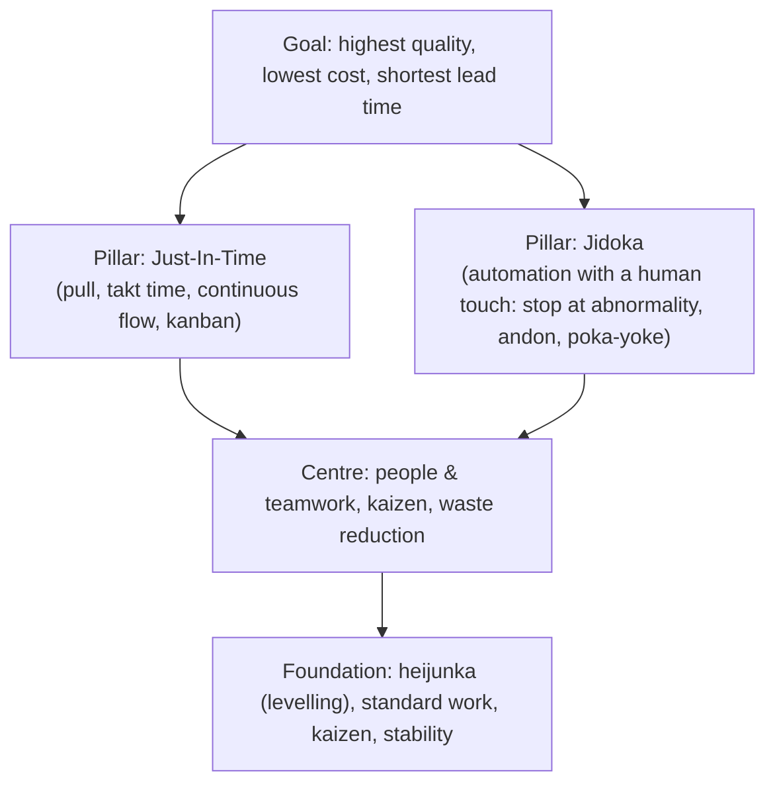
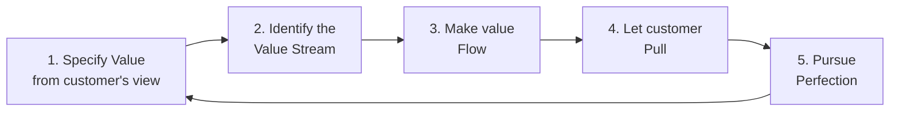
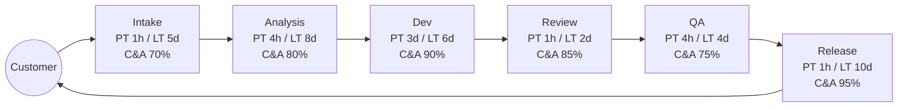

# Lean: Toyota Production System to Lean Software Development

> **TL;DR** — Lean is a management philosophy derived from the Toyota Production System (TPS): maximise customer value by eliminating waste and optimising the flow of the *whole* value stream, while respecting people and improving continuously. In knowledge work the biggest wastes are partially done work, task switching and waiting (queues). Key tools: value stream mapping, flow efficiency, kaizen, 5 Whys, A3, jidoka (stop and fix), poka-yoke (mistake-proofing). Kanban is Lean's pull mechanism applied to knowledge work.

---

## 1. Origins

| Year | Event |
|---|---|
| 1920s–30s | Sakichi Toyoda's automatic loom stops itself when a thread breaks → **jidoka** |
| 1937 | Kiichiro Toyoda founds Toyota Motor; "just in time" idea |
| 1948–1975 | **Taiichi Ohno** develops TPS: kanban, JIT, pull, waste reduction; inspired partly by US supermarkets (replenish only what's taken) |
| 1950s | Shigeo Shingo — SMED (quick changeover), poka-yoke |
| 1950s | W. Edwards Deming teaches statistical quality and PDCA in Japan |
| 1978 | Ohno, *Toyota Production System: Beyond Large-Scale Production* |
| 1988 | John Krafcik coins "lean" (MIT IMVP) |
| 1990 | Womack, Jones, Roos, *The Machine That Changed the World* |
| 1996 | Womack & Jones, *Lean Thinking* — 5 principles |
| 2001 | Toyota Way 2001 document: continuous improvement + respect for people |
| 2003 | Mary & Tom Poppendieck, *Lean Software Development: An Agile Toolkit* |
| 2004 | Jeffrey Liker, *The Toyota Way* — 14 principles |
| 2009 | Reinertsen, *Principles of Product Development Flow* |
| 2011 | Eric Ries, *The Lean Startup* |

### 1.1 The TPS house

### 1.2 The two pillars of the Toyota Way

1. **Continuous improvement** — challenge, kaizen, genchi genbutsu (go and see).
2. **Respect for people** — respect, teamwork. Often forgotten in "lean = cost cutting" implementations.

---

## 2. Core vocabulary

| Term | Meaning | Knowledge-work translation |
|---|---|---|
| **Muda** | Waste — activity that consumes resources but adds no value | See TIMWOODS below |
| **Mura** | Unevenness, variability in flow | Spiky arrivals, batch releases, end-of-sprint crunch |
| **Muri** | Overburden of people or machines | 100% utilisation, overtime, too much WIP |
| **Kaizen** | Continuous, incremental improvement by everyone | Retros, small experiments, improvement kata |
| **Kaikaku** | Radical, step-change improvement | Re-architecture, re-teaming |
| **Gemba** | "The real place" where work happens | The codebase, the board, the support desk, the user's desk |
| **Genchi genbutsu** | Go and see for yourself | Pair with devs, watch users, read logs — don't manage from reports |
| **Jidoka** | Automation with a human touch; stop when abnormal | Failing CI blocks merge; stop-the-line on broken build |
| **Andon** | Signal (cord, light) to call for help/stop the line | Blocker flag on card; red build radiator; incident page |
| **Poka-yoke** | Mistake-proofing | Type systems, linters, schema validation, branch protection, feature flags defaulting off |
| **Heijunka** | Production levelling (volume and mix) | Even replenishment; class-of-service allocation; avoid big batches |
| **Takt time** | Available time ÷ customer demand | Rarely directly applicable; analogous to delivery cadence |
| **Kanban** | Signal card authorising production (pull) | WIP-limited board; see [kanban-method.md](kanban-method.md) |
| **Hansei** | Self-reflection, acknowledging mistakes | Blameless post-mortem |
| **Nemawashi** | Building consensus informally before a decision | Socialising an RFC/ADR before review |
| **Hoshin kanri** | Policy deployment; aligning strategy to execution | OKRs, strategy review, Flight Level 3 |
| **SMED** | Single-minute exchange of die (fast changeover) | Fast environment setup, fast context loading, small batch deploy |
| **Standard work** | Current best known way, the baseline for kaizen | Explicit policies, DoD, runbooks |
| **5S** | Sort, Set in order, Shine, Standardise, Sustain | Codebase/repo hygiene, backlog grooming, deleting dead tickets |
| **Obeya** | "Big room" for visual management | Portfolio wall, program room, digital Obeya dashboard |
| **PDCA** | Plan–Do–Check–Act (Deming/Shewhart cycle) | Experiment loop for any change |

---

## 3. The wastes

### 3.1 Ohno's 7 wastes + 1 (TIMWOODS)

| Letter | Manufacturing waste | Description | Software equivalent (Poppendieck & common usage) |
|---|---|---|---|
| **T** | Transportation | Moving parts unnecessarily | **Handoffs** — knowledge lost each time work passes between people/teams (BA → dev → QA → ops) |
| **I** | Inventory | Excess raw/WIP/finished goods | **Partially done work** — unmerged branches, untested code, undeployed features, specs not built, huge backlogs |
| **M** | Motion | Unnecessary movement of people | **Task switching** — context switching, interruption, searching for information |
| **W** | Waiting | Idle time between steps | **Delays** — waiting for review, approval, environments, decisions, other teams |
| **O** | Overproduction | Making more/earlier than needed | **Extra features** — unused features (often cited ~45–65% rarely/never used, Standish; treat as anecdotal) |
| **O** | Overprocessing | More work than customer requires | **Relearning / extra process** — gold plating, unnecessary documents, approvals, re-discovering forgotten decisions |
| **D** | Defects | Rework, scrap | **Defects** — bugs, escaped defects, incidents, rework |
| **S** | Skills (non-utilised talent) — the "+1" | Not using people's knowledge and creativity | Experts doing clerical tasks, team ideas ignored, no autonomy |

### 3.2 Poppendieck's seven wastes of software development (2003/2006)

1. Partially done work
2. Extra processes
3. Extra features
4. Task switching
5. Waiting
6. Motion (handoffs)
7. Defects

(Later versions use "Relearning" and "Handoffs" explicitly.)

### 3.3 Waste-spotting checklist (walk the board)

- [ ] Items sitting in "Waiting for review/QA/deploy" > 2 days? → waiting, inventory
- [ ] Number of people working on > 2 items each? → task switching
- [ ] Features shipped in the last quarter with no usage data? → extra features
- [ ] Items passed through > 3 specialists before done? → handoffs
- [ ] Bugs found after "done"? → defects; DoD gap
- [ ] Backlog > 3 months of throughput? → inventory; prune it
- [ ] Approval steps that never reject anything? → extra process
- [ ] Recurring "how did we do this last time?" → relearning; document/automate

### 3.4 Value-add classification

| Category | Description | Action |
|---|---|---|
| Value-adding (VA) | Customer would pay for it; changes the product; done right first time | Optimise |
| Necessary non-value-adding (NNVA) | Required by regulation/business but not valued by customer (audit, compliance, some reviews) | Minimise, automate |
| Pure waste (NVA) | Neither | Eliminate |

---

## 4. Lean Thinking — Womack & Jones's 5 principles

| # | Principle | Question | Knowledge-work application |
|---|---|---|---|
| 1 | **Value** | What does the customer actually value? | Outcomes, not output; jobs-to-be-done |
| 2 | **Value stream** | What are all the steps from request to value delivered? | Map idea → production → feedback; include upstream (discovery) and downstream (ops) |
| 3 | **Flow** | How do we make work move without stops? | Small batches, limit WIP, remove handoffs, automate pipelines |
| 4 | **Pull** | Do we only start work when there's capacity and demand? | WIP-limited Kanban; replenishment on capacity; no push assignment |
| 5 | **Perfection** | How do we keep improving? | Kaizen, retros, PDCA |

---

## 5. Lean Software Development — 7 principles (Poppendieck)

| # | Principle | Key tools / practices | Anti-pattern |
|---|---|---|---|
| 1 | **Eliminate waste** | Value stream mapping, the 7 wastes | Long-lived branches, big backlog |
| 2 | **Build quality in** (originally "Amplify learning" was #2 in 2003; later editions reorder) | TDD, CI, pairing, automation, mistake-proofing | Test phase at the end |
| 3 | **Create knowledge** / Amplify learning | Short iterations, experiments, set-based design, documentation of learning | Detailed upfront specs |
| 4 | **Defer commitment** | Last responsible moment, options thinking, reversible decisions | Locking architecture in month 1 |
| 5 | **Deliver fast** | Small batches, limit WIP, short queues, CD | Quarterly release trains as the only path |
| 6 | **Respect people** | Self-organising teams, leadership, expertise | Command & control, utilisation targets |
| 7 | **Optimise the whole** | Measure end-to-end; avoid sub-optimisation; cross-functional teams | Per-team local metrics; "dev done" vs "customer done" |

> "Last responsible moment": commit when the cost of not deciding exceeds the cost of deciding. Not "last possible moment".

---

## 6. Problem-solving tools

### 6.1 5 Whys

Ask "why?" repeatedly (≈5 times) to move from symptom to systemic cause.

**Worked example**

| Why? | Answer |
|---|---|
| Why did the release fail? | DB migration timed out in production. |
| Why did it time out? | It locked a 200M-row table. |
| Why wasn't that caught earlier? | Staging has 10k rows. |
| Why does staging have so little data? | Nobody owns test data; anonymised copies were never set up. |
| Why is nobody owning it? | Platform team charter excludes data; product teams assume platform does it. |

Countermeasures: (a) migration linting rule (poka-yoke) for locking DDL; (b) ownership decision for prod-like data; (c) explicit policy in DoD: "migrations reviewed for lock behaviour".

**Pitfalls:** linear single-cause chains; stopping at "human error"; blame. Combine with fishbone (Ishikawa) for multiple causes. In complex systems prefer "contributing factors" language (see resilience engineering/blameless post-mortems).

### 6.2 Ishikawa (fishbone) categories

Manufacturing 6M: Man, Machine, Method, Material, Measurement, Mother Nature (environment). Software adaptation: People, Process, Tools, Code, Environment, Requirements, Communication.

### 6.3 A3 problem solving

One A3-size sheet (297×420 mm) that tells the story of a problem using PDCA. The value is in the *conversation* (mentor-mentee), not the paper.

| Section (left side = Plan) | Content |
|---|---|
| 1. Title / theme | Problem in one line |
| 2. Background | Why it matters; business context |
| 3. Current condition | Facts, data, charts, gemba observations |
| 4. Goal / target condition | Measurable target |
| 5. Root cause analysis | 5 Whys, fishbone, Pareto |

| Section (right side = Do/Check/Act) | Content |
|---|---|
| 6. Countermeasures | Proposed experiments linked to root causes |
| 7. Implementation plan | Who/what/when |
| 8. Follow-up / check | How results will be measured; actual results |
| 9. Act / standardise | What becomes standard work; what's next |

Variants: proposal A3, status A3. Reference: John Shook, *Managing to Learn*.

### 6.4 Toyota Kata (Mike Rother)

- **Improvement kata**: 1) understand direction/challenge, 2) grasp current condition, 3) establish next target condition, 4) PDCA experiments toward it.
- **Coaching kata**: five questions asked daily:
  1. What is the target condition?
  2. What is the actual condition now?
  3. What obstacles are preventing you from reaching it? Which one are you addressing now?
  4. What is your next step (experiment)? What do you expect?
  5. When can we go and see what we have learned?

### 6.5 Gemba walk checklist (knowledge work)

- Go to where the work happens: board, repo, PRs, CI dashboard, incident channel, support queue, users.
- Observe flow, not people. Ask "show me", not "tell me".
- Questions: What's blocking you? Where do you wait? What did you learn this week? What's the hardest part of getting work done?
- Don't fix on the spot; capture, follow up, and respect the team's ownership.
- Frequency: regular (weekly), short (30 min).

### 6.6 Jidoka and andon in software

| Physical | Software |
|---|---|
| Loom stops at broken thread | CI fails build on failing tests; deployment pipeline halts on failed health check |
| Andon cord | "Stop the line" policy: broken main → everyone swarms; blocker flag on card |
| Separate human from machine | Automate repetitive checks; humans handle exceptions |
| Fix root cause before restarting | Post-incident review before re-enabling |

### 6.7 Poka-yoke examples

| Type | Example |
|---|---|
| Prevention (contact) | Strong typing, required fields, non-null types, schema validation |
| Prevention (sequence) | Branch protection: no merge without passing checks and review |
| Detection | Linters, static analysis, contract tests, canary analysis |
| Defaults | Feature flags default off; least-privilege IAM defaults |
| Physical-world analogues | USB-C symmetric connector; SIM card notch |

---

## 7. Value Stream Mapping (VSM)

### 7.1 Purpose

Visualise all steps (value-adding and not) from request to value delivered, with metrics, to find waste and design a better future state. Created at Toyota as "material and information flow diagrams"; popularised by Rother & Shook, *Learning to See* (1999). Software-focused: Karen Martin & Mike Osterling, *Value Stream Mapping* (2013).

### 7.2 Process

1. Choose the value stream (one product/request type) and an executive sponsor.
2. Assemble a cross-functional team of people who *do* the work.
3. Walk the stream (gemba); define start and end (e.g. "customer request received" → "feature used in production").
4. Map the **current state**: process blocks, queues between them, information flows.
5. Collect metrics per step (see below).
6. Compute summary metrics; identify waste, bottlenecks, rework loops.
7. Design **future state** (target 3–12 months).
8. Create transformation plan (kaizen bursts, A3s); review regularly.

### 7.3 Metrics per process block

| Metric | Abbrev | Definition |
|---|---|---|
| **Process time** | PT | Hands-on time to do the work if uninterrupted (a.k.a. touch time, value-add time) |
| **Lead time** | LT | Elapsed time from when work is available to the step until it's handed to the next step (includes waiting) |
| **Percent Complete & Accurate** | %C&A | % of time the downstream step can use the output *without* correction, clarification, or rework |
| Activity ratio | AR | PT / LT for a step |
| People/FTE, batch size, uptime | — | Supporting data |

### 7.4 Summary metrics

- **Total lead time** = Σ LT (all steps) — what the customer experiences.
- **Total process time** = Σ PT.
- **Activity ratio / flow efficiency** = Total PT ÷ Total LT × 100%.
- **Rolled %C&A** = Π (%C&A of each step) × 100% — the probability work flows through without rework.

### 7.5 Worked example

| Step | PT | LT | %C&A |
|---|---|---|---|
| Intake & triage | 1 h | 5 d | 70% |
| Analysis / refinement | 4 h | 8 d | 80% |
| Development | 3 d | 6 d | 90% |
| Code review | 1 h | 2 d | 85% |
| QA / testing | 4 h | 4 d | 75% |
| Release (CAB + deploy) | 1 h | 10 d | 95% |

Assume 8 h working days.

- Total PT = 1 + 4 + 24 + 1 + 4 + 1 = **35 h ≈ 4.4 working days**
- Total LT = 5 + 8 + 6 + 2 + 4 + 10 = **35 days**
- Flow efficiency = 4.4 / 35 ≈ **12.5%** (using working days for both; typical knowledge work is 5–15%)
- Rolled %C&A = 0.70 × 0.80 × 0.90 × 0.85 × 0.75 × 0.95 ≈ **0.305 → 30.5%** — 70% of items hit some rework.

**Insights:** the biggest LT contributors are release (10 d, CAB batch) and analysis (8 d queue). Development itself is only 6 d. Optimising developer speed would barely move lead time. Future state: replace weekly CAB with automated change approval + continuous deployment; refine just-in-time with three amigos; raise intake %C&A with a request template.

### 7.6 VSM tips

- Map at the level of **5–15 process blocks**; too fine-grained → noise.
- Use real data (Jira/ADO timestamps) *and* interviews; the two disagree interestingly.
- Map rework loops explicitly.
- Map information flows (how work is requested and prioritised), not only work flow.
- Don't map the ideal process documented in Confluence; map what actually happens.
- The **future state** must be achievable; follow with an implementation plan.

---

## 8. Flow concepts from Lean

| Concept | Description |
|---|---|
| **One-piece flow** | Batch size of one; minimises inventory and lead time |
| **Pull vs push** | Pull: downstream signals capacity. Push: upstream starts work based on forecast/plan |
| **Supermarket** | Controlled buffer that downstream pulls from — analog: "Ready" column with WIP limit |
| **Heijunka box** | Levels mix over time — analog: capacity allocation per class of service/work type |
| **Bottleneck** | The constraint; see [queueing-and-flow-theory.md](queueing-and-flow-theory.md) (TOC) |
| **Little's Law** | WIP = Throughput × Lead time — see [flow-metrics.md](flow-metrics.md) |

---

## 9. Lean beyond manufacturing

| Movement | Focus | Key source |
|---|---|---|
| Lean Startup | Validated learning, Build–Measure–Learn, MVP, pivot | Eric Ries (2011) |
| Lean UX | Outcomes, hypotheses, collaboration | Gothelf & Seiden |
| Lean Product Development | Flow, cost of delay, set-based design | Reinertsen; Ward & Sobek |
| Lean Enterprise | Applying lean at org scale | Humble, Molesky, O'Reilly (2015) |
| Lean Portfolio Management | Funding value streams, WIP limits on portfolio | SAFe; Portfolio Kanban |
| Lean IT / Lean Ops | Incident management, ITSM flow | — |
| Beyond Budgeting | Rolling forecasts, relative targets | Bogsnes |

See [../02-product-management/README.md](../02-product-management/README.md) for Lean Startup/Lean UX depth.

---

## 10. When to use / when not

**Use lean thinking when**
- Lead times are long and nobody knows why.
- Many handoffs and specialist queues exist.
- There's a perception that "developers are slow" — VSM usually shows they aren't the bottleneck.
- You want improvement that is data-driven and owned by the people doing the work.

**Be careful when**
- Lean is used as a euphemism for headcount reduction ("lean and mean") — destroys trust, violates respect for people.
- Manufacturing concepts are transplanted literally (takt time, standard work for creative tasks). Knowledge work has high variability; *some* variability is valuable (Reinertsen).
- Waste elimination targets *necessary* learning activities (spikes, experiments, refactoring).

---

## 11. Common mistakes

1. **Tool-age lean** — 5S posters, VSM workshops, no change in management behaviour.
2. **Local optimisation** — making one step efficient while overall lead time grows.
3. **Ignoring respect for people** — lean without psychological safety becomes Taylorism.
4. **Measuring utilisation** — high utilisation → long queues (see Kingman). Lean focuses on flow, not busyness.
5. **5 Whys ending at a person** — "because Bob forgot" is not a root cause; ask why the system allowed it.
6. **One-time VSM** — the map rots; re-map every 6–12 months or after major changes.
7. **Confusing "lean" with "minimal process"** — lean is about the right process, explicit and improving.

---

## References

- Wikipedia: Toyota Production System — <https://en.wikipedia.org/wiki/Toyota_Production_System>
- Wikipedia: Lean manufacturing — <https://en.wikipedia.org/wiki/Lean_manufacturing>
- Wikipedia: Lean software development — <https://en.wikipedia.org/wiki/Lean_software_development>
- Wikipedia: Muda — <https://en.wikipedia.org/wiki/Muda_(Japanese_term)>
- Wikipedia: Kaizen — <https://en.wikipedia.org/wiki/Kaizen>
- Wikipedia: Gemba — <https://en.wikipedia.org/wiki/Gemba>
- Wikipedia: Autonomation (jidoka) — <https://en.wikipedia.org/wiki/Autonomation>
- Wikipedia: Poka-yoke — <https://en.wikipedia.org/wiki/Poka-yoke>
- Wikipedia: Five whys — <https://en.wikipedia.org/wiki/Five_whys>
- Wikipedia: A3 problem solving — <https://en.wikipedia.org/wiki/A3_problem_solving>
- Wikipedia: Value-stream mapping — <https://en.wikipedia.org/wiki/Value-stream_mapping>
- Wikipedia: Ishikawa diagram — <https://en.wikipedia.org/wiki/Ishikawa_diagram>
- Wikipedia: PDCA — <https://en.wikipedia.org/wiki/PDCA>
- Lean Enterprise Institute — <https://www.lean.org/>
- Taiichi Ohno, *Toyota Production System: Beyond Large-Scale Production* (1988 English ed.)
- James Womack & Daniel Jones, *Lean Thinking* (1996, 2003)
- Jeffrey Liker, *The Toyota Way* (2004)
- Mary & Tom Poppendieck, *Lean Software Development* (2003); *Implementing Lean Software Development* (2006)
- Mike Rother & John Shook, *Learning to See* (1999)
- Karen Martin & Mike Osterling, *Value Stream Mapping* (2013)
- John Shook, *Managing to Learn* (2008)
- Mike Rother, *Toyota Kata* (2009)
