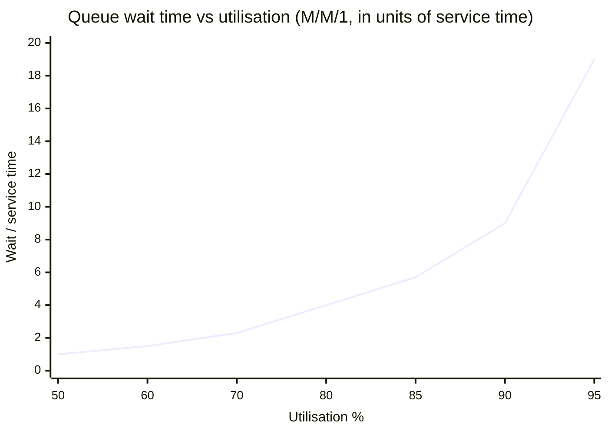
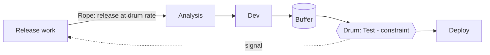

# Queueing and Flow Theory

> **TL;DR** — Knowledge work is a network of queues. As utilisation approaches 100%, waiting time grows non-linearly (it roughly doubles from 80% to 90% and explodes beyond). **Kingman's formula** shows wait time ∝ utilisation/(1−utilisation) × variability × service time. Reinertsen's *Principles of Product Development Flow* turns this into practice: quantify **cost of delay**, manage queues, reduce batch size, control WIP, prioritise with **CD3/WSJF**, accept and exploit variability. **Theory of Constraints** adds: the system's throughput is set by one constraint — find it, exploit it, subordinate everything else (**Drum-Buffer-Rope**), then elevate it.

---

## 1. Queueing basics

### 1.1 Notation

| Symbol | Meaning |
|---|---|
| λ | Arrival rate (items per unit time) |
| μ | Service rate per server (items per unit time) |
| c | Number of servers (parallel workers) |
| ρ = λ / (c·μ) | Utilisation |
| L | Average number in system (WIP) |
| Lq | Average number in queue |
| W | Average time in system (lead time) |
| Wq | Average time waiting in queue |
| Ca, Cs | Coefficients of variation of inter-arrival and service times |

**Kendall's notation**: A/S/c — arrival distribution / service distribution / number of servers. M = Markovian (exponential/Poisson), D = deterministic, G = general. E.g. M/M/1 = Poisson arrivals, exponential service, one server.

### 1.2 M/M/1 results

| Quantity | Formula |
|---|---|
| Utilisation | ρ = λ/μ (< 1 for stability) |
| Avg number in system | L = ρ / (1 − ρ) |
| Avg queue length | Lq = ρ² / (1 − ρ) |
| Avg time in system | W = 1 / (μ − λ) = (1/μ) · 1/(1−ρ) |
| Avg wait in queue | Wq = ρ / (μ − λ) = (1/μ) · ρ/(1−ρ) |

### 1.3 Utilisation vs wait time

Wait in queue as multiple of service time, M/M/1: Wq / (1/μ) = ρ / (1 − ρ)

| Utilisation ρ | ρ/(1−ρ) (queue wait in service-time units) | Avg items in queue Lq |
|---|---|---|
| 50% | 1.0 | 0.5 |
| 60% | 1.5 | 0.9 |
| 70% | 2.3 | 1.6 |
| 80% | 4.0 | 3.2 |
| 85% | 5.7 | 4.8 |
| 90% | 9.0 | 8.1 |
| 95% | 19.0 | 18.1 |
| 99% | 99.0 | 98.0 |



**Implication:** a team scheduled at 95% capacity will see work waiting ~19× longer than it takes to do. "Everyone is busy" and "everything is late" are the same phenomenon. Slack is not waste; it's the price of short lead times.

### 1.4 Kingman's formula (G/G/1 approximation)

```
E[Wq] ≈ ( ρ / (1 − ρ) ) × ( (Ca² + Cs²) / 2 ) × τ
```

- ρ/(1−ρ): **utilisation** term
- (Ca² + Cs²)/2: **variability** term (coefficients of variation of arrivals and service)
- τ: mean service time

Also called the **VUT equation** (Variability × Utilisation × Time; Hopp & Spearman, *Factory Physics*).

**Levers to reduce waiting:**

| Lever | Action in knowledge work |
|---|---|
| Lower utilisation (ρ) | WIP limits, slack, say no, capacity allocation |
| Lower arrival variability (Ca) | Regular replenishment cadence, levelled intake (heijunka), upstream filtering |
| Lower service variability (Cs) | Right-size items, reduce blockers, standard work for routine tasks, automate |
| Lower service time (τ) | Smaller batches, better tooling, remove handoffs |

**Worked example:** review step, τ = 2 h, ρ = 0.9, Ca = Cs = 1 → Wq ≈ 9 × 1 × 2 h = 18 h. Drop ρ to 0.7 → 2.33 × 2 h ≈ 4.7 h. Reduce variability (Ca = Cs = 0.5 → term 0.25) at ρ = 0.9 → 9 × 0.25 × 2 = 4.5 h.

### 1.5 Multiple servers and pooling

- **Pooling** queues (one shared queue for c servers) reduces waiting vs separate queues per server (single line at the bank vs one line per teller).
- Knowledge-work analogue: shared team backlog with generalising specialists vs individual queues per specialist.
- Trade-off: pooling requires cross-skilling (T-shaped people).

### 1.6 Queues in knowledge work are invisible

Unlike factory inventory, knowledge-work queues (unreviewed PRs, specs waiting, tickets in "To test") don't take physical space → visualise them explicitly (Doing/Done split, CFD).

---

## 2. Reinertsen — *The Principles of Product Development Flow* (2009)

Donald Reinertsen's book contains 175 principles in 8 themes. Highlights:

### 2.1 The eight themes

| Theme | Core idea | Practical moves |
|---|---|---|
| **Economics** | Make decisions in an economic framework; quantify **cost of delay** | Use CoD / CD3; "If you only quantify one thing, quantify cost of delay" |
| **Queues** | Queues are the root cause of poor product-dev performance; invisible and unmeasured | Visualise and measure queues; use CFDs; control queue size |
| **Variability** | Variability isn't always bad; payoff asymmetries mean some variability creates value | Reduce variability where cheap; exploit it where it creates options |
| **Batch size** | Reducing batch size is often the cheapest, most effective improvement | Small PRs, frequent releases, small requirements |
| **WIP constraints** | Constrain WIP to control cycle time and flow | WIP limits, block on full queues |
| **Flow control under uncertainty** | Cadence, synchronisation, and sequencing | Regular cadences; WSJF sequencing |
| **Fast feedback** | Fast feedback lowers cost of errors and enables exploitation | CI, short iterations, early integration |
| **Decentralised control** | Decentralise decisions with clear intent and boundaries (military "mission command") | Decision rules, economic guardrails, team autonomy |

### 2.2 Selected principles (paraphrased)

| ID | Principle | Meaning |
|---|---|---|
| E3 | Quantify cost of delay | Without it, trade-offs (speed vs cost) are guesses |
| Q1 | Inventory (queues) is invisible in product development | Make it visible |
| Q3 | Queueing capacity utilisation principle | Wait grows exponentially as utilisation → 100% |
| Q13 | Queue size control: don't control capacity utilisation, control queue size | Easier, more direct |
| V2 | Asymmetric payoffs make variability valuable | Experiments: small cost, big upside |
| B1 | Batch size reduction reduces cycle time | Little's Law + queueing |
| B3 | Batch size reduction accelerates feedback | Faster learning |
| B9 | Optimal batch size is a U-curve trade-off of transaction and holding cost | Reduce transaction costs (automation) to enable smaller batches |
| W1 | WIP constraints reduce average cycle time | Little's Law |
| W3 | Block all demand when WIP reaches upper limit | Pull discipline |
| F1 | Cadence limits accumulation of variance | Regular rhythm |
| F16 | Sequencing: WSJF when cost of delay & duration vary | Highest CoD/duration first |
| FF | Fast feedback loops | Shorter is better |
| D1 | Decentralise control for problems/opportunities that age poorly | Speed of response |
| D5 | Use mission/intent; mission command | Align on why |

### 2.3 Batch size — U-curve

```
Total cost per item = Transaction cost (high when batches small) + Holding cost (high when batches large)
```

Optimum lies where the two curves balance. **Automation lowers transaction cost** (CI/CD, automated tests, infra as code) → optimum moves to smaller batches → faster feedback, lower risk. This is the economic argument for DevOps.

### 2.4 Cost of delay (CoD) and CD3 / WSJF

**Cost of delay:** the economic impact of delaying delivery per unit of time (e.g. €/week).

**CD3 = Cost of Delay / Duration.** Do highest first.

**Worked example:**

| Feature | CoD (€k/week) | Duration (weeks) | CD3 |
|---|---|---|---|
| A | 10 | 4 | 2.5 |
| B | 6 | 1 | 6.0 |
| C | 3 | 2 | 1.5 |

Sequence options and total delay cost (each waits for those before it, plus its own duration):

- **CD3 order B → A → C:** B finishes at 1 → 6×1 = 6; A at 5 → 10×5 = 50; C at 7 → 3×7 = 21 → **total 77**
- **Highest CoD first A → B → C:** A at 4 → 40; B at 5 → 30; C at 7 → 21 → **total 91**
- **Shortest first B → C → A:** B 6; C at 3 → 9; A at 7 → 70 → **total 85**

CD3 minimises total cost of delay.

**WSJF (SAFe):** `WSJF = (User-business value + Time criticality + Risk reduction/opportunity enablement) / Job size`, using relative Fibonacci scores. A proxy for CD3 when absolute CoD is hard to estimate. Criticism: relative scores lose economic meaning; still better than HiPPO.

**Urgency profiles** → see [kanban-method.md](kanban-method.md) classes of service.

### 2.5 Other Reinertsen ideas
- **"Don't control capacity utilisation, control queues."**
- **Economic framework** combining: cycle time, product cost, development expense, product value, risk.
- **"Product development is not manufacturing"** — variability is necessary for innovation, unlike manufacturing.
- **Cadence + synchronisation**: e.g. regular integration points, release trains.

---

## 3. Theory of Constraints (TOC)

Eliyahu M. Goldratt, *The Goal* (1984). Every system has (at least) one constraint that limits throughput. Improving non-constraints does not improve system throughput.

### 3.1 Five Focusing Steps

| Step | Description | Software example |
|---|---|---|
| 0 | Define the goal & measure | Deliver valuable features to production; measure throughput & lead time |
| 1 | **Identify** the constraint | CFD: band widening before "Test"; testers overloaded |
| 2 | **Exploit** the constraint (get most out of it without investment) | Testers only test (no meetings/admin); clear "Ready for test" policy; pre-checked items (%C&A ↑) |
| 3 | **Subordinate** everything else to the constraint | Devs don't start new work when test is full; devs help with test prep, automation; WIP limit upstream |
| 4 | **Elevate** the constraint (invest) | Test automation; developer-owned testing; hire |
| 5 | If the constraint moves, **go back to step 1** — don't let inertia become the constraint | Constraint shifts to deployment → repeat |

### 3.2 Throughput accounting (brief)

| Measure | Definition |
|---|---|
| Throughput (T) | Rate of generating money through sales (revenue − truly variable cost) |
| Investment/Inventory (I) | Money tied up in the system |
| Operating Expense (OE) | Money spent turning I into T |

Priority: increase T, then reduce I, then reduce OE (opposite of cost-accounting instinct).

### 3.3 Drum-Buffer-Rope (DBR)

| Element | Meaning | Knowledge-work translation |
|---|---|---|
| **Drum** | The constraint sets the pace | Throughput of the bottleneck step |
| **Buffer** | Time/inventory buffer in front of the constraint to protect it from starvation | Small, WIP-limited "Ready for <constraint>" column |
| **Rope** | Release mechanism: new work is released only as fast as the drum consumes | WIP limit / CONWIP tied to constraint; replenishment paced to constraint throughput |



Kanban vs DBR: Kanban limits WIP at every stage; DBR limits WIP only to protect the constraint. Many Kanban systems effectively implement DBR via a CONWIP + buffer before the bottleneck.

### 3.4 Other TOC tools
- **Thinking processes**: Current Reality Tree, Evaporating Cloud (conflict resolution), Future Reality Tree, Prerequisite Tree, Transition Tree.
- **Critical Chain Project Management (CCPM)**: remove padding from tasks, aggregate into project buffer, manage by buffer consumption (fever chart). See [../03-project-management/README.md](../03-project-management/README.md).
- **Herbie** (from *The Goal*): the slowest hiker sets the pace of the troop.

### 3.5 Finding the constraint in software delivery

| Signal | Constraint likely at |
|---|---|
| Queue before a step grows (CFD band widening) | That step |
| People in one role always busy, others waiting | That role/skill |
| Items blocked waiting for X frequently | External dependency X |
| Long waits in "Ready to deploy" | Release process |
| Many items in "Analysis done" waiting | Development capacity (or replenishment over-feeding) |
| Huge backlog, nothing starts | Decision-making (prioritisation) |
| Constraint is policy (CAB, approvals) | Policy constraint — often most impactful |

---

## 4. Variability: reduce, buffer or exploit

| Source | Examples | Response |
|---|---|---|
| Arrival variability | Ad-hoc stakeholder requests, incidents | Cadenced replenishment; capacity allocation for unplanned work |
| Item size variability | Mix of tiny and huge items | Right-size at commitment |
| Process variability | Blockers, waiting for decisions/environments | Remove blockers systematically (blocker clustering) |
| People variability | Vacations, onboarding | Cross-skilling, pooling |
| Beneficial variability | Experiments, innovative ideas | Keep cheap; small bets with asymmetric payoff |

Three ways to deal with variability (Factory Physics): **buffer** with inventory, capacity, or time. In knowledge work, capacity buffer (slack) is usually the best.

---

## 5. Systems thinking connections

- **Optimise the whole** (Lean): local efficiency (e.g. 100% developer utilisation) often hurts global flow.
- **Deming**: ~94% of performance problems belong to the system, not individuals (frequently cited figure; treat as heuristic).
- **Red bead experiment**: workers can't control system-caused variation; rewarding/punishing them is pointless.
- **Conway's law**: org structure shapes architecture → dependencies → queues. See [../05-software-architecture/README.md](../05-software-architecture/README.md) and [../10-laws-principles-mental-models/README.md](../10-laws-principles-mental-models/README.md).
- **Feedback loops & delays** (Senge): delays in feedback produce oscillation (e.g. hiring waves, over-correction of priorities).

---

## 6. When to apply what

| Problem | Theory | Practice |
|---|---|---|
| Everything late, everyone busy | Queueing (utilisation) | Lower WIP; slack; stop starting |
| One step always overloaded | TOC | Five focusing steps; DBR |
| Prioritisation by loudest voice | Cost of delay | CD3/WSJF; classes of service |
| Big releases, painful integration | Batch size | Smaller PRs, CI/CD, feature flags |
| Unpredictable lead times | Variability (Kingman) | Right-size, reduce blockers, levelled intake |
| Slow decisions | Decentralised control | Decision rules, intent, guardrails |

---

## 7. Common mistakes

1. **Maximising utilisation** as a management goal.
2. **Improving non-constraints** (e.g. faster coding when release is the bottleneck).
3. **Ignoring policy constraints** (approvals, CAB, release windows).
4. **Treating all variability as bad** — killing experimentation.
5. **WSJF with fake precision** — debating 8 vs 13 for hours.
6. **Assuming M/M/1 numbers literally** — they are directional; real systems differ, but the shape of the curve holds.
7. **Batch size reduction without lowering transaction cost** — smaller releases with a 2-day manual release process = pain → automate first or concurrently.

---

## References

- Wikipedia: Queueing theory — <https://en.wikipedia.org/wiki/Queueing_theory>
- Wikipedia: Kingman's formula — <https://en.wikipedia.org/wiki/Kingman%27s_formula>
- Wikipedia: Kendall's notation — <https://en.wikipedia.org/wiki/Kendall%27s_notation>
- Wikipedia: M/M/1 queue — <https://en.wikipedia.org/wiki/M/M/1_queue>
- Wikipedia: Little's law — <https://en.wikipedia.org/wiki/Little%27s_law>
- Wikipedia: Theory of constraints — <https://en.wikipedia.org/wiki/Theory_of_constraints>
- Wikipedia: Drum-buffer-rope — <https://en.wikipedia.org/wiki/Drum-buffer-rope>
- Wikipedia: The Goal (novel) — <https://en.wikipedia.org/wiki/The_Goal_(novel)>
- Wikipedia: Critical chain project management — <https://en.wikipedia.org/wiki/Critical_chain_project_management>
- Wikipedia: Cost of delay — <https://en.wikipedia.org/wiki/Cost_of_delay>
- SAFe: WSJF — <https://scaledagileframework.com/wsjf/>
- Donald G. Reinertsen, *The Principles of Product Development Flow* (2009)
- Eliyahu M. Goldratt, *The Goal* (1984); *Critical Chain* (1997)
- Wallace Hopp & Mark Spearman, *Factory Physics* (3rd ed., 2008)
- Gene Kim et al., *The Phoenix Project* (2013) — TOC in IT
- W. Edwards Deming, *Out of the Crisis* (1986)
