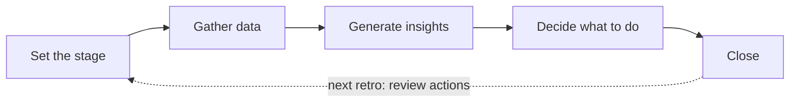
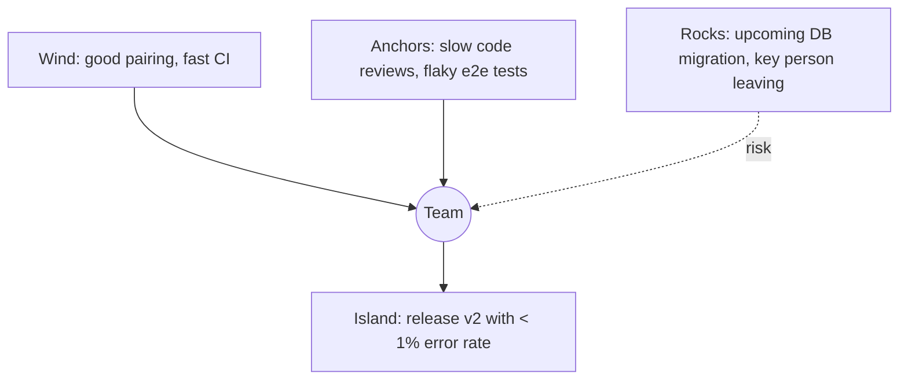

# Retrospectives, Team Health and Coaching Anti-patterns

> **TL;DR** — A retrospective is a structured team reflection that produces a small number of improvement experiments. Use Derby & Larsen's five phases: **Set the stage → Gather data → Generate insights → Decide what to do → Close**. Start with Norm Kerth's **Prime Directive** to frame it as blameless. Rotate formats (Start/Stop/Continue, 4Ls, Mad/Sad/Glad, Sailboat, Starfish, Timeline...) to avoid fatigue, but keep the five-phase structure. Track actions visibly; one or two finished experiments beat ten forgotten ones. Complement with periodic team health checks (Spotify Squad Health Check) and be wary of coaching and metrics anti-patterns.

---

## 1. The Prime Directive (Norm Kerth)

From *Project Retrospectives: A Handbook for Team Reviews* (2001). Paraphrased: regardless of what we discover, we understand and truly believe that everyone did the best job they could, given what they knew at the time, their skills and abilities, the resources available, and the situation at hand.

Purpose: establish psychological safety; shift focus from blame to system and learning. Read it aloud (or paraphrase) at the start, especially for project/incident retros.

Caveat: it's a stance to enable learning, not a denial that problems exist. If trust is low, the directive alone doesn't create safety — the facilitator's behaviour does.

---

## 2. Derby & Larsen's five phases

From Esther Derby & Diana Larsen, *Agile Retrospectives: Making Good Teams Great* (2006; 2nd ed. 2024 with new activities).

| Phase | Goal | Example activities | Time share (90 min retro) |
|---|---|---|---|
| **1. Set the stage** | Get everyone talking, establish focus and safety | Check-in (one word), ESVP (Explorer/Shopper/Vacationer/Prisoner), working agreements, Prime Directive | 5–10 min |
| **2. Gather data** | Create a shared picture of what happened (facts + feelings) | Timeline, Mad/Sad/Glad, 4Ls, metrics review (CFD, cycle time), "Triple nickels" | 20–30 min |
| **3. Generate insights** | Understand why; find patterns and root causes | 5 Whys, fishbone, patterns & shifts, force field analysis, dot voting on themes | 20–25 min |
| **4. Decide what to do** | Pick 1–3 experiments with owners | SMART goals, circle of influence, impact/effort matrix, "Short subjects" | 15–20 min |
| **5. Close the retrospective** | Summarise; appreciate; improve the retro itself | ROTI (Return On Time Invested, 1–5 fist), appreciations, +/Δ (plus/delta) | 5–10 min |

Common failure: jumping from "gather data" straight to "decide" → superficial actions that address symptoms.

---

## 3. Retrospective formats

| Format | Prompts / structure | Best for | Phase fit |
|---|---|---|---|
| **Start / Stop / Continue** | What should we start doing, stop doing, continue doing? | Quick action-oriented retro | Gather data → directly suggests actions |
| **Keep / Drop / Add** | Variant of SSC | Same | Same |
| **4Ls** (Mary Gorman & Ellen Gottesdiener) | Liked, Learned, Lacked, Longed for | Balanced reflection; end of a release | Gather data |
| **Mad / Sad / Glad** | Emotions about the period | Surfacing feelings, tension | Gather data |
| **Sailboat / Speedboat** | Wind (helps), Anchors (slows), Rocks (risks), Island (goal), (Sun: what we're proud of) | Visual, goal-oriented; good for remote | Gather data + insights |
| **Starfish** (Pat Kua) | Keep doing, Less of, More of, Stop doing, Start doing | Finer gradation than SSC | Gather data |
| **Timeline** | Plot events chronologically, annotate with emotions (above/below line) | Long periods, projects, incidents | Gather data |
| **Plus / Delta** | What went well (+), what to change (Δ) | Very short retros; closing | Close / quick |
| **Lean Coffee** | Participants propose topics, vote, discuss in timeboxes | Mature teams; open agenda | Insights |
| **Hot Air Balloon** | Hot air (lifts), sandbags (holds down), storms (risks), sun (goal) | Variation of sailboat | Same |
| **Five Whys / Fishbone** | Root cause on top issue | Recurring problem | Insights |
| **Futurespective / Remember the Future** | Imagine success in 6 months; what made it happen? | Start of project; new team | Insights / decide |
| **Pre-mortem** (Gary Klein) | Imagine the project failed; why? | Before big initiatives | Risk |
| **Metrics-based retro** | Review CFD, scatterplot, blockers | Kanban teams; data culture | Gather data |
| **Appreciation retro / Kudos** | Appreciate each other's contributions | Morale | Close |
| **Circles & Soup** | What we control / influence / soup (accept) | Teams feeling powerless | Decide |
| **Team radar** | Rate dimensions (1–5) e.g. quality, collaboration, flow | Track over time | Gather data |

Source of many activities: Retromat (<https://retromat.org/>), which generates plans by phase.

### 3.1 Sailboat example

---

## 4. Facilitation tips

| Area | Tip |
|---|---|
| Preparation | Look at last retro's actions; prepare data (metrics, timeline); choose format based on team mood and period |
| Safety | Anonymous input when trust is low (silent writing, anonymous tools); "Vegas rule" (what's said stays) |
| Inclusion | 1-2-4-All (Liberating Structures); silent brainstorming before discussion; round-robin |
| Focus | Dot vote to pick 1–3 topics; don't try to solve everything |
| Actions | Specific, owned, small, testable: "For the next 2 weeks, PRs > 400 lines get split before review; owner: X; check at next retro" |
| Follow-up | Put actions on the board (as cards with WIP); start next retro reviewing them |
| Variety | Rotate formats; change venue; external facilitator occasionally |
| Facilitator neutrality | SM/lead facilitating shouldn't steer; rotate facilitation |
| Remote | Use Miro/Mural/FigJam/retro tools; cameras optional; shorter timeboxes; breakout rooms |
| Escalation | Systemic issues beyond team control → escalate visibly (impediment backlog), report back |
| Duration | Scrum: ≤ 3 h for 1-month Sprint; 60–90 min typical for 2 weeks |

### 4.1 Action quality checklist
- [ ] Is it within the team's control/influence?
- [ ] Is there an owner (person, not "the team")?
- [ ] Is it small enough to complete before the next retro?
- [ ] How will we know it worked (signal/metric)?
- [ ] Is it visible on the board?

### 4.2 Retro anti-patterns

| Anti-pattern | Fix |
|---|---|
| Same complaints every time | Root cause analysis; escalate systemic issues; check actions were done |
| Too many actions | Max 1–3 |
| Actions never done | Treat as backlog items with capacity |
| Manager present inhibits honesty | Separate session; build trust; consider attendance |
| Blame game | Prime Directive; focus on system |
| "Nothing to improve" | Use data; ask "what would make us 10% better?" |
| Skipping retros under pressure | Short retro is better than none |
| Only negatives | Include appreciation |
| Facilitator solving problems | Facilitator guides process, team owns content |

---

## 5. Other retrospective types

| Type | When | Notes |
|---|---|---|
| Team retro | Every Sprint / bi-weekly | Default |
| Release/project retro | End of release/project | Timeline-based; longer |
| Incident post-mortem (blameless) | After incidents | Facts, timeline, contributing factors, action items; see [../08-engineering/README.md](../08-engineering/README.md) |
| Cross-team retro / "retro of retros" | Scaled setups | Systemic issues; SAFe "Inspect & Adapt" problem-solving workshop |
| Service Delivery Review | Kanban | Customer-focused; see [kanban-cadences.md](kanban-cadences.md) |
| Personal retro | Individual | Weekly reflection |

---

## 6. Team health checks

### 6.1 Spotify Squad Health Check model (2014)

Teams self-assess on ~10–11 dimensions using traffic-light cards (green/yellow/red) plus trend (improving/stable/worsening). Original dimensions (paraphrased):

| Dimension | Green ("awesome") example | Red ("crappy") example |
|---|---|---|
| Easy to release | Releasing is simple, safe, painless | Releasing is risky, painful, lots of manual work |
| Suitable process | Our way of working fits us | Our way of working sucks |
| Tech quality (health of codebase) | Proud of code quality; clean, readable | Code is a pile of dung; tech debt raging |
| Value | We deliver great stuff; stakeholders happy | We deliver crap; stakeholders hate us |
| Speed | We get stuff done quickly; no waiting | We never seem to get anything done |
| Mission | We know exactly why we're here and are excited | No idea why we're here |
| Fun | We love going to work | Boooooring |
| Learning | We're learning lots | We never have time to learn |
| Support | We get great support and help when we ask | We keep getting stuck because we can't get support |
| Pawns or players | We are in control of our destiny | We are just pawns in a game of chess |
| (Teamwork — added in many variants) | Great collaboration | People work in silos |

**How to run:**
1. Every 1–3 months; 45–60 min.
2. Each person votes per dimension (cards or digital); discuss divergences.
3. Record team colour + trend.
4. Identify 1–2 areas to improve; feed into retros.
5. Aggregate across teams for *management* to spot systemic issues — never to rank teams.

### 6.2 Other health/maturity tools

| Tool | Description |
|---|---|
| Team radar / spider chart | Custom dimensions, 1–5 scale |
| Agile Fluency diagnostic | Zones focusing/delivering/optimizing |
| Westrum organisational culture typology | Pathological / bureaucratic / generative (used by DORA) |
| Psychological safety survey (Amy Edmondson's 7 items) | Safety baseline |
| Team Canvas / Team charter | Purpose, values, roles, rules |
| Google Project Aristotle findings | Psychological safety, dependability, structure & clarity, meaning, impact |
| Tuckman stages | Forming, storming, norming, performing (adjourning) |
| Lencioni, 5 Dysfunctions | Absence of trust, fear of conflict, lack of commitment, avoidance of accountability, inattention to results |

See [../09-leadership-teams-facilitation/README.md](../09-leadership-teams-facilitation/README.md) for team dynamics depth.

---

## 7. Agile coaching anti-patterns

| Anti-pattern | Description | Better |
|---|---|---|
| **Framework evangelist** | Imposes one framework regardless of context | Start with what they do now; diagnose; offer options |
| **Ceremony police** | Focus on correct execution of events | Focus on outcomes and value |
| **Coach as doer** | Takes over facilitation, backlog, Jira forever → dependency | Build team capability; plan to exit |
| **Tool-first** | Transformation = Jira configuration | People and policies first, tools to support |
| **Certification as competence** | Coaches with certificates but no delivery experience | Pair coaches with technical coaches; experience matters |
| **Ignoring technical practices** | Process-only coaching; tech debt grows | Include technical coaching (TDD, CI, refactoring) |
| **Only team-level coaching** | Teams agile, organisation not (funding, governance, HR) | Coach leadership and system; Flight Levels 2–3 |
| **Metrics-driven maturity scoring** | Agile maturity assessments used to rank teams | Self-assessment for learning only |
| **Big-bang transformation** | All teams, one date, new framework | Evolutionary change; pilot; pull-based adoption |
| **Ignoring psychological safety** | Pushing transparency into a fear culture | Address safety first |
| **Advice monster** (Bungay Stanier) | Always telling, never asking | Coaching stance: ask, listen, reflect |
| **Neutrality as abdication** | Coach never shares expertise | Switch stances deliberately: teacher, mentor, facilitator, coach (Lyssa Adkins) |

### 7.1 Coaching stances (Lyssa Adkins, *Coaching Agile Teams*)
Teacher, mentor, facilitator, coach (plus problem-solver, conflict navigator, collaborator). Agile Coaching Competency Framework (Adkins & Spayd): Professional coaching, facilitating, teaching, mentoring + technical, business, transformation mastery.

---

## 8. Metrics anti-patterns (summary)

Detailed treatment in [flow-metrics.md](flow-metrics.md) §8. Key points:

- **Goodhart's Law** — targets corrupt measures.
- **Campbell's Law** — the more a quantitative indicator is used for social decision-making, the more it will be subject to corruption pressures.
- **McNamara fallacy** — measuring what's easy, ignoring what's important.
- **Velocity as KPI**, **individual metrics**, **utilisation targets**, **story points as currency**, **percent complete**.
- Use metrics for **learning and conversation**, owned by the team; aggregate system-level only.

---

## 9. Sample 60-minute retro plan (2-week cadence)

| Time | Phase | Activity |
|---|---|---|
| 0–5 | Set the stage | Prime Directive; one-word check-in |
| 5–10 | Review | Last retro actions: done? effect? |
| 10–25 | Gather data | Sailboat: silent writing (5 min), cluster, read |
| 25–30 | Gather data | Quick metrics look: cycle time scatterplot, blockers |
| 30–45 | Generate insights | Dot vote top anchor; 5 Whys in pairs → share |
| 45–55 | Decide | 1–2 experiments; owner; success signal; add to board |
| 55–60 | Close | ROTI; one appreciation each (optional) |

---

## References

- Wikipedia: Retrospective — <https://en.wikipedia.org/wiki/Retrospective>
- Retromat — <https://retromat.org/>
- Spotify Engineering blog (Squad Health Check model, 2014) — <https://engineering.atspotify.com/>
- Liberating Structures — <https://www.liberatingstructures.com/>
- Wikipedia: Goodhart's law — <https://en.wikipedia.org/wiki/Goodhart%27s_law>
- Wikipedia: Campbell's law — <https://en.wikipedia.org/wiki/Campbell%27s_law>
- Wikipedia: McNamara fallacy — <https://en.wikipedia.org/wiki/McNamara_fallacy>
- Wikipedia: Psychological safety — <https://en.wikipedia.org/wiki/Psychological_safety>
- Wikipedia: Tuckman's stages of group development — <https://en.wikipedia.org/wiki/Tuckman%27s_stages_of_group_development>
- Norman L. Kerth, *Project Retrospectives: A Handbook for Team Reviews* (2001)
- Esther Derby & Diana Larsen, *Agile Retrospectives* (2006; 2nd ed. 2024)
- Aino Vonge Corry, *Retrospectives Antipatterns* (2020)
- Lyssa Adkins, *Coaching Agile Teams* (2010)
- Amy Edmondson, *The Fearless Organization* (2018)
- Patrick Lencioni, *The Five Dysfunctions of a Team* (2002)
