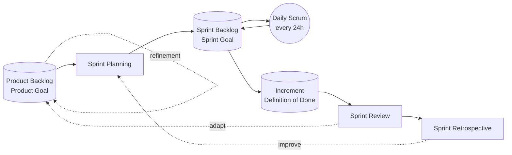
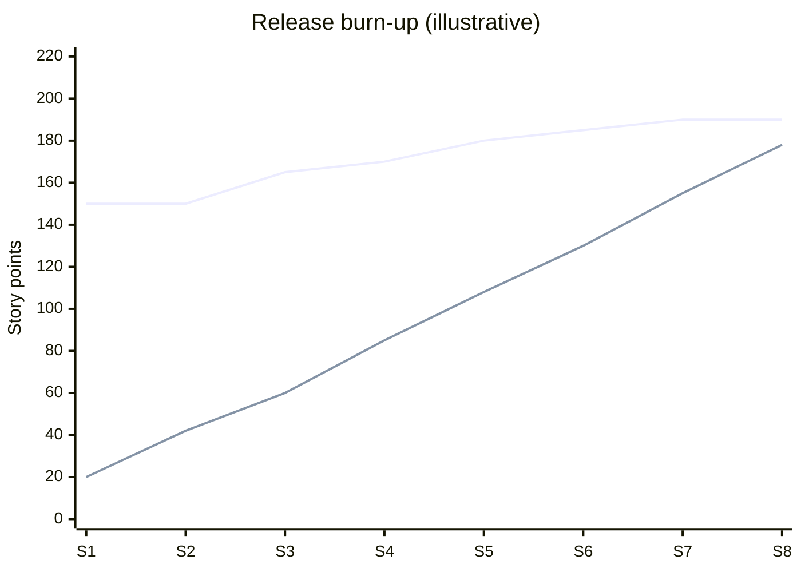

# Scrum

> **TL;DR** — Scrum (Scrum Guide 2020, Schwaber & Sutherland) is a lightweight framework built on **empiricism** (transparency, inspection, adaptation) and **lean thinking**. One **Scrum Team** (≤ ~10 people) with three accountabilities — **Product Owner**, **Scrum Master**, **Developers** — works in **Sprints** (≤ 1 month) containing Sprint Planning, Daily Scrum, Sprint Review and Sprint Retrospective. Three artifacts each have a commitment: **Product Backlog → Product Goal**, **Sprint Backlog → Sprint Goal**, **Increment → Definition of Done**. Five values: commitment, focus, openness, respect, courage. Velocity and story points are *not* part of Scrum and are easily abused.

---

## 1. History

| Year | Event |
|---|---|
| 1986 | Takeuchi & Nonaka, "The New New Product Development Game" — rugby "scrum" metaphor |
| 1993 | Jeff Sutherland applies it at Easel Corporation |
| 1995 | Schwaber & Sutherland present Scrum at OOPSLA |
| 2001 | *Agile Software Development with Scrum* (Schwaber & Beedle); Manifesto |
| 2002 | Scrum Alliance founded |
| 2009 | Scrum.org founded (Schwaber) |
| 2010 | First Scrum Guide |
| 2011, 2013, 2016, 2017 | Revisions (2016 adds values; 2017 adds uses of Scrum) |
| **2020** | **Current Scrum Guide**: less prescriptive, "Developers" instead of "Development Team", "accountabilities" instead of roles, **Product Goal** introduced, commitments per artifact, "self-managing" replaces "self-organising", three questions of Daily Scrum removed, Sprint Planning gains "Why" topic |

---

## 2. Theory

### 2.1 Empiricism — three pillars

| Pillar | Meaning | Enabled by |
|---|---|---|
| **Transparency** | Process and work visible to those performing and receiving it | Artifacts, DoD, shared board |
| **Inspection** | Frequent inspection of artifacts and progress to detect undesirable variances | Events |
| **Adaptation** | Adjust as soon as possible when deviations exceed acceptable limits | Self-managing team, authority to change |

Transparency enables inspection; inspection without transparency is misleading. Inspection enables adaptation; inspection without adaptation is pointless.

### 2.2 Lean thinking
Reduce waste, focus on essentials (2020 guide explicitly mentions lean thinking).

### 2.3 Scrum values

| Value | In practice | Violation example |
|---|---|---|
| **Commitment** | Commit to goals and to supporting each other | Abandoning Sprint Goal for side requests silently |
| **Focus** | Focus on Sprint work and goals | 5 parallel priorities |
| **Openness** | Open about work and challenges | Hiding problems until review |
| **Respect** | Respect each other as capable, independent people | Overriding team estimates |
| **Courage** | Do the right thing, work on tough problems | Not raising impediments; agreeing to impossible scope |

---

## 3. Scrum Team & accountabilities

Scrum Team: one cohesive unit, cross-functional, self-managing, typically **10 or fewer** people. No sub-teams or hierarchies. Accountable for creating a valuable, useful Increment every Sprint.

| Accountability | Accountable for | Does | Doesn't |
|---|---|---|---|
| **Product Owner** (one person, not a committee) | Maximising value of the product resulting from the team's work; effective Product Backlog management | Develops & communicates Product Goal; creates, orders and clearly communicates Product Backlog items; ensures backlog transparency; final say on order. May delegate work but remains accountable | Dictate how work is done; be a proxy without authority |
| **Scrum Master** | Establishing Scrum as defined; team's effectiveness | Coaches team on self-management & cross-functionality; helps focus on high-value Increments; causes removal of impediments; ensures events are positive, productive, timeboxed. Serves PO (backlog techniques, Product Goal) and organisation (adoption, removing barriers) | Be a project manager / team secretary / Jira admin |
| **Developers** | Creating any aspect of a usable Increment each Sprint | Create Sprint plan (Sprint Backlog); instil quality by adhering to DoD; adapt plan daily toward Sprint Goal; hold each other accountable as professionals | Wait for assignment |

"Developers" = everyone doing the work (engineers, designers, testers, analysts...), not just programmers.

---

## 4. Events

The **Sprint** is the container event; all others happen within it.

| Event | Timebox (1-month Sprint; shorter Sprints usually shorter) | Purpose | Participants | Output |
|---|---|---|---|---|
| **Sprint** | ≤ 1 month (fixed length) | Turn ideas into value; consistency | Scrum Team | Done Increment(s) |
| **Sprint Planning** | ≤ 8 hours | Why is this Sprint valuable? What can be Done? How will the work get done? | Scrum Team (+ invited experts) | Sprint Goal + selected PBIs + plan = Sprint Backlog |
| **Daily Scrum** | 15 minutes | Inspect progress toward Sprint Goal; adapt Sprint Backlog | Developers (PO/SM participate as Developers if they work on items) | Actionable plan for next day |
| **Sprint Review** | ≤ 4 hours | Inspect outcome; determine future adaptations | Scrum Team + key stakeholders | Revised Product Backlog |
| **Sprint Retrospective** | ≤ 3 hours | Plan ways to increase quality and effectiveness | Scrum Team | Improvements (may be added to next Sprint Backlog) |

Not an event: **Product Backlog refinement** — ongoing activity (often ≤ ~10% of capacity, a heuristic from earlier guides).

Sprint cancellation: only the PO can cancel a Sprint, if the Sprint Goal becomes obsolete.

### 4.1 Sprint Planning formats

**Three topics (2020 guide):**
1. **Why** is this Sprint valuable? → PO proposes how the product could increase value; team collaborates on **Sprint Goal**.
2. **What** can be Done this Sprint? → Developers select items from Product Backlog; consider past performance, capacity, DoD.
3. **How** will the chosen work get done? → Developers plan work (often decompose into ≤ 1-day tasks).

**Practical agenda (2-week Sprint, ~2–3 h):**

| Step | Time | Notes |
|---|---|---|
| Review context: product goal, last review feedback, metrics | 10 min | PO |
| Capacity check (holidays, on-call, support allocation) | 10 min | Count people-days or use throughput |
| Draft Sprint Goal | 20 min | Outcome-oriented, one sentence |
| Select items supporting the goal | 30 min | Forecast with throughput/velocity *range* |
| Plan "how": first days' tasks, risks, dependencies | 45 min | Not all tasks up front |
| Confirm Sprint Goal & forecast | 10 min | Team agrees |

**Good Sprint Goal:** "Enable customers to pay with saved cards so checkout conversion can be measured" — not "Complete JIRA-123, -124, -125".

### 4.2 Daily Scrum
- Developers choose the structure. The classic three questions (yesterday/today/impediments) were removed as mandatory in 2020.
- Better: walk the board right-to-left (flow-oriented), focus on Sprint Goal: "Are we on track for the goal? What's blocking?"
- Detailed discussions after the Daily Scrum.

### 4.3 Sprint Review formats

| Format | Description |
|---|---|
| Demo + discussion | Show working increment; gather feedback; discuss backlog adaptation |
| Science fair / bazaar | Stations per feature; stakeholders rotate (good for multiple teams) |
| Hands-on | Stakeholders use the product themselves |
| Metrics review | Usage data, outcomes since last release |
| Market/roadmap review | PO updates on market, budget, timeline, Product Goal progress |

Anti-pattern: Sprint Review as a "sign-off" or slide deck show; no stakeholder input; no backlog changes.

### 4.4 Sprint Retrospective
See [retrospectives-and-team-health.md](retrospectives-and-team-health.md) for formats and facilitation.

---

## 5. Artifacts and commitments

| Artifact | Commitment | Description |
|---|---|---|
| **Product Backlog** | **Product Goal** — future state of the product; long-term objective; one at a time | Emergent, ordered list of what's needed to improve the product; single source of work |
| **Sprint Backlog** | **Sprint Goal** — single objective for the Sprint; flexibility in exact work | Sprint Goal + selected PBIs + actionable plan; owned by Developers; updated throughout Sprint |
| **Increment** | **Definition of Done** — formal description of quality state required | Concrete stepping stone toward Product Goal; additive; must be usable; multiple increments per Sprint possible; can be released before Sprint end |

### 5.1 Definition of Done (DoD) example

- [ ] Code merged to main via PR with ≥ 1 approval
- [ ] Automated unit + integration tests pass; coverage not decreased
- [ ] Acceptance criteria verified (automated where feasible)
- [ ] Security scan has no high/critical findings
- [ ] Deployed to production behind feature flag (or released)
- [ ] Monitoring/alerts in place for new endpoints
- [ ] Documentation updated (API spec, ADR if architectural)
- [ ] Product Owner has seen it working

If organisation has a DoD, teams must meet it at minimum. Multiple teams on one product share one DoD.

### 5.2 Definition of Ready (not in Scrum Guide)
Optional team agreement. Risk: becomes a stage gate ("not ready, can't start") → mini-waterfall. Prefer lightweight readiness: "the team understands it well enough to start and can finish it within a Sprint."

### 5.3 Product Backlog items: user stories

Not required by Scrum, but common:
- Format: *As a <role>, I want <capability>, so that <benefit>.*
- **INVEST**: Independent, Negotiable, Valuable, Estimable, Small, Testable.
- **3 Cs** (Ron Jeffries): Card, Conversation, Confirmation.
- Acceptance criteria often in **Given/When/Then** (Gherkin).
- Splitting patterns: workflow steps, business rule variations, happy/unhappy path, data types, interfaces, CRUD operations, spikes, SPIDR (Spike, Path, Interface, Data, Rules — Mike Cohn).

See [../02-product-management/README.md](../02-product-management/README.md) for backlog management and story mapping.

---

## 6. Velocity

### 6.1 Definition
Story points (or item count) completed per Sprint. **Not mentioned in the Scrum Guide.**

### 6.2 Legitimate use
- Team's own planning aid: "We usually complete 20–28 points."
- Rough release forecasting (prefer Monte Carlo, see [forecasting-and-estimation.md](forecasting-and-estimation.md)).

### 6.3 Pitfalls

| Pitfall | Consequence |
|---|---|
| Velocity as productivity KPI | Point inflation (Goodhart) |
| Comparing teams' velocity | Meaningless — different scales |
| Targets ("increase by 10%") | Inflation, quality cuts, burnout |
| Partial credit for unfinished stories | Hides incomplete work |
| Points for bugs/tech debt to "keep velocity up" | Velocity ≠ value |
| Averages only | Ignore variance; use range |
| Re-estimating after completion | Destroys data |
| Committing to exactly average velocity | ~50% chance of missing |
| Velocity "normalised" across teams (SAFe) | Encourages cross-team comparison |

---

## 7. Burndown and burn-up charts

| Chart | Shows | Pros | Cons |
|---|---|---|---|
| **Sprint burndown** | Remaining work (points/hours/tasks) per day in Sprint | Simple daily signal | Hides scope changes; encourages task-hour tracking; often flat then cliff |
| **Release burndown** | Remaining points over Sprints | Simple | Scope changes invisible (or confusing "below zero" variants) |
| **Burn-up** | Completed work vs total scope (two lines) | Scope changes visible; better for stakeholders | Slightly more complex |

Top line: total scope (growing); bottom: completed. Projection where lines meet = forecast (use ranges).

**Burndown patterns:** flat line then cliff (work not finished until end — too big items, mini-waterfall); line going up (scope added); always ahead (under-committing / padding); no update (tracking ignored).

---

## 8. Sprint length selection

| Length | Pros | Cons | Good for |
|---|---|---|---|
| 1 week | Fast feedback; small plans | Meeting overhead proportionally higher | High uncertainty; startups |
| 2 weeks | Common default; balance | — | Most teams |
| 3–4 weeks | Bigger increments | Slow feedback; mini-waterfall risk | Rare; complex integration contexts |

Keep length consistent; change deliberately (via retro), not ad hoc.

---

## 9. Scrum anti-patterns

### 9.1 Team & roles

| Anti-pattern | Symptom | Remedy |
|---|---|---|
| Proxy PO / PO committee | Slow decisions; no single order | Empower a single PO; stakeholders influence via PO |
| PO absent | Team guesses priorities | Allocate PO time; PO at review & planning minimum |
| SM as secretary / Jira admin | No coaching; process stagnates | Clarify SM accountability; SM coaches org |
| SM as project manager | Assigns tasks; reports status | Developers own the Sprint Backlog |
| Part-time SM for 4 teams | Superficial support | Limit; or teams self-facilitate rotating |
| Component teams | Dependencies; no done increments | Feature teams; architecture changes |
| Specialists with handoffs inside Sprint | Mini-waterfall (dev in week 1, test in week 2) | Swarm, T-shaped skills, WIP limits within Sprint |

### 9.2 Events

| Anti-pattern | Remedy |
|---|---|
| Sprint Planning without Sprint Goal | Insist on goal first; select items for it |
| Daily Scrum = status report to manager | Developers own it; focus on goal and flow |
| Sprint Review = demo to PO only / acceptance meeting | Invite real stakeholders/users; discuss next steps |
| Retro skipped "no time" / no actions | Timebox; limit to 1–2 actions; follow up |
| Hardening/stabilisation Sprints | Strengthen DoD; build quality in |
| Sprint 0 lasting months | Deliver something valuable in Sprint 1 |
| Sprint length changed to fit scope | Keep cadence; adapt scope |
| Carrying over 50% of Sprint every Sprint | Smaller items, less WIP, better forecasting |

### 9.3 Artifacts

| Anti-pattern | Remedy |
|---|---|
| Product Backlog of 600 items | Prune; keep ~2–3 Sprints refined; options elsewhere |
| No Product Goal | Define outcome-based Product Goal |
| DoD missing or "code complete" | Define DoD to production-ready |
| Sprint Backlog frozen ("can't change") | Sprint Backlog is adaptable; Sprint Goal is the commitment |
| Undone work counted in Increment | Only Done items are part of the Increment |

### 9.4 Organisational
- **Water-Scrum-Fall**: requirements phase → Scrum Sprints → UAT/release phase.
- **Dark Scrum** (Jeffries): Scrum used to pressure developers.
- **Zombie Scrum** (Christiaan Verwijs, Johannes Schartau, Barry Overeem): Scrum motions without beating heart — no stakeholders, no done increments, no improvement, no joy. Book: *Zombie Scrum Survival Guide* (2020).
- Mechanical Scrum: ceremonies done, values ignored.
- "ScrumBut": "We do Scrum, but..." — some adaptations reasonable, others remove the feedback loops that make Scrum work.

---

## 10. When to use / when not

**Scrum fits when**
- Complex product development with uncertain requirements.
- Team is cross-functional (or can become so) and dedicated.
- Stakeholders can engage every Sprint.
- Organisation needs a clear rhythm and structure to start agile.

**Scrum is weaker when**
- High share of unplanned, interrupt-driven work (ops/support) → Kanban or Scrumban.
- Work is predominantly routine/repeatable.
- Team members are split across many teams.
- Delivery already continuous and the Sprint boundary adds artificial batching (use flow with retros/reviews on cadence).

---

## 11. Scrum vs Kanban: hybrid options

See [kanban-method.md](kanban-method.md) for comparison and Scrumban. Kanban Guide for Scrum Teams adds WIP limits, flow metrics, SLE and active management of item age within Scrum.

---

## 12. Checklist: healthy Scrum

- [ ] Product Goal exists and is known by every team member
- [ ] Every Sprint has an outcome-oriented Sprint Goal
- [ ] Increments meet DoD and are usable (ideally released)
- [ ] Stakeholders attend Sprint Review and give feedback that changes the backlog
- [ ] Retro actions are implemented and visible
- [ ] Daily Scrum ≤ 15 min, focused on goal
- [ ] Carry-over is the exception
- [ ] PO is available and empowered
- [ ] SM works on team *and* organisation impediments
- [ ] Velocity/points not used for performance evaluation

---

## References

- Scrum Guides — <https://scrumguides.org/>
- The 2020 Scrum Guide — <https://scrumguides.org/scrum-guide.html>
- Scrum.org — <https://www.scrum.org/>
- Scrum Alliance — <https://www.scrumalliance.org/>
- Wikipedia: Scrum (software development) — <https://en.wikipedia.org/wiki/Scrum_(software_development)>
- Wikipedia: User story — <https://en.wikipedia.org/wiki/User_story>
- Wikipedia: INVEST (mnemonic) — <https://en.wikipedia.org/wiki/INVEST_(mnemonic)>
- Wikipedia: Burndown chart — <https://en.wikipedia.org/wiki/Burndown_chart>
- Ron Jeffries, *The Nature of Software Development* (2015)
- Ken Schwaber & Mike Beedle, *Agile Software Development with Scrum* (2001)
- Jeff Sutherland, *Scrum: The Art of Doing Twice the Work in Half the Time* (2014)
- Mike Cohn, *User Stories Applied* (2004); *Succeeding with Agile* (2009)
- Overeem, Schartau, Verwijs, *The Zombie Scrum Survival Guide* (2020)
- Gunther Verheyen, *Scrum — A Pocket Guide* (3rd ed., 2021)
