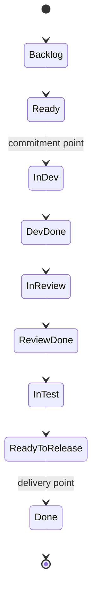

# Tooling: Jira and Azure DevOps for Kanban (and Scrum)

> **TL;DR** — Design the workflow on a whiteboard first, then configure the tool. In **Jira**: map statuses to board columns, use column constraints (min/max = WIP limits), split active states into "In X" / "X done" statuses, use status categories (To Do / In Progress / Done) correctly for metrics, create swimlanes via JQL queries (expedite, CoS), use quick filters, card colours and "days in column", and read the CFD and control chart reports. In **Azure Boards**: customise board columns with WIP limits and **split columns** (Doing/Done) natively, add **swimlanes**, **Definition of Done** per column, card styling rules, and use the **CFD**, **cycle time** and **lead time** widgets/Analytics. Data hygiene beats fancy plugins. For Monte Carlo and aging charts, use marketplace add-ons or export data.

---

## 1. General principles

| Principle | Detail |
|---|---|
| Design first, tool second | Model workflow & policies with the team; avoid letting tool defaults define process |
| Simple workflows | Fewer statuses; transitions "all → all" to avoid friction (rely on policies, not workflow validators) |
| Status categories matter | Metrics (cycle time, CFD, throughput) depend on correct To Do / In Progress / Done mapping |
| One board per team, plus a coordination view | Avoid many personal boards hiding work |
| Automate the boring parts | Auto-transition on PR open/merge; flag stale items |
| Don't over-instrument | Mandatory fields at every transition = friction = bad data |
| Avoid work logging as a metric | Time tracking corrupts flow data and trust |

---

## 2. Jira (Cloud) — Kanban configuration

### 2.1 Project types
- **Team-managed** (formerly next-gen): simpler, per-project workflow; board columns = statuses; WIP limits available; fewer reports/advanced features historically.
- **Company-managed** (classic): shared workflows/schemes; board via filter (JQL); full board configuration (columns, swimlanes, quick filters, card colours, card layout, estimation, working days). Recommended for metric-heavy Kanban.

### 2.2 Board configuration (company-managed)

| Setting | Where | Tips |
|---|---|---|
| **Board filter** | Board settings → General → Filter (JQL) | Defines scope: `project = PAY AND issuetype not in (Sub-task) ORDER BY Rank ASC` |
| **Kanban board sub-filter** | General | Hide old done items: `fixVersion in unreleasedVersions() OR fixVersion is EMPTY` or `resolved >= -14d OR resolution is EMPTY` |
| **Columns** | Columns | Map one or more statuses per column; create statuses "In Dev", "Dev Done", "In Review", "Review Done"... |
| **Column constraints (WIP)** | Columns → Column constraint: Issue Count (or Issue Count excluding sub-tasks) | Set **max** (WIP limit) and optionally **min** (starvation signal). Column turns red/yellow when breached |
| **Kanban backlog** | Columns → enable "Kanban backlog" | Moves "Backlog" column off-board into a separate backlog view — keeps board clean |
| **Swimlanes** | Swimlanes → Base on: Queries / Stories / Assignees / Epics / Projects / None | Use **Queries** for CoS: Expedite `priority = Highest OR labels = expedite`; Fixed date `duedate is not EMPTY`; Default lane "Standard" |
| **Quick filters** | Quick Filters | `flagged is not EMPTY` (blocked), `issuetype = Bug`, `labels = tech-debt`, `"Class of Service" = Expedite` |
| **Card colours** | Card colours → Based on: Issue types / Priorities / Assignees / Queries | Queries for CoS or aging: `status changed during (-30d, now()) ...` is limited; use `updated <= -7d` as stale proxy |
| **Card layout** | Card layout | Add Due date, Labels, Components, Class of Service field; keep ≤ 3 fields |
| **Days in column** | Card layout → "Days in column" toggle | Shows dots indicating time in column — aging proxy |
| **Working days** | Working days | Affects control chart calculations (non-working days excluded) |
| **Estimation** | Estimation | Kanban: "Issue count" approach; turn off story points if not used |
| **Flagging** | Built-in "Flag" (impediment) | Flagged cards turn yellow/red-ish; use for blockers; add comment with reason |

### 2.3 Workflow design for Kanban in Jira



| Status | Status category | Column |
|---|---|---|
| Backlog | To Do | Kanban backlog |
| Ready | To Do | Ready (WIP 6) |
| In Dev | In Progress | Develop – Doing |
| Dev Done | In Progress | Develop – Done (shares limit via column grouping — Jira can't share limits across columns; alternative: one column "Develop" containing both statuses and use card colour/quick filter to show "Dev Done") |
| In Review / Review Done | In Progress | Review |
| In Test | In Progress | Validate |
| Ready to Release | In Progress | Ready to Release |
| Done | Done | Done (resolution set!) |

**Jira limitation:** WIP limits are per column; there's no native shared limit across "Doing" and "Done" sub-columns. Options: (a) map both statuses into one column (shared limit) and distinguish via card colour query `status = "Dev Done"`; (b) separate columns with separate limits; (c) marketplace apps.

**Resolution field:** Ensure the transition to Done sets a **Resolution**; otherwise items appear unresolved in reports and JQL `resolution is EMPTY` filters break.

### 2.4 Useful JQL examples

```sql
-- Current WIP (committed, not done) for the team
project = PAY AND statusCategory = "In Progress"

-- Throughput: items finished in the last 7 days
project = PAY AND statusCategory = Done AND resolved >= -7d AND issuetype in (Story, Bug, Task)

-- Items finished in a date range (for metrics export)
project = PAY AND resolved >= "2026-07-01" AND resolved < "2026-10-01" ORDER BY resolved ASC

-- Blocked items
project = PAY AND flagged is not EMPTY

-- Aging proxy: in progress and not updated for 5+ days
project = PAY AND statusCategory = "In Progress" AND updated <= -5d

-- Moved into "In Dev" before 10 days ago and still not done (aging vs SLE, approximation)
project = PAY AND status CHANGED TO "In Dev" BEFORE -10d AND statusCategory != Done

-- Items that went backwards (rework) from Review to Dev
project = PAY AND status CHANGED FROM "In Review" TO "In Dev" DURING (-30d, now())

-- Expedite swimlane query
project = PAY AND (priority = Highest OR labels = expedite)

-- Fixed-date items due in the next 14 days, not done
project = PAY AND duedate <= 14d AND statusCategory != Done ORDER BY duedate ASC

-- Arrival rate: items that crossed commitment (moved into In Dev) this week
project = PAY AND status CHANGED TO "In Dev" DURING (startOfWeek(), now())

-- Items with no epic (unaligned work) — field name varies; in newer Jira Cloud use parent
project = PAY AND parent is EMPTY AND issuetype = Story AND statusCategory != Done

-- Old options to prune
project = PAY AND status = Backlog AND created <= -180d

-- Escaped defects created last 30 days
project = PAY AND issuetype = Bug AND labels = production AND created >= -30d
```

Notes: `status was`, `status changed` are supported for status history (and some other fields). Functions like `startOfWeek()`, `endOfMonth()`, `-7d` relative dates are standard. Custom fields are referenced by name in quotes or `cf[10010]`.

### 2.5 Jira reports for Kanban

| Report | Use | Caveats |
|---|---|---|
| **Cumulative flow diagram** | Flow stability, bottlenecks; configure columns shown, swimlanes, quick filters, timeframe | Exclude Backlog column for readability; refine by quick filter for a work type |
| **Control chart** | Cycle time scatter per item; choose start/end columns; rolling average; std dev | Uses mean & std dev — prefer reading percentiles via export; select columns that match commitment→delivery |
| **Created vs resolved** | Arrival vs departure rate | Use for demand vs capability |
| **Average age / Resolution time** (Jira dashboards gadgets) | Aging trends | Coarse |
| **Recently created**, **Pie chart** gadget | Work mix (flow distribution) by type | — |
| **Jira Product Discovery** | Upstream/discovery views | Separate product; links ideas to delivery epics |
| **Atlassian Analytics / data lake** | SQL over Jira data for custom metrics | Premium/Enterprise |

Marketplace options (verify current availability): ActionableAgile Analytics (CFD, scatterplot with percentiles, aging WIP, Monte Carlo), Nave, Great Gadgets, eazyBI.

### 2.6 Automation (Jira Automation) ideas
- When PR opened (dev tool integration) → transition to "In Review".
- When PR merged → transition to "Review Done".
- Scheduled rule: flag/comment on items in progress with `updated <= -5d` ("aging alert").
- When item flagged → post to team Slack/Teams channel.
- When parent's all children Done → transition parent.
- When Bug with `priority = Highest` created → add `expedite` label + notify.

---

## 3. Azure DevOps (Azure Boards) — Kanban configuration

### 3.1 Concepts
- **Process** (Basic, Agile, Scrum, CMMI; inherited custom processes) defines work item types and states.
- **Backlog levels**: Epics → Features → Stories/PBIs/Requirements (→ Tasks). Each backlog level has its own **board**.
- **Board columns** map to workflow **states** but can be more granular — multiple columns can map to the same state (columns are team-specific; states are process-wide).
- State categories: Proposed, In Progress, Resolved, Completed, Removed — drive metrics.

### 3.2 Board settings

| Setting | Tips |
|---|---|
| **Columns** | Add columns, map to states; columns can differ from states (e.g. "Develop", "Review", "Validate" all map to "Active"/"Committed") |
| **WIP limits** | Per column; header turns red when exceeded (soft limit — not enforced) |
| **Split columns** | Native **Doing / Done** split per column; WIP limit covers both sub-columns — ideal for Kanban |
| **Definition of Done** per column | Text shown via info icon in column header — explicit policies |
| **Swimlanes** | Add lanes (e.g. Expedite, Fixed date, Standard); default lane always exists. Recent versions support swimlane rules (auto-placement by field criteria) |
| **Card fields** | Show tags, assignee, effort, custom fields (CoS), parent, child progress |
| **Card styles (styling rules)** | Colour cards by query conditions (e.g. `Tags Contains expedite` → red; `Changed Date < @Today-5` → amber as stale proxy); tag colours |
| **Card reordering** | Option to allow reordering cards in columns |
| **Annotations** | Show tasks/tests checklists on cards |
| **Backlogs settings** | Select which backlog levels are visible; bugs as requirements or tasks |
| **Working days** | Team settings; affects calculations |
| **Team areas/iterations** | Kanban doesn't require iterations; set default iteration or ignore |

### 3.3 Example board

| Column | Mapped state | WIP | Split | DoD (column policy) |
|---|---|---|---|---|
| New (backlog) | New | — | — | — |
| Ready | Approved | 6 | No | Acceptance criteria present; right-sized; deps known |
| Develop | Committed | 5 | Yes | PR opened; unit tests; CI green |
| Review | Committed | 3 | Yes | 1 approval; comments resolved |
| Validate | Committed | 3 | Yes | AC verified; exploratory test done |
| Ready to Release | Committed | — | No | Merged; deployable |
| Done | Done | — | — | In production; flag enabled |

### 3.4 Analytics and charts

| Chart / widget | Description |
|---|---|
| **Cumulative Flow Diagram** (board in-context report & dashboard widget) | Choose backlog level, swimlanes, columns, time period; exclude "New" for readability |
| **Cycle Time widget** | Scatter of items by cycle time (In Progress → Completed state categories); rolling average & std dev |
| **Lead Time widget** | Created → Completed |
| **Velocity** (iteration-based) | Scrum use |
| **Burndown / Burnup widgets** | Sprint or release scope |
| **Analytics views + Power BI** | OData-based; build percentiles, throughput run charts, aging, Monte Carlo in Power BI/Excel |
| **Analytics OData queries** | `WorkItems` / `WorkItemSnapshot` entity sets for custom metrics |

Note: Cycle/Lead time widgets use state categories; ensure states map correctly. For **percentiles** and **aging WIP**, export via Analytics/OData or use marketplace extensions (e.g. ActionableAgile for Azure DevOps, Nave, Flow Analytics — verify current availability).

### 3.5 WIQL (Work Item Query Language) examples

```sql
-- Current WIP
SELECT [System.Id], [System.Title], [System.State], [System.BoardColumn]
FROM WorkItems
WHERE [System.TeamProject] = @project
  AND [System.WorkItemType] IN ('User Story', 'Bug')
  AND [System.State] IN ('Active', 'Committed')

-- Throughput last 7 days
SELECT [System.Id], [Microsoft.VSTS.Common.ClosedDate]
FROM WorkItems
WHERE [System.TeamProject] = @project
  AND [Microsoft.VSTS.Common.ClosedDate] >= @Today - 7

-- Stale in-progress items (aging proxy)
SELECT [System.Id], [System.Title], [System.ChangedDate]
FROM WorkItems
WHERE [System.State] = 'Active' AND [System.ChangedDate] < @Today - 5

-- Expedite items
SELECT [System.Id] FROM WorkItems
WHERE [System.Tags] CONTAINS 'expedite' AND [System.State] <> 'Closed'

-- Items currently in a given board column
SELECT [System.Id] FROM WorkItems
WHERE [System.BoardColumn] = 'Review' AND [System.BoardColumnDone] = True
```

(Field reference names depend on the process; e.g. Scrum process uses `Microsoft.VSTS.Common.ClosedDate` for Done items in some configurations and states "Committed"/"Done".)

`System.BoardColumn` and `System.BoardColumnDone` let you query split-column positions.

### 3.6 Automation in ADO
- Link commits/PRs to work items (`AB#123` in GitHub, or `#123` in Azure Repos) → auto-transition rules on PR completion (state transition on merge).
- Service hooks → Teams/Slack notifications on state changes.
- Azure Pipelines + Boards integration: show deployment status on work items.
- Rules in inherited process: e.g. make fields required on transition (use sparingly).

---

## 4. Jira vs Azure DevOps for Kanban

| Capability | Jira | Azure Boards |
|---|---|---|
| Split Doing/Done columns with shared WIP | No native (workaround via status mapping) | **Yes, native** |
| Column policies text | Status description (limited visibility) | **Definition of Done per column** |
| WIP limits | Max & min per column | Max per column |
| Swimlanes by query | **Yes (JQL)** | Swimlanes; rules in newer versions |
| Quick filters | **Yes (JQL)** | Filter bar (keyword, type, assignee, tags, parent) |
| CFD | Yes | Yes |
| Cycle time scatter | Control chart | Cycle time widget |
| Percentiles / Monte Carlo | Marketplace | Marketplace / Power BI |
| Query language | JQL (history operators `was`, `changed`) | WIQL (+ `ASOF`, history via Analytics) |
| Portfolio | Advanced Roadmaps (Plans), Jira Align | Delivery Plans, Epics/Features boards |
| Discovery | Jira Product Discovery | — (use Epics/Features boards) |

---

## 5. Portfolio and multi-team views

| Need | Jira | ADO |
|---|---|---|
| Portfolio Kanban (initiatives/epics) | Board on epic/initiative issue type (filter `issuetype = Epic`); Advanced Roadmaps for timeline | Epics/Features backlog board with WIP & split columns |
| Cross-team coordination (Flight Level 2) | Board with filter across projects; swimlanes by project/team | Multiple teams' features on a shared area path board; Delivery Plans |
| Dependencies | Issue links ("blocks"), Advanced Roadmaps dependency view | Predecessor/successor links; Delivery Plans dependency lines |

---

## 6. Other Kanban tools

| Tool | Notes |
|---|---|
| **Kanbanize (Businessmap)** | Strong Kanban Method support: multi-level boards, flow analytics, Monte Carlo |
| **SwiftKanban (Nimble)** | Kanban University-aligned; CoS, metrics |
| **LeanKit (Planview AgilePlace)** | Flexible board layouts, nested lanes |
| **Trello** | Simple; WIP limits via power-ups; good for personal/small teams |
| **GitHub Projects** | Boards with custom fields; limited flow analytics; simple WIP limits on columns |
| **GitLab Issue Boards** | Lists by label; WIP limits per list |
| **Linear** | Opinionated cycle-based; fast; cycle time insights |
| **YouTrack**, **ClickUp**, **Monday.com**, **Asana** | General work management; Kanban views |
| **Miro / Mural / FigJam** | Board design workshops, retros |
| **ActionableAgile Analytics**, **Nave** | Flow analytics add-ons/standalone (CSV import) |
| **Troy Magennis spreadsheets** | Free Monte Carlo / forecasting spreadsheets (Focused Objective) |

---

## 7. Data hygiene checklist

- [ ] Statuses mapped to correct status categories (Jira) / state categories (ADO)
- [ ] Done transition sets resolution (Jira)
- [ ] Commitment & delivery points correspond to identifiable statuses/columns
- [ ] Items aren't bulk-closed at period end (distorts throughput)
- [ ] Cancelled items have distinct resolution/state ("Won't do", "Removed")
- [ ] Sub-tasks excluded from throughput counts
- [ ] Board filter includes all team work (support, bugs)
- [ ] No duplicated items across boards inflating counts
- [ ] Workflow changes logged (date), so metric windows can be adjusted

---

## 8. Common mistakes

1. Workflow with 15 statuses and strict transitions → people skip updating → bad data.
2. WIP limits configured but ignored (red columns become wallpaper).
3. Using sprints in a Kanban project "for reporting" → artificial batching.
4. Reading control chart averages instead of percentiles.
5. Personal boards hiding work from the team board.
6. Time-tracking fields mandatory → resentment, fake data.
7. Measuring individuals via dashboards.
8. Tool admin decides process instead of the team.

---

## References

- Atlassian: Kanban — <https://www.atlassian.com/agile/kanban>
- Atlassian: Agile coach / guides — <https://www.atlassian.com/agile>
- Atlassian Support: Jira Software Cloud — <https://support.atlassian.com/jira-software-cloud/>
- Microsoft Learn: Azure Boards documentation — <https://learn.microsoft.com/en-us/azure/devops/boards/>
- Microsoft Learn: Kanban overview — <https://learn.microsoft.com/en-us/azure/devops/boards/boards/kanban-overview>
- Microsoft Learn: Azure DevOps reporting/Analytics — <https://learn.microsoft.com/en-us/azure/devops/report/>
- Businessmap (Kanbanize) — <https://businessmap.io/>
- ActionableAgile — <https://actionableagile.com/>
- Focused Objective — <https://www.focusedobjective.com/>
- Related: [kanban-board-design.md](kanban-board-design.md), [flow-metrics.md](flow-metrics.md), [forecasting-and-estimation.md](forecasting-and-estimation.md)
