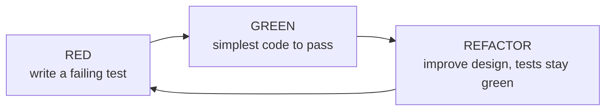

# Extreme Programming (XP) and Technical Agile Practices

> **TL;DR** — XP (Kent Beck, 1996–1999) is the engineering backbone of agility: short feedback loops at every scale — seconds (TDD), minutes (pairing, CI), hours (integration), days (planning game), weeks (small releases). Values: communication, simplicity, feedback, courage, respect. Core practices: TDD, pair/mob programming, continuous integration, small releases, planning game, collective code ownership, simple design, refactoring, coding standards, sustainable pace, whole team. Without these, Scrum/Kanban produce "flaccid" agile — process without the ability to change software safely. DevOps and Continuous Delivery are XP's natural continuation.

---

## 1. History

| Year | Event |
|---|---|
| 1996 | Kent Beck leads Chrysler Comprehensive Compensation (C3) project; Ron Jeffries joins as coach |
| 1999 | *Extreme Programming Explained: Embrace Change* (1st ed.) — 12 practices |
| 2000 | *Planning Extreme Programming* (Beck & Fowler) |
| 2001 | Beck, Jeffries, Cunningham, Fowler co-sign the Agile Manifesto |
| 2003 | Beck, *Test-Driven Development: By Example* |
| 2004 | *XP Explained* 2nd ed. — primary and corollary practices; values + principles |
| 2010 | Humble & Farley, *Continuous Delivery* |
| 2010s | Mob programming (Woody Zuill), DevOps, trunk-based development mainstream |

"Extreme": take good practices to the extreme — if code review is good, review all the time (pairing); if testing is good, test first (TDD); if integration is good, integrate continuously.

---

## 2. Values and principles

### 2.1 Values

| Value | Meaning |
|---|---|
| Communication | Most problems trace to someone not talking; favour conversation, shared space, pairing |
| Simplicity | Do the simplest thing that could possibly work; YAGNI |
| Feedback | From the system (tests), customer (releases), team (estimates) — as fast as possible |
| Courage | Tell the truth about progress; refactor; throw away code |
| Respect (added 2004) | Care for team members and the project |

### 2.2 Principles (2nd ed., selection)
Humanity, economics, mutual benefit, self-similarity, improvement, diversity, reflection, flow, opportunity, redundancy, failure, quality, baby steps, accepted responsibility.

---

## 3. Practices

### 3.1 Original 12 practices (1st ed.) grouped by feedback scale

| Scale | Practice |
|---|---|
| Fine-scale feedback | **Pair programming**, **Planning game**, **Test-driven development**, **Whole team (on-site customer)** |
| Continuous process | **Continuous integration**, **Refactoring (design improvement)**, **Small releases** |
| Shared understanding | **Coding standards**, **Collective code ownership**, **Simple design**, **System metaphor** |
| Programmer welfare | **Sustainable pace** (originally "40-hour week") |

### 3.2 2nd edition: primary practices
Sit together, whole team, informative workspace, energized work, pair programming, stories, weekly cycle, quarterly cycle, slack, ten-minute build, continuous integration, test-first programming, incremental design.

**Corollary practices**: real customer involvement, incremental deployment, team continuity, shrinking teams, root-cause analysis, shared code, code and tests, single code base, daily deployment, negotiated scope contract, pay-per-use.

---

## 4. Test-Driven Development (TDD)

### 4.1 Cycle

### 4.2 Rules (Uncle Bob's three laws, paraphrased)
1. Don't write production code unless it makes a failing test pass.
2. Don't write more of a test than is sufficient to fail (compilation failures count).
3. Don't write more production code than is sufficient to pass the one failing test.

### 4.3 Styles

| Style | Description | Pros | Cons |
|---|---|---|---|
| **Classicist / Chicago / Detroit** | State-based verification; real collaborators where possible; inside-out | Robust to refactoring | May discover design late |
| **Mockist / London** | Interaction-based; mocks for collaborators; outside-in (GOOS book) | Drives interface design | Brittle tests coupled to implementation |
| **ATDD / BDD** | Acceptance tests (Given/When/Then) drive development from outside | Shared understanding with business | Tooling overhead (Cucumber etc.) |

### 4.4 Benefits & evidence
- Fast feedback; regression safety net; better modular design; executable documentation.
- Studies (e.g. Microsoft/IBM case study, Nagappan et al. 2008) reported 40–90% fewer pre-release defects with 15–35% more initial development time — context-dependent; treat as indicative.

### 4.5 Common mistakes
- Writing tests after and calling it TDD.
- Testing implementation details (over-mocking).
- Skipping refactor step → test-driven mess.
- Huge steps; slow test suites (> minutes for unit tests).
- 100% coverage targets (Goodhart).

---

## 5. Pair and mob programming

### 5.1 Pair programming styles

| Style | How |
|---|---|
| Driver–Navigator | Driver types; navigator reviews, thinks strategically; switch regularly |
| Ping-pong (with TDD) | A writes failing test, B makes it pass and writes next test |
| Strong-style (Llewellyn Falco) | "For an idea to go from your head into the computer it must go through someone else's hands" |
| Tour guide / unstructured | Avoid — one person dominates |

**Benefits**: continuous review, knowledge sharing (bus factor), fewer defects, focus, onboarding. **Costs**: perceived double effort (empirically ~15% more person-hours for fewer defects — Cockburn & Williams 2000), fatigue; requires skill and psychological safety.

**Tips**: rotate pairs daily or per story; pomodoro breaks; remote tooling (VS Code Live Share, JetBrains Code With Me, Tuple); don't force 100% pairing.

### 5.2 Mob (ensemble) programming
- Whole team works on the same thing, same time, same computer (Woody Zuill, Hunter Industries ~2011).
- Driver rotates every few minutes (e.g. 4–10 min); navigators guide.
- Reduces WIP to 1 (or few) → no handoffs, no waiting for review, instant knowledge sharing.
- Good for: complex problems, onboarding, legacy code, critical changes.
- Kanban connection: mobbing makes WIP limit trivially low and flow efficiency high.

---

## 6. Continuous Integration (CI)

### 6.1 Definition (Fowler)
Team members integrate their work frequently — at least daily — into the mainline; each integration is verified by an automated build including tests.

### 6.2 Practices checklist
- [ ] Single source repository; mainline (trunk) is the integration point
- [ ] Automated build; self-testing build
- [ ] Everyone commits to mainline at least daily (short-lived branches < 1 day, or trunk-based)
- [ ] Every commit builds mainline on an integration machine
- [ ] Fix broken builds immediately ("stop the line" — jidoka)
- [ ] Keep the build fast (ten-minute build)
- [ ] Test in a clone of production environment
- [ ] Easy access to latest executable
- [ ] Everyone can see what's happening (build radiator)
- [ ] Automated deployment

**Feature branches with weeks of life + a CI server ≠ CI.** Trunk-based development, feature flags and branch by abstraction enable true CI.

### 6.3 Continuous Delivery / Deployment

| Term | Meaning |
|---|---|
| Continuous Integration | Merge and verify frequently |
| Continuous Delivery | Every change is releasable; deploy to production is a business decision, push-button |
| Continuous Deployment | Every change that passes the pipeline goes to production automatically |

Deployment pipeline: commit stage → automated acceptance → (capacity/security) → production. See [../08-engineering/README.md](../08-engineering/README.md) and [../06-cloud-architecture/README.md](../06-cloud-architecture/README.md).

---

## 7. Other XP practices

| Practice | Description | Modern form |
|---|---|---|
| **Small releases** | Release valuable increments frequently | Continuous delivery; feature flags; progressive delivery |
| **Planning game** | Business decides scope/priority/dates; developers estimate & decide technical sequencing. Release planning + iteration planning; stories on cards | Backlog refinement + sprint planning; or flow replenishment |
| **Collective code ownership** | Anyone can change any code; no "Bob's module" | Inner source; CODEOWNERS used carefully (review routing, not gatekeeping) |
| **Simple design** (Kent Beck's 4 rules, in priority order) | 1) passes the tests, 2) reveals intention, 3) no duplication, 4) fewest elements | Clean code, YAGNI |
| **Refactoring** | Improve structure without changing behaviour, in small steps protected by tests | IDE automated refactorings; Fowler's catalogue |
| **Coding standards** | Shared conventions | Linters/formatters (Prettier, Black, ESLint) |
| **System metaphor** | Shared story of how the system works | Ubiquitous language (DDD) |
| **Sustainable pace** | No overtime two weeks in a row | WIP limits, slack, no death marches |
| **Whole team / on-site customer** | Customer representative with the team | PO, embedded designers, real user access |
| **Informative workspace** | Big visible charts | Dashboards, physical boards |
| **Slack** | Include minor tasks that can be dropped | Capacity buffer, intangible CoS |
| **Spikes** | Timeboxed technical investigation | Spike stories |
| **Weekly / quarterly cycle** | Plan weekly, reflect quarterly | Sprints + roadmap |

---

## 8. XP + Scrum + Kanban

| Layer | Provides |
|---|---|
| Kanban | Flow management, WIP limits, metrics, evolutionary change |
| Scrum | Team structure, cadence, roles, goal focus |
| XP | Engineering practices enabling fast, safe change |

Common combination: "ScrumXP" (SAFe term) or "Kanban + XP". Without XP-like practices, short cycles accumulate technical debt → velocity declines → "agile doesn't work".

Martin Fowler's "**Flaccid Scrum**" (2009): teams adopt Scrum's process but not technical practices; code base deteriorates.

---

## 9. DevOps link

| DevOps idea | Agile/Lean root |
|---|---|
| **Three Ways** (Gene Kim, *The Phoenix Project* / *DevOps Handbook*): Flow, Feedback, Continual learning | Lean flow; XP feedback; kaizen |
| CALMS (Culture, Automation, Lean, Measurement, Sharing) | Lean + XP + culture |
| Deployment pipeline | XP CI + small releases |
| "You build it, you run it" | Whole team; collective ownership |
| Blameless post-mortems | Prime Directive, hansei |
| DORA metrics | Flow metrics for delivery (see [flow-metrics.md](flow-metrics.md)) |
| Value stream mapping of delivery pipeline | Lean VSM (see [lean.md](lean.md)) |
| Shift left (testing, security) | Build quality in |
| Platform engineering | Reducing cognitive load; Team Topologies |

**Accelerate** (Forsgren, Humble, Kim, 2018) linked technical practices (CI, trunk-based development, test automation, loosely coupled architecture, deployment automation) statistically to software delivery performance and organisational performance. Many of these are XP practices.

---

## 10. Other technical practices commonly used with agile

| Practice | Purpose |
|---|---|
| Trunk-based development | Enables CI; reduces merge pain |
| Feature toggles | Decouple deploy from release |
| Code review (asynchronous) | Quality & knowledge sharing (alternative: pairing) |
| Behaviour-driven development (BDD) | Shared specification by example |
| Example mapping (Matt Wynne) | Structured refinement: rules, examples, questions |
| Three amigos | Business + dev + test perspectives before building |
| Contract testing | Independent deployability between services |
| Infrastructure as code | Reproducible environments |
| Observability | Fast feedback from production |
| Domain-driven design | Model and boundaries aligned with business |
| Evolutionary architecture / fitness functions | Architecture that supports change |

---

## 11. When to use / when not

| Practice | Strong fit | Weak fit / adapt |
|---|---|---|
| TDD | Business logic, libraries, algorithms, long-lived code | Throwaway spikes, exploratory UI prototypes |
| Pairing | Complex/critical code, onboarding, knowledge silos | Trivial tasks, solo deep research (then pair to review) |
| Mobbing | Hard problems, team alignment, new codebase | Large teams (> 6–7), routine work |
| CI/trunk-based | Almost all teams | Regulated environments need extra controls (still possible) |
| Small releases | Web/SaaS | Embedded/hardware (use internal increments, simulation) |
| Collective ownership | Single team codebases | Very large codebases: team ownership boundaries + inner source |

---

## 12. Common mistakes

1. Process adoption without engineering practices ("flaccid Scrum").
2. Long-lived feature branches labelled "CI".
3. Mandating 100% pairing or 100% coverage by decree.
4. TDD without refactoring.
5. Ignoring a red build ("it's flaky") → normalising failure.
6. Overtime culture contradicting sustainable pace.
7. Mocks everywhere → brittle tests that resist refactoring.
8. Treating DevOps as a separate team/role instead of a capability.

---

## References

- Wikipedia: Extreme programming — <https://en.wikipedia.org/wiki/Extreme_programming>
- Wikipedia: Extreme programming practices — <https://en.wikipedia.org/wiki/Extreme_programming_practices>
- Wikipedia: Test-driven development — <https://en.wikipedia.org/wiki/Test-driven_development>
- Wikipedia: Pair programming — <https://en.wikipedia.org/wiki/Pair_programming>
- Wikipedia: Continuous integration — <https://en.wikipedia.org/wiki/Continuous_integration>
- Wikipedia: Continuous delivery — <https://en.wikipedia.org/wiki/Continuous_delivery>
- Wikipedia: DevOps — <https://en.wikipedia.org/wiki/DevOps>
- Martin Fowler, "Continuous Integration" — <https://martinfowler.com/articles/continuousIntegration.html>
- Martin Fowler's bliki — <https://martinfowler.com/bliki/>
- Trunk-based development — <https://trunkbaseddevelopment.com/>
- extremeprogramming.org (Don Wells) — <http://www.extremeprogramming.org/>
- DORA — <https://dora.dev/>
- Kent Beck, *Extreme Programming Explained* (1999; 2nd ed. 2004 with Cynthia Andres)
- Kent Beck, *Test-Driven Development: By Example* (2002)
- Steve Freeman & Nat Pryce, *Growing Object-Oriented Software, Guided by Tests* (2009)
- Martin Fowler, *Refactoring* (2nd ed., 2018)
- Jez Humble & David Farley, *Continuous Delivery* (2010)
- Nicole Forsgren, Jez Humble, Gene Kim, *Accelerate* (2018)
- Gene Kim et al., *The DevOps Handbook* (2016; 2nd ed. 2021)
- Woody Zuill & Kevin Meadows, *Software Teaming* (2022)
