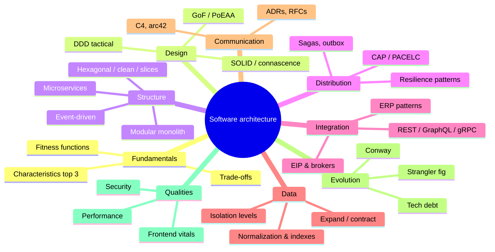

# 05 — Software Architecture

> **TL;DR** — The largest section of the knowledgebase: what architecture is and how to make trade-offs, design principles and patterns, architecture styles, domain-driven design, distributed systems, integration and APIs, application data architecture, documentation and decisions, evolution of legacy systems, security, performance, and frontend architecture. Start with **fundamentals**, then read by need.

---

## Files

| # | File | Description |
|---|---|---|
| 1 | [architecture-fundamentals.md](architecture-fundamentals.md) | Definitions (Fowler, Bass/Clements/Kazman, ISO/IEC/IEEE 42010), architect role, characteristics / ISO 25010, quality attribute scenarios, ATAM, trade-offs, fitness functions |
| 2 | [design-principles.md](design-principles.md) | SOLID with examples, DRY/KISS/YAGNI/LoD/SoC, connascence, GRASP, CQS, Tell-Don't-Ask, package principles (REP/CCP/CRP/ADP/SDP/SAP), Clean Code |
| 3 | [design-patterns.md](design-patterns.md) | All 23 GoF patterns (intent, when, examples) and PoEAA patterns: Repository, Unit of Work, Active Record vs Data Mapper, Service Layer, DTO, Specification, ... |
| 4 | [architecture-styles.md](architecture-styles.md) | Layered, modular monolith, microkernel, pipeline, service-based, event-driven, space-based, SOA, microservices, serverless, hexagonal/onion/clean, vertical slice, CQRS, event sourcing, micro-frontends, BFF; star-rating comparison |
| 5 | [domain-driven-design.md](domain-driven-design.md) | Strategic DDD (subdomains, bounded contexts, context mapping), tactical DDD (aggregates and Vernon's rules), Event Storming, Domain Storytelling, Bounded Context Canvas |
| 6 | [distributed-systems.md](distributed-systems.md) | Fallacies, CAP/PACELC, consistency models, clocks, consensus, idempotency, sagas, outbox/inbox, 2PC, retries/backoff/jitter, circuit breaker, bulkhead, rate limiting, backpressure, load shedding |
| 7 | [integration-and-messaging.md](integration-and-messaging.md) | Enterprise Integration Patterns, queues vs topics vs streams, Kafka/RabbitMQ/Azure Service Bus/Pub/Sub, message design, ERP integration patterns, ETL vs ELT |
| 8 | [api-design.md](api-design.md) | REST and Richardson maturity, HTTP methods and status codes, pagination, versioning, GraphQL, gRPC, webhooks, OpenAPI/AsyncAPI, API style guides, API gateway |
| 9 | [data-architecture-for-applications.md](data-architecture-for-applications.md) | SQL vs NoSQL, normalization 1NF–BCNF, indexing, ACID vs BASE, isolation levels and anomalies, polyglot persistence, database-per-service, expand/contract migrations |
| 10 | [documentation-and-decisions.md](documentation-and-decisions.md) | C4 model, arc42, ADRs (Nygard, MADR), RFCs/design docs, architecture katas, diagrams as code, UML essentials, 4+1 views |
| 11 | [evolution-and-legacy.md](evolution-and-legacy.md) | Strangler fig, branch by abstraction, parallel run, ACL, modernization strategies (the "R"s), technical debt quadrant, Conway's Law, Mikado method |
| 12 | [security-architecture.md](security-architecture.md) | OWASP Top 10 (2021 and 2025), ASVS, threat modelling (STRIDE, DREAD, PASTA, attack trees), zero trust, OAuth 2.0/2.1, OIDC, JWT pitfalls, secrets, supply chain (SLSA, SBOM) |
| 13 | [performance-and-scalability.md](performance-and-scalability.md) | Latency numbers, Little's Law, Amdahl, USL, scaling strategies, stateless services, caching patterns and stampedes, replication, sharding, consistent hashing, N+1, profiling |
| 14 | [frontend-architecture.md](frontend-architecture.md) | CSR/SSR/SSG/ISR/islands/RSC, app structure, state management, micro-frontends, design system architecture, Core Web Vitals |
| 15 | [resources.md](resources.md) | Books, websites, papers, talks, learning path |

---

## Suggested reading paths

| Goal | Path |
|---|---|
| New to architecture | 1 → 2 → 4 → 10 → 15 |
| Designing a new business system (ERP extension, portal) | 1 → 5 → 4 → 9 → 8 → 7 → 12 → 10 |
| Breaking up a monolith | 4 → 5 → 11 → 6 → 7 → 9 |
| Integration-heavy work | 7 → 8 → 6 → 5 (context mapping, ACL) |
| Performance or scale issue | 13 → 9 → 6 |
| Security review | 12 → 8 → 10 (DFDs) |
| Frontend platform | 14 → 4 (micro-frontends, BFF) → 12 (SPA auth) |

## Architecture cheat sheet

### Ten rules of thumb

1. Everything is a trade-off; write down *why* (ADRs).
2. Pick the top 3 characteristics; make them measurable; guard them with fitness functions.
3. Start with a well-modularised monolith; distribute only for a concrete characteristic.
4. Draw boundaries around business capabilities (bounded contexts), not technical layers or entities.
5. One writer per piece of data; integrate via contracts, not shared tables.
6. Every remote call: timeout, bounded retries with jitter, idempotency, circuit breaker.
7. Use the outbox for DB + message consistency; make consumers idempotent.
8. Version contracts deliberately; prefer additive change and tolerant readers.
9. Evolve incrementally (strangler fig, branch by abstraction, expand/contract); avoid big-bang rewrites.
10. Security, observability, and accessibility are designed in, not added at the end.

---

## Related sections

| Section | Relation |
|---|---|
| [../01-ux-ui/README.md](../01-ux-ui/README.md) | UX/UI, accessibility, design systems from the design side |
| [../02-product-management/README.md](../02-product-management/README.md) | Product discovery, requirements that drive characteristics |
| [../03-project-management/README.md](../03-project-management/README.md) | Planning migrations and architecture initiatives |
| [../04-agile-kanban-scrum/README.md](../04-agile-kanban-scrum/README.md) | Architecture in agile delivery |
| [../06-cloud-architecture/README.md](../06-cloud-architecture/README.md) | Cloud platforms, deployment, networking, resilience at infra level |
| [../07-data-ai-architecture/README.md](../07-data-ai-architecture/README.md) | Analytical data, ETL/ELT, lakehouse, AI/LLM architecture |
| [../08-engineering/README.md](../08-engineering/README.md) | Testing, CI/CD, observability, code quality practices |
| [../09-leadership-teams-facilitation/README.md](../09-leadership-teams-facilitation/README.md) | Team Topologies, Conway, facilitating workshops |
| [../10-laws-principles-mental-models/README.md](../10-laws-principles-mental-models/README.md) | Conway, Gall, Hyrum, Postel and other laws |
| [../11-enterprise-architecture-business/README.md](../11-enterprise-architecture-business/README.md) | Enterprise architecture, capability maps, TOGAF, ArchiMate |

## References

- Martin Fowler — Software Architecture Guide: https://martinfowler.com/architecture/
- Azure Architecture Center: https://learn.microsoft.com/azure/architecture/
- C4 model: https://c4model.com/
- arc42: https://arc42.org/
- microservices.io: https://microservices.io/
- Full list: [resources.md](resources.md)
