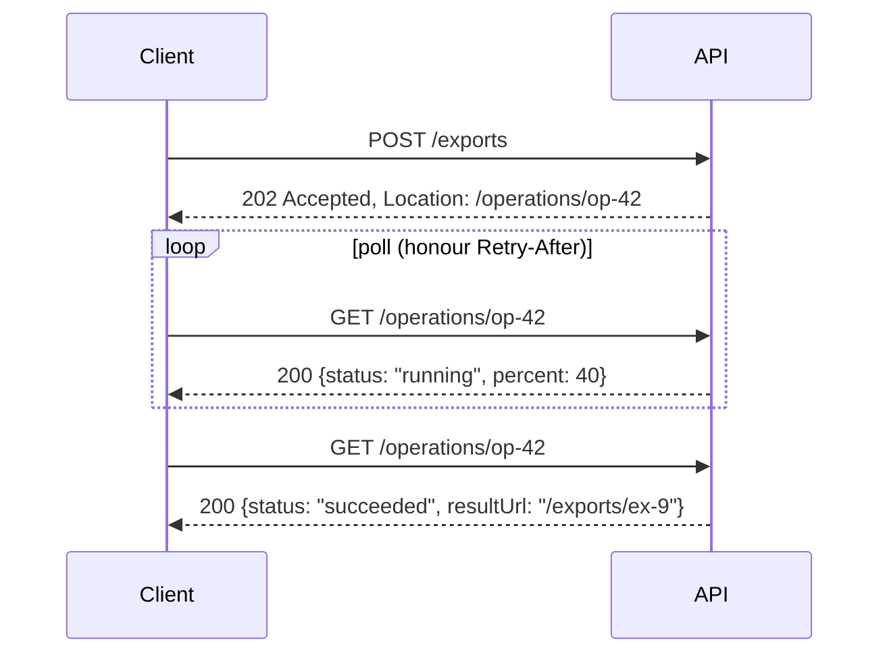
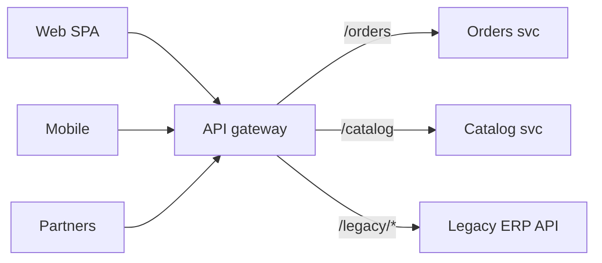

# API Design

> **TL;DR** — Pick the API style per interaction: **REST/HTTP** for resource-oriented public and partner APIs, **GraphQL** for client-driven aggregation over many entities, **gRPC** for low-latency internal service calls and streaming, **webhooks/events** for push notifications. Design contract-first (**OpenAPI**, **AsyncAPI**, `.proto`, GraphQL SDL), use HTTP semantics correctly (methods, status codes, idempotency, caching), choose **cursor pagination** for large/changing collections, version only on breaking change, and follow a published style guide (Microsoft, Google AIP, Zalando). Put cross-cutting concerns (auth, rate limits, routing) in an **API gateway**, not business logic.

---

## 1. API styles compared

| Style | Transport/format | Strengths | Weaknesses | Best for |
|---|---|---|---|---|
| **REST** | HTTP + JSON (usually) | Ubiquitous, cacheable, tooling, simple | Over/under-fetching; chatty for complex views | Public/partner APIs, CRUD-ish resources |
| **GraphQL** | HTTP POST + JSON | Client picks fields; one round trip; strong schema | Caching harder, N+1 on resolvers, query cost control, auth per field | BFFs, rich UIs aggregating many sources |
| **gRPC** | HTTP/2 + Protobuf | Fast, typed, streaming, codegen, deadlines | Browser needs gRPC-Web/Connect; less human-readable | Internal service-to-service, mobile, streaming |
| **SOAP** | HTTP + XML (WSDL, WS-*) | Formal contracts, WS-Security | Verbose, heavy | Legacy enterprise/ERP |
| **OData** | HTTP + JSON, query conventions | Standard querying (`$filter`, `$expand`) | Exposes data model; complex | Dynamics 365, SAP, data-centric APIs |
| **JSON-RPC / tRPC** | HTTP + JSON | Simple; tRPC end-to-end TS types | Tight coupling (tRPC: TS monorepo) | Internal full-stack TS apps |
| **Webhooks** | HTTP callbacks | Push, simple for consumers | Delivery reliability, security, consumer uptime | Notifying external parties |
| **WebSockets / SSE** | Persistent connections | Real-time push | Scaling stateful connections | Live dashboards, notifications, chat |
| **Async messaging** | Broker | Decoupling | Eventual consistency | Integration events ([integration-and-messaging.md](integration-and-messaging.md)) |

---

## 2. REST

Roy Fielding's dissertation (2000) defined REST constraints: **client-server, stateless, cacheable, uniform interface, layered system, code-on-demand (optional)**. Uniform interface: resource identification, manipulation through representations, self-descriptive messages, **HATEOAS** (hypermedia as the engine of application state).

### Richardson Maturity Model (Leonard Richardson; popularised by Fowler)

| Level | Name | Description | Example |
|---|---|---|---|
| 0 | The Swamp of POX | One endpoint, one method; RPC tunnelled over HTTP | `POST /api` with `{"action":"getOrder"}` |
| 1 | Resources | Multiple resource URIs, still one verb | `POST /orders/123` |
| 2 | HTTP verbs | Proper methods and status codes | `GET /orders/123` → 200; `POST /orders` → 201 |
| 3 | Hypermedia controls | Responses include links to next actions (HATEOAS) | `"_links": {"cancel": {"href": "/orders/123/cancellation"}}` |

Most "REST" APIs are Level 2 — usually the pragmatic sweet spot. Level 3 helps with discoverability and evolvability but is rarely consumed by clients.

### Resource naming

- Plural nouns, lowercase, hyphens or camelCase consistently: `/customers/{id}/orders`.
- No verbs in paths, except for non-CRUD **actions** modelled as sub-resources or custom methods: `POST /orders/{id}/cancellation` or Google AIP style `POST /orders/{id}:cancel`.
- Max ~2 levels of nesting; beyond that, use top-level resources with filters.
- Stable, opaque IDs (UUID/ULID or prefixed IDs `ord_...`); don't expose auto-increment if enumeration is a risk.

### HTTP methods

| Method | Semantics | Safe | Idempotent | Cacheable | Body |
|---|---|---|---|---|---|
| GET | Read | ✅ | ✅ | ✅ | No |
| HEAD | Headers only | ✅ | ✅ | ✅ | No |
| OPTIONS | Capabilities / CORS preflight | ✅ | ✅ | ❌ | Optional |
| POST | Create / process / action | ❌ | ❌ (use Idempotency-Key) | Rarely | Yes |
| PUT | Replace entire resource (or create at known URI) | ❌ | ✅ | ❌ | Yes |
| PATCH | Partial update (JSON Merge Patch RFC 7396 / JSON Patch RFC 6902) | ❌ | ❌ (can be made idempotent) | ❌ | Yes |
| DELETE | Remove | ❌ | ✅ | ❌ | Optional |
| QUERY (draft) | Safe, idempotent query with body | ✅ | ✅ | ✅ | Yes |

**Safe** = no server state change intended. **Idempotent** = multiple identical requests have the same effect as one (the *response* may differ, e.g. DELETE → 204 then 404).

### HTTP status codes (the ones that matter)

| Code | Meaning | Use |
|---|---|---|
| **200** OK | Success with body | GET, PUT/PATCH returning resource |
| **201** Created | Resource created | POST create; include `Location` header |
| **202** Accepted | Accepted for async processing | Long-running operations; return status URL |
| **204** No Content | Success, no body | DELETE, PUT without body |
| **301/308** | Permanent redirect (308 keeps method) | Moved resources |
| **302/307** | Temporary redirect (307 keeps method) | — |
| **304** Not Modified | Conditional GET matched ETag | Caching |
| **400** Bad Request | Malformed syntax/validation failure | Validation errors (or 422) |
| **401** Unauthorized | Not authenticated (missing/invalid credentials) | Include `WWW-Authenticate` |
| **403** Forbidden | Authenticated but not allowed | Authorization failure |
| **404** Not Found | Resource doesn't exist (or hidden for security) | — |
| **405** Method Not Allowed | Method not supported | Include `Allow` |
| **406** Not Acceptable | Can't produce requested media type | Content negotiation |
| **409** Conflict | State conflict (duplicate, invalid state transition) | Business rule conflicts |
| **410** Gone | Permanently removed | Deprecated endpoints after sunset |
| **412** Precondition Failed | `If-Match` ETag mismatch | Optimistic concurrency |
| **415** Unsupported Media Type | Wrong `Content-Type` | — |
| **422** Unprocessable Content | Semantically invalid | Validation errors (common choice) |
| **428** Precondition Required | Require `If-Match` | Enforce optimistic locking |
| **429** Too Many Requests | Rate limited | Include `Retry-After` |
| **500** Internal Server Error | Unexpected server failure | Never leak stack traces |
| **502** Bad Gateway | Upstream invalid response | Gateways |
| **503** Service Unavailable | Overloaded/maintenance | Include `Retry-After` |
| **504** Gateway Timeout | Upstream timeout | Gateways |

### Error format — Problem Details (RFC 9457, obsoletes RFC 7807)

```http
HTTP/1.1 422 Unprocessable Content
Content-Type: application/problem+json

{
  "type": "https://api.example.com/problems/credit-limit-exceeded",
  "title": "Credit limit exceeded",
  "status": 422,
  "detail": "Order total 12,500.00 EUR exceeds available credit of 10,000.00 EUR.",
  "instance": "/orders/SO-100234",
  "traceId": "4bf92f3577b34da6a3ce929d0e0e4736",
  "errors": { "lines[3].quantity": ["Must be a multiple of 12 (tray size)."] }
}
```

ASP.NET Core: `builder.Services.AddProblemDetails();` + `Results.Problem(...)` / `ValidationProblem`.

### Idempotency, concurrency, caching headers

| Concern | Headers |
|---|---|
| Idempotent POST | `Idempotency-Key: <uuid>` (IETF draft; Stripe convention) |
| Optimistic concurrency | Response `ETag: "v7"`; request `If-Match: "v7"` → 412 on mismatch |
| Conditional GET | `If-None-Match` → 304 |
| Caching | `Cache-Control: max-age=60, stale-while-revalidate=30`, `Vary` |
| Long-running ops | 202 + `Location: /operations/{id}`; poll or callback |
| Deprecation | `Deprecation` (RFC 9745), `Sunset` (RFC 8594) headers, `Link: rel="deprecation"` |
| Rate limits | `Retry-After`; `RateLimit-Policy` / `RateLimit` (IETF draft) |
| Tracing | `traceparent`, `tracestate` (W3C Trace Context) |

### Pagination styles

| Style | Request | Pros | Cons | Use |
|---|---|---|---|---|
| **Offset/limit** | `?offset=40&limit=20` / `?page=3&pageSize=20` | Simple; jump to page N; total counts | Slow for deep offsets (DB scans); duplicates/skips when data changes | Small admin tables, back-office grids |
| **Cursor (keyset/seek)** | `?after=eyJpZCI6MTIzfQ&limit=20` | Stable under inserts; O(log n) with index | No random page jump; cursor opaque | Large/changing datasets, feeds, public APIs |
| **Keyset explicit** | `?createdAfter=...&idAfter=...` | Transparent | Exposes sort keys | Internal APIs, sync |
| **Page token** (Google AIP-158) | `pageToken`, `pageSize` → `nextPageToken` | Opaque, server-controlled | Same as cursor | Google-style APIs |
| **Time-based / sync token** | `?since=2026-10-01T00:00:00Z` or delta token | Incremental sync | Clock/ordering issues; use monotonic change sequence | Integrations, ERP delta sync |
| **Link header** (RFC 8288) | `Link: <...>; rel="next"` | Hypermedia-friendly | Clients must parse header | GitHub API style |

```sql
-- Keyset pagination: stable and index-friendly
SELECT id, created_at, total
FROM orders
WHERE (created_at, id) < (:last_created_at, :last_id)
ORDER BY created_at DESC, id DESC
LIMIT 20;
-- index: (created_at DESC, id DESC)
```

Response envelope example:

```json
{ "items": [ /* ... */ ], "nextCursor": "eyJjIjoiMjAyNi0xMC0wOVQxMDowMDowMFoiLCJpIjoiMTIzIn0", "hasMore": true }
```

### Filtering, sorting, field selection

- Filtering: `?status=open&customerId=C-1`; ranges `?createdFrom=...&createdTo=...`; or a filter language (OData `$filter`, Google AIP-160 filtering, RSQL).
- Sorting: `?sort=-createdAt,id`.
- Sparse fieldsets: `?fields=id,total,status`.
- Expansion: `?expand=customer` — limit depth.

### Versioning strategies

| Strategy | Example | Pros | Cons |
|---|---|---|---|
| URI path | `/v1/orders` | Explicit, easy routing, cache-friendly | "Version the whole API"; URI not a stable resource identity |
| Query param | `/orders?api-version=2024-10-01` | Easy; Azure uses date versions | Easy to forget; caching keys |
| Header | `Api-Version: 2` | Clean URIs | Less visible, harder testing |
| Media type | `Accept: application/vnd.example.order.v2+json` | Fine-grained per resource; pure REST | Complex for clients/tools |
| No versioning (evolution) | Additive changes only; new fields/resources | No version churn | Requires discipline; eventually need breaking changes |
| Date-based (Stripe) | `Stripe-Version: 2024-06-20` pinned per account | Smooth upgrades | Server keeps transformation layers |

**Breaking changes**: removing/renaming fields, changing types/semantics, new required inputs, changing status codes, tightening validation, changing defaults, changing auth. **Non-breaking**: new optional fields/params, new endpoints, new enum values (*only* if clients are tolerant — document this!).

**Policy**: version only on breaking change; support N-1 for a defined period; announce deprecation with `Deprecation`/`Sunset`; measure usage per version before removal.

### Long-running operations (async request-reply)



Alternatives: webhook callback on completion, SSE/WebSocket progress.

### Bulk operations

- `POST /orders:batchCreate` with per-item results (207 Multi-Status semantics or per-item status array).
- Limit batch size; make each item idempotent; return partial failures clearly.

---

## 3. GraphQL

- Schema (SDL) with types, queries, mutations, subscriptions; single endpoint.
- Client selects fields → no over-fetching; nested queries → fewer round trips.

```graphql
type Query {
  order(id: ID!): Order
  orders(first: Int = 20, after: String, filter: OrderFilter): OrderConnection!
}

type Order {
  id: ID!
  status: OrderStatus!
  total: Money!
  customer: Customer!
  lines: [OrderLine!]!
}

type Mutation {
  placeOrder(input: PlaceOrderInput!): PlaceOrderPayload!
}
```

| Concern | Practice |
|---|---|
| N+1 resolvers | **DataLoader** batching per request |
| Pagination | Relay **Connection** spec (`edges`, `node`, `pageInfo`, cursors) |
| Errors | `errors` array + typed error unions in payloads for business errors |
| Security | Query depth/complexity limits, persisted queries / trusted documents, disable introspection in public prod if needed, field-level authorization |
| Caching | Persisted queries over GET for CDN; client normalised caches (Apollo, urql, Relay) |
| Federation | Apollo Federation / GraphQL Fusion to compose subgraphs from multiple teams |
| Versioning | Evolve schema; `@deprecated` fields; avoid versions |

**Use when** many clients with varying data needs, aggregation across services (as BFF), rapid UI iteration. **Avoid when** simple CRUD, file uploads/streaming heavy, public APIs needing HTTP caching, teams without capacity to manage query cost.

---

## 4. gRPC

```protobuf
syntax = "proto3";
package inventory.v1;

service InventoryService {
  rpc GetStock (GetStockRequest) returns (StockLevel);
  rpc ReserveStock (ReserveStockRequest) returns (Reservation);
  rpc WatchStock (WatchStockRequest) returns (stream StockLevel);   // server streaming
}

message GetStockRequest { string sku = 1; string warehouse_id = 2; }
message StockLevel { string sku = 1; int64 available = 2; int64 reserved = 3; }
message ReserveStockRequest { string sku = 1; int64 quantity = 2; string idempotency_key = 3; }
message Reservation { string reservation_id = 1; }
message WatchStockRequest { repeated string skus = 1; }
```

- Four call types: unary, server streaming, client streaming, bidirectional streaming.
- **Deadlines** propagate; status codes (`DEADLINE_EXCEEDED`, `UNAVAILABLE`, `ALREADY_EXISTS`, `FAILED_PRECONDITION`...).
- Protobuf evolution: never reuse field numbers; `reserved` removed fields; add fields freely.
- Browser: gRPC-Web or **Connect** protocol; JSON transcoding (ASP.NET Core gRPC JSON transcoding, Envoy, Google API HTTP annotations).
- Tooling: `buf` for linting/breaking-change detection.

---

## 5. Webhooks

| Concern | Best practice |
|---|---|
| Payload | Thin (event type + IDs) or full snapshot; include event ID, type, timestamp, version |
| Security | HMAC signature header (with timestamp to prevent replay), HTTPS only, optional mTLS / IP allow-list; consider Standard Webhooks spec |
| Delivery | At-least-once; retries with exponential backoff for hours/days; consumers dedupe by event ID |
| Ordering | Not guaranteed; include sequence/version; consumers fetch latest state if needed |
| Consumer response | Respond 2xx quickly; process asynchronously (queue) |
| Management | Subscription API, secret rotation, delivery logs, manual redelivery, disable after repeated failures |
| SSRF | Validate webhook target URLs (no internal IPs) when users register endpoints |

```ts
// Verify HMAC signature (Node)
import { createHmac, timingSafeEqual } from "node:crypto";

export function verifyWebhook(rawBody: string, header: string, secret: string, toleranceSec = 300) {
  const [ts, sig] = header.split(",").map((p) => p.split("=")[1]);   // e.g. "t=1696..,v1=abcd"
  if (Math.abs(Date.now() / 1000 - Number(ts)) > toleranceSec) return false;
  const expected = createHmac("sha256", secret).update(`${ts}.${rawBody}`).digest("hex");
  return timingSafeEqual(Buffer.from(sig, "hex"), Buffer.from(expected, "hex"));
}
```

---

## 6. Contract-first: OpenAPI and AsyncAPI

### OpenAPI (3.1, aligned with JSON Schema 2020-12)

```yaml
openapi: 3.1.0
info: { title: Orders API, version: 1.4.0 }
paths:
  /orders/{orderId}:
    get:
      operationId: getOrder
      parameters:
        - { name: orderId, in: path, required: true, schema: { type: string } }
      responses:
        "200":
          description: Order
          headers: { ETag: { schema: { type: string } } }
          content:
            application/json:
              schema: { $ref: "#/components/schemas/Order" }
        "404": { $ref: "#/components/responses/NotFound" }
components:
  schemas:
    Order:
      type: object
      required: [id, status, total]
      properties:
        id: { type: string, examples: ["SO-100234"] }
        status: { type: string, enum: [draft, placed, shipped, cancelled] }
        total: { $ref: "#/components/schemas/Money" }
    Money:
      type: object
      required: [amount, currency]
      properties:
        amount: { type: string, pattern: "^-?\\d+(\\.\\d{1,4})?$" }
        currency: { type: string, minLength: 3, maxLength: 3 }
  responses:
    NotFound:
      description: Not found
      content: { application/problem+json: { schema: { type: object } } }
```

Tooling: Spectral (linting with style-guide rulesets), oasdiff / openapi-diff (breaking change detection in CI), Redocly/Scalar/Swagger UI (docs), code generation (NSwag, Kiota, openapi-typescript, orval), Prism (mocking), Schemathesis (property-based testing). ASP.NET Core 9+: built-in `Microsoft.AspNetCore.OpenApi`.

**Money tip**: transmit decimals as strings (or integer minor units) to avoid floating-point issues.

### AsyncAPI (3.0)

Describes event-driven APIs: channels, operations (send/receive), messages, bindings (Kafka, AMQP, MQTT, WebSockets). Generate docs and code; pairs with CloudEvents.

```yaml
asyncapi: 3.0.0
info: { title: Sales events, version: 1.0.0 }
channels:
  orderPlaced:
    address: sales.order.placed.v1
    messages:
      OrderPlaced:
        payload:
          type: object
          required: [orderId, customerId, total]
          properties:
            orderId: { type: string }
            customerId: { type: string }
            total: { type: string }
operations:
  publishOrderPlaced:
    action: send
    channel: { $ref: "#/channels/orderPlaced" }
```

### Design-first workflow

1. Draft spec from use cases (consumer involvement).
2. Lint against style guide (Spectral).
3. Review (API design review / API guild).
4. Mock server for consumers.
5. Implement; validate implementation against spec (contract tests).
6. Breaking-change check in CI.
7. Publish to developer portal / API catalog (Backstage, APIM portal).

---

## 7. API design guidelines (style guides)

| Guide | Highlights |
|---|---|
| **Microsoft REST API Guidelines** (Azure) | `api-version` query param with dates, LRO pattern, error format, collections/pagination (`value`, `nextLink`), consistency across Azure |
| **Google AIP** (API Improvement Proposals) | Resource-oriented design (AIP-121), standard methods Get/List/Create/Update/Delete (AIP-131–135), custom methods `:verb` (AIP-136), field masks for update (AIP-134), pagination (AIP-158), filtering (AIP-160), LRO (AIP-151), errors (AIP-193) |
| **Zalando RESTful API Guidelines** | API-first, MUST/SHOULD/MAY rules, snake_case JSON, Problem JSON, cursor pagination, compatibility rules, event guidelines |
| **Adidas, PayPal, Atlassian, GitHub, Stripe** | Real-world references, esp. Stripe for idempotency/versioning |
| **JSON:API** | Specification for JSON response structure, relationships, sparse fieldsets |

### House style checklist

- [ ] Consistent naming case (pick camelCase or snake_case; never mix).
- [ ] Standard collection envelope and pagination.
- [ ] Problem Details for errors with stable `type` URIs.
- [ ] Timestamps ISO 8601 / RFC 3339 in UTC with `Z`.
- [ ] Money as decimal string + ISO 4217 currency.
- [ ] IDs as strings.
- [ ] Enums: document extensibility; clients must tolerate unknown values.
- [ ] Idempotency-Key for unsafe operations that create/charge.
- [ ] ETags for updatable resources.
- [ ] Security scheme documented (OAuth 2.0 scopes).
- [ ] Rate limits documented.
- [ ] Deprecation policy published.

---

## 8. API gateway



| Responsibility | In gateway? |
|---|---|
| Routing, TLS termination, load balancing | ✅ |
| Authentication (token validation), coarse authorization (scopes) | ✅ |
| Rate limiting, quotas, API keys / subscriptions | ✅ |
| Request/response transformation (light), header injection | ✅ (sparingly) |
| Caching, compression | ✅ |
| Observability (logs, metrics, tracing) | ✅ |
| Developer portal, analytics, monetisation | ✅ (API management) |
| Aggregation/composition | ⚠️ BFF instead, or simple composition |
| Business logic, fine-grained authorization | ❌ Keep in services |

Products: Azure API Management, AWS API Gateway, Google Apigee, Kong, Tyk, KrakenD, Envoy Gateway, YARP (.NET reverse proxy), Traefik, NGINX. Kubernetes **Gateway API** is the successor to Ingress.

**Gateway vs service mesh**: gateway = north–south (client → system); mesh = east–west (service ↔ service: mTLS, retries, traffic shifting).

**Anti-pattern**: "ESB in disguise" — gateway accumulating orchestration and business logic.

---

## Common mistakes / anti-patterns

- Verbs in URLs for CRUD (`/getOrders`), RPC disguised as REST.
- 200 OK with `{ "success": false }` error payloads.
- Exposing database/ORM entities directly as API models.
- Offset pagination on large, changing tables.
- No idempotency on POST that creates payments/orders.
- Versioning by copying the entire API for small changes.
- Breaking changes deployed without detection (no OpenAPI diff in CI).
- Chatty APIs requiring 20 calls to render a screen (→ BFF/GraphQL/composite endpoints).
- Floats for money; local times without offsets.
- Leaking internal errors and stack traces.
- GraphQL without depth/complexity limits.

## Related

- [integration-and-messaging.md](integration-and-messaging.md), [security-architecture.md](security-architecture.md) (OAuth, API security), [architecture-styles.md](architecture-styles.md) (BFF), [performance-and-scalability.md](performance-and-scalability.md) (HTTP caching)
- UX of developer portals and error messages: [../01-ux-ui/README.md](../01-ux-ui/README.md)

## References

- Fielding dissertation, Chapter 5 (REST): https://www.ics.uci.edu/~fielding/pubs/dissertation/rest_arch_style.htm
- Fowler — Richardson Maturity Model: https://martinfowler.com/articles/richardsonMaturityModel.html
- RFC 9110 — HTTP Semantics: https://www.rfc-editor.org/rfc/rfc9110
- RFC 9457 — Problem Details for HTTP APIs: https://www.rfc-editor.org/rfc/rfc9457
- RFC 8288 — Web Linking: https://www.rfc-editor.org/rfc/rfc8288
- RFC 8594 — Sunset header: https://www.rfc-editor.org/rfc/rfc8594
- RFC 7396 — JSON Merge Patch: https://www.rfc-editor.org/rfc/rfc7396 · RFC 6902 — JSON Patch: https://www.rfc-editor.org/rfc/rfc6902
- MDN — HTTP response status codes: https://developer.mozilla.org/docs/Web/HTTP/Status
- MDN — Idempotent: https://developer.mozilla.org/docs/Glossary/Idempotent
- Microsoft REST API Guidelines: https://github.com/microsoft/api-guidelines
- Microsoft — Web API design best practices: https://learn.microsoft.com/azure/architecture/best-practices/api-design
- Google AIP: https://google.aip.dev/
- Zalando RESTful API Guidelines: https://opensource.zalando.com/restful-api-guidelines/
- JSON:API: https://jsonapi.org/
- OpenAPI Specification: https://spec.openapis.org/oas/latest.html · https://www.openapis.org/
- AsyncAPI: https://www.asyncapi.com/docs
- GraphQL: https://graphql.org/learn/ · Relay connections: https://relay.dev/graphql/connections.htm
- gRPC: https://grpc.io/docs/ · Protocol Buffers: https://protobuf.dev/ · Buf: https://buf.build/docs/
- Connect RPC: https://connectrpc.com/
- Standard Webhooks: https://www.standardwebhooks.com/
- Spectral: https://github.com/stoplightio/spectral
- Microsoft — Gateway Routing / Aggregation / Offloading patterns: https://learn.microsoft.com/azure/architecture/patterns/gateway-routing
- Microsoft — Asynchronous Request-Reply: https://learn.microsoft.com/azure/architecture/patterns/async-request-reply
- Kubernetes Gateway API: https://gateway-api.sigs.k8s.io/
- Arnaud Lauret — *The Design of Web APIs* (2nd ed., 2025)
- James Higginbotham — *Principles of Web API Design* (2021)
