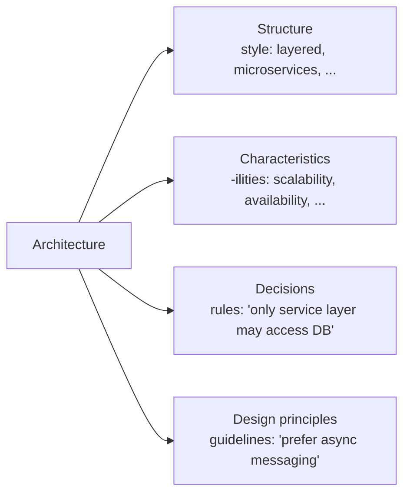
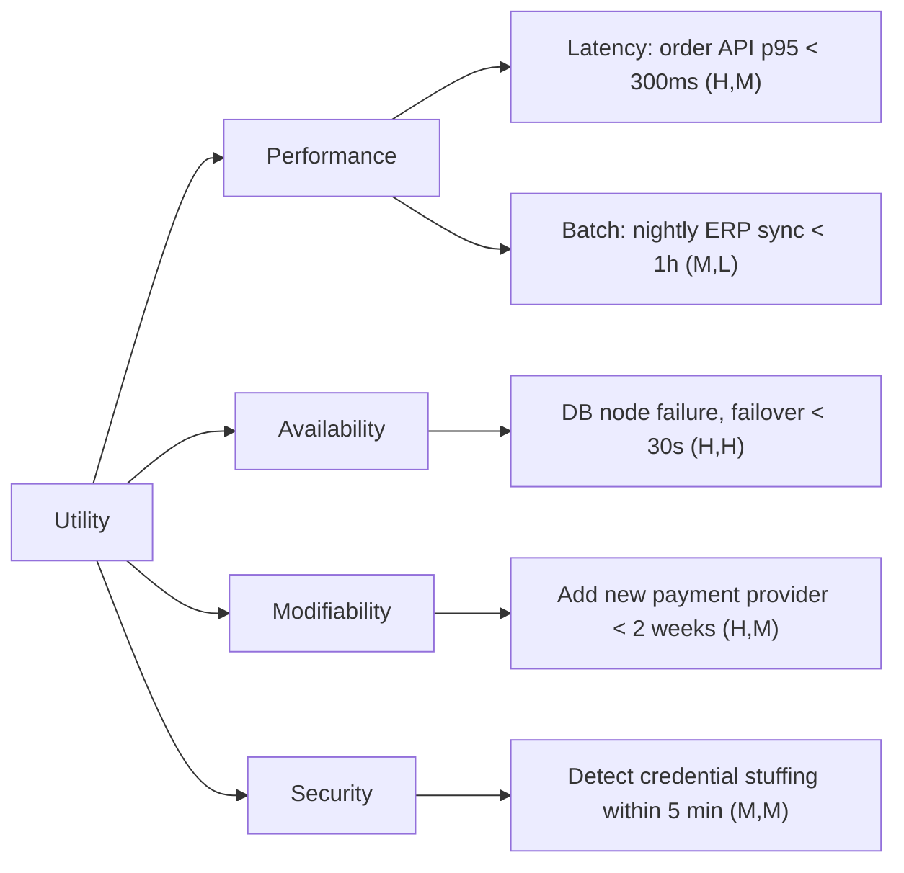

# Architecture Fundamentals

> **TL;DR** — Software architecture is the set of decisions that are hard to change and that shape how a system meets its quality goals. There is no "best" architecture, only trade-offs against explicit, prioritised *architecture characteristics* (quality attributes). Make those characteristics concrete with *quality attribute scenarios*, evaluate options with methods like *ATAM*, and protect them over time with *fitness functions*.

---

## 1. What is software architecture?

There is no single accepted definition. The useful ones complement each other:

| Source | Definition (paraphrased) | Emphasis |
|---|---|---|
| **Bass, Clements, Kazman** — *Software Architecture in Practice* | The set of structures needed to reason about the system: software elements, relations among them, and properties of both. | Structures + reasoning |
| **ISO/IEC/IEEE 42010** | Fundamental concepts or properties of a system in its environment, embodied in its elements, relationships, and the principles of its design and evolution. | Concepts, environment, evolution |
| **Martin Fowler** — "Who needs an architect?" / "Software Architecture Guide" | "The important stuff — whatever that is." Shared understanding among expert developers of the system design; decisions that are hard to change. | Social + importance |
| **Ralph Johnson** (quoted by Fowler) | The decisions you wish you could get right early in a project. | Irreversibility |
| **Grady Booch** | Significant design decisions, where significance is measured by cost of change. | Cost of change |
| **Richards & Ford** — *Fundamentals of Software Architecture* | Structure + architecture characteristics + architecture decisions + design principles. | Four dimensions |

### Richards & Ford's four dimensions



- **Structure** — the architecture style(s) used.
- **Characteristics** — success criteria independent of functionality.
- **Decisions** — hard rules ("presentation layer must not call the database").
- **Design principles** — guidelines, not rules ("prefer asynchronous messaging between services").

### Architecture vs design

| Architecture | Design |
|---|---|
| Strategic, system-wide | Tactical, local |
| Expensive to change | Cheaper to change |
| Driven by quality attributes | Driven by functional requirements |
| Decisions affecting many teams | Decisions inside a module/team |
| "Which style, which boundaries, which data ownership?" | "Which class, which pattern, which algorithm?" |

The line is a spectrum, not a wall. Fowler argues the distinction matters less than recognising which decisions are *significant*.

### ISO/IEC/IEEE 42010 concepts

The standard (2011, revised 2022) defines a vocabulary for **architecture descriptions** (ADs):

| Concept | Meaning |
|---|---|
| **Stakeholder** | Individual/group/org with interest in the system |
| **Concern** | Interest of a stakeholder (performance, cost, compliance, ...) |
| **Architecture viewpoint** | Conventions for constructing/using a view (notations, models, techniques) — a *template* |
| **Architecture view** | Representation of the system from a viewpoint, addressing concerns |
| **Model kind / view component** | Conventions for a model within a view |
| **Correspondence** | Relation between AD elements (traceability, consistency) |
| **Architecture rationale** | Explanation of decisions |
| **Architecture decision** | A choice that addresses concerns |

Practical takeaway: every diagram should answer *whose concern* it addresses. The C4 model, arc42, and 4+1 are all compatible with 42010 (see [documentation-and-decisions.md](documentation-and-decisions.md)).

---

## 2. The architect role

### Expectations (Richards & Ford's eight)

1. Make architecture decisions (guide, not dictate technology).
2. Continually analyse the architecture (vitality, decay, relevance).
3. Keep current with trends.
4. Ensure compliance with decisions (fitness functions, reviews).
5. Have diverse exposure and experience (technical breadth > depth).
6. Have business domain knowledge.
7. Possess interpersonal skills (leadership, negotiation).
8. Understand and navigate politics.

### Technical breadth vs depth

```
       ┌──────────────────────────────┐
       │  Stuff you don't know you    │  ← unknown unknowns
       │  don't know                  │
       ├──────────────────────────────┤
       │  Stuff you know you don't    │  ← architects grow THIS (breadth)
       │  know                        │
       ├──────────────────────────────┤
       │  Stuff you know              │  ← developers grow this (depth)
       └──────────────────────────────┘
```

An architect trades some depth for breadth: knowing that *five* caching solutions exist with their trade-offs beats being expert in one.

### Architect archetypes (Gregor Hohpe — "The Software Architect Elevator")

- **Elevator architect**: rides between the "penthouse" (executives, strategy) and the "engine room" (code, infrastructure); translates in both directions.
- **Architect as gardener vs. city planner**: enable evolution rather than dictate a master plan.
- **Ivory-tower anti-pattern**: decisions made without implementation feedback.

### Anti-patterns of the role

| Anti-pattern | Description | Remedy |
|---|---|---|
| Ivory tower | Detached from code and teams | Code occasionally (POCs, fitness functions, non-critical-path work) |
| Frozen caveman | Irrational fear from one past failure | Re-evaluate risk with data |
| Bottleneck trap | Architect owns critical-path code | Delegate; own frameworks/fitness functions instead |
| Covering your assets | Avoids decisions to avoid blame | Make decisions at the last *responsible* moment and record them (ADRs) |
| Groundhog day | Same decision re-discussed endlessly | Record ADRs with justification |
| Email-driven architecture | Decisions lost in chat | Single source of truth (ADR repo, wiki) |
| Architecture by résumé | Choosing tech to learn it | Tie choices to characteristics |

### Architect collaboration modes (Team Topologies alignment)

Architects work best as an **enabling team** (temporary capability uplift) or inside a **platform team**, not as an approval gate. See [../09-leadership-teams-facilitation/README.md](../09-leadership-teams-facilitation/README.md).

---

## 3. Architecture characteristics (quality attributes, "-ilities")

An **architecture characteristic** meets three criteria (Richards & Ford):

1. Specifies a **non-domain** design consideration.
2. Influences some **structural** aspect of the design.
3. Is **critical or important** to application success.

### Categories

| Category | Characteristics |
|---|---|
| **Operational** | Availability, continuity, performance, recoverability, reliability/safety, robustness, scalability, elasticity |
| **Structural** | Configurability, extensibility, installability, leverageability/reuse, localization, maintainability, portability, upgradeability |
| **Cross-cutting** | Accessibility, archivability, authentication, authorization, legal, privacy, security, supportability, usability, observability |

### ISO/IEC 25010 product quality model

ISO/IEC 25010:2011 defined 8 characteristics; the **2023 revision** has 9 (renamed "usability" → *interaction capability*, "portability" → *flexibility*, added *safety*).

| ISO 25010:2011 characteristic | Sub-characteristics | 2023 change |
|---|---|---|
| Functional suitability | Completeness, correctness, appropriateness | (+ functional appropriateness kept) |
| Performance efficiency | Time behaviour, resource utilisation, capacity | — |
| Compatibility | Co-existence, interoperability | — |
| Usability | Appropriateness recognisability, learnability, operability, user error protection, UI aesthetics, accessibility | → **Interaction capability** (adds inclusivity, self-descriptiveness, user engagement) |
| Reliability | Maturity, availability, fault tolerance, recoverability | Maturity → *faultlessness* |
| Security | Confidentiality, integrity, non-repudiation, accountability, authenticity | + *resistance* |
| Maintainability | Modularity, reusability, analysability, modifiability, testability | — |
| Portability | Adaptability, installability, replaceability | → **Flexibility** (+ scalability) |
| — | — | **Safety** (new): operational constraint, risk identification, fail safe, hazard warning, safe integration |

### Explicit vs implicit characteristics

- **Explicit**: stated in requirements ("support 10k concurrent users").
- **Implicit**: rarely written but expected (availability, security, reasonable performance). Architects must surface these.

### Extracting characteristics from domain concerns

| Domain concern (business says...) | Architecture characteristics |
|---|---|
| Mergers & acquisitions | Interoperability, scalability, adaptability, extensibility |
| Time to market | Agility, testability, deployability |
| User satisfaction | Performance, availability, fault tolerance, testability, deployability, agility, security |
| Competitive advantage | Agility, testability, deployability, scalability, availability, fault tolerance |
| Time and budget | Simplicity, feasibility |
| Regulatory compliance | Auditability, security, privacy, data residency |

**Agility** is a *composite* characteristic: maintainability + testability + deployability. Decompose composites into measurable parts.

### Rule of thumb: pick the top 3

Supporting every characteristic produces a generic, over-engineered architecture. Have stakeholders choose **at most ~7 candidates and rank the top 3**. Architecture katas use this constraint deliberately.

### Measuring characteristics

| Characteristic | Example metric |
|---|---|
| Performance | p50/p95/p99 latency, throughput (req/s), time-to-first-byte |
| Availability | Uptime % (SLO), MTBF, MTTR |
| Scalability | Max load with linear cost; response time vs. load curve |
| Elasticity | Time to scale out; MTTS (mean time to startup) |
| Maintainability | Cyclomatic complexity, coupling (afferent/efferent), change lead time |
| Testability | Code coverage of critical paths, test execution time |
| Deployability | Deployment frequency, change failure rate, lead time (DORA) |
| Security | Open vulnerabilities by severity, time-to-patch |
| Observability | % of requests traced; MTTD (mean time to detect) |

#### Availability nines

| Availability | Downtime/year | Downtime/month | Downtime/week |
|---|---|---|---|
| 99% | 3.65 days | 7.31 h | 1.68 h |
| 99.9% | 8.77 h | 43.8 min | 10.1 min |
| 99.95% | 4.38 h | 21.9 min | 5.04 min |
| 99.99% | 52.6 min | 4.38 min | 1.01 min |
| 99.999% | 5.26 min | 26.3 s | 6.05 s |

Composite availability for **serial** dependencies multiplies: two 99.9% services in series → 99.8%. **Parallel** redundancy: `1 - (1 - a)^n`.

### Architecture quantum

A **quantum** (Richards & Ford, *Building Evolutionary Architectures*) is an independently deployable artifact with high functional cohesion, high static coupling, and synchronous dynamic coupling. Characteristics are evaluated **per quantum**: a monolith has one quantum (one set of characteristics); microservices can have many, each with different requirements.

---

## 4. Quality attribute scenarios

From the SEI (Bass/Clements/Kazman). Turns vague "-ilities" into testable statements.

| Part | Meaning | Example (performance) |
|---|---|---|
| **Source** | Who/what generates the stimulus | 1,000 concurrent users |
| **Stimulus** | Event arriving | Submit sales orders |
| **Artifact** | Part of system stimulated | Order API |
| **Environment** | Conditions | Normal operation, peak season |
| **Response** | What the system does | Processes the orders |
| **Response measure** | How it's measured | p95 < 300 ms, 0 errors |

### Template

```text
Scenario QA-07 (Availability)
Source:            Hardware failure
Stimulus:          One database node becomes unreachable
Artifact:          Order persistence
Environment:       Normal operation, business hours
Response:          Fail over to replica; no committed orders lost
Response measure:  Failover < 30 s; RPO = 0; RTO < 1 min
Priority:          (H, M) — business importance High, technical difficulty Medium
```

### Scenario types

- **Use-case scenarios** — normal expected use.
- **Growth scenarios** — anticipated change ("add a second warehouse in 6 months").
- **Exploratory scenarios** — extreme stress ("double traffic overnight", "region outage").

### Utility tree



---

## 5. Architecture evaluation: ATAM and friends

### ATAM — Architecture Tradeoff Analysis Method (SEI)

**Phases**

| Phase | Participants | Activities |
|---|---|---|
| 0. Partnership & preparation | Evaluation team leaders, key project decision makers | Logistics, scope |
| 1. Evaluation (part 1) | Evaluation team + project decision makers | Steps 1–6 |
| 2. Evaluation (part 2) | + stakeholders | Steps 7–9 |
| 3. Follow-up | Evaluation team + client | Report |

**Nine steps**

1. Present the ATAM.
2. Present business drivers.
3. Present the architecture.
4. Identify architectural approaches.
5. Generate the quality attribute utility tree.
6. Analyse architectural approaches against high-priority scenarios.
7. Brainstorm and prioritise scenarios (with wider stakeholders).
8. Analyse architectural approaches (again, with new scenarios).
9. Present results.

**Outputs**

| Output | Meaning |
|---|---|
| **Risks** | Decisions that may cause problems for a quality attribute |
| **Non-risks** | Decisions that are sound |
| **Sensitivity points** | Parameter where a small change strongly affects one attribute (e.g., cache TTL → latency) |
| **Trade-off points** | Parameter affecting multiple attributes in opposite directions (e.g., encryption: ↑security ↓performance) |
| **Risk themes** | Systemic patterns across risks, tied to business drivers |

### Lighter-weight alternatives

| Method | Effort | Use when |
|---|---|---|
| **ATAM** | Days, many stakeholders | Large, high-stakes systems |
| **CBAM** (Cost Benefit Analysis Method) | Follows ATAM | Need ROI per architectural strategy |
| **LAAAM** (Lightweight ATAM) | Hours | Agile teams; compare options with utility tree |
| **Architecture review / design review** | 1–2 h | Per design doc / RFC |
| **Risk storming** (Simon Brown) | 1–2 h workshop | Collaborative risk identification on C4 diagrams |
| **Pre-mortem** | 1 h | "It's a year later and this failed — why?" |
| **TARA** (Tiny Architectural Review Approach, Eoin Woods) | Hours–days | Industrial, lightweight, code + interviews |

### Risk storming

1. Draw the architecture (C4 container diagram works well).
2. Everyone silently places risk sticky notes (colour by likelihood × impact).
3. Converge, discuss, prioritise.
4. Mitigate: prototype, spike, ADR, fitness function.

Risk matrix:

| Impact \ Likelihood | Low (1) | Medium (2) | High (3) |
|---|---|---|---|
| **High (3)** | 3 | 6 | 9 |
| **Medium (2)** | 2 | 4 | 6 |
| **Low (1)** | 1 | 2 | 3 |

---

## 6. Trade-off thinking

> **First Law of Software Architecture** (Richards & Ford): *Everything in software architecture is a trade-off.*
> **Corollary 1**: If an architect thinks they have discovered something that isn't a trade-off, more likely they just haven't identified the trade-off yet.
> **Second Law**: *Why is more important than how.*

### Typical tensions

| Gain | Usually costs |
|---|---|
| Scalability (distribution) | Simplicity, consistency, debuggability |
| Consistency (strong) | Availability, latency |
| Performance (caching, denormalisation) | Consistency, maintainability |
| Security (encryption, zero trust hops) | Performance, usability |
| Flexibility (configurability, plugins) | Simplicity, testability |
| Reuse (shared libs/services) | Coupling, autonomy |
| Deployability (many small units) | Operational complexity |
| Time to market | Technical debt |

### Decision tools

- **Weighted decision matrix**: list options × criteria; weight criteria by top-3 characteristics.
- **"It depends" checklist**: what scale, what team, what timeline, what budget, what failure cost?
- **Reversibility (Bezos one-way/two-way doors)**: spend effort on irreversible decisions; move fast on reversible ones.
- **Last responsible moment**: delay a decision until the cost of not deciding exceeds the cost of deciding — but no later.
- **Make decisions reversible**: abstraction boundaries, feature flags, expand/contract, ports & adapters.

```text
Weighted matrix example: message broker choice
Criteria (weight)     Kafka  RabbitMQ  Azure Service Bus
Throughput (3)          5       3          3
Ops effort (3)          2       3          5
Ordering/replay (2)     5       2          3
Team skill (2)          2       4          4
Weighted total         35      31         39  → Service Bus (if on Azure, modest throughput)
```

### Architecture decision anti-patterns

- **Analysis paralysis** — no decision because "more info needed".
- **Resume-driven** — pick fashionable tech.
- **Golden hammer** — one tool for everything.
- **Silver bullet thinking** — "microservices will fix our delivery speed".
- **Accidental architecture** — no decisions made, structure emerges by default (usually a big ball of mud).

---

## 7. Fitness functions (evolutionary architecture)

From *Building Evolutionary Architectures* (Ford, Parsons, Kua, Sadalage; 2nd ed. 2023):

> An **architectural fitness function** is any mechanism that provides an objective integrity assessment of some architecture characteristic(s).

### Categories

| Dimension | Options |
|---|---|
| Scope | **Atomic** (one context/characteristic) vs **holistic** (combined characteristics) |
| Cadence | **Triggered** (on commit/build) vs **continuous** (in production monitoring) vs **temporal** (scheduled, e.g. "review dependency age monthly") |
| Result | **Static** (fixed threshold) vs **dynamic** (shifting with context, e.g. latency scales with load) |
| Invocation | **Automated** vs **manual** (legal review) |
| Proactivity | **Intentional** vs **emergent** |
| Coverage | **Domain-specific** (e.g., PCI checks) |

### Examples

| Characteristic | Fitness function |
|---|---|
| Layering | ArchUnit/NetArchTest rule: `Domain` must not depend on `Infrastructure` |
| Modularity | No cyclic dependencies between packages (dependency-cruiser, madge, jdepend) |
| Performance | k6/Gatling test in CI: p95 < 300 ms at 200 RPS |
| Security | Dependency scan fails build on critical CVE; secret scanning |
| Availability | Chaos experiment: kill one pod, error rate stays < 0.1% |
| API compatibility | Contract tests (Pact) / OpenAPI diff fails on breaking change |
| Code quality | Cyclomatic complexity per function < 15 |
| Observability | Every new HTTP endpoint emits trace spans (lint rule) |
| Data | Schema migrations must be backward compatible (expand/contract check) |

### Code examples

**C# — NetArchTest**

```csharp
[Fact]
public void Domain_Should_Not_Depend_On_Infrastructure()
{
    var result = Types.InAssembly(typeof(Order).Assembly)
        .That().ResideInNamespace("Shop.Domain")
        .ShouldNot().HaveDependencyOn("Shop.Infrastructure")
        .GetResult();

    Assert.True(result.IsSuccessful, string.Join(", ", result.FailingTypeNames ?? []));
}
```

**TypeScript — dependency-cruiser rule (`.dependency-cruiser.cjs`)**

```js
module.exports = {
  forbidden: [
    {
      name: "no-domain-to-infra",
      severity: "error",
      from: { path: "^src/domain" },
      to: { path: "^src/infrastructure" },
    },
    {
      name: "no-circular",
      severity: "error",
      from: {},
      to: { circular: true },
    },
  ],
};
```

**Python — import-linter (`.importlinter`)**

```ini
[importlinter]
root_package = shop

[importlinter:contract:layers]
name = Layered architecture
type = layers
layers =
    shop.api
    shop.application
    shop.domain
```

**k6 performance fitness function**

```js
import http from "k6/http";
export const options = {
  vus: 50,
  duration: "1m",
  thresholds: { http_req_duration: ["p(95)<300"], http_req_failed: ["rate<0.01"] },
};
export default () => http.get(`${__ENV.BASE_URL}/api/orders?limit=20`);
```

### Evolutionary architecture principles

- **Incremental change**: small, deployable steps (CI/CD, feature toggles).
- **Guided change**: fitness functions keep evolution aligned.
- **Appropriate coupling**: couple only where it buys something.
- **Last responsible moment** for decisions.
- **Bring the pain forward**: do painful things (deploy, merge, migrate) often so they become easy.

---

## 8. Architecture process in practice

```mermaid
flowchart TD
  A[Business drivers & constraints] --> B[Identify characteristics<br/>top 3]
  B --> C[Quality attribute scenarios]
  C --> D[Identify components<br/>& boundaries]
  D --> E[Choose style(s)]
  E --> F[Record ADRs]
  F --> G[Fitness functions]
  G --> H[Build & measure]
  H -->|feedback| B
```

### Component identification approaches

| Approach | Description | Risk |
|---|---|---|
| **Actor/actions** | From use cases: actors and what they do | Too CRUD-oriented |
| **Event storming** | Domain events → aggregates → bounded contexts | Needs domain experts |
| **Workflow** | Model the business workflow | Ignores non-workflow concerns |
| **Entity trap** (anti-pattern) | One component per DB entity ("CustomerManager") | Anemic, CRUD-only design |

### Constraints

Distinguish **requirements** (what), **constraints** (non-negotiable decisions already made: "must run on Azure", "must integrate with SAP"), and **principles** (guidelines). Constraints reduce options; document them first.

---

## When to invest in architecture (and when not)

**Invest heavily when:**
- Decisions are irreversible or expensive (data model, integration contracts, platform choice).
- Many teams depend on the decision.
- Quality attributes are demanding (regulated, high-scale, safety-critical).

**Invest lightly when:**
- Prototype / throwaway / validating product fit.
- Single small team, easy redeploy, low-stakes data.
- You can make the decision reversible cheaply.

## Common mistakes

- Treating architecture as diagrams instead of decisions + rationale.
- Listing 15 "important" characteristics; none prioritised.
- No measurable response measures ("must be fast").
- Choosing a style before understanding characteristics.
- Architecture designed once and never verified (no fitness functions → erosion).
- Ignoring Conway's Law: architecture that conflicts with team structure will be bent by it.
- Confusing "distributed" with "decoupled".

## Checklist

- [ ] Business drivers and constraints written down
- [ ] Top 3 characteristics agreed with stakeholders
- [ ] Each characteristic has ≥ 1 quality attribute scenario with a response measure
- [ ] Significant decisions recorded as ADRs
- [ ] Each key characteristic protected by a fitness function
- [ ] Architecture views cover stakeholders' concerns (C4 / arc42)
- [ ] Risks reviewed (risk storming / pre-mortem) and owned

## Related

- [design-principles.md](design-principles.md), [architecture-styles.md](architecture-styles.md), [documentation-and-decisions.md](documentation-and-decisions.md)
- Laws & mental models (Conway, Gall, Hyrum, etc.): [../10-laws-principles-mental-models/README.md](../10-laws-principles-mental-models/README.md)
- Enterprise architecture (TOGAF, capability maps): [../11-enterprise-architecture-business/README.md](../11-enterprise-architecture-business/README.md)

## References

- Martin Fowler — Software Architecture Guide: https://martinfowler.com/architecture/
- Martin Fowler — Who Needs an Architect? (PDF): https://martinfowler.com/ieeeSoftware/whoNeedsArchitect.pdf
- ISO/IEC/IEEE 42010 overview: https://en.wikipedia.org/wiki/ISO/IEC_42010
- ISO/IEC 25010 (ISO 25000 portal): https://iso25000.com/index.php/en/iso-25000-standards/iso-25010
- ISO/IEC 9126 / 25010 background: https://en.wikipedia.org/wiki/ISO/IEC_9126
- List of system quality attributes: https://en.wikipedia.org/wiki/List_of_system_quality_attributes
- SEI (Software Engineering Institute): https://www.sei.cmu.edu/
- ATAM on Wikipedia: https://en.wikipedia.org/wiki/Architecture_tradeoff_analysis_method
- Bass, Clements, Kazman — *Software Architecture in Practice* (4th ed., 2021)
- Richards & Ford — *Fundamentals of Software Architecture* (2nd ed., 2025)
- Ford, Parsons, Kua, Sadalage — *Building Evolutionary Architectures* (2nd ed., 2023): https://evolutionaryarchitecture.com/
- Risk storming: https://riskstorming.com/
- ArchUnit: https://www.archunit.org/ · NetArchTest: https://github.com/BenMorris/NetArchTest · dependency-cruiser: https://github.com/sverweij/dependency-cruiser · import-linter: https://github.com/seddonym/import-linter
- Gregor Hohpe — *The Software Architect Elevator*: https://architectelevator.com/
