# Architecture Styles

> **TL;DR** — An architecture style is a named, recurring overall structure with known characteristics. Styles split into **monolithic** (one deployment unit: layered, modular monolith, microkernel, pipeline) and **distributed** (service-based, event-driven, space-based, SOA, microservices). Internal code-organisation styles (hexagonal, onion, clean, vertical slice) are orthogonal and can be used inside any deployment style. Start with the simplest style that meets your top-3 characteristics — usually a **modular monolith** — and distribute only where a quantum has genuinely different needs.

---

## 1. Classification

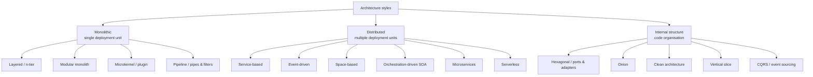

**Partitioning**: *technical partitioning* (by layer: UI, business, persistence) vs *domain partitioning* (by business capability: orders, billing). Conway's Law favours domain partitioning when teams are cross-functional.

---

## 2. Star-rating comparison (Richards & Ford style)

★ = poor, ★★★★★ = excellent. Ratings are generalisations of each style's natural tendency; good engineering can move them.

| Characteristic | Layered | Modular monolith | Microkernel | Pipeline | Service-based | Event-driven | Space-based | Orchestrated SOA | Microservices | Serverless* |
|---|---|---|---|---|---|---|---|---|---|---|
| Partitioning | Technical | Domain | Domain & technical | Technical | Domain | Technical | Technical | Technical | Domain | Domain |
| Quanta | 1 | 1 | 1 | 1 | 1+ | 1+ | 1+ | 1 | 1+ | many |
| Deployability | ★ | ★★ | ★★★ | ★★ | ★★★★ | ★★★ | ★★★ | ★ | ★★★★ | ★★★★ |
| Elasticity | ★ | ★ | ★ | ★ | ★★ | ★★★ | ★★★★★ | ★★★ | ★★★★★ | ★★★★★ |
| Evolvability | ★ | ★★★ | ★★★ | ★★★ | ★★★ | ★★★★★ | ★★★ | ★ | ★★★★★ | ★★★★ |
| Fault tolerance | ★ | ★ | ★ | ★ | ★★★★ | ★★★★★ | ★★★ | ★★★ | ★★★★★ | ★★★★ |
| Modularity | ★ | ★★★★ | ★★★ | ★★★ | ★★★★ | ★★★★ | ★★★ | ★★★ | ★★★★★ | ★★★★ |
| Overall cost (low = ★★★★★) | ★★★★★ | ★★★★★ | ★★★★★ | ★★★★★ | ★★★★ | ★★★ | ★★ | ★ | ★ | ★★★ |
| Performance | ★★ | ★★★ | ★★★ | ★★ | ★★★ | ★★★★★ | ★★★★★ | ★★ | ★★ | ★★ |
| Reliability | ★★★ | ★★★ | ★★★ | ★★★ | ★★★★ | ★★★ | ★★★★ | ★★ | ★★★★ | ★★★ |
| Scalability | ★ | ★ | ★ | ★ | ★★★ | ★★★★★ | ★★★★★ | ★★★★ | ★★★★★ | ★★★★★ |
| Simplicity | ★★★★★ | ★★★★ | ★★★★ | ★★★★★ | ★★★ | ★ | ★ | ★ | ★ | ★★★ |
| Testability | ★★ | ★★★ | ★★★ | ★★★ | ★★★★ | ★★ | ★ | ★ | ★★★★ | ★★★ |

\*Serverless is not in Richards & Ford's original chart; ratings are an estimate.

---

## 3. Monolithic styles

### 3.1 Layered (n-tier)

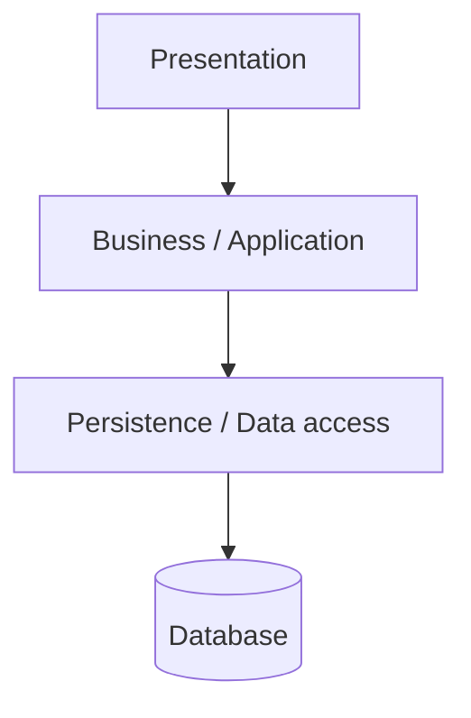

- **Closed layers**: a request must pass through each layer (isolation). **Open layers**: may be bypassed (e.g., shared services layer).
- **Layers of isolation**: changes in one layer don't affect others (in theory).
- **Tier** = physical deployment unit; **layer** = logical grouping. 3-tier: browser / app server / DB.

| When to use | When not |
|---|---|
| Small/simple apps, tight budget, team new to architecture, starting point | Large teams, high scalability/elasticity, frequent independent deployment |

**Anti-pattern — architecture sinkhole**: requests pass through layers with no logic (80/20 rule: if > 20% of requests are pass-throughs, reconsider). **Technical partitioning** also scatters a business change across all layers.

### 3.2 Monolith & modular monolith

A **modular monolith** is a single deployable with strong internal module boundaries aligned to business domains (bounded contexts).

```text
src/
  Modules/
    Sales/          ← public API: Sales.Contracts (commands, queries, integration events)
      Api/ Application/ Domain/ Infrastructure/
    Inventory/
    Billing/
  Shared/Kernel/    ← tiny: ids, Result, clock — no business logic
  Host/             ← composition root
```

**Rules that make it modular**
- Modules communicate only via public contracts (interfaces, in-process messages/events) — never by referencing another module's internals or tables.
- Each module owns its schema (`sales.*`, `inventory.*`); no cross-module joins (use read models or APIs).
- Enforce with fitness functions (NetArchTest, dependency-cruiser, Spring Modulith, Java `module-info`, .NET `internal` + separate assemblies).
- Async events between modules via an in-process bus (optionally with outbox) so extraction to a service later is mechanical.

| Pros | Cons |
|---|---|
| Simple deployment, debugging, transactions | Single quantum: one scaling profile, one tech stack |
| Refactoring across modules is cheap | Discipline required; boundaries erode without enforcement |
| Path to microservices if needed | Shared deploy pipeline; long builds as it grows |

**Monolith First** (Fowler): almost all successful microservice stories started with a monolith that got too big. **Majestic Monolith** (DHH) argues many teams never need to split.

### 3.3 Microkernel (plugin)

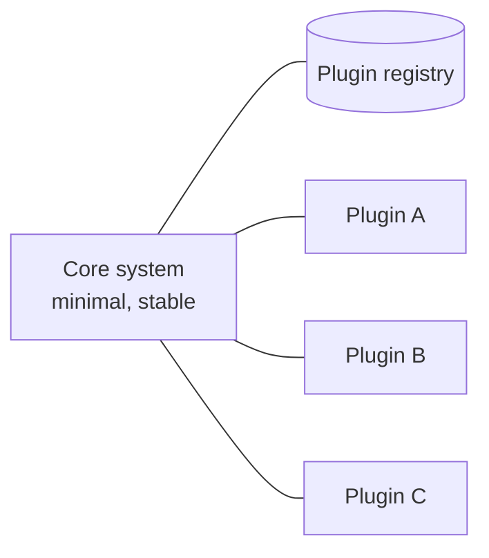

- Core system + plug-in components; plugins are independent, registered via a registry/contract.
- Examples: VS Code, Eclipse, browsers, Jenkins, tax/insurance rule engines, ERP localisations (country-specific modules), payment-method plugins.
- Plugins can be compile-time, runtime-loaded (assemblies, dynamic imports), or remote (REST/messaging).

| When to use | When not |
|---|---|
| Product with customer-specific variations; rules that vary by region/client; IDE-like tools | Highly scalable distributed systems; when the "core" is unclear |

### 3.4 Pipeline / pipes and filters


- Filter types: **producer** (source), **transformer**, **tester** (filter out), **consumer** (sink).
- Pipes are one-way, typically point-to-point.
- Examples: Unix shell, ETL jobs, compilers, image processing, CI pipelines, Kafka Streams topologies, ASP.NET middleware.

```python
from typing import Iterable, Iterator

def read_lines(path: str) -> Iterator[str]:
    with open(path, encoding="utf-8") as f:
        yield from f

def parse(lines: Iterable[str]) -> Iterator[dict]:
    for line in lines:
        sku, qty = line.rstrip("\n").split(";")
        yield {"sku": sku, "qty": int(qty)}

def only_positive(rows: Iterable[dict]) -> Iterator[dict]:
    return (r for r in rows if r["qty"] > 0)

for row in only_positive(parse(read_lines("stock.csv"))):
    print(row)
```

---

## 4. Distributed styles

### 4.1 Service-based architecture

A pragmatic hybrid: **4–12 coarse-grained domain services**, separately deployed, usually **sharing one database** (or a few), with a single UI or API gateway.

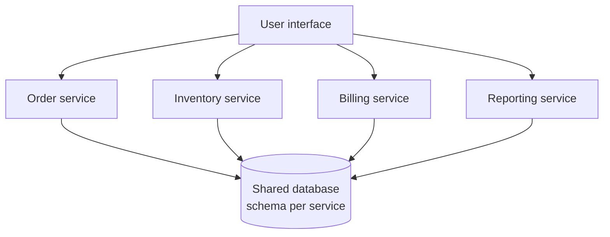

- ACID transactions within a service; shared DB simplifies reporting.
- Mitigate DB coupling by logical partitioning (schemas, per-service entity libraries).
- Often the **sweet spot** for internal enterprise systems (ERP extensions, portals): independent deployability without microservice operational cost.

### 4.2 Event-driven architecture (EDA)

Components communicate by producing and reacting to events asynchronously.

#### Broker topology (choreography)

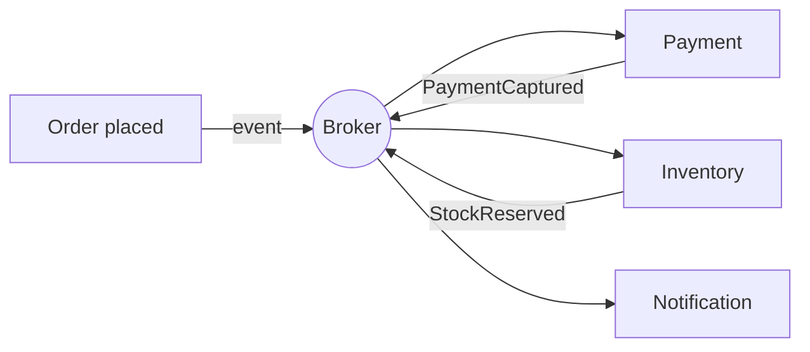

- No central coordinator; each processor publishes what it did.
- ✅ High decoupling, scalability, performance, extensibility.
- ❌ No overall workflow control, hard error handling, hard to know when a business transaction is "done", difficult recoverability.

#### Mediator topology (orchestration)

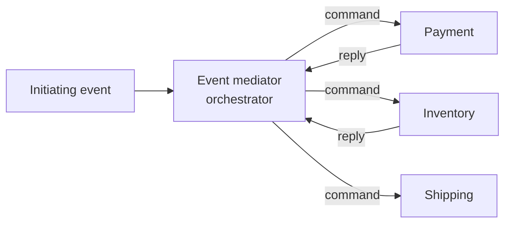

- A mediator (workflow engine, saga orchestrator, BPMN, Temporal, Azure Durable Functions, AWS Step Functions) controls the steps.
- ✅ Workflow control, error handling, state, restartability.
- ❌ More coupling to the mediator; mediator can become a bottleneck/god service.

| Aspect | Broker | Mediator |
|---|---|---|
| Workflow control | ✗ | ✓ |
| Error handling | Hard | Easier |
| Coupling | Lowest | Higher |
| Scalability/perf | Higher | Lower |
| Best for | Simple fan-out reactions | Complex multi-step business processes |

**Event types**: *domain events* (inside a bounded context), *integration events* (across), *event notification* vs *event-carried state transfer* vs *event sourcing* (Fowler, "What do you mean by Event-Driven?").

**EDA concerns**: idempotent consumers, ordering, poison messages/DLQs, schema evolution (schema registry), eventual consistency UX, observability (correlation IDs, distributed tracing). See [distributed-systems.md](distributed-systems.md).

### 4.3 Space-based architecture

For extreme and variable concurrency (ticketing, auctions, flash sales).

- **Processing units** hold application code + **in-memory data grid** (replicated cache).
- **Virtualised middleware**: messaging grid, data grid, processing grid, deployment manager.
- **Data pumps** asynchronously send updates to a database via **data writers**; **data readers** load on startup.
- Removes the database from the synchronous transaction path.
- ❌ Complex, expensive, hard to test at scale, data collisions between replicated caches.
- Products: Hazelcast, Apache Ignite, GigaSpaces, Coherence.

### 4.4 Service-Oriented Architecture (orchestration-driven SOA)

- Enterprise-wide reuse via an **Enterprise Service Bus (ESB)**, taxonomy of business/enterprise/application/infrastructure services, central orchestration engine.
- Goal: maximise reuse → result: extreme coupling, slow change, central integration team bottleneck.
- Legacy but common in large ERP landscapes (SAP PI/PO, BizTalk, Oracle SOA Suite, MuleSoft as ESB).
- Lesson learned: **reuse creates coupling**; microservices deliberately favour duplication over coupling.

### 4.5 Microservices

> Small, autonomous services modelled around a business domain (bounded context), independently deployable, owning their data, communicating over the network. (Newman; Lewis & Fowler 2014)

**Characteristics (Lewis & Fowler)**: componentization via services; organised around business capabilities; products not projects; smart endpoints and dumb pipes; decentralised governance; decentralised data management; infrastructure automation; design for failure; evolutionary design.

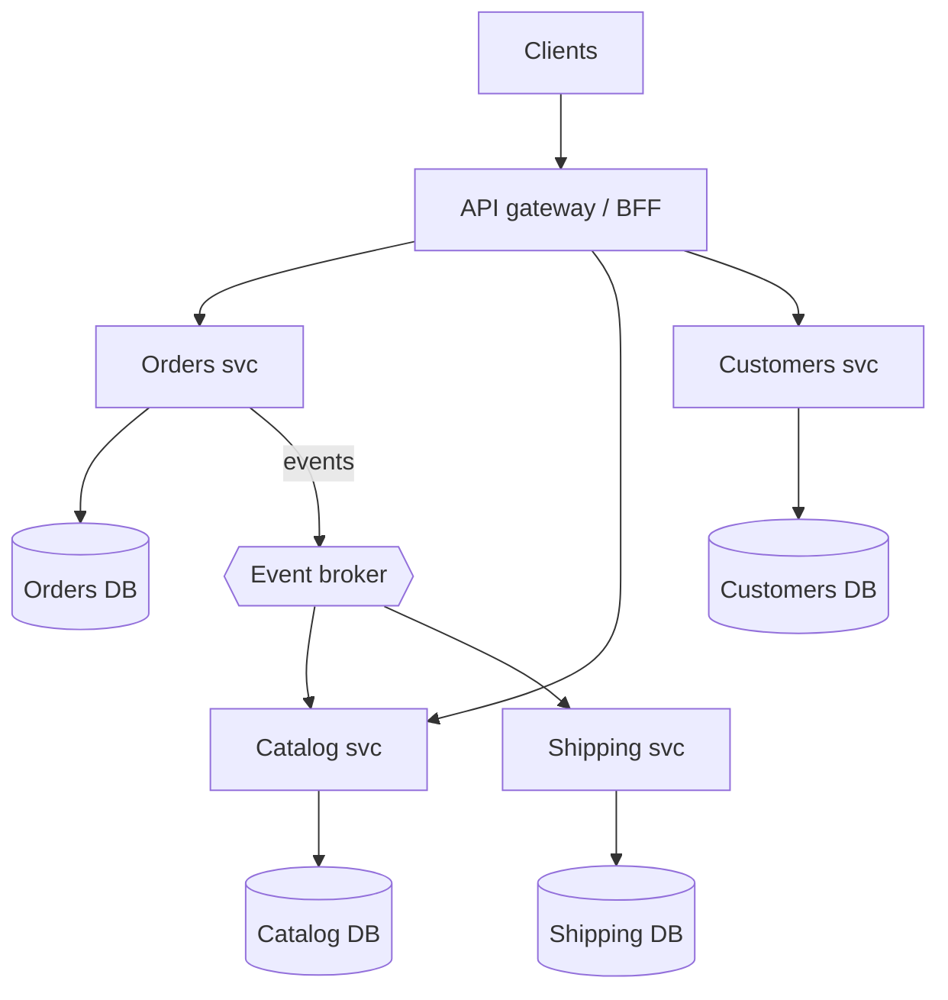

#### Criteria — when microservices make sense

| Criterion | Indicator |
|---|---|
| Independent deployability needed | Many teams (> ~3–5) blocked by shared release train |
| Different scaling profiles | One component needs 50× the capacity of the rest |
| Different characteristics per quantum | e.g., payments needs PCI isolation; search needs elasticity |
| Fault isolation | Failure of reporting must not take down ordering |
| Technology heterogeneity | ML service in Python, core in .NET |
| Organisational | Stream-aligned teams owning a capability end-to-end |
| Platform maturity | CI/CD, containers, observability, IaC, on-call already in place |

**Prerequisites (Fowler, "MicroservicePrerequisites")**: rapid provisioning, basic monitoring, rapid application deployment, DevOps culture.

#### Granularity disintegrators vs integrators (Ford et al., *Software Architecture: The Hard Parts*)

| Disintegrators (split) | Integrators (keep together) |
|---|---|
| Service scope & function (cohesion) | Database transactions (ACID needed) |
| Code volatility | Workflow & choreography (too much chatter) |
| Scalability & throughput | Shared code (heavy shared domain logic) |
| Fault tolerance | Data relationships (high join needs) |
| Security | |
| Extensibility | |

#### Pitfalls

| Pitfall | Symptom | Remedy |
|---|---|---|
| **Distributed monolith** | Services must be deployed together; synchronous call chains; shared DB tables; lock-step versioning | Re-draw boundaries by bounded context; async events; consumer-driven contracts |
| **Nano-services** | Services too fine-grained; chatty | Merge by cohesion and transactional needs |
| **Shared database** | Schema changes break other services | Database-per-service; data via APIs/events |
| **Entity services** | `CustomerService`, `ProductService` CRUD wrappers | Model capabilities/processes, not entities |
| **Synchronous chains** | Availability = product of all; latency adds up | Async messaging, caching, data replication |
| **Shared libraries with domain logic** | Lock-step upgrades | Share only infra libs; duplicate small domain bits |
| **Missing observability** | Can't debug across services | Distributed tracing (OpenTelemetry), correlation IDs, centralised logs |
| **Distributed transactions** | 2PC everywhere or inconsistencies | Sagas, outbox, idempotency |
| **Premature split** | Boundaries wrong; costly to move | Start modular monolith; extract later |
| **Microservice envy / resume-driven** | Splitting without a driver | Tie each split to a characteristic |

**Distributed monolith test**: can you deploy service A to production without coordinating with any other team? If not, you have a distributed monolith.

#### Supporting patterns (microservices.io)

API gateway, BFF, service discovery, circuit breaker, database per service, saga, CQRS, transactional outbox, event sourcing, API composition, consumer-driven contracts, service mesh, sidecar, log aggregation, distributed tracing, health check API, externalised configuration, strangler fig.

### 4.6 Serverless

- **FaaS** (AWS Lambda, Azure Functions, Google Cloud Run functions) + **BaaS** (managed DB, auth, queues, storage).
- Event-triggered, scale-to-zero, pay-per-use.

| Pros | Cons |
|---|---|
| No server management; elastic; cost-efficient for spiky/low load | Cold starts; execution time limits; vendor lock-in |
| Fine-grained scaling and billing | Distributed debugging; local dev harder |
| Great for glue code, webhooks, scheduled jobs, event processing | Cost can exceed containers at sustained high load; connection storms to relational DBs |

Patterns: function per event type, fan-out via queues, durable orchestrations (Durable Functions, Step Functions), claim check for large payloads. See [../06-cloud-architecture/README.md](../06-cloud-architecture/README.md).

---

## 5. Internal structure styles (code organisation)

These all follow the **Dependency Rule**: dependencies point inwards towards domain/policy; infrastructure is a plug-in.

### 5.1 Hexagonal architecture (ports & adapters) — Alistair Cockburn, 2005

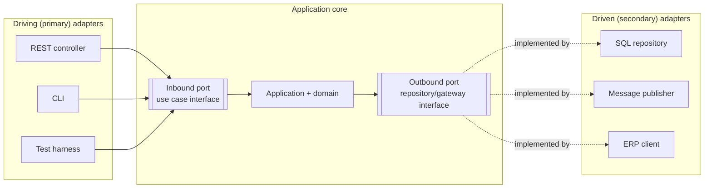

- **Ports**: technology-agnostic interfaces owned by the core. **Inbound/driving** ports = use cases; **outbound/driven** ports = what the core needs (persistence, messaging, external systems).
- **Adapters**: technology-specific implementations.
- Goal: test the core without UI or DB; swap technologies.

### 5.2 Onion architecture — Jeffrey Palermo, 2008

```
┌───────────────────────────────────────────┐
│ Infrastructure / UI / Tests               │
│  ┌─────────────────────────────────────┐  │
│  │ Application services                │  │
│  │  ┌───────────────────────────────┐  │  │
│  │  │ Domain services               │  │  │
│  │  │  ┌─────────────────────────┐  │  │  │
│  │  │  │ Domain model (entities) │  │  │  │
│  │  │  └─────────────────────────┘  │  │  │
│  │  └───────────────────────────────┘  │  │
│  └─────────────────────────────────────┘  │
└───────────────────────────────────────────┘
```

Repository interfaces live in inner layers; implementations in outer infrastructure.

### 5.3 Clean architecture — Robert C. Martin, 2012

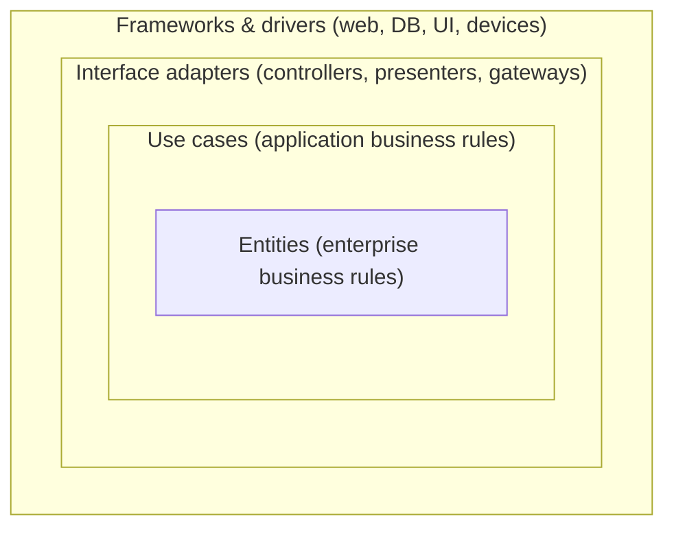

- Dependency rule: source code dependencies only point inwards.
- Use case interactors with input/output boundaries; presenters format output.
- Typical .NET solution: `Domain`, `Application`, `Infrastructure`, `WebApi` projects.

#### Hexagonal vs onion vs clean

| Aspect | Hexagonal | Onion | Clean |
|---|---|---|---|
| Core metaphor | Inside/outside with ports | Concentric layers | Concentric layers + use cases |
| Emphasis | Symmetry of driving/driven sides; testability | Domain at centre; DI | Use-case interactors; boundaries; presenters |
| Essence | **Same idea**: dependency inversion around a domain core | | |

**Criticism**: easily over-applied to CRUD apps → many projects, mapping layers, interfaces with one impl. Use when domain logic is non-trivial and long-lived.

### 5.4 Vertical slice architecture — Jimmy Bogard

Organise by **feature/use case** rather than technical layer. Each slice contains everything from request to data access; couple *within* a slice, minimise coupling *between* slices.

```text
Features/
  Orders/
    PlaceOrder.cs        ← command, validator, handler, endpoint in one file/folder
    GetOrderDetails.cs   ← query + handler using Dapper directly
    CancelOrder.cs
  Invoices/
    ...
```

```csharp
public static class PlaceOrder
{
    public sealed record Command(Guid CustomerId, List<Line> Lines) : IRequest<Guid>;
    public sealed record Line(string Sku, int Qty);

    public sealed class Validator : AbstractValidator<Command>
    {
        public Validator() { RuleFor(c => c.Lines).NotEmpty(); }
    }

    public sealed class Handler(ShopDb db) : IRequestHandler<Command, Guid>
    {
        public async Task<Guid> Handle(Command cmd, CancellationToken ct)
        {
            var order = Order.Place(cmd.CustomerId, cmd.Lines.Select(l => (l.Sku, l.Qty)));
            db.Orders.Add(order);
            await db.SaveChangesAsync(ct);
            return order.Id;
        }
    }

    public static void Map(IEndpointRouteBuilder app) =>
        app.MapPost("/orders", async (Command cmd, ISender s) => Results.Created($"/orders/{await s.Send(cmd)}", null));
}
```

| Pros | Cons |
|---|---|
| Change localised to one slice; easy onboarding | Duplication across slices (acceptable; refactor to domain when rules repeat) |
| Each slice picks its own complexity (Transaction Script vs domain model) | Needs discipline to push shared rules into domain |
| Pairs well with CQRS and modular monolith | Less suited to heavy shared domain invariants without a domain layer |

**Combination**: modular monolith (modules = bounded contexts) → vertical slices inside each module → rich domain model where complexity warrants.

### 5.5 CQRS — Command Query Responsibility Segregation

Greg Young (from Meyer's CQS). Separate the **write model** (commands, invariants) from the **read model** (queries, denormalised views).

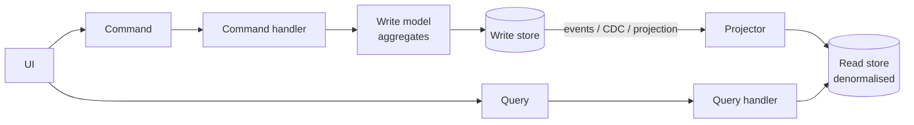

| Level | Description |
|---|---|
| 1. Code-level | Separate command/query handlers, same DB (very common; low cost) |
| 2. Separate read models | Same DB, views/denormalised tables for reads |
| 3. Separate stores | Read store (Elastic, Redis, Cosmos) updated asynchronously → eventual consistency |

| When to use | When not |
|---|---|
| Read/write asymmetry (reads ≫ writes); complex domains; different scaling of reads; multiple read representations; collaborative domains | Simple CRUD; teams unfamiliar; strong read-after-write consistency required everywhere |

Fowler warns: "For most systems CQRS adds risky complexity." Apply per bounded context, not system-wide.

### 5.6 Event sourcing

Store state as an **append-only sequence of events**; current state is a left-fold over events.

```ts
type AccountEvent =
  | { type: "Opened"; id: string; owner: string }
  | { type: "Deposited"; amount: number }
  | { type: "Withdrawn"; amount: number };

type Account = { id: string; owner: string; balance: number };

const evolve = (s: Account | null, e: AccountEvent): Account => {
  switch (e.type) {
    case "Opened": return { id: e.id, owner: e.owner, balance: 0 };
    case "Deposited": return { ...s!, balance: s!.balance + e.amount };
    case "Withdrawn": return { ...s!, balance: s!.balance - e.amount };
  }
};

const rehydrate = (events: AccountEvent[]) => events.reduce<Account | null>(evolve, null);

// Command handler decides new events based on current state
function withdraw(state: Account, amount: number): AccountEvent[] {
  if (amount > state.balance) throw new Error("Insufficient funds");
  return [{ type: "Withdrawn", amount }];
}
```

**Concepts**: event store (EventStoreDB/KurrentDB, Marten on PostgreSQL, Axon), streams per aggregate, optimistic concurrency on stream version, **snapshots**, **projections** (read models), **upcasting** (event schema evolution), temporal queries, replay.

| Pros | Cons |
|---|---|
| Complete audit trail; temporal queries ("state on 31 Dec") | Learning curve; event schema evolution is hard |
| Debug by replay; new projections retroactively | Eventual consistency of read models |
| Natural fit with EDA and CQRS | GDPR "right to erasure" vs immutability (crypto-shredding) |
| No impedance mismatch for behaviour-rich domains | Querying requires projections; overkill for CRUD |

**When**: finance/ledgers, audit-heavy domains, workflow/case management, where history *is* the domain. **Not**: simple CRUD, reporting-first systems.

### 5.7 Micro-frontends

Extend microservice ideas to the frontend: independently deliverable frontend applications composed into a whole.

| Composition | Mechanism | Notes |
|---|---|---|
| Server-side | SSI/ESI, Podium, Next.js multi-zones | Good SEO/perf |
| Build-time | npm packages | Not independently deployable — usually an anti-pattern |
| Run-time (JS) | Module Federation (Webpack/Rspack/Vite plugin), single-spa, import maps | Most common |
| Run-time (iframes) | iframes | Strong isolation; poor UX integration |
| Web Components | Custom elements | Framework-agnostic contracts |
| Edge | Edge-side composition | CDN workers |

Pitfalls: duplicated framework bundles, inconsistent UX (need a design system), shared state coupling, version skew. See [frontend-architecture.md](frontend-architecture.md).

### 5.8 Backend for Frontend (BFF) — Sam Newman / SoundCloud

One backend per frontend experience (web, mobile, partner), owned by the frontend team, that aggregates/tailors downstream APIs.

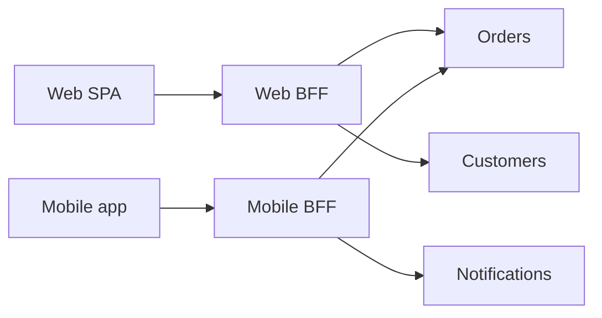

- Also the recommended **security pattern for SPAs** (OAuth token handling server-side; browser gets an HttpOnly session cookie) — see [security-architecture.md](security-architecture.md).
- Avoid: shared "general-purpose" BFF that grows into a monolithic gateway; business logic in BFF.

---

## 6. Choosing a style

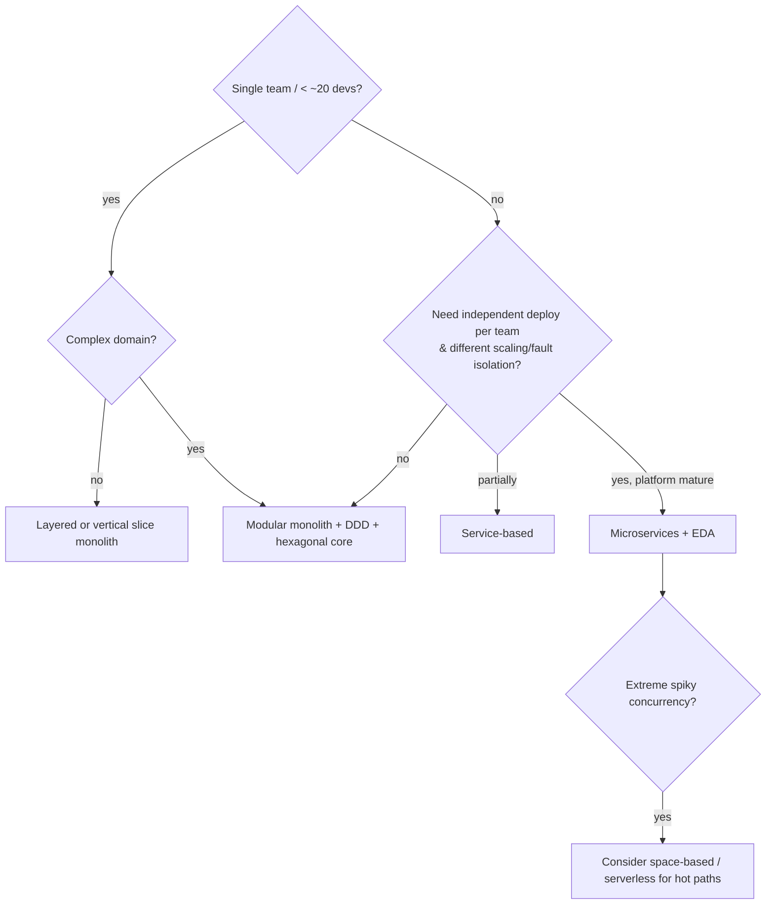

### Heuristics

- Choose by **top-3 characteristics**, not popularity.
- **Different quanta, different styles**: an ERP integration hub may be event-driven while the admin portal is a layered monolith.
- **Monolith → modular monolith → service-based → microservices** is a common, healthy evolution path.
- Count your **operational budget**: each deployable adds pipelines, dashboards, alerts, on-call.

## Common mistakes / anti-patterns

- **Big Ball of Mud** (Foote & Yoder): no discernible structure — the default outcome without decisions.
- **Distributed monolith** (see above).
- **Architecture by implication**: no conscious style choice.
- **Lasagna architecture**: too many layers, each a thin pass-through.
- **Clean architecture cargo-culting** for a 10-endpoint CRUD API.
- **Event-driven everything**: losing traceability of business processes; "event soup".
- **CQRS + event sourcing as default**.
- **Micro-frontends for one team**.

## Related

- [architecture-fundamentals.md](architecture-fundamentals.md), [domain-driven-design.md](domain-driven-design.md), [distributed-systems.md](distributed-systems.md), [evolution-and-legacy.md](evolution-and-legacy.md)
- Cloud deployment models: [../06-cloud-architecture/README.md](../06-cloud-architecture/README.md)
- Team structures / Conway: [../09-leadership-teams-facilitation/README.md](../09-leadership-teams-facilitation/README.md)

## References

- Fowler & Lewis — Microservices (2014): https://martinfowler.com/articles/microservices.html
- Fowler — Microservices Guide: https://martinfowler.com/microservices/
- Fowler — MonolithFirst: https://martinfowler.com/bliki/MonolithFirst.html
- Fowler — MicroservicePremium: https://martinfowler.com/bliki/MicroservicePremium.html
- Fowler — MicroservicePrerequisites: https://martinfowler.com/bliki/MicroservicePrerequisites.html
- Fowler — What do you mean by "Event-Driven"?: https://martinfowler.com/articles/201701-event-driven.html
- Fowler — CQRS: https://martinfowler.com/bliki/CQRS.html
- Fowler — Event Sourcing: https://martinfowler.com/eaaDev/EventSourcing.html
- Fowler — PresentationDomainDataLayering: https://martinfowler.com/bliki/PresentationDomainDataLayering.html
- Cam Jackson — Micro Frontends: https://martinfowler.com/articles/micro-frontends.html
- Chris Richardson — microservices.io patterns: https://microservices.io/patterns/
- Alistair Cockburn — Hexagonal architecture: https://alistair.cockburn.us/hexagonal-architecture/
- Robert C. Martin — The Clean Architecture: https://blog.cleancoder.com/uncle-bob/2012/08/13/the-clean-architecture.html
- Jeffrey Palermo — The Onion Architecture: https://jeffreypalermo.com/2008/07/the-onion-architecture-part-1/
- Jimmy Bogard — Vertical Slice Architecture: https://www.jimmybogard.com/vertical-slice-architecture/
- Sam Newman — Backends For Frontends: https://samnewman.io/patterns/architectural/bff/
- Microsoft — Architecture styles: https://learn.microsoft.com/azure/architecture/guide/architecture-styles/
- Microsoft — CQRS pattern: https://learn.microsoft.com/azure/architecture/patterns/cqrs
- Microsoft — Event Sourcing pattern: https://learn.microsoft.com/azure/architecture/patterns/event-sourcing
- Microsoft — BFF pattern: https://learn.microsoft.com/azure/architecture/patterns/backends-for-frontends
- Big Ball of Mud (Foote & Yoder): http://www.laputan.org/mud/
- Multitier architecture: https://en.wikipedia.org/wiki/Multitier_architecture
- Space-based architecture: https://en.wikipedia.org/wiki/Space-based_architecture
- Service-oriented architecture: https://en.wikipedia.org/wiki/Service-oriented_architecture
- Richards & Ford — *Fundamentals of Software Architecture*; Ford, Richards, Sadalage, Dehghani — *Software Architecture: The Hard Parts* (2021)
- Sam Newman — *Building Microservices* (2nd ed., 2021), *Monolith to Microservices* (2019)
- Chris Richardson — *Microservices Patterns* (2018)
