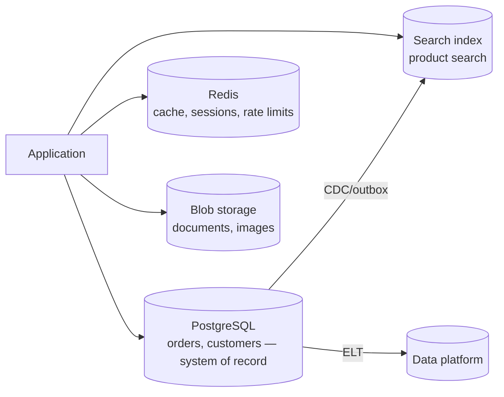
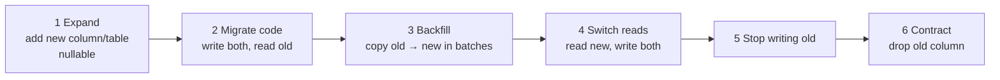

# Data Architecture for Applications

> **TL;DR** — Default to a relational database (PostgreSQL / SQL Server) with a normalised schema (3NF/BCNF) and good indexes; add specialised stores (document, key-value, search, graph, time-series) only for a concrete need (**polyglot persistence**). Understand **ACID vs BASE**, transaction **isolation levels** and the anomalies each allows. In distributed systems each service owns its data (**database-per-service**), and schema changes are deployed with **expand/contract** so old and new code coexist. Analytical data architecture (warehouses, lakehouses, ETL/ELT) is covered in [../07-data-ai-architecture/README.md](../07-data-ai-architecture/README.md).

---

## 1. SQL vs NoSQL

| Type | Model | Examples | Strengths | Weaknesses | Typical use |
|---|---|---|---|---|---|
| **Relational** | Tables, rows, joins, SQL, schema | PostgreSQL, SQL Server, MySQL/MariaDB, Oracle, SQLite, Azure SQL | ACID, joins, integrity constraints, mature tooling, ad-hoc queries | Horizontal write scaling harder; schema migrations | Default for business systems, ERP, transactional apps |
| **Distributed SQL / NewSQL** | Relational, horizontally scaled | CockroachDB, YugabyteDB, Google Spanner, TiDB, Azure Cosmos DB for PostgreSQL (Citus) | SQL + scale-out + strong consistency | Latency for cross-region tx, cost, complexity | Global apps needing SQL + scale |
| **Document** | JSON/BSON documents | MongoDB, Cosmos DB (NoSQL API), Couchbase, Firestore, DynamoDB (also KV) | Flexible schema, aggregate-shaped reads, scale-out | Joins/transactions across documents limited; schema drift | Content, catalogs, aggregate-oriented data, event payloads |
| **Key-value** | Key → value | Redis, Valkey, DynamoDB, etcd, Memcached | Extreme speed, simple | Query only by key | Caches, sessions, counters, rate limiting, locks |
| **Wide-column** | Partitioned rows with column families | Cassandra, ScyllaDB, HBase, Bigtable | Massive write throughput, linear scale | Query-driven modelling; limited ad-hoc queries | IoT, time-series, messaging, high-volume logs |
| **Graph** | Nodes + edges + properties | Neo4j, Amazon Neptune, Cosmos DB Gremlin, Memgraph | Relationship traversal | Scale-out harder; niche skills | Recommendations, fraud, network/BOM traversal, knowledge graphs |
| **Search** | Inverted index | Elasticsearch, OpenSearch, Azure AI Search, Typesense, Meilisearch | Full-text, faceting, relevance | Not system of record; eventual consistency | Product search, log search |
| **Time-series** | Timestamped measurements | TimescaleDB, InfluxDB, Azure Data Explorer, Prometheus | Compression, downsampling, time windows | Specialised | Metrics, sensor data (greenhouse climate, machines) |
| **Vector** | Embeddings + ANN index | pgvector, Qdrant, Weaviate, Pinecone, Azure AI Search | Similarity search | Approximate; relevance tuning | RAG, semantic search (see [../07-data-ai-architecture/README.md](../07-data-ai-architecture/README.md)) |
| **Object/blob** | Files | S3, Azure Blob, GCS | Cheap, durable | Not queryable directly | Documents, images, exports, data lake |

### Choosing

1. Start with relational unless there's a clear reason not to. PostgreSQL covers JSON (`jsonb`), full-text, time-series (Timescale), vectors (pgvector), geospatial (PostGIS).
2. Model **access patterns** first for NoSQL (DynamoDB single-table design, Cassandra query tables).
3. Consider operational maturity, team skills, managed service availability, licensing.
4. Search, cache, and analytics stores are usually **derived** from the system of record.

---

## 2. Normalization

Goal: eliminate redundancy and update anomalies (insert, update, delete anomalies).

| Normal form | Rule | Violation example | Fix |
|---|---|---|---|
| **1NF** | Atomic values; no repeating groups; each row unique (primary key) | `phones = "0612..., 0204..."` | Separate `customer_phone` table |
| **2NF** | 1NF + no **partial dependency** of non-key attribute on part of a composite key | `order_line(order_id, product_id, qty, product_name)` — `product_name` depends only on `product_id` | Move `product_name` to `product` |
| **3NF** | 2NF + no **transitive dependency** (non-key → non-key) | `customer(id, zip, city)` — `city` depends on `zip` | `zip_code(zip, city)` (or accept for practicality) |
| **BCNF** | For every functional dependency X → Y, X is a superkey | `course_teacher(student, course, teacher)` where teacher → course | Decompose into `(teacher, course)`, `(student, teacher)` |
| **4NF** | No multi-valued dependencies (independent multi-valued facts in one table) | `employee_skill_language(emp, skill, language)` | Separate `employee_skill`, `employee_language` |
| **5NF** | No join dependencies not implied by keys | Rare | Decompose |

Mnemonic (Bill Kent): every non-key attribute must provide a fact about *the key* (1NF), *the whole key* (2NF), and *nothing but the key* (3NF), "so help me Codd".

### Denormalization — when justified

- Read-heavy paths, reporting, search indexes, read models (CQRS).
- **Historical snapshots** that *must not* change: order lines store `unit_price` and `product_name` at order time (this is not redundancy — it's a different fact: "price at time of sale").
- Materialised views, computed columns, cached aggregates (with clear ownership of refresh).

### Data modelling tips for business apps

- Surrogate keys (`bigint identity`/UUIDv7) + **natural unique constraints** (`UNIQUE (company_id, invoice_number)`).
- UUIDv7/ULID: time-ordered → better index locality than random UUIDv4.
- Money: `DECIMAL(19,4)` + currency; never `float`.
- Timestamps: `timestamptz` / `datetimeoffset` in UTC; store business dates (`DATE`) separately from instants.
- Soft delete (`deleted_at`) only with a reason; consider archiving tables or temporal tables.
- Audit: temporal tables (SQL Server system-versioned, PostgreSQL extensions), or audit log/event table.
- Multi-tenancy: tenant column + row-level security, schema-per-tenant, or DB-per-tenant (trade-off isolation vs cost).
- Reference/code tables vs enums: code tables if business users maintain values.

---

## 3. Indexing

| Index type | Description | Good for |
|---|---|---|
| **B-tree** (default) | Balanced tree, sorted | Equality, ranges, ORDER BY, prefix LIKE |
| **Hash** | Hash table | Equality only |
| **Clustered** (SQL Server, MySQL InnoDB PK) | Table rows stored in index order; one per table | Range scans on clustering key |
| **Non-clustered / secondary** | Separate structure pointing to rows | Most lookups |
| **Composite** | Multiple columns; order matters (leftmost prefix) | Multi-column filters and sorts |
| **Covering** (`INCLUDE`) | Contains all columns needed → index-only scan | Hot queries |
| **Partial / filtered** | Index subset of rows (`WHERE status = 'open'`) | Skewed data, soft deletes |
| **Unique** | Enforces uniqueness | Natural keys, idempotency |
| **GIN / GiST** (PostgreSQL) | Inverted / generalized search trees | `jsonb`, arrays, full-text, geospatial |
| **BRIN** | Block range summaries | Huge append-only tables ordered by time |
| **Columnstore** | Column-oriented storage | Analytics/aggregations (SQL Server, Postgres extensions) |
| **Full-text** | Text search | Search in DB |

### Rules of thumb

- Index columns used in `WHERE`, `JOIN`, `ORDER BY`; **equality columns first, then range** in composite indexes.
- Selectivity matters; low-cardinality columns alone rarely help (except partial indexes).
- Every index slows writes and uses memory — remove unused ones (`pg_stat_user_indexes`, `sys.dm_db_index_usage_stats`).
- Index **foreign keys** (joins, cascading deletes).
- Avoid functions on indexed columns in predicates (`WHERE LOWER(email) = ...`) unless there's an expression index.
- Read the **execution plan** (`EXPLAIN (ANALYZE, BUFFERS)`, SQL Server actual plans); watch for scans, key lookups, spills, bad cardinality estimates.
- Keep statistics up to date; beware parameter sniffing (SQL Server).

```sql
-- Query
SELECT id, order_date, total FROM orders
WHERE customer_id = $1 AND status = 'open'
ORDER BY order_date DESC LIMIT 20;

-- Matching index (equality, equality, sort) + covering
CREATE INDEX ix_orders_customer_status_date
  ON orders (customer_id, status, order_date DESC) INCLUDE (total);
```

---

## 4. Transactions: ACID vs BASE

| ACID | Meaning |
|---|---|
| **Atomicity** | All or nothing |
| **Consistency** | Transaction moves DB from one valid state to another (constraints hold) |
| **Isolation** | Concurrent transactions don't interfere (to the degree of the isolation level) |
| **Durability** | Committed data survives crashes (WAL, fsync, replication) |

| BASE | Meaning |
|---|---|
| **Basically Available** | System responds, possibly with stale data |
| **Soft state** | State may change without input (due to convergence) |
| **Eventually consistent** | Replicas converge if updates stop |

ACID and BASE are ends of a spectrum; many modern NoSQL stores offer ACID transactions within a partition/document (and sometimes across). Distributed SQL offers ACID at scale with latency cost.

### Isolation levels and anomalies

| Anomaly | Description |
|---|---|
| **Dirty write** | Overwrite uncommitted data of another tx |
| **Dirty read** | Read uncommitted data that may roll back |
| **Non-repeatable read** (fuzzy read) | Re-reading a row returns different values |
| **Phantom read** | Re-running a range query returns different rows |
| **Lost update** | Two read-modify-write cycles; one overwrites the other |
| **Read skew** | Read inconsistent state across rows (parts before/after another tx) |
| **Write skew** | Two tx read overlapping data, make disjoint writes, violating an invariant (e.g., two doctors both go off-call) |

| Isolation level (ANSI) | Dirty read | Non-repeatable read | Phantom | Lost update / write skew |
|---|---|---|---|---|
| Read Uncommitted | Possible | Possible | Possible | Possible |
| Read Committed | Prevented | Possible | Possible | Possible |
| Repeatable Read | Prevented | Prevented | Possible (ANSI) / prevented in PG (snapshot) | Lost update prevented in PG; write skew possible |
| **Snapshot Isolation** (non-ANSI) | Prevented | Prevented | Prevented | Write skew possible |
| Serializable | Prevented | Prevented | Prevented | Prevented |

**Database defaults**

| Database | Default | Notes |
|---|---|---|
| PostgreSQL | Read Committed | `REPEATABLE READ` = snapshot isolation; `SERIALIZABLE` = SSI (serializable snapshot isolation), retry on serialization failure |
| SQL Server | Read Committed (locking) | Enable `READ_COMMITTED_SNAPSHOT` (RCSI) to reduce blocking (Azure SQL default on); `SNAPSHOT` level available |
| MySQL InnoDB | Repeatable Read | Gap/next-key locks |
| Oracle | Read Committed | Serializable = snapshot isolation |

### Preventing lost updates and write skew

| Technique | Example |
|---|---|
| Atomic update | `UPDATE stock SET qty = qty - 5 WHERE sku = 'X' AND qty >= 5` |
| Pessimistic lock | `SELECT ... FOR UPDATE` / `WITH (UPDLOCK, ROWLOCK)` |
| Optimistic concurrency | `UPDATE ... WHERE id = @id AND version = @v` → 0 rows = conflict |
| Serializable isolation | With retry loop |
| Constraints | Unique/exclusion constraints (`EXCLUDE USING gist` for overlapping bookings) |
| Materialising conflicts | Lock a row representing the invariant (e.g., a "slot" row) |

```sql
-- PostgreSQL: prevent double-booking with an exclusion constraint
CREATE EXTENSION IF NOT EXISTS btree_gist;
CREATE TABLE booking (
  resource_id int NOT NULL,
  during tstzrange NOT NULL,
  EXCLUDE USING gist (resource_id WITH =, during WITH &&)
);
```

---

## 5. Polyglot persistence and database-per-service

### Polyglot persistence (Fowler, Sadalage)

Use different storage technologies for different data needs within a system.



Cost: more operational burden, consistency between stores, more skills. Each extra store must earn its place.

### Database-per-service

| Option | Isolation | Notes |
|---|---|---|
| Private tables per service in shared DB | Low | Enforce via DB permissions |
| **Schema per service** | Medium | Common in modular monoliths/service-based |
| **Database per service** | High | Independent scaling, tech choice; standard for microservices |
| Database server per service | Highest | Cost; noisy-neighbour isolation |

**Consequences**: no cross-service joins or ACID transactions → use API composition, CQRS read models, event-carried state transfer, sagas. Reporting via data platform (ELT/CDC), not by joining service DBs.

### Data ownership rules

- Exactly **one** service/module writes a given piece of data (single writer).
- Others hold **read-only replicas** (cached/projection) updated via events, accepting staleness.
- Shared reference data (countries, currencies) can be replicated or served by a reference-data service.

---

## 6. Schema migrations and expand/contract

### Migration tooling

| Stack | Tools |
|---|---|
| .NET | EF Core migrations (generate SQL scripts, bundles), DbUp, Flyway, SSDT/DACPAC, Grate |
| Node/TS | Prisma Migrate, Drizzle Kit, Knex, TypeORM, Kysely migrations, node-pg-migrate |
| Python | Alembic (SQLAlchemy), Django migrations |
| Polyglot | Flyway, Liquibase, Atlas, Sqitch, Bytebase |

**Principles**: migrations versioned in source control; applied automatically in pipelines; idempotent/forward-only in production; reviewed as code; tested on production-like data volume (locks!).

### Expand/contract (parallel change)

Make breaking schema changes in backward-compatible steps so old and new app versions run simultaneously (rolling deploys, blue/green).



Example: rename `customer.name` → `customer.legal_name`.

```sql
-- Release 1 (expand)
ALTER TABLE customer ADD COLUMN legal_name text NULL;
-- app v1.1 writes both name and legal_name; reads name

-- Backfill in batches to avoid long locks
UPDATE customer SET legal_name = name
WHERE id IN (SELECT id FROM customer WHERE legal_name IS NULL LIMIT 5000);

-- Release 2: app v1.2 reads legal_name, writes both
-- Release 3: app v1.3 writes only legal_name
-- Release 4 (contract)
ALTER TABLE customer ALTER COLUMN legal_name SET NOT NULL;
ALTER TABLE customer DROP COLUMN name;
```

### Online migration hazards

| Operation | Risk | Safer approach |
|---|---|---|
| Add column with default (old PG/MySQL) | Table rewrite/lock | Modern PG (11+) is metadata-only for constant defaults; otherwise add nullable, backfill, set default |
| Add NOT NULL | Full scan + lock | Add `CHECK (...) NOT VALID`, validate later, then set NOT NULL |
| Create index | Blocks writes | `CREATE INDEX CONCURRENTLY` (PG), `ONLINE = ON` (SQL Server Enterprise/Azure) |
| Add foreign key | Validates all rows with lock | `NOT VALID` then `VALIDATE CONSTRAINT` |
| Rename column/table | Breaks running code | Expand/contract; views as compatibility layer |
| Change column type | Rewrite | New column + backfill |
| Large `UPDATE`/`DELETE` | Lock escalation, log growth, replication lag | Batch with throttling |

Tools: `pgroll`, `gh-ost`/`pt-online-schema-change` (MySQL), `strong_migrations`-style linters (e.g., `squawk` for PostgreSQL).

---

## 7. Data access patterns from the app

| Pattern | Tools | Notes |
|---|---|---|
| Full ORM (Data Mapper) | EF Core, Hibernate, SQLAlchemy ORM, Prisma, TypeORM, MikroORM | Productivity; watch N+1, tracking overhead, generated SQL |
| Micro-ORM / query builder | Dapper, Kysely, Drizzle, SQLAlchemy Core, Knex, jOOQ | Control and performance; more SQL |
| Raw SQL / stored procedures | — | Max control; logic in DB harder to test/version (ERP-heavy shops often have many) |
| CQRS split | ORM for writes, Dapper/SQL views for reads | Best of both |

### N+1 queries

```csharp
// ❌ N+1: one query for orders, one per order for customer
var orders = await db.Orders.ToListAsync();
foreach (var o in orders) Console.WriteLine(o.Customer.Name); // lazy load each

// ✅ Eager load or project
var rows = await db.Orders
    .Select(o => new { o.Id, o.Total, CustomerName = o.Customer.Name })
    .ToListAsync();
```

See [performance-and-scalability.md](performance-and-scalability.md).

### Connection management

- Use connection pooling (built-in ADO.NET/Npgsql, `pg` Pool, SQLAlchemy pool); PgBouncer for many short-lived clients (serverless).
- Pool size ≈ small (often `cores × 2` per DB server overall); more connections ≠ more throughput.
- Always `async` I/O; keep transactions short; never hold transactions across user think-time or remote calls.

---

## When to use what (quick guide)

| Need | Choose |
|---|---|
| Business transactions, integrity, reporting | Relational |
| Flexible per-tenant/custom fields | Relational + `jsonb` column, or document DB |
| Product search with facets | Search engine fed from RDBMS |
| Session/cache/rate limit | Redis/Valkey |
| Sensor/climate telemetry | Time-series DB or ADX/Timescale |
| Deep relationship queries | Graph DB (or recursive CTEs if modest) |
| Audit/history-first domain | Event store or temporal tables |

## Common mistakes / anti-patterns

- Choosing NoSQL "for scale" with no scale problem, then re-implementing joins in code.
- Shared database between independently deployed services (integration database).
- Missing indexes on foreign keys; or indexing everything.
- `SELECT *` in hot paths; unbounded queries without `LIMIT`.
- Floats for money; local timestamps without offsets.
- Long transactions spanning HTTP calls.
- Breaking schema changes deployed atomically with code (downtime, rollback impossible).
- EAV (entity-attribute-value) tables for everything — query nightmare; prefer `jsonb` or proper modelling.
- Using the ORM's lazy loading in APIs → N+1.
- Ignoring isolation level defaults → lost updates in inventory/stock.

## Related

- [distributed-systems.md](distributed-systems.md) (replication, consistency, outbox), [performance-and-scalability.md](performance-and-scalability.md) (caching, sharding)
- Analytical data, data mesh, lakehouse, ETL/ELT, AI data: [../07-data-ai-architecture/README.md](../07-data-ai-architecture/README.md)

## References

- Database normalization: https://en.wikipedia.org/wiki/Database_normalization
- Boyce–Codd normal form: https://en.wikipedia.org/wiki/Boyce%E2%80%93Codd_normal_form
- ACID: https://en.wikipedia.org/wiki/ACID · Eventual consistency: https://en.wikipedia.org/wiki/Eventual_consistency
- Isolation (database systems): https://en.wikipedia.org/wiki/Isolation_(database_systems)
- PostgreSQL — Transaction Isolation: https://www.postgresql.org/docs/current/transaction-iso.html
- PostgreSQL — Indexes: https://www.postgresql.org/docs/current/indexes.html
- SQL Server — Transaction locking and row versioning guide: https://learn.microsoft.com/sql/relational-databases/sql-server-transaction-locking-and-row-versioning-guide
- Use The Index, Luke (Markus Winand): https://use-the-index-luke.com/
- Fowler — PolyglotPersistence: https://martinfowler.com/bliki/PolyglotPersistence.html
- Fowler — ParallelChange (expand/contract): https://martinfowler.com/bliki/ParallelChange.html
- Fowler & Sadalage — Evolutionary Database Design: https://martinfowler.com/articles/evodb.html
- Fowler — IntegrationDatabase: https://martinfowler.com/bliki/IntegrationDatabase.html
- microservices.io — Database per service: https://microservices.io/patterns/data/database-per-service.html
- Microsoft — Data considerations for microservices: https://learn.microsoft.com/azure/architecture/microservices/design/data-considerations
- Microsoft — Understand data store models: https://learn.microsoft.com/azure/architecture/guide/technology-choices/data-store-overview
- Berenson et al. — A Critique of ANSI SQL Isolation Levels (1995): https://arxiv.org/abs/cs/0701157
- Hermitage — testing isolation levels: https://github.com/ept/hermitage
- Martin Kleppmann — *Designing Data-Intensive Applications*
- Sadalage & Fowler — *NoSQL Distilled* (2012)
- Ambler & Sadalage — *Refactoring Databases* (2006)
