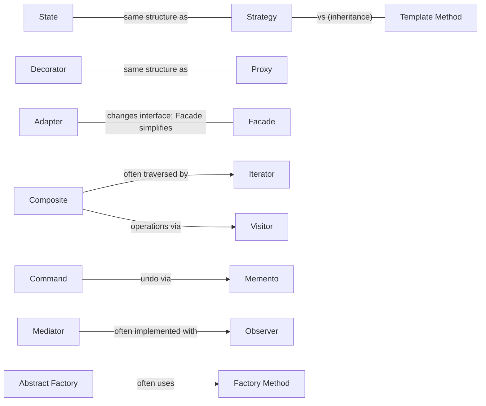

# Design Patterns (GoF + Enterprise Patterns)

> **TL;DR** — Patterns are named, reusable solutions to recurring design problems; their main value is a shared vocabulary. The 23 Gang of Four (GoF) patterns cover object creation, composition, and interaction. Fowler's *Patterns of Enterprise Application Architecture* (PoEAA) covers business-application concerns: domain logic organisation, persistence mapping, and distribution. Many GoF patterns are trivial in modern languages (first-class functions, DI containers, iterators) — know the intent, not just the UML.

---

## 1. GoF overview

*Design Patterns: Elements of Reusable Object-Oriented Software* (Gamma, Helm, Johnson, Vlissides, 1994). Two key principles from the book:

1. **Program to an interface, not an implementation.**
2. **Favour object composition over class inheritance.**

### All 23 patterns

#### Creational (5)

| Pattern | Intent | When to use | Modern equivalent |
|---|---|---|---|
| **Abstract Factory** | Create families of related objects without specifying concrete classes | Multiple product families (UI themes, cloud providers, DB dialects) | DI container registrations per environment |
| **Builder** | Separate construction of a complex object from its representation; step-by-step | Many optional params; immutable objects; test data builders | Fluent builders, object initializers, `record with` |
| **Factory Method** | Let subclasses decide which class to instantiate | Framework defines workflow; subclass/plugin supplies product | Factory function / `Func<T>` |
| **Prototype** | Create new objects by cloning an existing instance | Costly creation; configurable templates | `structuredClone`, `record with`, spread `{...obj}` |
| **Singleton** | Ensure one instance with global access | Truly single resource (rare) | DI singleton lifetime; module scope. Avoid hidden global state |

#### Structural (7)

| Pattern | Intent | When to use | Modern equivalent |
|---|---|---|---|
| **Adapter** | Convert an interface into one clients expect | Integrating third-party/legacy APIs; ports & adapters | Wrapper classes, anti-corruption layer |
| **Bridge** | Decouple abstraction from implementation so both vary independently | Two orthogonal dimensions (shape × renderer, notification × channel) | Composition + interfaces |
| **Composite** | Treat individual objects and compositions uniformly (tree) | Hierarchies: BOMs, menus, org charts, UI trees, rule trees | React component tree |
| **Decorator** | Attach responsibilities dynamically by wrapping | Cross-cutting: logging, caching, retry, auth around a service | Middleware, HOFs, `Scrutor.Decorate`, Python `@decorators` |
| **Facade** | Unified simple interface to a subsystem | Simplify complex subsystem/SDK; module public API | Service layer, SDK clients, BFF |
| **Flyweight** | Share fine-grained objects to save memory | Huge numbers of similar objects (glyphs, map tiles) | String interning, object pools |
| **Proxy** | Surrogate controlling access to another object | Lazy load, remote access, access control, caching | ORM lazy proxies, gRPC stubs, JS `Proxy` |

#### Behavioral (11)

| Pattern | Intent | When to use | Modern equivalent |
|---|---|---|---|
| **Chain of Responsibility** | Pass a request along a chain until handled | Pipelines, middleware, approval chains, validation | ASP.NET Core / Express middleware, MediatR behaviors |
| **Command** | Encapsulate a request as an object | Undo/redo, queuing, logging, CQRS commands, job scheduling | Command/handler objects, messages |
| **Interpreter** | Represent grammar and interpret sentences | Small DSLs, rule engines, query filters | Parser combinators, expression trees |
| **Iterator** | Sequential access without exposing representation | Custom collections, paging | `IEnumerable`/`yield`, JS iterators/generators, async iterators |
| **Mediator** | Encapsulate how objects interact; reduce many-to-many coupling | Complex UI dialogs, in-process request dispatch | MediatR, event bus, orchestrators |
| **Memento** | Capture/restore state without breaking encapsulation | Undo, snapshots, drafts | Immutable state snapshots (Redux) |
| **Observer** | One-to-many notification on state change | Events, reactive UI, domain events | Events/delegates, RxJS, signals, pub/sub |
| **State** | Alter behaviour when internal state changes | Lifecycles (order, document approval, invoice) | State machines (XState, Stateless) |
| **Strategy** | Interchangeable family of algorithms | Pricing, tax, routing, sorting, export format | Pass a function/lambda; DI keyed services |
| **Template Method** | Skeleton algorithm; subclasses override steps | Framework hooks; import pipelines with varying steps | Higher-order functions / strategy |
| **Visitor** | New operations over an object structure without changing classes | ASTs, compilers, document exports over stable hierarchy | Pattern matching over discriminated unions |

### Pattern relationships



**Easily confused pairs**

| Pair | Difference |
|---|---|
| Adapter vs Facade | Adapter makes an existing interface fit a *required* one; Facade defines a *new simpler* one |
| Decorator vs Proxy | Decorator *adds* behaviour (stackable); Proxy *controls access* (lazy, remote, security) |
| Strategy vs State | Strategy chosen by client; State changes itself as context transitions |
| Bridge vs Adapter | Bridge designed up-front to vary independently; Adapter retrofitted |
| Mediator vs Observer | Mediator centralises interaction logic; Observer distributes notifications |
| Factory Method vs Abstract Factory | One product via inheritance vs a family of products via composition |
| Command vs Strategy | Command encapsulates *what to do* (request); Strategy *how to do it* (algorithm) |

---

## 2. Key GoF patterns with examples

### Builder (C#) — test data builder

```csharp
public sealed class OrderBuilder
{
    private string _customerId = "C-1";
    private readonly List<OrderLine> _lines = [];
    private string _currency = "EUR";

    public OrderBuilder ForCustomer(string id) { _customerId = id; return this; }
    public OrderBuilder WithLine(string sku, int qty, decimal price)
    { _lines.Add(new OrderLine(sku, qty, price)); return this; }
    public OrderBuilder InCurrency(string c) { _currency = c; return this; }

    public Order Build() => Order.Create(_customerId, _currency, _lines);
}

var order = new OrderBuilder().WithLine("SKU-1", 2, 9.95m).Build();
```

### Factory Method / simple factory (TypeScript)

```ts
interface Exporter { export(rows: Row[]): Promise<Blob> }
class CsvExporter implements Exporter { async export(rows: Row[]) { /* ... */ return new Blob(); } }
class XlsxExporter implements Exporter { async export(rows: Row[]) { /* ... */ return new Blob(); } }

const exporters = { csv: () => new CsvExporter(), xlsx: () => new XlsxExporter() } as const;
type Format = keyof typeof exporters;
export const createExporter = (f: Format): Exporter => exporters[f]();
```

### Adapter (TypeScript) — wrapping a legacy ERP SOAP client

```ts
// Port the application owns
export interface StockLevels { getAvailable(sku: string): Promise<number> }

// Adapter translating the legacy model
export class LegacyErpStockAdapter implements StockLevels {
  constructor(private readonly soap: LegacyErpSoapClient) {}
  async getAvailable(sku: string): Promise<number> {
    const res = await this.soap.GetItemInventory({ ItemNo: sku, Location: "MAIN" });
    return Number(res.QtyOnHand) - Number(res.QtyReserved);
  }
}
```

### Decorator (C#) — retry + caching around a client

```csharp
public interface IExchangeRates { Task<decimal> GetRate(string from, string to); }

public sealed class CachedExchangeRates(IExchangeRates inner, IMemoryCache cache) : IExchangeRates
{
    public Task<decimal> GetRate(string from, string to) =>
        cache.GetOrCreateAsync($"fx:{from}:{to}", e =>
        {
            e.AbsoluteExpirationRelativeToNow = TimeSpan.FromMinutes(10);
            return inner.GetRate(from, to);
        })!;
}

// Registration with Scrutor
services.AddHttpClient<IExchangeRates, EcbExchangeRates>();
services.Decorate<IExchangeRates, CachedExchangeRates>();
```

### Composite (TypeScript) — bill of materials

```ts
interface BomNode { cost(): number; }
class Part implements BomNode { constructor(private unitCost: number) {} cost() { return this.unitCost; } }
class Assembly implements BomNode {
  constructor(private children: Array<{ node: BomNode; qty: number }>, private labour = 0) {}
  cost() { return this.labour + this.children.reduce((s, c) => s + c.node.cost() * c.qty, 0); }
}
const bike = new Assembly([{ node: new Part(40), qty: 2 }, { node: new Assembly([{ node: new Part(3), qty: 32 }]), qty: 2 }], 25);
```

### Strategy (Python) — functions as strategies

```python
from typing import Callable
from decimal import Decimal

ShippingStrategy = Callable[[Decimal], Decimal]

def flat_rate(weight_kg: Decimal) -> Decimal: return Decimal("6.95")
def per_kg(weight_kg: Decimal) -> Decimal: return Decimal("1.20") * weight_kg

STRATEGIES: dict[str, ShippingStrategy] = {"flat": flat_rate, "per_kg": per_kg}

def shipping_cost(method: str, weight: Decimal) -> Decimal:
    return STRATEGIES[method](weight)
```

### State (TypeScript) — order lifecycle as explicit transitions

```ts
type OrderState = "draft" | "placed" | "paid" | "shipped" | "cancelled";
type OrderEvent = "place" | "pay" | "ship" | "cancel";

const transitions: Record<OrderState, Partial<Record<OrderEvent, OrderState>>> = {
  draft:     { place: "placed", cancel: "cancelled" },
  placed:    { pay: "paid", cancel: "cancelled" },
  paid:      { ship: "shipped" },
  shipped:   {},
  cancelled: {},
};

export function transition(state: OrderState, event: OrderEvent): OrderState {
  const next = transitions[state][event];
  if (!next) throw new Error(`Invalid transition ${state} --${event}-->`);
  return next;
}
```

### Observer (C#) — domain events in-process

```csharp
public abstract class AggregateRoot
{
    private readonly List<IDomainEvent> _events = [];
    public IReadOnlyCollection<IDomainEvent> DomainEvents => _events;
    protected void Raise(IDomainEvent e) => _events.Add(e);
    public void ClearEvents() => _events.Clear();
}
// Dispatched after SaveChanges by a unit-of-work interceptor to INotificationHandler<T> instances.
```

### Chain of Responsibility (TypeScript) — middleware pipeline

```ts
type Ctx = { req: Request; user?: User };
type Next = () => Promise<Response>;
type Middleware = (ctx: Ctx, next: Next) => Promise<Response>;

const compose = (mws: Middleware[], handler: (c: Ctx) => Promise<Response>) =>
  (ctx: Ctx) => mws.reduceRight<Next>((next, mw) => () => mw(ctx, next), () => handler(ctx))();

const auth: Middleware = async (ctx, next) => (ctx.user ? next() : new Response(null, { status: 401 }));
const timing: Middleware = async (_ctx, next) => { const t = Date.now(); try { return await next(); } finally { console.log(Date.now() - t); } };
```

### Command (C#) — CQRS command + handler

```csharp
public sealed record ApproveInvoice(Guid InvoiceId, string ApprovedBy) : IRequest;

public sealed class ApproveInvoiceHandler(IInvoiceRepository repo, IUnitOfWork uow) : IRequestHandler<ApproveInvoice>
{
    public async Task Handle(ApproveInvoice cmd, CancellationToken ct)
    {
        var invoice = await repo.Get(cmd.InvoiceId, ct);
        invoice.Approve(cmd.ApprovedBy);
        await uow.Commit(ct);
    }
}
```

### Visitor vs pattern matching (TypeScript)

```ts
type Expr =
  | { kind: "num"; value: number }
  | { kind: "add"; left: Expr; right: Expr }
  | { kind: "mul"; left: Expr; right: Expr };

const evaluate = (e: Expr): number => {
  switch (e.kind) {
    case "num": return e.value;
    case "add": return evaluate(e.left) + evaluate(e.right);
    case "mul": return evaluate(e.left) * evaluate(e.right);
  }
};
// Exhaustiveness checking replaces the double-dispatch Visitor in languages with sum types.
```

### Singleton — prefer DI lifetime

```csharp
// ❌ static Instance → hidden global, hard to test
// ✅
builder.Services.AddSingleton<IClock, SystemClock>();
```

---

## 3. Enterprise application patterns (Fowler, PoEAA, 2002)

### Domain logic patterns

| Pattern | Description | When to use |
|---|---|---|
| **Transaction Script** | One procedure per business transaction | Simple logic, CRUD, scripts. Grows messy with complexity |
| **Table Module** | One class per DB table handling all rows (works with record sets) | .NET DataSet era; tabular logic; reporting |
| **Domain Model** | Object model of the domain with behaviour + data | Complex, changing business rules (DDD) |
| **Service Layer** | Defines application boundary; coordinates use cases, transactions, security | Multiple clients (UI, API, jobs) over same domain |

Fowler's classic sketch (effort to enhance vs. domain logic complexity):

```
effort to
enhance  │            Transaction Script ╱
         │                             ╱
         │              Table Module ╱  ___
         │                        ╱ ___/  Domain Model
         │       ___________/‾‾‾‾‾‾          (higher entry cost,
         │  ____/                             flatter growth)
         └──────────────────────────────────────────▶ complexity of domain logic
```

### Data source architectural patterns

| Pattern | Description | Typical tool |
|---|---|---|
| **Table Data Gateway** | One object per table; all SQL for that table | Simple DAO |
| **Row Data Gateway** | One object per row; no domain logic | — |
| **Active Record** | Row object + domain logic + persistence (`order.save()`) | Rails ActiveRecord, Django ORM, Laravel Eloquent, TypeORM AR mode |
| **Data Mapper** | Separate mapper moves data between objects and DB; domain unaware of persistence | EF Core, Hibernate, SQLAlchemy (ORM mode), MikroORM, TypeORM DM mode |

#### Active Record vs Data Mapper

| Aspect | Active Record | Data Mapper |
|---|---|---|
| Domain-DB coupling | Tight: object mirrors table | Loose: object model independent |
| Simplicity | High; fast to start | More setup |
| Testability | Harder (DB needed) | Domain testable in memory |
| Best for | CRUD-heavy, schema ≈ model | Rich domain, model ≠ schema |
| Risk | Business logic spread in callbacks; fat models | Mapping complexity |

```python
# Active Record style (Django)
order = Order.objects.get(pk=1)
order.status = "shipped"
order.save()

# Data Mapper style (SQLAlchemy 2.0 with a session = unit of work + identity map)
with Session(engine) as session, session.begin():
    order = session.get(Order, 1)
    order.ship()            # pure domain method
# commit flushes changes tracked by the unit of work
```

### Object-relational behavioural patterns

| Pattern | Description | Notes |
|---|---|---|
| **Unit of Work** | Tracks objects affected by a business transaction and coordinates writing changes | EF Core `DbContext`, SQLAlchemy `Session`, Hibernate `Session` |
| **Identity Map** | Ensures each object is loaded only once per session; map of loaded objects | Avoids duplicate instances and inconsistent updates; also a per-request cache |
| **Lazy Load** | Object doesn't contain all data but knows how to get it | Variants: lazy initialisation, virtual proxy, value holder, ghost. Causes **N+1** if abused |

### Object-relational structural patterns

Identity Field, Foreign Key Mapping, Association Table Mapping, Dependent Mapping, Embedded Value (→ owned types / value objects), Serialized LOB (→ JSON columns), Single Table / Class Table / Concrete Table Inheritance.

| Inheritance mapping | Tables | Pros | Cons |
|---|---|---|---|
| Single Table (TPH) | One | Fast, simple queries | Nullable columns, sparse |
| Class Table (TPT) | One per class | Normalised | Joins, slower |
| Concrete Table (TPC) | One per concrete class | No joins for concrete queries | Polymorphic queries need UNION; ID uniqueness |

### Object-relational metadata patterns

| Pattern | Description |
|---|---|
| Metadata Mapping | Mapping in metadata (attributes, fluent config, XML) |
| **Query Object** | Object representing a DB query (LINQ, SQLAlchemy select, Criteria API) |
| **Repository** | Mediates between domain and data mapping using a collection-like interface |

### Repository

> A Repository mediates between the domain and data mapping layers, acting like an in-memory domain object collection.

```ts
// Domain-owned port — collection semantics, aggregate-level
export interface OrderRepository {
  byId(id: OrderId): Promise<Order | null>;
  add(order: Order): void;
  // no generic update(): changes tracked by unit of work or saved explicitly
  nextIdentity(): OrderId;
}
```

```csharp
// EF Core implementation — thin; DbContext already is UoW + Identity Map
public sealed class EfOrderRepository(ShopDbContext db) : IOrderRepository
{
    public Task<Order?> ById(OrderId id, CancellationToken ct) =>
        db.Orders.Include(o => o.Lines).SingleOrDefaultAsync(o => o.Id == id, ct);
    public void Add(Order order) => db.Orders.Add(order);
}
```

**Guidelines**
- One repository per **aggregate root**, not per table.
- Return domain objects, not `IQueryable` (leaks persistence) — unless deliberately using the ORM as the repository in a simple app.
- Avoid **generic repository** `IRepository<T>` over an ORM: it removes useful features and adds no abstraction value.
- Reads for screens/reports can bypass repositories (CQRS read side: Dapper, SQL views).

### Specification (Evans & Fowler)

Encapsulates a business rule/predicate as a combinable object — usable for validation, selection (querying) and construction.

```csharp
public abstract class Specification<T>
{
    public abstract Expression<Func<T, bool>> ToExpression();
    public bool IsSatisfiedBy(T entity) => ToExpression().Compile()(entity);
    public Specification<T> And(Specification<T> other) => new AndSpecification<T>(this, other);
}

public sealed class OverdueInvoice(DateOnly today) : Specification<Invoice>
{
    public override Expression<Func<Invoice, bool>> ToExpression() =>
        i => i.Status == InvoiceStatus.Open && i.DueDate < today;
}

// usage: db.Invoices.Where(new OverdueInvoice(today).ToExpression())
```

Libraries: Ardalis.Specification (.NET).

### Distribution & base patterns

| Pattern | Description |
|---|---|
| **Remote Facade** | Coarse-grained facade over fine-grained objects to reduce remote calls |
| **Data Transfer Object (DTO)** | Object carrying data between processes to reduce calls; serialisable, no behaviour |
| **Gateway** | Object encapsulating access to an external system/resource (e.g., `PaymentGateway`, `ErpGateway`) |
| **Mapper** | Object setting up communication between two independent objects |
| **Layer Supertype** | Base type for all types in a layer (`Entity`, `AggregateRoot`) |
| **Separated Interface** | Interface defined in a different package from its implementation (→ DIP) |
| **Registry** | Well-known object for finding services (prefer DI) |
| **Value Object** | Small object whose equality is based on value (`Money`, `DateRange`) |
| **Money** | Value object for monetary amounts with currency; avoid floating point |
| **Special Case / Null Object** | Subclass providing special behaviour (`UnknownCustomer`) instead of null checks |
| **Plugin** | Links classes during configuration rather than compilation |
| **Service Stub** | Removes dependence on problematic services during testing |
| **Record Set** | In-memory tabular data |

### DTO guidelines

- Shape DTOs per use case/endpoint, not per entity.
- Never expose ORM entities directly over APIs (over-posting, lazy-load serialisation, coupling).
- Map explicitly (manual mapping or source-generated mappers like Mapperly) — reflection auto-mappers hide errors.
- DTOs are contracts: version them; validate at the boundary.

### Web presentation & concurrency patterns (brief)

| Category | Patterns |
|---|---|
| Web presentation | MVC, Page Controller, Front Controller, Template View, Transform View, Two-Step View, Application Controller |
| Offline concurrency | **Optimistic Offline Lock** (version column / ETag), **Pessimistic Offline Lock**, Coarse-Grained Lock, Implicit Lock |
| Session state | Client Session State, Server Session State, Database Session State |

#### Optimistic concurrency (EF Core)

```csharp
public class Invoice { public Guid Id { get; set; } [Timestamp] public byte[] RowVersion { get; set; } = []; }
// SaveChanges throws DbUpdateConcurrencyException if row changed since read → return 409/412 to client
```

---

## 4. Other pattern families worth knowing

| Family | Source | Examples |
|---|---|---|
| Domain-driven design | Evans, Vernon | Aggregate, Entity, Value Object, Domain Event, Repository, Factory → [domain-driven-design.md](domain-driven-design.md) |
| Enterprise integration | Hohpe & Woolf | Message channel, router, translator, aggregator → [integration-and-messaging.md](integration-and-messaging.md) |
| Microservices | Richardson | Saga, API gateway, database per service, outbox → [distributed-systems.md](distributed-systems.md) |
| Cloud design patterns | Microsoft | Retry, circuit breaker, sidecar, ambassador, valet key, claim check |
| Concurrency | POSA2 | Active Object, Monitor Object, Reactor, Proactor, Half-Sync/Half-Async |
| Architectural (POSA1) | Buschmann et al. | Layers, Pipes and Filters, Blackboard, Broker, MVC, PAC, Microkernel, Reflection |
| Functional | — | Railway-oriented programming (Result/Either), monads, lenses |

---

## When to use patterns / when not

**Use when**
- The problem recurs and the pattern's forces match.
- A shared name speeds up communication ("put a decorator around the client").
- Introducing a seam for testing or variability that *actually exists*.

**Don't use when**
- A language feature already solves it (lambda instead of Strategy class; generator instead of Iterator).
- Only one variant exists and none is expected (speculative generality).
- To show off ("pattern-itis").

## Common mistakes / anti-patterns

- **Singleton as global variable** → hidden coupling, untestable.
- **Generic repository over ORM** → leaky, lowest-common-denominator API.
- **Service Locator** → hidden dependencies (Mark Seemann calls it an anti-pattern); prefer constructor injection.
- **Anemic domain model** with Service Layer doing everything.
- **AutoMapper-everywhere** — silent mapping bugs, logic in mapping profiles.
- **Lazy loading in web APIs** → N+1 queries and serialisation loops.
- **Visitor over unstable hierarchies** — adding a class forces changing every visitor.
- **Overusing inheritance for Template Method** where a strategy/function would do.
- **God Mediator** — a mediator that knows every interaction.

## Related

- [design-principles.md](design-principles.md), [architecture-styles.md](architecture-styles.md), [data-architecture-for-applications.md](data-architecture-for-applications.md)

## References

- Design Patterns (GoF) — Wikipedia: https://en.wikipedia.org/wiki/Design_Patterns
- Software design pattern: https://en.wikipedia.org/wiki/Software_design_pattern
- Refactoring.Guru — design patterns catalog: https://refactoring.guru/design-patterns
- Fowler — PoEAA catalog: https://martinfowler.com/eaaCatalog/
- Fowler — Repository: https://martinfowler.com/eaaCatalog/repository.html
- Fowler — Unit of Work: https://martinfowler.com/eaaCatalog/unitOfWork.html
- Fowler — Active Record: https://martinfowler.com/eaaCatalog/activeRecord.html
- Fowler — Data Mapper: https://martinfowler.com/eaaCatalog/dataMapper.html
- Fowler — Service Layer: https://martinfowler.com/eaaCatalog/serviceLayer.html
- Fowler — Data Transfer Object: https://martinfowler.com/eaaCatalog/dataTransferObject.html
- Fowler — Identity Map: https://martinfowler.com/eaaCatalog/identityMap.html
- Fowler — Lazy Load: https://martinfowler.com/eaaCatalog/lazyLoad.html
- Fowler — Gateway: https://martinfowler.com/eaaCatalog/gateway.html
- Fowler — Table Module: https://martinfowler.com/eaaCatalog/tableModule.html
- Fowler — Specifications (Evans & Fowler, PDF): https://martinfowler.com/apsupp/spec.pdf
- Specification pattern: https://en.wikipedia.org/wiki/Specification_pattern
- Microsoft — Cloud design patterns: https://learn.microsoft.com/azure/architecture/patterns/
- Microsoft — Infrastructure persistence layer design (repositories, UoW): https://learn.microsoft.com/dotnet/architecture/microservices/microservice-ddd-cqrs-patterns/infrastructure-persistence-layer-design
- Mark Seemann — Service Locator is an Anti-Pattern: https://blog.ploeh.dk/2010/02/03/ServiceLocatorisanAnti-Pattern/
- Gamma, Helm, Johnson, Vlissides — *Design Patterns* (1994)
- Freeman & Robson — *Head First Design Patterns* (2nd ed., 2020)
- Martin Fowler — *Patterns of Enterprise Application Architecture* (2002)
- Buschmann et al. — *Pattern-Oriented Software Architecture* (POSA) vol. 1–5
