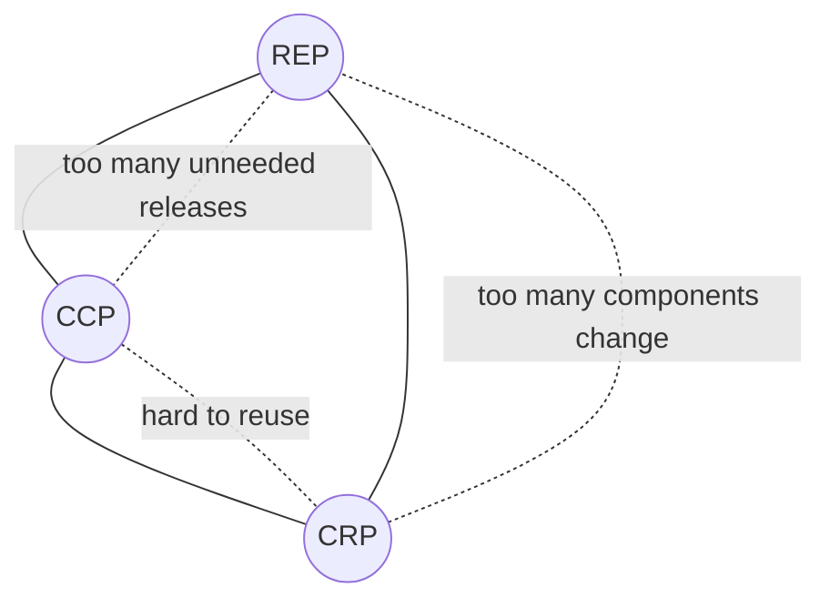

# Design Principles

> **TL;DR** — Principles are heuristics for managing *coupling* and *cohesion* so that code stays cheap to change. SOLID governs class/module design; package principles (REP/CCP/CRP, ADP/SDP/SAP) govern components; connascence gives a vocabulary to *measure* coupling; GRASP assigns responsibilities. Apply them in proportion to expected change — over-applying them is itself an anti-pattern.

---

## 1. Coupling and cohesion: the root of it all

| Concept | Definition | Goal |
|---|---|---|
| **Cohesion** | How strongly the elements inside a module belong together | **High** |
| **Coupling** | How strongly a module depends on others | **Low** (or rather: *appropriate*) |

### Cohesion types (worst → best, Yourdon & Constantine)

| Type | Elements grouped because... |
|---|---|
| Coincidental | Random (`Utils`, `Helpers`, `Misc`) |
| Logical | Same category of thing (`AllValidators`) |
| Temporal | Executed at the same time (`Startup`) |
| Procedural | Follow an execution sequence |
| Communicational | Operate on the same data |
| Sequential | Output of one is input of next |
| **Functional** | All contribute to a single well-defined task |

### Coupling types (worst → best)

| Type | Description |
|---|---|
| Content | Module modifies internals of another |
| Common | Shared global data |
| External | Shared external format/protocol/device |
| Control | Passing flags that control another's logic (`doThing(isAdmin: true)`) |
| Stamp | Passing a whole structure when only part is used |
| Data | Passing only the needed primitive data |
| Message | Communicate only via messages (no shared state) |

---

## 2. SOLID

Coined by Robert C. Martin (acronym by Michael Feathers).

### S — Single Responsibility Principle (SRP)

> A module should have one, and only one, **reason to change** — i.e. be responsible to one *actor*.

Not "do one thing" (that is a function-level rule). It is about *who* requests changes.

```ts
// ❌ Three actors: Accounting (pay), HR (hours), DBA (save)
class Employee {
  calculatePay(): Money { /* ... */ }
  reportHours(): string { /* ... */ }
  save(): void { /* ... */ }
}

// ✅ Separate by actor; a facade can keep the API convenient
class PayCalculator { calculate(e: EmployeeData): Money { /* ... */ } }
class HourReporter  { report(e: EmployeeData): string { /* ... */ } }
class EmployeeRepository { save(e: EmployeeData): Promise<void> { /* ... */ } }
```

**Smell**: merge conflicts in the same class from different teams; class names with "And"/"Manager".

### O — Open/Closed Principle (OCP)

> Software entities should be **open for extension, closed for modification** (Meyer; polymorphic version by Martin).

```csharp
// ❌ Every new discount type modifies this switch
decimal Discount(Order o) => o.CustomerType switch {
    "Gold" => o.Total * 0.1m,
    "Silver" => o.Total * 0.05m,
    _ => 0m
};

// ✅ New strategies are added without touching existing code
public interface IDiscountPolicy { bool AppliesTo(Order o); decimal Calculate(Order o); }

public sealed class GoldDiscount : IDiscountPolicy {
    public bool AppliesTo(Order o) => o.Customer.Tier == Tier.Gold;
    public decimal Calculate(Order o) => o.Total * 0.10m;
}

public sealed class DiscountService(IEnumerable<IDiscountPolicy> policies) {
    public decimal Calculate(Order o) =>
        policies.Where(p => p.AppliesTo(o)).Select(p => p.Calculate(o)).DefaultIfEmpty(0).Max();
}
```

**Caveat**: you can only be closed against *anticipated* kinds of change. Don't add extension points speculatively (YAGNI); refactor to OCP on the second or third variation.

### L — Liskov Substitution Principle (LSP)

> Subtypes must be substitutable for their base types without altering correctness (Barbara Liskov, 1987).

Rules (design by contract):
- Preconditions cannot be **strengthened** in a subtype.
- Postconditions cannot be **weakened**.
- Invariants of the supertype must be preserved.
- No new exceptions not expected by base contract.
- History constraint: subtype must not allow state changes the base forbids.

```ts
// ❌ Classic violation: Square changes Rectangle's contract
class Rectangle {
  constructor(public width: number, public height: number) {}
  setWidth(w: number) { this.width = w; }
  setHeight(h: number) { this.height = h; }
  area() { return this.width * this.height; }
}
class Square extends Rectangle {
  setWidth(w: number) { this.width = w; this.height = w; } // surprises callers
  setHeight(h: number) { this.width = h; this.height = h; }
}

// ✅ Model as separate immutable shapes sharing an interface
interface Shape { area(): number }
const rect = (w: number, h: number): Shape => ({ area: () => w * h });
const square = (s: number): Shape => ({ area: () => s * s });
```

Other common violations: `ReadOnlyCollection` throwing on `Add`; `NotImplementedException` overrides; subclass ignoring a parameter.

### I — Interface Segregation Principle (ISP)

> Clients should not be forced to depend on methods they do not use.

```csharp
// ❌ Fat interface
public interface IPrinterDevice { void Print(Doc d); void Scan(Doc d); void Fax(Doc d); }

// ✅ Role interfaces
public interface IPrinter { void Print(Doc d); }
public interface IScanner { void Scan(Doc d); }
public sealed class SimplePrinter : IPrinter { public void Print(Doc d) { /* ... */ } }
public sealed class Multifunction : IPrinter, IScanner { /* ... */ }
```

At architecture level: don't make services depend on huge shared client SDKs or "god" DTOs.

### D — Dependency Inversion Principle (DIP)

> High-level modules should not depend on low-level modules; both should depend on **abstractions**. Abstractions should not depend on details.

The abstraction is **owned by the high-level policy** (this is what makes it "inversion").

```ts
// domain/ports.ts — owned by domain
export interface InvoiceSender { send(invoice: Invoice): Promise<void> }

// application/issue-invoice.ts
export class IssueInvoice {
  constructor(private readonly sender: InvoiceSender) {}
  async execute(inv: Invoice) { inv.issue(); await this.sender.send(inv); }
}

// infrastructure/peppol-sender.ts — detail depends on domain abstraction
export class PeppolInvoiceSender implements InvoiceSender {
  async send(invoice: Invoice) { /* call e-invoicing network */ }
}
```

DIP ≠ Dependency Injection (DI is a technique to supply dependencies) ≠ IoC (framework calls your code). DIP is the foundation of hexagonal/onion/clean architecture.

### SOLID summary

| Principle | Protects against | Over-application smell |
|---|---|---|
| SRP | Unrelated changes colliding | Explosion of tiny classes |
| OCP | Ripple edits on extension | Speculative plugin points |
| LSP | Broken polymorphism | — (rarely over-applied) |
| ISP | Unneeded dependencies | One interface per method everywhere |
| DIP | Policy depending on details | Interfaces with exactly one impl and no seam need |

---

## 3. Other core principles

| Principle | Statement | Pitfall |
|---|---|---|
| **DRY** (Hunt & Thomas) | Every piece of *knowledge* has a single, unambiguous, authoritative representation | DRY is about knowledge, not text. Merging two coincidentally-identical snippets creates false coupling ("wrong abstraction") |
| **WET** / **AHA** | "Write Everything Twice" / "Avoid Hasty Abstractions" (Kent C. Dodds) | Counterweight to premature DRY |
| **Rule of Three** | Abstract on the third duplication | — |
| **KISS** | Keep it simple — prefer the simplest thing that works | Simple ≠ easy (Rich Hickey: "Simple Made Easy") |
| **YAGNI** (XP) | Don't build capabilities until needed | Doesn't apply to things expensive to retrofit (security, data model, observability) |
| **Law of Demeter (LoD)** | Talk only to immediate friends: `self`, params, created objects, own fields | Not "count the dots" — fluent builders are fine |
| **SoC** (Dijkstra) | Separate concerns into distinct sections | Over-layering |
| **Composition over inheritance** (GoF) | Prefer has-a over is-a for reuse | Inheritance still fine for true subtyping and frameworks |
| **Tell, Don't Ask** | Tell objects what to do; don't query state and decide for them | Can conflict with CQS-heavy read models |
| **CQS** (Meyer) | A method either **commands** (changes state, returns nothing) or **queries** (returns, no side effects) | `stack.pop()` is a pragmatic exception |
| **Principle of Least Astonishment (POLA)** | Components behave as users/developers expect | — |
| **Robustness principle** (Postel) | Be conservative in what you send, liberal in what you accept | Liberal acceptance ossifies bugs and creates security holes; modern view (RFC 9413) favours strictness |
| **Fail fast** | Detect and report errors as early as possible | Not "crash in production for recoverable errors" |
| **Principle of least privilege** | Minimum rights needed | See security section |
| **Hollywood principle** | "Don't call us, we'll call you" (IoC) | — |
| **Encapsulate what varies** | Isolate parts likely to change | — |
| **Program to an interface** | Depend on contracts, not implementations | — |
| **Boy Scout rule** | Leave code cleaner than you found it | Scope creep in PRs |

### Law of Demeter example

```ts
// ❌ Train wreck: caller knows customer → wallet → balance structure
if (order.customer.wallet.balance >= order.total) order.customer.wallet.debit(order.total);

// ✅ Tell, don't ask
order.customer.pay(order.total); // customer decides how
```

### Tell, Don't Ask

```csharp
// ❌ Ask
if (account.Balance >= amount) account.Balance -= amount; else throw new InsufficientFunds();

// ✅ Tell — invariant lives inside Account
account.Withdraw(amount);
```

### CQS vs CQRS

- **CQS**: method level — separate commands and queries.
- **CQRS**: architecture level — separate *models* (and possibly stores) for writes and reads. See [architecture-styles.md](architecture-styles.md).

### Composition over inheritance

```ts
// ❌ Inheritance explosion: LoggingCachingRepo, CachingRepo, LoggingRepo...
// ✅ Decorators compose behaviour
interface Repo<T> { get(id: string): Promise<T | undefined> }

const withCache = <T>(inner: Repo<T>, cache = new Map<string, T>()): Repo<T> => ({
  async get(id) {
    if (cache.has(id)) return cache.get(id);
    const v = await inner.get(id);
    if (v) cache.set(id, v);
    return v;
  },
});

const withLogging = <T>(inner: Repo<T>): Repo<T> => ({
  async get(id) { console.time(id); try { return await inner.get(id); } finally { console.timeEnd(id); } },
});

const repo = withLogging(withCache(new SqlOrderRepo()));
```

---

## 4. Connascence

Meilir Page-Jones (1992), popularised by Jim Weirich. Two components are **connascent** if a change in one requires a change in the other to keep the system correct. Gives a *graded* vocabulary for coupling.

### Static connascence (visible in source) — weakest → strongest

| Type | Meaning | Example | Refactor towards |
|---|---|---|---|
| **Name (CoN)** | Agree on a name | Method name `calculateTotal` | (Unavoidable, acceptable) |
| **Type (CoT)** | Agree on a type | Param must be `Money` | — |
| **Meaning / Convention (CoM)** | Agree on meaning of values | `status = 2` means "shipped"; `-1` = not found | Enums/named constants → CoN |
| **Position (CoP)** | Agree on order | `createUser("Ann", "Smith", true, 42)` | Named params / param objects → CoN |
| **Algorithm (CoA)** | Agree on an algorithm | Client and server must use same hash/checksum/encoding | Single shared implementation |

### Dynamic connascence (only at runtime) — weakest → strongest

| Type | Meaning | Example |
|---|---|---|
| **Execution (CoE)** | Order of execution matters | `email.setRecipient()` must precede `email.send()` |
| **Timing (CoTm)** | Timing of execution matters | Race conditions; timeout coupling |
| **Values (CoV)** | Several values must change together | Triangle angle invariants; distributed config values in sync |
| **Identity (CoI)** | Must reference the *same* entity | Two components must share the exact same instance/queue |

### Three properties

| Property | Rule |
|---|---|
| **Strength** | Prefer weaker forms; refactor strong → weak |
| **Locality** | Strong connascence is acceptable *within* a module, dangerous *across* modules/services |
| **Degree** | Number of elements affected; fewer is better |

**Guidelines (Weirich):**
1. Minimise overall connascence by breaking the system into encapsulated elements.
2. Minimise any remaining connascence that crosses encapsulation boundaries.
3. Maximise connascence within encapsulation boundaries.

```ts
// CoP → CoN
// ❌ new Order("C-1", "EUR", 3, true, false)
// ✅
new Order({ customerId: "C-1", currency: "EUR", quantity: 3, express: true, giftWrap: false });

// CoM → CoN
// ❌ if (order.status === 3) ...
enum OrderStatus { Draft = "draft", Placed = "placed", Shipped = "shipped" }
if (order.status === OrderStatus.Shipped) { /* ... */ }
```

**Architecture link**: across services aim for at most CoN/CoT (shared contract); CoA (shared serialization quirks), CoTm (synchronous call chains with timeouts), and CoI (shared DB rows) across services are microservice smells.

---

## 5. GRASP

*General Responsibility Assignment Software Patterns* — Craig Larman, *Applying UML and Patterns*.

| Pattern | Problem | Solution |
|---|---|---|
| **Information Expert** | Who should take a responsibility? | The class that has the information needed (`Order.total()` not `OrderService.computeTotal(order)`) |
| **Creator** | Who creates an A? | B if B contains/aggregates/records/closely uses A, or has init data |
| **Controller** | Who handles a system event first? | A non-UI object representing the system or a use case (application service / handler) |
| **Low Coupling** | How to reduce change impact? | Assign so coupling stays low |
| **High Cohesion** | How to keep objects focused? | Assign so cohesion stays high |
| **Polymorphism** | Behaviour varies by type? | Use polymorphic operations, not conditionals |
| **Pure Fabrication** | Expert would violate cohesion/coupling? | Invent a non-domain class (e.g., `Repository`, `PdfRenderer`) |
| **Indirection** | Avoid direct coupling? | Intermediate object (adapter, mediator, broker) |
| **Protected Variations** | Protect elements from variations in others? | Wrap points of instability behind stable interfaces |

Protected Variations is essentially the umbrella of OCP, information hiding (Parnas), LSP, and LoD.

---

## 6. Package / component principles (Robert C. Martin)

### Cohesion principles — what goes *into* a component

| Principle | Statement | Pulls towards |
|---|---|---|
| **REP** — Reuse/Release Equivalence | The granule of reuse is the granule of release (versioned, released together) | Larger, releasable components |
| **CCP** — Common Closure | Classes that change together for the same reasons belong together (SRP for components) | Grouping for maintainability |
| **CRP** — Common Reuse | Don't force users to depend on things they don't need (ISP for components) | Smaller, splitting components |

**Tension triangle**: REP + CCP make components bigger (inclusive); CRP makes them smaller (exclusive). Early in a project favour **CCP** (developability); as it matures and is reused, shift towards REP/CRP.



### Coupling principles — relationships *between* components

| Principle | Statement |
|---|---|
| **ADP** — Acyclic Dependencies | No cycles in the component dependency graph. Break cycles with DIP or by extracting a new component. |
| **SDP** — Stable Dependencies | Depend in the direction of stability. |
| **SAP** — Stable Abstractions | A component should be as abstract as it is stable. |

### Metrics

- **Fan-in (Ca)**: incoming dependencies (afferent).
- **Fan-out (Ce)**: outgoing dependencies (efferent).
- **Instability** `I = Ce / (Ca + Ce)` — 0 = maximally stable, 1 = maximally unstable.
- **Abstractness** `A = Na / Nc` — abstract classes+interfaces ÷ total classes.
- **Distance from main sequence** `D = |A + I − 1|` — ideally near 0.

```
A (abstractness)
1 ┤ Zone of        ╲
  │ Uselessness      ╲   main sequence
  │ (abstract, no      ╲   A + I = 1
  │  dependents)         ╲
0 ┤ Zone of Pain          ╲
  │ (concrete, stable:     ╲
  │  e.g. DB schema)
  └─────────────────────────── I (instability)
  0                          1
```

**Zone of pain**: concrete and stable → hard to change, many dependents (e.g., a shared "Common" library with concrete classes, a shared database schema). **Zone of uselessness**: abstract with no dependents.

---

## 7. Clean Code basics

From Robert C. Martin's *Clean Code* plus broader consensus (Kent Beck's four rules of simple design).

### Kent Beck's rules of simple design (in priority order)

1. Passes the tests.
2. Reveals intention.
3. No duplication (of knowledge).
4. Fewest elements.

### Practical rules

| Area | Guidelines |
|---|---|
| **Naming** | Intention-revealing, pronounceable, searchable; domain language (ubiquitous language); no encodings (`strName`); classes = nouns, methods = verbs |
| **Functions** | Small; one level of abstraction; few params (≤3, else parameter object); no flag arguments; no hidden side effects; CQS |
| **Comments** | Explain *why*, not *what*; delete commented-out code; prefer expressive code |
| **Formatting** | Automated (Prettier, dotnet format, Black/Ruff); vertical ordering top-down ("newspaper") |
| **Error handling** | Exceptions/Result types over error codes; don't return/pass `null` (Option/Maybe, nullable reference types); wrap third-party exceptions at boundaries |
| **Objects vs data structures** | Objects hide data, expose behaviour; DTOs expose data, no behaviour — don't mix (hybrids) |
| **Boundaries** | Wrap third-party APIs (adapters); learning tests |
| **Tests** | F.I.R.S.T. — Fast, Independent, Repeatable, Self-validating, Timely; one concept per test; AAA (Arrange/Act/Assert) |
| **Classes** | Small, SRP, cohesive |

### Code smells (Fowler, *Refactoring*) → refactorings

| Smell | Refactoring |
|---|---|
| Long function | Extract Function |
| Large class | Extract Class |
| Long parameter list | Introduce Parameter Object |
| Divergent change (one class, many reasons) | Split by responsibility (SRP) |
| Shotgun surgery (one change, many classes) | Move Function/Field, Inline Class (CCP) |
| Feature envy | Move Function to where data lives |
| Data clumps | Extract Class / value object |
| Primitive obsession | Replace Primitive with Object (value objects: `Email`, `Money`) |
| Repeated switches | Replace Conditional with Polymorphism |
| Message chains | Hide Delegate (LoD) |
| Middle man | Remove Middle Man |
| Speculative generality | Collapse Hierarchy, Inline (YAGNI) |
| Temporary field | Extract Class |
| Refused bequest | Replace Subclass with Delegate (LSP) |
| Mutable data | Encapsulate, make immutable |
| Global data | Encapsulate Variable |

### Primitive obsession → value object (Python)

```python
from dataclasses import dataclass
from decimal import Decimal

@dataclass(frozen=True, slots=True)
class Money:
    amount: Decimal
    currency: str

    def __post_init__(self) -> None:
        if len(self.currency) != 3:
            raise ValueError("ISO 4217 currency code expected")

    def __add__(self, other: "Money") -> "Money":
        if other.currency != self.currency:
            raise ValueError("currency mismatch")
        return Money(self.amount + other.amount, self.currency)
```

---

## 8. Other useful principles

| Principle | Notes |
|---|---|
| **Information hiding** (Parnas, 1972) | Decompose by *design decisions likely to change*, not by processing steps. Basis of modularity. |
| **Deep modules** (Ousterhout, *A Philosophy of Software Design*) | Simple interface, powerful implementation. Shallow modules (thin wrappers) add cost without value. |
| **Pull complexity downwards** | Module implementers should absorb complexity rather than push it to callers. |
| **Define errors out of existence** | Design APIs so error cases don't exist (e.g., `delete` of missing item is a no-op). |
| **Postel / robustness** | See above; prefer strict validation at trust boundaries. |
| **Parse, don't validate** (Alexis King) | Convert unstructured input into types that make invalid states unrepresentable. |
| **Make illegal states unrepresentable** (Yaron Minsky) | Use discriminated unions / types. |
| **Functional core, imperative shell** (Gary Bernhardt) | Pure domain logic; side effects at edges. Pairs with hexagonal. |
| **Principle of least knowledge** | = LoD. |
| **Convention over configuration** | Rails, ASP.NET conventions; reduces boilerplate. |
| **Worse is better** (Gabriel) | Simplicity of implementation can beat correctness/completeness in adoption. |

### Make illegal states unrepresentable (TypeScript)

```ts
// ❌ Booleans allow impossible combinations
type Payment = { paid: boolean; refunded: boolean; paidAt?: Date; refundedAt?: Date };

// ✅ Discriminated union
type Payment =
  | { kind: "pending" }
  | { kind: "paid"; paidAt: Date }
  | { kind: "refunded"; paidAt: Date; refundedAt: Date };
```

---

## When to apply / when not

| Apply rigorously | Apply lightly |
|---|---|
| Core domain logic that changes often | Throwaway scripts, spikes |
| Shared libraries / platform code | Simple CRUD screens |
| Boundaries between teams/services | Glue code, generated code |
| Code with long expected lifetime | Code that will be replaced soon |

## Common mistakes / anti-patterns

- **Interface for everything** ("IFoo/Foo" pairs with one implementation and no test seam need).
- **DRY across bounded contexts** — sharing a `Customer` class between Sales and Billing couples teams.
- **Anemic domain model** — all logic in services, entities are bags of getters/setters (violates Tell-Don't-Ask, Information Expert).
- **God class / God service** (`OrderManager` with 4,000 lines).
- **Utils/Common/Shared** projects — coincidental cohesion, zone of pain.
- **Over-abstracted generic repositories** hiding the ORM that is already a repository/unit of work.
- **Flag arguments and boolean traps** (`render(true, false)`).
- **Citing principles as dogma** in code review without explaining the change scenario they protect.

## Checklist (code review lens)

- [ ] Can I name the single actor this class/module serves?
- [ ] Adding the next variant: modify or extend?
- [ ] Any `NotImplementedException`/no-op overrides (LSP)?
- [ ] Any parameter lists > 3 or boolean flags (CoP/CoM)?
- [ ] Any cycles between modules/packages (ADP)?
- [ ] Does the domain depend on infrastructure (DIP)?
- [ ] Are invariants enforced inside the object owning the data (Tell-Don't-Ask)?
- [ ] Are primitives standing in for domain concepts (Primitive obsession)?

## Related

- [design-patterns.md](design-patterns.md), [domain-driven-design.md](domain-driven-design.md)
- Engineering practices (testing, refactoring, code review): [../08-engineering/README.md](../08-engineering/README.md)
- Laws & mental models: [../10-laws-principles-mental-models/README.md](../10-laws-principles-mental-models/README.md)

## References

- SOLID: https://en.wikipedia.org/wiki/SOLID
- Single responsibility principle: https://en.wikipedia.org/wiki/Single-responsibility_principle
- Open–closed principle: https://en.wikipedia.org/wiki/Open%E2%80%93closed_principle
- Liskov substitution principle: https://en.wikipedia.org/wiki/Liskov_substitution_principle
- Interface segregation principle: https://en.wikipedia.org/wiki/Interface_segregation_principle
- Dependency inversion principle: https://en.wikipedia.org/wiki/Dependency_inversion_principle
- Fowler — Dependency Injection: https://martinfowler.com/articles/injection.html
- Fowler — Tell Don't Ask: https://martinfowler.com/bliki/TellDontAsk.html
- Fowler — CommandQuerySeparation: https://martinfowler.com/bliki/CommandQuerySeparation.html
- Fowler — Anemic Domain Model: https://martinfowler.com/bliki/AnemicDomainModel.html
- Fowler — Yagni: https://martinfowler.com/bliki/Yagni.html
- Fowler — BeckDesignRules: https://martinfowler.com/bliki/BeckDesignRules.html
- Fowler — Code smell: https://martinfowler.com/bliki/CodeSmell.html
- Law of Demeter: https://en.wikipedia.org/wiki/Law_of_Demeter
- Connascence: https://connascence.io/ and https://en.wikipedia.org/wiki/Connascence
- GRASP: https://en.wikipedia.org/wiki/GRASP_(object-oriented_design)
- Package principles: https://en.wikipedia.org/wiki/Package_principles
- Robustness principle: https://en.wikipedia.org/wiki/Robustness_principle · RFC 9413: https://www.rfc-editor.org/rfc/rfc9413
- Principle of least astonishment: https://en.wikipedia.org/wiki/Principle_of_least_astonishment
- Composition over inheritance: https://en.wikipedia.org/wiki/Composition_over_inheritance
- Coupling: https://en.wikipedia.org/wiki/Coupling_(computer_programming) · Cohesion: https://en.wikipedia.org/wiki/Cohesion_(computer_science)
- Parnas — On the Criteria To Be Used in Decomposing Systems into Modules (1972): https://en.wikipedia.org/wiki/Information_hiding
- Alexis King — Parse, don't validate: https://lexi-lambda.github.io/blog/2019/11/05/parse-don-t-validate/
- Robert C. Martin — *Clean Code* (2008), *Clean Architecture* (2017), *Agile Software Development: Principles, Patterns, and Practices* (2002)
- John Ousterhout — *A Philosophy of Software Design* (2nd ed., 2021)
- Martin Fowler — *Refactoring* (2nd ed., 2018): https://refactoring.com/catalog/
