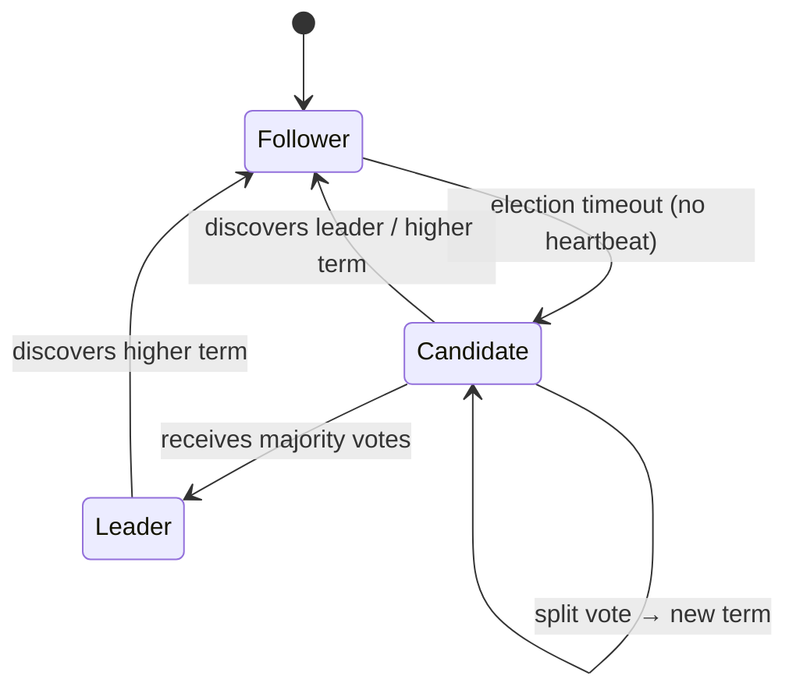
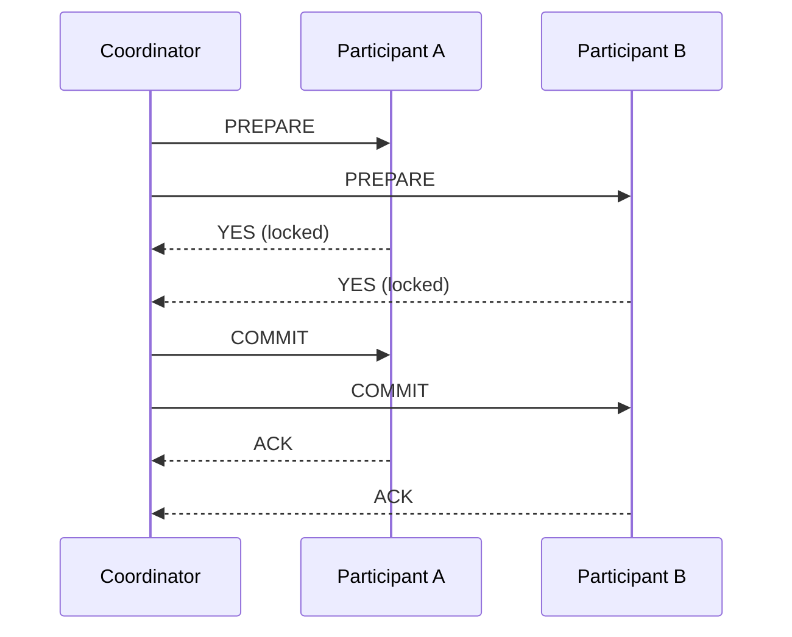
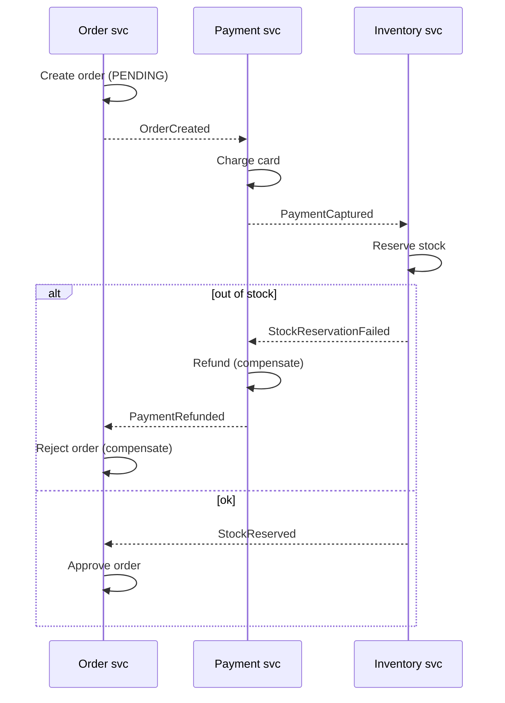
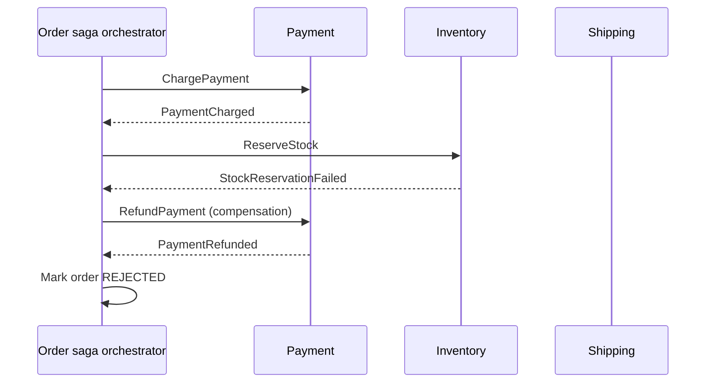
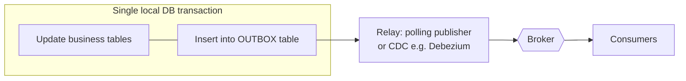
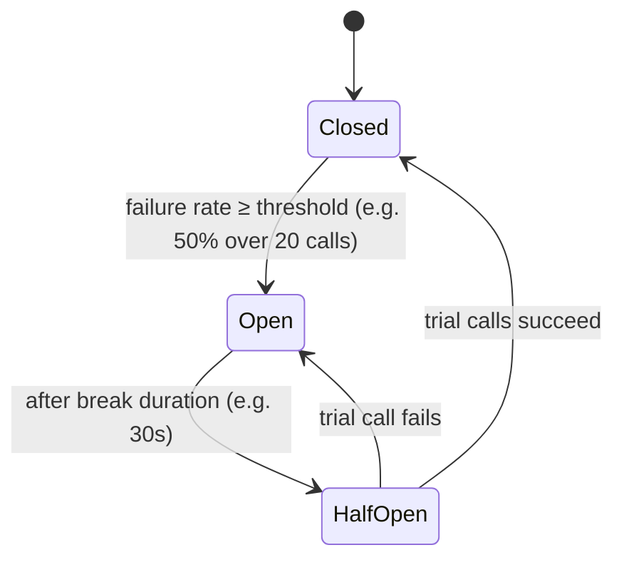

# Distributed Systems

> **TL;DR** — Once a system spans a network, partial failure, latency, and concurrency become the default. Know the **fallacies**, reason with **CAP/PACELC** and **consistency models**, design **idempotent** operations (exactly-once *delivery* is a myth; aim for exactly-once *effect*), replace distributed transactions with **sagas + transactional outbox/inbox**, and wrap every remote call with **timeouts, retries with exponential backoff + jitter, circuit breakers, and bulkheads**. Protect services with **rate limiting, backpressure, and load shedding**.

---

## 1. Fallacies of distributed computing

Peter Deutsch (1994, items 1–7) and James Gosling (item 8), Sun Microsystems.

| # | Fallacy | Reality / mitigation |
|---|---|---|
| 1 | The network is reliable | Packets drop, connections reset → retries, idempotency, queues |
| 2 | Latency is zero | Cross-region RTT ≈ 100+ ms → batch, cache, async, co-locate |
| 3 | Bandwidth is infinite | Payload sizes matter → pagination, compression, claim check |
| 4 | The network is secure | Zero trust, mTLS, encryption in transit |
| 5 | Topology doesn't change | IPs/pods move → service discovery, DNS, health checks |
| 6 | There is one administrator | Multiple orgs/teams/clouds → contracts, observability, runbooks |
| 7 | Transport cost is zero | Serialization CPU, egress fees → efficient formats, locality |
| 8 | The network is homogeneous | Mixed protocols/versions → standards, adapters |

Richards & Ford add: **versioning is easy**, **compensating updates always work**, **observability is optional** — all false.

---

## 2. CAP and PACELC

### CAP theorem (Brewer 2000; Gilbert & Lynch proof 2002)

In the presence of a **network Partition**, a distributed data store must choose between **Consistency** (linearizability: every read sees the latest write) and **Availability** (every request to a non-failing node gets a non-error response).

- P is not optional in real networks → the real choice during a partition is **CP** or **AP**.
- CAP's "C" ≠ ACID's "C".
- CAP is binary and only about partitions — too coarse for design decisions.

### PACELC (Daniel Abadi, 2010/2012)

> If **P**artition → choose **A** or **C**; **E**lse (normal operation) → choose **L**atency or **C**onsistency.

| System | P: A or C | E: L or C | Class |
|---|---|---|---|
| DynamoDB (default), Cassandra, Riak | A | L | PA/EL |
| MongoDB (default config) | A* | C | PA/EC (debated) |
| Cosmos DB | Tunable (5 consistency levels) | Tunable | — |
| Google Spanner, CockroachDB, etcd, ZooKeeper | C | C | PC/EC |
| PostgreSQL with sync replication | C | C | PC/EC |
| PostgreSQL with async replicas | (failover may lose writes) | L | — |

---

## 3. Consistency models

From strongest to weakest (simplified):

| Model | Guarantee | Example |
|---|---|---|
| **Strict serializability** | Serializable + real-time order | Spanner |
| **Linearizability** (atomic) | Single-object ops appear instantaneous at some point between invocation and response, respecting real time | etcd, ZooKeeper writes, single-leader sync reads |
| **Serializability** | Transactions appear to execute in *some* serial order (not necessarily real-time) | SERIALIZABLE isolation |
| **Sequential** | All see ops in the same order, consistent with each process's program order | — |
| **Causal** | Causally related ops seen in same order by all; concurrent ops may differ | COPS, MongoDB causal sessions |
| **PRAM / FIFO** | Writes from one process seen in order | — |
| **Read-your-writes** | A client sees its own writes | Session consistency (Cosmos DB default) |
| **Monotonic reads** | Never see older data after newer | Sticky sessions to a replica |
| **Monotonic writes** | A client's writes applied in order | — |
| **Bounded staleness** | Reads lag at most k versions or t time | Cosmos DB |
| **Eventual** | If writes stop, replicas converge | DNS, S3 (historically), Cassandra ONE |

**Session guarantees** (read-your-writes, monotonic reads/writes, writes-follow-reads) are usually what users actually need.

### Tunable quorum (Dynamo-style)

With `N` replicas, write quorum `W`, read quorum `R`:
- `R + W > N` → read and write sets overlap → read sees latest acknowledged write (with caveats: sloppy quorums, concurrent writes).
- `N=3, W=2, R=2` common. `W=1, R=1` → fast, eventual.

### Conflict resolution for multi-leader/leaderless

- **Last-writer-wins (LWW)** — simple, loses data, relies on clocks.
- **Version vectors / vector clocks** — detect concurrency; app merges.
- **CRDTs** (conflict-free replicated data types) — merge automatically: G-Counter, PN-Counter, OR-Set, LWW-Register, RGA/sequence CRDTs (Automerge, Yjs for collaborative editing).

---

## 4. Time and clocks

| Clock | Property | Use |
|---|---|---|
| **Wall clock** (time-of-day) | Can jump (NTP sync, leap seconds) | Display, logs — never ordering across nodes |
| **Monotonic clock** | Never goes backwards; per-process | Measuring durations, timeouts |
| **Lamport timestamp** | Logical counter; if a→b then L(a) < L(b) (not converse) | Total ordering with tie-break |
| **Vector clock** | One counter per node; detects concurrency | Conflict detection (Dynamo, Riak) |
| **Hybrid logical clock (HLC)** | Physical time + logical counter | CockroachDB, MongoDB |
| **TrueTime** | Bounded-uncertainty interval from GPS/atomic clocks | Spanner (commit-wait) |

Rules: don't use wall-clock timestamps to order events across machines; use **sequence numbers from a single authority**, logical clocks, or broker offsets. Clock skew of 10–100 ms is normal; worse during incidents.

---

## 5. Consensus

Agreement among nodes on a value/log despite failures. Needed for leader election, distributed locks, configuration, replicated state machines.

| Algorithm | Notes | Used in |
|---|---|---|
| **Paxos** (Lamport, 1989/1998) | Proposers, acceptors, learners; Multi-Paxos for logs; notoriously hard to understand/implement | Chubby, Spanner |
| **Raft** (Ongaro & Ousterhout, 2014) | Designed for understandability: leader election, log replication, safety; terms; majority quorum | etcd, Consul, CockroachDB, TiKV, Kafka KRaft, RabbitMQ quorum queues |
| **ZAB** | ZooKeeper Atomic Broadcast | ZooKeeper |
| **PBFT / Tendermint / HotStuff** | Byzantine fault tolerant (malicious nodes) | Blockchains |

### Raft essentials



- Cluster of `2f + 1` nodes tolerates `f` failures (3 → 1, 5 → 2).
- Leader appends entries; committed once replicated to majority.
- Randomised election timeouts avoid split votes.

**FLP impossibility** (Fischer, Lynch, Paterson 1985): no deterministic consensus algorithm can guarantee termination in an asynchronous system with even one crash failure — practical systems use timeouts (partial synchrony).

**Practical advice**: don't implement consensus yourself — use etcd, ZooKeeper, Consul, or a database's leader election. For distributed locks, prefer DB row locks/advisory locks or **fencing tokens** (Kleppmann's critique of Redlock).

---

## 6. Delivery semantics and idempotency

| Semantics | Meaning | How |
|---|---|---|
| **At-most-once** | 0 or 1 deliveries; may lose | Fire-and-forget, ack before processing |
| **At-least-once** | ≥ 1 deliveries; may duplicate | Ack after processing + retries (default for most brokers) |
| **Exactly-once** | Exactly 1 *effect* | At-least-once + **idempotent processing** / dedup; or transactional within a single system (Kafka EOS within Kafka) |

### The exactly-once myth

Over an unreliable network, a sender cannot distinguish "message lost" from "ack lost" (Two Generals problem), so **exactly-once delivery** across independent systems is impossible. What is achievable is **exactly-once processing / effectively-once**: at-least-once delivery + idempotent consumer. Kafka's "exactly-once semantics" covers read-process-write within Kafka (idempotent producer + transactions), not side effects in external systems.

### Idempotency techniques

| Technique | Example |
|---|---|
| Natural idempotency | `SET status = 'shipped'`, `PUT /resource`, upsert |
| Idempotency key | Client sends `Idempotency-Key` header; server stores key → response |
| Dedup table (inbox) | Store processed message IDs in same transaction as effect |
| Conditional update / optimistic concurrency | `UPDATE ... WHERE version = 7` |
| Unique constraints | `UNIQUE(order_id, payment_attempt)` |
| Event sequence numbers | Ignore events with seq ≤ last applied |

#### Idempotency key middleware (TypeScript, Express-style)

```ts
app.post("/payments", async (req, res) => {
  const key = req.header("Idempotency-Key");
  if (!key) return res.status(400).json({ error: "Idempotency-Key required" });

  const existing = await db.idempotency.find({ key, route: "POST /payments" });
  if (existing?.status === "completed") return res.status(existing.httpStatus).json(existing.body);
  if (existing?.status === "in_progress") return res.status(409).json({ error: "Request in progress" });

  // insert with unique constraint on (key, route) → concurrent duplicates fail fast
  await db.idempotency.insert({ key, route: "POST /payments", status: "in_progress", requestHash: hash(req.body) });
  const result = await payments.charge(req.body);
  await db.idempotency.update({ key }, { status: "completed", httpStatus: 201, body: result });
  res.status(201).json(result);
});
```

Store a hash of the request body and reject reuse of a key with a different payload (422). Expire keys after e.g. 24 h (Stripe's approach). IETF draft: `Idempotency-Key` HTTP header.

---

## 7. Distributed transactions

### Two-phase commit (2PC)



| Pros | Cons |
|---|---|
| Atomicity across resources | **Blocking**: if coordinator dies after prepare, participants hold locks indefinitely |
| Familiar (XA, MSDTC) | Latency, reduced availability (all must be up), poor scalability |
| | Not supported by most brokers/NoSQL/HTTP APIs |

3PC adds a pre-commit phase to reduce blocking but is rarely used. **Avoid 2PC across services**; use sagas.

### Sagas (Garcia-Molina & Salem, 1987)

A sequence of **local transactions**; each publishes an event/message triggering the next. On failure, execute **compensating transactions** for completed steps.

#### Choreography



#### Orchestration



| Aspect | Choreography | Orchestration |
|---|---|---|
| Coupling | Low; services know events | Orchestrator knows all participants |
| Visibility of process | Implicit, scattered | Explicit, in one place |
| Complexity growth | Hard beyond ~3–4 steps (cyclic dependencies) | Scales to complex flows |
| Single point of failure | None | Orchestrator (mitigate with durable state) |
| Testing | Harder (end-to-end) | Orchestrator testable in isolation |
| Tools | Broker only | Temporal, Camunda/Zeebe, Azure Durable Functions, AWS Step Functions, MassTransit/NServiceBus sagas |

#### Saga design rules

- Classify steps: **compensatable** (can be undone), **pivot** (point of no return — e.g., charge captured / goods shipped), **retriable** (after pivot; must eventually succeed).
- Compensation is *semantic* undo (issue refund, cancel reservation), not rollback; it may be visible to users.
- **Lack of isolation** → anomalies (lost updates, dirty reads). Countermeasures: *semantic lock* (status `PENDING`), commutative updates, pessimistic view (reorder steps), reread value, version file, by-value.
- All steps and compensations must be **idempotent**.

#### Orchestrated saga sketch (C#, Temporal-style pseudocode)

```csharp
public async Task<OrderResult> PlaceOrderWorkflow(PlaceOrder cmd)
{
    var compensations = new Stack<Func<Task>>();
    try
    {
        var payment = await Activities.ChargePayment(cmd.OrderId, cmd.Amount);
        compensations.Push(() => Activities.RefundPayment(payment.Id));

        var reservation = await Activities.ReserveStock(cmd.OrderId, cmd.Lines);
        compensations.Push(() => Activities.ReleaseStock(reservation.Id));

        await Activities.ScheduleShipment(cmd.OrderId);   // pivot
        return OrderResult.Approved;
    }
    catch (ActivityFailure)
    {
        while (compensations.TryPop(out var undo)) await undo();
        return OrderResult.Rejected;
    }
}
```

### Transactional outbox

Problem: **dual write** — updating a DB and publishing a message are two operations; either can fail, causing inconsistency.



```sql
CREATE TABLE outbox (
  id            UUID PRIMARY KEY,
  aggregate_id  TEXT NOT NULL,
  type          TEXT NOT NULL,
  payload       JSONB NOT NULL,
  occurred_at   TIMESTAMPTZ NOT NULL DEFAULT now(),
  published_at  TIMESTAMPTZ NULL
);
CREATE INDEX ix_outbox_unpublished ON outbox (occurred_at) WHERE published_at IS NULL;
```

```python
# Polling relay (simplified). FOR UPDATE SKIP LOCKED allows multiple relay instances.
def relay_batch(conn, producer, batch=100):
    with conn.transaction():
        rows = conn.execute("""
            SELECT id, type, aggregate_id, payload FROM outbox
            WHERE published_at IS NULL ORDER BY occurred_at
            LIMIT %s FOR UPDATE SKIP LOCKED""", (batch,)).fetchall()
        for r in rows:
            producer.publish(topic=r.type, key=r.aggregate_id, value=r.payload, message_id=str(r.id))
        conn.execute("UPDATE outbox SET published_at = now() WHERE id = ANY(%s)", ([r.id for r in rows],))
```

- Guarantees **at-least-once** publishing → consumers must be idempotent.
- Ordering: per aggregate via partition key = `aggregate_id`.
- Implementations: Debezium outbox event router, MassTransit/NServiceBus/Wolverine/Brighter outbox, Spring Modulith event publication registry.
- Clean up published rows periodically.

### Inbox (idempotent consumer)

```sql
CREATE TABLE inbox (message_id UUID PRIMARY KEY, handler TEXT NOT NULL, processed_at TIMESTAMPTZ NOT NULL DEFAULT now());
```

```csharp
await using var tx = await db.Database.BeginTransactionAsync(ct);
var inserted = await db.Database.ExecuteSqlInterpolatedAsync(
    $"INSERT INTO inbox(message_id, handler) VALUES ({msg.Id}, {nameof(ReserveStockHandler)}) ON CONFLICT DO NOTHING", ct);
if (inserted == 0) return;            // duplicate → already processed
await HandleBusinessLogic(msg, ct);   // same transaction
await db.SaveChangesAsync(ct);
await tx.CommitAsync(ct);
```

### Transactional messaging options summary

| Approach | Atomic DB+message? | Notes |
|---|---|---|
| Dual write (save then publish) | ❌ | Inconsistent on crash |
| Publish then save | ❌ | Phantom events |
| 2PC/XA with broker | ✅ | Rarely available, blocking |
| **Transactional outbox** | ✅ | Recommended default |
| **CDC / log tailing** | ✅ | Debezium on WAL/binlog; no polling |
| **Event sourcing** | ✅ | Events *are* the state; store = log |
| Listen-to-yourself | ✅ | Publish event first; own service consumes to update DB |

---

## 8. Resilience patterns

### Timeouts

- **Every** remote call needs a timeout (connect + read). Defaults are often infinite or very long.
- Set from downstream p99 latency + margin; propagate **deadlines** across hops (gRPC deadlines, `CancellationToken`, `AbortSignal`).
- Timeout budget: callers' timeouts must exceed callees' (or use remaining-deadline propagation) to avoid wasted work.

### Retries with exponential backoff and jitter

Retry only **transient** failures (timeouts, 429, 502/503/504, connection reset) and only **idempotent** operations (or with idempotency keys).

```
delay(n) = min(cap, base * 2^n)
full jitter:         sleep = random(0, delay(n))
equal jitter:        sleep = delay(n)/2 + random(0, delay(n)/2)
decorrelated jitter: sleep = min(cap, random(base, prev_sleep * 3))
```

Full jitter (AWS Architecture Blog, Marc Brooker) spreads retries to avoid synchronized **retry storms / thundering herds**.

```ts
async function retry<T>(fn: () => Promise<T>, { retries = 5, base = 100, cap = 5_000 } = {}): Promise<T> {
  for (let attempt = 0; ; attempt++) {
    try {
      return await fn();
    } catch (err) {
      if (attempt >= retries || !isTransient(err)) throw err;
      const delay = Math.random() * Math.min(cap, base * 2 ** attempt); // full jitter
      await new Promise((r) => setTimeout(r, delay));
    }
  }
}
```

**Retry rules**
- Retry at **one layer** only (retries at every layer multiply: 3 layers × 3 retries = 27× load).
- Use **retry budgets** (e.g., retries ≤ 10% of requests) — gRPC, Envoy, Finagle support this.
- Honour `Retry-After` headers.
- Don't retry on 4xx (except 408, 429).

### Circuit breaker (Michael Nygard, *Release It!*)



- **Closed**: calls pass; failures counted.
- **Open**: calls fail fast (or use fallback) without hitting the dependency.
- **Half-open**: allow limited trial calls.

```csharp
// .NET 8+ with Microsoft.Extensions.Http.Resilience (Polly v8)
builder.Services.AddHttpClient<IErpClient, ErpClient>()
    .AddResilienceHandler("erp", pipeline =>
    {
        pipeline.AddTimeout(TimeSpan.FromSeconds(10));                 // total
        pipeline.AddRetry(new HttpRetryStrategyOptions
        {
            MaxRetryAttempts = 3,
            BackoffType = DelayBackoffType.Exponential,
            UseJitter = true,
            Delay = TimeSpan.FromMilliseconds(200),
        });
        pipeline.AddCircuitBreaker(new HttpCircuitBreakerStrategyOptions
        {
            FailureRatio = 0.5,
            MinimumThroughput = 20,
            SamplingDuration = TimeSpan.FromSeconds(30),
            BreakDuration = TimeSpan.FromSeconds(30),
        });
        pipeline.AddTimeout(TimeSpan.FromSeconds(3));                  // per attempt
    });
// Or simply: .AddStandardResilienceHandler();
```

Libraries: Polly (.NET), resilience4j (Java), `cockatiel` / `opossum` (Node), `tenacity` / `pybreaker` (Python), service mesh (Istio/Linkerd/Envoy outlier detection).

### Bulkhead

Isolate resources so one failing dependency or tenant can't exhaust everything (ship compartments).

- Separate **thread/connection pools** per dependency.
- **Concurrency limits** per downstream (semaphores).
- Separate **queues/consumers** per priority or tenant.
- Separate **deployments/cells** (cell-based architecture) for blast-radius reduction.

```ts
import pLimit from "p-limit";
const erpLimit = pLimit(10);            // at most 10 concurrent ERP calls
const result = await erpLimit(() => erp.getStock(sku));
```

### Other resilience patterns

| Pattern | Description |
|---|---|
| **Fallback / graceful degradation** | Cached/default response, reduced functionality |
| **Fail fast** | Validate preconditions; reject when overloaded |
| **Health endpoint monitoring** | Liveness vs readiness vs startup probes |
| **Queue-based load leveling** | Buffer bursts in a queue; consumers process at steady rate |
| **Compensating transaction** | Undo via business action |
| **Leader election** | One active instance for singleton jobs |
| **Hedged requests** | Send duplicate request after p95 delay to another replica; take first (tail latency) |
| **Steady state** | Automatically purge logs/data/caches to avoid slow resource exhaustion |
| **Cell-based architecture** | Independent full-stack cells; route tenants to cells |
| **Chaos engineering** | Deliberately inject failures (Chaos Monkey, Azure Chaos Studio, AWS FIS) |

---

## 9. Rate limiting, backpressure, load shedding

### Rate limiting algorithms

| Algorithm | How it works | Pros | Cons |
|---|---|---|---|
| **Token bucket** | Bucket of capacity `b` refilled at rate `r`; request consumes a token | Allows bursts up to `b`, smooth average | Needs per-key state |
| **Leaky bucket** (as queue) | Requests enter queue, processed at constant rate; overflow dropped | Smooth output rate | Bursts delayed/dropped; queue latency |
| **Fixed window counter** | Count per fixed window (e.g., per minute) | Simple, cheap | Boundary burst: 2× limit across window edge |
| **Sliding window log** | Store timestamps of requests; count within last window | Accurate | Memory heavy |
| **Sliding window counter** | Weighted combination of current and previous window counts | Good accuracy, cheap | Approximation |
| **GCRA** (generic cell rate algorithm) | Theoretical arrival time; equivalent to leaky bucket as meter | Single timestamp per key | Less intuitive |

#### Token bucket (TypeScript, in-memory)

```ts
class TokenBucket {
  private tokens: number;
  private last = performance.now();
  constructor(private capacity: number, private refillPerSec: number) { this.tokens = capacity; }

  tryTake(n = 1): boolean {
    const now = performance.now();
    this.tokens = Math.min(this.capacity, this.tokens + ((now - this.last) / 1000) * this.refillPerSec);
    this.last = now;
    if (this.tokens < n) return false;
    this.tokens -= n;
    return true;
  }
}
```

#### Sliding window counter estimate

```
estimated = count(current window) + count(previous window) × (overlap fraction of previous window)
e.g. limit 100/min, 15s into current minute: prev=80, curr=30 → 30 + 80 × 0.75 = 90 → allow
```

**Distributed rate limiting**: Redis (`INCR` + `EXPIRE`, Lua scripts for token bucket), API gateways (Azure API Management, Kong, Envoy), ASP.NET Core `RateLimiter` middleware (fixed window, sliding window, token bucket, concurrency limiters).

Return **429 Too Many Requests** with `Retry-After`; optionally `RateLimit-*` headers (IETF draft).

### Backpressure

Signal upstream to slow down when downstream can't keep up, instead of buffering unboundedly.

- Bounded queues/channels (`System.Threading.Channels` with `BoundedChannelFullMode.Wait`).
- Reactive Streams `request(n)` demand signalling (RxJava, Project Reactor, Akka Streams).
- TCP flow control; HTTP/2 flow control windows; gRPC streaming.
- Kafka consumers naturally pull (consumer lag is the signal).
- Node.js streams: `write()` returns `false` → wait for `'drain'`.

```csharp
var channel = Channel.CreateBounded<Order>(new BoundedChannelOptions(1_000)
{
    FullMode = BoundedChannelFullMode.Wait   // producer awaits → backpressure
});
```

### Load shedding

Deliberately reject some work when overloaded to keep serving the rest within SLO.

- Reject early (at the edge) with 503/429 — cheaper than timing out later.
- **Prioritise**: shed low-priority traffic (batch, prefetch, analytics) first.
- Use **concurrency limits** (adaptive: Netflix `concurrency-limits`, TCP-Vegas-like) rather than static RPS.
- Drop requests whose deadline has already passed (queue timeout).
- **LIFO** under overload can improve fresh-request latency (Facebook's adaptive LIFO).

| Technique | Protects | Signal |
|---|---|---|
| Rate limiting | Fairness / quotas per client | 429 |
| Backpressure | Downstream from overload | Blocked producer / demand |
| Load shedding | Service itself under overload | 503 |
| Circuit breaker | Caller from failing callee | Fast failure |
| Bulkhead | Rest of system from one failure | Isolated pools |

---

## 10. Observability in distributed systems

- **Three pillars + more**: logs, metrics, traces (+ profiles, events).
- **OpenTelemetry** as vendor-neutral standard; **W3C Trace Context** (`traceparent`) propagated across HTTP and messages.
- **Correlation ID** in every log line and message header.
- **RED** (Rate, Errors, Duration) for services; **USE** (Utilisation, Saturation, Errors) for resources; **Four Golden Signals** (latency, traffic, errors, saturation — Google SRE).
- SLIs/SLOs/error budgets. See [../08-engineering/README.md](../08-engineering/README.md) and [../06-cloud-architecture/README.md](../06-cloud-architecture/README.md).

---

## When to distribute / when not

| Distribute when | Keep it in-process when |
|---|---|
| Independent scaling, fault isolation, team autonomy are top characteristics | One team, modest load, strong consistency needs |
| Geographic distribution / data residency | Latency-sensitive chatty interactions |
| Integrating independently owned systems (ERP, SaaS) | You lack observability and automation |

## Common mistakes / anti-patterns

- No timeouts; default `HttpClient` 100 s timeout blocking threads.
- Retrying non-idempotent operations (duplicate payments/orders).
- Retries at every layer → retry storms.
- Dual writes without outbox.
- Using wall-clock timestamps for ordering or LWW without understanding loss.
- Distributed locks without fencing tokens.
- Synchronous request chains across 5+ services (availability multiplies down).
- Assuming exactly-once delivery from a broker.
- Unbounded in-memory queues → OOM instead of backpressure.
- Circuit breaker without fallback/alerting; breaker per instance with too-low throughput threshold.
- Ignoring poison messages → consumer stuck forever (use DLQ + max delivery count).

## Checklist for every remote call

- [ ] Timeout set (connect + overall), deadline propagated
- [ ] Retries only for transient errors, with exponential backoff + jitter, bounded
- [ ] Operation idempotent or has idempotency key
- [ ] Circuit breaker + fallback defined
- [ ] Bulkhead / concurrency limit
- [ ] Trace context propagated; metrics (RED) emitted
- [ ] Failure mode documented (what does the user see?)

## Related

- [integration-and-messaging.md](integration-and-messaging.md), [performance-and-scalability.md](performance-and-scalability.md), [data-architecture-for-applications.md](data-architecture-for-applications.md)
- Cloud resilience & multi-region: [../06-cloud-architecture/README.md](../06-cloud-architecture/README.md)

## References

- Fallacies of distributed computing: https://en.wikipedia.org/wiki/Fallacies_of_distributed_computing
- CAP theorem: https://en.wikipedia.org/wiki/CAP_theorem
- PACELC theorem: https://en.wikipedia.org/wiki/PACELC_theorem
- Consistency model: https://en.wikipedia.org/wiki/Consistency_model
- Jepsen — Consistency models map: https://jepsen.io/consistency
- Raft: https://raft.github.io/
- Paxos: https://en.wikipedia.org/wiki/Paxos_(computer_science)
- Lamport timestamp: https://en.wikipedia.org/wiki/Lamport_timestamp · Vector clock: https://en.wikipedia.org/wiki/Vector_clock
- CRDT: https://en.wikipedia.org/wiki/Conflict-free_replicated_data_type · https://crdt.tech/
- Two-phase commit: https://en.wikipedia.org/wiki/Two-phase_commit_protocol
- Two Generals' Problem: https://en.wikipedia.org/wiki/Two_Generals%27_Problem
- Martin Kleppmann — How to do distributed locking: https://martin.kleppmann.com/2016/02/08/how-to-do-distributed-locking.html
- microservices.io — Saga: https://microservices.io/patterns/data/saga.html
- microservices.io — Transactional outbox: https://microservices.io/patterns/data/transactional-outbox.html
- microservices.io — Idempotent consumer: https://microservices.io/patterns/communication-style/idempotent-consumer.html
- Microsoft — Saga pattern: https://learn.microsoft.com/azure/architecture/reference-architectures/saga/saga
- Microsoft — Retry: https://learn.microsoft.com/azure/architecture/patterns/retry
- Microsoft — Circuit Breaker: https://learn.microsoft.com/azure/architecture/patterns/circuit-breaker
- Microsoft — Bulkhead: https://learn.microsoft.com/azure/architecture/patterns/bulkhead
- Microsoft — Rate Limiting pattern: https://learn.microsoft.com/azure/architecture/patterns/rate-limiting-pattern
- Microsoft — Queue-Based Load Leveling: https://learn.microsoft.com/azure/architecture/patterns/queue-based-load-leveling
- Microsoft — Compensating Transaction: https://learn.microsoft.com/azure/architecture/patterns/compensating-transaction
- Fowler — CircuitBreaker: https://martinfowler.com/bliki/CircuitBreaker.html
- AWS Architecture Blog — Exponential Backoff and Jitter: https://aws.amazon.com/blogs/architecture/exponential-backoff-and-jitter/
- AWS Builders' Library — Timeouts, retries and backoff with jitter: https://aws.amazon.com/builders-library/timeouts-retries-and-backoff-with-jitter/
- AWS Builders' Library — Using load shedding to avoid overload: https://aws.amazon.com/builders-library/using-load-shedding-to-avoid-overload/
- Token bucket: https://en.wikipedia.org/wiki/Token_bucket · Leaky bucket: https://en.wikipedia.org/wiki/Leaky_bucket
- Stripe — Idempotent requests: https://docs.stripe.com/api/idempotent_requests
- Polly: https://www.pollydocs.org/
- Debezium outbox event router: https://debezium.io/documentation/reference/stable/transformations/outbox-event-router.html
- Temporal: https://temporal.io/
- OpenTelemetry: https://opentelemetry.io/
- Martin Kleppmann — *Designing Data-Intensive Applications* (2017; 2nd ed. 2025/26)
- Michael Nygard — *Release It!* (2nd ed., 2018)
- Mikito Takada — *Distributed Systems for Fun and Profit*: http://book.mixu.net/distsys/
