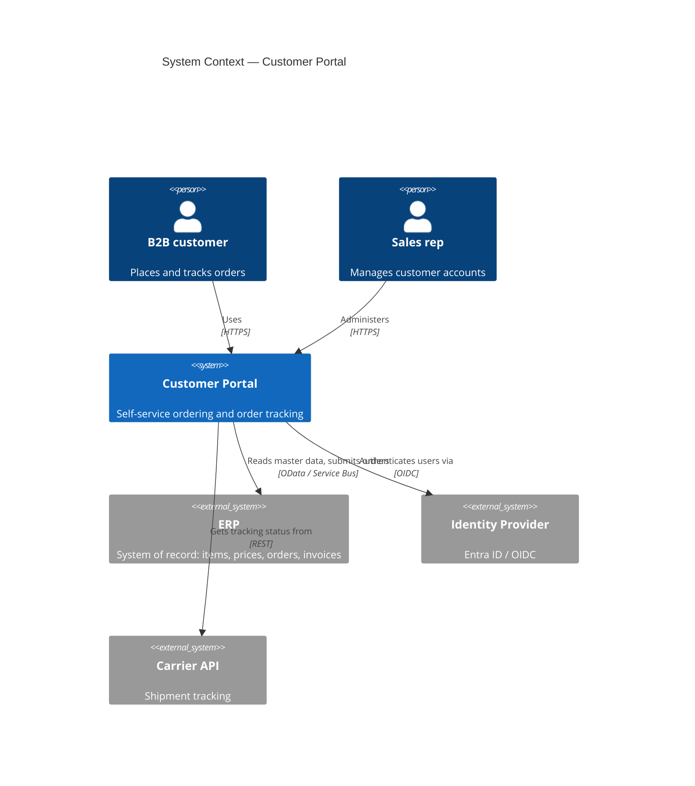
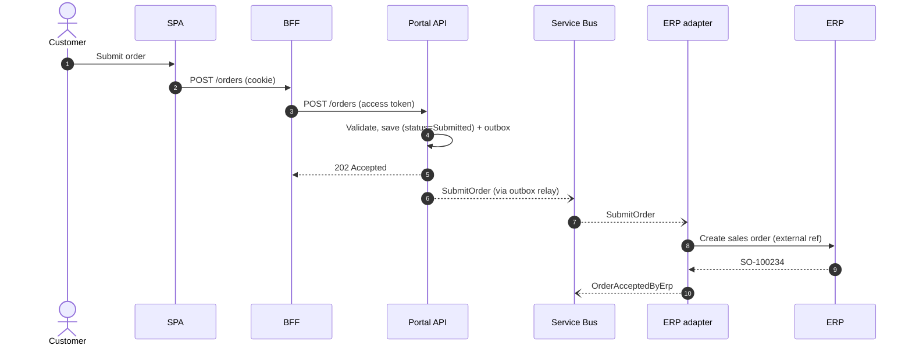
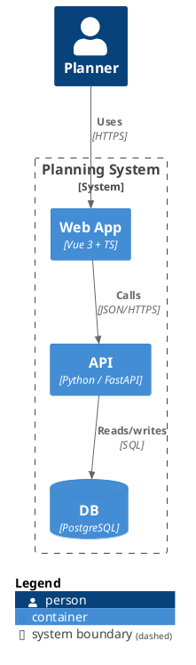

# Architecture Documentation and Decision Making

> **TL;DR** — Document *decisions and their rationale* more than structures. Use the **C4 model** (Context → Containers → Components → Code) for diagrams, **arc42** as a 12-section template for the architecture description, **ADRs** (Nygard or MADR format) for individual decisions, and **RFCs/design docs** for proposals that need review. Keep documentation as code (Markdown + Structurizr/Mermaid/PlantUML in the repo), small, and current. Practice with **architecture katas**.

---

## 1. Why document

- Shared understanding across teams and time ("why is it like this?").
- Onboarding; audits and compliance; stakeholder communication.
- Avoid *Groundhog Day* decisions.
- **Just enough**: documentation that nobody reads or updates is waste. Prefer living documentation generated or validated from code.

### Audience → artefact

| Audience | Need | Artefact |
|---|---|---|
| Executives / business | Scope, value, risks, cost | C4 context diagram, one-page summary, risk register |
| Product / PM | Capabilities, constraints, roadmap impact | Context + container diagrams, ADR summaries |
| Developers | Structure, conventions, decisions | Container/component diagrams, ADRs, code conventions, README |
| Ops / SRE | Deployment, runbooks, SLOs | Deployment diagram, runbooks, dashboards |
| Security / audit | Data flows, trust boundaries, controls | Data flow diagram + threat model, ASVS mapping |
| Integrators / partners | Contracts | OpenAPI/AsyncAPI, sequence diagrams |

---

## 2. C4 model (Simon Brown)

Hierarchical set of diagrams, "maps of your code" at different zoom levels. Notation-independent; requires titles, legends, and labelled relationships.

| Level | Diagram | Shows | Audience |
|---|---|---|---|
| 1 | **System Context** | The software system, its users (people), and external systems | Everyone, incl. non-technical |
| 2 | **Container** | Applications and data stores (separately deployable/runnable units: SPA, API, DB, queue, function) and their interactions + tech choices | Technical people inside and outside the team |
| 3 | **Component** | Components inside one container (grouping of related functionality behind an interface) | Developers, architects |
| 4 | **Code** | Classes/tables (UML class, ERD) — usually generated or omitted | Developers (on demand) |

> "Container" in C4 ≠ Docker container. It means a runtime boundary (web app, database schema, mobile app, serverless function, file system).

### Supplementary diagrams

| Diagram | Purpose |
|---|---|
| **System Landscape** | All systems in an enterprise/scope (context of contexts) |
| **Dynamic** | Runtime collaboration for a use case (numbered interactions; like a collaboration/sequence diagram) |
| **Deployment** | Mapping of containers to infrastructure (deployment nodes: cloud regions, k8s clusters, VMs) per environment |

### Notation guidance

- Every element: **name, type, technology (where relevant), short description**.
- Every relationship: **unidirectional label** describing intent ("Reads orders from", "Publishes OrderPlaced to [Service Bus]") + technology/protocol.
- Key/legend on every diagram; title with type and scope ("Container diagram for Customer Portal").
- Prefer fewer boxes per diagram (< ~20).

### Example (Mermaid C4 syntax — experimental in Mermaid)



### Structurizr DSL (model once, render many views)

```text
workspace "Customer Portal" {
  model {
    customer = person "B2B customer"
    erp = softwareSystem "ERP" "System of record" "External"
    portal = softwareSystem "Customer Portal" {
      spa = container "Web SPA" "Ordering UI" "React + TypeScript"
      bff = container "BFF" "Session, token handling, aggregation" "ASP.NET Core"
      api = container "Portal API" "Ordering use cases" "ASP.NET Core"
      db  = container "Portal DB" "Read models, carts, audit" "PostgreSQL" "Database"
      bus = container "Message broker" "Commands & events" "Azure Service Bus" "Queue"
    }
    customer -> spa "Uses" "HTTPS"
    spa -> bff "Calls" "JSON/HTTPS, cookie session"
    bff -> api "Calls" "JSON/HTTPS, OAuth2"
    api -> db "Reads/writes" "SQL"
    api -> bus "Sends SubmitOrder" "AMQP"
    bus -> erp "Delivers to ERP adapter" "AMQP"
  }
  views {
    systemContext portal { include * autolayout lr }
    container portal { include * autolayout lr }
    theme default
  }
}
```

### C4 anti-patterns

- Mixing abstraction levels on one diagram.
- Unlabelled arrows / bidirectional arrows.
- Missing technology on containers.
- Component diagrams for every container (only where valuable).
- Treating C4 as a *process* — it's a notation/abstraction set.

---

## 3. arc42 (Gernot Starke & Peter Hruschka)

Pragmatic template for architecture communication and documentation; 12 sections; use only what you need.

| # | Section | Content |
|---|---|---|
| 1 | **Introduction and Goals** | Requirements overview, top 3–5 **quality goals**, stakeholders and expectations |
| 2 | **Architecture Constraints** | Technical, organisational, political, legal constraints and conventions |
| 3 | **Context and Scope** | Business context (communication partners, domain interfaces) and technical context (channels, protocols) — ≈ C4 level 1 |
| 4 | **Solution Strategy** | Fundamental decisions and approaches: technology, top-level decomposition, how quality goals are achieved, organisational decisions |
| 5 | **Building Block View** | Static decomposition: level 1 (white box of system) → level 2 … — ≈ C4 levels 2–3 |
| 6 | **Runtime View** | Behaviour of building blocks in important scenarios (sequence/activity diagrams) — ≈ C4 dynamic |
| 7 | **Deployment View** | Infrastructure, environments, mapping of building blocks to nodes — ≈ C4 deployment |
| 8 | **Cross-cutting Concepts** | Domain model, persistence, UI, security, error handling, logging, i18n, testability, etc. |
| 9 | **Architecture Decisions** | Important decisions with rationale — ADRs (or links to them) |
| 10 | **Quality Requirements** | Quality tree (utility tree) + quality scenarios |
| 11 | **Risks and Technical Debts** | Known risks and debts, prioritised, with mitigation |
| 12 | **Glossary** | Domain and technical terms (ubiquitous language) |

### Lean usage ("arc42 essential")

For a small system: sections 1 (goals), 3 (context), 4 (strategy), 5 (level 1 building blocks), 9 (ADRs), 11 (risks), 12 (glossary). Combine with C4 diagrams in 3/5/6/7.

### Docs-as-code layout

```text
docs/
  architecture/
    01-introduction-and-goals.md
    03-context-and-scope.md
    04-solution-strategy.md
    05-building-blocks.md
    08-concepts/
      security.md
      error-handling.md
    09-decisions/            ← ADRs
      0001-record-architecture-decisions.md
      0002-use-modular-monolith.md
      0003-use-azure-service-bus-for-erp-integration.md
    10-quality-requirements.md
    11-risks-and-technical-debt.md
    12-glossary.md
  diagrams/
    workspace.dsl            ← Structurizr
```

Render with MkDocs (Material), Docusaurus, Antora, or Backstage TechDocs; lint with markdownlint/Vale; review in PRs.

---

## 4. Architecture Decision Records (ADRs)

> An ADR captures a single architecturally significant decision, its context, and its consequences. A collection of ADRs is the *decision log*.

### What qualifies as "architecturally significant"

Affects structure, characteristics, dependencies, interfaces, or construction techniques (Michael Nygard); or is expensive to reverse; or affects multiple teams.

### Nygard template (2011)

```markdown
# ADR 0007: Use Azure Service Bus for ERP order submission

## Status
Accepted (2026-09-12). Supersedes ADR 0003.

## Context
Orders from the portal must reach the ERP even when the ERP is under maintenance (weekly windows,
~2 h). Direct OData calls from the API fail during these windows and peak loads (Monday 08:00–10:00)
exceed the ERP's service protection limits. We are on Azure; the team knows .NET and MassTransit.

## Decision
The portal API sends a `SubmitOrder` command to an Azure Service Bus queue (sessions keyed by customer ID).
An ERP adapter consumes, calls the ERP API with the portal order ID as external reference, and publishes
`OrderAcceptedByErp` / `OrderRejectedByErp` events.

## Consequences
+ Orders are accepted during ERP downtime; load is leveled.
+ Duplicate detection via external reference makes retries safe.
- Order confirmation becomes asynchronous; UI shows "Submitted, awaiting confirmation".
- New operational component: DLQ monitoring and replay tooling required.
- Cost: Service Bus Standard tier.
```

### MADR (Markdown Architectural Decision Records) — v4 structure

```markdown
---
status: accepted          # proposed | rejected | accepted | deprecated | superseded by ADR-0012
date: 2026-09-12
decision-makers: [architecture guild, team portal]
consulted: [ERP team, security]
informed: [all dev teams]
---
# Use Azure Service Bus for ERP order submission

## Context and Problem Statement
How do we reliably submit portal orders to the ERP given maintenance windows and API limits?

## Decision Drivers
* Reliability during ERP downtime
* Respect ERP API limits
* Team skills and Azure footprint

## Considered Options
* Direct synchronous OData calls with retries
* Azure Service Bus queue + ERP adapter
* Kafka (Event Hubs) topic
* iPaaS (Logic Apps)

## Decision Outcome
Chosen option: "Azure Service Bus queue + ERP adapter", because it is the only option satisfying
reliability and load leveling with low ops effort and existing skills.

### Consequences
* Good, because ...
* Bad, because ...

### Confirmation
Contract tests for the adapter; alert on DLQ depth > 0; chaos test: stop ERP sandbox for 1 h.

## Pros and Cons of the Options
### Direct synchronous OData calls
* Good, because simple
* Bad, because orders fail during maintenance
...

## More Information
Links to spike results, pricing calc, related ADRs.
```

### Other formats

| Template | Notes |
|---|---|
| Nygard | Minimal: Title, Status, Context, Decision, Consequences |
| MADR | Options with pros/cons, drivers, confirmation; widely used |
| Y-Statements (Olaf Zimmermann) | One sentence: "In the context of <use case>, facing <concern>, we decided for <option> and neglected <other options>, to achieve <quality>, accepting <downside>." |
| Tyree & Akerman | Extensive (issue, assumptions, constraints, positions, argument, implications, related) |
| Business case / Planguage | For cost-heavy decisions |

### ADR practices

- Store in the repo (`docs/adr/` or `docs/architecture/decisions/`), numbered, **immutable once accepted** — supersede rather than edit (except typos/status).
- Statuses: proposed → accepted → (deprecated | superseded).
- Write in the PR that implements or prepares the decision; review like code.
- Keep them short (1–2 pages). Link related ADRs.
- Tools: `adr-tools` (CLI), `log4brains` (static site), `dotnet-adr`, Backstage ADR plugin, Structurizr (embeds ADRs).
- **Architecture Advice Process** (Andrew Harmel-Law, on martinfowler.com): anyone can make a decision after seeking advice from affected people and experts; ADRs capture it; an architecture advisory forum provides visibility — decentralises decisions without an architecture board bottleneck.

---

## 5. RFCs and design documents

| Artefact | Purpose | Lifecycle |
|---|---|---|
| **RFC / design doc** | Propose and discuss a change *before* deciding; explore options | Draft → review → approved/rejected → (implemented) |
| **ADR** | Record the decision taken and why | Accepted → superseded |
| **Tech spec** | Detailed implementation plan | During build |

### Design doc template (Google-style, condensed)

```markdown
# <Title>
Author(s) · Reviewers · Status · Last updated

## Context and scope        — background, what's in/out
## Goals and non-goals      — measurable goals; explicit non-goals
## Proposal / design        — overview diagram (C4), APIs, data model, key flows
## Alternatives considered  — with trade-offs and why rejected
## Cross-cutting concerns   — security, privacy, observability, performance, cost, accessibility, migration/rollout
## Risks and open questions
## Rollout and rollback plan
## Milestones
```

### Review process tips

- Time-box comment periods (e.g., 1 week); name required reviewers (security, ops, data).
- Use a "decision owner"; consensus is not required, informed consent is.
- Async-first; meeting only for contentious points.
- Archive approved RFCs; link to resulting ADRs.

---

## 6. Architecture katas (Ted Neward)

Practice exercises: small teams design an architecture for a fictional business problem in a time-box, then present and get critiqued.

**Format**
1. Get a kata (requirements, users, constraints) — e.g., from Neward's list or the O'Reilly Architectural Katas competition.
2. 45–90 min: identify **architecture characteristics** (choose top 3), components, style, key decisions.
3. Present (5–10 min): context diagram, container diagram, ADRs.
4. Peer critique: questions, risks, alternative trade-offs.

**Value**: builds trade-off muscle, vocabulary, and presentation skills; good for architecture guilds and interview practice.

---

## 7. Diagrams as code

| Tool | Strengths | Weaknesses |
|---|---|---|
| **Structurizr DSL** | Model-based (one model, many C4 views); ADR embedding; Structurizr Lite/on-prem | C4-specific; layout control limited |
| **Mermaid** | Renders natively in GitHub/GitLab/Azure DevOps/Obsidian/Docusaurus; flowcharts, sequence, class, state, ER, C4 (experimental), gantt, mindmap, architecture | Layout control limited; large diagrams messy |
| **PlantUML** | Mature, full UML, C4-PlantUML library | Java/Graphviz dependency, dated look |
| **D2** | Modern syntax, good layouts (ELK/TALA) | Fewer integrations |
| **Graphviz (DOT)** | Graph layout engine | Low-level |
| **Diagrams (Python, mingrammer)** | Cloud architecture diagrams with provider icons | Static images |
| **draw.io / diagrams.net** | WYSIWYG, can store `.drawio.svg` in repo | Not text-diffable in a meaningful way |
| **IcePanel / Ilograph / LikeC4** | Interactive, model-based | Commercial (some) |

### Mermaid examples



```mermaid
erDiagram
  CUSTOMER ||--o{ ORDER : places
  ORDER ||--|{ ORDER_LINE : contains
  PRODUCT ||--o{ ORDER_LINE : "ordered in"
  CUSTOMER { string id PK; string name; decimal credit_limit }
  ORDER { string id PK; string customer_id FK; date order_date; string status }
  ORDER_LINE { string order_id FK; int line_no; string sku FK; int qty; decimal unit_price }
```

### PlantUML C4 example



---

## 8. UML essentials

UML 2.5 has 14 diagram types; in practice a handful matter.

| Diagram | Type | Use it for |
|---|---|---|
| **Class** | Structure | Domain models, key abstractions |
| **Component** | Structure | Logical components & interfaces (C4 L3 alternative) |
| **Deployment** | Structure | Nodes, artefacts, environments |
| **Package** | Structure | Module dependencies |
| Object, Composite structure, Profile | Structure | Rare |
| **Sequence** | Behaviour (interaction) | Runtime flows, integrations, auth flows — *most useful* |
| **Activity** | Behaviour | Business processes, algorithms, swimlanes (BPMN is often better for business processes) |
| **State machine** | Behaviour | Lifecycles (order, invoice, approval) |
| **Use case** | Behaviour | Scope overview (often replaced by story maps) |
| Communication, Timing, Interaction overview | Behaviour | Rare |

### Class diagram relationships

| Notation | Meaning |
|---|---|
| `A --> B` | Association (A knows B) |
| `A ..> B` | Dependency (A uses B transiently) |
| `A --|> B` | Generalisation (inheritance) |
| `A ..|> B` | Realisation (implements interface) |
| `A o-- B` | Aggregation (shared, weak whole-part) |
| `A *-- B` | Composition (owned; lifecycle bound) |
| Multiplicities | `1`, `0..1`, `*`, `1..*` |
| Visibility | `+` public, `-` private, `#` protected, `~` package |

**Sketch, don't over-model** ("UML as sketch" — Fowler, *UML Distilled*).

---

## 9. 4+1 view model (Philippe Kruchten, 1995)

| View | Concern | Stakeholders | Typical diagrams |
|---|---|---|---|
| **Logical** | Functionality: key abstractions | End users, analysts | Class, state, (C4 component) |
| **Development** (implementation) | Software organisation in dev environment: modules, layers, packages | Developers, managers | Package, component |
| **Process** | Runtime: concurrency, distribution, performance, scalability | Integrators, performance engineers | Sequence, activity, (C4 dynamic) |
| **Physical** (deployment) | Mapping software to hardware/infra | System engineers, ops | Deployment |
| **+1 Scenarios** (use cases) | Tie views together, validate the architecture | All | Use case, sequence |

Related view frameworks: **Views and Beyond** (SEI — module, component-and-connector, allocation styles), **Rozanski & Woods viewpoints and perspectives** (context, functional, information, concurrency, development, deployment, operational viewpoints; security/performance/availability perspectives), **ISO/IEC/IEEE 42010** as the meta-standard.

### Mapping between frameworks

| C4 | arc42 | 4+1 |
|---|---|---|
| System context | §3 Context and scope | (Scenarios) |
| Container | §5 Building block L1, §7 Deployment | Development / Physical |
| Component | §5 Building block L2 | Logical / Development |
| Dynamic | §6 Runtime view | Process |
| Deployment | §7 Deployment view | Physical |
| — | §9 Decisions (ADRs) | — |

---

## When to document what

| Situation | Minimum |
|---|---|
| New system | Context + container diagram, quality goals, first ADRs, glossary |
| New significant decision | ADR (or RFC first if contentious) |
| New integration | Sequence diagram + contract (OpenAPI/AsyncAPI) |
| Security review | DFD with trust boundaries + threat model |
| Handover/onboarding | arc42-lite + runbooks |

## Common mistakes / anti-patterns

- Big up-front documents that rot immediately.
- Diagrams without legends; boxes-and-lines with ambiguous meaning.
- Documentation in a wiki disconnected from code → drift.
- ADRs written after the fact without real alternatives ("decision theatre").
- Editing accepted ADRs instead of superseding.
- Too many diagrams; nobody can tell which is current.
- Recording *what* without *why*.
- Architecture review board as a gate that slows delivery instead of advice process.

## Related

- [architecture-fundamentals.md](architecture-fundamentals.md) (quality scenarios, ATAM), [security-architecture.md](security-architecture.md) (threat modelling DFDs)
- Facilitation of decision workshops: [../09-leadership-teams-facilitation/README.md](../09-leadership-teams-facilitation/README.md)
- Enterprise architecture frameworks (TOGAF, ArchiMate): [../11-enterprise-architecture-business/README.md](../11-enterprise-architecture-business/README.md)

## References

- C4 model: https://c4model.com/
- Structurizr: https://structurizr.com/ · DSL docs: https://docs.structurizr.com/dsl
- arc42: https://arc42.org/ · arc42 docs: https://docs.arc42.org/ · arc42 FAQ: https://faq.arc42.org/
- ADR GitHub organisation: https://adr.github.io/
- MADR: https://adr.github.io/madr/
- Michael Nygard — Documenting Architecture Decisions (2011): https://www.cognitect.com/blog/2011/11/15/documenting-architecture-decisions
- adr-tools: https://github.com/npryce/adr-tools
- Joel Parker Henderson — ADR examples: https://github.com/joelparkerhenderson/architecture-decision-record
- Andrew Harmel-Law — Scaling the Practice of Architecture, Conversationally: https://martinfowler.com/articles/scaling-architecture-conversationally.html
- Architectural katas (Neal Ford's kata list): https://nealford.com/katas/
- Mermaid: https://mermaid.js.org/
- PlantUML: https://plantuml.com/ · C4-PlantUML: https://github.com/plantuml-stdlib/C4-PlantUML
- D2: https://d2lang.com/
- Diagrams (mingrammer): https://diagrams.mingrammer.com/
- UML: https://en.wikipedia.org/wiki/Unified_Modeling_Language · OMG UML: https://www.omg.org/spec/UML/
- 4+1 view model: https://en.wikipedia.org/wiki/4%2B1_architectural_view_model
- Kruchten — The 4+1 View Model of Architecture (IEEE Software, 1995)
- Fowler — *UML Distilled* (3rd ed., 2003)
- Rozanski & Woods — *Software Systems Architecture* (2nd ed., 2011): https://www.viewpoints-and-perspectives.info/
- Clements et al. — *Documenting Software Architectures: Views and Beyond* (2nd ed., 2010)
- Simon Brown — *Software Architecture for Developers* (Leanpub)
