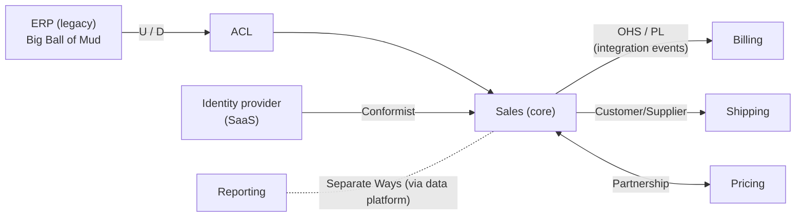
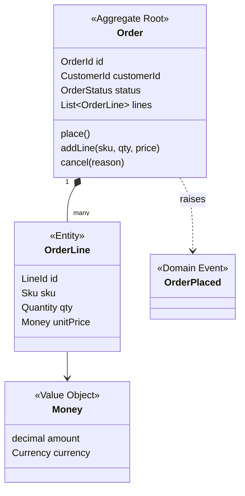
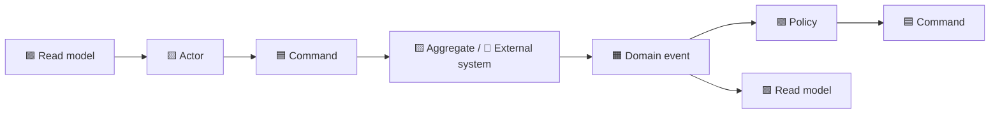

# Domain-Driven Design (DDD)

> **TL;DR** — DDD (Eric Evans, 2003) aligns software with the business by building a **model** in a **ubiquitous language** shared with domain experts. *Strategic DDD* splits a large domain into **subdomains** and **bounded contexts** and maps their relationships (**context maps**). *Tactical DDD* gives building blocks (entities, value objects, aggregates, domain events, repositories, services, factories) to implement a model inside one bounded context. Discovery techniques (**Event Storming**, **Domain Storytelling**, the **Bounded Context Canvas**) make it collaborative. Invest DDD effort in the **core domain**; buy or keep it simple elsewhere.

---

## 1. Why DDD

- Complexity in business software is mostly **essential domain complexity**, not technology.
- A shared model reduces translation errors between experts and developers.
- Boundaries (bounded contexts) are the best known heuristic for **service/module boundaries** and **team boundaries**.

### When DDD pays off / doesn't

| Use | Avoid / go light |
|---|---|
| Complex, evolving business rules (pricing, planning, ERP processes, compliance) | CRUD, forms over data |
| Long-lived core systems giving competitive advantage | Generic capabilities (buy SaaS) |
| Multiple teams needing clear boundaries | Prototypes, tiny apps |
| Access to domain experts | No access to experts (model will be guesswork) |

---

## 2. Strategic design

### 2.1 Domain and subdomains

| Subdomain type | Description | Strategy | Example (manufacturing/wholesale ERP) |
|---|---|---|---|
| **Core** | Differentiates the business; competitive advantage | Build in-house; best people; rich model; DDD tactical patterns | Production planning, pricing/quoting engine, cultivation scheduling |
| **Supporting** | Necessary, specific to business, not differentiating | Build simply or outsource; transaction scripts OK | Internal approval workflow, label printing |
| **Generic** | Solved problem, same for everyone | Buy/SaaS/open source | Identity, accounting ledger, email, payroll |

**Core Domain Chart** (DDD Crew): plot subdomains by *business differentiation* vs *model complexity* to decide build/buy/outsource.

The **problem space** has subdomains; the **solution space** has bounded contexts. Ideally 1:1, but not required.

### 2.2 Ubiquitous language

- A rigorous language shared by team and domain experts, **used in code, tests, conversations, docs**.
- Valid **within one bounded context** — the same word may mean different things elsewhere.
- Maintain a **glossary** per context; changes in language are model changes.

```text
Context: Sales                         Context: Warehouse
"Order"   = customer's commitment      "Order" → called "Pick list"/"Shipment"
"Product" = sellable item with price   "Product" = SKU with location, weight, dimensions
"Customer"= account with credit limit  (no customer concept; only "Ship-to address")
```

Smells: developers translating terms ("in the code we call it `Entity2`"), generic names (`Item`, `Data`, `Manager`), CRUD verbs instead of domain verbs (`updateOrder` vs `confirmOrder`, `cancelOrder`).

### 2.3 Bounded context

> An explicit boundary within which a domain model and its ubiquitous language apply consistently.

- Typically owned by **one team**; maps well to a **module** (modular monolith) or **one or a few services**.
- Has its own model, schema, and language; integration with others via explicit contracts.

**Heuristics for finding boundaries**
- Language changes (same term, different meaning).
- Different business capabilities / departments / processes.
- Pivotal events in Event Storming (e.g., `OrderPlaced`, `OrderShipped` separate phases).
- Different rates of change, different consistency needs.
- Different actors/stakeholders.
- Avoid boundaries that require frequent synchronous chatter or distributed transactions.

### 2.4 Context mapping

A **context map** documents bounded contexts and their relationships — both technical and organisational (power dynamics between teams).

| Pattern | Relationship | Description | Use when |
|---|---|---|---|
| **Partnership** | Mutual dependency | Two teams succeed/fail together; coordinate planning and releases | Tight collaboration, short-term |
| **Shared Kernel** | Shared | Small shared subset of model/code co-owned by both teams | Very close teams; keep it tiny |
| **Customer–Supplier** | Upstream/downstream | Upstream (supplier) plans with downstream (customer) needs; negotiated | Downstream has influence |
| **Conformist** | Upstream/downstream | Downstream adopts upstream model as-is; no influence | Upstream is huge/external (e.g., a big ERP or SaaS) and model is acceptable |
| **Anticorruption Layer (ACL)** | Downstream protection | Translation layer isolating downstream model from upstream model | Legacy or foreign models would corrupt yours |
| **Open Host Service (OHS)** | Upstream offers | Well-defined protocol/API for many consumers | Many downstreams |
| **Published Language (PL)** | Shared language | Documented exchange format (often with OHS) — e.g. EDIFACT, UBL, iCalendar, a JSON schema | Interoperability |
| **Separate Ways** | None | No integration; duplicate if needed | Integration cost > benefit |
| **Big Ball of Mud** | — | Mark areas with no clear model; contain with ACL | Legacy reality |



Notation: **U** = upstream (influences), **D** = downstream (depends). Tool: Context Mapper DSL (contextmapper.org).

#### Anticorruption layer example (TypeScript)

```ts
// Upstream legacy ERP DTO (foreign model)
interface ErpCustomerRecord { KUNNR: string; NAME1: string; KTOKD: string; SPERR: "X" | "" }

// Our model
class Customer {
  constructor(readonly id: CustomerId, readonly name: string, readonly segment: Segment, readonly blocked: boolean) {}
}

// ACL: facade + adapter + translator
export class ErpCustomerTranslator {
  toDomain(r: ErpCustomerRecord): Customer {
    return new Customer(
      CustomerId.from(r.KUNNR.replace(/^0+/, "")),
      r.NAME1.trim(),
      r.KTOKD === "Z001" ? Segment.Wholesale : Segment.Retail,
      r.SPERR === "X",
    );
  }
}
```

### 2.5 Team and context alignment

- One team can own several contexts; **avoid** one context owned by several teams.
- Team Topologies: stream-aligned team ≈ bounded context(s); platform team for generic capabilities.
- Inverse Conway maneuver: shape teams to get the boundaries you want. See [evolution-and-legacy.md](evolution-and-legacy.md) and [../09-leadership-teams-facilitation/README.md](../09-leadership-teams-facilitation/README.md).

### 2.6 Distillation

- **Domain vision statement** — one page on the core domain's value.
- **Highlighted core** — mark the core in docs/code.
- **Segregated core** — refactor core concepts away from supporting code.
- **Generic subdomains** — factor out and buy.
- **Cohesive mechanisms** — extract algorithmic machinery (e.g., a graph traversal) from the model.

---

## 3. Tactical design



### 3.1 Building blocks

| Block | Definition | Key properties |
|---|---|---|
| **Entity** | Object defined by **identity** and continuity over time | Mutable (via behaviour), identity equality |
| **Value Object** | Object defined by its **attributes**; no identity | Immutable, value equality, self-validating, side-effect-free functions |
| **Aggregate** | Cluster of entities/VOs treated as a unit for data changes; accessed via the **aggregate root** | Consistency boundary; transactional boundary |
| **Domain Event** | Something that happened that domain experts care about (past tense) | Immutable; `OrderPlaced`, `InvoiceOverdue` |
| **Repository** | Collection-like access to aggregates | One per aggregate root |
| **Domain Service** | Stateless operation that doesn't naturally belong to an entity/VO | Named in ubiquitous language (`TransferService`, `PricingPolicy`) |
| **Application Service** | Orchestrates use cases: load aggregate, call behaviour, save, publish; handles transactions/security | No business rules |
| **Factory** | Encapsulates complex creation ensuring invariants | Static factory method, factory class, or on another aggregate |
| **Module** | Package grouping cohesive concepts named in the ubiquitous language | — |

### 3.2 Value objects

```csharp
public sealed record Quantity
{
    public int Value { get; }
    public UnitOfMeasure Unit { get; }

    public Quantity(int value, UnitOfMeasure unit)
    {
        if (value < 0) throw new DomainException("Quantity cannot be negative");
        (Value, Unit) = (value, unit);
    }

    public Quantity Add(Quantity other) =>
        other.Unit == Unit ? new(Value + other.Value, Unit) : throw new DomainException("Unit mismatch");
}
```

Candidates: `Money`, `Email`, `Address`, `DateRange`, `Percentage`, `Sku`, `Iban`, `Quantity`, `GeoLocation`, strongly-typed IDs (`OrderId`). Persist as owned types/embedded values or JSON columns.

### 3.3 Aggregates — Vaughn Vernon's four rules ("Effective Aggregate Design")

| # | Rule | Rationale |
|---|---|---|
| 1 | **Protect true invariants inside consistency boundaries** | An aggregate is the boundary of *transactional* consistency for business rules that must always hold |
| 2 | **Design small aggregates** | Large aggregates cause contention, load too much, and scale poorly; most aggregates = root + value objects |
| 3 | **Reference other aggregates by identity** | Hold `CustomerId`, not `Customer`; prevents modifying multiple aggregates and enables distribution |
| 4 | **Use eventual consistency outside the boundary** | Update other aggregates via domain events in separate transactions |

Additional guidance: **modify one aggregate per transaction** (by default); reasons to break rules: UI convenience, lack of technical mechanisms, global transactions mandated, query performance — but be explicit.

```csharp
public sealed class Order : AggregateRoot<OrderId>
{
    private readonly List<OrderLine> _lines = [];
    public CustomerId CustomerId { get; private set; }
    public OrderStatus Status { get; private set; } = OrderStatus.Draft;
    public IReadOnlyList<OrderLine> Lines => _lines;
    public Money Total => _lines.Aggregate(Money.Zero(Currency), (t, l) => t + l.Subtotal);
    public Currency Currency { get; private set; }

    private Order() { } // ORM

    public static Order Draft(OrderId id, CustomerId customer, Currency currency) =>
        new() { Id = id, CustomerId = customer, Currency = currency };

    public void AddLine(Sku sku, Quantity qty, Money unitPrice)
    {
        EnsureStatus(OrderStatus.Draft);
        if (unitPrice.Currency != Currency) throw new DomainException("Currency mismatch");
        if (_lines.Count >= 200) throw new DomainException("Max 200 lines per order");   // invariant
        _lines.Add(new OrderLine(LineId.New(), sku, qty, unitPrice));
    }

    public void Place(ICreditPolicy credit)
    {
        EnsureStatus(OrderStatus.Draft);
        if (_lines.Count == 0) throw new DomainException("Empty order");
        if (!credit.Allows(CustomerId, Total)) throw new DomainException("Credit limit exceeded");
        Status = OrderStatus.Placed;
        Raise(new OrderPlaced(Id, CustomerId, Total, DateTimeOffset.UtcNow));
    }

    private void EnsureStatus(OrderStatus expected)
    {
        if (Status != expected) throw new DomainException($"Order is {Status}, expected {expected}");
    }
}
```

**Aggregate design checklist**
- [ ] Which invariants must be *immediately* consistent? Only those go inside.
- [ ] Is there concurrency contention (many users editing same aggregate)? Split.
- [ ] References to other aggregates by ID only?
- [ ] No setters; all changes via intention-revealing methods?
- [ ] Optimistic concurrency (version) on the root?
- [ ] Size: loads in one query, typically < a few hundred child items?

### 3.4 Domain events

```ts
export interface DomainEvent { readonly occurredAt: Date; readonly type: string }

export class InvoiceOverdue implements DomainEvent {
  readonly type = "billing.invoice-overdue.v1";
  constructor(readonly invoiceId: string, readonly customerId: string, readonly amountDue: number,
              readonly occurredAt = new Date()) {}
}
```

| Domain event | Integration event |
|---|---|
| Within bounded context, in-process | Across contexts, via broker |
| Can reference domain types | Only primitive/contract types; versioned |
| Dispatched before/after commit | Published reliably via **outbox** after commit |
| Freely refactorable | Public contract (Published Language) |

Dispatch options: collect on aggregate → dispatch after `SaveChanges` (same transaction for handlers inside context, or outbox for integration).

### 3.5 Domain services vs application services

```ts
// Domain service — business rule spanning aggregates, no infrastructure
export class TransferPolicy {
  canTransfer(from: Account, to: Account, amount: Money): boolean {
    return from.currency === to.currency && !from.frozen && from.available().gte(amount);
  }
}

// Application service — orchestration, transactions, no rules
export class TransferFunds {
  constructor(private accounts: AccountRepository, private uow: UnitOfWork, private policy: TransferPolicy) {}
  async execute(cmd: { from: string; to: string; amount: Money }) {
    const [from, to] = await Promise.all([this.accounts.byId(cmd.from), this.accounts.byId(cmd.to)]);
    if (!this.policy.canTransfer(from, to, cmd.amount)) throw new Error("Transfer not allowed");
    from.withdraw(cmd.amount);
    to.deposit(cmd.amount); // NB: two aggregates in one tx — acceptable only if same DB & justified; else saga
    await this.uow.commit();
  }
}
```

### 3.6 Factories

- **Factory method on aggregate root**: `Order.Draft(...)`.
- **Factory on another aggregate**: `customer.StartOrder()` (when creation depends on the other's state).
- **Factory class** for complex assembly (reconstitution from legacy, multiple dependencies).

---

## 4. Discovery and modelling techniques

### 4.1 Event Storming (Alberto Brandolini)

Collaborative workshop using sticky notes on a long wall to explore a domain via **domain events**.

#### Sticky note colours (common convention)

| Colour | Element | Example |
|---|---|---|
| 🟧 **Orange** | Domain event (past tense) | "Order placed" |
| 🟦 **Blue** | Command / action | "Place order" |
| 🟨 **Pale/small yellow** | Actor / user (persona) | "Sales rep" |
| 🟨 **Large yellow** | Aggregate (design level; originally "entity") | "Order" |
| 🟪 **Lilac / purple** | Policy / business rule / reactive logic ("whenever X then Y") | "When payment received, release order" |
| 🩷 **Pink (large)** | External system | "Payment provider", "ERP" |
| 🟥 **Red / hot pink (rotated)** | Hotspot: problem, question, conflict | "Who approves discounts > 20%?" |
| 🟩 **Green** | Read model / information needed for a decision | "Customer credit status" |
| Lines / tape | Pivotal events, swimlanes, boundaries | |
| Opportunity (green or other) | Improvement idea | |

Colours vary across facilitators; agree a legend at the start.

#### Three levels

| Level | Goal | Participants | Output |
|---|---|---|---|
| **Big Picture** | Explore the whole business flow; find hotspots, boundaries, pivotal events | 10–30 people across business & IT | Chaotic exploration → timeline → pivotal events → swimlanes → candidate bounded contexts, hotspots, opportunities |
| **Process Modelling** | Model one process precisely | Smaller group | Grammar: *Actor → Command → System/Aggregate → Event → Policy → Command...* with read models |
| **Software Design** | Design aggregates and code | Dev team + experts | Aggregates, commands, events, invariants → ready to code |

#### Process modelling "grammar"



#### Big Picture phases

1. **Chaotic exploration** — everyone writes events, no discussion.
2. **Enforce the timeline** — arrange chronologically; dedupe.
3. **People and systems** — add actors and external systems.
4. **Explicit walkthrough** — narrate the story; find gaps.
5. **Hotspots & opportunities** — mark problems.
6. **Pivotal events / boundaries** — candidate contexts.
7. **Arrow voting** — choose the most important problem to address.

**Remote**: Miro/Mural templates. **Tips**: unlimited modelling space, enough sticky notes, no chairs, facilitator keeps energy, don't model "the system" too early.

### 4.2 Domain Storytelling (Stefan Hofer & Henning Schwentner)

Domain experts tell concrete stories; a moderator records them as pictographic diagrams:

- **Actors** (person, group, system) — icons.
- **Work objects** (document, call, email, goods) — icons.
- **Activities** — arrows labelled with verbs.
- **Sequence numbers** — order of activities.
- **Annotations** for variations.

```text
(1) Customer —sends→ [purchase order] —to→ Sales clerk
(2) Sales clerk —checks→ [credit limit] —in→ ERP
(3) Sales clerk —creates→ [sales order] —in→ ERP
(4) ERP —sends→ [pick list] —to→ Warehouse
```

| Dimension | Options |
|---|---|
| Granularity | Coarse-grained (whole process) / fine-grained |
| Point in time | As-is / to-be |
| Domain purity | Pure (no software) / digitalised (with systems) |

Tool: Egon.io (free web modeller). Great complement to Event Storming for exploring **current-state processes** with non-technical experts.

### 4.3 Bounded Context Canvas (DDD Crew, Nick Tune)

| Section | Content |
|---|---|
| **Name** | Context name |
| **Purpose** | Why it exists, business value |
| **Strategic classification** | Domain (core/supporting/generic), business model (revenue/engagement/compliance/cost reduction), evolution (genesis/custom/product/commodity — Wardley) |
| **Domain roles** | e.g., draft context, execution context, analysis context, gateway, specification, enforcer |
| **Inbound communication** | Collaborators, messages (commands/queries/events) received |
| **Outbound communication** | Messages sent, to whom |
| **Ubiquitous language** | Key terms |
| **Business decisions** | Key rules and policies |
| **Assumptions** | Things believed but unverified |
| **Verification metrics** | How to know boundaries are right |
| **Open questions** | Unknowns |

Related DDD Crew artefacts: **Aggregate Design Canvas**, **Core Domain Charts**, **Message Flow modelling**, **DDD Starter Modelling Process** (Understand → Discover → Decompose → Strategize → Connect → Organise → Define → Code).

### 4.4 Other techniques

- **Example Mapping** (rules, examples, questions) → BDD scenarios.
- **User Story Mapping** → product backlog; see [../02-product-management/README.md](../02-product-management/README.md).
- **Wardley Mapping** → strategic evolution of components; see [../11-enterprise-architecture-business/README.md](../11-enterprise-architecture-business/README.md).
- **Business Model Canvas** / **Impact Mapping** → link to business goals.

---

## 5. DDD in a typical code base

```text
src/Sales/
  Domain/
    Orders/ Order.cs  OrderLine.cs  OrderPlaced.cs  IOrderRepository.cs
    Pricing/ PricingPolicy.cs
    Shared/ Money.cs  Sku.cs
  Application/
    PlaceOrder/ PlaceOrderCommand.cs  PlaceOrderHandler.cs
    Queries/ GetOrderSummary.cs   ← read side may bypass domain
  Infrastructure/
    Persistence/ SalesDbContext.cs  OrderConfiguration.cs  EfOrderRepository.cs
    Messaging/ OutboxPublisher.cs
    Erp/ ErpCustomerTranslator.cs (ACL)
  Api/
    OrdersEndpoints.cs
  Contracts/            ← published language: integration events, public DTOs
    OrderPlacedV1.cs
```

## Common mistakes / anti-patterns

- **DDD-lite**: using tactical patterns (repositories, entities) without strategic design → "anemic DDD".
- **One big model** for the whole enterprise ("canonical data model") — fails across contexts.
- **Entity-driven boundaries** (`CustomerService`) instead of capability-driven.
- **Giant aggregates** (`Customer` containing all orders) → contention and performance issues.
- **Navigational references** between aggregates → multi-aggregate transactions.
- **Anemic domain model** with setters everywhere.
- **Shared kernel growth** into a shared monolith library.
- **Ignoring the language** — code uses technical terms experts don't recognise.
- **Applying DDD to generic subdomains** — reinventing what you should buy.
- **Event Storming without domain experts** — developers guessing the domain.

## Related

- [architecture-styles.md](architecture-styles.md) (modular monolith, microservices, CQRS/ES), [integration-and-messaging.md](integration-and-messaging.md), [evolution-and-legacy.md](evolution-and-legacy.md)
- Facilitation of workshops: [../09-leadership-teams-facilitation/README.md](../09-leadership-teams-facilitation/README.md)
- Business capability mapping: [../11-enterprise-architecture-business/README.md](../11-enterprise-architecture-business/README.md)

## References

- Domain-driven design — Wikipedia: https://en.wikipedia.org/wiki/Domain-driven_design
- Fowler — Bounded Context: https://martinfowler.com/bliki/BoundedContext.html
- Fowler — Ubiquitous Language: https://martinfowler.com/bliki/UbiquitousLanguage.html
- Fowler — DDD Aggregate: https://martinfowler.com/bliki/DDD_Aggregate.html
- Fowler — Value Object: https://martinfowler.com/bliki/ValueObject.html
- Fowler — Domain Driven Design: https://martinfowler.com/bliki/DomainDrivenDesign.html
- Eric Evans — DDD Reference (free PDF): https://www.domainlanguage.com/ddd/reference/
- Vaughn Vernon — Effective Aggregate Design (PDF): https://www.dddcommunity.org/library/vernon_2011/
- DDD Crew (GitHub org; Bounded Context Canvas, Context Mapping, Starter Modelling Process): https://github.com/ddd-crew
- Context Mapper: https://contextmapper.org/
- Event Storming: https://www.eventstorming.com/
- Domain Storytelling: https://domainstorytelling.org/ · Egon.io: https://egon.io/
- Microsoft — Designing a DDD-oriented microservice: https://learn.microsoft.com/dotnet/architecture/microservices/microservice-ddd-cqrs-patterns/ddd-oriented-microservice
- Microsoft — Anti-corruption Layer pattern: https://learn.microsoft.com/azure/architecture/patterns/anti-corruption-layer
- Eric Evans — *Domain-Driven Design: Tackling Complexity in the Heart of Software* (2003)
- Vaughn Vernon — *Implementing Domain-Driven Design* (2013), *Domain-Driven Design Distilled* (2016)
- Vlad Khononov — *Learning Domain-Driven Design* (2021)
- Alberto Brandolini — *Introducing EventStorming* (Leanpub)
- Hofer & Schwentner — *Domain Storytelling* (2021)
- Scott Millett & Nick Tune — *Patterns, Principles, and Practices of Domain-Driven Design* (2015)
