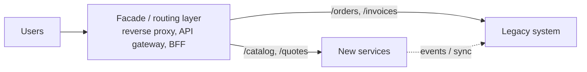
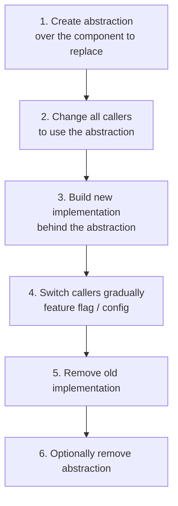
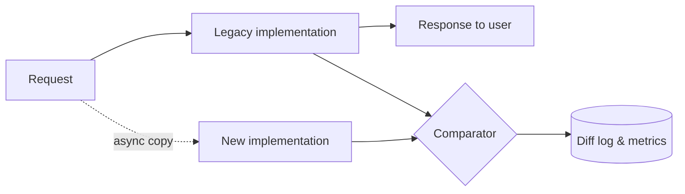
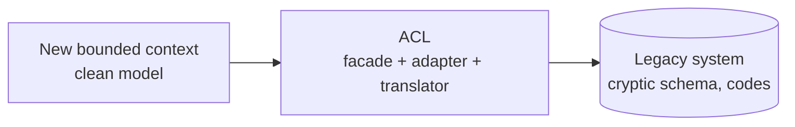
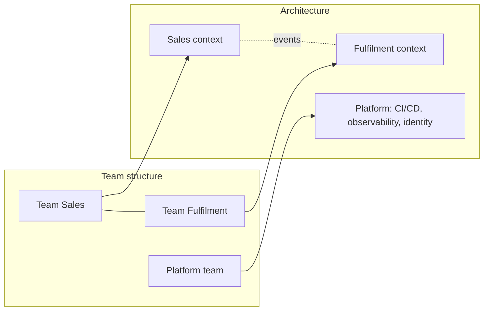
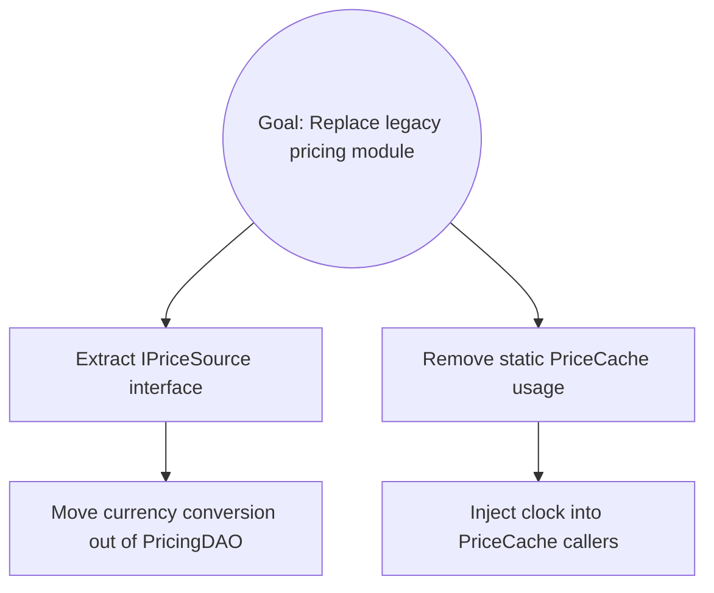

# Architecture Evolution and Legacy Modernization

> **TL;DR** — Systems must evolve continuously; big-bang rewrites usually fail. Modernize incrementally with **Strangler Fig** (route traffic piece by piece to new code), **Branch by Abstraction** (swap implementations behind an interface on trunk), **Parallel Run** (compare old vs new outputs), and an **Anti-Corruption Layer** (protect the new model). Treat **technical debt** deliberately (Fowler's quadrant), make it visible, and pay it down where it hurts flow. Align architecture and teams (**Conway's Law**, **Inverse Conway Maneuver**). Use the **Mikado Method** for large refactorings.

---

## 1. Why systems decay

- **Lehman's laws** of software evolution: a system in use must continually change or become less useful (continuing change), and its complexity increases unless work is done to reduce it (increasing complexity).
- **Architecture erosion / drift**: implementation diverges from intended architecture through shortcuts.
- **Accidental complexity** accumulates; knowledge leaves with people.
- Technology ages (unsupported frameworks, runtimes, OS, ERP versions).

Counter-forces: fitness functions, refactoring as routine, ADRs, ownership, modular boundaries.

---

## 2. Modernization strategies

### The "R" options (Gartner 5 Rs → AWS 6/7 Rs)

| Strategy | Description | Effort | Value | Example |
|---|---|---|---|---|
| **Retain** | Keep as-is (for now) | None | Low | Stable system near end of life |
| **Retire** | Decommission | Low | Cost savings | Unused reporting app |
| **Rehost** ("lift and shift") | Move to new infra unchanged | Low | Infra savings, DC exit | VM to cloud VM |
| **Relocate** | Move platform as-is (e.g., VMware to cloud VMware) | Low | — | — |
| **Replatform** ("lift, tinker, shift") | Minor changes to use managed services | Medium | Ops savings | SQL Server VM → Azure SQL MI; IIS → App Service |
| **Repurchase** ("drop and shop") | Replace with SaaS/COTS | Medium | Commodity capability | Custom CRM → Dynamics/Salesforce |
| **Refactor / re-architect** | Restructure for cloud-native/modularity | High | High agility/scale | Monolith → modular monolith/services |
| **Rebuild / rewrite** | Rewrite from scratch | Very high | Potentially high, high risk | Only with strong reasons |

See also [../06-cloud-architecture/README.md](../06-cloud-architecture/README.md) for migration programmes.

### Rewrite vs incremental

> "The single worst strategic mistake that any software company can make: rewrite the code from scratch." — Joel Spolsky (on Netscape), paraphrased

Big-bang rewrite risks: hidden business rules lost, moving target (old system keeps changing), long time with no value delivered, second-system effect (Brooks), cutover risk.

Incremental modernization: deliver value early, reduce risk, learn the domain, can stop any time.

### Selecting what to modernize first

| Criterion | Prefer |
|---|---|
| Business value / change frequency | High-change areas (hotspots) |
| Risk | Low-risk edge capabilities first to learn the pattern |
| Coupling | Loosely coupled seams (thin interfaces, clear data ownership) |
| Pain | Areas causing incidents or blocking teams |

**Hotspot analysis** (Adam Tornhill, *Your Code as a Crime Scene*): combine change frequency (git log) with complexity → prioritise refactoring where both are high. Tools: CodeScene, `code-maat`, git-of-theseus.

```bash
# Quick change-frequency hotspots from git
git log --since="12 months ago" --name-only --pretty=format: | sort | uniq -c | sort -rn | head -30
```

---

## 3. Strangler Fig (Fowler, 2004)

Named after strangler fig trees that grow around a host tree and eventually replace it.



### Steps

1. **Identify seams** — capability boundaries (URL paths, screens, message types, batch jobs).
2. **Introduce an interception layer** — reverse proxy (YARP, NGINX, APIM), BFF, or event interception.
3. **Implement one capability** in the new system (with ACL to legacy data where needed).
4. **Redirect traffic** for that capability (feature flag / percentage rollout).
5. **Sync data** in the transition (CDC, events, dual reads); define system of record per entity per phase.
6. **Retire** legacy code for that capability. Repeat.
7. Eventually remove legacy and facade (or keep facade as gateway).

### Variants

| Variant | Interception point |
|---|---|
| **HTTP / UI strangler** | Reverse proxy routes paths; micro-frontends replace screens |
| **Event interception** | Capture legacy events/messages; new consumers take over (Fowler's "Event Interception") |
| **Database strangler** | CDC from legacy DB feeds new service data store |
| **Asset capture** | Move ownership of an entity type (e.g., "customers") to new system |
| **Divert the flow** | Route new data flows to new system; legacy keeps old data until archive |

### YARP reverse proxy routing (C#, appsettings)

```json
{
  "ReverseProxy": {
    "Routes": {
      "catalog": { "ClusterId": "new", "Match": { "Path": "/catalog/{**rest}" } },
      "fallback": { "ClusterId": "legacy", "Match": { "Path": "{**catch-all}" }, "Order": 1000 }
    },
    "Clusters": {
      "new":    { "Destinations": { "d1": { "Address": "https://catalog.internal/" } } },
      "legacy": { "Destinations": { "d1": { "Address": "https://legacy-erp-web.internal/" } } }
    }
  }
}
```

### Pitfalls

- Facade becomes a bottleneck/single point of failure — make it simple and highly available.
- Never finishing (two systems forever) — set retirement milestones and measure % migrated.
- Shared database between old and new → coupling persists; plan data ownership transfer.

---

## 4. Branch by Abstraction (Paul Hammant; Fowler)

Make large-scale changes **on trunk** without long-lived branches.



```ts
// Step 1–2: abstraction
export interface TaxCalculator { calculate(order: Order): Money }

// Step 3: new implementation
class LegacyTaxCalculator implements TaxCalculator { /* wraps old module */ }
class RulesEngineTaxCalculator implements TaxCalculator { /* new */ }

// Step 4: toggle per tenant
export const taxCalculatorFor = (tenant: Tenant, flags: Flags): TaxCalculator =>
  flags.isEnabled("new-tax-engine", tenant) ? new RulesEngineTaxCalculator() : new LegacyTaxCalculator();
```

Use with **trunk-based development** and **feature flags** (see [../08-engineering/README.md](../08-engineering/README.md)).

---

## 5. Parallel Run / Dark Launch / Shadow Traffic

Run old and new implementations side by side; compare results; old remains source of truth until confidence is high.



| Technique | Description |
|---|---|
| **Parallel run** | Both compute results; compare; legacy result used |
| **Dark launch** | New code executes in production invisibly |
| **Shadow traffic / traffic mirroring** | Copy live traffic to new service (Envoy/Istio mirroring) |
| **Scientist pattern** | GitHub's `Scientist` library (Ruby; ports in .NET `Scientist.NET`, Python `laboratory`): run control + candidate, publish mismatches |
| **Canary release** | Small % of real users served by new path |
| **Reconciliation** | Batch compare outputs (e.g., invoices produced by both systems) |

Caveat: new implementation must not cause side effects (send emails, post to ERP) during parallel run — stub writes or use idempotent sinks.

---

## 6. Anti-Corruption Layer (ACL)

From DDD (Evans). A translation layer between your model and a legacy/external model so the foreign model doesn't leak in.

Components: **Facade** (simplified interface to legacy), **Adapter** (protocol conversion), **Translator** (model mapping).



- Lives on the downstream (new) side.
- Can be a module, a service, or part of an integration hub.
- Can be **temporary** (removed once legacy retired) or **permanent** (for external SaaS/ERP).
- See [domain-driven-design.md](domain-driven-design.md) for an example.

---

## 7. Other evolution techniques

| Technique | Description |
|---|---|
| **Expand/contract (parallel change)** | Backward-compatible change in steps (APIs, schemas). See [data-architecture-for-applications.md](data-architecture-for-applications.md) |
| **Feature toggles** | Release, experiment, ops, permission toggles (Pete Hodgson); remove after use |
| **Change Data Capture** | Replicate legacy DB changes as events to new services |
| **Tolerant reader + consumer-driven contracts** | Evolve APIs without lock-step |
| **Modularize first** | Introduce modules inside the monolith before extracting services |
| **Extract service by capability** | Start with leaf capabilities with few dependencies |
| **Seams** (Michael Feathers) | Places to alter behaviour without editing code; add characterization tests before changes |
| **Characterization tests** / golden master / approval tests | Capture current behaviour of legacy code before refactoring (Verify, ApprovalTests, snapshot tests) |
| **Sprout method/class, wrap method/class** | Add new behaviour in new, tested code invoked from legacy |
| **Transitional architecture** (Fowler et al.) | Temporary components (event bridges, proxies) built to be removed |
| **Legacy displacement patterns** | Fowler's site catalogs: Event Interception, Legacy Mimic, Divert the Flow, Revert to Source, Transitional Architecture |

---

## 8. Technical debt

**Ward Cunningham (1992)**: shipping first-time code is like going into debt; a little debt speeds development if paid back promptly with a rewrite; the danger is not repaying — every minute on not-quite-right code counts as interest.

### Fowler's Technical Debt Quadrant

| | **Reckless** | **Prudent** |
|---|---|---|
| **Deliberate** | "We don't have time for design." | "We must ship now and deal with consequences." (with a payback plan) |
| **Inadvertent** | "What's layering?" (lack of skill) | "Now we know how we should have done it." (learning) |

Prudent-inadvertent debt is unavoidable — learning reveals better designs. Reckless debt should be prevented by skills, reviews, and standards.

### Types of debt

| Type | Examples |
|---|---|
| Code debt | Duplication, complexity, poor naming, missing tests |
| Architecture debt | Wrong boundaries, cyclic dependencies, shared DB, distributed monolith |
| Infrastructure/ops debt | Manual deployments, snowflake servers, missing monitoring |
| Dependency debt | Outdated frameworks/libraries/runtimes (EOL .NET, Node, Python versions) |
| Test debt | No automated tests; flaky tests |
| Documentation/knowledge debt | Bus factor 1; undocumented integrations |
| Data debt | Inconsistent master data, missing constraints |
| Security debt | Known vulns, missing controls |
| Social/process debt | Team topology misaligned with architecture |

### Managing debt

1. **Make it visible**: debt register (backlog items tagged `tech-debt`), arc42 §11, ADR consequences, `TODO`/`shortcut:` comments linked to tickets.
2. **Quantify impact** in business terms: lead time, incident rate, onboarding time, cost of delay, % of effort spent on unplanned work.
3. **Prioritise** by *interest rate*: debt in frequently changed code (hotspots) costs most; debt in stable code may be fine forever.
4. **Pay down continuously**: Boy Scout rule; allocate capacity (e.g., 15–20% per sprint); refactor as part of feature work ("make the change easy, then make the easy change" — Kent Beck).
5. **Big debts** → explicit initiatives with ADRs and measurable goals.
6. **Prevent**: definition of done, fitness functions, code review, pairing, static analysis (SonarQube), dependency bots (Dependabot/Renovate).

```text
Debt item template
Title:       Shared "Common" library couples Sales and Billing deploys
Type:        Architecture
Interest:    Every Billing release requires a Sales regression test (~2 days/month)
Principal:   ~3 weeks to split into Sales.Contracts and Billing.Contracts
Trigger:     Do before onboarding the second billing country (Q2)
Owner:       Team Billing
```

**SQALE** method and SonarQube's "technical debt ratio" offer quantification, but numbers are proxies — combine with qualitative impact.

---

## 9. Conway's Law and the Inverse Conway Maneuver

> **Conway's Law** (Melvin Conway, 1968): organisations which design systems are constrained to produce designs which are copies of the communication structures of these organisations.

Implications:
- A 4-team org building a compiler gets a 4-pass compiler.
- Shared component owned by many teams → coordination bottleneck and mud.
- Org reorganisations will reshape the architecture whether planned or not.

**Inverse Conway Maneuver** (Thoughtworks Technology Radar, 2015; Team Topologies): deliberately design team structure to encourage the desired architecture — e.g., create stream-aligned teams per bounded context to get loosely coupled services.



Related concepts:
- **Team cognitive load** (Team Topologies): size the software a team owns to what it can understand.
- **Team interaction modes**: collaboration, X-as-a-Service, facilitating.
- **Sociotechnical architecture**: design teams and architecture together.

Details: [../09-leadership-teams-facilitation/README.md](../09-leadership-teams-facilitation/README.md); Conway and related laws: [../10-laws-principles-mental-models/README.md](../10-laws-principles-mental-models/README.md).

---

## 10. Mikado Method (Ola Ellnestam & Daniel Brolund)

Technique for large refactorings in a codebase where changes cascade.



### Steps

1. Write down the **goal** (root of the Mikado graph).
2. **Try** to achieve it naively (time-boxed).
3. If things break, note the **prerequisites** that would need to be done first as child nodes.
4. **Revert** your changes (`git reset --hard`) — essential.
5. Pick a **leaf** prerequisite; repeat 2–4 for it.
6. When a leaf can be done without breaking anything, **commit** it and tick it off.
7. Work back up the graph until the goal is achieved.

Benefits: always-green trunk, small commits, visual progress, shared understanding; combines well with Branch by Abstraction.

---

## Modernization roadmap template

| Phase | Activities | Exit criteria |
|---|---|---|
| 0. Assess | Inventory systems, dependencies, data flows; hotspot analysis; business capability map; risks | Prioritised candidate list, target architecture sketch |
| 1. Foundations | CI/CD, observability, test harness (characterization tests), facade/proxy, identity | First change deployed via new pipeline |
| 2. First slice | Strangle one low-risk capability end-to-end, ACL, data sync | Capability fully on new stack in production |
| 3. Scale out | Repeat per capability; transfer data ownership; parallel runs for critical calculations | % traffic/capabilities migrated metrics |
| 4. Retire | Decommission legacy components, archive data, remove transitional architecture | Legacy shut down; costs removed |

## Common mistakes / anti-patterns

- Big-bang rewrite with feature freeze on legacy.
- Strangling without a plan to transfer data ownership (shared DB forever).
- Modernizing by technology fashion rather than business pain.
- Lift-and-shift expecting cloud-native benefits.
- Long-lived feature branches for big refactors (merge hell) instead of branch by abstraction.
- Treating tech debt as a separate "cleanup sprint" once a year.
- Ignoring Conway: new architecture designed but team structure unchanged.
- Recreating the legacy system's quirks 1:1 instead of rethinking processes ("paving cow paths").

## Related

- [architecture-styles.md](architecture-styles.md), [domain-driven-design.md](domain-driven-design.md), [documentation-and-decisions.md](documentation-and-decisions.md)
- Delivery practices, trunk-based dev, feature flags: [../08-engineering/README.md](../08-engineering/README.md)
- Programme/project planning for migrations: [../03-project-management/README.md](../03-project-management/README.md)

## References

- Fowler — StranglerFigApplication: https://martinfowler.com/bliki/StranglerFigApplication.html
- Fowler — BranchByAbstraction: https://martinfowler.com/bliki/BranchByAbstraction.html
- Fowler — Patterns of Legacy Displacement: https://martinfowler.com/articles/patterns-legacy-displacement/
- Fowler — TechnicalDebtQuadrant: https://martinfowler.com/bliki/TechnicalDebtQuadrant.html
- Fowler — TechnicalDebt: https://martinfowler.com/bliki/TechnicalDebt.html
- Fowler — ConwaysLaw: https://martinfowler.com/bliki/ConwaysLaw.html
- Fowler — ParallelChange: https://martinfowler.com/bliki/ParallelChange.html
- Pete Hodgson — Feature Toggles: https://martinfowler.com/articles/feature-toggles.html
- Microsoft — Strangler Fig pattern: https://learn.microsoft.com/azure/architecture/patterns/strangler-fig
- Microsoft — Anti-corruption Layer pattern: https://learn.microsoft.com/azure/architecture/patterns/anti-corruption-layer
- Conway's law: https://en.wikipedia.org/wiki/Conway%27s_law
- Lehman's laws of software evolution: https://en.wikipedia.org/wiki/Lehman%27s_laws_of_software_evolution
- Technical debt: https://en.wikipedia.org/wiki/Technical_debt
- Mikado Method: https://mikadomethod.info/
- Team Topologies: https://teamtopologies.com/
- AWS — Migration strategies (7 Rs): https://docs.aws.amazon.com/prescriptive-guidance/latest/large-migration-guide/migration-strategies.html
- Joel Spolsky — Things You Should Never Do, Part I: https://www.joelonsoftware.com/2000/04/06/things-you-should-never-do-part-i/
- GitHub Scientist: https://github.com/github/scientist
- Michael Feathers — *Working Effectively with Legacy Code* (2004)
- Ellnestam & Brolund — *The Mikado Method* (2014)
- Adam Tornhill — *Your Code as a Crime Scene* (2nd ed., 2024), *Software Design X-Rays* (2018)
- Skelton & Pais — *Team Topologies* (2nd ed., 2025)
- Sam Newman — *Monolith to Microservices* (2019)
