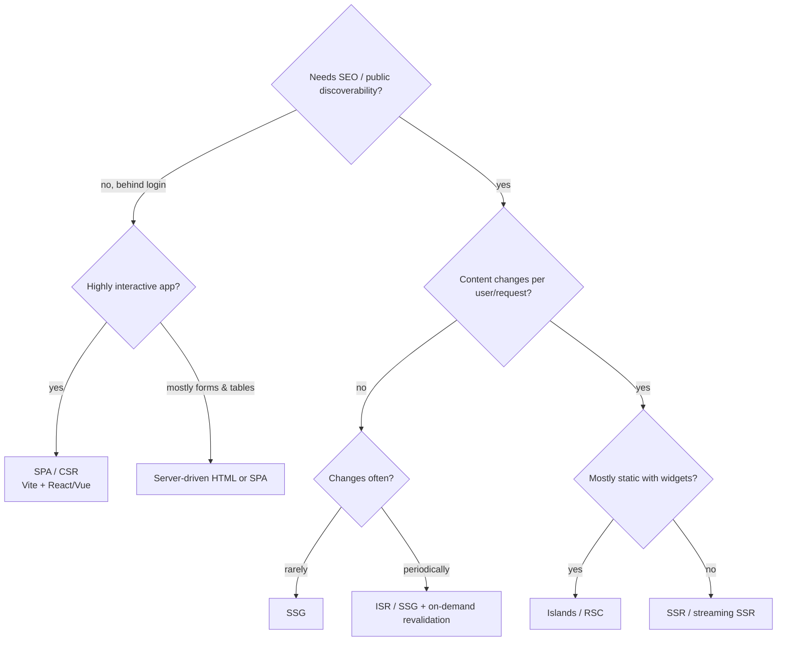
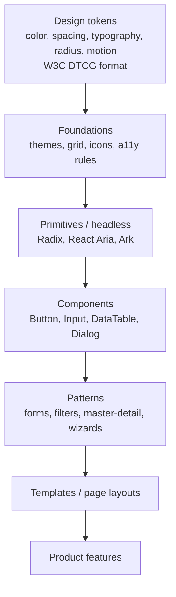

# Frontend Architecture

> **TL;DR** — Choose a **rendering strategy** per route: SSG/ISR for content, SSR or streaming SSR for personalised SEO-relevant pages, SPA/CSR for authenticated app-like tools (ERP front-ends, portals), and **islands** for mostly static pages with pockets of interactivity. Separate **server state** (TanStack Query, SWR, RTK Query, Apollo) from **client/UI state** (local state, signals, Zustand/Pinia/Redux). Structure code **by feature**, enforce boundaries, and build on a **design system** (tokens → components → patterns). Use **micro-frontends** only to solve team-scaling problems. Measure **Core Web Vitals**: LCP < 2.5 s, INP < 200 ms, CLS < 0.1 at the 75th percentile.

---

## 1. Rendering strategies

| Strategy | What happens | Pros | Cons | Use for |
|---|---|---|---|---|
| **CSR / SPA** | Browser downloads JS bundle, renders everything client-side | Rich interactivity; simple hosting (static + API); app-like | Slow first load, SEO weaker, large bundles, blank screen without JS | Internal tools, dashboards, ERP UIs, authenticated portals |
| **SSR** | Server renders HTML per request; client **hydrates** | Fast first paint, SEO, personalised | Server cost; TTFB depends on data fetching; hydration cost | E-commerce, personalised public pages |
| **Streaming SSR** | HTML streamed in chunks (React Suspense, Vue/Nuxt) | Faster TTFB/FCP; progressive | Complexity | Data-heavy SSR pages |
| **SSG** | HTML pre-rendered at build | Fastest, cheapest (CDN), secure | Rebuild for changes; not personalised | Docs, marketing, blogs |
| **ISR** (incremental static regeneration) | Static pages regenerated in background on interval/on-demand | SSG speed + fresh-ish content | Staleness window; platform-specific | Catalogs, product pages with periodic updates |
| **Islands architecture** | Static HTML with isolated interactive "islands" hydrated independently (partial hydration) | Minimal JS; great performance | Cross-island state harder | Content sites with widgets (Astro, Fresh, Eleventy+islands) |
| **React Server Components (RSC)** | Components render on server; zero client JS for server components; mixed with client components | Less JS, data fetching near data | New mental model, framework coupling (Next.js App Router, React Router RSC) | Modern React apps |
| **Resumability** | No hydration; app state serialised into HTML, resumes on interaction | Near-zero startup JS | Ecosystem smaller (Qwik) | Performance-critical public sites |
| **Edge rendering** | SSR at CDN edge | Low latency globally | Runtime limits, data locality | Global audiences |
| **Server-driven HTML** (HTMX, Hotwire, LiveView, Blazor Server) | Server returns HTML fragments; minimal JS | Simple; no client state duplication | Server round trips; offline weak | CRUD back-office apps |

### Frameworks map

| Library | Meta-framework (SSR/SSG/ISR) |
|---|---|
| React | Next.js, React Router v7 (formerly Remix), TanStack Start, Gatsby (legacy) |
| Vue | Nuxt, VitePress |
| Svelte | SvelteKit |
| Solid | SolidStart |
| Angular | Angular SSR (built-in) |
| Multi-framework | Astro (islands), Qwik City |
| .NET | Blazor (Server, WebAssembly, Static SSR + interactive render modes) |

### Decision guide



Mixed strategies per route are normal (marketing pages SSG, app SSR/CSR).

---

## 2. Application structure

### Feature-based (vertical) structure

```text
src/
  app/                    ← routing, providers, layout, composition root
  features/
    orders/
      api/                ← queries/mutations (TanStack Query hooks), DTO mapping
      components/         ← OrderTable.tsx, OrderForm.tsx
      model/              ← types, domain logic, validation (zod)
      routes/             ← route modules
      index.ts            ← public API of the feature
    customers/
  shared/
    ui/                   ← design-system wrappers
    lib/                  ← http client, date utils, formatting
    config/
```

Rules:
- Features import from `shared` and other features' **public `index.ts` only**; no deep imports (enforce with ESLint `import/no-restricted-paths`, `eslint-plugin-boundaries`, Nx module boundaries, dependency-cruiser).
- Keep business rules out of components (pure functions in `model/`).
- **Feature-Sliced Design** (FSD) is a formalised variant: layers `app → pages → widgets → features → entities → shared`.

### Component patterns

| Pattern | Use |
|---|---|
| Container/presentational (smart/dumb) | Separate data fetching from rendering (hooks largely replaced containers) |
| Custom hooks / composables | Reusable stateful logic (`useOrders`, `useDebounce`) |
| Compound components | Flexible APIs (`<Tabs><Tabs.List/>...</Tabs>`) |
| Headless components | Behaviour + a11y without styles (Radix, React Aria, Headless UI, Ark UI) |
| Render props / slots | Customisation points (Vue slots, React children functions) |
| Controlled vs uncontrolled | Form inputs; controlled for complex validation |
| Error boundaries | Contain render failures per region |
| Suspense boundaries | Loading states per region |

---

## 3. State management

### Categories of state

| Category | Examples | Recommended tool |
|---|---|---|
| **Server state / cache** | Orders list, customer details | TanStack Query (React/Vue/Solid/Svelte), SWR, RTK Query, Apollo/urql (GraphQL), Pinia Colada |
| **URL state** | Filters, sort, pagination, selected tab | Router search params (nuqs, TanStack Router typed search params, Vue Router query) |
| **Form state** | Inputs, validation, dirty flags | React Hook Form, TanStack Form, Formik, VeeValidate; schema validation with Zod/Valibot |
| **Local UI state** | Modal open, hover | `useState`, `ref()`, signals |
| **Global client state** | Auth user, theme, feature flags, wizard progress | Context (low-frequency), Zustand, Jotai, Redux Toolkit, Pinia, signals, XState stores |
| **Workflow/process state** | Multi-step processes, complex lifecycles | State machines (XState) |
| **Persisted/offline** | Drafts, offline queue | IndexedDB (Dexie), local-first sync engines |

**Most "global state" is actually server state** — moving it into a server-cache library removes most Redux boilerplate.

### Patterns

| Pattern | Description | Libraries |
|---|---|---|
| **Flux / unidirectional data flow** | Actions → dispatcher/reducer → store → view | Redux, Vuex (legacy) |
| **Redux pattern** | Single immutable store; pure reducers; middleware for effects | Redux Toolkit, NgRx |
| **Atomic state** | Small independent atoms composed bottom-up | Jotai, Recoil (archived), Nano Stores |
| **Proxy/mutable reactive stores** | Mutate state, framework tracks changes | Pinia, MobX, Valtio |
| **Signals** | Fine-grained reactive primitives; updates only dependents | SolidJS, Preact Signals, Angular signals, Vue refs, Svelte 5 runes; TC39 Signals proposal |
| **State machines / statecharts** | Explicit states & transitions | XState |
| **Server cache** | Stale-while-revalidate cache keyed by query | TanStack Query, SWR |
| **Local-first / sync engines** | Local DB + background sync, CRDTs | Replicache/Zero, ElectricSQL, Automerge, Yjs |

### TanStack Query example (React + TypeScript)

```tsx
import { useQuery, useMutation, useQueryClient } from "@tanstack/react-query";

export const orderKeys = {
  all: ["orders"] as const,
  list: (filters: OrderFilters) => [...orderKeys.all, "list", filters] as const,
  detail: (id: string) => [...orderKeys.all, "detail", id] as const,
};

export function useOrders(filters: OrderFilters) {
  return useQuery({
    queryKey: orderKeys.list(filters),
    queryFn: ({ signal }) => api.get<Page<OrderDto>>("/orders", { params: filters, signal }),
    staleTime: 30_000,
    placeholderData: (prev) => prev,   // keep previous page while loading next
  });
}

export function useCancelOrder() {
  const qc = useQueryClient();
  return useMutation({
    mutationFn: (id: string) => api.post(`/orders/${id}/cancellation`, {}, { headers: { "Idempotency-Key": crypto.randomUUID() } }),
    onSuccess: (_d, id) => {
      qc.invalidateQueries({ queryKey: orderKeys.detail(id) });
      qc.invalidateQueries({ queryKey: orderKeys.all });
    },
  });
}
```

### Pinia store (Vue 3)

```ts
import { defineStore } from "pinia";
import { ref, computed } from "vue";

export const useCartStore = defineStore("cart", () => {
  const lines = ref<Array<{ sku: string; qty: number; price: number }>>([]);
  const total = computed(() => lines.value.reduce((s, l) => s + l.qty * l.price, 0));
  function add(sku: string, price: number, qty = 1) {
    const line = lines.value.find((l) => l.sku === sku);
    line ? (line.qty += qty) : lines.value.push({ sku, qty, price });
  }
  return { lines, total, add };
});
```

### State management guidelines

- Keep state as **local** as possible; lift only when shared.
- Derive, don't duplicate (compute totals; don't store them).
- Put shareable view state in the **URL** (deep links, back button).
- Normalise entity caches only when necessary (GraphQL clients do it for you).
- Optimistic updates for responsiveness, with rollback on error.

---

## 4. Micro-frontends

Independent teams build, test, and deploy parts of a frontend separately; composed at runtime/build/server.

### When it makes sense

| Do | Don't |
|---|---|
| Multiple (≥ 3–4) autonomous teams on one product UI, slowed by shared release | Single team |
| Clear vertical domain boundaries (e.g., "catalog", "checkout", "account") | Splitting by technical layer or by component |
| Legacy UI migration (strangler for frontend) | To "allow any framework" without need |
| Different release cadences per area | Small app where a modular monolith frontend works |

### Composition approaches

| Approach | Description | Trade-offs |
|---|---|---|
| **Route-based (vertical split)** | Each MFE owns full pages/routes; app shell routes | Simplest; least runtime coupling |
| **Module Federation** (Webpack 5, Rspack, `@module-federation/vite`, Module Federation 2.0) | Load remote modules at runtime; share dependencies | Version alignment of shared deps; runtime failures |
| **single-spa** | Orchestrator for multiple frameworks' apps | Flexible; config overhead |
| **Web Components** | Custom elements as framework-agnostic contract | Shadow DOM styling, SSR complexity |
| **Native Federation / import maps** | ESM + import maps | Standards-based |
| **Server-side composition** | Edge/server includes (ESI/SSI, Podium, Next.js multi-zones) | Good perf/SEO; infra complexity |
| **iframes** | Full isolation | UX, a11y, performance, communication issues |

### Rules

- **Domain ownership**: one team per MFE, aligned to bounded context.
- **Contracts**: communicate via URL, custom events, or a thin event bus — not shared global stores.
- **Shared design system** for consistent UX (versioned package or runtime-loaded).
- **Shared dependencies** minimised and versioned; avoid multiple React copies.
- **Independent deployability** with runtime manifest (versions per MFE) and fallbacks if a remote fails.
- **Performance budget** across MFEs (duplicate bundles!).
- Cross-cutting: auth (shell owns session, BFF), routing (shell), telemetry (shared SDK).

---

## 5. Design system architecture

### Layers



Atomic Design (Brad Frost): atoms → molecules → organisms → templates → pages.

### Design tokens

- Tiers: **primitive/global** (`blue-600: #2563eb`) → **semantic/alias** (`color-action-primary: {blue-600}`) → **component** (`button-primary-bg: {color-action-primary}`).
- Single source of truth (Figma Variables / Tokens Studio) → transformed by **Style Dictionary** (or similar) into CSS variables, Tailwind theme, iOS/Android, etc.
- Theming (dark mode, brands, tenant white-labelling) by swapping semantic token values.
- W3C Design Tokens Community Group (DTCG) format for interoperability.

```css
:root {
  --color-blue-600: #2563eb;
  --color-action-primary: var(--color-blue-600);
  --space-2: 0.5rem;
  --radius-md: 0.375rem;
}
[data-theme="dark"] { --color-action-primary: #60a5fa; }
.button-primary { background: var(--color-action-primary); padding: var(--space-2) calc(var(--space-2) * 2); border-radius: var(--radius-md); }
```

### Distribution and governance

| Concern | Practice |
|---|---|
| Packaging | Monorepo (pnpm workspaces, Nx, Turborepo); publish versioned packages; semantic versioning; changesets |
| Documentation | Storybook (stories as docs + tests), usage guidelines, do/don't |
| Testing | Visual regression (Chromatic, Playwright screenshots), interaction tests, a11y tests (axe) |
| Accessibility | WCAG 2.2 AA built into components (focus, ARIA, keyboard, contrast) |
| Contribution model | Core team + federated contributions; RFCs for new components |
| Adoption metrics | Component usage analytics, drift detection |
| Framework strategy | Framework-specific (React) vs Web Components (Lit, Stencil) for multi-framework orgs |

Options: build on headless primitives + Tailwind (e.g., shadcn/ui copy-in approach), or adopt a full library (MUI, Vuetify, PrimeVue/PrimeReact, Fluent UI, Ant Design) and theme it. Data-heavy ERP UIs often need a strong **data grid** (AG Grid, TanStack Table, MUI X DataGrid).

UX and design guidance: [../01-ux-ui/README.md](../01-ux-ui/README.md).

---

## 6. Performance: Core Web Vitals

Google's user-centric metrics, measured at the **75th percentile** of page loads (field data, CrUX/RUM).

| Metric | Measures | Good | Needs improvement | Poor |
|---|---|---|---|---|
| **LCP** — Largest Contentful Paint | Loading: time until largest image/text block is rendered | **≤ 2.5 s** | 2.5–4.0 s | > 4.0 s |
| **INP** — Interaction to Next Paint (replaced FID in March 2024) | Responsiveness: latency of interactions across the page lifetime | **≤ 200 ms** | 200–500 ms | > 500 ms |
| **CLS** — Cumulative Layout Shift | Visual stability | **≤ 0.1** | 0.1–0.25 | > 0.25 |

Supporting metrics: **TTFB** (≤ 0.8 s good), **FCP** (≤ 1.8 s), **TBT** (lab proxy for INP).

### Improving each

| Metric | Techniques |
|---|---|
| **LCP** | Fast TTFB (CDN, caching, SSR/SSG), preload LCP image (`fetchpriority="high"`), avoid lazy-loading the LCP image, modern formats (AVIF/WebP), responsive images, inline critical CSS, minimise render-blocking JS/CSS, font `display: swap` + preload |
| **INP** | Reduce JS execution; break long tasks (`scheduler.yield()`, `setTimeout`, `requestIdleCallback`); avoid heavy work in event handlers; debounce; virtualise long lists/grids; use web workers; reduce hydration cost (islands/RSC); `startTransition`/`useDeferredValue` in React; avoid layout thrashing |
| **CLS** | Set `width`/`height` or `aspect-ratio` on images/video/iframes; reserve space for ads/embeds/banners; avoid inserting content above existing content; use `transform` animations; `font-display: optional` or size-adjusted fallback fonts |

### General frontend performance practices

- **Bundle budget** (e.g., < 170 KB compressed JS for critical path on mobile); analyse with `vite-bundle-visualizer`/`webpack-bundle-analyzer`.
- Code splitting per route; lazy-load heavy components (charts, editors).
- Tree-shake; avoid moment.js-style heavy deps; use `date-fns`/Temporal.
- HTTP caching: hashed asset filenames + `Cache-Control: immutable`.
- Prefetch on hover/viewport for likely navigations.
- Virtualise large tables (TanStack Virtual, AG Grid) — critical for ERP grids with thousands of rows.
- Measure with **RUM** (web-vitals library → analytics/OpenTelemetry), not just Lighthouse.
- Add **Lighthouse CI** / performance budgets as fitness functions.

```ts
import { onLCP, onINP, onCLS } from "web-vitals";
const send = (m: { name: string; value: number; id: string }) =>
  navigator.sendBeacon("/rum", JSON.stringify({ ...m, page: location.pathname }));
onLCP(send); onINP(send); onCLS(send);
```

---

## 7. Cross-cutting frontend concerns

| Concern | Practice |
|---|---|
| **Security** | BFF + HttpOnly cookies; CSP with nonces; avoid `dangerouslySetInnerHTML`/`v-html` with untrusted input (sanitise with DOMPurify); Trusted Types; SRI for third-party scripts; CSRF protection |
| **Accessibility** | Semantic HTML first; WCAG 2.2 AA; keyboard navigation; focus management on route change; axe in CI; screen reader testing |
| **i18n / l10n** | ICU message format (FormatJS, vue-i18n, i18next); `Intl` APIs for dates/numbers/currency; RTL support |
| **Error handling** | Error boundaries; user-friendly messages from Problem Details; global error tracking (Sentry) with source maps |
| **API client** | Generated from OpenAPI (openapi-typescript, orval, Kiota); runtime validation at boundary (Zod) for untrusted data |
| **Testing** | Testing trophy: static types + lint, unit for logic, **component/integration tests** (Testing Library, Vitest) as the bulk, E2E (Playwright) for critical journeys, visual regression |
| **Feature flags** | Server-evaluated where possible; avoid flicker |
| **Offline/PWA** | Service workers (Workbox), background sync for field/warehouse apps |
| **Observability** | RUM, frontend traces linked to backend via `traceparent` |
| **Monorepo tooling** | pnpm, Nx, Turborepo; shared tsconfig/eslint configs |

---

## When to use what (summary)

| Product type | Suggested approach |
|---|---|
| Internal ERP/back-office tool | SPA (Vite + React/Vue) or server-driven HTML; strong data grid; TanStack Query; design system on headless primitives |
| B2B customer portal (login required) | SPA or SSR app behind BFF; feature-based structure |
| Public marketing + docs | SSG/islands (Astro, VitePress, Next.js static) |
| E-commerce storefront | SSR/streaming/RSC + ISR for catalog, edge caching |
| Large multi-team product | Modular frontend monorepo first; micro-frontends if release coupling hurts |

## Common mistakes / anti-patterns

- Putting server data in Redux/Pinia and hand-rolling caching/invalidation.
- One giant global store; components subscribing to everything (re-render storms).
- Micro-frontends for a single team; sharing state between MFEs.
- SSR everything "for SEO" in an authenticated app.
- Lazy-loading the LCP image; no image dimensions (CLS).
- Lighthouse-only performance work without field data.
- Business logic inside components; duplicated validation rules diverging from backend.
- Design system as a Figma file only, no coded components/tokens.
- Ignoring accessibility until an audit.
- Storing tokens in `localStorage`.

## Related

- [architecture-styles.md](architecture-styles.md) (micro-frontends, BFF), [security-architecture.md](security-architecture.md) (SPA auth), [performance-and-scalability.md](performance-and-scalability.md), [api-design.md](api-design.md)
- UX/UI design, accessibility, design systems from the design side: [../01-ux-ui/README.md](../01-ux-ui/README.md)
- Testing and engineering practices: [../08-engineering/README.md](../08-engineering/README.md)

## References

- web.dev — Rendering on the Web: https://web.dev/articles/rendering-on-the-web
- web.dev — Web Vitals: https://web.dev/articles/vitals
- web.dev — LCP: https://web.dev/articles/lcp · INP: https://web.dev/articles/inp · CLS: https://web.dev/articles/cls
- web.dev — Optimize INP: https://web.dev/articles/optimize-inp
- Patterns.dev (rendering, design, performance patterns): https://www.patterns.dev/
- Jason Miller — Islands Architecture: https://jasonformat.com/islands-architecture/
- Astro — Islands: https://docs.astro.build/en/concepts/islands/
- Next.js docs: https://nextjs.org/docs · Nuxt: https://nuxt.com/docs · SvelteKit: https://svelte.dev/docs/kit
- React Server Components: https://react.dev/reference/rsc/server-components
- TanStack Query: https://tanstack.com/query/latest · Pinia: https://pinia.vuejs.org/ · Zustand: https://zustand.docs.pmnd.rs/ · Redux Toolkit: https://redux-toolkit.js.org/ · XState: https://stately.ai/docs
- Cam Jackson — Micro Frontends: https://martinfowler.com/articles/micro-frontends.html
- micro-frontends.org (Michael Geers): https://micro-frontends.org/
- Module Federation: https://module-federation.io/
- single-spa: https://single-spa.js.org/
- Feature-Sliced Design: https://feature-sliced.design/
- Brad Frost — Atomic Design: https://atomicdesign.bradfrost.com/
- Design Tokens Community Group: https://www.designtokens.org/ · Style Dictionary: https://styledictionary.com/
- Storybook: https://storybook.js.org/
- WCAG 2.2: https://www.w3.org/TR/WCAG22/
- OWASP — DOM-based XSS Prevention Cheat Sheet: https://cheatsheetseries.owasp.org/cheatsheets/DOM_based_XSS_Prevention_Cheat_Sheet.html
- Kent C. Dodds — The Testing Trophy: https://kentcdodds.com/blog/the-testing-trophy-and-testing-classifications
- Michael Geers — *Micro Frontends in Action* (2020)
- Luca Mezzalira — *Building Micro-Frontends* (O'Reilly)
